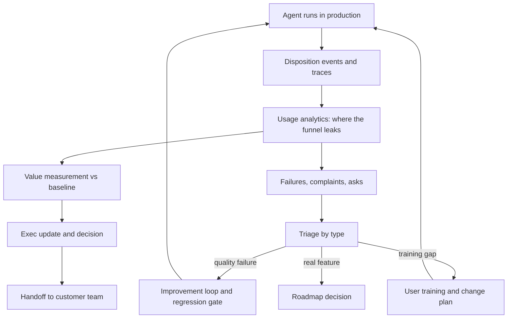

## Overview
This module covers the gap between "the agent is live" and "the agent is used and is paying for itself".
A deployed agent can pass every eval and still fail, because people ignore it, work around it or trust
it too much. For an agent builder, that gap decides whether the project renews.

What this module gives an agent builder:
- **Instrumentation.** Usage analytics records what people do with each agent output (accept, edit, regenerate, abandon, take over) against an eligible population, joined to traces by a run ID.
- **Proof of value.** Adoption and value-realization measurement keeps "they use it" separate from "it changed a business outcome", using a baseline or comparison group and net of run cost.
- **An improvement loop.** Continuous improvement and feature-request triage route production evidence and customer asks into measured fixes or reasoned roadmap decisions.
- **People and rollout.** Stakeholder management maps who can help, block or be affected, and finds the security reviewers, data owners and team leads who can veto late. Change management names the exact behavior that must change, finds what blocks it for each group, and redesigns incentives and workflow around the agent.
- **Knowledge capture and trust.** Workshops pull expert knowledge into concrete artifacts: a mapped workflow, an agreed rubric, labelled examples. User training teaches a working mental model of where the agent is reliable, how it fails and how to check its output.
- **Reporting and exit.** Exec communication turns the numbers into a conclusion-first update with a clear ask. Handoff moves ownership to the customer's team through staged, demonstrated exit criteria.

Core versus background for agents:
- **Core:** continuous-improvement, the trace-to-regression-suite loop you run on every agent release.
- **Useful (you meet them operating agents):** usage-analytics, adoption-and-value-realization-measurement, workshops, user-training, change-management, stakeholder-management, feature-request-triage, exec-communication, handoff-to-customer-teams.

What you can build afterwards:
- A disposition-event pipeline and adoption dashboard for any agent, with denominators and noise bands.
- A release gate that turns classified agent failures into regression cases and before/after bucket rates.
- A value report and staged handoff plan that let you plan and run a rollout, prove or disprove its value with a defensible number, and leave behind a team that can run it.

Use cases where agent teams reach for this module:
- **Pilot to expansion decisions:** a sponsor asks whether to roll the agent out to more teams.
- **Silent takeover:** traces look clean but users quietly redo the agent's work.
- **Vendor exit:** an FDE team must hand the agent, its tools and its eval gate to the customer.

It matters most for FDEs, and for Architects who own an agent platform that has to show value to keep
its budget.

## Why it matters
- **Engineer:** You build the agent's disposition events (accepted unchanged, edit size, regenerate, abandon, takeover) without copying raw prompts into the warehouse, and you run the improvement loop: classify trajectory failures, fix at the cheapest layer, add the cases to a frozen regression suite, gate the release, and check that the targeted failure bucket actually shrank in production.
- **Architect:** You design measurement into the agent platform from the start: an eligible-population denominator, a baseline or comparison group agreed during scoping, guardrail metrics beside the value metric, and system boundaries (repos, CI, monitoring, tool identities) chosen so the customer team can own the agent after handoff without a rebuild.
- **FDE:** You are the person in the room when the agent goes live. You map stakeholders and veto holders in week one, run the workshops that settle the agent's quality criteria, train users to verify its outputs, triage asks without promising forks, report to the sponsor with the conclusion and the ask first, and hand over only when the customer team has shown it can ship a gated change and handle an incident.

## Mental model
Picture adoption as a funnel with a loop beside it, both wrapped around a running agent.

- **The funnel** runs from eligible people, to people who try the agent, to people who use it for the intended work, to work that comes out measurably better than the baseline.
- **Each layer leaks for its own reason**, and each lesson is a tool for one leak. People who never start are a stakeholder or change problem. People who try and drop off are usually a training, trust or workflow problem. People who use it without effect are a quality or scoping problem.
- **Usage analytics** shows where the funnel leaks, and value measurement shows what reaches the bottom.
- **The loop** takes what leaks out (failures, complaints, feature asks), sorts it by type, and feeds it back as fixes, training or roadmap decisions.
- **Exec communication** reports the funnel's shape to whoever funds it. **Handoff** is the moment the loop's owner changes.

Usage is the leading indicator you act on weekly; realized value is the lagging number that renews the
contract. Never report one as the other.

The agent sits at the top; everything below it is the adoption machinery this module builds, and the
arrows back into the agent are the fixes and training that change what the next runs do.

## Suggested order
1. continuous-improvement — the agent-core lesson: the operating loop that turns classified production failures into gated, measured fixes, and needs only traces and an eval harness to start.
2. usage-analytics — instruments what users do with each agent output, so you can see whether fixes, change and training are working.
3. adoption-and-value-realization-measurement — builds on usage data, adding a baseline or comparison group to separate engagement from business value.
4. workshops — the main tool for getting knowledge and agreement out of experts as concrete artifacts such as rubrics, workflows and labelled eval cases.
5. user-training — teaches users the mental model and verification habits the agent needs, with drills rather than feature tours.
6. change-management — defines the behavior change and its blockers per group, which sets the target for training, analytics and measurement.
7. stakeholder-management — finds the sponsors, users and veto holders, because every rollout step depends on knowing who must agree; on a real project do this in week one.
8. feature-request-triage — routes customer asks, separating real features from quality failures, training gaps and model limits that belong in the improvement loop.
9. exec-communication — turns adoption and value numbers into conclusion-first updates and decisions for the people who fund the work.
10. handoff-to-customer-teams — the last step, which moves ownership of the whole loop to the customer once they have shown they can run it.

## Capstone
### Brief
**Use case:** an insurer's claims team has an AI drafting agent live, and the sponsor must decide whether
to expand it. You are the forward-deployed engineer, and this is the module's major project (about a week).

The agent drafts replies to policyholder emails from the claim file and policy documents. It has been
live for four weeks across 180 eligible adjusters in three regional teams. The sponsor, the head of
claims operations, was sold "30% faster first response".

The dashboard shows 1,400 requests a week, and the sponsor wants to know whether to expand to another
400 adjusters next quarter. Using a synthetic or anonymised event log and claim dataset (provided or
generated), find out what is really happening and set the deployment up to succeed after you leave.

What you will do:
- Map the stakeholders and veto holders, and write the behavior statement and change plan.
- Design the usage event schema and adoption dashboard, and measure realized value against a baseline or comparison group.
- Run a quality-criteria workshop, and design training with verification drills.
- Triage a backlog of 30 raw asks, and run one improvement cycle on the agent.
- Write the expansion recommendation for the sponsor, and draft a staged handoff plan for the insurer's own team.

### Deliverables
- A stakeholder map covering at least eight roles (sponsor, team leads, adjusters, IT, security, data owner, compliance, works council or HR), each with what they need, their influence or veto power, and a planned engagement and cadence.
- A change plan with a one-sentence behavior statement, the blockers for each group, and incentive or workflow changes, plus a training plan with at least five verification drills built from real failure types and a measure for each.
- A usage event schema with no raw prompt or claim content, and a dashboard showing weekly active over eligible, AI-assisted share of replies, week-4 cohort retention, and accepted-unchanged, edit-size and regeneration rates sliced by team and prompt version.
- A value-realization report that compares first-response time against a baseline or comparison group, gives a range rather than a point, and breaks the gap between the projected 30% and the realized figure into adoption, quality and attribution parts.
- A workshop agenda and output for agreeing a reply-quality rubric, a triaged backlog of the 30 asks with a classification, cluster, score and route for each, and one completed improvement cycle with new regression cases and before/after bucket rates.
- A one-page executive update recommending expand, hold or re-scope, with the decision needed and the date, and a staged handoff plan with exit criteria the insurer's team must demonstrate.

### Rubric
- The value figure is credited to the agent only against a baseline or comparison group, comes with a stated range, and explicitly rules out at least one confounder such as early adopters being the fastest adjusters.
- The dashboard never reports a raw request count without a denominator, and at least one team-level difference is traced to a cause (team lead, incentive or training) rather than left as noise.
- The executive update gives its recommendation and the decision needed in the first two sentences, translates the error rate into cases and cost, and a reader can restate the ask after one read.
- At least a third of the 30 asks are reclassified as quality failures, training gaps or model limits and routed to the matching place, and every declined ask has a stated reason sent back to the requester.
- The improvement cycle adds regression cases before the fix, shows no regression on the frozen suite, and reports the targeted failure bucket's rate before and after.
- Handoff exit criteria are tasks the customer team performs (a gated prompt change, a simulated incident, a credential rotation away from personal accounts), not dates or documents delivered.
