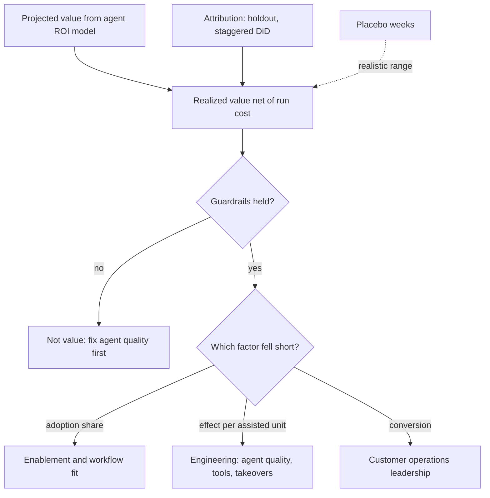

## TL;DR
Adoption measures whether people actually hand the intended work to your agent; value realization
measures whether that changed a business outcome versus a comparison group, net of run cost. Keep them
apart: adoption leads weekly, realized value renews the contract.

## For agent builders
- **Why it matters for agents.** Agents are sold on projections like "the agent resolves 40% of tickets
  end to end". Traces can show the agent finished runs; only an attributed outcome comparison shows that
  handling time, backlog or cost actually moved.
- **Where it shows up in your stack.** Run outcomes and takeovers from usage analytics feed the adoption
  share; the customer's ticketing or claims system supplies the outcome; your provider bills and tool costs
  supply the run-cost term.
- **What you control.** The rollout calendar (staggered go-lives make attribution possible), the value
  equation, guardrails such as reopen rate on agent-completed work, and how run cost and takeover cost are
  counted.
- **What you can skip.** Econometrics beyond difference-in-differences, placebo weeks and team-level
  resampling; those three cover most agent deployments.

## Decision case
### Scenario
A ticket-resolution agent goes live across a customer's 4 support regions, about 2,500 eligible tickets
a week each (10,000 in total). The renewal decision is at day 120 (about week 17), and finance wants a
ranged, net-of-run-cost estimate. All figures are illustrative planning numbers.
- **Politics:** the sponsor will not keep any region off the agent for more than 6 weeks, and refuses a
  region-level holdout.
- **Router:** the agent sits behind a ticket router, so a random share of tickets can skip it.
- **Value at stake:** using the agent example above at 70% completion, about $18,333 a week net over 5,000
  runs, or roughly $3.67 per attempted run.
- **Data:** 8 weeks of pre-launch handling times per region; reopen rate is the agreed guardrail.
- **Team:** one analyst, plus the FDE who owns the rollout calendar.

### Options
| Option | How it works | Credible at week 6 | Credible at day 120 | Cost and politics |
|---|---|---|---|---|
| Before/after | compare with the 8 pre-launch weeks | weak: concurrent changes credited | weaker still: drift accumulates | free |
| Matched comparison | a similar business unit without the agent | selection bias remains | same | needs another unit's data |
| Staggered DiD | regions live at weeks 0, 2, 4 and 6; compare with not-yet-live regions, placebo band | yes | no control left after week 6 | meets the 6-week limit |
| Staggered DiD plus 5% ticket holdout | as above, and the router keeps 5% of tickets from the agent through day 120 | yes | yes: a randomised control | about 5% of value forgone |

### Decision
**Staggered go-lives at weeks 0, 2, 4 and 6 with difference-in-differences, plus a 5% ticket-level
holdout at the router kept through day 120.** The stagger gives the early workflow-level estimate; the
holdout is the only control still standing when the renewal number is computed.
- **Why the stagger alone fails the renewal:** after week 6 every region is live, so a 90-day re-check
  would fall back to before/after.
- **Holdout precision:** from week 7 to week 16 the holdout collects 500 × 10 = 5,000 tickets against
  95,000 treated. With an illustrative 20-minute spread in handling time, the standard error of the
  difference is about `20 × sqrt(1/5000 + 1/95000) ≈ 0.29` minutes, far below a 5-minute effect.
- **Why ticket-level errors are fair here:** the ticket, not the region, is randomised, so claim-level
  noise is the right noise. The DiD keeps its placebo band.
- **Cost:** 500 held-out tickets a week at an attempt share of 0.5 is 250 runs × $3.67 ≈ $917 a week,
  5% of the $18,333.

**What would change it.**
- **No ticket holdout allowed:** keep the stagger and report the day-120 number as before/after,
  labelled weakest.
- **Gain needs whole-team change,** such as a new staffing model: the ticket holdout understates it, so
  lean on the DiD.
- **Only 2 regions:** the stagger is one comparison, so the holdout becomes primary.

### Trade-offs accepted
- **Contamination biases the holdout toward zero.** Staff handle both kinds of ticket and copy the agent's
  phrasing; compare holdout handling time with the pre-launch baseline and report the holdout as a floor.
- **About 5% of value forgone.** Show it on the renewal slide and end the holdout at day 120.
- **Per-ticket, not workflow, effect.** The holdout misses backlog and staffing effects; conversion is
  still checked separately through backlog and overtime.
- **Uneven waits.** Region D waits 6 weeks; publish the calendar early and track its pre-period trend.

### Review rubric
- **Value equation written first,** including run cost and takeover cost, before any design is chosen.
- **Each design rated at both checkpoints:** the write-up says which control still exists at the renewal
  date, not only at week 6.
- **Error bars match the unit of randomisation:** placebo spread for region-level DiD, ticket-level
  error only where tickets were randomised.
- **Holdout cost recomputed** from stated volume, attempt share and value per run.
- **Bias directions named:** contamination, novelty and self-selection, each with the direction it pushes.
- **Flip conditions stated:** what evidence or politics would make a different design primary.

## Why it exists
- **Every deployment is sold on a projection.** An ROI model says something like "25% faster claims
  handling across 200 adjusters". Ninety days later someone has to say how much of that showed up.
- **Adoption gets reported as value.** "80% of adjusters used it this month" says nothing about whether
  claims got faster. The tool could be used and ignored, or used and slower.
- **Before/after claims credit for everything that changed.** A new intake form, a seasonal dip in claim
  complexity or a staffing change all move the number. Early adopters also tend to be the fast ones, so
  adopter-versus-non-adopter comparisons measure who chose the tool, not what it did.
- **Self-reported savings are optimistic.** Hours "saved" that are not redeployed to backlog, volume or
  reduced overtime never reach a P&L.
- **The forcing problem is attribution under business conditions.** You rarely get a clean lab experiment
  but still owe the sponsor a defensible number, a range around it, and an explanation of the gap. That
  explanation decides the next move: more training, product fixes, or re-scoping.

## How it works
### 1. Write the value equation before go-live
Make the ROI model's chain explicit so each link can be measured separately:

```
realized value ≈ eligible volume × adoption share × effect per assisted unit × conversion − run cost
```

| Factor | Meaning |
|---|---|
| *Adoption share* | Fraction of eligible work actually done with AI assistance, not the fraction of users who logged in |
| *Effect per assisted unit* | Change in the outcome metric (minutes, error rate, revenue) on that work |
| *Conversion* | Whether the gain becomes money or capacity: freed hours absorbed into backlog, avoided hires, reduced overtime |

- **Decompose *because* a total shortfall is useless on its own.** You need to know which factor fell
  short to know what to fix.

### Reading the equation for an agent
- **Adoption share** is the share of eligible tasks routed to the agent (its attempt share), not the share
  of users who opened the agent UI.
- **Effect per assisted unit** is net per attempted run: completion rate × time saved on completed tasks,
  minus takeover rate × the time humans spend reviewing and redoing taken-over runs. A takeover is not
  assisted work; it is often extra work.
- **Run cost** scales with steps and tool calls per task, so a looping agent erodes value even when its
  completion rate holds.

### 2. Define adoption as a ladder, not a number
- **Breadth:** share of eligible users active weekly.
- **Depth:** share of their eligible work items AI-assisted.
- **Durability:** cohort retention past the novelty period.
- **Targets by date,** for example 30/60/90 days.
- **Adoption is the lever the delivery team controls most directly,** through training, workflow
  integration and change management.

### 3. Choose the strongest attribution design the situation allows
From strongest to weakest:

| Design | How | Caveat |
|---|---|---|
| **Randomised holdout** | A random subset of users or cases keeps the old process | Clean but politically hard when the tool is popular |
| **Staggered rollout with difference-in-differences** | Groups go live at different dates; compare each group's change with the change in groups not yet live | Removes shared trends such as seasonality or a process change, provided groups would have moved in parallel without the tool |
| **Matched comparison** | Compare against similar teams that did not get the tool | Selection bias remains |
| **Before/after against a baseline** | Compare with the pre-launch period | Valid only if nothing else changed; always report as the weakest evidence |
| **Self-report surveys** | Ask users | Useful for satisfaction and for *why*, not for the size of the effect |

- **Check that pre-period trends really were parallel** before trusting a DiD number.
- **With many groups going live at different dates,** compare each group only against groups not yet
  live. A single pooled regression that also uses already-live groups as controls can be biased when the
  effect grows over time.
- **Use intention-to-treat** (all work in the live group, used or not) for the deployment's real effect.
  Dividing it by the adoption share gives a rough per-assisted-unit effect, under the assumption that
  non-assisted work did not change.

### 4. Put a range on the estimate honestly
- **The tempting error bar is wrong.** Computed from thousands of claims, it comes out tiny, because it
  ignores that treatment was assigned to *groups* (regions, teams), not individual claims, and groups
  drift apart for reasons unrelated to the tool. With two regions you have, in effect, one comparison.
- **Placebo tests:** run the same DiD calculation on pre-launch weeks, pretending a go-live happened when
  it did not. The spread of those fake "effects" shows how much groups wander apart on their own; a real
  effect has to stand clearly outside it.
- **Unit-level variation:** when the rollout is staggered over many teams, compute the estimate per team
  (or bootstrap by resampling teams, not claims) and report the spread across teams.
- **Watch the effect over time.** Week-6 numbers can include novelty and extra attention from the launch
  team, so re-check the per-assisted-unit effect at the 90-day point before it goes into a renewal.

### 5. Pair every value metric with guardrails
- **Faster but worse is not value.** Speed gains that raise error, rework, complaint or
  compliance-exception rates do not count.
- **Agree thresholds in advance,** so "faster but worse" is caught by the definition and not argued about
  afterwards.

### 6. Run a value-realization cadence
1. **Report projected versus realized value by factor** at each checkpoint.
2. **Give ranges, not point estimates,** and state the attribution method, the assumptions and the
   guardrail status.
3. **Assign each shortfall to an owner:** adoption gaps to enablement, effect gaps to engineering,
   conversion gaps to the customer's operations leadership.

## Diagram
Each factor of the value equation is measured separately, so a shortfall routes to the team that can
fix it; guardrails decide whether a gain counts at all.



## Examples
### Agent scenario: net value of a ticket-resolution agent
A support agent attempts half of 10,000 eligible tickets a week. The per-ticket effects (10 minutes saved
when it completes, 3 minutes lost when a human takes over) must come from a comparison design like the
one below, not from the agent's own traces. All numbers are illustrative.

```python
tickets = 10_000                       # eligible tickets a week
attempt_share = 0.50                   # share of tickets routed to the agent
saved_min, takeover_penalty_min = 10, 3
run_cost_usd, hourly_usd = 0.40, 40    # model + tool cost per run, loaded human cost per hour

def weekly_value(completion):
    runs = tickets * attempt_share
    resolved = runs * completion
    taken_over = runs - resolved
    net_min = resolved * saved_min - taken_over * takeover_penalty_min
    return runs, net_min / 60, net_min / 60 * hourly_usd - runs * run_cost_usd

for completion in (0.5, 0.7, 0.9):
    runs, hours, value = weekly_value(completion)
    print(f"completion={completion:.0%} runs={runs:.0f} net_hours={hours:.0f} value=${value:,.0f}/week")
# completion=50% runs=5000 net_hours=292 value=$9,667/week
# completion=70% runs=5000 net_hours=508 value=$18,333/week
# completion=90% runs=5000 net_hours=725 value=$27,000/week
```

- **Completion rate is the steepest lever:** moving from 50% to 70% nearly doubles net value, because each
  takeover both loses the saving and adds review time.
- **Run cost is small here** ($2,000 a week) but grows with steps per task, so track it per completed task.

### Worked scenario: claims-intake assistant, staggered by region
A claims-intake assistant for 200 eligible adjusters, each handling about 45 claims a week (9,000 claims a
week in total). All numbers are illustrative.

| Item | Value |
|---|---|
| Baseline, four weeks before launch | 40 minutes of handling time per claim |
| Projection | a 25% cut (10 minutes) on assisted claims at 90% adoption: 10 × 0.9 × 9,000 = 81,000 minutes ≈ **1,350 hours a week** |
| Rollout | region A live in week 0, region B in week 6, a natural comparison |
| Region A, all claims, weeks 0–6 | 40 → 32 minutes (−8) |
| Region B, not yet live | 41 → 38 minutes (−3); a simplified intake form shipped company-wide in week 2 |
| Difference-in-differences | −8 − (−3) = **−5 minutes per claim** attributable to the assistant (pre-launch trends were flat and parallel) |
| Placebo check | pretend go-lives in pre-launch weeks gave "effects" between −1 and +1 minute, so report about −4 to −6 minutes, not −5.00 ± 0.1 from the claim-level standard error |
| Naive before/after, adopters only | −9 minutes: it included the form change and the fact that fast adjusters adopted first |

Decomposition at week 6 in region A:
- **Adoption share:** 65% of adjusters weekly active, using it on 70% of their claims, so about
  0.65 × 0.70 ≈ 0.46 of claims (assuming similar volumes per adjuster).
- **Effect per assisted claim:** 5 ÷ 0.46 ≈ **11 minutes** (about 9–13 across the range), in line with the
  projected 10.
- **Realized value at full rollout,** if region B reaches region A's adoption: 5 × 9,000 = 45,000 minutes
  ≈ **750 hours a week** (600–900 across the placebo range), about 56% of projection (roughly 45–65%).
- **The gap is adoption** (0.46 against a planned 0.9), not model quality. The next investment is
  enablement: the 35% of adjusters who do not use it, and the 30% of claims active users still handle
  unassisted.
- **Guardrail:** claim reopen rate moved from 4.1% to 4.3%, inside the agreed ±0.5-point band.
- **Conversion, checked separately:** the customer's backlog fell, so freed hours were absorbed rather than
  lost to slack.

### Value-equation calculator in Python
The same scenario as code, so the decomposition and range are reproducible at every checkpoint.

```python
claims_per_week = 9_000                 # 200 adjusters x 45 claims
projected_h = 10 * 0.9 * claims_per_week / 60          # minutes -> hours

def did(treat_pre, treat_post, ctrl_pre, ctrl_post):
    return (treat_post - treat_pre) - (ctrl_post - ctrl_pre)

effect = did(40, 32, 41, 38)            # minutes per claim, intention-to-treat
placebo_spread = 1.0                    # fake "effects" ranged -1 to +1 minute
low, high = abs(effect) - placebo_spread, abs(effect) + placebo_spread

adoption_share = 0.65 * 0.70            # breadth x depth
for name, e in (("low", low), ("mid", abs(effect)), ("high", high)):
    per_assisted = e / adoption_share
    realized_h = e * claims_per_week / 60
    print(f"{name}: {per_assisted:.0f} min/assisted claim, "
          f"{realized_h:.0f} h/week, {realized_h / projected_h:.0%} of projection")
print(f"projected {projected_h:.0f} h/week, DiD {effect} min/claim")
# low: 9 min/assisted claim, 600 h/week, 44% of projection
# mid: 11 min/assisted claim, 750 h/week, 56% of projection
# high: 13 min/assisted claim, 900 h/week, 67% of projection
# projected 1350 h/week, DiD -5 min/claim
```

## Production patterns
- **Signed measurement plan before go-live** — during scoping, write the baseline window, the value
  equation (including agent run cost and takeover cost), the attribution design and the guardrail
  thresholds into one page the sponsor and finance agree. Monitor whether the baseline metric definition
  changes in the customer's systems mid-project.
- **Rollout calendar as experiment design** — when a holdout is politically impossible, schedule regions or
  teams to go live weeks apart so not-yet-live groups are controls. Monitor a pre-period trend chart per
  group to confirm parallel trends before reading any DiD result.
- **Placebo band on every estimate** — rerun the DiD on pre-launch weeks with fake go-live dates and report
  the realized estimate with that spread. Monitor the band width; if it is as large as the effect, say so.
- **Factor table at 30/60/90 reviews** — show projected versus realized for adoption share, effect per
  assisted unit and conversion, each with a named owner and a date. Monitor adoption weekly and the effect
  monthly once volume accumulates.
- **Guardrail band written into the definition** — for example reopen rate within ±0.5 points of baseline;
  a breach voids the value claim for that period. Monitor guardrail metrics on the same cadence as value.
- **90-day re-check before renewal** — recompute the per-assisted-unit effect after the launch team's
  attention fades, because week-6 numbers can include novelty. For agents, also recompute run cost per
  completed task and takeover rate, since model or tool changes since launch can move both.

## Trade-offs
- **Randomised holdout vs goodwill.** It gives the most credible effect estimate but withholds a useful
  tool from some users; when politics forbid it, a staggered rollout is the usual compromise.
- **Intention-to-treat vs per-use effect.** ITT is honest about real deployment impact but understates
  per-use effect; divide by adoption share only when non-assisted work plausibly did not change.
- **Ranges vs one number.** Reporting ranges and assumptions protects credibility with finance, but
  executives may prefer one number; give the conservative end as the headline when the decision is a
  renewal.
- **Business outcomes vs speed of signal.** Outcomes take weeks to accumulate, so you also track leading
  indicators (adoption, acceptance) that move faster but prove nothing about value on their own.
- **More agent autonomy vs measurable effect.** Letting the agent act without approval raises the saving
  per task, but makes errors land in outcomes before anyone sees them; keep approval gates until
  guardrails have held across a full checkpoint.

## Pitfalls
- **Reporting usage as value.** The dashboard shows high weekly actives, but finance finds no change in
  cost per case and stops trusting the AI team's numbers.
- **Before/after without a comparison group.** A large effect appears that coincides with a seasonal dip or
  a process change, and it shrinks or reverses the following quarter.
- **Comparing adopters with non-adopters.** The effect looks huge because self-selected adopters were
  already the strongest performers, which shows up as a gap that predates go-live.
- **Counting hours saved that are never redeployed.** Projected savings appear in slides, but headcount,
  overtime and backlog are unchanged, so the budget owner sees nothing.
- **Claim-level error bars on a region-level rollout.** The reported range is implausibly tight, and the
  next region's result lands far outside it.
- **Skipping guardrails.** Handling time improves while rework or complaints rise, discovered later
  through escalations instead of the measurement plan.
- **Counting agent-completed runs as value.** The slide shows thousands of tasks "done by the agent", but
  takeovers, human review time and run cost were never subtracted, so finance sees a smaller or negative
  number. Fix: use the net effect and the run-cost term.

## When to use
- **Set it up during scoping,** when you agree the baseline and the ROI model, and start reporting at the
  first 30-day checkpoint.
- **Mandatory for:** anything sold on a business case, renewals and expansions, and internal platform
  teams defending budget.
- **Lighter version:** for small internal productivity tools, an adoption ladder plus a baseline comparison
  may be proportionate.
- **Measure:** adoption weekly; value monthly or per checkpoint, once enough volume has accumulated.
- **Interviews:** expect "how would you prove this worked?". The strong answer names the comparison group,
  decomposes the gap, and names the guardrails.

## Role lens
- **Engineer:** Builds the pipelines that join usage events to the customer's outcome data, and computes
  intention-to-treat and per-assisted-unit effects reproducibly.
- **Architect:** Designs the rollout so attribution is possible (staggered regions, holdout cohorts) and
  owns the value equation that links system metrics to the business case.
- **FDE:** Runs the 30/60/90 value reviews with the sponsor, explains shortfalls by factor, and turns the
  biggest gap into an action plan with named owners.

## Check yourself
**Q:** Ninety days in, realized value is 40% of the ROI projection. The sponsor asks whether the model is
underperforming. How do you answer?
**A:** I decompose the shortfall instead of guessing. Using the value equation, I check adoption share
(breadth × depth) against the plan, the effect per assisted unit from the comparison design, and whether
freed capacity was converted. If adoption is at 45% against a 90% plan while the per-assisted-unit effect
matches projection, the model is fine and the gap is enablement or workflow fit. If adoption is on plan
but the effect is small, it is a quality or task-fit problem for engineering. I state the attribution
method, give a range and confirm the guardrails held. Then I propose the specific next lever with an owner and date.

## Interview questions
### Why keep adoption and value realization as separate measurements?
- **Adoption is a leading indicator** of whether the intended people use the system for the intended work;
  the delivery team can act on it weekly through training and workflow integration.
- **Value is a lagging, attributed outcome** that needs a baseline or comparison group and weeks of volume.
- **Merging them hides the diagnosis:** high usage can coexist with no outcome change, and a shortfall
  cannot be routed to an owner unless the factors are measured separately.

### The sponsor refuses a holdout for a claims agent rolling out across four regions. How do you design the measurement?
- **Stagger the go-live dates** so regions not yet live act as controls, and compute difference-in-
  differences against only not-yet-live groups.
- **Check parallel pre-period trends** per region before go-live, and run placebo DiDs on pre-launch weeks
  to size the natural drift.
- **Report intention-to-treat,** then divide by adoption share for a rough per-assisted-unit effect, with
  guardrails agreed up front.

### When is a plain before/after comparison acceptable, and what does it cost you?
- **Acceptable** for a small internal tool where a lighter, proportionate version is enough, and only when
  you can show nothing else changed in the period.
- **The cost:** any concurrent change (a new form, seasonality, staffing) is credited to the AI, so it is
  always reported as the weakest evidence.
- **Flip point:** once the number feeds a renewal or a budget decision, invest in a comparison group.

### A DiD over 9,000 claims a week gives minus 5 minutes with a standard error of 0.1. What do you report?
- **Not ± 0.1,** because treatment was assigned by region, so with two regions you effectively have one
  comparison; claim-level errors ignore group drift.
- **Run placebo tests** on pre-launch weeks; if fake effects span −1 to +1 minute, report about −4 to −6.
- **Translate the range into hours** (600–900 a week here) and lead with the conservative end for a renewal.

### How do you show that saved time actually reached the P&L?
- **Measure conversion as its own factor:** backlog, volume handled per head, overtime or avoided hires,
  owned by the customer's operations leadership.
- **Self-reported hours are not enough,** because unredeployed time never reaches a P&L.
- **In the claims example,** a falling backlog showed the freed hours were absorbed rather than lost to slack.

### Your agent completes 70% of the tickets it attempts. Why might its realized value still be disappointing?
- **Takeovers cost time:** the 30% taken over can each add review and redo minutes, so net effect per task
  is below the gross saving.
- **Run cost and attempt share:** cost per run grows with steps and tool calls, and if the agent only
  attempts half the eligible tickets, the adoption share caps the total.
- **Attribution:** without a staggered rollout or holdout, the per-ticket saving itself is unproven, so
  measure it with DiD before tuning prompts.

## Quiz
### Q: A staggered rollout shows the live region's handling time fell 8 minutes and the not-yet-live region's fell 3 minutes over the same weeks. What is the difference-in-differences estimate, and what does it assume?
- [ ] 8 minutes, assuming the not-yet-live region is irrelevant
- [x] 5 minutes, assuming both regions would have followed parallel trends without the tool
- [ ] 11 minutes, assuming the two changes add up
- [ ] 5 minutes, assuming adoption in the live region was 100%
> DiD subtracts the shared trend (−3) from the treated change (−8), giving −5. Its key assumption is
> parallel trends. Adoption below 100% does not invalidate it; it makes the result an intention-to-treat estimate.

### Q: Why is comparing outcomes of adopters versus non-adopters within the same team a weak attribution design?
- [ ] Because the two groups use different model versions
- [ ] Because adopters generate more analytics events
- [x] Because users choose to adopt, so differences may reflect who adopted rather than what the tool did
- [ ] Because non-adopters cannot have baseline measurements
> Self-selection is the problem. Early adopters are often already faster or more engaged, so their
> advantage predates the tool. Randomisation or staggered rollout breaks that link.

### Q: Realized value is half the projection, adoption share is half the planned level, and the per-assisted-unit effect matches the projection. What should the next investment target?
- [ ] Fine-tuning the model to improve output quality
- [x] Enablement and workflow integration to raise adoption among non-users
- [ ] Revising the baseline measurement upward
- [ ] Adding guardrail metrics to the dashboard
> The decomposition puts the entire gap in adoption, because each assisted unit delivers as projected.
> Improving the model would raise an effect that is already on target and leave the real shortfall untouched.

## Use cases & projects
### Use cases
- **Renewing an agent deployment.** A factor table (adoption share, net effect, conversion, run cost)
  with placebo ranges answers "did the agent pay for itself?" in terms finance accepts.
- **Choosing the next investment.** When the gap is attempt share or takeovers, the fix is routing,
  enablement or agent quality; when it is conversion, it belongs to the customer's operations.
- **Deciding on more autonomy.** Guardrails on agent-completed work (reopen rate, error rate) decide
  whether approval gates can be relaxed.
- **Rolling an agent out across teams.** A staggered go-live calendar turns the rollout itself into the
  comparison group.

### Mini project
**Build a value report for a simulated agent rollout (2-3 hours).**
- **Goal:** produce a defensible, ranged estimate of an agent's weekly net value.
- **Steps:** simulate weekly handling times for two teams over 10 weeks, with the agent going live in
  team A at week 5 and a shared drift in both; write a projected value up front; add agent run logs
  (completed, taken over, tool calls, cost) and a weekly reopen rate as the guardrail; compute DiD, a
  placebo spread from pre-launch weeks, adoption share and net value with the run-cost and takeover terms.
- **Done when:** a one-page table shows projected versus realized value by factor with a range, the
  guardrail status, and the single factor you would invest in next.
