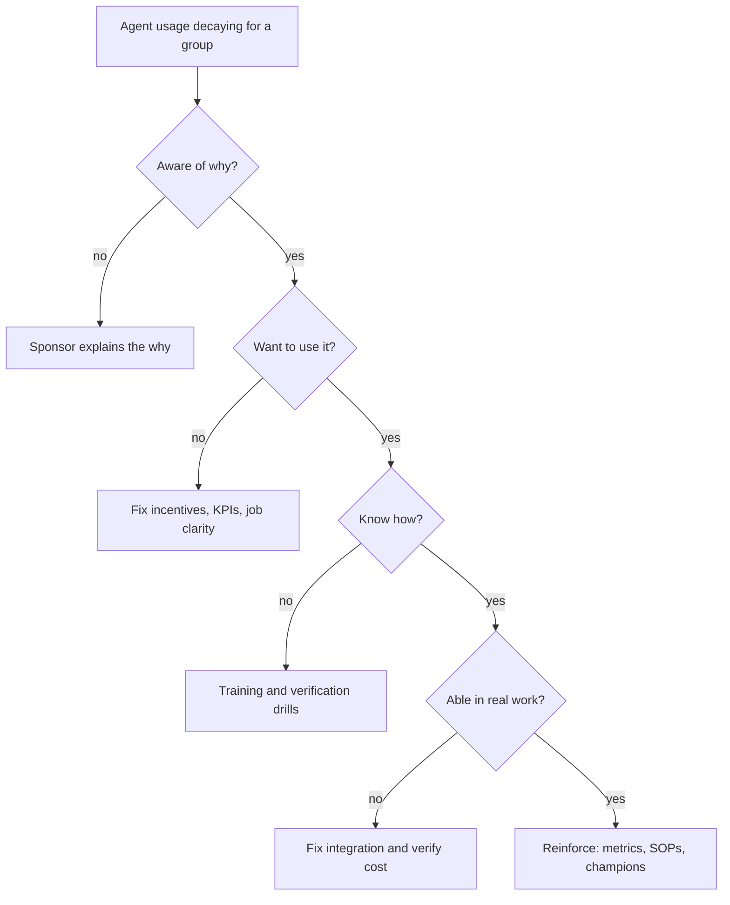

## TL;DR
Change management moves people from the old way of doing a task to working with your agent, so a deployed
agent is actually used. Enterprise agents usually fail through an unchanged workflow around them, not a
broken model or tool loop.

## For agent builders
- **Why it matters for agents.** An agent that drafts, looks things up and proposes actions only creates
  value if people start their work from its output and stop doing the task the old way. A perfect tool loop
  nobody routes work through is overhead.
- **Where it shows up in your stack.** Eligibility rules in the router (which tasks the agent may take),
  approval gates and override buttons, citations and trace views in the UI, and the event log that records
  accept, edit and reject per user and team.
- **What you control.** Instrument the target behavior from day one, gate the agent to tasks where it beats
  the manual path, make verification cheap (inline citations, one-click source open), and ship visible fixes
  for what users report.
- **What you can skip.** The organizational-psychology literature. Treat ADKAR as a debugging checklist for
  low usage, and keep the break-even arithmetic; that covers most agent rollouts.

## Why it exists
- **Shipping is not adoption.** A typical internal agent launch shows a burst of curious usage in the first
  week, then a slow decay back to the old process, while the dashboard still shows the system "live".
  Nothing in the code is wrong; the people around it never changed what they do.
- **Probabilistic output forces users to learn *when* to trust it.** Under-trusters redo the work by hand
  and now spend more time than before, because they read the agent's draft *and* do the task. Over-trusters
  let errors through (automation bias), and the first public mistake poisons the agent for everyone.
- **Agents arrive with an implied question about jobs.** An agent that completes tasks end to end raises it
  more sharply than an autocomplete. If nobody answers it, people answer it themselves, and quiet resistance
  is a rational response.
- **The value needs the work redesigned around the agent.** If human agents (the support staff) are still
  measured on the old metric, still follow the old checklist and still route through the old approval step,
  the AI step is pure overhead.
- **The naive alternatives fail predictably.** "Announce it, record a training video, it's intuitive"
  creates awareness but not desire and leaves incentives untouched. "Mandate it" produces compliance
  theatre: people open the tool so the login count looks good, then ignore the output. Change management
  instead names the behavior change, finds what blocks it per group, and removes those blocks one by one.

## How it works
### Background: frameworks as diagnostic checklists
| Model | Level | Stages |
|---|---|---|
| **ADKAR** (Prosci) | The individual | *Awareness* of why, *Desire* to take part, *Knowledge* of how, *Ability* to do it in real work, *Reinforcement* that makes it stick |
| **Kotter's eight steps** | The organization | Create urgency, build a guiding coalition, form a vision, communicate it, remove obstacles, generate short-term wins, consolidate gains, anchor the new way in culture |
| **Unfreeze-change-refreeze** | Compact framing | Loosen the old habit, form the new one, then deliberately lock it in |

- **ADKAR is diagnostic.** Find the first stage that is blocked for a group and work there, *because*
  training (Knowledge) cannot fix a Desire problem, and enthusiasm (Desire) cannot fix a missing
  integration (Ability), such as an agent that cannot reach the system of record.
- **Lewin attribution caveat.** Unfreeze-change-refreeze is traditionally attributed to Kurt Lewin;
  historians note the tidy three-step version was largely popularized by later writers.
- **None of these is an algorithm.** Use them to ask "what is missing for this group?", not as a sequence
  of ceremonies.

### 1. Define the change as behavior
- **Unmanageable:** "Adopt the AI agent" cannot be managed or measured.
- **Manageable:** "Claims adjusters start every file over 30 pages from the agent's summary and verify its
  cited sections, instead of reading the file front to back."
- **Write one such sentence per affected role**, *because* every later step (training, metrics,
  incentives, the events your agent logs) hangs off it.

### 2. Assess impact per group
- **List what changes for each group:** tasks, skills, metrics, tools, approvals, and any effect on
  headcount or roles.
- **Be explicit about job impact**, *because* silence is filled with rumor.
- **Groups differ.** End users, their team leads, QA reviewers, IT support and compliance each experience
  a different change; for an agent with write tools, whoever approves its actions is a group too.

Treat resistance as data about which stage is blocked, not as an attitude problem. Each needs a different
fix, which is why the diagnosis has to be per group:

| What you hear | What is blocked |
|---|---|
| "It's slower" | Ability or incentive problem |
| "It got the prior-injury note wrong" | Trust problem |
| "Why would I train my replacement?" | Desire, rooted in job security |
| A senior expert's "I don't need it" | Often loss of status as the person who knows |

The incentive question can usually be made arithmetic. A user adopts the agent's path when, on the metric
they are judged by, it beats the old one *including* the cost of verifying the output:

- **The comparison:** `t_ai = t_review_output + t_verify + t_fix_errors` versus `t_manual`.
- **The rational outcome:** if verification is slow or the task is short, `t_ai > t_manual` and
  non-adoption is the rational choice, not a training gap.
- **The builder's lever:** most of `t_verify` is UI and trace design you own, such as citations that open
  the exact source passage.

### 3. Build sponsorship and a change network
- **Executive sponsor creates legitimacy** by visibly using the agent and explaining the why.
- **Champions create proof.** These are usually the early adopters in Rogers' diffusion model, inside each
  team, *because* people copy respected peers more readily than memos.
- **Team leads matter most.** If a lead says "don't trust that thing", no amount of central communication
  wins.

### 4. Change the system around the agent
- **Update SOPs, QA checklists and KPIs** so the new way is the measured way.
- **Decide when the old path is retired** and what the fallback is when the agent is down, times out or is
  wrong, so a failed tool call hands the case back to a person cleanly.
- **Why:** people follow incentives, so an unchanged scorecard quietly pulls them back to the old process.

### 5. Roll out in phases, and plan for the dip
1. **Pilot cohort first**, fix what they hit, then expand.
2. **Expect performance to *fall* before it rises** (often called the J-curve): people are learning a new
   habit, running old and new paths side by side, and hitting first-version bugs.
3. **Tell the sponsor in advance** and temporarily protect the pilot cohort's productivity targets.
4. **Judge the trend after the learning period**, not week two, *because* a dip that nobody predicted
   reads as failure and gets the project cancelled at its lowest point.
5. **Close the feedback loop.** Publish a "you said, we did" list, *because* visible responsiveness is the
   cheapest way to build desire.
6. **Calibrate trust honestly.** Show the measured error rate from your evals and teach how to verify
   (citations, confidence cues), which calibrates trust instead of inflating it.

### 6. Reinforce and measure
| Indicator type | Examples |
|---|---|
| Leading | Weekly active users in the target group, share of eligible tasks started with the agent, override and edit rates |
| Lagging | Cycle time, quality, cost per case |

- **Usage without outcome improvement** usually means people use it but the workflow around it has not
  changed (or the agent is not adding value).
- **Outcome improvement without usage** means something other than the agent is driving the outcome, so
  crediting the agent would be wrong.

## Diagram
Walk ADKAR in order for one group and stop at the first stage that fails; the fix sits next to it, not
further down the list.



## Examples
### Break-even calculator: when is the agent's path rational?
Plug in timings from user interviews (these are the illustrative figures from the scenario below) to see
where the agent's path starts beating the manual one on the user's own metric.

```python
def t_manual(pages, per_page=0.6):
    return per_page * pages

def t_ai(pages, fixed=10, per_page=0.25):
    # fixed: read the agent's summary, open and check each cited section
    # per_page: the spot reading that remains
    return fixed + per_page * pages

break_even = 10 / (0.6 - 0.25)          # 0.6p = 10 + 0.25p
print(f"break-even ~ {break_even:.0f} pages")   # ~29 pages

for p in (12, 30, 80):
    ai, man = t_ai(p), t_manual(p)
    print(f"{p:3} pages: agent {ai:4.0f} min, manual {man:4.0f} min ->",
          "use agent" if ai < man else "manual wins")
# 12 pages: agent 13 vs manual 7  -> manual wins
# 80 pages: agent 30 vs manual 48 -> use agent
# Cutting `fixed` (e.g. inline citations) lowers the break-even further.
```

### Adoption metrics straight from the agent's event log
If every agent run logs who it served, whether the task was eligible and what the user did with the
output, the adoption dashboard is a group-by. The rows here are illustrative.

```python
from collections import defaultdict

# one row per agent run: team, eligible task?, user action on the output
runs = [
    ("team_a", True, "accepted"), ("team_a", True, "edited"), ("team_a", True, "accepted"),
    ("team_b", True, "rejected"), ("team_b", True, "rejected"), ("team_b", True, "edited"),
]
eligible_tasks = {"team_a": 4, "team_b": 9}   # from the case system, not the agent

stats = defaultdict(lambda: {"runs": 0, "override": 0})
for team, eligible, action in runs:
    if eligible:
        stats[team]["runs"] += 1
        stats[team]["override"] += action == "rejected"

for team, s in stats.items():
    share = s["runs"] / eligible_tasks[team]
    print(f"{team}: {share:.0%} of eligible tasks via agent, "
          f"override {s['override'] / s['runs']:.0%}")
# team_a: 75% of eligible tasks via agent, override 0%
# team_b: 33% of eligible tasks via agent, override 67%  -> talk to team_b's lead first
```

### Worked scenario: an insurer's claims-summary agent
A hypothetical insurer rolls out a claims agent to 120 adjusters. It retrieves the claim file, calls a
policy-lookup tool and writes a cited summary.

Usage starts at about 70% of adjusters in week one and decays to about 25% by week six. The offline eval looks fine, so the team interviews ten adjusters and reads the
agent's logs instead of retraining.

**Diagnosis by ADKAR stage:**

| Stage | Finding |
|---|---|
| Knowledge | Fine: adjusters know how to use the agent |
| Desire | Low: scored on claims closed per day, and on short files reading the summary plus checking it takes longer than reading the file |
| Trust (via leads) | Two team leads tell their teams not to rely on it after a story spread about a summary that missed a prior-injury note |
| Ability | Weak: the summary opens in a separate tab, so verification means switching windows |

**The arithmetic** (illustrative figures from the interviews):
- **Manual:** about 0.6 minutes per page.
- **Agent path:** about 10 minutes fixed overhead plus about 0.25 minutes per page of remaining spot reading.
- **Break-even:** 0.6p = 10 + 0.25p, so p ≈ 29 pages.
- **Short file:** on a 12-page file the agent's path costs 13 minutes against 7 by hand.
- **Long file:** on an 80-page file it costs 30 against 48.
- **Verdict:** adjusters who abandoned the agent were, on average, handling shorter files: they were right.

**Interventions follow the diagnosis:**
1. **Eligibility:** the router sends files to the agent only when they are over 30 pages, where it saves
   time.
2. **Trust:** the missed-note bug is reproduced from the trace, fixed, added to the eval set and
   announced; the team publishes its golden-set result (say, a material omission in 1 of 25 long files)
   alongside the instruction to check cited sections for medical history.
3. **Leads:** the two skeptical leads join the pilot review and become champions.
4. **System:** the QA checklist accepts "summary verified" as a valid review step.
5. **Ability:** citations move inline, which cuts the fixed verification overhead and lowers the
   break-even further.

**Outcome:** usage on eligible files recovers and stays. Cycle time on long files becomes the metric
reported to the sponsor, rather than the share of all adjusters using the agent, which would have
pressured people to use it on short files where it costs time.

## Production patterns
- **Eligibility gating in the router** — when the agent only beats the manual path on some tasks, route
  by a rule (for example a feature flag on document length over the break-even page count) instead of
  sending everything. Monitor share of *eligible* tasks done the new way and time per task on each path.
- **Segmented adoption dashboard from agent events** — from launch, log each run's user action (accept,
  edit, reject, override) with team and task type attached, and chart per team rather than as one
  company-wide line. Monitor team-by-team variance with no technical cause, which points at leads or local
  incentives.
- **Pre-agreed J-curve review date** — before rollout, agree in writing with the sponsor the learning
  period, the protected targets for the pilot cohort, and the date of the first go/kill review. Monitor
  the trend over that window, not single weeks.
- **"You said, we did" changelog tied to the eval set** — publish a short, regular list mapping
  user-reported agent failures to the fix shipped and the eval case added, in the channel users already
  read. Monitor feedback volume and override rate after each fix lands.
- **Scorecard update as a launch gate** — do not widen the agent beyond the pilot until SOPs, QA
  checklists and KPIs name the new path. Monitor reversion to the manual path during busy periods as the
  early warning.
- **Clean human fallback** — when the agent errors, times out or hits a step budget, hand the case back
  to the user's queue with what it found so far. Monitor fallback rate per week; a spike erodes trust
  faster than any announcement rebuilds it.

## Trade-offs
- **Phased pilot vs speed.** A pilot surfaces workflow problems cheaply but delays org-wide value; skip
  it only when the change is small and reversible.
- **Retiring the old path vs keeping a fallback.** Retiring forces adoption and ends dual running, but
  removes the fallback; keep it while the agent's error rate is still being established.
- **Heavy executive sponsorship vs headcount fear.** It speeds legitimacy, but a sponsor seen as imposing
  cuts can turn the change into a headcount fight; it flips back to an asset once the sponsor has stated
  plainly what happens to roles.
- **Mandating usage vs real adoption.** It gets the numbers up quickly, but produces compliance theatre
  unless incentives and workflow change first.
- **Champion network vs people's time.** It costs time, which pays off at scale and is overkill for a
  ten-person team.
- **More agent autonomy vs adoption.** Letting the agent act without approval saves the most time but
  raises the cost of each visible mistake; widen autonomy only after override rates are low and stable.

## Pitfalls
- **Treating training as the whole change plan.** Symptom: high course completion with usage decaying
  after launch week.
- **Measuring logins instead of the target behavior.** Dashboards look healthy while cycle time and
  quality do not move.
- **Leaving old KPIs in place.** Shows up as users reverting to the manual path whenever they are busy.
- **Ignoring team leads and middle managers.** Usage varies sharply team by team with no technical
  explanation.
- **Overselling accuracy at launch.** The first visible error triggers a trust collapse and a spike in
  overrides.
- **Targeting "everyone uses it for everything".** Symptom: usage on tasks where the agent is slower, flat
  or worse outcomes, and resentment.
- **Reviewing results during the learning dip.** Shows up as a sponsor wanting to cancel in week three
  when the trend was about to turn.
- **Staying silent on job impact.** Revealed by rumors, union or works-council questions, and slow passive
  resistance.
- **Not logging the user's action on agent output.** Symptom: you know runs per day but not whether anyone
  used the result. Fix: emit accept, edit and reject events with team and task type from the first release.

## When to use
- **Use when** an agent changes how a group of people does its daily work, which is almost every
  enterprise deployment beyond a developer tool. Effort scales with the number of people affected, how
  much their metrics and roles change, and how costly mistakes are.
- **Start during scoping, not after launch.** The behavior statement and impact assessment belong next to
  the success metrics and the agent's event schema.
- **Measure** the target behavior and business outcome, not logins: share of *eligible* tasks done the new
  way, override and edit rates, time per task on the new path versus the old, and usage segmented by team
  (team-by-team variance with no technical cause points at leads or local incentives).
- **Fix first** if you cannot write the behavior sentence or show the new path beats the old on the user's
  own metric; do that before planning communications.
- **Interviews:** the signal is whether you treat low adoption as a diagnosis problem (which ADKAR stage is
  blocked, for whom) rather than as a call for more training or a better model.

## Role lens
- **Engineer:** Instruments the product so the target behavior is measurable, and builds the trust affordances (citations, confidence cues, easy override) users need.
- **Architect:** Owns the design of the human workflow around the system: where review sits, what the fallback is, and which metrics define success.
- **FDE:** Sits with users, diagnoses which stage of change is blocked for which team, and brings concrete workflow and incentive fixes to the sponsor.

## Check yourself
**Q:** Six weeks after launch, usage of your AI drafting tool has halved, but offline evals are unchanged. The sponsor wants to fund a model upgrade. What do you do first?
**A:** I would not assume the model is the cause, because evals are flat and decay after a launch spike is the classic adoption pattern. I would segment usage by team and task type, interview a handful of users and team leads, and map what I find onto ADKAR to find the first blocked stage. Typical causes are incentives (old KPIs), workflow friction (verification is slow), a trust event (one bad output went viral) or a lead discouraging use. Each has a cheaper fix than a model upgrade. I would come back to the sponsor with the diagnosis, the targeted fixes and the metric that will show whether they worked.

## Interview questions
### What is ADKAR, and why is it more useful as a diagnostic than as a plan?
- **Definition:** five individual-level stages: Awareness, Desire, Knowledge, Ability, Reinforcement.
- **Why diagnostic:** you work on the first blocked stage for a given group, because each stage needs a
  different fix; training (Knowledge) cannot repair Desire, and enthusiasm cannot repair a missing
  integration (Ability).
- **So** running every stage as a ceremony for every group wastes effort on stages that are already fine.

### One team uses your agent heavily and an identical team barely touches it. How do you debug that?
- **Rule out technical causes first:** same agent version and prompt, same tool permissions and data, same
  integrations, similar task mix; compare tool-call error and fallback rates per team in the traces.
- **Then look at people:** what the team lead says about the agent, how that team's KPIs are set, and
  whether a trust event happened there.
- **Fix locally:** bring the lead into the pilot review, protect targets during learning, and recheck
  team-level usage and outcome a few weeks later.

### When would you not mandate use of an agent?
- **When the new path loses on the user's own metric.** If `t_ai > t_manual` for a task, a mandate forces
  slower work and breeds compliance theatre.
- **When the error rate is not yet established**, because removing the manual fallback leaves no safe
  path when the agent is wrong.
- **Mandate later**, once incentives, SOPs and workflow already favor the new path and the old one is
  being retired deliberately.

### Which events would you make your agent emit so adoption is measurable, and which numbers go on the dashboard?
- **Events:** per run, the user, team, task type, whether the task was eligible, and the user's action on
  the output (accept, edit, reject, override), plus fallbacks to the manual path.
- **Leading:** share of eligible tasks started with the agent in the target group, override and edit
  rates, weekly active users in that group. **Lagging:** cycle time, quality and cost per case, against the
  pre-launch baseline.
- **Leave off or demote:** company-wide logins and training completion, because they measure exposure,
  not behavior, and pressure people to use the agent where it costs time.

### How do you keep a sponsor from cancelling during the J-curve dip?
- **Predict it in writing before launch:** expected dip, learning period length, and the review date.
- **Protect the pilot cohort's targets** for that period so the dip does not punish early adopters.
- **Report the trend** and the fixes shipped ("you said, we did"), so the sponsor judges direction rather
  than a single bad week.

### Users say your agent is "slower than doing it myself". What do you change in the agent, not the training?
- **Measure the claim:** time from agent output to user action, split by task size, against the manual
  baseline; it is often true on short tasks.
- **Cut verification cost:** inline citations that open the exact passage, fewer claims per output, and a
  summary of what the agent checked via tools.
- **Gate eligibility:** route only tasks above the break-even size to the agent, and keep the rest manual.

## Quiz
### Q: In ADKAR terms, what is the main risk of responding to low adoption with more training sessions?
- [ ] Training sessions are too expensive to run for most teams
- [x] Training addresses Knowledge, which may not be the blocked stage if users lack Desire or Ability
- [ ] Training reduces Awareness by overwhelming users with detail
- [ ] Training should only happen after the Reinforcement stage
> ADKAR is diagnostic: work on the first stage that is blocked. If users understand the tool but are
> scored on a metric it hurts, or cannot verify outputs easily, more training changes nothing.

### Q: Which indicator best shows that the intended behavior change has happened?
- [ ] Number of logins per week across the company
- [ ] Course completion rate for the launch training
- [x] Share of eligible tasks that are started with the AI output in the target group
- [ ] Number of positive comments in the launch announcement channel
> Logins and completions measure exposure, not behavior. The share of eligible tasks actually done the new
> way maps directly to the behavior statement, and can be paired with outcome metrics.

### Q: Why do AI tools need explicit trust calibration as part of change management, more than ordinary software?
- [ ] Because AI tools are always less accurate than the manual process they replace
- [ ] Because regulators require users to sign off on every AI output
- [x] Because probabilistic outputs make users either redo the work or let errors through unless they learn when to rely on it
- [ ] Because AI tools cannot show any evidence for their outputs
> Deterministic software is right or broken; AI output is right most of the time. Under-trust doubles the
> work and over-trust lets errors pass, so users need honest error rates and a way to verify.

## Use cases & projects
### Use cases
- **Rolling out a support or claims agent to a frontline team.** The behavior statement, eligibility rule
  and override telemetry decide whether usage survives week six.
- **Widening an agent's autonomy.** Moving from "draft for approval" to "act, then notify" is a change for
  the approvers, with its own J-curve and trust event risk.
- **Recovering a stalled agent pilot.** ADKAR per team, plus the break-even arithmetic, usually finds a
  cheaper fix than a model upgrade.
- **Replacing a manual approval step with an agent check.** QA checklists and KPIs must name the agent's
  step, or reviewers keep doing both.

### Mini project
**Adoption telemetry and a break-even gate for a small agent (2-3 hours).**
- **Goal:** make an agent's adoption measurable and route it only to tasks where it beats the manual path.
- **Steps:** build or reuse a summarizer agent with one retrieval tool; log one event per run with user,
  team, task size, eligibility and the user's action (accept, edit, reject); simulate two teams with
  different override behavior; compute share of eligible tasks and override rate per team; add a router
  rule that sends only tasks above a break-even size to the agent.
- **Done when:** you have a per-team table showing eligible-task share and override rate, the router rule
  is driven by a computed break-even, and you can name which ADKAR stage each team's numbers point to.
