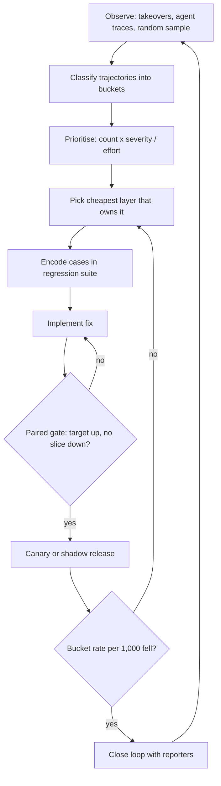

## TL;DR
Continuous improvement is the loop that turns production agent runs into measured fixes: classify
trajectory failures, prioritise them, fix at the cheapest layer, encode cases in a regression suite, gate
the release and confirm online that the bucket shrank.

## For agent builders
- **Why it matters for agents.** Agent failures are coupled and multi-step: a prompt edit that stops one
  loop can make the agent skip a required lookup elsewhere. Without a frozen suite and a paired gate,
  every fix is a guess about the other trajectories.
- **Where it shows up in your stack.** Traces with tool-call spans feed the failure taxonomy; an eval
  harness runs the regression suite in CI; canary or shadow routing and version stamps (prompt, tool
  schemas, model, index) make production changes attributable.
- **What you control.** The bucket taxonomy (wrong tool, bad arguments, loops, premature stop), the
  layer you fix at, the gate's noise rules, and when vendor model or data changes count as releases.
- **What you can skip.** Statistics beyond McNemar's paired test and a rate per 1,000 runs; that pair
  covers most agent release decisions.

## Why it exists
- **Quality does not stay where acceptance left it.** New users phrase things differently, the knowledge
  base changes, the vendor updates the model behind an alias, and the business adds products the prompts
  never mention. Quality drifts, and users quietly route around a tool they stop trusting.
- **Reactive patching breaks things silently.** A complaint arrives, someone edits the prompt until that
  example works, and it ships. LLM behaviour is coupled: an instruction added to fix French users'
  replies can change tone or format for everyone else, and without a regression suite nobody notices
  until the next complaint.
- **Nothing measures frequency.** The loudest stakeholder's anecdote gets fixed before the failure that
  hits two hundred users a week.
- **Nobody can say whether it is getting better.** The team is busy but the acceptance rate is flat.
- **The loop makes every stage measurable:** an input (classified failures), a gate (no regression on a
  frozen suite) and an output (the targeted bucket shrinks in production). It is plan-do-check-act, with
  test-driven bug fixing as the "check" step, adapted to probabilistic outputs and shifting dependencies.

## How it works
### 1. Observe
Pull signals from several sources, because each sees different failures:
- **Disposition events** from usage analytics (regenerations, heavy edits, abandons) and explicit feedback.
- **Escalations** to humans and **incidents**.
- **Trace-level errors:** tool failures, timeouts, empty retrievals.
- **Periodic human review of a random sample.** It matters *because* every other source is biased toward
  failures that users notice and bother to report.

### 2. Classify
- **Build a stable taxonomy through error analysis:** read real traces and name the failure modes ("cited
  superseded policy", "wrong language", "tool called with wrong account ID").
- **For agents, classify the trajectory, not just the final answer:** wrong tool chosen, right tool with
  bad arguments, a loop that hits the step budget, a required lookup skipped, or a stop before the task
  was done. A correct final answer reached through a risky action is still a failure.
- **Scale with an LLM classifier** once the categories are stable, and spot-check it.
- **Counts per bucket per week** are the input to everything that follows.

### 3. Prioritise
- **Score:** weekly count × severity ÷ effort.
- **Hard override:** anything harmful, non-compliant or money-losing is fixed first regardless of score,
  *because* a pure frequency score will always rank a frequent cosmetic issue above a rare one that ends
  the contract.

### 4. Fix at the cheapest layer that works
Diagnose which layer owns the failure before touching anything. In rough order of cost:

| Order | Layer | Typical failure it owns |
|---|---|---|
| 1 | UX or training | The user asked for something out of scope |
| 2 | Prompt or instructions | Wrong format, tone, language |
| 3 | Retrieval and data | Wrong, stale or missing documents |
| 4 | Tools and integrations | Wrong arguments, failing calls |
| 5 | Guardrails | Policy-violating output |
| 6 | Model choice | Capability gap |
| 7 | Fine-tuning | Persistent behaviour the above cannot fix |

- **Many "model failures" are retrieval or data failures,** and a prompt cannot fix a document that is not
  in the index.
- **Agents add a layer: the loop itself.** Loops and premature stops are often fixed in orchestration
  (stopping conditions, step budgets, loop detection, a clearer tool error message the model can act on),
  not in the system prompt. Tool descriptions and argument schemas sit in layer 4 and are a cheap,
  frequent fix for wrong-tool and bad-argument buckets.

### 5. Encode before you fix
- **Add the failing production cases,** de-identified as needed, to the regression suite *before* changing
  the system.
- **Why first:** it proves the suite catches the failure, and keeps it caught after later changes.

### 6. Gate, release, verify
1. **Run the full frozen suite on the candidate.** Require improvement on the targeted slice and no
   regression beyond noise on every other slice.
2. **Give "noise" a number,** for two reasons: slices are small, so a pass rate over *n* cases has a
   standard error of about `sqrt(p(1−p)/n)`; and LLM outputs and LLM judges vary between runs even on
   identical inputs.
3. **Compare paired,** because baseline and candidate run on the *same* cases. Count cases that flipped
   pass→fail (*b*) and fail→pass (*c*). McNemar's test treats `(b − c)² / (b + c)` above about 3.84 as a
   change unlikely to be chance at the 5% level. With only a handful of flips, use the exact binomial
   version instead.
4. **Handle flaky cases** by running each several times and scoring the majority, or the gate will block
   and pass at random.
5. **Ship behind a canary or shadow deployment,** then check online that the bucket shrank.
6. **Use a *rate*** (failures per 1,000 conversations) compared with the bucket's own pre-release weeks,
   not a raw count, because traffic growth makes a fixed bucket look bigger.
7. **Version every prompt, retrieval config and model,** so a change in production metrics can be
   attributed to a specific release.

### 7. Run it on a cadence
- **Weekly triage and a fixed release train** keep the loop moving without turning every complaint into
  an emergency.
- **External changes go through the same gate:** a vendor model update, a re-indexed knowledge base, or a
  new user group.
- **Close the loop with reporters** ("you flagged X, fixed in release 14"), because visible responses keep
  feedback rates up.

## Diagram
The loop has a measured input, a measured gate and a measured output; anything that fails the gate goes
back to the fix step, not to production.



## Examples
### Agent scenario: seeding trajectory buckets from traces
Before an LLM classifier is worth it, simple rules over tool-call spans seed the agent's failure buckets,
and every failing run becomes a regression case. Run summaries are illustrative.

```python
from collections import Counter

# Minimal run summaries from the tracing store: tool calls in order, plus the run outcome.
runs = [
    {"id": "r1", "calls": [("search_orders", "ok"), ("issue_refund", "ok")], "outcome": "done"},
    {"id": "r2", "calls": [("search_orders", "ok")] * 6, "outcome": "max_steps"},
    {"id": "r3", "calls": [("issue_refund", "error:bad_account_id")], "outcome": "taken_over"},
    {"id": "r4", "calls": [], "outcome": "answered_without_tools"},
    {"id": "r5", "calls": [("search_orders", "ok")] * 3, "outcome": "max_steps"},
]

def bucket(run):
    names = [name for name, _ in run["calls"]]
    if any(status.startswith("error:bad_") for _, status in run["calls"]):   # not timeouts
        return "tool called with bad arguments"
    if run["outcome"] == "max_steps" and len(names) >= 3 and len(set(names[-3:])) == 1:
        return "loop: same tool repeated"
    if run["outcome"] == "answered_without_tools":
        return "skipped required lookup"
    return "ok"

counts = Counter(bucket(r) for r in runs)
for name, n in counts.most_common():
    print(f"{name:32} {n}")
regression_cases = [r["id"] for r in runs if bucket(r) != "ok"]
print(regression_cases)
# loop: same tool repeated         2
# ok                               1
# tool called with bad arguments   1
# skipped required lookup          1
# ['r2', 'r3', 'r4', 'r5']
```

| Week | Loop bucket per 1,000 runs | What happened |
|---|---|---|
| Before fix | 18 | the order-search tool returned an empty list with no message, so the agent retried |
| Fix (layer 4) | n/a | the tool now returns "no orders found for this email", and a loop detector stops after 3 identical calls |
| Canary, 2 weeks | 6 | the bucket rate fell against its own pre-release weeks, so the fix is kept |

The rates are illustrative; the point is the unit, failures per 1,000 runs, not raw counts.

### Weekly triage and release gate in Python
Bucket counts come from classified production feedback. The ranking applies the severity override, and
the gate compares per-slice pass rates on the same frozen regression suite.

```python
from dataclasses import dataclass

@dataclass
class Bucket:
    name: str
    weekly_count: int        # classified production failures this week
    severity: int            # 1 cosmetic, 3 wrong answer, 5 harmful / non-compliant
    effort_days: float
    layer: str               # prompt | retrieval | tool | guardrail | model

def rank_key(b: Bucket):
    # Severity-5 items jump the queue; the rest are ranked by count x severity / effort.
    return (b.severity >= 5, b.weekly_count * b.severity / b.effort_days)

buckets = [
    Bucket("wrong date format", 300, 1, 0.5, "prompt"),           # score 600
    Bucket("cites superseded policy", 140, 3, 3.0, "retrieval"),  # score 140
    Bucket("replies in English to French users", 60, 2, 1.0, "prompt"),  # 120
    Bucket("promises refund outside policy", 12, 5, 2.0, "guardrail"),   # 30, but severity 5
]
for b in sorted(buckets, key=rank_key, reverse=True):
    print(f"{b.name:38} layer={b.layer}")

def release_ok(base: dict, cand: dict, target: str, tol: float = 0.02) -> bool:
    """Pass rates per slice on the same frozen suite; tol should reflect slice sample size."""
    improved = cand[target] > base[target]
    no_regression = all(cand[s] >= base[s] - tol for s in base)
    return improved and no_regression

base = {"refunds": 0.81, "billing": 0.93, "french": 0.88, "shipping": 0.95}
cand = {"refunds": 0.97, "billing": 0.94, "french": 0.84, "shipping": 0.95}
print(release_ok(base, cand, "refunds"))   # False: french fell 4 points, beyond tolerance
```

- **The refund guardrail goes first** despite the lowest score.
- **The candidate fixes refunds but is blocked,** because the fix cost the French slice four points. That
  is exactly the regression reactive patching would have shipped.

### Worked scenario: is the French drop real?
Illustrative numbers for the blocked release above.

| Question | Answer |
|---|---|
| Slice size | 250 cases, so 0.88 → 0.84 is ten net cases |
| Paired flips | 13 pass→fail, 3 fail→pass |
| McNemar statistic | `(13 − 3)² / 16 ≈ 6.3`, above 3.84, so block |
| Same four points on a 25-case slice | one case: rerun or grow the slice, do not trust a fixed 2-point tolerance |
| Root cause from a flipped case's trace | the new refund instruction ("always state the policy in English legal terms") overrode the language rule |

### A paired gate that handles few flips
The fixed tolerance above is a simplification. This gate uses the flips directly and the exact binomial
test, which stays valid when flips are few.

```python
from math import comb

def mcnemar(b, c):
    """b = pass->fail flips, c = fail->pass flips, same cases, baseline vs candidate."""
    n = b + c
    if n == 0:
        return 0.0, 1.0
    chi2 = (b - c) ** 2 / n
    k = min(b, c)                                   # exact two-sided binomial test
    p_exact = min(1.0, 2 * sum(comb(n, i) for i in range(k + 1)) / 2 ** n)
    return chi2, p_exact

def slice_gate(b, c, alpha=0.05):
    chi2, p = mcnemar(b, c)
    regressed = b > c and p < alpha
    return ("block" if regressed else "pass"), round(chi2, 2), round(p, 3)

print(slice_gate(13, 3))    # ('block', 6.25, 0.021)  french slice, 250 cases
print(slice_gate(2, 1))     # ('pass', 0.33, 1.0)     one net case
print(slice_gate(4, 0))     # ('pass', 4.0, 0.125)    chi-square says block, exact test says not proven
```

## Production patterns
- **Paired gate on a frozen suite** — for every candidate prompt, tool-schema, retrieval or model change,
  run baseline and candidate agents on the same cases in CI and gate on per-slice flips (exact test when
  flips are few), not on the average. Score trajectories as well as final answers, for example "called
  the lookup tool before refunding". Monitor flips per slice and regression escapes per release.
- **Repeat flaky cases and score the majority** — when a case passes and fails across identical runs, mark
  it flaky, run it an odd number of times and take the majority. Monitor the share of flaky cases; a
  rising share means the judge or the prompt is unstable.
- **Canary with a bucket-rate check** — route a small share of traffic to the candidate, then compare the
  targeted bucket's failures per 1,000 conversations with its own pre-release weeks. Monitor that rate and
  roll back if it does not fall.
- **Version stamps on every trace** — record prompt version, tool-schema version, retrieval or index
  version and model identifier on each agent run, so a production shift can be attributed to a release.
  Monitor metrics grouped by release, not by calendar week.
- **Treat vendor and data changes as releases** — where the provider offers dated model snapshots, pin one
  instead of a floating alias, and run the full suite before moving; do the same before swapping a
  re-indexed knowledge base. Monitor suite results per snapshot.
- **Random-sample review alongside reported failures** — review a fixed number of random conversations
  each week to catch failures users never report. Monitor the share of buckets discovered only by the
  sample.

## Trade-offs
- **Fast release train vs attribution.** It shortens time-to-fix but makes attribution harder; batch fewer
  changes per release when you need to know which change moved the metric.
- **Prompt-layer fixes vs brittleness.** They are quick and cheap but accumulate brittle instructions; once
  the same bucket returns after several prompt fixes, move the fix to retrieval, tools or fine-tuning.
- **Growing suite vs cost.** It catches more but gets slower and costlier with an LLM judge; prune
  duplicate and obsolete cases, and tier the suite into fast and full runs.
- **Shared fix vs isolation.** Fixing one customer's failure in shared prompts helps everyone but risks
  others' behaviour; when the failure is truly customer-specific, put the fix in that customer's
  configuration and suite.
- **Final-answer scoring vs trajectory scoring.** Checking only the answer is cheap and stable, but misses
  risky or wasteful paths; trajectory checks catch them at the cost of brittle expectations, so assert on
  required and forbidden tool calls rather than an exact sequence.

## Pitfalls
- **Whack-a-mole prompt edits without a suite.** Symptom: complaints you already fixed reappear a few
  releases later. Fix: encode before you fix.
- **Prioritising by who complained loudest.** The dashboard shows a large, steady bucket untouched for
  weeks while small anecdotes get fixed.
- **Overfitting to the regression suite.** Offline pass rates climb every release while production
  acceptance and edit rates stay flat.
- **Tracking bucket counts instead of rates.** A fixed failure appears to "come back" the month traffic
  doubles, while its rate per 1,000 conversations is still down.
- **A gate that ignores run-to-run variance.** The same candidate passes Monday and fails Tuesday, and the
  team learns to rerun until green.
- **Unversioned changes.** Production quality shifts and nobody can tell whether the prompt edit, the
  re-index or the vendor's model update caused it.
- **Feedback that disappears into a backlog.** Feedback volume drops because users learn that reporting
  changes nothing.
- **Fixing agent loops in the system prompt.** "Do not call the same tool repeatedly" is added, loops drop
  for a week, then return in another tool. Fix: repair the tool's empty or error result and add a loop
  detector or step budget in the orchestration layer.

## When to use
- **Use when** an AI system is in production with real users, starting in hypercare and continuing for
  the system's life.
- **Slow the cadence, never stop it,** as failure buckets shrink, because inputs and dependencies keep
  changing.
- **Avoid when** prototyping early: the design is still moving and a frozen suite would freeze the wrong
  behaviour.
- **Measure the loop itself:** weekly failure rate by bucket, time from report to fix, regression escapes
  per release, and production acceptance trend.
- **Interviews:** describe the loop end to end and stress the gate and the online check.

## Role lens
- **Engineer:** Writes the classifier and the gate, adds failing cases to the suite before each fix, and
  versions prompts and configs so production changes are attributable.
- **Architect:** Owns the release process: eval gates, canary or shadow stages, which changes need full
  suites, and how customer-specific fixes are isolated from shared behaviour.
- **FDE:** Runs the weekly triage with the customer, translates their complaints into failure buckets, and
  reports back which fixes shipped and what moved.

## Check yourself
**Q:** After six weeks of prompt fixes driven by user complaints, the offline suite pass rate is up from
82% to 94%, but production acceptance is flat. What is likely happening and what do you change?
**A:** The suite and production have diverged. The suite probably holds only the complaint cases, so the
fixes overfit to them, while the bulk of production failures were never classified. Unreported failures
could also be growing, from drift or new users. I would review a random production sample to rebuild the
failure taxonomy, add representative cases rather than only complained-about ones, and check whether
prompt patches have accumulated into conflicting instructions. Then I would prioritise by measured bucket
frequency and severity. Each release would be validated by an online check that the targeted bucket
shrank, not only by offline pass rate.

## Interview questions
### What does continuous improvement mean for an LLM system, and why is reactive prompt patching not enough?
- **Definition:** a loop of observe, classify, prioritise, fix at the cheapest layer, encode, gate and
  verify online, run on a cadence.
- **Why patching fails:** LLM behaviour is coupled, so a fix for one complaint can break other slices;
  nothing measures frequency; and nobody can say whether quality is improving overall.

### A fix passed the gate, but two weeks later the targeted bucket is no smaller in production. How do you debug it?
- **Check the measurement first:** compare the bucket's rate per 1,000 conversations with its pre-release
  weeks, not raw counts, and confirm the classifier still labels the bucket the same way.
- **Check the release:** confirm via version stamps on traces that the new prompt or config is actually
  serving the affected traffic.
- **Check coverage:** read fresh failures in the bucket; if they differ from the encoded cases, the suite
  captured a sub-pattern and the fix belongs at another layer, often retrieval.

### When would you move a fix out of the prompt, and what does that cost?
- **Move it when** the same bucket returns after several prompt fixes, or when the root cause is data, a
  missing document or a tool, because a prompt cannot fix a document that is not in the index.
- **The cost:** retrieval, tool or fine-tuning changes take longer and need wider regression runs.
- **Customer-specific failures** go into that customer's configuration and suite rather than shared prompts.

### Your French slice has 40 cases and dropped five points. Do you block the release?
- **Five points on 40 cases is two cases.** The standard error at a pass rate near 0.88 is about
  sqrt(0.88 × 0.12 / 40) ≈ 0.05, so the drop is about one standard error.
- **Use the paired flips:** with a handful of flips, the exact binomial test rarely shows significance, so
  rerun flaky cases, grow the slice and read the flipped traces.
- **Block anyway if** a flipped case is a severity-5 failure, because the severity override applies to
  gates too.

### The vendor updated the model behind the alias your agent calls. What should your process do?
- **Treat it as a release:** run the full frozen suite and compare per slice against the previous model,
  including trajectory checks, because tool-choice and stopping behaviour can shift even when answers look
  similar.
- **Prefer pinned snapshots** where the provider offers them, so the update happens when you choose.
- **Watch online bucket rates** after the switch, because vendor changes are one of the main sources of
  silent drift.

### After a tool-schema change, your agent hits the step budget far more often. Walk through the loop.
- **Classify first:** pull max-step runs by version stamp and read trajectories; repeated identical calls
  point to a loop, alternating tools to a planning failure.
- **Fix at the cheapest layer:** often the tool description or its empty and error results, then a loop
  detector in orchestration; encode the failing runs as regression cases before changing anything.
- **Gate and verify:** paired gate on the suite, canary, then confirm the loop bucket per 1,000 runs fell.

## Quiz
### Q: Why add the failing production cases to the regression suite before implementing the fix?
- [ ] It makes the release pipeline run faster
- [x] It proves the suite detects the failure, and it keeps the failure detected after later changes
- [ ] It is needed so the LLM judge can learn from the examples
- [ ] It prevents the vendor from changing the model
> Encoding first is the test-driven pattern: a test that fails before the fix and passes after shows the
> suite actually covers the failure. That protects against regressions from future changes.

### Q: A bucket of "promises refunds outside policy" has 12 weekly cases, while "wrong date format" has 300. Which prioritisation is sound?
- [ ] Date format first, because frequency × severity ÷ effort gives it the higher score
- [x] Refund promises first, because harmful or non-compliant failures override the frequency score
- [ ] Whichever is cheaper to fix, because effort dominates
- [ ] Neither, until the counts are statistically significant
> Pure scores rank frequent cosmetic issues above rare costly ones. A severity override puts harmful,
> non-compliant or money-losing failures first, then the score orders the rest.

### Q: A candidate release raises the targeted slice from 81% to 97% but drops another slice by 4 points, beyond the agreed tolerance. What should happen?
- [ ] Ship it, because the average pass rate across slices went up
- [ ] Ship it and add the dropped slice to next week's triage
- [x] Block it and rework the fix, because the gate requires no regression beyond noise on any slice
- [ ] Widen the tolerance so the release passes
> Averages hide regressions for specific user groups. The per-slice no-regression rule exists to catch
> exactly this kind of coupled side effect before it reaches production.

## Use cases & projects
### Use cases
- **Hypercare for a newly launched agent.** Weekly trajectory triage turns takeovers and max-step runs
  into ranked buckets with owners.
- **Shipping prompt or tool-schema changes safely.** A paired gate on a frozen suite blocks the fix that
  repairs refunds but breaks the French slice.
- **Absorbing vendor model updates.** Pinned snapshots plus a full suite run make a model change a
  release, not a surprise.
- **Killing agent loops for good.** Loop and premature-stop buckets are fixed in tools and orchestration,
  then verified as a rate per 1,000 runs.

### Mini project
**Run one full improvement cycle on a toy agent (2-3 hours).**
- **Goal:** take one failure bucket from production-style traces to a gated, verified fix.
- **Steps:** build a small agent with two tools, one of which returns an empty result without a message;
  generate 50+ runs and bucket them with rules like the example; add the failing runs to a regression
  suite; fix at the cheapest layer; run baseline and candidate on the suite and apply the McNemar gate.
- **Done when:** the suite shows the loop bucket fixed with no slice regressing beyond noise, and a
  before/after table reports the bucket as failures per 1,000 runs.
