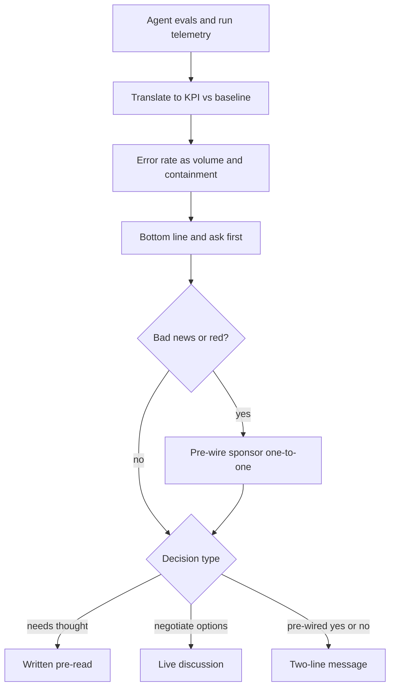

## TL;DR
Executive communication turns your agent's evals and traces into the conclusion first, in business terms,
with the decision needed and the evidence. Jargon, unexplained error rates or late bad news can get a
healthy agent project cancelled.

## For agent builders
- **Why it matters for agents.** Agent projects are funded on business outcomes, but your dashboards show
  task completion, tool-call success, escalation rate and cost per run. If you cannot translate those into
  hours saved and errors contained, the sponsor cannot defend the budget.
- **Where it shows up in your stack.** Eval results, run logs and token or cost telemetry feed a small
  translation script; the steering update, go/no-go memo and quarterly value review are its outputs.
- **What you control.** The formulas (value per month, escaped errors), how you state small-sample
  results, the colour rules you agree with the sponsor, and how early you report an agent failure.
- **What you can skip.** Presentation craft and slide design. BLUF, one value number with its arithmetic
  and an honest error statement do most of the work.

## Decision case
### Scenario
An IT service-desk agent has finished its pilot: it resets access and handles software-install
requests, with a person reviewing every action. The CIO wants to expand it company-wide and drop human
review on access resets to save reviewer time.

You write the go/no-go memo for a steering meeting in 5
days, where the CIO has 10 minutes. All figures are illustrative.
- **Expanded volume:** about 15,000 resets and 10,000 install requests a month.
- **Pilot quality:** 0 wrong resets in 300 cases; 8 wrong installs in 400 (2%); review catches about 95%
  of wrong actions.
- **CIO's stated tolerance:** no more than 25 wrong actions a month reaching employees.
- **Review capacity:** 2 reviewers, about 280 hours a month; a review takes about 0.6 minutes.

The arithmetic the memo rests on:
- **Zero failures is not zero.** By the rule of three, 0 in 300 allows a true rate up to 3/300 = 1%.
- **Installs with review:** 10,000 x 0.02 x 0.05 = 10 escaped a month.
- **Resets with review, worst plausible:** 15,000 x 0.01 x 0.05 = 7.5.

### Options
| Option | How it works | Wrong actions reaching staff a month | Review hours | Within tolerance? |
|---|---|---|---|---|
| Recommend autonomy on resets now | The memo agrees with the CIO | up to 15,000 x 1% = 150, plus 10 = 160 | 10,000 x 0.6 min = 100 | No, at the plausible upper bound |
| Expand with review on everything | Safe recommendation, no further ask | up to 7.5 + 10, about 18 | 25,000 x 0.6 min = 250 of 280 | Yes, but no route to the saving and little spare capacity |
| Expand with review, plus a written autonomy gate | Review everything now; resets go autonomous once enough failure-free cases bring their bound down | about 18 now, then up to 15 + 10 = 25 | 250, falling to 100 | Yes, at the edge once the gate opens |
| Send the dashboard, let the CIO choose | Full metrics, no recommendation | Unknown | Unknown | No ask, so the decision slips |

### Decision
**Expand with review, plus a written autonomy gate for resets.** It meets the 25-a-month tolerance from
day one and gives the CIO the saving she wants on a date she can plan for, instead of a "not yet".
- **The gate is arithmetic:** resets may drop review when 3/n x 15,000 is 15 or less, that is n of at
  least 3,000 failure-free cases. That leaves 15 + 10 = 25 at the bound. With 300 already seen, 2,700 more
  take under a week at about 3,500 resets a week.
- **The memo leads with the bottom line:** "Expand now with review; resets can go unreviewed in about a
  week if no reset fails. Decision needed: approve both today." Value, the error lines in volume terms
  and review hours follow; eval detail goes to the appendix.
- **Pre-wire the CIO one-to-one,** because the memo turns down her preferred option, and she should not
  hear that first in front of peers.

**What would change it.**
- **Any wrong reset during the gate:** the zero-failure bound no longer applies. Recompute with the
  observed rate and keep review on until the projection fits.
- **A lower catch rate:** at 90% catch, installs alone send 10,000 x 0.02 x 0.1 = 20 a month to staff, so
  the gate needs a tighter reset bound or better install checks first.

### Trade-offs accepted
- **The saving arrives a week later than the CIO asked.** Report gate progress (failure-free resets so
  far) in each update so the date stays credible.
- **The plan sits exactly at the tolerance once the gate opens.** Watch escaped errors from employee
  reports weekly. One month above 25 puts resets back under review, and the memo says so in advance.
- **Review capacity is tight during the first week.** Watch reviewer backlog; if it grows, slow the
  expansion rather than skim reviews.

### Review rubric
- **Bottom line and ask in the first two lines,** with a decision date.
- **Error rates in volume terms with containment:** monthly escaped actions computed per option, not a
  single accuracy figure.
- **Small samples stated honestly:** zero-failure results carry the rule-of-three bound, and it is used in
  the projection.
- **Recommendation tied to the executive's own constraint:** the stated tolerance and capacity decide the
  option, shown with arithmetic.
- **Bad news pre-wired:** the write-up plans a one-to-one before the meeting when it disagrees with the
  executive.
- **Reversal triggers named:** which observed failure or measured catch rate would change the
  recommendation.

## Why it exists
- **Executive attention is the bottleneck, not your work.** Executives allocate money, people and
  political cover across many initiatives. They see your project for a few minutes a week, usually
  between meetings, and decide from that whether to keep funding, expand or intervene.
- **Engineers default to chronological, bottom-up reporting:** what we did, what we found, finally what it
  means. That mirrors how the work happened but forces the reader to do the synthesis, and the conclusion
  often arrives after their attention has gone.
- **Technical framing hides the meaning.** "Retrieval recall@10 improved from 0.71 to 0.83" or "tool-call
  success is up" leaves the executive unable to tell whether this is good news for the business.
- **Agents make it harder in three ways.** Quality is a rate, not a yes or no, so "it works" and "it
  fails" both mislead; results are uncertain early, so honest ranges beat false precision; and agents that
  act carry reputational and compliance risk, so bad news that arrives late destroys trust faster than the
  bad news itself.
- **The naive alternatives both fail.** Dumping the full status report is not read; polishing everything
  green is believed until it is not.

## How it works
### 1. Lead with the answer
- **BLUF (bottom line up front):** put the conclusion and any ask in the first two lines.
- **Minto's Pyramid Principle gives the structure:** state the governing point, support it with a few
  grouped arguments, support each with evidence. *Because* the reader may stop at any point, each level
  should stand on its own.
- **SCQA frames the opening when context is needed:** situation (what is true), complication (what
  changed), question (what that raises), answer (what you recommend).

### 2. Speak in business outcomes and baselines
- **Translate agent metrics into the KPI the executive owns**, against the baseline measured before
  deployment: "average handling time on long claims is down from 42 to 31 minutes" rather than "summary
  ROUGE improved" or "task completion rate is up".
- **Why:** the executive's question is always "is this worth it", so every number should connect to value,
  cost or risk.
- **Show the arithmetic.** The translation is usually one line, and showing it makes the number checkable:

```
value per month   = volume × time saved per item × loaded cost per hour
escaped errors    = volume × error rate × (1 − catch rate at review)
```

A per-item saving means little to an executive; "about 220 adjuster-hours a month" lets them compare it
with the cost of the system (model and tool spend per run included) and with their other options.

### 3. Make uncertainty and error rates concrete
- **Express quality per volume and with consequence:** "about 3 in 100 drafts need a material
  correction; all are caught at human review; zero reached customers this month".
- **Give ranges when the sample is small**, and say what would change the estimate.
- **Why:** executives make risk decisions, so they need the size and containment of the failure, not just
  the average.

| Framing | What the executive can decide from it |
|---|---|
| "97% accurate" | Nothing |
| "3% error rate" | Sounds small |
| 3% of 20,000 drafts a month | 600 corrections |
| Review catches 95% of them | About 30 a month reach customers |

Whether 30 is acceptable is the executive's decision, and they cannot make it from "97% accurate".

**Be explicit about the sample.** Zero failures in 50 cases is still consistent with a true failure rate
as high as about 6%. The "rule of three" gives roughly 3/n as the upper 95% bound when no failures are
seen, so say "no failures yet in 50 cases" rather than "no failures".

### 4. Ask for a decision explicitly
- **State** the decision, the options, your recommendation, the cost of each, and the date by which it must
  be made.
- **Why:** "FYI" items get read and forgotten, so an update without a clear ask cannot unblock you. For
  agents, typical asks are widening autonomy, adding a tool, or funding a missing integration.

### 5. No surprises: escalate early, pre-wire big messages
- **Report risks while they are still yellow**, with a mitigation.
- **Pre-wire difficult news.** Before a steering meeting, brief the sponsor one-to-one, *because*
  executives react badly to learning something in front of peers that they could have known earlier.
- **Agent incidents count.** A wrong write action or a leaked field reaches the sponsor from you first,
  with what happened, the blast radius and the fix.

### 6. Fix the format, the cadence and the status rules
- **One page, stable structure:** headline, status with trend, KPI versus baseline and target, top risks,
  decisions needed. It lets the reader compare week to week.
- **Detail goes in an appendix** for those who want it: eval breakdowns, tool-call error rates, traces.

Define what each status colour means at the start, in terms the sponsor agreed, for example:

| Colour | Meaning |
|---|---|
| Green | On track for the target date and KPI with no unmitigated risk |
| Amber | At risk, mitigation in place, no decision needed yet |
| Red | Will miss without a decision from you |

- **Why define them:** an undefined colour is chosen by the author's optimism, so status drifts toward
  green until it jumps to red. That is how watermelon reporting happens without anyone intending to
  mislead.
- **Amber with a mitigation is a normal, healthy state for a pilot**; reporting it is what earns belief in
  your greens.

### 7. Match the channel to the decision
| Channel | Works when |
|---|---|
| Written pre-read | The reader needs to think before deciding |
| Live discussion | Options must be negotiated |
| Two-line message | A yes/no that is already pre-wired |

Send pre-reads early enough to be read, and open the meeting with the decision, not a recap of the
document.

## Diagram
Read top-down as the order of an update; the "yes" branch is the pre-wire path for bad news, and the last
split picks the channel by the kind of decision.



## Examples
### Turning eval numbers into executive numbers
These three helpers produce every number in a typical agent steering update; the inputs are the
illustrative figures used in this lesson.

```python
def value_hours(volume, minutes_saved):
    return volume * minutes_saved / 60

def escaped_errors(volume, error_rate, catch_rate):
    return volume * error_rate * (1 - catch_rate)

def zero_failure_upper_bound(n, exact=False):
    # rule of three: ~3/n is the 95% upper bound when 0 failures are seen in n
    return 1 - 0.05 ** (1 / n) if exact else 3 / n

print(value_hours(1_200, 42 - 31))                   # 220.0 adjuster-hours a month
print(20_000 * 0.03)                                 # 600.0 corrections a month
print(round(escaped_errors(20_000, 0.03, 0.95)))     # 30 reach customers a month
print(f"{zero_failure_upper_bound(50):.0%}")             # 6%
print(f"{zero_failure_upper_bound(50, exact=True):.1%}") # 5.8%
```

Multiply `value_hours` by the loaded cost per hour to get the money figure for the value line.

### From agent run logs to the update's quality and cost lines
Agent telemetry carries more than accuracy: how many runs finished, how many escalated to a person, and
what each run cost. This sketch turns a month of run records into the lines an executive reads. All
figures are illustrative.

```python
runs = 1_200                      # agent runs on long claims this month
completed = 1_050                 # finished without handing back to a person
escalated = runs - completed      # handed to an adjuster by design (low confidence, tool error)
material_errors = 36              # found at adjuster review in completed runs
reached_claimant = 0
cost_per_run = 0.40               # model plus tool spend, in dollars

print(f"{completed / runs:.0%} of long claims handled end to end; "
      f"{escalated} routed to adjusters by design")          # 88%; 150 routed
print(f"about {round(100 * material_errors / completed)} in 100 summaries needed a "
      f"material correction; {reached_claimant} reached a claimant")   # about 3 in 100
print(f"run cost about ${runs * cost_per_run:,.0f} a month")  # about $480
# Put the escalations in the update as containment, not failure:
# they are the agent declining work it should not do alone.
```

### Worked scenario: rewriting a steering update
A hypothetical engineer drafts a steering update for the VP of Operations about a claims-summary agent
pilot.

**Before (chronological, technical):**

> "This sprint we migrated to a new embedding model, rebuilt the index, fixed a PDF parsing bug affecting
> scanned files and ran the eval suite. Recall@10 went from 0.71 to 0.83. We are also seeing some issues
> with handwritten notes. Usage is around 60%. Next sprint we will look at OCR options."

The VP cannot tell whether the pilot is on track, what the numbers mean or what is being asked.

**After (pyramid structure):**

| Line | Content |
|---|---|
| **Bottom line** | The pilot is on track to hit its target, and I need a decision on OCR budget by 3 November. |
| **Value** | Handling time on long claims is down from 42 to 31 minutes against a 30-minute target, across the 40 adjusters in the pilot. At about 1,200 long claims a month that is roughly 220 adjuster-hours a month (1,200 × 11 minutes). |
| **Quality** | About 3 in 100 summaries need a material correction; all were caught at adjuster review and none reached a claimant. |
| **Risk** | About one file in eight contains handwritten notes, which the agent cannot read today, so those files fall back to manual review. |
| **Decision** | Fund a specialist OCR service (estimated cost in the appendix) to extend coverage to those files, or accept manual handling for them. I recommend funding it, because it is the largest remaining gap to the target. |

The technical details (embedding model, recall@10, tool-call errors) move to an appendix. (All figures
are illustrative.)

## Production patterns
- **Fixed one-page template with agreed colour rules** — at kickoff, agree the green, amber and red
  definitions with the sponsor and write them at the bottom of every update. Monitor how often a red
  appears without a preceding amber; each one is a reporting failure.
- **Metric translation script over agent telemetry** — keep one sheet or notebook that turns eval results
  and run logs (completions, escalations, corrections, cost per run) into the update's business numbers
  using the value and escaped-error formulas, rerun for every update. Monitor its inputs (volume, catch
  rate at review) for drift, since they move the headline numbers.
- **Pre-wire before every steering meeting with bad news** — a one-to-one with the sponsor ahead of the
  meeting, sharing the bottom line, the options and your recommendation. Monitor whether steering meetings
  end with a decision rather than a request for more analysis.
- **Agent incident notes within a day** — when the agent takes a wrong action or exposes data, send the
  sponsor a short note: what happened, how many cases, whether it was contained, the fix and the eval case
  added. Monitor time from detection to sponsor note.
- **Decision log with due dates** — each ask in an update carries options, a recommendation, costs and a
  decision date, tracked in a log the sponsor can see. Monitor decisions arriving after their date.
- **Small-sample wording rule** — when an eval or pilot has seen no failures, report "no failures yet in
  n cases" plus the rule-of-three bound of about 3/n. Monitor for absolute claims ("no errors") in drafts
  before they go out.

## Trade-offs
- **Conclusion first vs unfinished analysis.** Leading with the conclusion saves executive time but needs
  the analysis finished; when it is not, say what you know and when you will know more.
- **Business metrics vs technical nuance.** Translation makes value visible but hides nuance; keep an
  appendix for technical reviewers who need it.
- **Early risk reporting vs premature intervention.** It builds trust but may trigger intervention; pair
  each risk with a mitigation and an owner.
- **Fixed one-page format vs flexibility.** It enables week-to-week comparison but can feel rigid when a
  crisis needs a dedicated note.
- **Pre-wiring vs an extra meeting.** It avoids public surprises but adds a meeting; skip it only when the
  news is routine.

## Pitfalls
- **Chronological reporting that buries the conclusion.** Symptom: executives asking "so is this on
  track?" after every update.
- **Model or agent metrics without a business translation.** Revealed when steering discussions never
  touch value.
- **Watermelon status (green outside, red inside).** It hides problems until they explode, destroying trust
  in later updates.
- **Updates without an explicit ask.** Blockers wait weeks because nobody realized a decision was needed.
- **A single accuracy number without volume, consequence or uncertainty.** Leads to over-confidence or
  panic.
- **Undefined status colours.** Shows up as a project reported green for weeks that turns red in a single
  update.
- **Claiming "no errors" from a small sample.** Revealed when the first production failures arrive and the
  executive feels misled.
- **Reporting escalations as failures.** Symptom: the sponsor pushes to cut hand-offs, raising autonomy
  where the agent is weakest. Fix: present by-design escalations as containment, with the rate per case
  type.

## When to use
- **Use for** any communication with someone who decides about funding, scope or risk but does not do the
  work: steering updates, escalations, go/no-go recommendations, autonomy or tool-scope changes and
  quarterly value reviews.
- **With peers who need detail**, still lead with the conclusion but include the technical depth.
- **Measure** whether decisions arrive on time, whether executives can restate the status and the ask
  after reading (ask the sponsor to play it back), and whether their understanding of status matches
  reality: a red never preceded by an amber is a reporting failure, not just a project one.
- **Interviews:** you may be asked to explain a technical result to an executive; lead with the outcome and
  the ask, give one number tied to value, and state the main risk.

## Role lens
- **Engineer:** Turns eval and telemetry output into the few business-facing numbers an update needs, with honest error rates and ranges.
- **Architect:** Frames trade-offs (cost, risk, time) as explicit options with a recommendation so executives can decide quickly.
- **FDE:** Writes the customer's steering updates, pre-wires the sponsor before difficult meetings, and escalates risks while they are still recoverable.

## Check yourself
**Q:** Your pilot's accuracy is below the target agreed with the customer's executive, but a fix is likely. How do you communicate this?
**A:** Early and directly, before the steering meeting, in a one-to-one with the sponsor. I would lead with the bottom line: we are below target, here is the gap in business terms (what share of cases need correction and whether any reached customers), here is the cause, here is the fix with a realistic date and its uncertainty, and here is the decision I need, such as extending the pilot by three weeks or narrowing scope to the case types already above target. I would not bury it or polish it green, because finding out later costs far more trust than the gap itself.

## Interview questions
### What is BLUF, and why does it matter more for executives than for peers?
- **Definition:** bottom line up front, the conclusion and any ask in the first two lines, with supporting
  arguments and evidence below (the Pyramid Principle).
- **Why executives:** they see the project for minutes between meetings and may stop reading at any point,
  so the conclusion must survive a partial read.
- **Peers** still get the conclusion first, but with the technical depth included rather than moved to an
  appendix.

### Explain a recall@10 improvement from 0.71 to 0.83 in your agent's retrieval step to a VP of Operations.
- **Do not lead with recall.** Lead with the KPI it moved, such as handling time on long claims against
  the pre-deployment baseline.
- **Give one value number with its arithmetic**, for example volume times minutes saved, so it can be
  checked and compared with the system's cost.
- **Close with the main risk and any decision needed**; recall@10 goes to the appendix.

### Your agent's eval saw zero failures in 50 cases. What do you tell the sponsor?
- **"No failures yet in 50 cases", not "no failures".** By the rule of three, the true failure rate could
  still be as high as about 3/n, here roughly 6%, at 95% confidence.
- **Translate it to volume:** at production volume, a few percent could mean many cases a month, which is
  the number the sponsor needs for a risk decision.
- **Say what would tighten the estimate**, such as a larger eval set before expansion.

### Your agent made a wrong write to a customer record last night. How do you tell the sponsor?
- **Before anyone else does**, one-to-one or a short written note the same day: what happened, how many
  records, whether any customer saw it, and whether it is contained.
- **Then cause and fix:** the trace that shows why, the guard added (approval gate, argument check,
  narrower tool scope) and the eval case that now covers it.
- **Close with any decision:** for example pausing write actions until the fix ships, with the cost of
  pausing.

### Your weekly status has been green for six weeks and is about to go red. What went wrong, and what now?
- **Likely cause:** undefined colour rules, so optimism chose green and ambers were never reported
  (watermelon reporting).
- **Now:** pre-wire the sponsor one-to-one, lead with the bottom line, the gap in business terms, the
  options with costs and a decision date.
- **Prevent recurrence:** agree written green, amber and red definitions with the sponsor and treat amber
  with a mitigation as normal.

### When would you not send a written pre-read?
- **When options must be negotiated live**, because a document cannot trade off positions between
  executives in real time.
- **When it is a pre-wired yes or no**, where a two-line message is enough and a document adds delay.
- **Otherwise** send it early enough to be read, and open the meeting with the decision.

## Quiz
### Q: What should come first in an executive status update?
- [ ] A chronological list of work completed since the last update
- [ ] The technical metrics with their definitions
- [x] The conclusion and any decision you need from the reader
- [ ] The methodology used to evaluate the system
> BLUF and the Pyramid Principle put the governing point first because executives may stop reading at any
> time. Chronology and methodology belong lower or in an appendix.

### Q: Which phrasing best communicates AI quality to an executive?
- [ ] "Our F1 score improved by 0.12 this sprint"
- [ ] "The model is highly accurate"
- [x] "About 3 in 100 drafts need correction; all were caught at review and none reached customers"
- [ ] "The model hallucinates sometimes, as all LLMs do"
> Executives make risk decisions, so they need the rate in volume terms plus whether errors are contained.
> Raw metrics, vague praise or fatalism give them nothing to decide with.

### Q: Why brief the sponsor one-to-one before presenting bad news at a steering meeting?
- [ ] To get permission to leave the bad news out of the meeting
- [x] So the sponsor is not surprised in front of peers and can help shape the response
- [ ] Because steering committees cannot discuss risks formally
- [ ] To shorten the steering meeting agenda
> Pre-wiring keeps trust and turns the sponsor into an ally for the proposed fix. Hiding the news would
> violate the no-surprises rule that makes executive communication credible.

## Use cases & projects
### Use cases
- **Weekly steering update for an agent pilot.** Eval and run telemetry become one value number, one
  contained-error statement and one ask.
- **Asking to widen an agent's autonomy or tool scope.** A decision memo with options, error rates in
  volume terms and the cost of each option.
- **Reporting an agent incident.** A same-day note with blast radius, containment, fix and the new eval
  case keeps the sponsor's trust.
- **Quarterly value review.** Hours saved and cost per run against the pre-deployment baseline justify the
  next phase of funding.

### Mini project
**An auto-generated one-page update from agent telemetry (1-2 hours).**
- **Goal:** produce a BLUF steering update directly from an agent's eval results and run logs.
- **Steps:** collect (or simulate) a month of runs with completion, escalation, corrections found at
  review and cost per run; record a manual baseline time per task; write a script that computes value
  hours, escaped errors, the rule-of-three bound for any zero-failure slice, and run cost; render a
  one-page update with bottom line, value, quality, risk and decision lines, and an appendix of technical
  metrics.
- **Done when:** the script regenerates the page from new data in one command, every number shows its
  arithmetic, and a non-technical reader can restate the status and the ask after one read.
