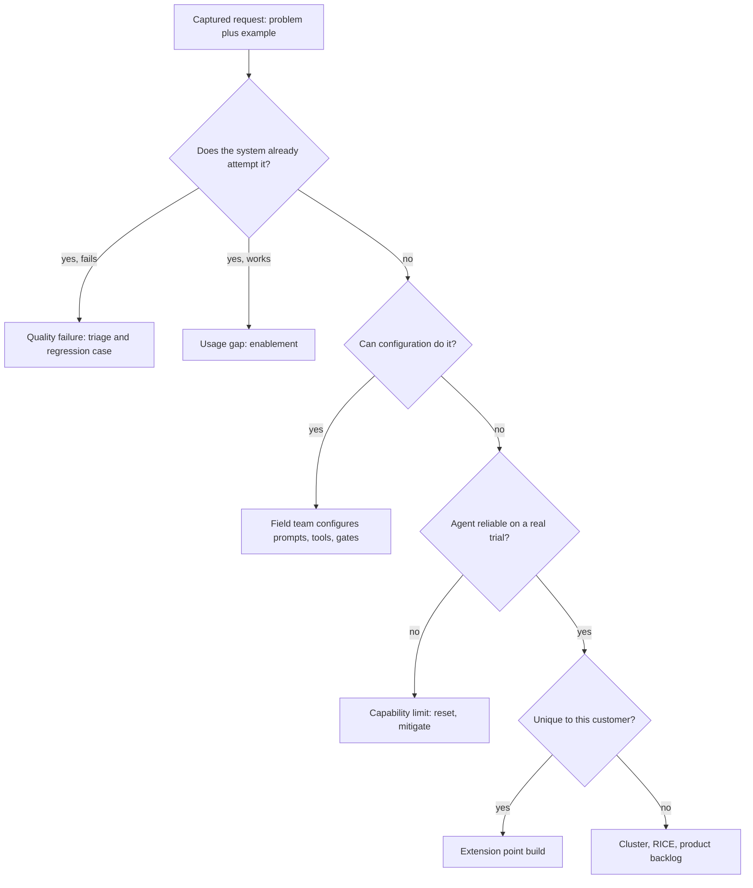

## TL;DR
Feature-request triage turns asks about your agent into routed decisions: capture the problem, classify
what it really is (often a quality failure, a setting or an autonomy limit), cluster across customers,
score, route, and tell the requester.

## For agent builders
- **Why it matters for agents.** Agent asks hide their type: "it keeps searching forever" is a loop bug,
  "stop asking me to approve" is a risk setting, "connect it to our CRM" is a new tool, and "let it do
  the whole claim alone" is a reliability limit. Each goes to a different queue.
- **Where it shows up in your stack.** The first classifying step reads the agent's traces for the
  requester's example; configuration means prompts, tool lists, approval gates and step budgets; new
  tools land on your supported tool interface instead of a fork.
- **What you control.** The intake fields, the fixed order of classifying questions, a small reliability
  trial before calling anything a product gap, and keeping ARR out of the score.
- **What you can skip.** Roadmap-planning frameworks beyond RICE; the scoring is a ranking aid, and the
  routing is where agent teams win or lose time.

## Decision case
### Scenario
A vendor runs one claims-agent platform for 14 customers with about $8,000k ARR. MegaCorp ($2,000k, 25%
of ARR) says its renewal in 12 weeks depends on a multi-level approval chain: payouts above a threshold
need two approvers from named departments. All figures are illustrative.
- **Triage so far:** a product gap (approval chains are common in the segment), but only MegaCorp has
  asked. With the team's estimates it scores RICE 1 × 2 × 0.8 ÷ 3 ≈ 0.53, against 1.60 for page-level
  citations, which three accounts want.
- **Product capacity:** 3 unallocated engineer-weeks this quarter, enough for one of the two.
- **Platform rule:** one codebase with weekly releases; no customer forks.
- **Extension point:** the approval gate can call a customer-hosted approval tool through the supported
  tool interface.
- **Field team:** 2 FDEs; neither can promise roadmap dates.

### Options
| Option | How it works | Renewal in 12 weeks | Platform rule | Roadmap fairness |
|---|---|---|---|---|
| Field fork | FDEs patch the gate for MegaCorp, about 3 FDE-weeks | yes | breaks it: an upgrade tax every weekly release | unaffected now, costly later |
| Extension-point build | MegaCorp's chain runs in their workflow system; the gate calls it as an approval tool, about 2 FDE-weeks | yes | keeps it | citations keep the product slot |
| Product commitment now | build general approval chains in core, 3 engineer-weeks | yes, if started now | keeps it | displaces a 1.60 cluster for a 0.53 one |
| Decline with workaround | approvers forward cases by hand | at risk | keeps it | fair, but churn risk on 25% of ARR |

### Decision
**Build on the extension point now, and log approval chains as a product gap with ARR in its own
column.** It meets the renewal date without a fork and without letting one account take the only product
slot by arithmetic nobody chose.
- **Product owner decides openly:** the backlog shows RICE 0.53 next to $2,000k and RICE 1.60 next to
  $770k, so favouring MegaCorp, if chosen, is a written decision.
- **Recurrence rule:** the build goes in the extension register. If two more accounts ask, reach becomes
  3 and RICE rises to 3 × 2 × 0.8 ÷ 3 = 1.60, a tie with citations, which triggers a productization
  proposal.
- **What MegaCorp hears:** what will ship, when, and that core support is under review, with no date.

**What would change it.** If the gate had no supported hook, the real choice is fork or product slot,
and the product owner must make it with ARR visible. If MegaCorp's chain needs agent reasoning, not just
a routing rule, trial it on real payouts first; it may be a capability limit.

### Trade-offs accepted
- **A customer-specific tool to maintain.** Track it in the extension register with an owner, and test
  it in MegaCorp's suite on every release.
- **MegaCorp's workflow team is on the critical path.** The chain lives in their system, so agree its
  delivery date in week 1 and test the gate against a stub until it lands.
- **Two approval paths in the field.** Watch approval latency and rejection rate per path, so the
  external chain does not hide a slow or failing step.
- **MegaCorp may still want it in core.** Log every further ask from any account into the same cluster,
  so reach grows from evidence.
- **Some goodwill lost by not promising a date.** Close the loop in writing within a week of the request.

### Review rubric
- **Ask classified before solutioning,** with the trace or trial evidence for the type.
- **RICE recomputed and ARR kept separate,** with both shown for every competing cluster.
- **Every option checked against the platform rule,** including the upgrade cost of a fork.
- **Extension point named,** or its absence stated as the reason the decision escalates.
- **Requester reply drafted:** what ships, when, and what is not promised.
- **Flip conditions named:** the reach or capability evidence that would change the route.

## Why it exists
- **Asks arrive constantly.** In workshops, in Slack, from the sponsor, and from end users during
  training sessions; an FDE hears dozens a week.
- **Saying yes in the field fails.** "We can add that" wins goodwill this week, but produces promises
  product never made, custom branches that make every upgrade painful, and a roadmap set by one account.
- **Forwarding everything unprocessed fails too.** It buries signal in noise: twenty differently worded
  requests for the same capability look like twenty small asks instead of one large one.
- **In AI products many asks are not features.** "Make it more accurate on foreign-exchange questions" is a
  quality failure for the continuous-improvement loop. "Let it handle bulk uploads" may already exist, so
  the need is training. "Guarantee it never makes a mistake" is a capability limit needing an expectation
  reset and human-review design.
- **Misrouting is costly.** Users keep suffering a quality bug while it sits in a product queue, or product
  time goes to building what already exists. Triage lets the roadmap follow evidence instead of whoever
  asks loudest, and stops field teams silently forking the product.

## How it works
### 1. Capture the problem, not the solution
Record each request in a standard form:

| Field | Example question |
|---|---|
| Who asked | Role and account |
| Job to be done | What are you trying to get done? |
| Current workaround | What do you do today? |
| Cost of no change | Blocks a deal, risks renewal, costs time |
| Frequency | How often does this happen? |
| Concrete example | One real case |

- **Keep asking "what would that let you do?"** to get from "add an Excel export button" to "finance
  reconciles AI answers against the ledger monthly".
- **You need the problem *because*** clustering and solution design both depend on it; the customer's
  proposed solution is one option among several.

### 2. Classify what the ask really is
| Type | What it is | Route |
|---|---|---|
| **Quality failure** | The system already tries and gets it wrong | Failure triage, a regression case, a fix through the release gate |
| **Usage or knowledge gap** | The capability exists | Enablement; fix the docs or UI if many people miss it |
| **Configuration** | Achievable with existing prompts, knowledge sources, settings or permissions | The field team does it |
| **Customer-specific extension** | A real need unique to this customer, such as an integration with their ERP | Build on a supported extension point, never as a fork |
| **Product gap** | A capability missing for a class of customers | Product backlog with evidence |
| **Capability limit** | Not reliably achievable with current models | Reset expectations; propose human review, narrower scope or confidence thresholds |

Ask the classifying questions in a fixed order, cheapest and most urgent first:
1. **Does the system already attempt this?** Look at the traces for the requester's example. If it tries
   and fails, it is a quality failure, which goes first *because* users are being hurt now. If it succeeds
   when used correctly, it is a usage gap.
2. **Can existing configuration do it?**
3. **Can current models do it reliably?** Try it on a couple of dozen real examples before calling it a
   product gap, because "the model can't" and "nobody tried" look the same from a ticket.
4. **Is the need unique to this customer, or plausibly shared?**

- **Split compound asks.** "Make pricing answers right and never wrong" is one quality failure plus one
  capability limit, and each half has a different route.

### What the types look like for an agent
| Agent ask | Usual type |
|---|---|
| "It keeps calling search and never answers" | Quality failure: a loop bucket for the improvement loop |
| "Stop asking me to approve small refunds" | Configuration, but only with a risk owner signing off on the approval threshold |
| "Connect it to our in-house CRM" | Customer-specific extension: a new tool on the supported tool interface |
| "Let it file claims end to end with no human" | Often a capability limit on reliability: narrower scope or human review |

### 3. Deduplicate and cluster across customers
- **Group by underlying problem, not wording.** One cluster with five accounts and concrete examples is far
  stronger evidence than five separate tickets.
- **A shared tagging taxonomy across all field teams** is what makes this possible.

### 4. Score with explicit criteria
A common framework is RICE, popularised by Intercom: Reach × Impact × Confidence ÷ Effort.

| Input | Scale |
|---|---|
| **Reach** | Originally people or events per period; across customers, distinct accounts with the problem is a reasonable proxy |
| **Impact** | Coarse: 3 massive, 2 high, 1 medium, 0.5 low, 0.25 minimal |
| **Confidence** | A percentage that discounts guesses |
| **Effort** | Person-weeks or person-months |

- **Coarse scales are deliberate:** they stop the team arguing over decimals and make the score a ranking
  aid, not a measurement.
- **Add strategic fit and risk** (safety, compliance, maintenance burden).
- **Record commercial weight (ARR, deal-blocking status) as a *separate* input,** not multiplied into the
  score, *because* folding revenue in lets the biggest account set the roadmap without anyone deciding
  that on purpose.

### 5. Route and decide
- **Field fixes happen now.**
- **Product gaps go to the product owner, who decides;** the FDE supplies evidence, not commitments.
- **Declines get a written reason** and, where possible, a workaround.
- **Recurrence rule:** when the same customer-specific extension has been built for several customers,
  propose productizing it.

### 6. Close the loop
- **Tell every requester what happened and why, including "no".**
- **A visible outcome keeps customers reporting real problems,** instead of escalating the same ask to
  their executive sponsor.

## Diagram
The classifying questions run in a fixed order, so the cheapest and most urgent routes are tested before
anything reaches the product backlog.



## Examples
### Agent scenario: triaging four asks about a claims agent
One week of asks from a claims-handling agent's users, classified with the fixed questions. Numbers are
illustrative.

| Ask | What the traces or a trial showed | Type | Route |
|---|---|---|---|
| "It keeps searching and never answers" | 9% of runs hit the step budget with repeated policy-search calls | Quality failure | Loop bucket, regression cases, fix in the search tool's empty result |
| "Stop asking me to approve small payouts" | Approval gate is a per-tool setting; 98% of payouts under the threshold were approved unchanged last month | Configuration | Raise the threshold only after the risk owner signs off |
| "Connect it to our in-house fraud system" | No such tool; no other customer uses this system | Customer-specific extension | Build a tool on the supported tool interface and add it to the extension register |
| "Let it settle claims end to end" | Trial on 24 real claims: 14 settled correctly with no human | Capability limit | Narrow scope to simple claim types and keep human review for the rest |

- **Only the trial makes the last row honest:** 14 of 24 is about 58%, far from "end to end", so the
  answer is a scoped plan, not a roadmap promise.

### Weekly triage pass: cluster, route and score
Seven captured requests from five accounts. Requests are clustered by underlying problem and type, each
cluster is routed, and only product gaps get a RICE score. ARR is shown next to the score but kept out of
it. Impact, confidence and effort are the team's estimates.

```python
from collections import defaultdict

# (account, arr_k, problem_key, kind)
requests = [
    ("Acme", 400, "cite-source-page", "product_gap"),
    ("Globex", 250, "cite-source-page", "product_gap"),
    ("Initech", 120, "cite-source-page", "product_gap"),
    ("Acme", 400, "sap-form-export", "customer_specific"),
    ("Globex", 250, "stale-fx-rates", "quality_failure"),
    ("Umbrella", 90, "bulk-upload", "usage_gap"),
    ("MegaCorp", 2000, "approval-workflow", "product_gap"),
]
ROUTE = {
    "quality_failure": "failure triage + regression case",
    "usage_gap": "enablement; fix discoverability",
    "customer_specific": "field build on extension point",
    "product_gap": "product backlog with evidence",
}
# Team estimates per product-gap cluster: impact (0.25-3), confidence (0-1), effort (weeks).
ESTIMATES = {"cite-source-page": (2, 0.8, 3), "approval-workflow": (2, 0.8, 3)}

clusters = defaultdict(list)
for acct, arr, problem, kind in requests:
    clusters[(problem, kind)].append((acct, arr))

for (problem, kind), rows in clusters.items():
    accounts = {a for a, _ in rows}
    arr = sum(dict(rows).values())          # ARR per distinct account
    line = f"{problem:17} {kind:17} accounts={len(accounts)} arr=${arr}k -> {ROUTE[kind]}"
    if kind == "product_gap":
        impact, conf, effort = ESTIMATES[problem]
        line += f" | RICE={len(accounts) * impact * conf / effort:.2f}"
    print(line)
```

Seven tickets become five decisions:

| Cluster | Decision |
|---|---|
| Page-level citations | One cluster spanning three accounts (RICE 3 × 2 × 0.8 ÷ 3 = 1.60, ARR $770k); goes to product with three concrete examples |
| Approval workflow | A product gap because approval chains are common in the segment, but only one account has asked; with identical estimates it scores RICE 0.53 at ARR $2,000k |
| Stale FX rates | Straight into the quality loop this week |
| SAP export | Built by the field team on the integration API |
| Bulk upload | Already exists, so a training note and a UI change review |

- **Had reach been weighted by ARR, the order would flip:** 2,000 against 770.
- **Neither ordering is automatically right;** the separate column puts that choice in front of the
  product owner instead of letting arithmetic make it.

### Classifying asks in a fixed order
The ordered questions from step 2 as a function, applied to asks from this lesson. The booleans are what
the FDE learns from traces, configuration checks and a small trial.

```python
def classify(attempts, works_when_used_right, config_can_do, reliable_on_sample, unique):
    """Ask the questions in a fixed order: cheapest and most urgent first."""
    if attempts:                                   # traces show it already tries
        return "usage_gap" if works_when_used_right else "quality_failure"
    if config_can_do:
        return "configuration"
    if not reliable_on_sample:                     # tried on a couple of dozen real examples
        return "capability_limit"
    return "customer_specific" if unique else "product_gap"

asks = {
    "more accurate on FX questions": (True, False, False, True, False),
    "handle bulk uploads":           (True, True, False, True, False),
    "answer from the new HR policy": (False, True, True, True, False),
    "export to our SAP form":        (False, False, False, True, True),
    "cite the source page":          (False, False, False, True, False),
    "guarantee it is never wrong":   (False, False, False, False, False),
}
for ask, answers in asks.items():
    print(f"{ask:32} -> {classify(*answers)}")
# more accurate on FX questions    -> quality_failure
# handle bulk uploads              -> usage_gap
# answer from the new HR policy    -> configuration
# export to our SAP form           -> customer_specific
# cite the source page             -> product_gap
# guarantee it is never wrong      -> capability_limit
```

## Production patterns
- **Structured intake with required fields** — when several field teams capture asks, use one form whose
  job, workaround, cost-of-no-change and example fields are mandatory, so tickets carry the problem rather
  than a proposed button. Monitor the share of requests with a concrete example attached.
- **Shared tag taxonomy and a weekly clustering pass** — every field team tags by underlying problem from
  one list; triage merges duplicates weekly before scoring. Monitor how many tickets each cluster absorbs
  and how often new tags are created.
- **Auto-route quality failures out of the backlog** — a request classified as a quality failure opens a
  failure-triage item with its example, and the agent run ID behind it, as a regression case. Monitor
  time from report to regression case and to a gated fix.
- **ARR as its own column** — the backlog view shows RICE and commercial weight side by side, so the
  product owner sees when a large account would reorder the list. Monitor how often a decision overrode
  the RICE order, with the reason written down.
- **Recurrence rule for field extensions** — keep a register of customer-specific builds by pattern,
  including custom agent tools; when a pattern repeats across several customers (three CRM tools that do
  the same lookup), raise a productization proposal. Monitor extensions per pattern and how many were
  later productized.
- **Decision and closure log** — every request records a decision, a reason and the date the requester was
  told. Monitor time from request to decision and the share of requesters notified.

## Trade-offs
- **Field build vs upgrade tax.** A customer-specific feature built in the field can save a deal now, but
  every fork taxes later upgrades; it is acceptable only on a supported extension point, with a
  recurrence rule for productizing it.
- **ARR weighting vs fairness.** Weighting by ARR aligns with revenue but lets one large account dominate;
  keep it a separate, visible input so product leadership makes that trade-off deliberately.
- **Capture effort vs evidence.** Detailed capture and clustering take FDE time each week, but turn
  anecdotes into evidence; for a single small pilot with one stakeholder, a lightweight list may be enough.
- **Roadmap transparency vs implied commitments.** Sharing roadmap intent builds trust but creates implied
  commitments; share problem clusters and status, not delivery dates, unless product has committed.
- **Saying yes to more autonomy vs risk.** Relaxing approval gates or step budgets on request removes
  friction users feel daily, but moves error cost onto the customer; treat it as a risk decision with an
  owner, backed by approval data.

## Pitfalls
- **Logging the proposed solution instead of the problem.** The backlog fills with near-duplicate items,
  and the cluster that matters never looks big.
- **Routing quality failures to the product backlog.** Users keep reporting the same wrong answers for
  weeks while the item waits for roadmap planning.
- **Field promises the product never made.** Symptom: an escalation from the customer's executive asking
  where "the committed feature" is.
- **Letting the largest customer's asks dominate.** The roadmap drifts toward one account's workflow, and
  other customers' adoption stalls.
- **Treating capability limits as features.** Engineering chases "never wrong" for months instead of
  designing human review and scope limits.
- **No closure to requesters.** The same asks reappear louder through other channels, and feedback from end
  users dries up.
- **Granting "more autonomy" as a feature.** A field team removes an approval gate to please a user, and
  the first bad payout shows nobody owned the risk. Fix: route autonomy asks to a named risk owner with
  approval-rate evidence.

## When to use
- **Use when** a deployed system has users who can ask for things, which is from the first pilot week
  onward.
- **Cadence:** weekly while volume is high, plus a cross-customer review with product monthly or per
  planning cycle.
- **Matters most for platforms serving several customers,** where clustering and the decline-with-reason
  discipline protect the roadmap.
- **Measure:** time from request to decision, the share of requests reclassified as quality or usage gaps,
  and how many field extensions were later productized.
- **Interviews:** the signal is separating problem from solution and routing AI-specific asks correctly.

## Role lens
- **Engineer:** Builds the capture form and tagging, and turns quality-failure requests into regression
  cases instead of feature tickets.
- **Architect:** Defines the supported extension points that make customer-specific asks buildable
  without forks, and sets the rule for when a pattern gets productized.
- **FDE:** Interviews requesters to get to the underlying problem, classifies and clusters asks, and
  delivers clear decisions back to customers without making roadmap commitments.

## Check yourself
**Q:** A customer's VP says, "We need the assistant to stop giving wrong answers about our pricing; put
it on your roadmap for next quarter." How do you triage this?
**A:** I would not treat it as a roadmap item. It is most likely a quality failure, so I collect concrete
examples and check the traces. Likely causes are retrieval of outdated pricing documents, missing
sources, or a prompt that lets the model guess. Those go into failure triage now, with regression cases
and a fix through the release gate, often within days. If part of the ask is "never be wrong", I explain
that as a model limit and propose mitigations: citing the pricing source, refusing when no document
matches, or human review for quotes. Then I tell the VP the plan and timeline.

## Interview questions
### What makes feature-request triage different for an AI product?
- **Many asks are not features:** they are quality failures, usage gaps or model capability limits phrased
  as requests, and each has a different route.
- **Why it matters:** a quality bug parked in a product queue keeps hurting users for a quarter, and
  product time spent rebuilding an existing capability is wasted.
- **So the first step is checking traces** for the requester's example before anything is scored.

### A user asks for "support for scanned PDFs". Walk me through triaging it.
- **Capture the problem:** which documents, how often, what they do today, and one real file.
- **Classify in order:** does ingestion already attempt scanned files and fail (quality failure), or work
  when uploaded correctly (usage gap)? Can a configuration setting enable it? Does a trial on a couple of
  dozen real scans work reliably?
- **Then decide reach:** if other accounts have the same need, cluster and score it; if unique, build on an
  extension point.

### A large customer says they will churn unless you build their feature. How do you handle it?
- **Do not promise in the field;** capture the problem, classify it and bring evidence to the product owner.
- **Show ARR next to the score, not inside it,** so leadership decides deliberately whether one account
  should reorder the roadmap.
- **Offer what you can own:** a configuration, an extension-point build, or a workaround, with a written
  reason for anything declined.

### Two clusters: six accounts, impact 1, confidence 0.5, effort 2 weeks; versus two accounts, impact 3, confidence 0.8, effort 4 weeks. Which ranks higher?
- **RICE:** 6 × 1 × 0.5 ÷ 2 = 1.5 against 2 × 3 × 0.8 ÷ 4 = 1.2, so the broad, lower-impact cluster ranks
  higher.
- **Read it as a ranking aid,** because the coarse scales are estimates; a small change in confidence can
  swap the order.
- **Then add the non-score inputs:** strategic fit, risk and commercial weight, kept visible.

### Users ask the agent to "stop asking for approval". How do you triage it?
- **Classify with data first:** pull approval-gate decisions per tool; if almost every proposal below some
  amount was approved unchanged, a higher threshold is a configuration change.
- **But treat it as risk, not convenience:** a named risk owner signs off on the threshold, and the
  change ships through the release gate with monitoring of reversals or complaints.
- **Keep gates where rejections are frequent,** because those are the actions the agent still gets wrong.

### When is a field-built, customer-specific feature or agent tool acceptable?
- **When the need is genuinely unique** and it can be built on a supported extension point, such as the
  agent's tool interface, never as a fork, because forks tax every later upgrade.
- **Track it in a register,** and apply the recurrence rule: once several customers need the same
  extension, propose productizing it.

## Quiz
### Q: Why should triage record the requester's underlying problem rather than their proposed solution?
- [ ] Proposed solutions are usually technically infeasible
- [x] Clustering across customers and choosing the best solution both depend on the problem, while solutions are worded differently
- [ ] Product teams refuse to read solution proposals
- [ ] It reduces the number of requests that must be logged
> Different customers propose different solutions to the same problem. Capturing the problem reveals the
> real size of the need and leaves room for a better design than any single proposal.

### Q: A user asks for the assistant to "be more accurate on currency conversions", and traces show it citing last year's FX table. Where should this go?
- [ ] The product backlog as a new feature for the next planning cycle
- [ ] Enablement, because the user should check the rates themselves
- [x] The continuous-improvement loop as a quality failure, with a regression case and a data or retrieval fix
- [ ] Decline it as a model capability limit
> The system already tries to answer this and fails because of stale data. That is a quality failure,
> fixed fastest through failure triage and the release gate, not a roadmap item.

### Q: Why keep ARR as a separate input rather than multiplying it into the priority score?
- [ ] ARR data is usually confidential and cannot be stored
- [ ] Revenue should never influence product decisions
- [x] Folding it in lets the largest account set the roadmap implicitly, while a separate input makes that trade-off a deliberate decision
- [ ] RICE scores are only defined for non-financial inputs
> Revenue matters, but hidden inside a score it silently outweighs reach and impact. Showing it
> separately lets product leaders decide openly when to favour a big account.

## Use cases & projects
### Use cases
- **Weekly triage for a deployed agent.** Asks are checked against traces first, so loop and wrong-tool
  complaints reach the improvement loop within days.
- **New tool requests.** "Connect it to our system" becomes a tool on the supported interface, tracked in
  the extension register until a pattern justifies productizing it.
- **Autonomy requests.** Asks to drop approvals or raise step budgets go to a risk owner with
  approval-gate data instead of being granted in the field.
- **Cross-customer roadmap input.** Clusters with RICE and a separate ARR column show product which agent
  capabilities several accounts need.

### Mini project
**Build a triage helper for agent asks (2-3 hours).**
- **Goal:** route a batch of agent feature requests correctly using traces and a small trial.
- **Steps:** collect or write 15 realistic asks about a tool-calling agent; for each, record the
  requester's example and look up (or simulate) the matching run; answer the four classifying questions
  in order with a small function like the one above; run a 20-case trial for any "can it do X" ask; score
  the product gaps with RICE and show ARR separately.
- **Done when:** every ask has a type, a route and a written reply to the requester, and at least one ask
  is reclassified from "feature" to quality failure or configuration with trace evidence.
