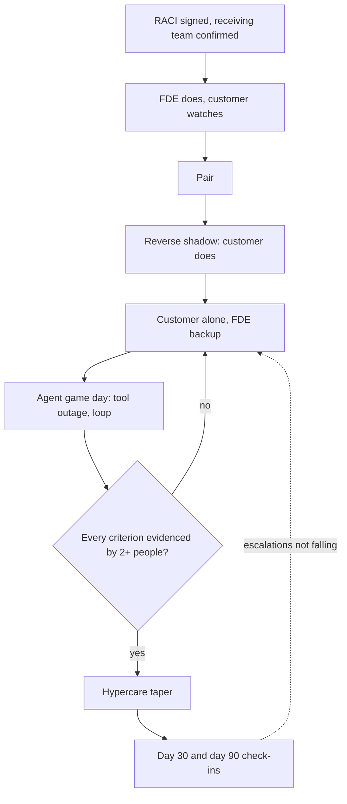

## TL;DR
Handoff transfers *ownership* of a deployed agent from the vendor or FDE team to the customer's
engineers: running it, changing its prompts and tools safely, judging its quality. It works in stages,
with exit criteria the customer has demonstrated, not a calendar date.

## For agent builders
- **Why it matters for agents.** An agent carries more moving parts than a chat feature: tool
  credentials, approval gates, step budgets, a trajectory eval suite. Each one decays silently if nobody
  on the customer side has operated it, and agents act on real systems when they decay.
- **Where it shows up in your stack.** Tool credentials in the customer's identity provider, the agent's
  prompts and tool schemas in their repositories, the eval gate in their CI, and agent alerts (tool error
  rate, step-budget hits, cost per run) in their on-call tooling.
- **What you control.** Building on customer-owned service identities from day one, a tool inventory with
  scopes and expiry, runbooks keyed to agent alerts, and exit criteria that include an agent game day.
- **What you can skip.** Contract and commercial mechanics of the support boundary; leave those to the
  account team, but make sure the RACI names who owns each tool.

## Decision case
### Scenario
The support agent from the examples above (order search, refunds behind an approval gate, email) is due
to leave the FDE team in 4 weeks. The customer's platform team is 2 engineers and 1 operations analyst.
All dates and figures are illustrative.
- **Readiness today:** the skills matrix shows 1 of 5 exit criteria evidenced by two customer people.
  Three have one name each; the model-version upgrade has none.
- **Upcoming change:** the provider releases the next model snapshot in week 7 and retires the current
  one in week 12, so a gated model upgrade lands after the planned exit.
- **Budget:** the sponsor will fund at most 2 more weeks of full FDE time, or a part-time retainer.
- **Risk:** the agent issues refunds, so a bad upgrade costs money before anyone notices.
- **Sponsor goal:** the customer owns the agent; no indefinite vendor dependency.

### Options
| Option | How it works | Covers the week-12 upgrade | Budget | Ends dependency |
|---|---|---|---|---|
| Exit on the date | full handoff in week 4, best-effort support | no: nobody has run an upgrade | fits | yes, on paper |
| Extend until ready | full FDE time until every criterion has two names | only by staying to week 12, 8 weeks over | over budget | yes, late |
| Managed service | vendor keeps run, change and quality | yes | ongoing fee | no |
| Split, time-boxed | customer owns run and access in week 4; vendor co-owns quality and model change on a retainer until the upgrade is done by 2 customer engineers | yes, paired | fits | yes, by about week 13 |

### Decision
**Split ownership, time-boxed.** In the remaining 4 weeks, close the three single-name gaps (game day,
secret rotation, triage), so 4 of 5 criteria have two names at exit.

The customer takes run and access then. The vendor stays accountable for quality and model change on a part-time retainer until two
customer engineers have shipped the snapshot upgrade through the trajectory gate.
- **Why not exit on the date:** the one task nobody can do arrives 3 weeks after exit, on a tool that
  moves money.
- **Why not extend:** covering the upgrade with full FDE time means staying 8 weeks past the planned
  exit, against the 2 the budget allows.
- **Why not managed service:** it contradicts the sponsor's goal and keeps the vendor in every change.
- **Exit test for the retainer:** the upgrade PR, gate report and canary result are authored by customer
  engineers, with the FDE only reviewing.

**What would change it.** If the provider let the team pin the current snapshot past week 12, a plain exit
in week 4 with a booked check-in would do. If the platform team lost an engineer, the two-name rule fails
everywhere, and managed service becomes the honest option.

### Trade-offs accepted
- **A blurred boundary for about 9 weeks.** The RACI names the vendor for quality and model change only;
  track escalations by area, which should fall to zero outside those two.
- **Approval gates stay on refunds** through the upgrade, keeping the customer's review load; watch
  approval rates per tool for a later threshold decision.
- **Retainer cost after the planned end.** It is capped by date and by the upgrade exit test.
- **The upgrade is the customer's first big change.** Run it behind a canary and keep the read-only switch
  rehearsed from the game day.

### Review rubric
- **Readiness from evidence:** the write-up counts criteria with two customer names, not meetings held.
- **Known future changes listed:** model retirements, re-indexes or credential expiries that land after exit.
- **Ownership split by area:** run, change, quality, access and vendor interface each get a named owner.
- **A time box with an exit test:** any continued vendor role ends on checkable evidence, not a date alone.
- **Consequential tools handled:** gates and kill switch status are explicit for tools that move money or
  data.
- **Flip conditions named:** what staffing or vendor change would make another option right.

## Why it exists
- **Forward-deployed work ends.** The FDE moves to the next account, and the system has to keep working
  without them.
- **The failure is slow decay, not a dramatic outage.** Nobody knows why retrieval filters by region, so
  someone "simplifies" it. Nobody can run the eval suite, so a vendor model update ships unchecked. An alert
  fires into a channel nobody watches. A credential issued to the FDE's personal account expires. Six
  months later the customer concludes "the AI didn't work", and the renewal goes with it.
- **A document dump does not transfer a skill.** A wiki page, an architecture diagram and a recorded
  walkthrough in the final week fail because operating an AI system is a skill, not a body of facts.
  Reading about triaging a quality regression does not prepare someone to do it at 2 a.m.
- **AI systems carry more tacit knowledge than ordinary services.** Why a prompt is phrased the way it is,
  which eval slices are noisy, which failures are known and acceptable: much of that lives only in the
  builder's head.
- **The forcing problem:** move that knowledge, and the matching responsibility, to people who will be
  accountable after the builder is gone.

## How it works
### 1. Define what is being handed off
Split ownership into explicit areas, because each needs different skills and often different people.

| Area | Covers |
|---|---|
| **Run** | On-call, alerts, incident response, capacity and cost budgets |
| **Change** | Prompt and config edits, re-indexing, dependency and model upgrades, all through the release gate |
| **Quality** | The regression suite, failure triage, and the continuous-improvement cadence |
| **Access and accounts** | Service identities, secrets, data permissions, audit, and who owns and pays for the model-provider and cloud accounts |
| **Vendor interface** | What the vendor still supports after handoff, how to escalate, and with what SLAs |

- **Accounts are dependencies.** A vendor-billed API account outlives the engagement unless it is moved.
- **Write it as a responsibility matrix (RACI) that both sides sign.** An unclear boundary turns into
  support tickets the vendor bounces back and forth with the customer.

### Agent-specific items to hand over
- **Tool inventory:** every tool the agent can call, the service identity it uses, its scopes, expiry
  date and owner, because an agent's blast radius is the union of its tools' permissions.
- **Control settings:** step budgets, approval gates for consequential actions, rate and cost limits, and
  how to switch the agent off or to read-only mode during an incident.
- **Eval suite with trajectory checks:** required and forbidden tool calls per case, so the customer can
  gate prompt, tool-schema and model changes.
- **Known agent failure modes:** the current buckets (loops, bad arguments, premature stops) with their
  rates and the fixes already tried.

### 2. Check the receiving team is real
- **Confirm named people, allocated time and the needed skills** before planning the transfer. A handoff
  to a team with no capacity is a handoff to nobody.
- **If skills are missing,** the honest options are training plus a longer transition, or a
  managed-service arrangement.
- **Plan for at least two people per ownership area.** If every exit task is done by the one engineer who
  paired with the FDE, the single point of failure has only moved from vendor to customer, and it
  reappears the first time that person is on leave or changes job.
- **Keep a skills matrix:** areas down the side, named people across, a mark when someone has *done* the
  task. It makes the gap visible early.

### 3. Make the artifacts operable, not just readable
- **Code and config:** move infrastructure-as-code, prompts and configs into the customer's repositories
  and CI.
- **Signals:** route dashboards and alerts to the customer's on-call tooling, and write runbooks keyed to
  specific alerts.
- **Evals:** make the suite runnable in the customer's pipeline.
- **Credentials:** re-issue every one to customer-owned service identities.
- **Decision records** for the non-obvious choices, because the "why" is what stops a well-meaning
  simplification from undoing a fix.
- **Known-issues list and open backlog,** handed over explicitly.

### 4. Transfer responsibility in stages
Each stage moves the operator role one step, *because* people build operational skill by doing the task
with a safety net, not by reading about it.
1. **FDE does, customer watches.**
2. **They work as a pair.**
3. **Customer does, FDE watches** (reverse shadowing).
4. **Customer works alone,** FDE as backup.
5. **Exit.**

### 5. Exit on demonstrated capability
- **Exit criteria are tasks with evidence.** For example: the customer team shipped a prompt change
  through the gate, ran the suite and correctly interpreted a regression, resolved a game-day incident
  using the runbook, rotated a secret, and ran a weekly triage without help.
- **A date can be a target, but the criteria decide.**
- **Evidence must be checkable by someone other than the FDE** (a merged pull request, a gate report, an
  incident ticket), because the FDE has the strongest incentive to declare victory on schedule.

### 6. Taper, then check in
- **Hypercare window** with reducing FDE involvement.
- **30- and 90-day check-ins** on the same adoption and quality metrics, so post-handoff decay shows up as
  a trend and not as a churn surprise.
- **Escalations back to the vendor per month:** a falling count means ownership has moved; a flat or
  rising one means the customer is still operating the system through the vendor's people.

## Diagram
Responsibility moves one stage at a time; the exit review checks evidence, and a failed criterion sends
the team back a stage instead of ending the engagement on the calendar date.



## Examples
### Agent scenario: audit the tool inventory before exit
A support agent calls three tools. Before exit, every tool credential must belong to a customer service
identity, have enough life left, carry least-privilege scopes and have a runbook. Names are illustrative.

```python
FDE = {"fde-anna", "fde-raj"}

# Agent tool inventory: (tool, credential owner, scopes, days to expiry, runbook linked)
tools = [
    ("search_orders", "svc-support-agent", ["orders:read"], 180, True),
    ("issue_refund",  "fde-raj",           ["refunds:write"], 12, True),
    ("send_email",    "svc-support-agent", ["mail:send", "admin"], 365, False),
]

def tool_gaps(tools, min_days=30):
    for name, owner, scopes, days, runbook in tools:
        if owner in FDE:
            yield f"{name}: credential owned by {owner}, re-issue to a customer service identity"
        if days < min_days:
            yield f"{name}: credential expires in {days} days"
        if "admin" in scopes:
            yield f"{name}: admin scope, narrow to least privilege"
        if not runbook:
            yield f"{name}: no runbook for tool failures"

for gap in tool_gaps(tools):
    print("GAP", gap)
# GAP issue_refund: credential owned by fde-raj, re-issue to a customer service identity
# GAP issue_refund: credential expires in 12 days
# GAP send_email: admin scope, narrow to least privilege
# GAP send_email: no runbook for tool failures
```

- **The refund tool is the outage waiting to happen:** it runs on a departing FDE's personal credential
  that expires in 12 days, likely inside the hypercare window. Re-issuing it to a customer service
  identity fixes both gaps at once.

### Worked scenario: six-week handoff of a contract-review assistant
A two-person FDE team hands the assistant to the customer's platform team (three engineers and one
operations analyst) over six weeks. The timeline is illustrative.

| Weeks | Stage | What happened |
|---|---|---|
| 1–2 | FDE does, customer watches | RACI agreed. Repos, Terraform and the prompt registry move into the customer's GitHub organisation. The model-API key and document-store credentials are re-issued to customer service accounts and personal keys revoked. Alerts route to the customer's PagerDuty rota with the FDE as secondary. |
| 3–4 | Pair, then reverse shadow | A customer engineer adds the new indemnity clause type to the extraction prompt: twelve labelled contracts go into the suite first, the gate shows the "governing law" slice drop three points, they fix the instruction conflict and ship behind the canary. The analyst runs the weekly triage while the FDE observes. |
| 5 | Customer alone, FDE backup | Game day: the FDE injects a failure that empties retrieval results for one business unit. The on-call engineer finds it from the alert and runbook in 22 minutes, traces it to a revoked index permission, and restores it. The runbook gets two corrections. |
| 6 | Exit review | Each criterion is checked against evidence: change shipped through the gate, incident resolved, secret rotated, triage run unaided, decision records reviewed. |

- **What the review found:** the skills matrix shows each task was done by only one engineer, and one item
  fails outright: nobody has done a vendor model-version upgrade.
- **Decision:** exit is moved a week. The customer runs the upgrade with the suite, and a second engineer
  repeats the gated change and the secret rotation, before sign-off.
- **Follow-up:** check-ins are booked for day 30 and day 90.

### Readiness check from the skills matrix
The exit review as code: every required criterion needs evidence from at least two customer people, and
work the FDE did does not count. Names and ticket ids are illustrative.

```python
FDE = {"fde-anna", "fde-raj"}

done = [  # (exit criterion, area, performed by, evidence link)
    ("prompt change through gate", "change",  "priya", "PR-412 + gate report"),
    ("prompt change through gate", "change",  "tom",   "PR-431 + gate report"),
    ("game-day incident resolved", "run",     "tom",   "INC-88"),
    ("secret rotated",             "access",  "priya", "CHG-19"),
    ("weekly triage run unaided",  "quality", "maria", "triage notes wk5"),
    ("model-version upgrade",      "change",  "fde-raj", "PR-440"),
]
required = ["prompt change through gate", "game-day incident resolved", "secret rotated",
            "weekly triage run unaided", "model-version upgrade"]

def readiness(done, required, min_people=2):
    gaps = []
    for crit in required:
        people = {who for c, _, who, ev in done if c == crit and who not in FDE and ev}
        if not people:
            gaps.append(f"{crit}: no customer evidence")
        elif len(people) < min_people:
            gaps.append(f"{crit}: only {sorted(people)}")
    return gaps

for g in readiness(done, required):
    print("GAP", g)
# GAP game-day incident resolved: only ['tom']
# GAP secret rotated: only ['priya']
# GAP weekly triage run unaided: only ['maria']
# GAP model-version upgrade: no customer evidence
```

## Production patterns
- **Customer-owned identities from day one** — when the build starts, create service accounts in the
  customer's identity provider and cloud, one per agent or per tool group with least-privilege scopes,
  and never use personal API keys even temporarily. Keep a credential inventory with owner and expiry
  date; alert well before expiry and after any personal key is found in use.
- **Eval gate as a required CI check** — once prompts and configs live in the customer's repositories, make
  the regression suite a required status check on pull requests that touch them (branch protection in
  GitHub supports this). Monitor how many changes went through the gate per month after exit.
- **Alert-keyed runbooks** — every alert links to its runbook section, written for the customer's on-call
  engineer. Monitor alerts fired without a runbook link and time to acknowledge on the customer's rota.
- **Game day before exit** — inject a realistic failure (empty retrieval, revoked permission, provider
  outage, a tool returning errors that sends the agent into a loop) in a production-like environment with
  the FDE only observing. Include switching the agent to read-only or off. Measure time to resolve and fold
  every runbook correction back in.
- **Skills matrix with two names per cell** — track who has *performed* each exit task, with links to the
  evidence. Monitor cells with fewer than two customer names; they are single points of failure.
- **Vendor-escalation count after exit** — log every escalation back to the vendor team. Monitor the
  monthly count across the 30- and 90-day check-ins; it should fall.

## Trade-offs
- **Staged, criteria-based transfer vs FDE time.** It costs weeks of FDE time but avoids decay after
  departure; a shorter handoff is reasonable only for simple, stable systems with experienced receiving
  teams.
- **Full ownership vs managed service.** Full handoff frees the vendor but suits customers with real
  platform capability; when the customer lacks AI skills or the system still changes weekly, a
  managed-service arrangement is safer.
- **Customer tooling vs vendor tooling.** Adopting their CI, monitoring and ticketing makes the system
  theirs, but costs migration effort and loses vendor-standard dashboards; the trade flips toward vendor
  tooling when the vendor will keep operating the system.
- **Exhaustive documentation vs maintained documentation.** Exhaustive docs feel safe but go stale
  quickly; short runbooks keyed to alerts plus decision records for non-obvious choices are maintained
  more often.
- **Handing over full agent autonomy vs keeping gates.** Removing approval gates at handoff cuts the
  customer's review load, but a new team learns the agent's failure modes slowly; keep gates on
  consequential tools until the customer has run a few improvement cycles.

## Pitfalls
- **Credentials tied to the FDE's personal accounts.** Symptom: an outage weeks after departure, when the
  account is deprovisioned or a personal API key expires.
- **A last-week document dump.** The receiving team cannot answer basic "what do I do when X alerts"
  questions at the exit review, or nobody holds one.
- **Handing off to a team with no allocated capacity.** Alerts go unacknowledged and the triage cadence
  quietly stops within a month.
- **Undocumented design rationale.** The customer "simplifies" a deliberate choice, such as a retrieval
  filter or prompt constraint, and an old failure returns.
- **An eval suite that only runs on the FDE's laptop.** The first vendor model upgrade after handoff ships
  untested and quality shifts.
- **Every exit task done by one customer engineer.** The system runs fine until that person leaves or is
  on holiday, then the next incident takes days.
- **A vague support boundary.** Tickets bounce between vendor support and the customer team, and
  resolution times climb.
- **Nobody knows how to stop the agent.** During the first post-exit incident the agent keeps taking a
  bad action while the team searches for the setting. Fix: a documented kill switch or read-only mode,
  exercised in the game day.

## When to use
- **Plan it at the start of the engagement,** not the end. Who will own the system should shape early
  choices: which repos, which CI, which monitoring stack, and whose identities.
- **Use the full staged process** for any system with real users, consequential outputs, or ongoing change.
- **Avoid the full process** for a throwaway POC; a short readme is enough.
- **Measure success after handoff,** not at the exit meeting: incident time-to-resolve by the customer
  team, changes shipped through the gate, triage continuity, and quality trends at 30 and 90 days.
- **Interviews:** the signal is treating handoff as transfer of responsibility with exit criteria.

## Role lens
- **Engineer:** Moves code, prompts and infrastructure into customer-owned repos and identities, and makes
  the eval suite and gates runnable in the customer's CI without vendor-only tooling.
- **Architect:** Draws the ownership boundary and support model, decides between full handoff and managed
  service, and keeps the design rationale in decision records.
- **FDE:** Runs the graduated transfer, designs the game day, judges readiness against evidence, and
  negotiates a later exit when a criterion is not met.

## Check yourself
**Q:** The engagement contract ends in two weeks, but the customer team has not yet shipped a change
through the release gate on its own. What do you do?
**A:** I would not treat the contract date as proof of readiness. First, I make the gap visible to both
sponsors: which exit criteria have evidence and which do not, and what risk each open item carries. In
the two weeks, I prioritise the highest-risk missing capability, usually a gated change and an incident
drill, by having the customer do them with me as backup. If they still are not ready, I propose
options: a short paid extension, a defined post-handoff support window with named escalation, or a
managed-service arrangement for the parts they cannot yet own. Then the sponsor chooses with the risk
written down.

## Interview questions
### What exactly is transferred in a handoff, and why is documentation not enough?
- **Ownership in five areas:** run, change, quality, access and accounts, and the vendor interface, written
  as a signed RACI.
- **Documentation transfers facts, not skill.** Operating an AI system means triaging regressions and
  resolving incidents, which people learn by doing with a safety net.
- **Tacit knowledge** (why a prompt is phrased a certain way, which slices are noisy) needs decision records
  and paired work, not a final-week walkthrough.

### Design the exit criteria for handing off a RAG agent with tools.
- **Tasks with checkable evidence:** a prompt change shipped through the gate, a regression correctly read,
  a game-day incident resolved from the runbook, a secret rotated, a re-index or model upgrade run with the
  suite, a weekly triage run unaided.
- **Evidence a third party can verify:** merged pull requests, gate reports, incident tickets.
- **Two people per area,** so the single point of failure does not move from vendor to customer.
- **Agent-specific tasks:** a tool-schema change shipped through the trajectory gate, a tool credential
  rotated, and the agent switched to read-only during a drill.

### What agent-specific risks do you check before handing an agent to a customer team?
- **Tool permissions:** every tool on a customer service identity with least-privilege scopes, an owner
  and an expiry date, because the agent can do anything its tools allow.
- **Controls they can operate:** step budgets, approval gates, cost limits and a kill switch, each with a
  runbook and exercised once by the customer.
- **Quality ownership:** a trajectory eval suite that runs in their CI, and the current failure buckets
  with rates, so their first model upgrade is gated.

### When would you not do a full handoff?
- **When the receiving team has no allocated capacity or AI skills,** because a handoff to nobody decays.
- **When the system still changes weekly,** since the vendor would be re-explaining constantly.
- **The alternative** is a managed-service arrangement or a longer transition with training, chosen by the
  sponsor with the risk written down.

### Three months after exit, vendor escalations are flat at around ten a month. What does that tell you and what do you do?
- **Ownership has not moved:** the customer is still operating the system through the vendor's people.
- **Classify the escalations** by ownership area to find which capability is missing, for example model
  upgrades or quality triage.
- **Run a targeted transfer** for that area: paired work, a drill, and evidence from two people, then
  re-check at the next check-in.

### What usually causes an outage a few weeks after the FDE leaves?
- **Credentials tied to the FDE personally:** the account is deprovisioned or a personal API key expires.
- **Prevention:** re-issue every credential to customer-owned service identities in the first weeks and
  revoke personal ones, with an inventory of owners and expiry dates.
- **Detection:** alerts that route to the customer's on-call, not to a channel nobody watches.

## Quiz
### Q: Why are handoff exit criteria best expressed as tasks the customer team has performed?
- [ ] Because contracts legally require task-based acceptance
- [x] Because operating an AI system is a skill, and only doing tasks shows the team can handle them unaided
- [ ] Because tasks are easier to schedule than reviews
- [ ] Because documentation cannot describe AI systems accurately
> Reading runbooks does not prove someone can triage a regression or resolve an incident. Demonstrated
> tasks with evidence do. Dates and documents are inputs to readiness, not proof of it.

### Q: Weeks after an FDE leaves, the assistant stops working with authentication errors to the model API. What handoff step most likely was missed?
- [ ] Moving prompts into the customer's prompt registry
- [ ] Running a game-day incident drill
- [x] Re-issuing credentials to customer-owned service identities and revoking personal ones
- [ ] Writing decision records for the retrieval design
> Credentials issued to an individual's account break when that account is deprovisioned or the key
> expires. Re-issuing them to customer service identities is a core handoff step.

### Q: When is a managed-service arrangement a better choice than a full handoff?
- [x] When the customer lacks the skills or capacity to operate the system and it still changes frequently
- [ ] When the customer has a mature platform team with on-call rotations
- [ ] Whenever the system uses a third-party model API
- [ ] When the documentation is complete
> Full ownership needs a capable, staffed receiving team. Without one, or while the system is still
> changing quickly, the vendor operating it avoids handing responsibility to nobody.

## Use cases & projects
### Use cases
- **FDE exit from an agent deployment.** Staged transfer plus an agent game day proves the customer can
  run, change and stop the agent without the builder.
- **Internal platform team adopting an agent.** The same RACI, tool inventory and exit evidence apply when
  a product team hands its agent to a central platform team.
- **Credential and permission hygiene.** A tool inventory audit before exit catches personal keys, near
  expiries and over-broad scopes.
- **Choosing managed service instead.** When the receiving team cannot yet own tools and evals, the
  readiness check makes that case with evidence.

### Mini project
**Write and test a handoff pack for a toy agent (2-3 hours).**
- **Goal:** make a small tool-calling agent operable by someone who did not build it.
- **Steps:** list the agent's tools with owner, scopes and expiry; write two runbook sections keyed to
  alerts (tool error rate, step-budget hits); add a switch that puts the agent in read-only mode; make the
  eval suite runnable with one command; ask a colleague to resolve an injected tool outage using only the
  pack.
- **Done when:** the colleague restores service and flips read-only mode without help, the tool audit
  prints no gaps, and you have folded their runbook corrections back in.
