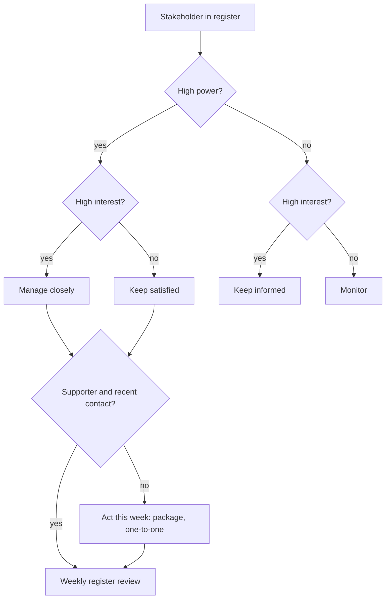

## TL;DR
Stakeholder management means knowing who can help, block or be affected by your agent and engaging each
on purpose, because agent projects often stall on a late "no" from security, a data owner or a team lead
never engaged, not on the model.

## For agent builders
- **Why it matters for agents.** An agent that reads company data and calls tools that change records
  triggers more reviews than a chatbot: data access per tool, credentials, vendor risk, audit and rollback.
  Each reviewer holds a veto and has a queue, and the queue often sets your launch date.
- **Where it shows up in your stack.** The tool inventory (read vs write, which system, which
  credentials), the data-flow diagram from user to model to tools, approval gates, audit logs and the kill
  switch are what reviewers read.
- **What you control.** Design tools with narrow scopes so reviews are easier, prepare the review package
  before anyone asks, back-schedule approvals from go-live, and put eval error rates in every sponsor
  update so expectations stay real.
- **What you can skip.** Stakeholder theory beyond the power-interest grid and RACI. A register with a
  weekly staleness check covers most agent projects.

## Why it exists
- **Agent deployments touch many groups.** The sponsor funds it, a process owner's team uses it, IT runs
  the integration, security and legal review the data flow and tool access, a data owner controls
  source-system access, procurement handles the contract, and in some regions a works council or union must
  be consulted when work changes.
- **Each can slow or stop the project, and each defines success differently.** The sponsor wants a
  business metric, users want less tedium and no blame, security wants no new exposure, the data owner
  wants no surprises.
- **Sending company data to a model, and letting it act through tools, triggers reviews** (data
  classification, residency, vendor risk, access control) that ordinary tools may not, and those reviewers
  have real veto power.
- **Probabilistic quality needs expectation management.** A sponsor who heard "it works" in the demo will
  treat a 5% error rate as a failure unless someone set that expectation early; expectations drift away
  from what the agent can deliver.
- **The naive approaches fail.** Talking mostly to the sponsor and friendly champion optimizes for people
  already on your side, so blockers surface when they block (at the security review or go-live, when
  changes cost most). A weekly email to everyone is noise to most and too shallow for the few who decide.

## How it works
### 1. Identify everyone, including the quiet vetoes
- **List people and groups, not departments.** For each, ask: can they approve, block, fund, or are they
  affected?
- **Probe for the roles agent projects forget:** data owners for every system a tool touches, security,
  privacy, legal, compliance, IT operations, team leads of end users, and employee representatives.
- **Ask each stakeholder "who else should I talk to?"**, *because* informal vetoes are often invisible on
  the org chart.

### 2. Map influence, interest and stance
The power-interest grid (usually attributed to Mendelow) sorts people into four groups:

| | Low interest | High interest |
|---|---|---|
| **High power** | Keep satisfied | Manage closely |
| **Low power** | Monitor | Keep informed |

- **Add stance** (supporter, neutral, skeptic, blocker), plus what each person needs to believe to support
  the project and what they fear.
- **Why the grid:** engagement effort is finite, so the grid tells you where to spend it.
- **Stance is the attribute that changes.** Record the evidence for it ("asked twice about data
  residency") rather than a label, and expect to revise it.

For each important stakeholder, write down what they are measured on and what this project does to that
measure:

| Stakeholder | Scorecard | What the project does to it |
|---|---|---|
| Security lead | Rewarded for incidents that did not happen | Gains nothing from your launch |
| Team lead | Judged on throughput | The pilot dents it for a few weeks |
| Data owner | Blamed if their data leaks | Leak risk through someone else's system |

- **Most "irrational" resistance becomes predictable** once you see the project from their scorecard.
- **The fix is usually to change what the project costs them** (a complete review package, a protected
  target during the pilot, a narrower data scope or a read-only tool), not to argue harder about the
  benefits.

### 3. Define decision rights
- **For each key decision** (scope, data access, tool permissions, go-live, rollback), agree who is
  responsible, accountable, consulted and informed (RACI).
- **Why:** it prevents the classic stall where three people each think another one approves the release,
  *because* an agent go-live usually needs sign-off from several functions.

### 4. Sequence by lead time, not by friendliness
- **Some approvals have long, fixed lead times:** a security or vendor-risk review queue, a data-access
  request, a works-council consultation, a procurement cycle.
- **Lay them out like a project plan and work backwards from go-live**, *because* the latest-starting
  long-lead review sets the real launch date regardless of how fast the engineering goes.
- **Worked case:** go-live is in ten weeks and the security queue is running at six, so the review package
  must be submitted by week four, which means the data-flow design and tool list must be stable before then.

### 5. Plan engagement per person
| Who | Engagement |
|---|---|
| Manage-closely stakeholders | One-to-ones and early drafts |
| Security and legal | Architecture, data-flow and tool-permission documentation before they ask |
| Users and team leads | Workshops and pilots |
| Executives | Short decision-focused updates |

Security and legal get the package early *because* a reviewer who receives a complete package early is
far less likely to block late.

### 6. Escalate with options, not complaints
1. **Escalate only after one-to-one work fails**, through the sponsor.
2. **State the blocker's concern fairly**, with two or three options (narrow scope, add a control, delay)
   and their costs.
3. **Tell the blocker before you escalate.**
4. **Frame it as a decision.** "They are in the way" costs you the relationship for the rest of the
   project; "we need a decision between these options" usually gets one.

### 7. Maintain the map
- **Keep a register** with owner, stance, last contact and next action; review it weekly.
- **Update it when people change roles.**
- **Build more than one senior supporter.** When a sponsor leaves, the successor inherits a project they
  did not choose and may cut it.

## Diagram
Each stakeholder is routed by power and interest, then stance decides whether this week needs action; the
weekly review loops everyone back through.



## Examples
### A stakeholder register with an overdue-attention check
A minimal stakeholder register, the kind an FDE keeps alongside the agent project plan, with a check that
flags where attention is overdue. The rule encodes the grid: high-power people who are not supporters, or
whom nobody has spoken to recently, need action this week.

```python
from datetime import date

stakeholders = [
    # name, role, power 1-5, interest 1-5, stance, last contact
    ("Priya", "VP Ops (sponsor)",         5, 5, "supporter", date(2026, 10, 14)),
    ("Marc",  "CISO delegate",            5, 2, "skeptic",   date(2026, 9, 2)),
    ("Lena",  "Data owner, claims DB",    4, 2, "neutral",   date(2026, 9, 20)),
    ("Tom",   "Team lead, adjusters",     3, 5, "blocker",   date(2026, 10, 1)),
    ("Ana",   "Adjuster (champion)",      2, 5, "supporter", date(2026, 10, 16)),
]

def quadrant(power, interest):
    if power >= 4:
        return "manage closely" if interest >= 4 else "keep satisfied"
    return "keep informed" if interest >= 4 else "monitor"

def actions(today, stale_days=21):
    for name, role, p, i, stance, last in stakeholders:
        q, age = quadrant(p, i), (today - last).days
        flags = []
        if p >= 4 and stance != "supporter":
            flags.append(f"high power, {stance}")
        if stance == "blocker":
            flags.append("blocker: find out what they fear")
        if p >= 4 and age > stale_days:
            flags.append(f"no contact for {age} days")
        if flags:
            print(f"{name:5} {role:24} [{q}] -> " + "; ".join(flags))

actions(date(2026, 10, 20))
```

What the check flags on this data:

| Who | Flag | Action |
|---|---|---|
| Marc | Skeptic with a veto, 48 days without contact | Send the data-flow and tool-permission package and book a review |
| Lena | Neutral data owner, 30 days | Confirm access terms for the claims-lookup tool |
| Tom | Team lead blocking adoption | One-to-one about what he fears, usually blame for agent errors or his team's metrics |

The sponsor and the champion need nothing this week.

### Which reviews does the agent's tool list trigger?
The tool inventory drives the approval plan. This sketch maps each tool to the reviews it triggers and
back-schedules them from go-live. Lead times are the ones from the scenario below; the tool list is
illustrative.

```python
GO_LIVE_WEEK = 10
LEAD_WEEKS = {"security": 6, "data_access": 3, "works_council": 8}   # 3 and 8 illustrative

tools = [
    # name, system, writes?, touches personal data?
    ("search_claims",   "claims DB",  False, True),
    ("get_policy",      "policy API", False, False),
    ("update_claim",    "claims DB",  True,  True),
]

def reviews_for(tool):
    name, system, writes, personal = tool
    out = {"security"} if writes or personal else set()
    if personal:
        out.add("data_access")
    return out

needed = set().union(*(reviews_for(t) for t in tools))
needed.add("works_council")          # the agent changes how adjusters work
for r in sorted(needed, key=lambda r: GO_LIVE_WEEK - LEAD_WEEKS[r]):
    print(f"{r:14} submit by week {GO_LIVE_WEEK - LEAD_WEEKS[r]}")
# works_council  submit by week 2
# security       submit by week 4
# data_access    submit by week 7
# Dropping update_claim (read-only pilot) would not remove security here,
# but it usually makes that review shorter and the package smaller.
```

### Worked scenario: back-scheduling approvals from go-live
Go-live for a claims agent is in ten weeks. Lay out each long-lead approval and find its latest start; the
security figure comes from the case above, the others are illustrative.

| Approval | Lead time (weeks) | Latest submission week | Prerequisite |
|---|---|---|---|
| Security review queue | 6 | 4 | Data-flow design and tool list stable |
| Data-access request | 3 (illustrative) | 7 | Data scope agreed with owner |
| Works-council consultation | 8 (illustrative) | 2 | Impact on roles written down |

- **The binding constraint is the works council**, not engineering: it must start in week 2, so the
  role-impact statement is due before any build is finished.
- **Security is next:** the data-flow design and the agent's tool permissions must stabilize by week 4,
  which forces architecture decisions early.
- **Friendliness is irrelevant to the order.** Engaging the friendliest reviewer first would leave the
  project waiting in a queue after the build is done.

## Production patterns
- **Approval lead-time plan** — at kickoff, ask each reviewing function for its current queue length and
  put every approval on the project plan as a dependency with a latest-start date. Monitor the gap between
  planned and actual submission dates each week.
- **Review package ready before the ask** — prepare the architecture and data-flow diagram, data
  classification, storage location and retention, vendor terms, access controls and logging as one bundle,
  plus the agent's tool inventory with read or write scope, approval gates and kill switch. Monitor the
  number of reviewer follow-up questions and the time from submission to decision.
- **Least-privilege tools as a negotiating lever** — when a reviewer balks, offer a read-only pilot, a
  narrower data scope or a human approval on every write before arguing benefits. Monitor which tool
  scopes each review approved, and re-submit only the delta when you widen them.
- **Register with automated staleness flags** — keep the register in a sheet or tracker and run a weekly
  check like the one above (high power and not a supporter, or no contact past a threshold). Monitor how
  many high-power entries are stale at each weekly review.
- **RACI in the project charter** — write the RACI for scope, data access, tool permissions, go-live and
  rollback into the charter the sponsor signs. Monitor decisions that slip past their due date, which
  usually point at an unclear accountable owner.
- **Eval-anchored expectations** — include the current eval error rate, the baseline and the mitigation in
  every sponsor update from the first demo onward. Monitor whether the sponsor can restate the expected
  error rate unprompted.

## Trade-offs
- **Formal mapping vs time.** Mapping everyone catches hidden vetoes but costs time; a small internal tool
  with one team needs only a short list.
- **Engaging blockers early vs momentum.** It surfaces objections while they are cheap but can slow
  momentum; skip only when their approval is genuinely not required.
- **Single strong sponsor vs resilience.** One sponsor makes decisions fast but is a single point of
  failure if that person moves; cultivate a second senior supporter.
- **Tailored messages vs consistency.** Tailoring improves relevance but risks inconsistent stories; keep
  one source of truth that every message draws from.
- **Open error rates vs alarm.** Sharing the error rate sets realistic expectations but can alarm cautious
  stakeholders unless paired with the mitigation and the baseline.
- **Broad tool access vs review speed.** Write tools across several systems make a more capable agent but
  pull in more reviewers and longer queues; start narrow and widen with evidence.

## Pitfalls
- **Talking mainly to supporters.** Symptom: a surprise "no" from security or legal at the go-live review.
- **Leaving decision rights implicit.** Revealed when go-live waits for weeks because nobody knows who
  signs off.
- **Ignoring team leads of end users.** Shows up as adoption varying sharply between teams with the same
  agent.
- **Letting the sponsor's expectations drift from the eval results.** A normal error rate is then read as
  project failure.
- **Never updating the map after reorganizations.** Discovered when a new executive cancels a project they
  never heard of.
- **Engaging long-lead reviewers by friendliness rather than lead time.** Revealed when the build is done
  and the project waits weeks in a review queue.
- **Adding a write tool after security signed off.** Symptom: a second review, or a reviewer who feels
  misled. Fix: treat any new tool or wider scope as a change that goes back to the reviewer.

## When to use
- **Use when** an agent crosses team boundaries, needs data access from another owner, calls tools in
  systems you do not own, or requires security or compliance review, which covers most enterprise work.
- **Timing:** build the map in the first week of scoping and review it weekly through rollout and
  hypercare.
- **Measure indirectly:** no late vetoes, decisions made on schedule, approvals submitted ahead of each
  reviewer's lead time, and sponsors whose expectations match the evals.
- **Scale down** for a small internal tool used by one team: a short list of approvers is enough.
- **Interviews:** show that you look for blockers and veto holders first, not just sponsors.

## Role lens
- **Engineer:** Produces the artifacts reviewers need, such as data-flow diagrams, eval results and access logs, and answers technical objections precisely.
- **Architect:** Owns the decision rights for architecture, data access and security sign-off, and makes sure reviewers see designs before they harden.
- **FDE:** Maintains the map inside the customer, finds informal vetoes by asking who else matters, and converts skeptics through one-to-ones.

## Check yourself
**Q:** Two weeks before go-live, the customer's security team, never formally engaged, asks to review the system and signals concern. How do you respond, and what would you have done differently?
**A:** Now: treat it as legitimate, not an obstacle. I would meet them immediately with a complete package (architecture and data-flow diagram, data classification, where data is stored and for how long, vendor terms, access controls, logging) and ask for their specific concerns in writing so we can resolve them one by one. I would tell the sponsor honestly that go-live may move. Earlier: security has a veto on any system that sends company data to a model, so they belong in the high-power quadrant from week one, with their review lead time on the plan and the data-flow design reviewed before integration was built. I would also ask what they are accountable for, because a package that answers their specific exposure questions moves faster than one that argues the business value.

## Interview questions
### What is a power-interest grid, and what do you add to it for an agent project?
- **Definition:** a two-by-two of power and interest giving four strategies: manage closely, keep
  satisfied, keep informed, monitor; it tells you where finite engagement effort goes.
- **Add stance with evidence** (supporter, neutral, skeptic, blocker) and what each person is measured on,
  because resistance becomes predictable from their scorecard.
- **For agents specifically**, probe for the data owner of every system a tool touches, security, privacy
  and works councils, who hold vetoes but rarely appear in the first list.

### What goes in the security review package for an agent that can write to a customer system?
- **Data flow:** what leaves the company, to which model provider, stored where and for how long, plus
  vendor terms and data classification.
- **Tool inventory:** each tool, the system it calls, read or write, the credential it uses and its scope,
  and which actions need human approval.
- **Controls:** audit logs of every tool call, rate limits, a kill switch and the rollback path for a
  wrong write, with eval results on the write actions.

### A team lead is quietly steering his team away from the pilot. How do you handle it?
- **One-to-one first**, to learn what he fears: blame for agent errors, or the pilot denting his team's
  throughput.
- **Change what the project costs him:** a protected target during the pilot, a clear rule on who owns
  agent errors, involvement in the pilot review.
- **Escalate only with options** if that fails, and tell him before you do.

### Your go-live date is set by engineering estimates. Why might that be wrong?
- **Approvals have fixed lead times** (security queue, data access, procurement, works council) that do
  not shrink when engineering speeds up.
- **The latest-starting long-lead review sets the real date.** With a six-week security queue and go-live in
  ten weeks, the package is due in week four.
- **So** back-schedule approvals first and let them drive when designs and the tool list must be stable.

### Security approved a read-only agent. Product now wants it to update records. How do you handle it?
- **Treat it as a new review**, not a tweak: send the delta (new tool, scope, credential, approval gate,
  rollback) to the same reviewer before building it into the release.
- **Offer staged options:** human approval on every write first, then wider autonomy once eval and
  override data show it is safe.
- **Re-plan the date** around that reviewer's queue and tell the sponsor now, not at go-live.

### How do you escalate a blocker without burning the relationship?
- **Tell the blocker first**, so the escalation is not a surprise.
- **State their concern fairly** and bring two or three options (narrow scope, add a control, delay) with
  costs.
- **Ask for a decision, not a ruling against a person:** "we need a decision between these options" gets
  one; "they are in the way" costs you the rest of the project.

## Quiz
### Q: On a power-interest grid, a security reviewer who rarely engages but can block go-live belongs where?
- [ ] Monitor, because their interest is low
- [ ] Keep informed, because they only need status updates
- [x] Keep satisfied, because high power means their objection can stop the project
- [ ] Manage closely, because every reviewer must attend weekly meetings
> High power with low interest means "keep satisfied": give them what they need to approve, early and
> complete. Monitoring them risks a late veto; weekly meetings waste their time.

### Q: Why define a RACI for the go-live decision on an AI deployment?
- [ ] To make the sponsor solely responsible for any errors
- [x] Because go-live usually needs several functions, and without explicit decision rights the release stalls
- [ ] Because RACI documents are required by most AI regulations
- [ ] To replace the need for security and compliance reviews
> AI go-lives typically need sign-off from operations, security, compliance and IT. A RACI makes the
> accountable approver explicit, so nobody waits for an approval nobody believes is theirs.

### Q: A team lead is openly discouraging his team from using the tool. What is the best first move?
- [ ] Escalate to the sponsor to mandate usage on his team
- [ ] Exclude his team from the rollout
- [x] Meet him one-to-one to learn what he fears, such as blame for AI errors or damage to team metrics
- [ ] Send his team additional training materials
> Blockers usually have a concrete concern. Understanding it allows a real fix; mandating through the
> sponsor tends to produce compliance theatre, and more training does not address his objection.

## Use cases & projects
### Use cases
- **Getting a tool-using agent through security review.** A complete package with the tool inventory and
  controls, submitted ahead of the queue, avoids the two-weeks-before-launch veto.
- **Widening an agent from read-only to write actions.** Each new tool scope goes back to the reviewers
  and data owners, on their lead times.
- **Agents that change frontline work.** Team leads and employee representatives are stakeholders whose
  consultation can set the launch date.
- **Keeping a sponsor through an agent pilot.** Eval-anchored expectations and a second senior supporter
  protect the project from one bad week or one reorg.

### Mini project
**A review plan generated from your agent's tool list (1-2 hours).**
- **Goal:** turn an agent's tool definitions into a stakeholder and approval plan.
- **Steps:** list the tools of an agent you have built (or a sample of 4-6) with system, read or write,
  credential and data sensitivity; map each to the reviews and data owners it triggers; assign
  illustrative lead times and back-schedule from a go-live week; build a five-person register and run the
  staleness check; draft a one-page review package outline.
- **Done when:** you have a table of tools to reviewers, a latest-submission week per approval, the
  register flags for this week, and one change (a narrower tool scope) that shortens the plan.
