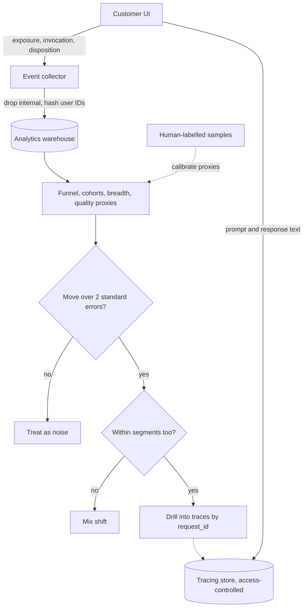

## TL;DR
Usage analytics instruments an AI feature to show who uses it, how often, how deeply, and what they do
with its output: accept, edit, regenerate or abandon. Traces show what the system did; analytics shows
what people did with it.

## Why it exists
- **A healthy system can still go unused.** A deployed assistant can be technically fine while nobody
  relies on it; only behavioural events against a defined eligible population show that.
- **Request and login counts mislead.** Requests rise when one enthusiastic team uses the tool heavily
  while forty others ignore it, or when users regenerate the same answer five times because the first
  four were wrong. Logins count people who opened the page, not people who got anything done.
- **Raw counts have no denominator.** 2,000 weekly users is a success among 2,500 eligible agents and a
  failure among 40,000.
- **AI output is probabilistic, so the signal comes after the response.** Did the user send the draft
  unchanged, rewrite half of it, copy one paragraph, or close the panel? These downstream actions are the
  cheapest large-scale quality signal you will get; thumbs buttons are clicked by a small, unrepresentative
  fraction, mostly when annoyed.
- **Reading prompt logs or traces is not a substitute.** Traces are keyed by request, not by user journey,
  and copying raw prompts into an analytics warehouse spreads sensitive customer content to a system with
  broad access.

## How it works
### 1. Define the eligible population and the unit of value
- **Eligible population:** who *could* use the feature (licensed seats, agents in the pilot queues).
- **Unit of work:** a ticket answered, a contract reviewed, a query resolved.
- **Every rate needs both.** Adoption is active users ÷ eligible users, not active users alone. Depth is
  units of work done with AI ÷ units of work done in total.

### 2. Design an event schema around outcomes, not clicks
A small, stable vocabulary beats hundreds of ad-hoc events.

| Event | Meaning |
|---|---|
| **exposure** | The feature was shown or offered (needed for any funnel denominator) |
| **invocation** | The user deliberately asked for AI help |
| **response** | The system returned output, carrying the `request_id` that joins to the trace |
| **disposition** | Accepted as-is, accepted after edit (with an edit-size measure), regenerated, discarded, escalated to a human |
| **explicit feedback** | Thumbs, ratings, free-text reasons |

- **Common fields on every event:** pseudonymous user ID, account or tenant, feature name, prompt/model
  version and a timestamp.
- **`request_id` is the design choice that matters most.** It lets you go from "acceptance dropped on
  Tuesday" to the exact traces, prompt version and retrieved documents behind the dropped requests,
  *without* storing content in the analytics store.

### Edit size, defined precisely
- **Why define it:** "edited" alone lumps a fixed typo together with a full rewrite.
- **Compute it in the client,** where the draft and the sent text are both already present, for example as
  `1 − similarity(draft, sent)` with a character- or token-level diff ratio. Emit only the number.
- **Bucket it** (0, under 10%, 10–50%, over 50%) so the dashboard shows the shape of the distribution,
  because the mean hides the difference between "most drafts need a light touch" and "half are fine,
  half are rewritten from scratch".

### 3. Prefer implicit signals, calibrate them with explicit ones
- **Coverage:** disposition events are emitted for every response, so they avoid the self-selection bias
  of explicit ratings.
- **Not bias-free:** "abandoned" has to be inferred from a timeout or a closed panel, and users copy text
  out in ways the UI may not see.
- **Noisy:** a user may accept a mediocre draft because fixing it is quicker than writing from scratch.
- **So treat them as proxies.** "Accepted unchanged", "edited by more than half" and "regenerated" are
  proxies. Periodically check them against human-labelled samples, so you know what a 60% acceptance rate
  means for *this* workflow.

### 4. Build the standard views
| View | Definition | What it tells you |
|---|---|---|
| **Funnel** | eligible → exposed → tried once → used in 3+ distinct weeks | Whether the problem is awareness, first experience or ongoing value |
| **Cohort retention** | of users who first used it in week *w*, the share still using it in week *w+n* | Flattening above zero is a habit; decay toward zero is a novelty curve |
| **Stickiness and depth** | weekly-active ÷ monthly-active, and AI-assisted share of all work items | How habitual and how central the tool is |
| **Breadth** | active users by team, region or role | Where adoption is lumpy, which it usually is |
| **Quality proxies over time** | acceptance, edit size and regeneration rate, sliced by prompt version | Whether a release helped or hurt |

- **Checklist:** frameworks such as Google's HEART (Happiness, Engagement, Adoption, Retention, Task
  success) are a useful check that the views cover the whole journey.

### 5. Check noise and mix before reading a change
- **Every rate moves by chance,** because it is a proportion over a finite count.
- **Standard error of one rate** *p* over *n* events: about `sqrt(p(1−p)/n)`.
- **Standard error of a difference** between two periods or prompt versions: about
  `sqrt(p₁(1−p₁)/n₁ + p₂(1−p₂)/n₂)`.
- **Rule of thumb:** treat a move smaller than roughly two standard errors as unproven. Small pilots make
  this bite: at 50 drafts a week, acceptance can swing ten points with nothing changed.
- **Mix:** an aggregate rate is a weighted average over segments, so it moves when the weights move even
  if no segment changes. If a new team with naturally harder tickets joins in the week a prompt ships,
  overall acceptance falls and the prompt gets blamed.
- **Slice by team or cohort first.** A real regression shows up *within* segments; a mix shift shows flat
  segments and a moving total.

### 6. Keep it clean and lawful
- **Exclude internal, test and service accounts,** or the vendor team's own testing inflates week one.
- **Hash or tokenize user IDs.**
- **Keep prompt and response text in the access-controlled tracing store,** not in analytics.
- **Agree retention periods and works-council or employee-monitoring constraints** with the customer
  *before* instrumenting.
- **Aggregate to team level by default,** because in many organisations per-employee productivity
  tracking is a legal and political issue.

## Diagram
Behavioural events and content take separate paths; the `request_id` is the only bridge, and labelled
samples keep the proxies honest.



## Examples
### Cohort retention and draft disposition in SQL
Two Postgres queries over an `ai_events` table for a support-reply drafting assistant. The first computes
weekly cohort retention on a deliberate action (`draft_requested`), excluding internal users; the second
tracks what agents did with the drafts.

```sql
WITH active AS (
  SELECT DISTINCT e.user_id, date_trunc('week', e.ts)::date AS wk
  FROM ai_events e JOIN users u ON u.user_id = e.user_id
  WHERE e.feature = 'draft_reply'
    AND e.event_type = 'draft_requested'      -- an intentional action, not an impression
    AND NOT u.is_internal
),
cohort AS (SELECT user_id, min(wk) AS cohort_wk FROM active GROUP BY user_id),
size   AS (SELECT cohort_wk, count(*) AS n FROM cohort GROUP BY cohort_wk)
SELECT c.cohort_wk,
       (a.wk - c.cohort_wk) / 7                              AS weeks_since_first_use,
       count(DISTINCT a.user_id)                             AS active_users,
       round(count(DISTINCT a.user_id)::numeric / max(s.n), 3) AS retention
FROM cohort c
JOIN active a ON a.user_id = c.user_id
JOIN size s   ON s.cohort_wk = c.cohort_wk
GROUP BY c.cohort_wk, weeks_since_first_use
ORDER BY c.cohort_wk, weeks_since_first_use;

-- Disposition of drafts per week, sliced by prompt version.
SELECT date_trunc('week', ts)::date AS wk, prompt_version,
       count(*) FILTER (WHERE event_type = 'draft_shown')          AS shown,
       count(*) FILTER (WHERE event_type = 'draft_sent_unchanged') AS sent_as_is,
       count(*) FILTER (WHERE event_type = 'draft_sent_edited')    AS sent_edited,
       count(*) FILTER (WHERE event_type = 'draft_regenerated')    AS regenerated
FROM ai_events
WHERE feature = 'draft_reply'
GROUP BY 1, 2 ORDER BY 1, 2;
```

### Worked scenario: prompt v7 regression or mix shift?
Reading the two queries together is the point. Illustrative numbers:

| Step | Finding |
|---|---|
| Week-4 retention of the first cohort | 0.35 |
| `sent_as_is / shown` before vs after prompt v7 | fell from 0.42 to 0.30, about 500 drafts on each version |
| Standard error of the difference | `sqrt(0.42·0.58/500 + 0.30·0.70/500) ≈ 0.03` |
| Size of the move | a 12-point drop is roughly four standard errors: not noise |
| Same drop with 50 drafts per version | error about 0.095, so the drop would prove nothing |
| Slice by team | every team fell, and regenerations rose |

- **If only the newly onboarded billing team were low** and the others flat, it would be mix.
- **Because every team fell,** it is a quality regression to chase in the traces by `request_id`, not an
  adoption problem.

### Client-side edit size and a significance check in Python
Edit size is computed where both texts exist and only the bucket is emitted; the same file checks
whether a change in acceptance is bigger than noise.

```python
from difflib import SequenceMatcher
from math import sqrt

def edit_size(draft, sent):
    return 1 - SequenceMatcher(None, draft, sent).ratio()   # 0 = unchanged, 1 = rewritten

def bucket(x):
    if x == 0:
        return "0"
    if x < 0.10:
        return "under 10%"
    if x <= 0.50:
        return "10-50%"
    return "over 50%"

def diff_se(p1, n1, p2, n2):
    return sqrt(p1 * (1 - p1) / n1 + p2 * (1 - p2) / n2)

draft = "Thanks for reaching out. Your refund was issued today."
sent = "Thanks for reaching out! Your refund was issued today and should arrive in 3-5 days."
x = edit_size(draft, sent)
print(round(x, 2), bucket(x))             # 0.23 10-50%  (emit the bucket, never the text)

for n in (500, 50):                       # drafts per prompt version
    se = diff_se(0.42, n, 0.30, n)
    z = (0.42 - 0.30) / se
    print(n, round(se, 3), round(z, 1), "real" if abs(z) >= 2 else "unproven")
# 500 0.03 4.0 real
# 50 0.095 1.3 unproven
```

## Production patterns
- **Versioned event contract** — when several features or teams emit events, keep the vocabulary in one
  schema file (for example JSON Schema) validated in the collector; quarantine unknown event types instead
  of silently accepting them. Monitor the rejected-event rate after every client release.
- **Join key, not content** — whenever prompts may hold customer data, put `request_id` and
  `prompt_version` on every analytics event and keep text only in the tracing store. Monitor the share of
  response events whose `request_id` has a matching trace; a falling join rate means broken instrumentation.
- **Exclusion at ingestion** — from day one of a pilot, flag internal, test and service accounts (an
  `is_internal` column on the users table, as in the SQL above) and filter in one shared view. Monitor the
  share of events from flagged accounts, so vendor testing never reaches the sponsor dashboard.
- **Noise band on every rate** — on any dashboard leadership reads, show the event count and a two-standard-
  error band next to each rate, and grey out slices below a minimum *n*. Monitor *n* per slice per week.
- **Staged prompt rollout with a comparison** — ship a new prompt version to a fraction of users or teams
  first and compare acceptance, edit-size buckets and regeneration against the old version by segment
  (see A/B testing). Monitor the per-segment difference, not just the total.
- **Proxy calibration sampling** — on a fixed cadence, have reviewers label a random sample of responses
  per disposition bucket. Monitor agreement between "accepted unchanged" and "labelled good" over time.

## Trade-offs
- **Rich disposition events vs UI work.** They give unbiased coverage of every response, but need front-end
  work in the customer's UI; when you cannot touch the UI, you fall back to sparse explicit feedback.
- **Per-user granularity vs monitoring concerns.** It enables cohort and funnel analysis, but raises
  employee-monitoring concerns; where works councils or regulators object, team-level aggregates are the
  right default.
- **Small fixed vocabulary vs nuance.** It keeps dashboards comparable across releases, at the cost of
  missing feature-specific nuance; add events only when a decision depends on them.
- **Content alongside events vs data spread.** It makes ad-hoc analysis easy but copies sensitive data
  widely; keep content in the tracing store and join by `request_id` unless the data is non-sensitive.

## Pitfalls
- **Counting requests instead of users and work items.** Symptom: a rising usage chart while most eligible
  teams show zero activity in a breadth view. Fix: normalise by eligible users and work items.
- **Reporting adoption without a denominator.** Leadership celebrates "1,200 users" until someone asks how
  many were licensed and the answer is 9,000.
- **Leaving internal and test accounts in.** Week-one usage looks spectacular and then "collapses" when the
  vendor team stops testing.
- **Treating thumbs-down rate as quality.** It moves with UI placement and annoyance, so it disagrees with
  acceptance and edit-size trends and with human review.
- **Blaming a prompt for a mix shift.** Overall acceptance drops in the week a new team onboards, yet every
  segment's rate is flat when sliced.
- **Turning acceptance rate into a target.** Drafts get shorter and blander, acceptance climbs, and
  downstream outcomes such as reopen rate or customer satisfaction slip.
- **Logging raw prompts into the product analytics tool.** Discovered at a security review, after customer
  data has spread to a system with broad access.

## When to use
- **Instrument before the pilot starts,** not after someone asks for numbers. You cannot reconstruct
  disposition events afterwards, and the first weeks are when the funnel is most informative.
- **Use it to separate three diagnoses:** "the system is wrong", "people are not using it" and "people use
  it but it doesn't help". They lead to engineering, training and scoping work respectively.
- **Minimal dashboard:** weekly active ÷ eligible, AI-assisted share of work items, week-4 cohort retention,
  and accepted-unchanged, edit-size and regeneration rates sliced by prompt version and team.
- **Avoid when** it is standing in for outcome measurement: high usage proves engagement, not value (see
  adoption and value-realization measurement).
- **Interviews:** expect to design the event schema for an AI feature and say which implicit signals you
  would trust and why.

## Role lens
- **Engineer:** Emits disposition events with a `request_id` that joins to traces, versions every prompt
  in the event payload, and writes the cohort and funnel queries.
- **Architect:** Decides where content lives versus where behavioural events live, sets the pseudonymisation
  and retention policy, and standardises the event vocabulary across features.
- **FDE:** Negotiates what may be tracked inside the customer's environment, gets UI hooks into their
  tools, and reads the breadth view to find the teams that need help.

## Check yourself
**Q:** A customer's AI drafting tool shows weekly requests up 40% month over month, and the sponsor wants
to declare success. What would you check before agreeing, and why?
**A:** I would check whether the growth is broad or concentrated, and whether it reflects value or
retries. First, normalise by eligible users and look at breadth: are more teams active, or is one team
using it harder? Second, check requests per completed work item and the regeneration rate. A jump in
retries after a prompt or model change inflates requests while quality falls. Third, check cohort
retention, to see whether new users stick or decay after a novelty week. Fourth, check disposition:
sent-as-is and edit-size trends. Only broad, retained usage with stable or improving acceptance supports
the claim. Even then it shows engagement, and value still needs an outcome comparison.

## Interview questions
### How is usage analytics different from tracing, and why do you need both?
- **Traces record what the system did** per request: prompt, retrieved documents, model calls, latency.
  Analytics records what people did with the output, keyed by user and journey.
- **You need both because they answer different questions.** A healthy trace dashboard cannot tell you
  that forty teams never opened the feature, and an analytics dashboard cannot tell you which retrieved
  document caused a bad draft.
- **Join them by `request_id`** so content stays in the access-controlled tracing store.

### Design the event schema for an AI email-drafting feature.
- **Five event types:** exposure, invocation, response (with `request_id`), disposition (sent unchanged,
  sent edited with an edit-size bucket, regenerated, discarded, escalated) and explicit feedback.
- **Common fields:** pseudonymous user ID, tenant, feature name, prompt and model version, timestamp.
- **Deliberately excluded:** the email text itself, because it belongs in the tracing store, and per-person
  productivity views unless the customer has agreed to them.

### Acceptance fell eight points the week a new prompt shipped. How do you work out whether the prompt is to blame?
- **Check noise first:** compute the standard error of the difference from the event counts; under about
  two standard errors, the move is unproven.
- **Then check mix:** slice by team and cohort. Flat segments with a moving total means a population
  change, such as a new team onboarding, not a prompt regression.
- **If segments fell too,** look at regeneration and edit-size buckets, then drill into a sample of
  affected traces by `request_id` and compare prompt versions.

### When would you not collect per-user analytics?
- **When works councils, regulators or the customer's own policy object** to per-employee monitoring;
  aggregate to team level and accept that individual cohort analysis is lost.
- **When the pilot is too small** for per-user rates to mean anything; a handful of users produces noise
  that invites the wrong conclusions about individuals.
- **The cost:** you lose individual funnels and retention, so lean harder on breadth by team and on
  disposition rates.

### How many drafts do you need before you trust a five-point change in acceptance?
- **Use the difference formula:** with acceptance near 0.4, each version contributes about 0.24/*n* to the
  variance, so the standard error is about sqrt(0.48/*n*).
- **Two standard errors at five points** requires sqrt(0.48/*n*) ≤ 0.025, so roughly 770 drafts per
  version.
- **At 50 drafts a week,** that is months of data, so in small pilots report direction and wait, or use
  human-labelled samples instead.

## Quiz
### Q: Why are disposition events (accepted, edited, regenerated, discarded) usually preferred over thumbs ratings as the main quality signal?
- [ ] They are more accurate than human judgement of output quality
- [x] They are recorded for every response, so they avoid the self-selection bias of the few users who click ratings
- [ ] They do not require any changes to the user interface
- [ ] They can be computed from the model's log-probabilities alone
> Implicit dispositions cover every response. Ratings come from a small, skewed subset, often annoyed
> users. Dispositions are still noisy proxies and need calibrating against labelled samples, and they do
> require UI instrumentation.

### Q: What is the main reason to carry a `request_id` on analytics events instead of copying prompt and response text into the analytics store?
- [ ] Analytics tools cannot store long text fields
- [ ] It makes the cohort retention query run faster
- [x] It lets you drill from a behavioural anomaly to the exact trace while keeping sensitive content in the access-controlled tracing store
- [ ] It is required by the OpenTelemetry specification
> The join key gives you both views without duplicating customer content into a widely accessible
> system. Speed and storage limits are not the reason, and no telemetry standard mandates this specific design.

### Q: A cohort chart shows each weekly cohort's usage falling steadily toward zero by week six. What does this most likely indicate?
- [ ] A logging bug that drops events from older users
- [x] A novelty effect: people try the feature but do not find enough ongoing value to form a habit
- [ ] Healthy adoption, because new cohorts keep arriving each week
- [ ] That the eligible population was defined too broadly
> Retention that decays toward zero instead of flattening is the classic novelty curve. New cohorts
> arriving can hide it in a total-users chart, which is exactly why cohort views exist.
