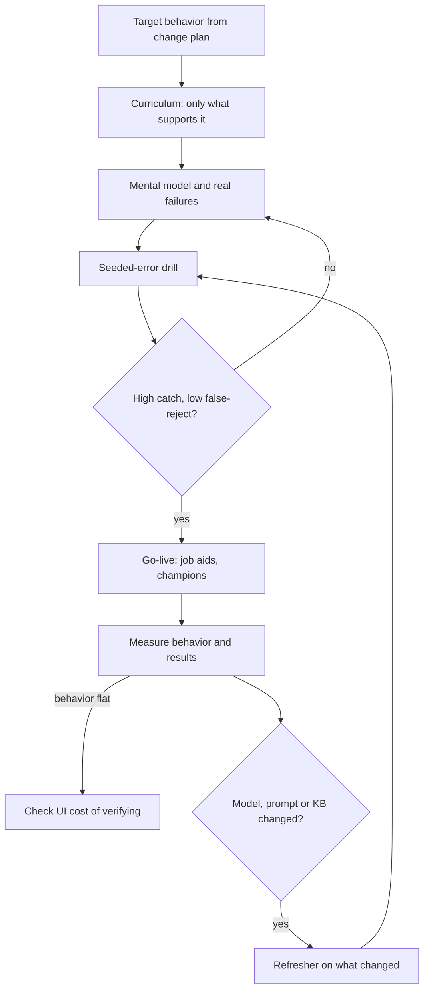

## TL;DR
AI user training teaches a working mental model, not a feature tour: what the system is good at, how it
fails, how to verify output, what data it may take, and how to report problems.

## Why it exists
- **AI breaks the old training contract.** Traditional training teaches where the buttons are, because the
  software behaves the same way every time and correctness is the vendor's job. With an AI assistant, two
  users clicking the same button can get different results, and the same input can produce a strong
  answer one day and a weaker one after a model update.
- **Correctness is now partly the user's job**, because the user is often the last check before an output
  reaches a customer or a record. Probabilistic tools punish both blind trust and blanket distrust; users
  who never learn to check either let errors through or quietly stop using the tool.
- **So users need four new things:** recognize task types where the system is reliable and where it is
  not; verify fast (open the cited source, check the number against the record); know what not to paste
  in (customer PII into an unapproved tool, for example); and flag a bad output so it reaches the team
  that can fix it.
- **The naive alternatives fail.** A recorded feature demo creates awareness and nothing else, and much
  of it is forgotten quickly if not practised soon. "It's a chat box, it's intuitive" leaves each user to
  discover failure modes alone, usually by being burned in front of a customer.
- **One big launch session is not enough.** It covers too much, before users have the context to absorb
  it, and is never repeated when the system changes.

## How it works
### 1. Derive the curriculum from the behavior change
- **Start from the target behavior** in the change plan ("agents start each reply from the AI draft and
  check every policy claim against the linked article").
- **Work backwards** to what a user must know and be able to do.
- **Everything else is optional**, *because* attention is the scarce resource in training.

### 2. Teach the mental model and the failure modes
- **Explain the system in the user's terms:** "it reads the five most relevant help articles and drafts a
  reply from them; if the answer is not in those articles, it may guess."
- **That one sentence predicts the main failure** (confident answers on topics not in the knowledge base)
  and tells users what to check.
- **Show real failures from your evaluation set**, *because* people calibrate trust from examples far
  better than from a stated accuracy number.

### 3. Practise on real tasks, with seeded errors
- **Use the users' own kinds of cases** in hands-on exercises.
- **Run a verification drill:** each person gets a set of AI outputs, some with realistic seeded errors,
  and accepts, edits or rejects each. It builds the skill that matters most and produces a measurable
  score.
- **Use role-specific tracks.** The reviewer, the frontline user and the team lead need different drills.

Score the drill on *two* numbers, not one, *because* there are two ways to be miscalibrated:

| Metric | Formula | Bad value means |
|---|---|---|
| **Catch rate** | seeded errors caught ÷ seeded errors | Low: over-trust |
| **False-reject rate** | correct outputs rejected or rewritten ÷ correct outputs | High: under-trust; the user does the task twice and will eventually decide the tool is useless |

- **Catch rate alone rewards the wrong behavior.** A user who rejects everything scores 100% on catch rate.
- **The goal:** high catch with low false-reject, plus a verification time per item that fits the real
  workflow.

Seed realistic errors, not obvious ones:
- **Realistic teaches; garbled does not.** An invented refund window that looks like a real policy
  teaches something; a garbled sentence does not, because the model rarely fails that way. Draw error
  types from the eval set's actual failure modes.
- **Mind the base rate.** A drill might be 25% wrong to give enough practice, but production may be wrong
  a few times in a hundred, and people checking rarely-wrong output stop looking (vigilance falls when
  errors are rare).
- **So teach verification as a fixed, cheap habit** tied to claim types ("always check numbers, dates and
  policy terms against the citation") rather than a judgment about whether a draft "feels off".

### 4. Cover data handling and escalation explicitly
- **State the data rules:** what may and may not go into the tool, and why.
- **State the bad-output path:** the feedback button, what to write, and when to escalate to a human
  expert.
- **Give it its own segment.** *Because* these rules carry compliance risk, they deserve a dedicated,
  short, testable segment rather than a slide buried in the middle.

### 5. Deliver in the workflow, then reinforce
1. **Short sessions close to go-live.**
2. **Job aids inside the tool:** tooltips and a one-page "when to trust, when to check" card.
3. **Office hours and champions** in each team.
4. **Spaced reinforcement beats one long session**, *because* skills not used soon after training fade
   quickly (the spacing effect is one of the more robust findings in learning research).
5. **Train-the-trainer** lets the customer's own staff carry the program after handoff.

Training cannot fix a slow check: if verifying a claim takes three clicks and a second window, people
skip it under time pressure. The cheapest training improvement is often an inline citation the engineer
adds.

### 6. Measure with the four levels, and retrain on change
| Kirkpatrick level | Question | AI-tool evidence |
|---|---|---|
| 1. Reaction | Did they find it useful? | Survey |
| 2. Learning | Can they do the drill? | Catch and false-reject rates |
| 3. Behavior | Do usage logs show the target behavior? | Citation-open and edit rates |
| 4. Results | Did the business metric move? | QA error rate, handle time |

- **Organizations measure levels 1 and 2 far more often** than 3 and 4, yet 3 and 4 are the ones that
  show whether the program worked.
- **Retrain on change.** When the model, prompt or knowledge base changes enough to shift behavior, update
  the failure-mode examples and tell users what is different, *because* their calibrated trust is now
  calibrated to an old system.

## Diagram
The program is a loop, not a launch event: measurement at levels 3 and 4 and every system change feed
back into the drills and examples.



## Examples
### Scoring a verification drill on both numbers
A drill result is a list of (was the output wrong?, did the user reject or rewrite it?). Score both
calibration directions, not just catches.

```python
def score_drill(items):
    """items: list of (seeded_error: bool, user_rejected_or_rewrote: bool)."""
    errs = [r for e, r in items if e]
    good = [r for e, r in items if not e]
    catch = sum(errs) / len(errs)               # over-trust if low
    false_reject = sum(good) / len(good)        # under-trust if high
    return round(catch, 2), round(false_reject, 2)

# 20 drafts, 5 with seeded errors (as in the scenario below)
before = [(True, c) for c in [1, 1, 0, 0, 0]] + [(False, r) for r in [1] * 4 + [0] * 11]
after  = [(True, c) for c in [1, 1, 1, 1, 0]] + [(False, r) for r in [1] * 1 + [0] * 14]
reject_all = [(True, True)] * 5 + [(False, True)] * 15

print(score_drill(before))      # (0.4, 0.27)  catches 2 of 5, rewrites 4 of 15
print(score_drill(after))       # (0.8, 0.07)  catches 4 of 5, rewrites 1 of 15
print(score_drill(reject_all))  # (1.0, 1.0)   perfect catch, useless behavior
```

### Worked scenario: a 60-agent support team
A hypothetical support team of 60 agents is getting an AI reply drafter grounded in the help center. The
eval shows drafts are usually accurate on documented topics but sometimes invent policy details on
undocumented ones. Training is three 45-minute sessions in the go-live week, by team.

| Session | Content |
|---|---|
| One | Mental model ("it only knows the help center; if the answer is not there it may guess") plus four real eval failures |
| Two | Verification drill: 20 drafts, 5 with seeded errors (an invented refund window, a wrong plan name, a missing caveat) |
| Three | What customer data may be pasted into free-text fields, the feedback button, when to hand off to a tier-2 specialist |

| Drill metric | Before coaching | After coaching |
|---|---|---|
| Seeded errors caught | 2 of 5 on average | 4 of 5 on a second drill set |
| Correct drafts rewritten "to be safe" | 4 of the 15 | 1 of 15 |

- **What changed:** a walk-through of "click the citation, check every number and policy claim", plus an
  explicit rule for what to check and what to leave alone.
- **Why report both numbers:** the rewrites are the under-trust that makes the tool feel slower than
  typing, and improving catch rate by making people rewrite everything would be a regression.
- **Reinforcement:** a pinned checklist in the drafting panel, two champions per team, and office hours
  twice a week for a month.
- **Level 3:** logs show the share of replies sent with zero edits on undocumented topics falling (the
  desired behavior), while overall draft use rises.
- **Level 4:** the team reports handle time and the QA error rate to the sponsor.
- **Retraining:** when the knowledge base is restructured two months later, a 15-minute refresher shows
  what changed. (All figures are illustrative.)

## Production patterns
- **Drill sets built from eval failures** — before go-live, sample real failure cases from the eval set,
  mix them with correct outputs, and keep the set versioned next to the eval data. Monitor catch and
  false-reject rates per cohort, and refresh the set when the eval's failure modes shift.
- **Verification telemetry** — log whether a user opened the cited source before accepting an output, per
  claim type where possible. Monitor citation-open rate on high-risk claims (numbers, dates, policy
  terms); a fall after launch week signals vigilance decay.
- **Release-note-driven refreshers** — tie every model, prompt or knowledge-base change that alters
  behavior to a short user-facing "what changed" note and, if large, a refresher session. Monitor
  override and complaint rates in the week after each release.
- **In-product job aids** — ship the "when to trust, when to check" card and tooltips inside the tool,
  not in a wiki. Monitor whether new users reach target behavior without a live session.
- **Train-the-trainer with score checks** — hand the customer's champions the drill set, the mental-model
  script and the scoring sheet. Monitor drill scores from customer-run cohorts to catch quality drift
  after handoff.

## Trade-offs
- **Live, hands-on sessions vs scale.** They build real verification skill but cost user hours; recorded
  material scales better when the tool is low-risk.
- **Role-specific tracks vs preparation cost.** They fit each job closely but multiply preparation work;
  one shared track is fine when roles use the tool identically.
- **Showing real failures vs scaring adopters.** It calibrates trust, but can scare off adopters if
  presented without the verification method that handles them.
- **Training close to go-live vs schedule pressure.** It improves retention but compresses the schedule;
  train too early and people forget before they can practise.
- **Customer-run train-the-trainer vs quality.** It scales and survives handoff, but quality drifts
  unless you supply materials and check drill scores.

## Pitfalls
- **Teaching features instead of failure modes.** Symptom: users who know every button yet forward wrong
  answers unchecked.
- **Measuring only satisfaction surveys.** They look positive while usage logs show the target behavior
  never appeared.
- **Never retraining after model or prompt changes.** Revealed by a sudden rise in overrides or
  complaints after an update.
- **Treating data-handling rules as an aside.** Discovered later when sensitive data shows up in prompts
  or logs.
- **Training once at launch with no reinforcement.** Shown by usage and drill scores sliding over the
  following weeks.
- **Seeding drills with obvious errors.** Revealed by near-perfect drill scores alongside QA still finding
  unchecked policy mistakes in production.
- **Scoring only the catch rate.** Shows up as heavy editing of correct drafts and handle time rising
  instead of falling.

## When to use
- **Use when** users are expected to rely on AI output in work that matters, especially when they are the
  last check before the output reaches a customer, a record or a decision.
- **Scale effort with error cost and user count.** A low-risk internal summarizer may need a job aid and a
  short video; a drafting tool for regulated customer communication needs drills, data-handling rules and
  measured verification skill.
- **Measure at behavior and results level, not just reaction:** drill catch rate and false-reject rate
  (learning), citation-open rate and edit rate on high-risk claim types in the logs (behavior), and QA
  error rate and handle time (results).
- **If behavior metrics do not move**, check the UI cost of verifying before adding more sessions.
- **Interviews:** a strong answer explains why AI training must teach verification and failure modes, and
  how you would tell whether it worked.

## Role lens
- **Engineer:** Builds the in-product affordances training relies on: inline citations, feedback buttons, tooltips and logging that shows whether verification happens.
- **Architect:** Decides where human review sits and which outputs require it, which in turn sets what each role must be trained to check.
- **FDE:** Runs the sessions with the customer's real cases, builds the seeded-error drills, and trains internal champions who own training after handoff.

## Check yourself
**Q:** Training satisfaction scores are high, yet QA finds agents are sending AI drafts with policy errors. What is wrong with the program, and how would you change it?
**A:** The program is probably measuring reaction, not learning or behavior, and teaching what the tool does rather than how it fails. I would add a verification drill with seeded, realistic policy errors to measure whether agents can catch them, teach a concrete checking method (open the citation, check every policy claim and number), and show real failures from the eval set. Then I would track behavior in logs, such as edit rates on undocumented topics, and the QA error rate as the result. I would watch the false-reject rate too, so the fix does not swing
agents into rewriting every draft. I would also check whether the UI makes verification fast, because a slow check gets skipped regardless of training.

## Interview questions
### Why is training for an AI tool different from training for ordinary enterprise software?
- **Behavior is not fixed.** The same input can give different outputs, and quality shifts after model or
  prompt updates, so a feature tour describes a moving target.
- **Correctness moves to the user.** The user is often the last check, so the core skill is recognizing
  plausible but wrong output and verifying it quickly, not finding buttons.

### Design a verification drill for a contract-clause extraction tool.
- **Material:** real contracts of the users' kind, outputs from the actual system, with errors seeded from
  the eval set's real failure modes (wrong party, wrong date, missed exception), not garbled text.
- **Scoring:** catch rate and false-reject rate, plus time per item, so neither over-trust nor
  rewrite-everything passes.
- **Habit taught:** always check dates, amounts and party names against the cited clause, regardless of
  how confident the output looks.

### Drill scores are excellent, but QA still finds unchecked errors in production. What is happening?
- **Base-rate gap:** the drill was perhaps 25% wrong, production a few in a hundred, and vigilance drops
  when errors are rare.
- **Drill too easy:** obvious seeded errors produce near-perfect scores that do not transfer.
- **Verification too slow in the real UI:** if checking takes extra clicks and windows, people skip it.
- **Fix:** realistic seeds, a fixed claim-type checking habit, inline citations, and telemetry on
  citation opens.

### When would you skip live training entirely?
- **Low-risk, low-stakes tools**, such as an internal summarizer whose output never reaches a customer or
  record, where a job aid and a short video are enough.
- **But not** when users are the last check on regulated or customer-facing output, because there the
  verification skill must be practised and measured.

### How do you show a sponsor that training worked?
- **Go beyond levels 1 and 2:** survey and drill scores show reaction and learning only.
- **Level 3 from logs:** citation-open rate and edit rate on high-risk claim types moving in the target
  direction.
- **Level 4 against baseline:** QA error rate and handle time, compared with before training.

## Quiz
### Q: Which Kirkpatrick level is shown by usage logs where agents now open citations before sending drafts?
- [ ] Reaction
- [ ] Learning
- [x] Behavior
- [ ] Results
> Behavior is whether people apply the skill on the job, which logs can show. Learning would be a drill
> score in training; Results would be the change in the business metric such as QA errors.

### Q: Why are seeded-error drills more useful than a quiz on product features for AI tools?
- [ ] Feature quizzes are harder to grade automatically
- [x] They train and measure the skill users most need: catching plausible but wrong outputs in realistic cases
- [ ] They prove the model is accurate enough to deploy
- [ ] They remove the need for human review in production
> Users are often the last check, so recognizing wrong outputs is the critical skill. A drill measures it
> directly; it says nothing about model accuracy and does not replace review.

### Q: After a major model upgrade, what should happen to user training?
- [ ] Nothing, as long as the interface has not changed
- [ ] Users should be retrained from scratch with the full original program
- [x] Update the failure-mode examples and give a short refresher on what behaves differently
- [ ] Training should pause until the new model's accuracy reaches 100%
> Users' trust is calibrated to the old system's behavior. A targeted refresher on what changed recalibrates
> it cheaply; a full retrain wastes time and waiting for perfection never ends.
