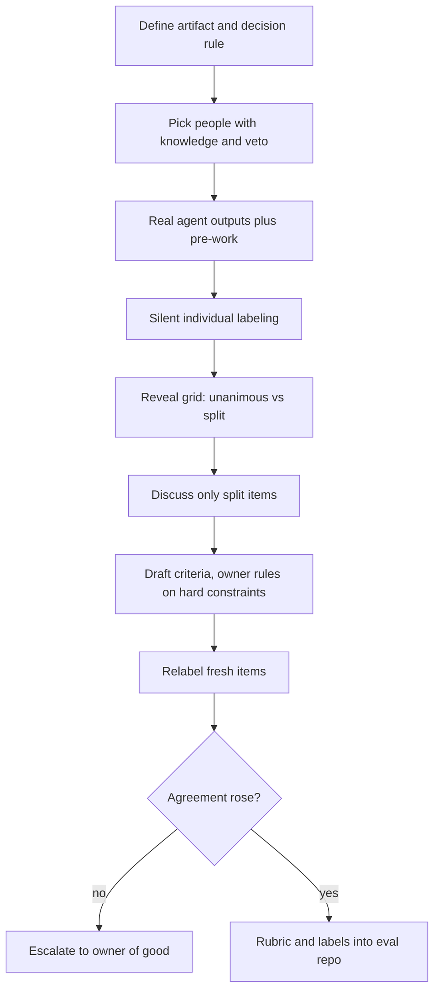

## TL;DR
A workshop is a facilitated session where experts produce an artifact your agent needs (ranked use
cases, a workflow map, a rubric, labeled eval examples) in hours, not weeks. Without a defined output and
follow-up, it is a long meeting.

## For agent builders
- **Why it matters for agents.** Your agent's eval set, judge rubric, tool boundaries and approval gates
  all encode what experts consider "good" and "allowed". That knowledge is tacit and contested; a rubric or
  workflow workshop is the fastest way to make it explicit enough to code.
- **Where it shows up in your stack.** Workshop labels become golden eval cases, the rubric becomes the
  grading prompt for an LLM judge, and the to-be workflow map becomes the agent's tool list, step order
  and human-review points.
- **What you control.** Bring real agent outputs (not hypotheticals), have experts label silently first,
  measure agreement with a chance-corrected statistic, and commit the rubric and labels to the eval repo
  the same week.
- **What you can skip.** Facilitation games beyond silent work, 1-2-4-All and dot voting. The agreement
  math and the artifact-first agenda matter most.

## Why it exists
- **Agent knowledge lives in people's heads.** Which cases are hard, what "good" looks like for an answer,
  where the workflow really breaks, which data and actions are allowed. It is spread across subject-matter
  experts, operators, IT, security and a sponsor who rarely sit together.
- **The slow alternatives produce gaps.** Interviews one at a time are slow and produce contradictions you
  discover only when the agent ships. Email produces short answers from the busiest people and silence
  from the rest.
- **Quality criteria for generative output are often tacit.** Two experts can look at the same draft and
  disagree on whether it is acceptable, and neither has written the rule down. You cannot build an eval,
  a prompt or a training program until that disagreement is surfaced and resolved.
- **Same examples, same time, is fastest.** Putting the experts in front of the same real examples at once
  is the quickest way to surface and resolve the disagreement.
- **Naive formats fail differently.** An open "brainstorm" gets dominated by the most senior or loudest
  voice and ends with ideas nobody owns. A presentation dressed up as a workshop (you talk, they listen)
  captures nothing. A good workshop is designed backwards from its artifact, with structure that makes
  everyone's knowledge visible before it is debated.

## How it works
### 1. Fix the output and the decision first
- **Write down what will exist at the end:** "a rubric with 4 to 6 criteria that 5 claims experts agree
  on" or "a top-3 use-case shortlist with an owner and data source each".
- **For agent work, name the downstream file:** the eval set, the judge prompt or the tool and approval
  spec that the artifact will feed.
- **Design everything backwards from it**, *because* a workshop without a defined artifact drifts into
  discussion.
- **Budget the agenda from the artifact, not the calendar slot.** If the output needs 20 examples labelled
  and every disagreement discussed, estimate how many will split and how long each takes. A three-hour
  slot that needs four hours of discussion produces a half-finished rubric and a "we'll continue by email"
  that never converges.

### 2. Choose participants for knowledge and authority
- **Invite** the people who do the work, the people who can decide, and anyone with a veto (security,
  data owner, legal) for the parts that concern them, such as which tools the agent may call.
- **Keep the working group small**, often under about ten, *because* participation per person falls fast
  as groups grow.
- **Split audiences.** Separate sessions beat one huge one when audiences need different things.

### 3. Prepare real material and pre-work
- **Bring the customer's actual documents, tickets or agent outputs**, anonymized as needed.
- **Send short pre-work** ("list your three most painful cases").
- **Why:** real material grounds the conversation in facts, *because* people argue less about a specific
  ticket than about abstractions.

### 4. Structure: diverge, then converge
1. **Silent individual work first** (sticky notes, labeling, writing) before any discussion, *because* it
   stops the first senior opinion from anchoring everyone else.
2. **Share in small groups, then plenary**, for example with the 1-2-4-All pattern (alone, pairs, fours,
   whole group).
3. **Cluster and converge with explicit criteria:** dot voting, an impact-versus-feasibility grid, or
   discussing only the disagreements.
4. **Keep a parking lot** so off-topic items are captured without derailing the session.

Agree the decision rule before the decision, *because* a group that has not agreed how to decide will
argue about the process as soon as the outcome is close:

| Rule | How it works |
|---|---|
| Owner decides | The accountable owner decides after hearing everyone |
| Consent | Adopt unless someone has a reasoned objection |
| Vote | Majority, with the owner breaking ties |
| Hard constraints | Legal, regulatory, security are not voted on; the owner rules and the group designs around it |

### Measure agreement, not just whether people nodded
- **Measure twice.** For labelling and rubric sessions, compute agreement on the silent first pass and
  again after the rubric.
- **Raw percent agreement flatters you when one label dominates.** If 90% of outputs are acceptable, two
  raters who say "accept" to everything agree 90% of the time while disagreeing on every case that
  matters.
- **Chance-corrected statistics fix this:** Cohen's kappa for two raters, Fleiss' kappa for more.
- **In the room, a simpler readout works:** the count of items where everyone agrees, plus the list of
  split items, which is the agenda for the discussion.
- **If agreement does not rise after the rubric**, the criteria are still ambiguous or the experts
  genuinely want different things; escalate to whoever owns the definition of "good".
- **The same math checks your LLM judge later:** compare the judge's labels with the experts' consensus
  using kappa, not raw agreement.

### 5. Facilitate actively
- **The facilitator owns time**, makes quiet participants heard, and stops solution debates that belong
  elsewhere.
- **Outsider advantage.** On a customer engagement the FDE is often both facilitator and domain outsider,
  which is useful: naive questions expose tacit rules.

### 6. Capture live and follow up fast
- **Write outputs into the artifact during the session**, not from memory later.
- **Send a summary within a day or two** with decisions, open questions, owners and dates, *because*
  agreement decays quickly and the summary becomes the record people refer to.

### Common agent workshop types
Each has a different artifact, so do not merge them.

| Type | Artifact | Where it lands in the agent |
|---|---|---|
| Use-case discovery | Candidates ranked by value and feasibility | Which agent to build first |
| Workflow mapping | As-is and to-be, where AI sits and who reviews | Tool list, step order, approval gates |
| Rubric and labeling | Agreed definition of good output, labeled examples | Golden eval set, judge prompt |
| Enablement or prompting | Users able to work with the tool | Adoption, feedback quality |

## Diagram
Follow the path from artifact to follow-up; the loop on the right is what happens when relabeling shows
agreement did not rise.



## Examples
### Measuring agreement in a labeling session
Percent agreement can look excellent while two raters disagree on every case that matters; kappa exposes
it, and the split list is the discussion agenda.

```python
from collections import Counter

def percent_agreement(a, b):
    return sum(x == y for x, y in zip(a, b)) / len(a)

def cohens_kappa(a, b):
    n = len(a)
    po = percent_agreement(a, b)
    ca, cb = Counter(a), Counter(b)
    pe = sum(ca[k] * cb[k] for k in set(a) | set(b)) / (n * n)
    return (po - pe) / (1 - pe) if pe < 1 else 1.0

# 20 outputs, 18 truly acceptable. Rater A accepts everything;
# rater B accepts 18 and rejects the 2 that matter.
a = ["accept"] * 20
b = ["accept"] * 18 + ["reject"] * 2
print(percent_agreement(a, b))          # 0.9: looks great
print(round(cohens_kappa(a, b), 2))     # 0.0: no agreement beyond chance

def unanimous(rows):
    """rows: one list of labels per item, one label per rater."""
    split = [i for i, r in enumerate(rows) if len(set(r)) > 1]
    return len(rows) - len(split), split   # agenda = the split items

rows = [["accept"] * 5] * 9 + [["accept", "edit", "accept", "reject", "edit"]] * 11
agree, agenda = unanimous(rows)
print(agree, len(agenda))               # 9 unanimous, 11 to discuss
```

### From workshop labels to an LLM-judge check
After the workshop, the expert consensus labels become the reference for the agent's automated grader.
Reuse `cohens_kappa` above to decide whether the judge prompt built from the rubric can be trusted. The
labels here are illustrative.

```python
# consensus label per fresh draft after the rubric, and the LLM judge's label on the same drafts
experts = ["accept"] * 6 + ["edit"] * 2 + ["reject"] * 2
judge   = ["accept"] * 6 + ["accept", "edit"] + ["reject", "accept"]

print(percent_agreement(experts, judge))        # 0.8
print(round(cohens_kappa(experts, judge), 2))   # 0.58
misses = [i for i, (e, j) in enumerate(zip(experts, judge)) if e != j]
print(misses)                                    # [6, 9]: judge passed drafts experts would not
# Read the misses against the rubric, tighten the judge prompt, and re-run before
# letting the judge gate releases of the agent.
```

### Worked scenario: a rubric for an agent's claim-denial letters
A hypothetical insurer needs acceptance criteria for claim-denial letters drafted by a claims agent. The
team runs a three-hour rubric workshop with five senior claims handlers, a compliance officer and the FDE
as facilitator.

**Agenda, designed backwards from the output** (times illustrative):

| Block | Minutes |
|---|---|
| Framing and decision rule (compliance rules on legal requirements, the claims director's delegate on everything else) | 15 |
| Silent labeling | 30 |
| Reveal the label grid | 15 |
| Split cases, roughly 5 minutes each | about 60 |
| Draft criteria | 30 |
| Relabel | 20 |
| Owners and open questions | 10 |

- **The budget only works if about 10 to 12 cases split**, which is why the facilitator picks the 20
  drafts to include obvious passes and obvious fails as well as hard cases.
- **Pre-work:** each handler sends two letters they consider excellent and two they would reject.
- **First pass:** everyone labels the same 20 agent drafts silently as accept, edit or reject. The five
  handlers agree unanimously on only 9 of the 20.
- **Discussion:** rather than debate all 20, the group discusses just the 11 split cases.

The disagreements cluster into four themes:
1. Whether the letter cites the exact policy clause.
2. Whether the tone is acceptable for a bereaved claimant.
3. Whether appeal rights are stated. Compliance rules these are mandatory, turning the theme from
   preference into a hard requirement.
4. Whether the letter speculates about facts not in the file.

**Result:** four criteria with a pass and a fail example each. Relabeling 10 fresh drafts with the rubric,
unanimous agreement rises to 8 of 10. Output: a written rubric, 30 labeled examples for the golden set,
two open questions with owners, and a follow-up summary sent the next morning. (Figures are
illustrative.)

**What the agent team does with it:** the mandatory appeal-rights rule becomes a deterministic check on
every letter, the other three criteria go into the judge prompt, and the 30 labeled examples become the
regression set run on every prompt or model change.

## Production patterns
- **Labeling tool instead of sticky notes for rubric sessions** — when the output is labels, have each
  expert label in a shared sheet or annotation tool with hidden columns, then reveal the grid. Monitor the
  unanimous count and the split list live; that list sets the discussion agenda.
- **Agenda budget from the split estimate** — before the session, pilot-label a few items yourself to
  estimate the split rate, then size the discussion block as split items times minutes per item. Monitor
  whether discussion overruns; if it does, cut scope rather than extend by email.
- **Workshop output straight into the eval set** — commit the labeled examples and rubric to the agent's
  eval repository the same week, with the workshop date and participants recorded. Monitor agreement
  between the rubric-based LLM or human graders and the expert labels on later batches.
- **Hard constraints as code, preferences as rubric** — anything the owner ruled mandatory (appeal rights,
  a forbidden action) becomes a deterministic check or a tool permission, not a judge criterion. Monitor
  the check's failure rate per release.
- **Decision log with owners** — record every decision, its decision rule, the owner and any open question
  in one shared document sent within a day or two. Monitor how many settled decisions get reopened over
  the following month.
- **Veto holders booked for their segment only** — schedule security, legal or the data owner for the part
  of the agenda that concerns them, such as tool permissions, rather than the whole day. Monitor late
  objections after the session.

## Trade-offs
- **In-person vs remote.** In-person builds trust and energy but costs travel and calendar time; remote
  works well for short, focused labeling sessions.
- **Decision-makers in the room vs junior candor.** Their presence lets the session commit, but can
  silence junior experts unless silent individual work comes first.
- **Tight structure vs surprise.** It produces predictable artifacts but can miss surprising insights;
  leave a slot for open discussion when exploring a new domain.
- **Broad attendance vs depth.** It builds buy-in yet reduces depth per person; split into focused
  sessions when more than about ten people need to contribute.
- **Full day vs two half-days.** A full day gets much done at once, but fatigue erodes the afternoon; two
  half-days often produce better output.

## Pitfalls
- **No defined output.** The session ends with energy but no artifact; symptom: a follow-up email that only
  says "great session".
- **Starting with open discussion.** The most senior voice anchors everyone; the output mirrors one
  person's view.
- **Hypothetical examples instead of real agent outputs.** Revealed later when the rubric fails on actual
  cases.
- **Missing the veto holder.** A security or compliance objection arrives weeks later and invalidates agreed
  decisions, such as a tool the agent was going to call.
- **Slow follow-up.** Within a week participants remember different decisions and reopen settled questions.
- **Ratifying a decision already made.** Participants detect it quickly; symptom: polite silence and an
  output nobody defends later.
- **No agreed decision rule.** Revealed when the last hour is spent arguing about who gets to decide rather
  than about the criteria.

## When to use
- **Use when** the knowledge you need is spread across several people, they are likely to disagree, or
  you need a joint commitment rather than individual opinions: discovery, workflow redesign, defining
  quality criteria, labeling a first golden set, and user enablement.
- **Avoid when** a single expert can answer by message, or when the decision is already made and only
  needs communicating.
- **Measure** by the artifact and by whether decisions held a month later; for labelling sessions, also by
  whether agreement measurably rose between the first pass and the relabel.
- **Interviews:** describe the output you would design for and how you would stop anchoring.

## Role lens
- **Engineer:** Prepares real examples and tooling for labeling sessions, and turns the agreed rubric and labels into eval cases and prompt changes.
- **Architect:** Uses workflow and discovery workshops to settle boundaries: where AI sits, who reviews, which systems and data are in scope.
- **FDE:** Designs and facilitates the sessions on site, extracts tacit expert rules through naive questions, and owns the follow-up summary.

## Check yourself
**Q:** Your client's experts keep disagreeing about whether the AI's answers are "good enough". How would you design a workshop to resolve this, and why that structure?
**A:** I would design backwards from a written rubric plus a labeled example set. Experts would first label the same real outputs silently, which makes disagreement measurable and stops anchoring on the most senior person. We would then discuss only the cases where labels split, cluster the reasons into criteria, and let the person with authority (often compliance or the process owner) rule on which criteria are mandatory. Finally we would relabel fresh examples with the rubric to check that agreement improved. The output feeds the eval set, and a summary with owners goes out within a day.

## Interview questions
### What distinguishes a workshop from a long meeting?
- **A defined artifact:** a rubric, ranked shortlist, workflow map or labeled set exists at the end, with
  owners.
- **Structure designed backwards from that artifact:** silent individual work, explicit convergence and an
  agreed decision rule, because unstructured discussion drifts and gets anchored by seniority.
- **Fast follow-up:** a written summary within a day or two, so decisions do not decay.

### Two raters agree 90% of the time. Is your rubric working?
- **Not necessarily.** If 90% of outputs are acceptable, two raters who accept everything also agree 90%
  while disagreeing on every case that matters.
- **Use a chance-corrected statistic:** Cohen's kappa for two raters, Fleiss' kappa for more.
- **And look at the split items directly**, because they are where the tacit rules differ.

### How do you turn a rubric workshop into an automated eval for your agent?
- **Split the output:** rules the owner ruled mandatory become deterministic checks; preference criteria
  become the LLM-judge prompt, each with its pass and fail example.
- **Validate the judge** against the expert consensus labels with kappa, and read every disagreement
  before trusting it to gate releases.
- **Commit the labels** as a regression set and re-run it on every prompt, tool or model change.

### Your workshop produced a rubric, but a month later teams are reopening every decision. What went wrong?
- **Likely causes:** slow or missing follow-up summary, a veto holder who was not in the room, or no
  decision rule agreed up front.
- **Also check** whether the session ratified a decision already made, which yields an output nobody
  defends.
- **Fix:** a decision log with owners sent within a day or two, and the veto holders booked for their part.

### You need to decide which tools an agent may call and where a human approves. How would you run that workshop?
- **Artifact first:** a to-be workflow map listing each step, the tool it calls, read or write, and who
  approves write actions.
- **People:** the operators who do the work, the process owner, and security and the data owner for the
  tool-permission segment, because they hold the veto.
- **Real cases:** walk five recent tickets through the map silently, then discuss only where people placed
  the approval differently; the owner rules on hard constraints.

### How do you budget time for a three-hour rubric session with 20 examples?
- **Start from the artifact:** estimate how many items will split (for example about 10 to 12) and minutes
  per split item (roughly 5), giving about 60 minutes of discussion.
- **Add fixed blocks:** framing, silent labeling, reveal, drafting criteria, relabel, owners.
- **Pick items to hit the estimate:** include obvious passes and fails alongside hard cases, so the split
  count fits the slot.

## Quiz
### Q: Why start a workshop segment with silent individual work before group discussion?
- [ ] It shortens the session by skipping discussion
- [x] It captures everyone's view before the first opinion, often the most senior, anchors the group
- [ ] It lets the facilitator grade participants individually
- [ ] It is required for remote sessions only
> Anchoring and deference to seniority distort group output. Writing or labeling alone first makes every
> view visible, and the following discussion can focus on genuine disagreements.

### Q: In a labeling workshop, five experts agree on 9 of 20 outputs. What is the most efficient next step?
- [ ] Replace the experts with a single senior reviewer
- [ ] Average the labels and move on
- [x] Discuss only the split cases and turn the reasons for disagreement into explicit criteria
- [ ] Ask the model to label the cases instead
> The split cases contain the tacit rules that differ between experts. Turning them into criteria makes
> the rubric explicit; averaging or delegating hides the disagreement that will resurface later.

### Q: What best indicates that a discovery workshop succeeded?
- [ ] Participants rated it highly in the feedback form
- [ ] The session ran to the planned agenda exactly
- [x] A defined artifact exists with owners, and the decisions are still holding weeks later
- [ ] Every attendee spoke at least once
> A workshop is a means to an artifact and a durable decision. Satisfaction and agenda adherence can be
> high in a session that produced nothing anyone acts on.

## Use cases & projects
### Use cases
- **Defining "good" for an agent's outputs.** A rubric and labeling workshop produces the golden set and
  the judge criteria in one afternoon.
- **Deciding tool permissions and approval gates.** A workflow-mapping session with the veto holders
  settles which actions the agent may take alone.
- **Picking the first agent to build.** A discovery workshop ranks candidate workflows by value and
  feasibility, with an owner and data source each.
- **Calibrating an LLM judge.** Expert consensus labels from the session are the reference the judge is
  measured against.

### Mini project
**From silent labels to a validated judge (2-3 hours).**
- **Goal:** turn a small labeling exercise into a rubric and check whether an LLM judge built from it
  agrees with people.
- **Steps:** generate 20 outputs from a small agent; have three people (or yourself on three separate
  passes) label each accept, edit or reject silently; list unanimous and split items; write a 4-criterion
  rubric from the splits; relabel 10 fresh outputs; write a judge prompt from the rubric and compare its
  labels with the consensus using `cohens_kappa`.
- **Done when:** you have the rubric file, the first-pass and relabel agreement numbers, the judge's
  kappa against consensus, and a list of the judge's disagreements with a note on each.
