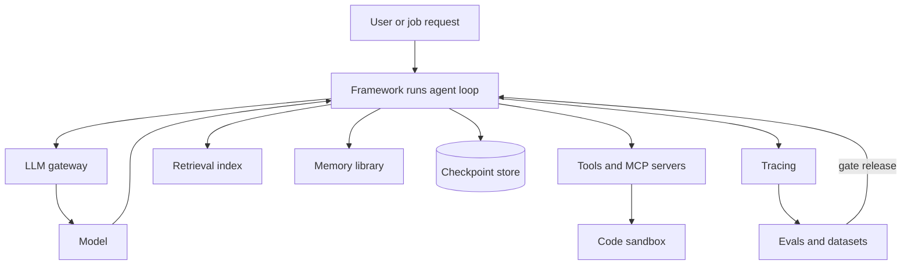

## Overview
This module covers the libraries and services you build agents with. Every framework wraps the same
loop: call a model, run its tool calls, feed the results back.

They differ in what they take off your
hands, such as durable state, multi-agent routing, retrieval, typing or a hosted harness. That is how
you pick one, not by feature lists or GitHub stars.

The lessons fall into five groups:

- **Choosing:** how to decide between building on a provider SDK and adopting a framework, and how to keep an exit plan.
- **The LangChain family:** LangChain for integrations and `create_agent`, LangGraph for explicit `StateGraph` control flow, checkpointers, `interrupt()` and multi-agent patterns, and LangSmith for traces, datasets and evaluators.
- **Other agent frameworks:** OpenAI Agents SDK, Claude Agent SDK, Pydantic AI, Google ADK and Mastra for TypeScript, plus CrewAI, AutoGen / AG2 and DSPy.
- **Data and memory:** LlamaIndex for ingestion and retrieval tools, and Mem0 and Letta for long-term memory.
- **Running it safely:** code-execution sandboxes (E2B, Modal, Docker) and the end-to-end stack of framework, LLM gateway, vector store, tracing, evals and deployment.

**Core versus background for agent builders:**

- **Core (15 lessons):** every lesson except three is marked core, because you use it directly when you pick, build, trace, sandbox or deploy an agent.
- **Useful (3 lessons):** crewai, autogen-ag2 and dspy. You meet them in prototypes, research code, job posts and prompt-optimisation work, so know where each shines and where it costs you control.
- **Background:** none. Each lesson maps to a library you may install.

**What you can build afterwards:**

- **A framework choice you can defend:** the same 20-case eval run on two candidates, with an exit plan.
- **A durable agent:** typed tools, checkpointed state under a `thread_id`, human approval pauses and streamed progress.
- **A retrieval agent:** an ingestion pipeline and an index exposed as a tool the agent calls.
- **A production stack:** gateway, traces, CI evals, sandboxed code execution and memory, connected through ids.

## Why it matters
- **Engineer:** You write agents on top of these libraries every day, so you must know what each one owns: the loop, tool dispatch, state and its reducers, checkpoints and resume, streaming modes, guardrails and traces. That knowledge tells you where to add a tool, a budget or a test, and where a hidden retry lives.
- **Architect:** The framework decides how state is persisted, how a human pauses a run, how traces look and how hard it is to leave, and those are expensive to change after launch. You choose one tool per stack layer, define the contracts between layers, and keep tools, prompts and eval sets framework-independent.
- **FDE:** Customers arrive already committed to a stack, whether Python or TypeScript, Google Cloud or self-hosted, LangChain or a vendor SDK. You need to stand up a working agent in their framework quickly, explain its sandbox and memory story to a reviewer, and show traces and evals that prove it works on their data.

## Mental model
Think of an agent system as a fixed loop wrapped in six layers. The loop is always the same: model,
tool calls, results, repeat. A framework owns the loop and some of the layers around it. Your job is
to know which layer each tool fills and to own the contracts between them.

| Layer | Lessons | What it decides |
|---|---|---|
| Loop and orchestration | langchain, langgraph-fundamentals, langgraph-multi-agent-patterns, openai-agents-sdk, claude-agent-sdk, pydantic-ai, google-agent-development-kit, mastra, crewai, autogen-ag2 | Who calls the model, how tool calls run, how control passes between agents |
| Durable state and humans | langgraph-persistence-streaming-and-human-in-the-loop | Whether a run survives a crash, pauses for approval and streams progress |
| Data and memory | llamaindex, agent-memory-libraries | What the agent retrieves this turn and remembers across sessions |
| Quality | dspy, langsmith-for-agents | How prompts are tuned against a metric and how runs are traced and scored |
| Execution safety | code-execution-sandboxes-for-agents | What model-written code can reach |
| The whole stack | choosing-an-agent-framework, end-to-end-agent-stack | Which product fills each layer, and how ids connect them |

- **A framework is a bundle of layers:** compare frameworks by which layers they own, not by demo count.
- **Your assets stay portable:** tools, prompts and eval sets should not depend on the framework you picked.

The framework sits in the middle and calls everything else. The gateway, retrieval, memory, sandbox,
checkpoints and tracing are separate choices, and evals built from traces decide whether a change ships.

## Suggested order
1. choosing-an-agent-framework — sets the frame for everything else: build on SDKs versus frameworks, which layer each owns, and the exit plan.
2. openai-agents-sdk — the thinnest production-grade loop, a handful of primitives that show what every framework does underneath.
3. pydantic-ai — typed dependencies, tool arguments and validated outputs, the contract discipline you want in any framework.
4. claude-agent-sdk — a full harness with file, shell and web tools, MCP, subagents, hooks and context management, in contrast to a bare loop.
5. langchain — the common interface over models, tools and retrievers that LangGraph and LangSmith build on.
6. langgraph-fundamentals — makes the loop explicit as a `StateGraph` with reducers and conditional edges.
7. langgraph-persistence-streaming-and-human-in-the-loop — adds checkpoints, `interrupt()` approvals and streaming once the graph model is clear.
8. langgraph-multi-agent-patterns — supervisors, handoffs and subgraphs, after single-agent graphs and persistence are solid.
9. langsmith-for-agents — traces, datasets and trajectory evaluators to debug and regression-test the agents built so far.
10. llamaindex — the data side: ingestion, indexes and query engines exposed as agent tools.
11. agent-memory-libraries — Mem0 and Letta for long-term memory across sessions, after retrieval is understood.
12. code-execution-sandboxes-for-agents — isolates the code-interpreter tool with E2B, Modal or hardened Docker.
13. google-agent-development-kit — a code-first framework with workflow agents, sessions, built-in evals and Google Cloud deploys, best compared against the ones above.
14. mastra — the TypeScript path for agents and workflows inside a web app.
15. crewai — useful: role-based crews and Flows, read with the multi-agent costs already in mind.
16. autogen-ag2 — useful: conversational multi-agent systems and the two package lines you meet in older code.
17. dspy — useful: compiles prompts against a metric, which needs an eval set like the one from LangSmith.
18. end-to-end-agent-stack — closes the module by assembling framework, gateway, vector store, tracing, evals and deployment.

## Capstone
### Brief
**Use case:** an internal platform team needs a research-and-analysis agent that answers questions over
the company's documents and runs small data analyses. This is the module's major project, planned for
a weekend to a week.

A user asks a question such as "how did refund volume change after the March policy update?" The agent
retrieves from an indexed document set, runs Python on a CSV in a sandbox, remembers the user's
preferences across sessions, and pauses for approval before it writes a report to a shared location.

Build it on one primary framework, chosen in writing:

- **Retrieval:** a LlamaIndex ingestion pipeline whose index is exposed as a tool.
- **Durable loop:** a LangGraph graph (or an equivalent framework) with a checkpointer, `interrupt()` before the write and streamed progress.
- **Sandboxed analysis:** a `run_code` tool on E2B, Modal or hardened Docker, with no network egress.
- **Memory:** Mem0 or Letta, scoped per user.
- **Stack:** model calls through an LLM gateway, traces in LangSmith or an OpenTelemetry backend, and an eval set run in CI.

Then port the core loop to a second framework and run the same eval set on both.

### Deliverables
- A working agent in a repository, with a one-page framework decision record covering which layers the framework owns, what it would cost to leave, and why the alternatives lost.
- An ingestion job and retrieval tool with documented parsing, chunk size, overlap, embedding model and top-k, plus a sandboxed code tool with CPU, memory, time and egress limits.
- A durable run: checkpoints in a persistent store, a thread id scheme, an approval interrupt before the write tool, and streamed progress events in a simple UI or CLI.
- A 20-case eval set with a script that reports task completion, tool-selection accuracy, steps and cost per task, run against both frameworks.
- A stack diagram showing the framework, gateway, vector store, memory, sandbox, tracing, evals and deployment, and the ids that connect them.

### Rubric
- Killing the process while it waits for approval and restarting it resumes the same thread in the same state, and approving runs the write exactly once.
- Every run produces one trace tree that shows each model call, tool call and graph step, linked to the user and thread ids.
- A sandbox attempt to reach the network or read host environment variables fails, and the failure appears in the trace.
- A fact the user states in one session is retrieved in a new session, and deleting that user's memory makes a retrieval probe return nothing.
- The same eval set runs unchanged on both frameworks, because tools, prompts and cases live outside framework code, and the report compares completion and cost side by side.
- A prompt or model change that lowers eval scores is blocked in CI before it reaches the deployed agent.
