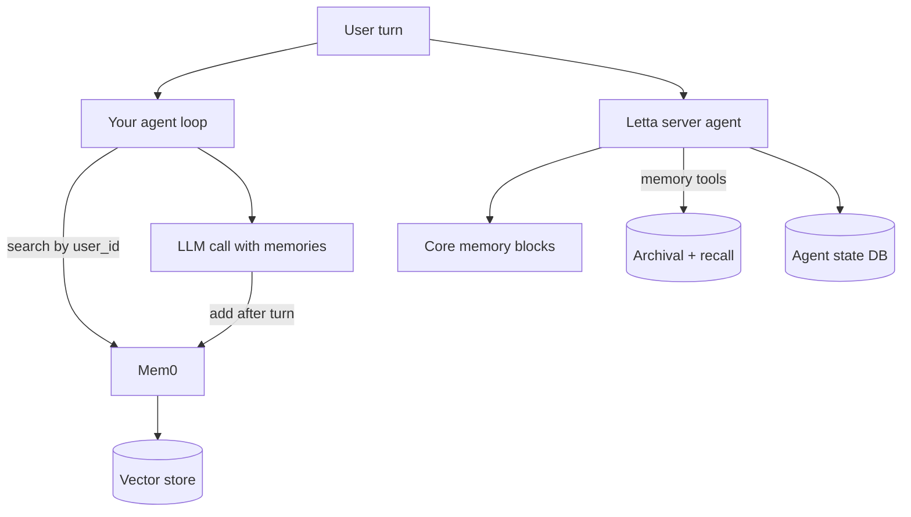

## TL;DR
Mem0 and Letta give agents long-term memory: Mem0 is a memory layer that extracts and retrieves facts per
user, while Letta (formerly MemGPT) runs stateful agents that edit their own memory blocks on a server.

## For agent builders
- **Why it matters for agents.** Without memory, every session starts cold and users repeat themselves;
  with naive memory (dump all history), cost and confusion grow every turn. These libraries extract,
  store, retrieve and update what matters.
- **Where it shows up in your stack.** Mem0 as a Python or TypeScript library (`mem0ai` package) over a
  vector store, or its hosted platform; Letta as a server (self-hosted or cloud) with a client SDK and an
  agent development UI.
- **What you control.** What gets stored (extraction prompts or memory tools), scoping ids (user, agent,
  session), retrieval count, update and deletion policy, and which store backs it.
- **What you can skip.** Building your own extraction and deduplication pipeline unless you have unusual
  needs; the concepts are in the agent-memory lesson, and these tools implement them.

## Why it exists
- **Context windows are not memory.** Long histories cost tokens on every call and degrade attention;
  the agent needs a compact, retrievable store of facts and preferences.
- **Plain RAG over chat logs is noisy.** Retrieving raw old messages returns contradictions ("I live in
  Pune" then "I moved to Delhi"); memory layers extract facts and update or replace stale ones.
- **Memory needs lifecycle operations.** Users ask to forget; facts change; tenants must not mix. Both
  tools expose add, search, update and delete keyed by ids.
- **Some agents must manage memory themselves.** The MemGPT idea, carried into Letta, treats the context
  window like RAM and external storage like disk, with the agent calling tools to move data between them.

## How it works
### Mem0: a memory layer you call around your agent
1. **Add.** After a turn, call `m.add(messages, user_id=...)`. An LLM extracts candidate facts and compares
   them with existing memories, then adds, updates or deletes entries, because storing every message
   would duplicate and contradict. Passing `infer=False` skips extraction and stores the messages as
   given, which is cheaper but loses consolidation.
2. **Search.** Before the next model call, `m.search(query, user_id=...)` returns the most relevant
   memories, which you inject into the prompt.
3. **Manage.** `get_all`, `update`, `delete` and `history` support inspection, corrections and
   right-to-be-forgotten requests.
4. **Configure.** `Memory.from_config(...)` picks the LLM, embedder and vector store (Qdrant, pgvector,
   Chroma and others); an optional graph store adds entity relations. `MemoryClient` targets the hosted
   platform instead.

### Letta: stateful agents that edit their own memory
| Concept | What it is | Why it exists |
|---|---|---|
| Memory blocks (core memory) | labelled text blocks such as `human` and `persona` always in context | the agent always sees key facts, and can edit them |
| Archival memory | a vector-searchable store outside the context | long-term facts that do not fit in context |
| Recall memory | searchable past conversation history | find earlier turns without keeping them in context |
| Memory tools | built-in tools the agent calls to edit blocks and search or insert into archival memory | the model decides what to remember |
| Server | agents, state and tools persist in a database behind an API | agents are long-lived objects, not prompts |

### Choosing among memory options
| Option | Model | Pick when |
|---|---|---|
| Mem0 | library or hosted layer; your framework stays in charge | you have an agent already and want per-user memory added |
| Letta | the server owns the agent, its state and memory | you want long-lived agents that self-manage memory |
| Framework memory (LangGraph stores, ADK MemoryService, Mastra memory) | built into your runtime | you want fewer moving parts and simple recall |
| Zep or other memory services | managed memory with temporal knowledge graphs | you need time-aware facts and a managed service |
| Your own table plus vector search | full control | memory needs are narrow and audit rules are strict |

## Diagram
Compare the two shapes: Mem0 wraps your agent's calls, while Letta is the agent server and edits its own
memory through tools.



## Examples
### Mem0 around a plain chat loop
Requires `pip install mem0ai openai` and `OPENAI_API_KEY`; the default config uses OpenAI models and a
local vector store. The search return shape has changed across versions, so check the current docs.

```python
from mem0 import Memory
from openai import OpenAI

memory = Memory()                      # Memory.from_config({...}) to choose LLM, embedder, vector store
llm = OpenAI()

def chat(user_id: str, message: str) -> str:
    found = memory.search(message, user_id=user_id, limit=5)
    hits = found["results"] if isinstance(found, dict) else found
    facts = "\n".join(f"- {h['memory']}" for h in hits)
    msgs = [
        {"role": "system", "content": f"Known facts about the user:\n{facts or '- none'}"},
        {"role": "user", "content": message},
    ]
    reply = llm.chat.completions.create(model="gpt-4o-mini", messages=msgs).choices[0].message.content
    memory.add(msgs[1:] + [{"role": "assistant", "content": reply}], user_id=user_id)
    return reply

print(chat("u-7", "I'm vegetarian and I live in Pune."))
print(chat("u-7", "Suggest a dinner place near me."))   # retrieves both facts
print(memory.get_all(user_id="u-7"))                    # inspect what was stored
```

### Letta: create a stateful agent with memory blocks
Requires a running Letta server (self-hosted or cloud) and `pip install letta-client`. Model handles are
illustrative; check the current docs for supported names.

```python
from letta_client import Letta

client = Letta(base_url="http://localhost:8283")
agent = client.agents.create(
    model="openai/gpt-4o-mini",
    embedding="openai/text-embedding-3-small",
    memory_blocks=[
        {"label": "human", "value": "Name unknown. Preferences unknown."},
        {"label": "persona", "value": "A concise travel assistant that remembers preferences."},
    ],
)
resp = client.agents.messages.create(
    agent_id=agent.id,
    messages=[{"role": "user", "content": "I'm Asha and I only fly window seats."}],
)
for m in resp.messages:
    print(m.message_type, getattr(m, "content", ""))   # includes the agent's memory-edit tool calls
# The agent persists on the server: later calls with the same agent_id see the updated human block.
```

| Question | Mem0 | Letta |
|---|---|---|
| Who decides what to remember | an extraction step after each add | the agent, via memory tools |
| Where the agent loop runs | your framework | the Letta server |
| Integration effort | two calls around your loop | adopt Letta as the agent runtime |

## Production patterns
- **Scope every memory by tenant and user.** Pass `user_id` (and `agent_id` or run ids where supported)
  derived from authenticated identity, and filter by tenant in the store, because a missing id becomes a
  global memory. Monitor queries without a user scope; there should be none.
- **Retrieve a few, inject compactly.** Limit search to a handful of results and render them as short
  bullets in the system prompt. Monitor memory tokens per call and answer quality on an eval set.
- **Support deletion and audit.** Wire user "forget me" requests to `delete` or `delete_all`, keep
  `history` for audit, and test that deleted facts never resurface. Monitor deletion latency.
- **Add asynchronously when latency matters.** Memory extraction is an extra LLM call; run `add` after the
  response is sent (a background task or queue) so users do not wait. Monitor extraction failures.
- **Self-host Letta with a real database.** Run the Letta server with Postgres, back it up like any
  stateful service, and version agent configurations. Monitor agent state size and tool errors per agent.
- **Evaluate memory explicitly.** Build multi-session test scripts (state a fact, change it, ask later) and
  score whether the agent uses the latest fact. Track precision of injected memories.

## Trade-offs
- **Extracted facts vs raw history.** Extraction keeps memory small and current, but it can drop nuance or
  store a wrong inference; keep raw logs elsewhere for audit.
- **Layer vs runtime.** Mem0 slots into any framework; Letta gives richer self-managed memory but asks you
  to run its server as the agent runtime.
- **Self-managed memory vs predictability.** Letting the agent edit its own memory is flexible, but the
  model may store irrelevant or sensitive details; constrain block sizes and review edits.
- **Hosted vs self-hosted.** Hosted platforms cut operations work but place user facts with a vendor,
  which may conflict with data residency rules.

## Pitfalls
- **Global memories from missing ids.** Symptom: one user's preference appears for another. Fix: require
  ids at the call site and add a test that fails without them.
- **Storing secrets and sensitive data.** Users paste card numbers or health details, which extraction
  happily saves. Fix: redact PII before `add`, and set extraction instructions that exclude sensitive
  categories.
- **Stale facts winning retrieval.** Symptom: the agent uses an old address. Fix: rely on the update path
  (not only add), inspect `history`, and add eval cases where facts change.
- **Memory as a substitute for state.** Order ids and workflow progress belong in your database or
  workflow state, not in fuzzy semantic memory.

## When to use
- **Use when:** users return across sessions and expect the agent to remember preferences, facts or
  ongoing projects.
- **Avoid when:** sessions are one-off, or the needed context is structured data you can query directly.
- **Measure:** memory precision (injected memories that were relevant), memory tokens per call, stale-fact
  error rate, and deletion correctness.
- **Interviews:** contrast extraction-based memory with self-editing memory, and explain scoping and
  deletion.

## Role lens
- **Engineer:** Wraps the agent loop with memory search and add calls, scopes ids correctly, redacts PII,
  and writes multi-session tests.
- **Architect:** Chooses between a memory layer, a stateful agent server and framework-native memory, and
  sets retention, residency and deletion policy.
- **FDE:** Shows a customer an agent that remembers their preferences across sessions, and explains
  exactly what is stored and how to delete it.

## Check yourself
**Q:** After adding Mem0, your assistant sometimes recommends meat dishes to a user who said last month
they turned vegetarian, and costs rose 20%. What do you investigate and change?
**A:** For the stale fact, inspect `get_all` and `history` for that user: if both "eats meat" and
"vegetarian" exist, the update step did not replace the old fact, so improve extraction instructions,
check the conflict handling of your version, and add an eval case where a preference changes. Also check
retrieval: a limit too low or a poor query may miss the newer fact. For cost, memory extraction adds an
LLM call per `add`; run it asynchronously, use a cheaper extraction model, and cap injected memories to a
handful of short bullets.

## Interview questions
### How does Mem0's approach to memory differ from Letta's?
- **Mem0 is a layer.** Your agent calls `search` before and `add` after a turn; an extraction step decides
  which facts to add, update or delete in a vector store.
- **Letta is a runtime.** Agents live on a server with memory blocks in context and archival storage
  outside it, and the agent itself calls tools to edit what it remembers.

### Why not just store every message in a vector database and retrieve it?
- **Raw messages are noisy and contradictory.** Old and new statements conflict, and retrieval returns
  fragments without knowing which is current.
- **Memory layers consolidate.** Extracting facts and updating existing entries keeps memory small,
  current and cheap to inject, with history kept for audit.

### A user asks your agent to forget everything about them. What must happen?
- **Delete across stores.** Call the memory library's delete for that user, and also purge raw logs,
  caches, traces and backups according to policy, because memory is not the only copy.
- **Prove it.** Run a follow-up check that searches return nothing for that user and that the agent no
  longer uses the facts.

### How do you evaluate whether long-term memory helps your agent?
- **Multi-session scenarios.** Scripts that state facts, change them, and ask questions sessions later;
  score whether the answer uses the latest correct fact.
- **Track cost and precision.** Measure memory tokens per call and the share of injected memories that were
  relevant, and compare task success with memory on and off.

### Where should memory scoping be enforced?
- **On the server, from identity.** Derive user and tenant ids from authentication, never from model output
  or client-supplied fields alone.
- **In the store too.** Filter by tenant at query time and test cross-tenant isolation, because a single
  missing id can leak memories across users.

## Quiz
### Q: In Mem0, what happens when you call add with a new conversation turn?
- [ ] The raw messages are appended to a log with no processing
- [x] An LLM extracts facts and the library adds, updates or deletes memories so they stay consistent
- [ ] The vector store is rebuilt from scratch
- [ ] The messages are sent to every user in the tenant
> Mem0 runs an extraction and consolidation step, so a changed preference updates or replaces the old
> memory rather than leaving two contradictory facts side by side.

### Q: What are Letta's core memory blocks?
- [ ] Encrypted backups of the agent database
- [ ] GPU memory reserved for the model
- [x] Labelled text blocks kept in the agent's context that the agent can edit with tools
- [ ] A list of tools the agent may call
> Core memory blocks such as human and persona are always in context, and the agent updates them with
> memory tools; larger, older data lives in archival and recall memory outside the context.

### Q: What is the most important control to prevent memory leaking between users?
- [ ] Using a larger embedding model
- [ ] Retrieving more memories per query
- [ ] Running memory extraction synchronously
- [x] Scoping every add and search by user and tenant ids derived from authentication
> Memories are only as isolated as their ids. Without a user or tenant scope a search can return another
> user's facts, so ids must come from authenticated identity and be required at every call.

## Use cases & projects
### Use cases
- **Personal assistants and copilots.** Remember preferences, names and ongoing projects across sessions
  without resending history.
- **Customer support agents.** Recall a customer's past issues and device details so they do not repeat
  themselves.
- **Long-lived companion or tutor agents.** Letta-style agents that maintain a model of the learner and
  update it as they progress.
- **Sales and account agents.** Keep account context, stakeholders and commitments per customer, scoped by
  tenant.

### Mini project
**Add long-term memory to a chat agent and test it across sessions (2-3 hours).**
- **Goal:** a CLI or small web agent that remembers user preferences across restarts with Mem0, scoped per
  user, with deletion.
- **Steps:** configure Mem0 with a local vector store; wrap your chat loop with `search` and `add`; run a
  scripted 3-session scenario where a preference changes in session 2; add a `/forget` command calling
  delete for that user; optionally repeat the scenario with a Letta agent and compare.
- **Done when:** session 3 uses the updated preference, a second user never sees the first user's facts,
  `/forget` leaves `get_all` empty, and you have a table of memory tokens per turn.
