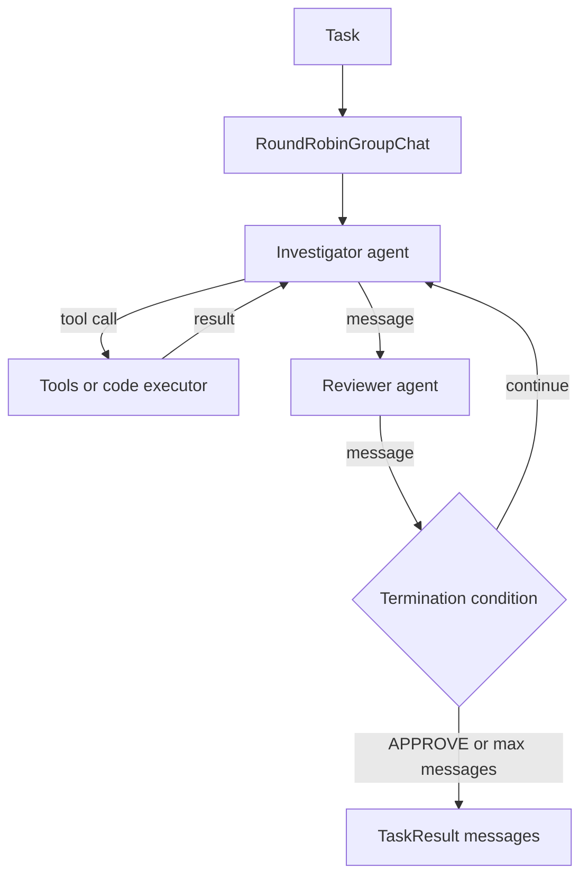

## TL;DR
AutoGen models multi-agent systems as conversations: agents exchange messages in pairs or group chats
until a termination condition fires. It now exists as two lines, Microsoft's rewritten AutoGen 0.4+ and
the community fork AG2, which keeps the original API.

## For agent builders
- **Why it matters for agents.** It popularised the "agents talk to each other" pattern: a coder and a
  code executor, a writer and a critic, a group chat with a manager. You will meet it in research code,
  prototypes and interviews, so know both lines and their limits.
- **Where it shows up in your stack.** `AssistantAgent` and teams such as `RoundRobinGroupChat` or
  `SelectorGroupChat` in Microsoft AutoGen; `ConversableAgent`, `UserProxyAgent` and `GroupChat` in AG2;
  Docker-based code executors in both.
- **What you control.** Agent system messages, tools, which agents participate, speaker selection,
  termination conditions, code-execution sandboxing and the model client.
- **What you can skip.** The lineage trivia beyond what you need to pick the right package and read old
  examples correctly; the next section gives exactly that.

## Why it exists
- **Some problems improve with critique.** A writer plus a reviewer, or a coder plus a test runner,
  catches errors one pass misses. Conversation is the simplest way to express that loop.
- **Code execution is a natural tool.** Letting one agent write Python and another run it in a sandbox
  solves maths, data and file tasks that pure text cannot, and AutoGen made that a first-class pattern.
- **Group roles need a coordinator.** With several agents, someone must pick the next speaker; group
  chat managers and selector teams do that with a model or rules.
- **The original design hit limits.** Synchronous, tightly coupled agents were hard to scale and
  observe, which drove Microsoft's asynchronous, event-driven 0.4 rewrite and, separately, the AG2 fork.

## How it works
### Which AutoGen is which
| Line | Package and import | API style | Status (check current docs) |
|---|---|---|---|
| AutoGen 0.2 (original, 2023) | `pyautogen`, `import autogen` | `ConversableAgent`, `initiate_chat` | superseded |
| AG2 (community fork, late 2024) | `ag2` (also published under older names), `import autogen` | 0.2-compatible, extended | actively developed |
| Microsoft AutoGen 0.4+ (early 2025 rewrite) | `autogen-agentchat`, `autogen-core`, `autogen-ext` | async, event-driven, layered | Microsoft has announced Agent Framework as its successor |

- **Read imports first.** `from autogen import ...` is AG2 or 0.2 style; `from autogen_agentchat ...` is
  Microsoft 0.4+. Mixing tutorials from both lines is the most common source of confusion.

### Microsoft AutoGen 0.4+ (AgentChat layer)
- **Model clients** such as `OpenAIChatCompletionClient` (from `autogen_ext.models.openai`) are passed to
  agents, so models are swappable.
- **`AssistantAgent(name, model_client=..., tools=[...], system_message=...)`** calls tools; with
  `reflect_on_tool_use=True` it summarises tool results in natural language.
- **Teams:** `RoundRobinGroupChat` (fixed turn order), `SelectorGroupChat` (a model picks the next
  speaker), `Swarm` (agents hand off explicitly), and Magentic-One style orchestration.
- **Termination conditions** compose with `|` and `&`: `TextMentionTermination("APPROVE") |
  MaxMessageTermination(8)`.
- **Run and stream:** `await team.run(task=...)` or `team.run_stream(...)` with `Console` for output;
  `save_state()` and `load_state()` persist agents and teams.
- **Core layer** (`autogen-core`) is an actor-style runtime for event-driven agents, including
  distributed runtimes, for teams building their own patterns.

### AG2 (0.2-style API)
- **`ConversableAgent`** is the base; `AssistantAgent` is an LLM agent and `UserProxyAgent` stands in for
  a human and can execute code.
- **`initiate_chat(recipient, message=...)`** runs a two-agent conversation until
  `is_termination_msg`, `max_consecutive_auto_reply` or `max_turns` stops it.
- **`human_input_mode`** (`"ALWAYS"`, `"TERMINATE"`, `"NEVER"`) sets when a human is asked.
- **Tools** are registered with `register_function(f, caller=..., executor=..., description=...)`: one
  agent proposes the call, another executes it.
- **`GroupChat` and `GroupChatManager`** run multi-agent chats with `max_round` and a speaker selection
  method.

## Diagram
Follow a critic loop: the team alternates speakers, tools run on the investigator's turn, and the
termination condition (checked after every message, simplified here to the reviewer's turn), not the
model, decides when the conversation ends.



## Examples
### Investigator and reviewer team (Microsoft AutoGen 0.4+ AgentChat)
Requires `pip install autogen-agentchat "autogen-ext[openai]"` and `OPENAI_API_KEY`. The tool returns
canned metrics so you can watch the critique loop.

```python
import asyncio
from autogen_agentchat.agents import AssistantAgent
from autogen_agentchat.conditions import MaxMessageTermination, TextMentionTermination
from autogen_agentchat.teams import RoundRobinGroupChat
from autogen_agentchat.ui import Console
from autogen_ext.models.openai import OpenAIChatCompletionClient

async def get_error_rate(service: str) -> str:
    """Return the 5xx error rate for a service over the last hour."""
    return {"checkout": "4.2% (baseline 0.3%)", "search": "0.1%"}.get(service, "unknown service")

async def main():
    client = OpenAIChatCompletionClient(model="gpt-4o-mini")
    investigator = AssistantAgent(
        "investigator", model_client=client, tools=[get_error_rate], reflect_on_tool_use=True,
        system_message="Diagnose incidents using tools. Propose one cause, citing tool data.")
    reviewer = AssistantAgent(
        "reviewer", model_client=client,
        system_message="Challenge claims without tool evidence. Say APPROVE only when supported.")
    stop = TextMentionTermination("APPROVE") | MaxMessageTermination(8)   # always add a hard cap
    team = RoundRobinGroupChat([investigator, reviewer], termination_condition=stop)
    await Console(team.run_stream(task="Some users cannot check out. Diagnose."))
    await client.close()

asyncio.run(main())
```

- **The hard cap matters:** without `MaxMessageTermination`, a reviewer that never says APPROVE keeps
  the loop, and the bill, running.
- **State:** `await team.save_state()` returns a serialisable dict you can store and later
  `load_state()` to resume.

### Code-writing assistant with a sandboxed executor (AG2)
The classic two-agent pattern: the assistant writes code, the user proxy runs it in Docker and reports
the output back.

```python
import os
from autogen import AssistantAgent, UserProxyAgent

llm_config = {"config_list": [{"model": "gpt-4o-mini", "api_key": os.environ["OPENAI_API_KEY"]}]}
assistant = AssistantAgent("assistant", llm_config=llm_config)   # default prompt ends with TERMINATE
executor = UserProxyAgent(
    "executor",
    human_input_mode="NEVER",
    max_consecutive_auto_reply=5,                                  # hard cap on auto replies
    is_termination_msg=lambda m: "TERMINATE" in (m.get("content") or ""),
    code_execution_config={"work_dir": "scratch", "use_docker": True},  # run code in a container
)
executor.initiate_chat(assistant, message="Compute the median of [3, 9, 4, 12, 7] in Python and print it.")
```

| Question | Microsoft AutoGen 0.4+ | AG2 |
|---|---|---|
| Programming model | async teams over an event-driven core | synchronous-style chats, 0.2-compatible |
| Termination | composable condition objects | `is_termination_msg`, `max_consecutive_auto_reply`, `max_turns` |
| Code execution | `CodeExecutorAgent` with Docker or local executors | `UserProxyAgent` with `code_execution_config` |
| Best fit | new builds needing async and distribution | existing 0.2 code and its tutorials |
| Watch | successor Agent Framework direction | package-name overlap with older releases |

## Production patterns
- **Always pair a semantic stop with a hard cap.** Combine a text or handoff condition with
  `MaxMessageTermination` (or `max_turns` and `max_consecutive_auto_reply` in AG2), and alert on runs
  that end by the cap, because they usually mean the agents disagreed or looped.
- **Execute code only in containers.** Use Docker-based executors with a scratch work directory, no
  credentials and restricted network; never local execution on a host with secrets. Monitor execution
  time, exit codes and blocked network calls.
- **Persist team state between requests.** Save with `save_state()` after each run and reload by
  conversation ID, so a service can stay stateless and resume. Version the stored state, since formats
  can change across releases.
- **Trace message flow.** Use the built-in OpenTelemetry support (check the current docs for setup) or
  log every message with sender, tokens and tool calls. Count messages and tokens per agent; one chatty
  agent is the usual cost driver.
- **Pin the line and version.** Pin `autogen-agentchat` and `autogen-ext` together, or pin `ag2`,
  and check imports in CI so a dependency resolver cannot pull the other line. Review the Microsoft
  Agent Framework migration guidance before starting new long-lived projects.

## Trade-offs
- **Conversation as the abstraction vs explicit control.** Group chats are quick to express and good for
  critique and brainstorming, but control flow hides in who speaks next. Flips to LangGraph or a Flow when
  steps and transitions must be auditable.
- **Model-selected speakers vs cost and predictability.** `SelectorGroupChat` adapts to the task, but
  each selection is a model call and selection errors stall progress. Round-robin or explicit handoffs
  are cheaper and testable.
- **Code execution power vs risk.** Running generated code solves real tasks, but the sandbox becomes
  your security boundary. Flips to predefined tools when the code would touch production data.
- **Ecosystem split vs stability.** Two active lines plus an announced successor mean tutorials and
  APIs diverge. Choose the line whose roadmap you trust for the system's lifetime.

## Pitfalls
- **Mixing AG2 and AutoGen 0.4 examples.** Symptom: import errors or classes with unexpected arguments.
  Fix: check whether code imports `autogen` or `autogen_agentchat`, and follow that line's docs only.
- **Relying on "TERMINATE" alone.** Symptom: endless polite exchanges ("Thank you!", "You're welcome!").
  Fix: add message caps and make termination criteria concrete in system messages.
- **Local code execution in production.** Symptom: generated code reads files or environment variables
  it should not. Fix: Docker executors, a throwaway work directory, no secrets in the environment.
- **Too many agents in one group chat.** Symptom: rising tokens per task and wrong speaker picks. Fix:
  start with two or three agents and add one only when an eval shows it helps.

## When to use
- **Use when** the problem benefits from agents critiquing each other or from generated code executed
  in a sandbox, especially in research, data analysis and prototyping.
- **Use Microsoft AutoGen 0.4+ when** you want async, event-driven teams and are comfortable tracking its
  transition to Agent Framework; use AG2 when you maintain 0.2-style code.
- **Avoid when** you need deterministic, auditable workflows, durable approval pauses, or tight latency;
  choose LangGraph, a vendor SDK or Pydantic AI.
- **Measure** messages and tokens per task, termination reason mix, task success on an eval set and
  sandbox violations.

## Role lens
- **Engineer:** Builds teams with clear termination conditions and caps, wires tools and Docker
  executors, and reads message traces to cut wasted turns.
- **Architect:** Chooses between the AutoGen lines (or their successor) for the system's lifetime, sets
  the sandbox boundary for code execution, and decides where conversation-based control is acceptable.
- **FDE:** Uses quick group-chat prototypes to show a customer what multi-agent critique can do, then
  explains what must be hardened (caps, sandboxing, state) before production.

## Check yourself
**Q:** A two-agent AutoGen team (writer and critic) sometimes runs for 40 messages and costs ten times
the median. What is going on, and how do you fix it?
**A:** The termination condition depends on the critic saying a keyword, and it never does: the critic's
criteria are vague, the writer cannot satisfy them, or the pair drifts into pleasantries. Add a hard cap
with `MaxMessageTermination` (or `max_turns` in AG2) combined with the semantic condition, and make the
critic's approval criteria concrete and checkable. Log the termination reason per run, alert when the
cap triggers, and review those transcripts to fix the prompts. If critique rarely changes the output,
measure whether the critic is worth its cost at all.

## Interview questions
### Explain the difference between AutoGen 0.2, AG2 and AutoGen 0.4.
- **AutoGen 0.2** introduced conversable agents and two-agent and group chats with synchronous-style
  APIs.
- **AG2** is the community fork that keeps and extends that API under the `autogen` import.
- **AutoGen 0.4** is Microsoft's async, event-driven rewrite with Core, AgentChat and Extensions
  layers; Microsoft has since announced Agent Framework as the successor, so check its status.

### How do termination conditions work, and why are they critical?
- **Conditions decide when a conversation ends:** a keyword, a handoff, a message count, a token budget,
  composable with `|` and `&` in AutoGen 0.4.
- **They are critical** because agents talking to agents have no natural end; a missing hard cap is the
  main cause of runaway cost.
- **Log which condition fired** to find prompts that never converge.

### How would you safely let an agent execute code it writes?
- **Run it in a container** via a Docker executor with a throwaway work directory.
- **Remove credentials and restrict network egress,** so generated code cannot reach production systems.
- **Cap execution time and turns,** and log code plus outputs for review.

### When is a conversational multi-agent design the wrong choice?
- **When the workflow is known:** fixed steps belong in code or a state machine, which is cheaper and
  testable.
- **When runs must pause for approvals for days:** you need durable checkpoints and interrupts.
- **When latency matters:** every agent turn is a model call, so a group chat is slower than one agent
  with tools.

### How do you choose speaker selection in a group chat?
- **Round-robin** for fixed alternation like writer and critic: cheapest and predictable.
- **Model-based selection** (`SelectorGroupChat`, or AG2's `"auto"`) when the right next expert depends
  on content, accepting an extra call per turn.
- **Explicit handoffs** (`Swarm`) when agents know who should act next, which is easier to test.

## Quiz
### Q: You see `from autogen_agentchat.teams import RoundRobinGroupChat` in a codebase. Which line is it?
- [ ] AG2, the community fork
- [x] Microsoft AutoGen 0.4 or later, the AgentChat layer
- [ ] AutoGen 0.2
- [ ] CrewAI
> The `autogen_agentchat` package belongs to Microsoft's rewritten AutoGen. AG2 and AutoGen 0.2 use
> `import autogen` with `ConversableAgent`-style classes.

### Q: Why combine TextMentionTermination with MaxMessageTermination?
- [ ] Because TextMentionTermination only works with one agent
- [x] Because the keyword may never appear, and a message cap guarantees the conversation ends
- [ ] Because MaxMessageTermination is required to stream output
- [ ] Because it reduces tokens per message
> Semantic conditions depend on the model; a hard cap bounds cost and latency when the agents never
> converge.

### Q: What is the safest default for running code that an AutoGen or AG2 agent generates?
- [ ] Run it locally in the service process for speed
- [ ] Ask the model to promise the code is safe
- [x] Execute it in a Docker-based executor with no credentials and restricted network
- [ ] Disable termination conditions so errors can be fixed
> The sandbox is the security boundary for generated code; prompts are not. A container without
> secrets or egress limits what any generated code can reach.

## Use cases & projects
### Use cases
- **Data-analysis assistants.** An assistant writes pandas code, an executor runs it in Docker, and the
  pair iterates until the numbers and chart are produced.
- **Writer and critic loops.** Drafting specs, emails or reports with a reviewer agent that checks them
  against explicit criteria before a human sees them.
- **Research prototypes.** Teams explore multi-agent strategies (debate, planner-executor, Magentic-One
  style orchestration) before hardening the winner.
- **Incident investigation.** An investigator with read-only tools and a reviewer that rejects claims
  without evidence, ending in an approved diagnosis.

### Mini project
**Writer-critic team with measured termination (1-2 hours).**
- **Goal:** show how termination design changes cost and outcome in a two-agent team.
- **Steps:** build a writer and a critic with AutoGen AgentChat (or AG2); give the critic three
  concrete approval criteria; run 10 tasks with only a keyword stop (with a high safety cap), then with
  keyword plus `MaxMessageTermination(6)`; log messages, tokens and termination reason per run.
- **Done when:** a table compares messages, tokens and approval rate for both settings, and you can
  name one task where the critic never approved and why.

### Major project
**Sandboxed data-analysis agent team (multi-day; fits the module Capstone).**
- **Goal:** a service where users upload a CSV and ask questions, answered by a coder, executor and
  reviewer team.
- **Scope:** Docker executor with no network; saved team state per session; termination conditions with
  hard caps; message and token tracing; a reviewer that checks numbers against executed output.
- **Done when:** a 30-question eval over three datasets reports correctness, messages and cost per
  question, and a prompt-injected CSV cannot make the code reach the network.
