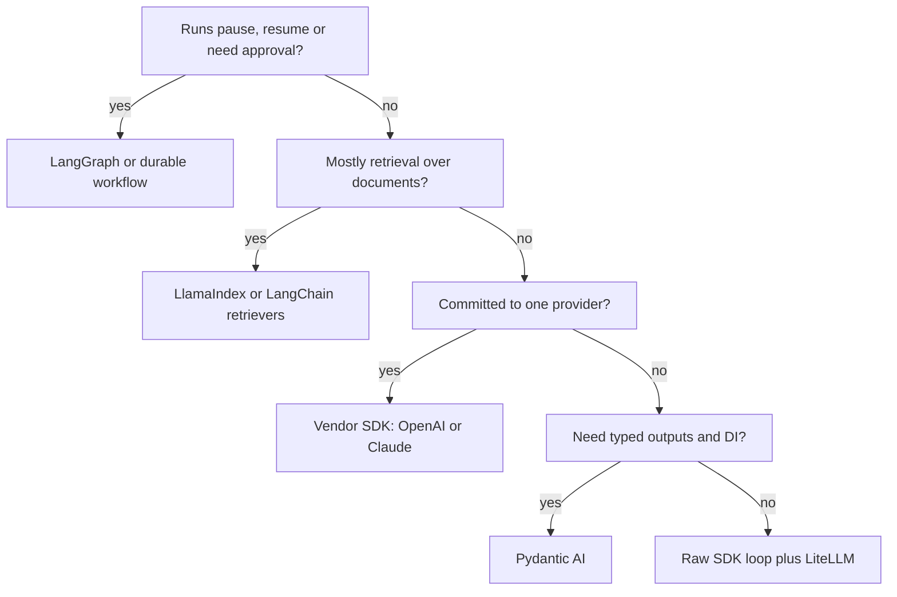

## TL;DR
Every agent framework wraps the same loop: call a model, run its tool calls, feed results back. Pick
one by what you would otherwise build yourself: durable state, multi-agent routing, retrieval, typing or
a hosted harness, not by feature lists.

## For agent builders
- **Why it matters for agents.** The framework decides how state is persisted, how a human pauses a run,
  how traces look and how hard it is to leave. Those are expensive to change after launch.
- **Where it shows up in your stack.** Between your provider SDK (or an LLM gateway such as LiteLLM) and
  your app: it owns the loop, tool dispatch, memory, streaming and often tracing.
- **What you control.** Whether you take a framework at all, which layer it owns, and an exit plan: your
  tools, prompts and eval set should not depend on it.
- **What you can skip.** Ranking frameworks by GitHub stars or demo count. Run the same 20-case eval on two
  candidates instead.

## Decision case
### Scenario
An EU insurer wants a claims-intake agent: it reads a claim, checks the policy, asks for missing
documents, and proposes a payout. Payouts over 2,000 EUR need an adjuster's approval. The team must pick
the agent framework this week. All figures below are illustrative planning numbers, not benchmarks.
- **Team:** 4 Python engineers; one also writes the TypeScript review UI. Nobody has operated a durable
  workflow engine such as Temporal.
- **Scale:** 4,000 claims a day at about 8 supersteps each, so 4,000 x 8 = 32,000 checkpoints a day.
- **Approvals:** 30% of claims (1,200 a day) pause for an adjuster with a 24 h SLA and a 6 h median wait.
  By Little's law about 1,200 x 6 / 24 = 300 runs sit paused at any moment, across deploys.
- **Data residency:** state and traces stay in the EU VPC; no SaaS tracing.
- **Providers:** one model provider today; procurement wants a second within 12 months.
- **Latency and deadline:** first streamed update within 2 s at p95; pilot live in 10 weeks.

### Options
| Option | How it works | Durable 24 h approval | Second provider | EU-only traces | 10 weeks with this team |
|---|---|---|---|---|---|
| Raw SDK loop | your loop, a Postgres run table, LiteLLM | you build pause, resume and payloads | yes, via LiteLLM | any OTel backend | tight: resume and streaming eat weeks |
| LangGraph | `StateGraph`, `interrupt()`, `PostgresSaver`, LiteLLM under it | built in, resumes by `thread_id` | yes | self-hosted LangSmith or Langfuse | fits: Python, durable pause is a library call |
| OpenAI Agents SDK | `Runner`, tools with `needs_approval`, saved `RunState` | you store and reload the serialized state | partial | custom trace processor | workable, more glue around state |
| Raw loop in Temporal | loop steps as activities in a durable workflow | strongest: retries, timers, history | yes | self-hosted | risky: new cluster to learn and run |

### Decision
**LangGraph with a Postgres checkpointer, LiteLLM under the model calls, and traces in a self-hosted EU
backend.** It is the only option that covers the 24 h approval, provider neutrality and EU-only traces
without new infrastructure or weeks of state code, in the team's language.
- **Why not the raw loop:** the loop is easy, but durable pause, resume after deploys and streaming are
  most of a 10-week budget.
- **Why not Temporal:** it is the more robust engine, but a new cluster plus learning it does not fit 10
  weeks for a team without that experience.
- **Why not the vendor SDK:** state reload and a second provider both need glue the team would own.
- **Exit plan:** tools stay plain typed functions, prompts live in the repo, and the 50-case eval set is
  framework-neutral, so a later move costs days, not a rewrite.

**What would change it.** If the company already runs Temporal for other workflows, put the raw loop
inside it. If approvals were dropped and runs took seconds, a raw loop is enough. If the bake-off showed
LangGraph losing on the eval set or needing more glue than the raw loop, the evidence wins.

### Trade-offs accepted
- **A framework dependency with frequent releases.** Pin exact versions, upgrade on a branch, and gate
  upgrades on the eval set passing.
- **Checkpoint storage growth.** At an illustrative 20 KB per checkpoint, 32,000 a day is 640 MB a day,
  about 19.2 GB over a 30-day retention. Run a retention job for closed claims and alert on table size.
- **Nodes re-run on resume.** The approval node runs again when the adjuster answers. Payout calls live
  in a later node with an idempotency key per claim; alert on any duplicate payout attempt.
- **A database write per superstep.** Adds latency to each step. Track p95 checkpoint write time and the
  2 s first-update target, and stream `updates` so users see progress before the run ends.

### Review rubric
- **Constraints first:** the write-up lists run length, approvals, residency, providers, team skills and
  deadline before naming any framework.
- **Numbers recomputed:** paused-run count, checkpoint volume and storage follow from stated inputs, and
  rough figures are labelled illustrative.
- **Options scored on the constraints:** 2-4 real alternatives, including a raw SDK baseline, each rated
  on every hard constraint, not on feature lists.
- **Evidence named:** a thin-slice bake-off (one tool, one approval, one killed-process resume) and the
  eval metrics compared: pass rate, tokens per task, p95 latency.
- **Reversibility:** an explicit exit plan for tools, prompts, evals and model calls.
- **Risks monitored:** each accepted trade-off has a metric or alert, and the write-up says what evidence
  would change the decision.

## Why it exists
- **The loop is small; the rest is not.** A tool-calling loop is about 30 lines. Checkpointing, resume
  after a crash, human approval, streaming partial output, parallel branches and tracing are each weeks of
  work to build well.
- **Frameworks buy that rest, at a price.** You inherit their abstractions, their release cadence and
  sometimes their prompts. LangChain's early agents parsed model text with hidden prompts, which is why
  many teams now prefer thinner layers.
- **Providers now ship their own harnesses.** The OpenAI Agents SDK and the Claude Agent SDK give a
  supported loop with tools, handoffs or subagents and tracing, tuned for one vendor's models.
- **The naive choice fails late.** Teams pick the framework with the best tutorial, then discover at
  month three that it cannot persist a paused run or that its trace format does not fit their stack.

## How it works
### The decision is about layers, not brands
| Layer you need | Build it yourself when | Reach for |
|---|---|---|
| The loop and tool dispatch | always feasible, 30-100 lines | raw provider SDK, LiteLLM |
| Typed tools and validated outputs | you want type checking and retries on bad output | Pydantic AI, Instructor |
| Durable state, pause and resume, branching | runs last minutes to days or need approvals | LangGraph, a durable workflow engine |
| Retrieval over many documents | data plumbing dominates | LlamaIndex, LangChain retrievers |
| Role-based multi-agent teams | you are prototyping a crew of roles quickly | CrewAI, AutoGen / AG2 |
| A full agent harness (files, shell, MCP, subagents) | you want a coding or ops agent out of the box | Claude Agent SDK |
| Provider-native handoffs, guardrails, tracing | you are committed to one provider | OpenAI Agents SDK, Google ADK |

### The candidates in one line each
- **Raw SDK loop.** Full control and the fewest surprises; you build persistence, retries and tracing.
- **LangGraph.** Agents as a typed state graph with checkpointers, interrupts and streaming; most control
  over flow, more code for simple cases.
- **LlamaIndex.** Data-first: loaders, indexes and query engines, plus agents and event-driven workflows.
- **OpenAI Agents SDK.** `Agent`, `Runner`, function tools, handoffs, guardrails, tool approvals and
  built-in tracing.
- **Claude Agent SDK.** The harness behind Claude Code: built-in tools, MCP servers, subagents, hooks and
  permission modes.
- **CrewAI.** Agents with a role, goal and backstory, assigned tasks in a crew; Flows for explicit control.
- **Pydantic AI.** Typed agents with dependency injection and validated structured output, model-agnostic.

### A scoring procedure that holds up
1. **Write the hard requirements first:** longest run time, need for human approval, multi-agent or not,
   languages (Python, TypeScript), hosting limits (VPC, no SaaS tracing).
2. **Shortlist two candidates** that cover them natively, plus the raw-SDK baseline.
3. **Build the same thin slice** in each: one tool, one approval, one resume after a killed process.
4. **Run your eval set** (20-50 cases) on each and compare pass rate, tokens per task and p95 latency.
5. **Check the exit cost:** can tools, prompts and evals move without rewrites?

## Diagram
Read it top-down: each question removes options, and the raw SDK stays a valid answer at every level.



## Examples
### The baseline every framework wraps
Runs as-is; `call_model` stands in for one provider SDK call with tools attached. If a framework cannot
beat this on your requirements, you do not need it yet.

```python
import json

TOOLS = {"order_status": lambda order_id: {"A-1001": "shipped, arrives Friday"}.get(order_id, "not found")}

def call_model(messages):               # stand-in for one provider SDK call with tools=[...] attached
    if messages[-1]["role"] == "user":
        return {"tool_calls": [{"id": "c1", "name": "order_status", "args": {"order_id": "A-1001"}}]}
    return {"content": "Order A-1001 has shipped and arrives Friday.", "tool_calls": []}

def run_agent(question, max_steps=8):
    messages = [{"role": "system", "content": "Support agent. Use tools for order data."},
                {"role": "user", "content": question}]
    for step in range(max_steps):                        # the step budget a framework would hide
        reply = call_model(messages)
        messages.append({"role": "assistant", **reply})
        if not reply["tool_calls"]:
            return reply["content"], step + 1
        for call in reply["tool_calls"]:                 # execute, then feed results back
            try:
                result = TOOLS[call["name"]](**call["args"])
            except Exception as e:                       # errors go back to the model, not up the stack
                result = f"error: {e}"
            messages.append({"role": "tool", "tool_call_id": call["id"], "content": json.dumps(result)})
    raise RuntimeError("step budget exhausted")

print(run_agent("Where is order A-1001?"))   # ('Order A-1001 has shipped and arrives Friday.', 2)
```

### The same agent in a framework (Pydantic AI)
`TestModel` calls every tool with generated arguments, so this runs offline; swap in a provider string
such as `"openai:gpt-4o-mini"` for real use. The schema comes from the type hints and docstring.

```python
# pip install pydantic-ai-slim
from pydantic_ai import Agent
from pydantic_ai.models.test import TestModel

agent = Agent(TestModel(), instructions="Support agent. Use tools for order data.")

@agent.tool_plain
def order_status(order_id: str) -> str:
    """Shipping status for an order id."""
    return "shipped"

result = agent.run_sync("Where is A-1001?")
print(result.output)          # TestModel echoes tool results: {"order_status":"shipped"}
```

### Worked scenario: a refund agent for a fintech
Requirements: refunds over 100 need a human approval that may take a day; the team is Python; traces must
stay in their VPC; one provider today, maybe two next year.

| Option | Approval that survives a restart | Multi-provider | Self-hosted tracing | Verdict |
|---|---|---|---|---|
| Raw SDK loop | build it (state table, resume logic) | via LiteLLM | any OTel backend | viable, most code |
| LangGraph | `interrupt()` plus a Postgres checkpointer | yes | LangSmith self-hosted, Langfuse | best fit |
| OpenAI Agents SDK | `needs_approval` tools; you store and reload the serialized `RunState` | partial | custom trace processors | workable, more glue |
| CrewAI | human input exists; durable resume weaker | yes | yes | prototype only |

The team picked LangGraph because the durable pause is built in, not bolted on, and kept tools as plain
functions, so the exit cost stays low.

## Production patterns
- **Keep tools framework-free.** Write tools as plain typed functions in your own package and adapt them
  with a one-line decorator per framework. Monitor nothing new; the payoff is a migration measured in days.
- **Put a gateway under the framework.** Route model calls through LiteLLM or your own gateway for keys,
  rate limits, fallbacks and cost logs, so swapping frameworks does not lose them. Monitor cost per task.
- **Pin versions and read changelogs.** Agent frameworks ship breaking changes often; pin exact versions,
  upgrade on a branch, and gate the upgrade on your eval set passing.
- **Run a bake-off on your eval set.** Build the same thin slice in two candidates and compare pass rate,
  tokens per task and p95 latency on 20-50 real cases before committing.
- **Own the trace format.** Prefer frameworks that export OpenTelemetry or have a pluggable trace sink, so
  traces land in your observability stack even if you change frameworks.

## Trade-offs
- **Control vs speed to first demo.** A raw loop shows every prompt and retry; a framework gives approval,
  streaming and persistence in days. Flips when requirements are simple and stable.
- **Provider SDK vs neutral framework.** Vendor SDKs track new model features first and are tuned for
  them; neutral frameworks let you switch providers. Flips once you need a second provider for cost or
  outage cover.
- **Batteries vs debuggability.** Prebuilt agents and crews hide prompts; when output is wrong you debug
  someone else's prompt. Explicit graphs cost more code but keep every step visible.
- **Hosted platform vs self-run.** Managed deployment (LangSmith Deployment, formerly LangGraph Platform,
  or vendor runtimes) removes ops work but adds a bill and a data-residency question.

## Pitfalls
- **Choosing by tutorial.** Symptom: month-three rewrite when you need resume-after-crash. Fix: list hard
  requirements first and test a killed-process resume in the bake-off.
- **Letting the framework own your prompts.** Symptom: quality changes after a minor upgrade. Fix: keep
  system prompts in your repo or prompt registry and pass them in explicitly.
- **Mixing two orchestration frameworks.** Symptom: two state models, two trace trees, retries at both
  levels. Fix: one orchestrator; other libraries only as components (a retriever, a validator).
- **Multi-agent by default.** Symptom: three agents doing one agent's job at triple the tokens. Fix: start
  with one agent and add roles only when an eval shows a single agent failing.

## When to use
- **Use a raw SDK loop when** the agent is one loop with a few tools, runs in seconds, and you want full
  control of prompts and cost.
- **Use a framework when** you need durable pause and resume, parallel branches, multi-agent routing or a
  harness with files, shell and MCP that you would otherwise build.
- **Avoid deciding without** a thin-slice bake-off on your own eval set and a written exit plan.
- **Measure:** pass rate, tokens and latency per task, and lines of glue code you own.
- **Interviews:** expect "why this framework and not a raw loop?"; answer with requirements, not features.

## Role lens
- **Engineer:** Builds the thin slice in two candidates, keeps tools and prompts framework-free, and
  reports pass rate, tokens and latency per task from the same eval set.
- **Architect:** Writes the hard requirements (durability, approvals, hosting, languages) and the exit
  plan, and decides which layer the framework is allowed to own.
- **FDE:** Maps a customer's constraints, such as VPC-only tracing or an existing provider contract, to a
  framework choice they can operate after the engagement ends.

## Check yourself
**Q:** A team wants an internal agent that answers HR questions from 2,000 policy PDFs, with no actions
and answers in under 5 seconds. Another wants an agent that issues refunds over 100 only after a manager
approves, which can take a day. Would you pick the same framework for both?
**A:** No. The HR agent is retrieval-heavy and stateless: a raw SDK loop or a single LlamaIndex or
LangChain retrieval pipeline is enough, and a heavy orchestration layer adds latency and code without
benefit. The refund agent needs a durable pause that survives restarts, an approval payload, and resume on
the same thread, which LangGraph gives with `interrupt()` and a Postgres checkpointer, or a durable
workflow engine gives around a raw loop. In both cases keep tools as plain functions and run the same eval
set before committing, so the choice can be revisited.

## Interview questions
### What does an agent framework give you that a raw provider SDK does not?
- **The same loop, plus the hard parts.** Persistence after every step, pause and resume for humans,
  streaming of tokens and steps, parallel branches, retries and tracing.
- **What it does not give.** Better reasoning. The model and your tools decide quality; a framework only
  changes how much infrastructure you write around them.

### Your team is split between LangGraph and the OpenAI Agents SDK. How do you decide?
- **Write the hard requirements:** durable approvals, provider neutrality, hosting and trace residency.
- **Build a thin slice in both** (one tool, one approval, one resume after a killed process) and run the
  same 20-50 case eval.
- **Decide on evidence:** pass rate, tokens and p95 latency per task, plus how much glue code each needed.

### When would you not use a framework at all?
- **Short, stateless agents.** One loop, a few tools, answers in seconds: a 50-line loop is easier to read,
  test and tune than any abstraction.
- **Heavy prompt control or unusual providers.** When you must see every token sent, or the framework
  lags a model feature you need, the raw SDK wins.

### How do you keep a framework choice reversible?
- **Tools and prompts live outside it** as plain typed functions and versioned files, adapted by thin
  wrappers.
- **Model calls go through a gateway** so keys, fallbacks and cost logs survive a switch.
- **The eval set is framework-neutral**, so you can prove a migration did not regress quality.

### A CrewAI prototype works in demos but costs 4x more tokens than expected in production. What do you check?
- **Count agents and turns per task.** Role-based crews often pass full context between several agents;
  each hop re-sends the transcript.
- **Then try fewer roles.** Collapse to one agent with the same tools, rerun the eval, and keep the crew
  only if pass rate drops without it.

## Quiz
### Q: What is the strongest reason to adopt LangGraph instead of a raw SDK loop?
- [ ] It makes the model reason better on multi-step tasks
- [x] You need runs to pause for human approval and resume from persisted state after a restart
- [ ] It removes the need for tool schemas
- [ ] It is the only framework that supports tool calling
> LangGraph's checkpointers and interrupts give durable pause and resume. Reasoning quality comes from
> the model and prompts, and every framework, including a raw loop, supports tool calling.

### Q: Which practice most reduces the cost of switching agent frameworks later?
- [ ] Using the framework's prebuilt agent for every workflow
- [ ] Storing prompts inside framework components
- [x] Keeping tools as plain typed functions and the eval set framework-neutral
- [ ] Combining two orchestration frameworks so either can be dropped
> Plain tools adapt to any framework with a thin wrapper, and a neutral eval set proves a migration did
> not regress. Prompts inside components and mixed orchestrators both increase lock-in.

### Q: A team needs an agent with built-in file editing, shell access, MCP servers and subagents for an internal coding workflow. Which is the most direct fit?
- [ ] CrewAI
- [ ] LlamaIndex
- [x] Claude Agent SDK
- [ ] A LangChain LCEL chain
> The Claude Agent SDK packages the agent harness behind Claude Code, with built-in tools, MCP support,
> subagents and permission controls. The others would need that harness built on top.

## Use cases & projects
### Use cases
- **Greenfield agent kickoff.** Teams run a one-week bake-off of two frameworks plus a raw loop on the same
  thin slice before committing.
- **Approval-heavy workflows.** Refunds, account changes and procurement agents pick a framework for
  durable pause and resume first and everything else second.
- **Retrieval-first assistants.** Knowledge-base agents choose data tooling (LlamaIndex, LangChain
  retrievers) and keep orchestration minimal.
- **Vendor-committed products.** Teams on one provider adopt its agent SDK for faster access to new model
  features, with tools kept portable.

### Mini project
**Framework bake-off on one thin slice (2-3 hours).**
- **Goal:** choose between a raw SDK loop and one framework with evidence, not opinion.
- **Steps:** write two plain tools (`order_status`, `issue_refund`) and 10 eval cases; build the agent as a
  raw loop and in one framework (LangGraph or Pydantic AI); add an approval before `issue_refund`; kill the
  process mid-approval and try to resume; log pass rate, tokens and latency per case.
- **Done when:** you have a table comparing both on pass rate, tokens per task, lines of glue code and
  whether resume worked, plus a one-paragraph recommendation with its exit plan.
