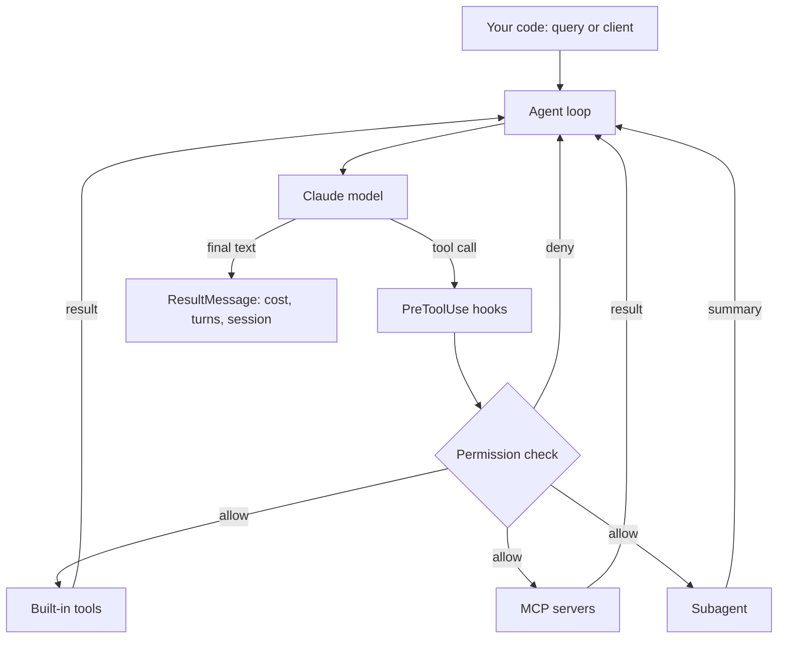

## TL;DR
The Claude Agent SDK exposes the agent harness behind Claude Code as a library: a built-in agent loop
with file, shell and web tools, custom tools served over MCP, subagents, hooks and permissions, and
automatic context management, driven from Python or TypeScript.

## For agent builders
- **Why it matters for agents.** Instead of a bare tool loop, you get a harness that already reads and
  edits files, runs commands, searches, compacts long contexts and delegates to subagents. You add your
  tools and policies, which suits coding, ops and research agents that work on a computer.
- **Where it shows up in your stack.** `query()` or `ClaudeSDKClient` in your service or job,
  `ClaudeAgentOptions` as the agent's configuration, in-process MCP servers for your own tools, external
  MCP servers for SaaS systems, and hooks as your policy layer.
- **What you control.** System prompt, allowed and disallowed tools, permission mode, working directory,
  MCP servers, subagent definitions, hooks, turn limits, model, and session resume or fork.
- **What you can skip.** Writing your own file-edit, grep or bash tools and context compaction; the
  harness ships them. Build only the domain tools.

## Why it exists
- **Agents that act on computers need many tools done well.** Reading a file range, editing with exact
  replacements, globbing, running a command with a timeout: each is easy to write badly. The SDK reuses
  the tools Claude Code has hardened.
- **Long tasks overflow context.** A 50-step debugging run produces more tool output than fits. The
  harness compacts and manages context automatically, which a hand-rolled loop must reinvent.
- **Tool integration should be a protocol, not glue.** Custom tools are MCP tools, in process or
  external, so the same server serves this agent, Claude Code and any other MCP host.
- **Autonomy needs policy hooks.** Teams must block `rm -rf`, require approval for writes and log every
  tool call. Hooks and permission callbacks give deterministic code a veto over the model.

## How it works
### Two ways to drive it
| Entry point | Use it for | Shape |
|---|---|---|
| `query(prompt=..., options=...)` | one-shot tasks, jobs, CI | async iterator of messages; new session each call |
| `ClaudeSDKClient(options=...)` | multi-turn conversations, interrupts | `async with` client; `client.query(...)` then `client.receive_response()` |

- **Messages stream as typed objects:** `AssistantMessage` (with `TextBlock` and tool-use blocks),
  `UserMessage` (tool results), `SystemMessage`, and a final `ResultMessage`.
- **`ResultMessage`** carries the outcome: `subtype`, `is_error`, `num_turns`, `session_id`, usage and
  `total_cost_usd`, which is what you log per run.

### Configuration: `ClaudeAgentOptions`
- **Prompt and model:** `system_prompt`, `model`. Recent versions do not apply the Claude Code system
  prompt or load filesystem settings by default; opt in (for example `setting_sources=["project"]` to
  read `CLAUDE.md`). This changed at the rename from the Claude Code SDK, so check the migration notes.
- **Tools:** `allowed_tools` lists tools pre-approved to run; `disallowed_tools` removes tools.
  Built-ins include `Read`, `Write`, `Edit`, `Bash`, `Glob`, `Grep`, `WebSearch` and `WebFetch`.
- **Permissions:** `permission_mode` (`default`, `acceptEdits`, `plan`, `bypassPermissions`) plus a
  `can_use_tool` callback for decisions in code.
- **Scope and limits:** `cwd` for the working directory, `max_turns` for the loop budget.
- **Sessions:** `resume=<session_id>` continues a conversation; `fork_session` branches from it.

### Custom tools are MCP tools
1. **Define a tool** with the `@tool(name, description, input_schema)` decorator on an async function
   that returns MCP-style content (`{"content": [{"type": "text", "text": ...}]}`).
2. **Bundle tools** with `create_sdk_mcp_server(name=..., version=..., tools=[...])`. This runs in your
   process, with no subprocess or network hop.
3. **Register** it in `mcp_servers={"helpdesk": server}` and allow it as `mcp__helpdesk__get_ticket`
   (the `mcp__<server>__<tool>` naming).
4. **External servers** use the same map with a config: a stdio command (`"type": "stdio"`, `command`,
   `args`) or a remote URL (`"type": "http"` for Streamable HTTP, `"type": "sse"` for the older
   transport). Streamable HTTP replaced HTTP+SSE in the 2025-03-26 MCP spec; remote servers use the
   spec's OAuth-based authorization.

### Subagents
- **Defined with `AgentDefinition`** (description, prompt, tools, optional model) in `options.agents`.
- **The main agent delegates** through its subagent tool, and each subagent runs with its own context
  window and tool list, returning only a summary. That keeps the main context small and lets you give a
  reviewer read-only tools.
- **The description is the routing signal,** so say when to use it ("use after any code edit").

### Hooks
- **Events** include `PreToolUse`, `PostToolUse`, `UserPromptSubmit`, `Stop` and others; register them
  as `hooks={"PreToolUse": [HookMatcher(matcher="Bash", hooks=[fn])]}`.
- **A `PreToolUse` hook can deny** a call with a reason the model sees, which is how deterministic
  policy overrides the model. Return shapes are version-sensitive; check the hooks reference.

## Diagram
Follow one turn: the model proposes a tool call, hooks and permissions decide, the tool runs locally or
over MCP, and the result returns to the loop until a result message ends the run.



## Examples
### A read-only bug-triage agent with one custom MCP tool
Requires `pip install claude-agent-sdk` and an Anthropic API key (Bedrock and Vertex are supported via
environment settings). The agent reads a ticket, searches the repo and proposes a fix.

```python
import asyncio
from claude_agent_sdk import (AssistantMessage, ClaudeAgentOptions, ResultMessage, TextBlock,
                              create_sdk_mcp_server, query, tool)

@tool("get_ticket", "Fetch a support ticket's text by ID, e.g. T-1", {"ticket_id": str})
async def get_ticket(args):
    tickets = {"T-1": "CSV export times out after 30 seconds for accounts with 50k rows."}
    return {"content": [{"type": "text", "text": tickets.get(args["ticket_id"], "not found")}]}

helpdesk = create_sdk_mcp_server(name="helpdesk", version="1.0.0", tools=[get_ticket])

options = ClaudeAgentOptions(
    system_prompt="Triage bugs: read the ticket, find the responsible code, propose a fix. Never edit.",
    cwd="./repo",
    mcp_servers={"helpdesk": helpdesk},
    allowed_tools=["Read", "Grep", "Glob", "mcp__helpdesk__get_ticket"],
    disallowed_tools=["Write", "Edit", "Bash"],
    max_turns=15,
)

async def main():
    async for msg in query(prompt="Investigate ticket T-1", options=options):
        if isinstance(msg, AssistantMessage):
            for block in msg.content:
                if isinstance(block, TextBlock):
                    print(block.text)
        elif isinstance(msg, ResultMessage):
            print(f"[{msg.subtype}] turns={msg.num_turns} cost={msg.total_cost_usd} session={msg.session_id}")

asyncio.run(main())
```

- **Why `disallowed_tools` as well:** pre-approving tools and removing tools are different settings;
  removing writes makes "read-only" a property of the configuration, not of the prompt.
- **Log the `session_id`:** passing it as `resume=` later continues the investigation with full context.

### A fixing agent with a test-runner subagent and a policy hook
The main agent may edit; a subagent runs tests with a narrower tool list; a hook vetoes dangerous
commands no matter what the model decides.

```python
from claude_agent_sdk import AgentDefinition, ClaudeAgentOptions, HookMatcher

BLOCKED = ("rm -rf", "git push", "curl ", "wget ")

async def block_dangerous_bash(input_data, tool_use_id, context):
    cmd = input_data.get("tool_input", {}).get("command", "")
    if any(b in cmd for b in BLOCKED):
        return {"hookSpecificOutput": {
            "hookEventName": "PreToolUse",
            "permissionDecision": "deny",
            "permissionDecisionReason": f"Blocked by policy: {cmd[:60]}",
        }}
    return {}                                              # no opinion: normal permission flow

options = ClaudeAgentOptions(
    cwd="./repo",
    permission_mode="acceptEdits",                         # file edits auto-approved inside cwd
    allowed_tools=["Read", "Grep", "Glob", "Edit", "Bash", "Task"],  # Task = subagent tool; check name
    agents={"test-runner": AgentDefinition(
        description="Runs the test suite and reports failures. Use after every code edit.",
        prompt="Run pytest -q, then summarise failing tests and their errors. Never edit files.",
        tools=["Bash", "Read"],
    )},
    hooks={"PreToolUse": [HookMatcher(matcher="Bash", hooks=[block_dangerous_bash])]},
    max_turns=30,
)
```

| Layer | Protects against | Deterministic? |
|---|---|---|
| System prompt "never push" | honest mistakes | no |
| `disallowed_tools` | whole tool classes | yes |
| `PreToolUse` hook | specific dangerous arguments | yes |
| Container with no credentials or egress | everything the hook missed | yes |

## Production patterns
- **Run each agent session in a sandbox.** The harness executes real commands, so host it in a
  container or VM with only the repository mounted, no production credentials and restricted network
  egress. The docs discuss ephemeral versus long-running containers; pick per task length. Monitor
  container CPU, wall time and blocked egress attempts.
- **Policy in hooks, not prompts.** Put deny rules for commands and paths in `PreToolUse` hooks and
  approval logic in `can_use_tool`, and log every decision with the tool input. Count denials per rule;
  a spike means a prompt or task change is pushing the model toward unsafe actions.
- **Keep tools on MCP and reuse them.** Build domain tools as MCP servers (in-process for latency,
  external stdio or Streamable HTTP for sharing), so the same tools serve this agent, Claude Code and
  other MCP hosts. Remote servers should use OAuth-scoped tokens per user, as the MCP authorization spec
  describes, not a shared admin key.
- **Track cost and turns from `ResultMessage`.** Store `total_cost_usd`, `num_turns`, usage and
  `subtype` per run, alert on `error_max_turns`-style subtypes, and set `max_turns` per task class.
  Cost per successful task is the metric that tells you if a cheaper model works.
- **Resume instead of restarting.** Persist `session_id` with the job; on a crash or a follow-up
  question, start with `resume=` so the agent keeps its context. Use `fork_session` to try two fixes
  from the same investigated state.
- **Evaluate on task outcomes.** For coding agents, the eval is "tests pass and diff is reviewed" on a
  fixed set of issues, run in fresh containers; record success rate, turns and cost per issue.

## Trade-offs
- **Rich harness vs bare loop.** You inherit strong file, shell and context-management behaviour for
  free, but also a larger runtime and a subprocess boundary. Flips to a bare API loop or the OpenAI Agents
  SDK when the agent only calls a few HTTP tools.
- **Claude-specific vs portable.** The SDK targets Claude models (directly or through Bedrock and
  Vertex). Teams needing many providers behind one interface choose Pydantic AI, LangGraph or LiteLLM.
- **Autonomy vs blast radius.** Bash and edit tools make agents capable and dangerous in equal measure;
  `bypassPermissions` is only acceptable inside a disposable sandbox.
- **Subagents vs one long context.** Subagents keep the main context small and allow least-privilege
  tools, but add latency and can lose detail in their summaries. Flips when a task needs the full detail.

## Pitfalls
- **Assuming the prompt makes it read-only.** Symptom: an "analysis" agent edits files. Fix: remove write
  tools with `disallowed_tools` and verify in a test.
- **Expecting `CLAUDE.md` or project settings to load.** Symptom: project conventions ignored after an
  upgrade. Fix: opt in with `setting_sources` in recent versions; check the migration guide.
- **Running on a developer laptop or CI runner with secrets.** Symptom: the agent can read `.env` files
  or cloud credentials. Fix: dedicated container, scoped tokens, no ambient credentials.
- **Wrong MCP tool names in `allowed_tools`.** Symptom: the tool never runs or is denied. Fix: use
  `mcp__<server>__<tool>` exactly, with the server key from `mcp_servers`.

## When to use
- **Use when** the agent works on a computer: code, files, logs, shell commands, browsing, or long
  investigations where context management matters, and Claude is your model.
- **Use when** you already invest in MCP servers and want one tool layer across agents and IDEs.
- **Avoid when** you need multi-provider parity, or the agent only does short API tool calls where a
  bare loop is simpler to host.
- **Measure** success rate per task class, turns, cost per run, hook denials and sandbox violations.

## Role lens
- **Engineer:** Configures `ClaudeAgentOptions`, writes MCP tools and hooks, sets turn budgets, and
  debugs runs from the streamed messages and the session transcript.
- **Architect:** Designs the sandbox, credential and network boundary, decides which tools are in
  process versus shared MCP servers, and owns the permission model.
- **FDE:** Connects the customer's systems as MCP servers with scoped auth, tunes subagents to their
  workflow, and demonstrates the policy hooks to their security team.

## Check yourself
**Q:** You deploy a Claude Agent SDK agent that triages on-call alerts. It must read logs and run
read-only diagnostic commands, but must never restart services without a human. How do you configure
it?
**A:** Give it `Read`, `Grep` and `Bash`, and a custom MCP tool for the log store. Add a `PreToolUse` hook
on `Bash` that allows only an explicit list of diagnostic commands and denies anything else with a
reason, rather than trying to list every dangerous command. Expose restarts only as a separate MCP tool
that is not pre-approved; route it through `can_use_tool` (or your own approval service) so a human
approves each call with its arguments. Run the agent in a container with read-only credentials and no
access to production write paths, set `max_turns`, and log every hook decision and the `ResultMessage`.

## Interview questions
### What does the Claude Agent SDK give you that calling the Messages API with tools does not?
- **A harness:** the agent loop, hardened file, shell and search tools, and automatic context
  management for long runs.
- **Integration points:** MCP servers for tools, subagents with their own contexts, hooks and
  permission callbacks for policy, and session resume and fork.
- **The cost:** a heavier runtime with a subprocess boundary, and coupling to Claude models.

### How do you add a custom tool, and why is it an MCP server?
- **Define** an async function with `@tool`, bundle it with `create_sdk_mcp_server`, register it in
  `mcp_servers`, and allow it as `mcp__server__tool`.
- **Why MCP:** one protocol for in-process and external tools, so the same server can be reused by other
  MCP hosts and moved out of process (stdio or Streamable HTTP) without changing the agent.

### Design the safety layers for a coding agent that can run shell commands.
- **Configuration:** remove tools it does not need, set `permission_mode` deliberately, and cap turns.
- **Hooks:** `PreToolUse` allowlists or denies commands and paths, with reasons the model sees.
- **Environment:** a disposable container with no secrets and restricted egress, which catches what the
  hooks miss, plus human review of the diff before merge.

### When would you use subagents, and what can go wrong?
- **Use them** to isolate noisy work (running tests, searching a large codebase) in a separate context
  and to give that work narrower tools.
- **What goes wrong:** the summary drops a detail the main agent needed, or a vague description means the
  subagent is never invoked. Fix with explicit descriptions and outputs that include file paths and errors.

### How do you measure and control the cost of these agents in production?
- **Record** `total_cost_usd`, usage, `num_turns` and `subtype` from every `ResultMessage`, keyed by task
  class.
- **Control** with `max_turns`, subagents to keep contexts small, a cheaper model for subagents where
  quality holds, and cost per successful task as the comparison metric.

## Quiz
### Q: How is a custom Python function exposed as a tool to a Claude Agent SDK agent?
- [ ] By adding it to the system prompt as a JSON schema
- [x] By decorating it with @tool, bundling it with create_sdk_mcp_server and registering the server in mcp_servers
- [ ] By subclassing the built-in Bash tool
- [ ] By writing it to a file the agent can Read
> Custom tools are MCP tools. The in-process server avoids a subprocess, and the tool is referenced as
> `mcp__<server>__<tool>` in `allowed_tools`.

### Q: Which mechanism lets deterministic code block a specific dangerous command even if the model chooses it?
- [ ] A sentence in the system prompt
- [ ] Setting max_turns lower
- [x] A PreToolUse hook that returns a deny decision for matching tool inputs
- [ ] Moving the command into a subagent
> Hooks run before the tool executes and can deny the call with a reason. Prompts only influence the
> model; hooks enforce policy.

### Q: Why give a test-running subagent its own definition instead of letting the main agent run tests?
- [ ] Subagents run on faster hardware
- [x] It runs in its own context with narrower tools and returns a summary, keeping the main context small
- [ ] The main agent cannot use the Bash tool
- [ ] Subagents do not count toward cost
> Test output is long and noisy. A subagent absorbs it in a separate context, can be restricted to `Bash`
> and `Read`, and returns only the failures.

## Use cases & projects
### Use cases
- **Coding agents in CI.** An agent picks up a labelled issue, reproduces it, edits code, runs tests in a
  container and opens a pull request for review.
- **SRE and on-call assistants.** Read logs and metrics through MCP tools, run allowlisted diagnostics,
  and propose remediations behind an approval step.
- **Research and analysis agents.** Web search and fetch plus file tools to gather sources, write notes
  and produce a report, with subagents per sub-question.
- **Internal workflow automation.** MCP servers for ticketing, CRM and docs let one agent run multi-step
  back-office tasks with hooks enforcing policy.

### Mini project
**Read-only repo investigator with a policy hook (2-3 hours).**
- **Goal:** an agent that answers "where and why does X happen" in a repository without being able to
  change anything.
- **Steps:** write one in-process MCP tool that returns a mock ticket; configure `Read`, `Grep`, `Glob`
  and a `Bash` hook that allows only `git log` and `ls`; run five investigation prompts; log
  `ResultMessage` cost, turns and subtype; try to make it delete a file and confirm the hook denies it.
- **Done when:** five runs have logged cost and turns, every answer cites file paths, and your denial
  test shows the hook's reason in the transcript.

### Major project
**Issue-to-pull-request coding agent (multi-day; fits the module Capstone).**
- **Goal:** an agent service that takes a labelled issue, fixes it in a sandbox and opens a reviewed
  pull request.
- **Scope:** container per run with no secrets; MCP tools for the issue tracker; a test-runner subagent;
  `PreToolUse` hooks for commands and paths; session resume on failure; cost and turn logging.
- **Done when:** on 20 seeded issues you report success rate, cost and turns per issue, every run has a
  transcript, and a red-team issue asking it to exfiltrate a secret is blocked.
