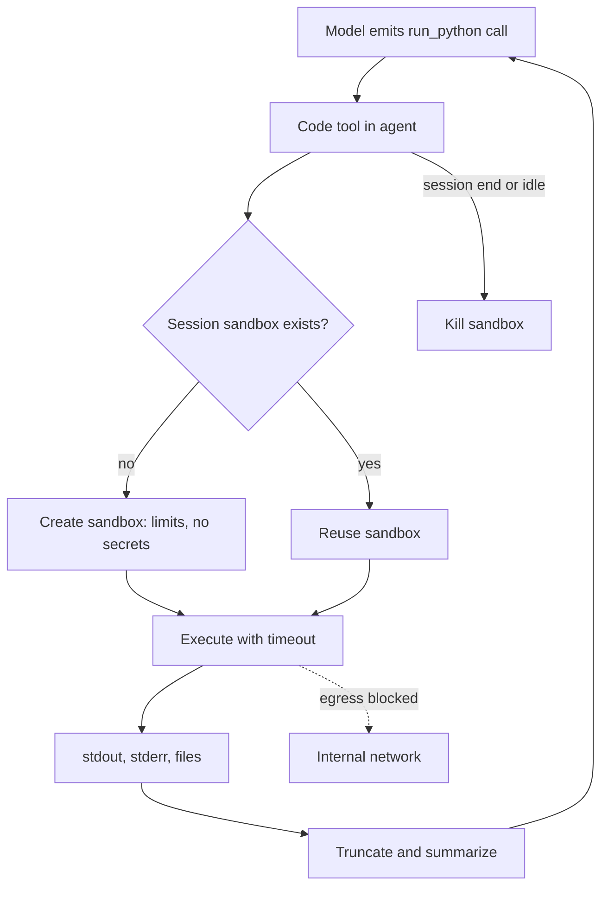

## TL;DR
Agents that write and run code need an isolated place to run it. E2B gives hosted microVM sandboxes,
Modal gives programmable cloud sandboxes, and Docker gives self-managed containers that need hardening
before they are safe.

## For agent builders
- **Why it matters for agents.** A code-interpreter tool turns model output into executed programs.
  Without isolation, one prompt injection can read secrets, call internal services or delete data on the
  host running your agent.
- **Where it shows up in your stack.** A `run_code` or `execute_python` tool whose implementation creates
  a sandbox, writes files, runs code with limits, and returns stdout, stderr and artifacts to the model.
- **What you control.** Isolation level (container, gVisor, microVM), network egress, CPU, memory and
  time limits, mounted files, installed packages, sandbox lifetime and what output flows back.
- **What you can skip.** Writing your own hypervisor integration. Pick a product or a hardened container
  runtime; the threat model is covered in the sandboxing lesson.

## Why it exists
- **Generated code is untrusted code.** It comes from a model that read user input, web pages and tool
  results, any of which can contain injected instructions.
- **Plain containers share the host kernel.** A kernel exploit or misconfiguration (privileged mode,
  mounted Docker socket) escapes to the host; microVMs (Firecracker) and user-space kernels (gVisor) add a
  stronger boundary.
- **Agents need state across steps.** Data analysis agents load a file, explore, plot and iterate, so a
  sandbox must persist a session (files and a live interpreter) across tool calls.
- **Cost and latency matter.** A sandbox per call must start fast; products keep warm pools and snapshot
  templates so start-up is closer to a second than to a minute (illustrative order of magnitude).

## How it works
### The agent-side contract
1. **The model emits code** as a tool call, for example `run_python(code="...")`.
2. **The tool gets or creates a sandbox** for this session, with limits and no secrets inside.
3. **It runs the code** with a timeout and captures stdout, stderr, errors and files.
4. **It returns a bounded result** (truncated output, error text, artifact references), because huge
   outputs flood the context window.
5. **It destroys or expires the sandbox** when the session ends or after an idle timeout.

### The three options
| Option | Isolation | Model | Strengths | Costs |
|---|---|---|---|---|
| E2B | Firecracker microVMs, hosted (self-host option exists) | SDK creates sandboxes; code-interpreter SDK runs Jupyter-style cells | fast start, stateful sessions, charts and files returned, built for agents | per-second vendor pricing, data leaves your cloud unless self-hosted |
| Modal | gVisor-based containers on Modal's cloud | `modal.Sandbox.create(...)` from Python with an image, timeout, network controls | any image, GPUs, same platform as your other Modal jobs | vendor platform, sandboxes run in Modal's cloud |
| Docker (self-managed) | Linux namespaces and cgroups on your host; add gVisor (`runsc`) or Kata for more | Docker SDK or a job runner starts a container per task | full control, runs on your infra, no vendor | you own hardening, pooling, cleanup and escape risk |

### Hardening checklist for any option
| Control | Why |
|---|---|
| No network, or an egress allowlist | blocks data exfiltration and internal service calls |
| No secrets in the sandbox | injected code can read every environment variable and file |
| CPU, memory, process and time limits | stops fork bombs, infinite loops and cost runaway |
| Non-root user, read-only root filesystem, dropped capabilities | shrinks what an escape attempt can use |
| Never mount the Docker socket or host paths | either one is effectively root on the host |
| Fresh sandbox per user or tenant | no cross-user files or state |

## Diagram
Follow the tool call: the agent never runs code itself; a sandbox with limits does, and only a bounded
result returns to the model.



## Examples
### A hardened Docker code tool you can run locally
Requires Docker and `pip install docker`. Each call starts a fresh, offline, resource-capped container.

```python
import docker

client = docker.from_env()

def run_python(code: str, timeout_s: int = 10) -> dict:
    """Tool: run untrusted Python in an isolated container and return bounded output."""
    c = client.containers.run(
        "python:3.12-slim", ["python", "-c", code],
        detach=True, network_disabled=True, mem_limit="256m", nano_cpus=500_000_000,
        pids_limit=64, read_only=True, user="65534:65534", cap_drop=["ALL"],
        security_opt=["no-new-privileges"],
    )
    try:
        status = c.wait(timeout=timeout_s)          # raises on timeout
        out = c.logs(stdout=True, stderr=True).decode(errors="replace")
        return {"exit_code": status["StatusCode"], "output": out[-4000:]}  # keep the tail only
    except Exception as e:
        return {"exit_code": None, "output": f"timeout or error: {type(e).__name__}"}
    finally:
        c.remove(force=True)                        # force kills a still-running container first

print(run_python("print(sum(range(10)))"))
print(run_python("import urllib.request; urllib.request.urlopen('http://example.com')"))  # fails: no network
print(run_python("while True: pass", timeout_s=3))                                         # killed
```

### Hosted sandboxes: E2B and Modal for a data-analysis agent
Both snippets show the core calls; method names have changed between major SDK versions, so check the
current docs.

```python
# E2B: pip install e2b-code-interpreter, E2B_API_KEY set
from e2b_code_interpreter import Sandbox

sbx = Sandbox.create(timeout=300)              # older SDKs used Sandbox(); stateful for this session
sbx.files.write("/home/user/sales.csv", open("sales.csv", "rb").read())
ex = sbx.run_code("import pandas as pd; df = pd.read_csv('/home/user/sales.csv'); df.describe()")
print(ex.logs.stdout, ex.error, ex.results)    # results can include rich outputs such as charts
ex2 = sbx.run_code("df['revenue'].sum()")      # same interpreter: df still exists
sbx.kill()

# Modal: pip install modal, modal token set
import modal
app = modal.App.lookup("agent-sandboxes", create_if_missing=True)
sb = modal.Sandbox.create(app=app, image=modal.Image.debian_slim().pip_install("pandas"),
                          timeout=120, block_network=True)
p = sb.exec("python", "-c", "print(2 + 2)")
print(p.stdout.read())
sb.terminate()
```

| Need | Best fit |
|---|---|
| Stateful notebook-style analysis with charts | E2B code interpreter |
| Custom images, GPUs, or jobs already on Modal | Modal Sandboxes |
| Data must stay on your infrastructure | Docker with gVisor or Kata, or a self-hosted product |

## Production patterns
- **One sandbox per session, killed on idle.** Map agent session id to sandbox id, reuse it across tool
  calls, and set an idle timeout so abandoned sessions stop billing. Monitor live sandbox count and
  average lifetime against active sessions.
- **Block egress by default, allowlist when needed.** Start with no network; if the agent must install
  packages, pre-bake them into the image or template instead of opening the internet. Monitor blocked
  connection attempts as a prompt-injection signal.
- **Bound everything that returns to the model.** Truncate stdout to a few thousand characters, return
  file references instead of contents, and summarize big tables. Monitor tokens added per code-tool call.
- **Pre-build images or templates.** Bake common libraries into a custom image or E2B template so start-up
  stays fast and runs are reproducible. Monitor sandbox start latency p95.
- **Add a stronger runtime for self-managed containers.** Run untrusted code under gVisor (`--runtime=runsc`)
  or Kata Containers on dedicated nodes, never on the host that holds agent secrets. Monitor node-level
  CPU and memory saturation.
- **Log code and outcomes for audit and evals.** Store the executed code, exit code and truncated output
  with the trace, so you can replay failures and score code-tool success rate.

## Trade-offs
- **Hosted vs self-managed.** E2B and Modal remove isolation and pooling work but send code and data to a
  vendor; Docker keeps data in-house but makes you responsible for escapes and cleanup.
- **Stronger isolation vs speed and cost.** MicroVMs and gVisor add a boundary at some start-up and
  syscall overhead; plain containers are faster but rely on the shared kernel.
- **Stateful sessions vs hygiene.** Reusing a sandbox keeps variables and files for iterative analysis,
  but long-lived sandboxes accumulate state and cost; cap lifetime.
- **Network access vs safety.** Internet access lets agents fetch data and install packages but opens
  exfiltration paths; the allowlist is the compromise.

## Pitfalls
- **Running generated code in the agent process.** `exec()` or a subprocess on the agent host exposes every
  secret and network route. Fix: always cross a sandbox boundary.
- **Mounting the Docker socket for convenience.** Symptom: a container can start privileged containers.
  Fix: never mount it; use a separate job runner with its own credentials.
- **Passing API keys into the sandbox.** Injected code prints or sends them. Fix: keep credentials in the
  agent's tools outside the sandbox, and hand the sandbox only data.
- **Leaking sandboxes.** Symptom: bills climb with abandoned sessions. Fix: timeouts, `finally` cleanup and
  a reaper job that kills sandboxes past their lifetime.

## When to use
- **Use when:** agents analyse data, generate charts, transform files, test code or run user-provided
  scripts.
- **Avoid when:** a fixed function tool can do the job; giving the model a general interpreter is far more
  power than calculating a total needs.
- **Measure:** code-tool success rate, sandbox start latency, sandbox minutes per session, blocked egress
  attempts and tokens returned per call.
- **Interviews:** explain why containers alone are a weak boundary, and walk through the hardening list.

## Role lens
- **Engineer:** Implements the code tool with limits, timeouts, output truncation and cleanup, and tests it
  with hostile inputs such as infinite loops and network calls.
- **Architect:** Chooses hosted microVMs, Modal or self-managed gVisor based on data residency, cost and
  isolation needs, and keeps secrets outside every sandbox.
- **FDE:** Explains to a customer's security team where generated code runs, what it can reach, and how
  sandboxes are destroyed, with the hardening checklist as evidence.

## Check yourself
**Q:** Your data-analysis agent runs model-written Python with `subprocess` on the same server as the
agent, which holds a database password in an environment variable. Security asks you to fix it this
sprint. What do you change?
**A:** Move execution across an isolation boundary: an E2B or Modal sandbox, or a self-managed container
under gVisor on separate nodes. Inside it, no secrets and no network by default, CPU, memory, process and
time limits, a non-root user and a read-only filesystem. Keep the database credential in a separate,
narrow query tool outside the sandbox and pass only result data in. Reuse one sandbox per session with an
idle timeout, truncate output returned to the model, and log executed code for audit. Test with
injection cases that try to read env vars or call the network.

## Interview questions
### Why is a plain Docker container not enough isolation for agent-generated code?
- **It shares the host kernel.** A kernel vulnerability or misconfiguration (privileged mode, mounted
  socket, broad capabilities) lets code escape to the host.
- **Stronger options exist.** gVisor intercepts syscalls in user space and Firecracker or Kata microVMs
  give each sandbox its own kernel, so escapes need a much harder exploit.

### How would you design the run_code tool for a data-analysis agent?
- **Session-scoped sandbox.** Create a sandbox per agent session, upload the user's files, and reuse the
  interpreter across calls so variables persist.
- **Limits and bounded results.** Apply timeouts and resource caps, return truncated stdout, errors and
  file references, and kill the sandbox on idle or session end.

### Your sandbox bill tripled last month. What do you look at?
- **Lifetime versus activity.** Compare sandbox minutes with active session minutes; a gap means missing
  idle timeouts or cleanup failures.
- **Start-up and retries.** Check whether failed runs are retried in fresh sandboxes, and whether images
  install packages at start-up instead of being pre-built.

### When would you choose self-managed sandboxes over E2B or Modal?
- **Data residency and control.** When code and data must stay in your VPC or on-premises, or a customer
  forbids third-party execution.
- **Accepting the cost.** You then own gVisor or Kata setup, pooling, cleanup and patching, so it is worth
  it only when the requirement is real.

### How do you stop a prompt-injected agent from exfiltrating data through the sandbox?
- **No secrets and no egress.** Keep credentials outside, disable network or allowlist specific hosts, and
  give the sandbox only the data the task needs.
- **Detect and audit.** Log executed code and blocked connections, alert on egress attempts, and include
  injection cases in your eval suite.

## Quiz
### Q: Which change most reduces risk when an agent runs generated code?
- [ ] Using a larger model that writes better code
- [x] Running the code in an isolated sandbox with no secrets and no network by default
- [ ] Asking the model to promise not to call the network
- [ ] Running the code as root so it never fails on permissions
> Generated code can be steered by injected instructions, so the boundary must be enforced by isolation,
> no secrets and blocked egress, not by the model's own judgment.

### Q: Why do agent sandboxes often persist across several tool calls in one session?
- [ ] Persistent sandboxes are always cheaper than fresh ones
- [ ] Sandboxes cannot be created more than once per user
- [x] Iterative analysis needs files and interpreter state such as loaded data frames to survive between calls
- [ ] It removes the need for timeouts
> A data-analysis agent loads data in one call and explores it in the next. A session-scoped sandbox keeps
> that state, with an idle timeout so it does not live forever.

### Q: What is the main reason to truncate sandbox output before returning it to the model?
- [ ] Models cannot read program output
- [ ] Truncation encrypts the output
- [ ] Sandboxes cannot return more than one line
- [x] Large outputs consume the context window and cost tokens without helping the next step
> Printing a whole data frame can add thousands of tokens to every later step. Returning a tail, an error
> summary or a file reference keeps the loop cheap and focused.

## Use cases & projects
### Use cases
- **Data-analysis agents.** Users upload CSVs; the agent writes pandas code, runs it in a sandbox and
  returns charts and tables.
- **Coding agents that run tests.** The agent edits a repository clone inside a sandbox and runs the test
  suite before proposing a patch.
- **Spreadsheet and file conversion assistants.** Generated scripts transform documents without touching
  the host.
- **Evaluation harnesses.** Execute model-generated code against unit tests safely at scale.

### Mini project
**Build a sandboxed code tool and attack it (2-3 hours).**
- **Goal:** a `run_python` tool for a small tool-calling agent, backed by Docker (or E2B), that survives
  hostile code.
- **Steps:** implement the hardened Docker tool from this lesson; connect it to a tool-calling loop that
  answers questions about a CSV; write 6 hostile tests (infinite loop, fork bomb, network call, reading env
  vars, writing to `/`, a 10 MB print); add session reuse with an idle timeout.
- **Done when:** the agent answers 3 CSV questions correctly, all 6 hostile tests are contained with a clear
  error, no containers remain after the run, and returned output never exceeds your size cap.
