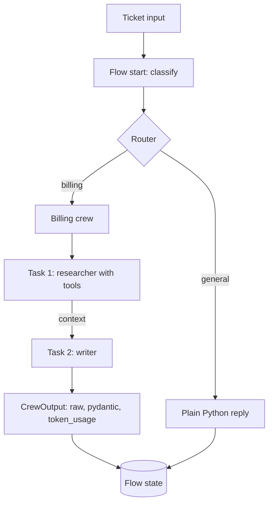

## TL;DR
CrewAI is a Python framework for role-based multi-agent work: you define agents by role, goal and
backstory, give them tasks with expected outputs, run them as a crew, and wrap crews in event-driven
Flows when you need deterministic control around them.

## For agent builders
- **Why it matters for agents.** It is the fastest way to stand up a "team" of specialised agents for
  research, content or analysis pipelines, and it is common in job posts and demos, so you should know
  where it shines and where it costs you control.
- **Where it shows up in your stack.** `Agent`, `Task` and `Crew` objects (often from YAML configs), tools
  built with `@tool` or `BaseTool`, `crew.kickoff(inputs=...)` in a job, and `Flow` classes that route,
  hold state and call crews.
- **What you control.** Roles, goals and backstories (all prompts), task descriptions and
  `expected_output`, task order and `context`, process type, delegation, tools, LLM per agent, and
  iteration and rate limits.
- **What you can skip.** Agent "personalities" beyond what improves outputs. Backstory text is prompt
  tokens on every call; keep what measurably helps.

## Why it exists
- **Some work decomposes like a team.** Research, then analyse, then write, then review: each step has a
  different focus and toolset. Role-specific agents keep each prompt short and focused.
- **Hand-wiring several agents is repetitive.** Passing one agent's output as context to the next,
  collecting outputs and counting tokens is boilerplate the crew handles.
- **Fully autonomous crews are hard to control.** Flows were added so that routing, state and
  branching are ordinary Python, with crews used only where open-ended reasoning helps.
- **Teams want a readable spec.** YAML files for agents and tasks let non-engineers review roles and
  task wording separately from code.

## How it works
### Agents, tasks, crews
| Object | Key fields | Notes |
|---|---|---|
| `Agent` | `role`, `goal`, `backstory`, `tools`, `llm`, `allow_delegation`, `max_iter` | role, goal and backstory become the agent's system prompt |
| `Task` | `description`, `expected_output`, `agent`, `context`, `output_pydantic`, `human_input` | `expected_output` is the stopping target; `context` passes earlier task outputs |
| `Crew` | `agents`, `tasks`, `process`, `memory`, `verbose`, `max_rpm` | `kickoff(inputs={...})` fills `{placeholders}` in descriptions |
| `CrewOutput` | `.raw`, `.pydantic`, `.json_dict`, `.tasks_output`, `.token_usage` | log `token_usage` per run |

### Processes
- **`Process.sequential`:** tasks run in order, each seeing the outputs named in `context` (and by
  default the previous one). Predictable and cheapest.
- **`Process.hierarchical`:** a manager (set `manager_llm` or `manager_agent`) plans, delegates and
  validates. More flexible, more calls, harder to predict.
- **Delegation:** with `allow_delegation=True` an agent can hand subtasks or questions to coworkers via
  built-in tools. Turn it off unless you measured a benefit, because it multiplies calls.

### Tools and models
- **Tools:** decorate a function with `@tool("Name")` from `crewai.tools` (docstring is the description)
  or subclass `BaseTool` with an `args_schema`. The `crewai-tools` package adds search, scraping and
  file tools.
- **Models:** `LLM(model="provider/model", temperature=...)` per agent, so a cheap model can research
  while a stronger one writes. Provider routing has used LiteLLM; check the current docs for supported
  providers and native integrations.

### Flows
1. **Subclass `Flow[State]`** with a Pydantic state model, so every step reads and writes typed fields.
2. **`@start()`** marks entry steps; **`@listen(step)`** runs after a step; **`@router(step)`** returns
   a label, and `@listen("label")` steps run for that branch. `or_` and `and_` combine triggers.
3. **Call crews inside steps** where open-ended work is needed; plain Python handles the rest.
4. **`flow.kickoff(inputs={...})`** runs it; persistence decorators can save state between runs
   (check the current docs for `@persist` and backends).

### Project scaffold
- **`crewai create crew <name>`** generates `agents.yaml`, `tasks.yaml` and a class using `@CrewBase`,
  `@agent`, `@task` and `@crew` decorators from `crewai.project`, plus a `crewai run` entry point.

## Diagram
Read it top-down: a Flow owns state and routing in code, and only the branch that needs open-ended work
calls a crew whose tasks pass context forward.



## Examples
### A two-agent research crew with a typed result
Requires `pip install crewai` and a provider key. The tool returns canned data so the example is
deterministic about inputs.

```python
from pydantic import BaseModel
from crewai import LLM, Agent, Crew, Process, Task
from crewai.tools import tool

@tool("Fetch competitor pricing")
def fetch_pricing(company: str) -> str:
    """Return the public price points for a company name."""
    return {"Acme": "Starter $29/mo, Pro $99/mo", "Globex": "Team $49/user/mo"}.get(company, "no data")

class Brief(BaseModel):
    summary: str
    price_points: list[str]
    recommendation: str

llm = LLM(model="openai/gpt-4o-mini", temperature=0.2)
researcher = Agent(role="Pricing researcher", goal="Collect accurate competitor price points",
                   backstory="You only report prices returned by your tool.", tools=[fetch_pricing],
                   llm=llm, allow_delegation=False, max_iter=5)
analyst = Agent(role="Pricing analyst", goal="Turn price data into one clear recommendation",
                backstory="You write short, sourced briefs.", llm=llm, allow_delegation=False)

research = Task(description="Collect pricing for {companies}, calling the tool once per company.",
                expected_output="Each company with its price points", agent=researcher)
brief = Task(description="Write a pricing brief for our {product}.",
             expected_output="Summary, price points and one recommendation",
             agent=analyst, context=[research], output_pydantic=Brief)

crew = Crew(agents=[researcher, analyst], tasks=[research, brief], process=Process.sequential)
out = crew.kickoff(inputs={"companies": "Acme, Globex", "product": "analytics add-on"})
print(out.pydantic)          # Brief(...)
print(out.token_usage)       # log this per run
```

- **Why delegation is off:** with two fixed tasks there is nothing to delegate, and enabling it adds
  coworker-question calls.
- **`output_pydantic`** makes the last task's result a typed object for the code that consumes it.

### A Flow that routes in code and calls a crew only when needed
Routing is deterministic Python in the Flow; the billing crew runs only on billing tickets.

```python
from pydantic import BaseModel
from crewai.flow.flow import Flow, listen, router, start

class TicketState(BaseModel):
    text: str = ""
    category: str = ""
    reply: str = ""

class SupportFlow(Flow[TicketState]):
    @start()
    def classify(self):
        t = self.state.text.lower()
        self.state.category = "billing" if ("charge" in t or "invoice" in t) else "general"

    @router(classify)
    def route(self):
        return self.state.category

    @listen("billing")
    def run_billing_crew(self):
        self.state.reply = billing_crew.kickoff(inputs={"ticket": self.state.text}).raw  # a Crew built as above

    @listen("general")
    def general_reply(self):
        self.state.reply = "Thanks, routed to the general queue."

flow = SupportFlow()
flow.kickoff(inputs={"text": "I was charged twice on my last invoice"})
print(flow.state.category, "->", flow.state.reply)
```

| Approach for 1,000 tickets/day | Model calls per ticket (illustrative) | Predictability |
|---|---|---|
| Hierarchical crew decides everything | manager plus several agent calls on every ticket | low |
| Flow routes, crew on billing only (say 30%) | zero for general tickets, a few for billing | high |

## Production patterns
- **Flows outside, crews inside.** Put intake, routing, retries and persistence in a `Flow` with typed
  state, and call crews only for open-ended steps. Monitor share of runs that reach a crew and cost per
  branch, because that is where spend concentrates.
- **Prefer sequential, disable delegation by default.** Start with `Process.sequential` and
  `allow_delegation=False`; switch to hierarchical only if an eval shows better outcomes. Track calls
  and tokens per run from `token_usage` before and after.
- **Bound iterations and rate.** Set `max_iter` per agent and `max_rpm` on the crew or agent to avoid
  loops and provider rate-limit errors. Alert on runs that end because the iteration cap was hit.
- **Typed outputs and review points.** Use `output_pydantic` on tasks consumed by code, and
  `human_input=True` (or an approval step in the Flow) before anything with side effects. Count rejected
  drafts per task to find weak prompts.
- **Trace and control telemetry.** Connect an observability integration (the docs list several,
  including OpenTelemetry-based ones) to see each agent's calls and tool use. CrewAI sends anonymous
  usage telemetry by default; the docs describe disabling it (for example `OTEL_SDK_DISABLED=true`;
  check the current variable).
- **Treat role text as prompts under eval.** Keep `agents.yaml` and `tasks.yaml` in version control
  and run a fixed eval set on every edit, since a reworded backstory changes behaviour as much as code.

## Trade-offs
- **Quick multi-agent setup vs control.** Roles and tasks get a pipeline running in an afternoon, but
  the framework writes the prompts and loop around your text. Flips to LangGraph or a hand-rolled loop
  when you need exact control of every call.
- **Specialised agents vs token cost.** Each role adds a system prompt and calls; a single agent with
  good tools is often cheaper for the same quality. Flips when evals show roles genuinely help.
- **Hierarchical flexibility vs predictability.** A manager agent handles varied tasks but adds calls
  and variance. Sequential plus Flow routing is the usual production compromise.
- **Built-in memory vs your own store.** `memory=True` is convenient but its storage and embedding
  defaults may not fit your data policy; production teams often manage memory in their own database.

## Pitfalls
- **Vague `expected_output`.** Symptom: agents ramble, loop or stop early. Fix: state format, length
  and what "done" means; use `output_pydantic` when code consumes it.
- **Delegation on by accident.** Symptom: token usage several times higher than expected, with agents
  asking each other questions. Fix: set `allow_delegation=False` explicitly and check traces.
- **Over-long backstories.** Symptom: high input tokens on every call with no quality gain. Fix: trim to
  the behaviours that matter and confirm with the eval set.
- **Letting a crew do deterministic work.** Symptom: an LLM "classifies" tickets that a keyword rule or
  a single small call would handle. Fix: move it into Flow code.

## When to use
- **Use when** the work naturally splits into roles (research, analyse, write, review), outputs are
  documents or reports, and you want a readable spec quickly.
- **Use Flows when** you need deterministic routing, typed state and selective use of crews.
- **Avoid when** latency budgets are tight, the task is a single tool loop, or you need fine-grained
  control of prompts and state; prefer a vendor SDK, Pydantic AI or LangGraph.
- **Measure** cost and calls per run, task success on an eval set, iteration-cap hits and human
  rejection rate.

## Role lens
- **Engineer:** Writes agents, tasks, tools and Flows, sets `max_iter`, delegation and output types,
  and reads traces to cut wasted calls.
- **Architect:** Decides where crews are justified versus deterministic Flow steps, sets memory and
  telemetry policy, and compares cost per outcome with single-agent designs.
- **FDE:** Prototypes a customer's multi-step content or research process as a crew, then hardens it
  with Flows, typed outputs and review steps before handover.

## Check yourself
**Q:** A CrewAI hierarchical crew producing weekly market reports costs five times what the team
budgeted, and output quality varies week to week. What do you change?
**A:** Look at traces and `token_usage` first: hierarchical managers and delegation multiply calls, and
long backstories inflate every request. Move to `Process.sequential` with explicit task order and
`context`, set `allow_delegation=False`, cap `max_iter`, and trim role text. Put fixed steps (data
collection, formatting) in Flow code or tools rather than agents. Make the final task's
`expected_output` precise and use `output_pydantic`, so variation shows up as validation failures.
Compare cost and quality on a fixed set of past weeks before and after each change.

## Interview questions
### What is the difference between a crew and a flow in CrewAI?
- **A crew** is a set of role-based agents executing tasks, sequentially or under a manager, with the
  framework running each agent's loop.
- **A flow** is event-driven Python with typed state, start, listen and router steps, where you decide
  control flow and may call crews inside steps.
- **Production use** usually puts the flow outside and crews inside where open-ended work helps.

### When does a role-based multi-agent design beat a single agent with tools?
- **When subtasks need different context or tools** that would bloat one prompt, such as a researcher
  with search tools and a writer with style rules.
- **When intermediate outputs benefit from review** by a separately prompted agent.
- **Otherwise a single agent is cheaper;** prove the gain with an eval rather than assuming it.

### Your crew's token usage tripled after a small change. How do you debug it?
- **Diff the config:** was delegation enabled, the process switched to hierarchical, or a backstory or
  task description lengthened?
- **Read traces:** look for coworker questions, repeated tool calls and iteration-cap hits.
- **Fix and measure:** revert or bound the change and confirm with `token_usage` on the same inputs.

### How do you make a CrewAI pipeline safe to run with side effects?
- **Keep side effects in Flow steps or tools** with explicit approval (`human_input=True` or an
  approval step), not inside free-form agent reasoning.
- **Type the output** that triggers the action with `output_pydantic` and validate it in code.
- **Scope tool credentials** to the minimum and log every call.

### How would you compare CrewAI with LangGraph for a client?
- **CrewAI:** faster to express role-based pipelines, readable YAML specs, less control over prompts and
  state transitions.
- **LangGraph:** explicit state graphs, checkpointers and interrupts, more code but more control and
  easier durable human-in-the-loop.
- **Decide by** how much of the process is fixed versus open-ended, and how long runs must pause.

## Quiz
### Q: What does setting allow_delegation=False on an agent prevent?
- [ ] The agent from using any tools
- [x] The agent from handing subtasks or questions to other agents in the crew
- [ ] The crew from running tasks sequentially
- [ ] The agent from receiving context from earlier tasks
> Delegation adds coworker tools that let an agent ask or assign work to others. Disabling it keeps the
> call count predictable; context passing between tasks is unaffected.

### Q: In a CrewAI Flow, how does a router choose the next step?
- [ ] The LLM picks from all steps on every transition
- [ ] Steps run in definition order
- [x] The router method returns a label, and steps decorated with @listen for that label run
- [ ] The crew's manager agent decides
> Routers are ordinary Python that return a string; listeners subscribed to that string run next, which
> keeps routing deterministic.

### Q: Which change most directly reduces cost in a crew that runs on every ticket?
- [ ] Adding a longer backstory to each agent
- [ ] Switching to Process.hierarchical
- [x] Routing in Flow code so the crew runs only for tickets that need it
- [ ] Enabling delegation so agents share work
> The cheapest model call is the one you do not make. Deterministic routing in the Flow sends only the
> tickets that need open-ended work to the crew.

## Use cases & projects
### Use cases
- **Research and report pipelines.** Researcher, analyst and writer agents produce weekly market,
  competitor or literature briefs with typed sections.
- **Content operations.** Drafting, editing and compliance-review agents prepare marketing or docs
  content, with a human approval step before publishing.
- **Sales and account prep.** A crew gathers company news, CRM notes and product fit into a meeting
  brief before each call.
- **Ticket workflows with selective crews.** A Flow triages tickets in code and runs a specialist crew
  only for complex categories.

### Mini project
**Sequential research crew inside a routing Flow (2-3 hours).**
- **Goal:** a Flow that routes 20 mixed requests in code and runs a two-agent crew only for research
  requests, returning a typed brief.
- **Steps:** build a researcher with one mock tool and a writer with `output_pydantic`; keep delegation
  off and set `max_iter`; write the Flow with a router; run all 20 requests; record `token_usage`, crew
  invocations and validation failures; then try hierarchical mode on the research subset.
- **Done when:** a table compares cost, calls and output validity for sequential versus hierarchical,
  and only research requests invoked the crew.

### Major project
**Weekly competitive-intelligence system (multi-day; fits the module Capstone).**
- **Goal:** a scheduled Flow that gathers sources, runs research and writing crews, and delivers a
  reviewed report.
- **Scope:** typed Flow state with persistence; tools for search and internal CRM data; sequential
  crews; `output_pydantic` sections; a human approval step; tracing and cost logging.
- **Done when:** four weekly runs complete with cost per report under a set budget, every claim links to
  a source, and an eval on past weeks scores accuracy and coverage.
