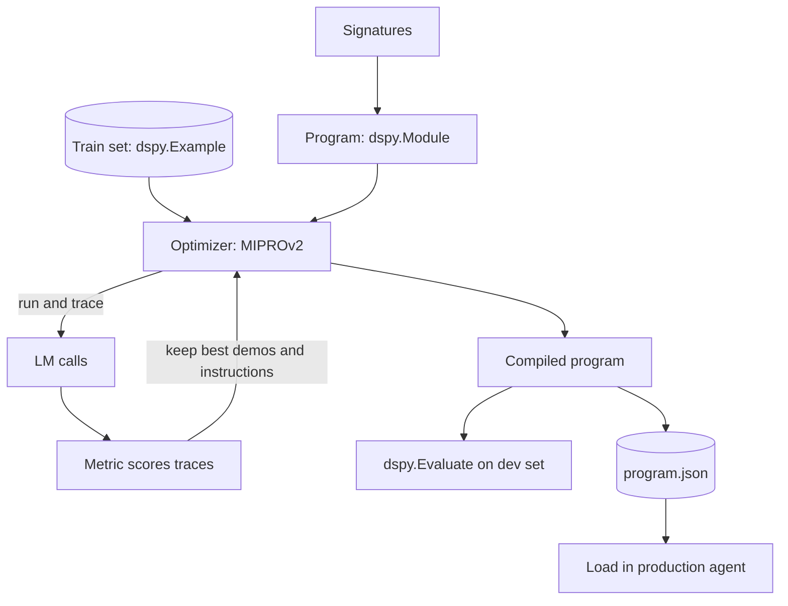

## TL;DR
DSPy lets you program LLM steps as typed signatures and modules instead of hand-written prompts, then
uses optimizers and a metric to compile better instructions and few-shot demos, so agent quality becomes
something you measure and improve.

## For agent builders
- **Why it matters for agents.** An agent is a pipeline of LLM calls (route, retrieve, reason, call tools,
  answer). DSPy lets you tune each call against an eval set instead of editing prompts by feel, and re-tune
  when you switch models.
- **Where it shows up in your stack.** The `dspy` Python package: `dspy.LM` for models (LiteLLM-style
  provider strings), `dspy.Signature`, modules like `dspy.Predict`, `dspy.ChainOfThought` and `dspy.ReAct`,
  `dspy.Evaluate`, and optimizers such as `dspy.BootstrapFewShot` and `dspy.MIPROv2`.
- **What you control.** The signatures (inputs, outputs, docstring task description), the program's
  structure, the metric, the training examples and the optimizer budget.
- **What you can skip.** The research on bootstrapping internals. Know that optimizers search over
  instructions and demos using your metric, and that more budget costs more LLM calls.

## Why it exists
- **Prompts are brittle parameters.** A hand-tuned prompt is tied to one model and one wording; changing
  the model or adding a step means re-tuning by trial and error with no record of why.
- **Multi-step pipelines are hard to tune by hand.** In a 3-step agent, improving step 1's prompt changes
  what steps 2 and 3 see; DSPy optimizes steps together against the end-to-end metric.
- **Few-shot demos are expensive to curate.** Optimizers bootstrap demos by running the program on training
  inputs and keeping traces that pass the metric, so you need inputs and a metric more than labelled traces.
- **Quality must be measurable.** DSPy forces you to write a metric and a dev set first, which is the same
  discipline agent evals require anyway.

## How it works
### Core abstractions
| Abstraction | What it is | Analogy |
|---|---|---|
| `dspy.LM` + `dspy.configure` | the model client and the global default model | a database connection |
| `dspy.Signature` | declared inputs, outputs and a task docstring, e.g. `"question -> answer"` | a function type signature |
| Modules (`Predict`, `ChainOfThought`, `ReAct`, your own `dspy.Module`) | strategies that turn a signature into prompts and parse outputs | layers in a neural network |
| `dspy.Example` | one training or dev example; `.with_inputs(...)` marks input fields | a labelled row |
| Metric | `def metric(example, pred, trace=None) -> float or bool` | a loss function |
| Optimizers (formerly teleprompters) | `BootstrapFewShot`, `MIPROv2` and others that compile a program | an optimizer and training loop |
| `dspy.Evaluate` | runs a program over a dev set and scores it | a test harness |

### The workflow
1. **Declare.** Write signatures for each step; types (including `Literal` and Pydantic models) become
   output constraints the adapter parses.
2. **Compose.** Build a `dspy.Module` whose `forward` calls sub-modules, like a PyTorch model.
3. **Measure.** Write a metric and run `dspy.Evaluate` on a dev set to get a baseline score.
4. **Compile.** Pass the program, metric and a train set to an optimizer. `BootstrapFewShot` collects demos
   that pass the metric; `MIPROv2` also proposes and searches instructions.
5. **Save and load.** `compiled.save("program.json")` stores the learned instructions and demos;
   `program.load(...)` restores them in production, so serving does not re-run optimization.

### When to pick DSPy
| Pick DSPy when | Pick something else when |
|---|---|
| You have a metric and 20+ examples and want measurable gains | You have no eval set yet: build one first |
| You switch models often and want to re-tune cheaply | You need a full agent runtime with sessions and deploy: ADK, LangGraph, Mastra |
| A pipeline has several LLM steps that interact | One structured call is enough: Instructor or provider structured outputs |
| You want small models to match bigger ones on a narrow task | Your team needs prompts humans can read and edit freely |

## Diagram
Read it as a training loop: the optimizer runs the program on examples, scores traces with the metric,
and keeps the best instructions and demos.



## Examples
### A tool-using agent, a metric and an optimizer
Requires `pip install dspy` and an API key for the provider; the model string is illustrative.

```python
import dspy

dspy.configure(lm=dspy.LM("openai/gpt-4o-mini"))

def lookup_refund_policy(product: str) -> str:
    """Return the refund window for a product category."""
    return {"laptop": "30 days", "headphones": "14 days"}.get(product.lower(), "unknown")

class SupportAnswer(dspy.Signature):
    """Answer a customer's refund question using the policy tool."""
    question: str = dspy.InputField()
    answer: str = dspy.OutputField(desc="one sentence that states the refund window")

agent = dspy.ReAct(SupportAnswer, tools=[lookup_refund_policy], max_iters=4)

trainset = [
    dspy.Example(question="Can I return my laptop after 3 weeks?", answer="30 days").with_inputs("question"),
    dspy.Example(question="Refund window for headphones?", answer="14 days").with_inputs("question"),
    # ...use 20+ real examples in practice
]

def metric(example, pred, trace=None):
    return example.answer in pred.answer          # did the answer state the right window?

evaluate = dspy.Evaluate(devset=trainset, metric=metric, num_threads=4, display_progress=True)
print(evaluate(agent))                              # baseline score

compiled = dspy.BootstrapFewShot(metric=metric, max_bootstrapped_demos=4).compile(agent, trainset=trainset)
print(evaluate(compiled))                           # use a separate devset in real work
compiled.save("support_agent.json")
dspy.inspect_history(n=1)                           # see the exact prompt DSPy sent
```

### Worked scenario: moving a ticket router to a cheaper model
A team routes tickets into 6 queues with a hand-tuned prompt on a large model and wants a small model.
Numbers are illustrative of the process, not a benchmark.

| Step | Action | Dev-set accuracy |
|---|---|---|
| 1 | Hand prompt, large model | 91% |
| 2 | Same prompt, small model | 78% |
| 3 | `dspy.Predict` with a `Literal` output field, small model | 80% |
| 4 | `MIPROv2(metric=metric, auto="light")` on 200 train examples | 89% |
| 5 | Ship small model with the compiled program; re-run optimization when the queue set changes | stays monitored |

- **What made it work:** a clean metric (exact queue match), separate train and dev sets, and saving the
  compiled program as a versioned artifact.
- **What it cost:** one optimization run is many LLM calls; budget it like a training job, and check the
  current docs for the `auto` presets and their call counts.

## Production patterns
- **Optimize offline, serve the compiled artifact.** Run optimizers in a notebook or CI job, save with
  `program.save(...)`, version the JSON next to code, and `load` it at startup. Monitor the dev-set score
  recorded with each artifact version.
- **Hold out a dev set and gate releases.** Use `dspy.Evaluate` in CI on a held-out set; block a new
  compiled program if it scores below the current one. Track per-slice scores so a gain on one category
  does not hide a regression on another.
- **Use a cheap model for bootstrapping, a strong one as teacher when needed.** Optimizers accept settings
  for a teacher or prompt model (check the current docs per optimizer), so demos can come from a stronger
  model while the student serves cheaply. Monitor optimization cost in tokens.
- **Trace DSPy calls.** Use `dspy.inspect_history` during development and an integration such as MLflow's
  DSPy autologging or OpenTelemetry instrumentation in production. Monitor tokens per module call.
- **Cache and thread evaluations.** DSPy caches LM calls by default, which makes re-runs cheap but can hide
  model drift; disable or clear the cache when measuring a new model version. Use `num_threads` to speed
  evaluation within rate limits.

## Trade-offs
- **Measured quality vs readable prompts.** Compiled prompts with bootstrapped demos score better but are
  harder for humans to edit; edits should go through signatures and re-compilation.
- **Optimization gains vs cost.** Better optimizers make more LLM calls; on a small dev set the gain can be
  noise, so the gain is real only when it holds on a held-out set.
- **Abstraction vs control.** DSPy owns prompt formatting through adapters, which is great until you need
  exact provider features; then a thin SDK call inside a custom module is simpler.
- **Library, not runtime.** DSPy has no sessions, deployment or human-in-the-loop; pair it with a framework
  or service for those.

## Pitfalls
- **Optimizing without a held-out set.** Symptom: big gains in the notebook, no gain in production. Fix:
  separate train and dev sets, ideally from real traffic.
- **A metric that rewards the wrong thing.** Substring checks pass verbose answers that contain the right
  token. Fix: inspect failing and passing traces, and use an LLM-judge metric when exact match is too weak.
- **Forgetting to load the compiled program.** Symptom: production behaves like the baseline. Fix: load the
  saved artifact at startup and log its version on every call.
- **Re-optimizing after every model change blindly.** Fix: re-evaluate first; re-compile only when the
  score drops, and compare costs.

## When to use
- **Use when:** an agent step has a clear metric and repeatable inputs (routing, extraction, query
  rewriting, answer grounding) and you want gains you can prove.
- **Avoid when:** you have no eval data, the task is a single obvious call, or the team needs hand-written
  prompts for compliance review.
- **Measure:** dev-set score before and after, optimization cost in calls and dollars, and latency added
  by demos in the prompt.
- **Interviews:** explain signatures, modules and optimizers as declare, compose, compile.

## Role lens
- **Engineer:** Writes signatures and metrics, runs `dspy.Evaluate` and an optimizer, and ships the saved
  program as a versioned artifact.
- **Architect:** Decides where DSPy owns prompts (narrow, measurable steps) and where a framework runtime
  owns orchestration, and budgets optimization runs.
- **FDE:** Uses a customer's labelled tickets to compile a router quickly and shows the before-and-after
  dev-set score as the evidence.

## Check yourself
**Q:** A DSPy-optimized query rewriter scored 15 points higher in the notebook but production retrieval
did not improve. What are the likely causes and how do you check each?
**A:** First, the gain may be overfit: if the dev set overlapped the train set or was tiny, re-score on a
held-out set from real queries. Second, production may not load the compiled program; confirm the saved
JSON is loaded and its version logged. Third, the metric may not reflect retrieval quality; a rewriter
judged on string similarity can score well while retrieving worse, so use recall@k of the downstream
retriever as the metric. Finally, check that cached LM calls during evaluation did not hide a model
version difference.

## Interview questions
### What problem do DSPy signatures and optimizers solve compared with prompt templates?
- **Signatures separate what from how.** You declare inputs, outputs and the task; modules generate the
  prompt and parse the result, so the program is not tied to one wording.
- **Optimizers tune against a metric.** Instead of editing prompts by feel, an optimizer searches
  instructions and demos that maximize your metric on examples, and can be re-run for a new model.

### How would you use DSPy inside a production agent built with another framework?
- **Wrap a step, not the whole agent.** Compile a DSPy module for a measurable step such as routing or
  query rewriting, and call it from a LangGraph node or an ADK tool.
- **Ship the artifact.** Load the saved program at startup, log its version, and keep the runtime's own
  sessions, tracing and approvals.

### Your optimized program regressed after a model upgrade. How do you handle it?
- **Measure first.** Run `dspy.Evaluate` on the held-out set with the new model and the existing compiled
  program, with caching disabled so results reflect the new model.
- **Re-compile if needed.** If the score drops, re-run the optimizer for the new model and keep both
  artifacts versioned, so rollback is a config change.

### When is DSPy the wrong tool?
- **No metric or no data.** Without a dev set and a metric, optimizers have nothing to optimize, and DSPy
  becomes extra abstraction over one prompt.
- **Runtime concerns dominate.** Sessions, approvals, deployment and streaming UI are not DSPy's job; pick
  an agent framework and use DSPy only where measurable tuning pays.

### How do you design a metric for an agent step?
- **Match the downstream goal.** For a router, exact label match; for a retriever query, recall@k of the
  retrieved documents; for answers, a grounded LLM-judge with a rubric.
- **Validate the metric.** Read passing and failing traces to confirm the metric agrees with human
  judgment before trusting optimizer gains.

## Quiz
### Q: In DSPy, what is the role of a signature?
- [ ] It authenticates calls to the model provider
- [x] It declares a step's inputs, outputs and task description, independent of the prompt wording
- [ ] It stores the optimized few-shot demos
- [ ] It defines which optimizer to use
> A signature such as "question -> answer" declares what a step does. Modules turn it into prompts and
> parsers, and optimizers later fill in instructions and demos for it.

### Q: What does BootstrapFewShot need from you to improve a program?
- [ ] Fully labelled reasoning traces for every example
- [ ] A fine-tuned model checkpoint
- [x] Training examples and a metric that says whether an output is good
- [ ] A vector database of past prompts
> It runs the program on training inputs, keeps the traces that pass your metric, and uses them as
> demonstrations, so inputs and a metric are enough; full traces are not required.

### Q: Why save and load a compiled DSPy program in production?
- [ ] Loading makes the model run faster on GPUs
- [ ] The optimizer must run on every request to stay accurate
- [ ] Saved programs encrypt the prompts
- [x] It restores the learned instructions and demos without re-running the expensive optimization
> Optimization makes many LLM calls. Saving the compiled state to JSON and loading it at startup gives
> production the tuned behaviour at normal per-call cost, and makes versions auditable.

## Use cases & projects
### Use cases
- **Ticket and intent routers.** Compile a classifier step for a cheaper model and prove accuracy on a
  held-out set.
- **RAG query rewriting.** Optimize a rewriter against downstream retrieval recall instead of guessing at
  prompt wording.
- **Extraction agents.** Typed signatures with Pydantic outputs, tuned for field-level accuracy on real
  documents.
- **Model migrations.** Re-compile an agent's prompts when moving to a new or smaller model and compare
  dev-set scores.

### Mini project
**Compile a support router and prove the gain (2-3 hours).**
- **Goal:** a DSPy module that routes support messages into 5 queues, optimized for a small model, with a
  measured improvement over the baseline.
- **Steps:** collect or write 80 labelled messages and split 50 train and 30 dev; write a signature with a
  `Literal` output; score `dspy.Predict` with `dspy.Evaluate`; compile with `BootstrapFewShot` and then
  `MIPROv2` on a light budget; save the best program and load it in a tiny FastAPI endpoint.
- **Done when:** you have a table of baseline and compiled dev scores with optimization cost, the endpoint
  loads the saved JSON, and you can show one failing trace and explain it.
