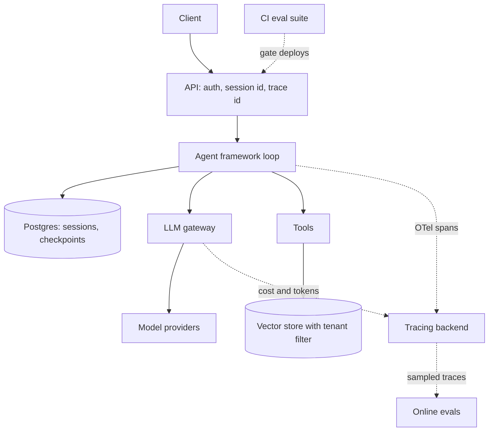

## TL;DR
A production agent is six connected layers: a framework for the loop, an LLM gateway for models, a vector
store for retrieval, tracing for visibility, evals for quality gates, and a deployment with durable state.
Choose each for a reason, and connect them through ids.

## For agent builders
- **Why it matters for agents.** Most agent failures in production are not model failures: a missing
  trace, an unpinned model, a lost session or an unevaluated prompt change. The stack decides whether you
  can see, reproduce and fix them.
- **Where it shows up in your stack.** Framework (LangGraph, ADK, Mastra, OpenAI Agents SDK, Pydantic AI),
  gateway (LiteLLM proxy or a managed AI gateway), vector store (pgvector, Qdrant and others), tracing
  (OpenTelemetry into Langfuse, LangSmith or Phoenix), evals (a harness in CI plus online scoring), and
  runtime (containers, a database for state, a queue or workflow engine).
- **What you control.** One choice per layer, the contracts between layers (ids, schemas, trace context),
  and which layer owns retries, budgets and approvals.
- **What you can skip.** Buying a platform for every layer on day one. Start with one service, Postgres
  with pgvector, a gateway and traces, then add pieces when a measured need appears.

## Decision case
### Scenario
A mid-size EU health insurer wants a claims agent: members ask about claim status, upload documents,
and file simple claims. Claims over €2,000 need a human adjuster, who can take up to 3 days to decide.
All figures below are illustrative.
- **Team:** 6 engineers, 4 Python backend and 2 TypeScript frontend; they run managed Postgres 16
  today and no other stateful service.
- **Scale:** 400k members, about 60k conversations a month, about 8 model calls per conversation, so
  480k model calls a month; a policy knowledge base of 150k chunks.
- **Data residency:** member data, including prompts and traces, must stay in an EU region inside
  the insurer's own cloud account.
- **Latency:** first token in under 2 s at p95 per turn.
- **Budget:** a model spend cap of €12,000 a month.
- **Deadline:** production pilot in 12 weeks.

### Options
| Option | How it works | Residency | Cost vs €12k cap | Team and ops | 2 s latency and 12 weeks | 3-day approvals |
|---|---|---|---|---|---|---|
| A. Managed agent platform | a cloud vendor's hosted runtime, memory, tracing and evals | only if the vendor runs it in the insurer's EU account; must be verified | model spend plus platform fees; budgets set in the vendor console | least ops; new platform to learn | no extra hop if models are served in-region; fast to build, but procurement can eat the 12 weeks | vendor-specific pause and resume |
| B. Reference stack, self-hosted | LangGraph, LiteLLM proxy, pgvector, OTel to self-hosted Langfuse, CI evals, containers plus Postgres checkpoints | everything runs in the insurer's EU account | gateway virtual keys enforce the cap | two new services to run (proxy, Langfuse); Postgres already known | one proxy hop to measure; known Python and Postgres fit 12 weeks | checkpoint the run, resume on the adjuster's decision |
| C. B plus a workflow engine | as B, with Temporal owning the claim lifecycle | as B | as B | a third new stateful system and a new programming model | as B for latency; learning the engine competes with the 12 weeks | strongest durability, timers and visibility |
| D. Hosted SaaS per layer | managed gateway, managed vector database, SaaS tracing | prompts and traces leave the account | per-vendor bills, harder to cap in one place | least ops | hops to several vendors to measure; quickest setup | depends on the chosen framework |

### Decision
Choose **B**, the reference stack, self-hosted in the insurer's EU account.
- **Residency decides first.** D sends traces and prompts to third parties, so it fails outright. A
  passes only if verified per service, which is a procurement risk inside 12 weeks.
- **The budget needs a hard cap.** At an illustrative 3,000 input and 300 output tokens per call, 480k
  calls are 1,440M input and 144M output tokens. At illustrative large-model prices of €3 and €15 per
  million, that is €4,320 + €2,160 = €6,480 a month.
- **Why the cap matters.** That is 54% of the cap, but a loop bug that doubles calls makes it €12,960,
  over the limit. LiteLLM virtual-key budgets plus a step cap in LangGraph stop that.
- **The team fits.** Four Python engineers make LangGraph a better fit than Mastra, and Postgres
  already holds sessions, checkpoints and pgvector, so the only new services are the proxy and Langfuse.
- **Approvals fit checkpoints.** A paused run is a row in Postgres, not a waiting process, so a 3-day
  wait costs nothing. One `interrupt`, then resume on the adjuster's decision, covers it without
  Temporal.
- **Latency is measurable, not assumed.** The proxy adds a network hop; measure it in week 2 against
  the 2 s first-token budget.

**What would change it:** switch to A if the vendor confirms EU in-account hosting and OTel export
before week 2. Move to C when a claim must coordinate several systems with timers, escalations or
compensation. Swap pgvector for a dedicated store when filtered retrieval p95 or recall degrades.

### Trade-offs accepted
- **Two more services on call.** The team now runs the LiteLLM proxy and Langfuse; watch proxy error
  rate and added latency, and Langfuse ingestion lag, with alerts on both.
- **Weaker lifecycle tooling than an engine.** No built-in timers or escalation; a daily job lists
  runs suspended for more than 48 hours. Watch suspended-run age and resume success rate.
- **Evals are built, not bought.** A 200-case dataset in CI plus sampled online judging takes about a
  week; watch eval score per release and grow the set from production failures.
- **pgvector shares Postgres.** Retrieval load competes with sessions; watch retrieval p95 and
  database CPU at peak.

### Review rubric
- **Constraints first.** The write-up lists residency, latency, budget, team and deadline as explicit
  constraints before naming any tool.
- **Every option scored on every constraint.** The table shows at least one option rejected for a
  stated, constraint-based reason.
- **Numbers recomputed.** Cost or volume figures show the multiplication, are labelled illustrative,
  and are compared with the stated cap.
- **Long waits placed deliberately.** It says where a multi-day pause lives (checkpoint, engine) and why.
- **Revisit triggers.** At least two measurable conditions that would change the choice.
- **Watched trade-offs.** Each accepted cost names the metric or alert that would reveal it.

## Why it exists
- **Framework demos hide production needs.** A notebook agent has no auth, no persistence, no cost limits
  and no regression tests; each missing layer becomes an incident.
- **Model access must be centralized.** Teams call several providers; without a gateway, keys, rate
  limits, fallbacks and spend tracking are scattered across services.
- **Agents are hard to debug without traces.** A wrong answer at step 9 can come from a retrieval miss at
  step 2; only a trace tree linking every model, tool and retrieval call shows it.
- **Prompt and model changes regress silently.** An eval gate in CI and online scoring catch quality
  drops that unit tests miss.
- **Agents are long-running and stateful.** Sessions, checkpoints and human approvals need durable
  storage and sometimes a workflow engine, not process memory.

## How it works
### The reference stack
| Layer | Job | Default pick | Alternatives and when |
|---|---|---|---|
| Framework | agent loop, tools, state, human-in-the-loop | LangGraph (Python) or Mastra (TypeScript) | ADK on Google Cloud, OpenAI Agents SDK or Claude Agent SDK for one provider, Pydantic AI for typed outputs |
| LLM gateway | one API to many models, keys, budgets, fallbacks, caching | LiteLLM proxy | managed gateways from cloud or CDN vendors when you want no ops |
| Vector store | retrieval for RAG and memory | Postgres with pgvector | Qdrant, Weaviate or a managed service at larger scale or heavy filtering |
| Tracing | spans for every model, tool and retrieval call | OpenTelemetry SDK exporting to Langfuse | LangSmith if you live in LangChain, Phoenix, or your existing APM |
| Evals | offline gates and online scoring | a dataset plus harness in CI, LLM judges with rubrics | framework-native eval runners (ADK, Mastra), vendor eval suites |
| Deployment | serving, state, scaling | container on a managed platform plus Postgres for sessions | a workflow engine (Temporal, Inngest) for long or approval-heavy jobs, Kubernetes at scale |

### How the pieces connect
1. **Request in.** The API authenticates the user and creates or loads a session id and a trace id,
   because every later layer keys off them.
2. **Framework runs the loop.** It loads state from Postgres, calls the model through the gateway, and
   calls tools.
3. **Gateway routes the model call.** It applies per-team budgets, retries and fallbacks, and tags the
   call with user and session metadata for cost reports.
4. **Retrieval tool queries the vector store** with tenant filters, returning chunks with source ids.
5. **Every step emits a span** into one trace, so the trace shows model calls, tokens, tool latency and
   retrieved ids.
6. **Evals read traces and datasets.** Offline evals run the agent in CI on a fixed set; online scorers
   sample production traces.
7. **State is checkpointed** after each step, so a crash or a human approval resumes instead of restarting.

### Decision rules
- **Fewest moving parts that meet the requirement.** Each extra vendor adds a contract, a bill and an
  outage domain.
- **Open standards at the seams.** OpenAI-compatible APIs at the gateway and OpenTelemetry for traces
  let you swap vendors without rewriting agents.
- **Put durability where waits are long.** Seconds-long agent runs fit a web service; hours-long runs with
  approvals belong in a workflow engine or a framework with checkpoints.

## Diagram
Follow one request through the layers; the dotted lines are the trace and eval paths that make the rest
debuggable.



## Examples
### The seams in code: gateway, retrieval and tracing around one agent step
Framework-neutral on purpose: the OpenAI client points at a LiteLLM proxy, retrieval uses pgvector, and
OpenTelemetry spans wrap each call. Endpoints, model alias and table are illustrative.

```python
import psycopg
from openai import OpenAI
from opentelemetry import trace

tracer = trace.get_tracer("support-agent")
llm = OpenAI(base_url="http://litellm-proxy:4000", api_key="team-virtual-key")  # gateway, not provider
db = psycopg.connect("postgresql://app@db/agent")

def retrieve(tenant_id: str, query_vec: list[float], k: int = 5) -> list[tuple]:
    with tracer.start_as_current_span("tool.retrieve") as span:
        rows = db.execute(
            "SELECT id, content FROM chunks WHERE tenant_id = %s "
            "ORDER BY embedding <=> %s::vector LIMIT %s",
            (tenant_id, str(query_vec), k),
        ).fetchall()
        span.set_attribute("retrieval.doc_ids", [str(r[0]) for r in rows])  # OTel takes str/int lists only
        return rows

def answer(session_id: str, tenant_id: str, question: str, query_vec: list[float]) -> str:
    with tracer.start_as_current_span("agent.step") as span:
        span.set_attribute("session.id", session_id)
        docs = retrieve(tenant_id, query_vec)
        context = "\n".join(f"[{d[0]}] {d[1]}" for d in docs)
        resp = llm.chat.completions.create(
            model="support-default",                       # alias defined in the gateway config
            messages=[{"role": "system", "content": f"Answer only from:\n{context}"},
                      {"role": "user", "content": question}],
            extra_body={"metadata": {"session_id": session_id, "tenant": tenant_id}},
        )
        span.set_attribute("gen_ai.usage.input_tokens", resp.usage.prompt_tokens)   # GenAI semconv
        span.set_attribute("gen_ai.usage.output_tokens", resp.usage.completion_tokens)
        return resp.choices[0].message.content
# Configure an OTLP exporter to Langfuse or another backend at startup; check each tool's current docs
# for the exact metadata fields the gateway records.
```

### Worked scenario: picking the stack for a support agent
A B2B SaaS team of 4 engineers, Python backend, 30 tenants, about 20k agent conversations a month
(illustrative numbers).

| Decision | Choice | Reason | Revisit when |
|---|---|---|---|
| Framework | LangGraph | explicit graph, checkpoints for refund approvals | team moves to TypeScript |
| Gateway | LiteLLM proxy | two providers, per-tenant budgets, fallback on outages | ops burden exceeds a managed gateway's cost |
| Vector store | pgvector in the existing Postgres | 2M chunks, tenant filter in SQL, one backup story | p95 retrieval latency or filtered recall degrades |
| Tracing | OTel to self-hosted Langfuse | customer data stays in their VPC | trace volume outgrows the instance |
| Evals | 150-case dataset in CI plus 5% sampled online judging | blocks prompt and model regressions | new intents appear in traffic |
| Deployment | containers plus Postgres checkpoints | runs last under a minute, approvals via checkpoints | approvals stretch to days across systems |

## Production patterns
- **Propagate one trace and session id everywhere.** Create them at the API, pass them to the framework,
  the gateway metadata and tool calls, and log them with errors. Monitor the share of model calls with no
  parent trace; it should be zero.
- **Route all model traffic through the gateway.** Use model aliases (for example `support-default`) so a
  model swap is a config change, with per-team virtual keys and budgets. Monitor spend per alias and
  fallback rate.
- **Gate deploys on evals.** Run the eval dataset on every prompt, model or tool change and fail CI on a
  score drop beyond a threshold; sample live traces for online scoring. Track scores per release.
- **Keep tenant isolation in every data layer.** Tenant filters in vector queries, tenant-scoped sessions
  and memory, and tenant tags on traces. Test cross-tenant retrieval in CI.
- **Set budgets at three levels.** Max steps per run in the framework, `max_tokens` on every model call
  plus token and request rate limits per key at the gateway, and spend limits per key (LiteLLM virtual keys
  take a max budget). Alert on runs that hit the step cap.
- **Checkpoint state outside the process.** Store sessions and checkpoints in Postgres (or the framework's
  durable store) so deploys, crashes and human approvals resume safely. Monitor resumed-run success.

## Trade-offs
- **Best-of-breed vs integrated platform.** Separate tools for each layer give flexibility and avoid
  lock-in but cost integration work; an integrated platform ships faster until you outgrow it.
- **Self-hosted vs managed.** Self-hosting the gateway and tracing keeps data in your VPC but adds on-call
  work; managed services flip that, and data residency usually decides.
- **Postgres for everything vs specialized stores.** One database is simpler to operate and back up;
  specialized vector stores win at large scale or heavy filtered search.
- **Workflow engine vs framework checkpoints.** Engines give strong durability and visibility for long
  jobs, at the cost of another system; framework checkpoints are enough for short runs.

## Pitfalls
- **Calling providers directly from each service.** Symptom: no spend visibility, keys in many places, and
  an outage takes everything down. Fix: one gateway with aliases and fallbacks.
- **Tracing only the model call.** Symptom: you see a bad answer but not the retrieval or tool step that
  caused it. Fix: spans for tools and retrieval, linked in one trace.
- **Evals as a one-time spreadsheet.** Symptom: quality drifts after prompt tweaks. Fix: a versioned
  dataset run automatically in CI and grown from production failures.
- **Picking every layer before the first user.** Symptom: weeks of integration, no feedback. Fix: start
  with the default stack, measure, and swap a layer only when a metric says so.

## When to use
- **Use when:** you are taking an agent from prototype to production, or reviewing an architecture for
  gaps before launch.
- **Avoid when:** you are still testing whether the use case works; a notebook and a provider SDK are
  enough until then.
- **Measure:** task success on the eval set, cost per conversation, p95 latency per step, trace coverage
  and incident time to root cause.
- **Interviews:** draw the six layers, name a default for each with a reason, and say what would make you
  change it.

## Role lens
- **Engineer:** Wires trace and session ids through the framework, gateway and tools, and keeps the eval
  suite running in CI.
- **Architect:** Picks one option per layer with a written reason and a revisit trigger, and owns the
  seams: OpenAI-compatible APIs, OpenTelemetry and tenant isolation.
- **FDE:** Adapts the reference stack to a customer's cloud, data residency and existing tools, and
  explains which layers can reuse what they already run.

## Check yourself
**Q:** A customer reports that the agent gave a wrong refund amount yesterday. With your stack, what do you
do in the first 30 minutes, and what stack gap would make it impossible?
**A:** Find the conversation by session id, open its trace, and walk the spans: which documents retrieval
returned (by id, with tenant), what the model saw and produced through the gateway (model alias, version,
tokens), and which tool returned the amount. That shows whether the fault was retrieval, the tool, or the
model. Then add the case to the eval dataset and fix. The gaps that make this impossible: no trace linking
tool and retrieval spans to the model call, no session id carried through layers, or calls made
directly to providers with no gateway log of the exact model used.

## Interview questions
### Walk me through the production stack you would use for a new agent, layer by layer.
- **Six layers.** Framework for the loop, gateway for models, vector store for retrieval, tracing, evals
  and deployment with durable state.
- **Defaults with reasons.** For example LangGraph, a LiteLLM proxy, pgvector, OpenTelemetry into Langfuse,
  a CI eval suite, and containers with Postgres checkpoints, each with a stated revisit trigger.

### Why put an LLM gateway in front of providers instead of calling SDKs directly?
- **Central control.** Keys, budgets, rate limits, retries and fallbacks live in one place, and model
  aliases make swaps a config change.
- **Visibility.** Every call is logged with cost and metadata such as session and tenant, which is how you
  answer what a feature costs.

### Your agent's cost per conversation doubled after a release. How do you find out why?
- **Compare traces.** Look at steps per run, tokens per call and which model alias each call used, before
  and after the release.
- **Check the usual causes.** A prompt that loops more, larger retrieved context, a fallback to a pricier
  model, or broken prompt caching; fix and add a budget alert.

### When would you move from framework checkpoints to a workflow engine?
- **Long waits and many systems.** When runs wait hours or days for approvals or external events and
  span several services, a workflow engine gives stronger durability and visibility.
- **Not before.** For runs under a few minutes, framework checkpoints in Postgres are simpler and enough.

### How do you keep tenants isolated across the stack?
- **In every store.** Tenant filters on vector queries, tenant-scoped sessions and memory, and per-tenant
  keys or metadata at the gateway.
- **Tested, not assumed.** CI tests that try cross-tenant retrieval and session access, and traces tagged
  by tenant so leaks are detectable.

## Quiz
### Q: What is the main benefit of routing all model calls through an LLM gateway?
- [ ] It makes every model respond faster
- [x] Keys, budgets, fallbacks and cost logging are centralized, and model swaps become configuration
- [ ] It removes the need for evals
- [ ] It stores the agent's conversation state
> A gateway gives one place for credentials, limits, retries and spend tracking, and aliases decouple
> agent code from specific provider models.

### Q: Why should every layer carry the same trace and session ids?
- [ ] Providers require them for billing
- [ ] They compress the prompt
- [ ] They replace authentication
- [x] So one trace links the model, tool and retrieval steps of a run and you can find the root cause
> A wrong answer often starts in retrieval or a tool. Shared ids let you open one trace and follow the
> run across the framework, gateway and stores.

### Q: Which is a reasonable default vector store for a small team already running Postgres?
- [ ] A new specialized vector database cluster on day one
- [ ] An in-memory list in the agent process
- [x] pgvector in the existing Postgres, with tenant filters in SQL
- [ ] The LLM gateway's cache
> pgvector keeps vectors next to the rest of the data with one backup and access story; move to a
> specialized store when scale or filtered-recall metrics demand it.

## Use cases & projects
### Use cases
- **Taking a prototype to production.** Map what the demo lacks (gateway, traces, evals, durable state)
  and add each with a default choice.
- **Architecture reviews before launch.** Use the six layers as a checklist and ask for a reason and a
  revisit trigger per choice.
- **Multi-team agent platforms.** A shared gateway, tracing backend and eval service let several teams
  ship agents with common controls.
- **Customer deployments in a VPC.** Swap managed layers for self-hosted ones (LiteLLM, Langfuse,
  pgvector) to meet data residency.

### Mini project
**Assemble a minimal production stack around one agent (3 hours).**
- **Goal:** run a small RAG support agent through a LiteLLM proxy, with pgvector retrieval, OpenTelemetry
  traces in Langfuse, and an eval gate.
- **Steps:** start Postgres with pgvector, a LiteLLM proxy with one model alias, and Langfuse locally;
  load 50 document chunks with a tenant column; build the agent step from this lesson with spans for
  retrieval and the model call; write 15 eval cases and a script that fails when accuracy drops below a
  threshold.
- **Done when:** one request shows a full trace with retrieval doc ids and token counts, the gateway logs
  cost by session, swapping the model alias needs no code change, and a deliberately broken prompt makes
  the eval script fail.
