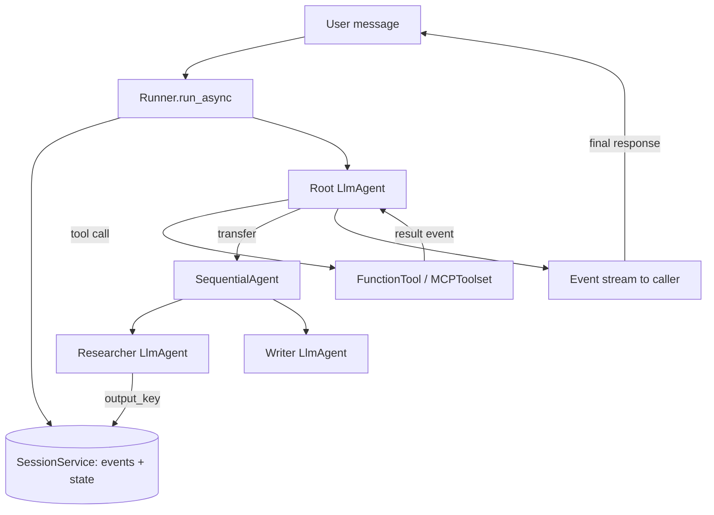

## TL;DR
Google's Agent Development Kit (ADK) is a code-first framework: LLM agents, workflow agents and tools,
run by a Runner over sessions and state, with a dev UI, built-in evals and deploys to Cloud Run or Agent
Engine.

## For agent builders
- **Why it matters for agents.** ADK gives you the pieces every production agent needs in one package:
  a tool-calling loop, deterministic orchestration (sequential, parallel, loop), session state, memory,
  callbacks for guardrails, and an eval runner, without writing the plumbing yourself.
- **Where it shows up in your stack.** The `google-adk` Python package (a Java SDK and other languages also
  exist), the `adk` CLI (`adk web`, `adk run`, `adk eval`, `adk deploy`), and Google Cloud deployment
  targets. It is model-agnostic through a LiteLLM wrapper, though Gemini is the first-class path.
- **What you control.** Agent instructions and tools, how agents are composed into a tree, which session
  and memory services persist state, and which callbacks gate model and tool calls.
- **What you can skip.** Vertex-specific services if you are not on Google Cloud; the core agent, runner
  and in-memory or database session services run anywhere.

## Why it exists
- **Agents need both reasoning and control flow.** Pure LLM routing is flexible but unpredictable; pure
  code pipelines are predictable but brittle. ADK puts LLM agents and deterministic workflow agents in the
  same tree, so you choose per step.
- **Plumbing dominates early agent work.** Session storage, event history, streaming, tool schemas from
  Python functions and a local test UI are each a week of glue code. ADK ships them as defaults.
- **Multi-agent systems need a shared contract.** Every agent in ADK emits the same `Event` stream and
  reads the same session state, so a sub-agent, a tool and a workflow step compose without adapters.
- **Shipping is the hard part.** `adk deploy` targets Cloud Run and Vertex AI Agent Engine, and `adk eval`
  replays test cases, so the path from notebook to a managed, evaluated service is short.

## How it works
### Core abstractions
| Abstraction | What it is | Why it exists |
|---|---|---|
| `LlmAgent` (alias `Agent`) | model + instruction + tools + optional `sub_agents` | the reasoning unit; decides which tool or sub-agent to call |
| `SequentialAgent`, `ParallelAgent`, `LoopAgent` | workflow agents that run children in a fixed pattern, no LLM | deterministic control flow around LLM steps |
| Tools | Python functions (wrapped as `FunctionTool`), `AgentTool`, built-ins such as `google_search`, `MCPToolset` | the agent's actions; schemas come from type hints and docstrings |
| `Runner` | executes an agent for one user turn and yields `Event`s | separates the agent definition from execution |
| `SessionService` | stores sessions: events plus a `state` dict | conversation persistence and shared scratchpad |
| `MemoryService` | long-term, cross-session recall | memory beyond one conversation |
| Callbacks | `before_model_callback`, `before_tool_callback`, `after_tool_callback` and others | guardrails, caching, logging, policy |

### The mental model
1. **A tree of agents.** The root agent receives the user turn. An `LlmAgent` can delegate to a child in
   `sub_agents` (transfer) or call another agent as a tool (`AgentTool`), which returns control afterwards.
2. **Everything is an event.** Model responses, tool calls, tool results and state changes are appended to
   the session as `Event` objects, because one ordered log makes replay, tracing and eval possible.
3. **State is the shared blackboard.** `session.state` is a dict visible to every agent. Setting
   `output_key="draft"` on an `LlmAgent` saves its final text into `state["draft"]`, and later instructions
   can reference it with `{draft}` templating.
4. **State prefixes set scope.** No prefix is session scope, `user:` persists across a user's sessions,
   `app:` is shared by all users, and `temp:` lives for one invocation only.
5. **Services are swappable.** `InMemorySessionService` for tests, `DatabaseSessionService` for your own
   SQL database, `VertexAiSessionService` on Google Cloud; agent code does not change.

### When to pick ADK
| Pick ADK when | Pick something else when |
|---|---|
| You deploy on Google Cloud or use Gemini heavily | You want a provider-neutral graph with explicit checkpointing: LangGraph |
| You want workflow agents and LLM agents in one tree | You want the thinnest SDK over one provider: OpenAI Agents SDK or Claude Agent SDK |
| You want a built-in dev UI and eval runner | Your team is TypeScript-first: Mastra or the Vercel AI SDK |
| You plan to expose agents over A2A | You need type-validated outputs above all: Pydantic AI |

## Diagram
Follow one user turn: the Runner loads the session, the root agent delegates, and every step lands as an
event in the session.



## Examples
### A minimal tool-calling agent
Requires `pip install google-adk` and a Gemini API key (`GOOGLE_API_KEY`) or Vertex AI credentials. The
model id is illustrative; use one your account supports.

```python
import asyncio
from google.adk.agents import Agent
from google.adk.runners import Runner
from google.adk.sessions import InMemorySessionService
from google.genai import types

def get_order_status(order_id: str) -> dict:
    """Look up the shipping status of an order by its id."""
    fake_db = {"A100": "shipped", "A101": "processing"}
    return {"order_id": order_id, "status": fake_db.get(order_id, "not_found")}

root_agent = Agent(
    name="support_agent",
    model="gemini-2.0-flash",
    instruction="Answer order questions. Always call get_order_status before answering.",
    tools=[get_order_status],
)

async def main():
    sessions = InMemorySessionService()
    await sessions.create_session(app_name="support", user_id="u1", session_id="s1")
    runner = Runner(agent=root_agent, app_name="support", session_service=sessions)
    msg = types.Content(role="user", parts=[types.Part(text="Where is order A100?")])
    async for event in runner.run_async(user_id="u1", session_id="s1", new_message=msg):
        if event.is_final_response():
            print(event.content.parts[0].text)

asyncio.run(main())
# In early releases create_session was synchronous; check the current docs for your version.
```

### A research pipeline with workflow agents and shared state
Two LLM agents run in a fixed order; the first writes to state, the second reads it through templating.

```python
from google.adk.agents import LlmAgent, SequentialAgent

researcher = LlmAgent(
    name="researcher", model="gemini-2.0-flash",
    instruction="List 5 key facts about the user's topic as bullets.",
    output_key="facts",                      # final text saved to state["facts"]
)
writer = LlmAgent(
    name="writer", model="gemini-2.0-flash",
    instruction="Write a 120-word brief using only these facts:\n{facts}",
    output_key="brief",
)
root_agent = SequentialAgent(name="brief_pipeline", sub_agents=[researcher, writer])
# Run it with the same Runner as above, or locally with `adk web` from the parent directory.
```

| Choice | Why |
|---|---|
| `SequentialAgent` instead of one big prompt | each step is small, testable and traced separately |
| `output_key` instead of parsing chat history | the writer reads exactly one variable, not the whole transcript |
| Swap writer for a `LoopAgent` with a critic | adds a bounded revise loop when quality needs it |

## Production patterns
- **Persist sessions in a real database.** Replace `InMemorySessionService` with
  `DatabaseSessionService(db_url=...)` (any SQLAlchemy URL) or `VertexAiSessionService`, because
  in-memory sessions vanish on every restart or replica switch. Monitor session table growth and prune old
  events.
- **Gate tools with callbacks.** Use `before_tool_callback` to check arguments and user permissions and
  return a dict to short-circuit the call; use `before_model_callback` for input guardrails. Monitor how
  often callbacks block, by tool.
- **Deploy with the CLI, then pin versions.** `adk deploy cloud_run` or `adk deploy agent_engine` packages
  the agent; pin `google-adk` in requirements because the API is still evolving. Check the current docs
  for deploy flags. Monitor cold-start latency and error rate per revision.
- **Evaluate trajectories, not only answers.** Record test cases from the dev UI into eval sets and run
  `adk eval` in CI; ADK scores tool-call trajectory and final response against references. Block merges
  when the trajectory score drops.
- **Trace every invocation.** ADK emits OpenTelemetry spans; export them to Cloud Trace or a vendor such
  as Langfuse or LangSmith. Monitor tokens per invocation and tool latency.
- **Use non-Gemini models deliberately.** Wrap other providers with `LiteLlm(model="...")` from
  `google.adk.models.lite_llm`, but test each one, because tool-calling quality varies by model.

## Trade-offs
- **Batteries included vs lock-in pull.** Sessions, memory, evals and deploy are built in, but the smoothest
  paths (Agent Engine, Vertex memory) are Google Cloud services; off-cloud you assemble more yourself.
- **Agent tree vs explicit graph.** LLM transfer between sub-agents is quick to write but harder to reason
  about than LangGraph's explicit edges; prefer workflow agents when the order is known.
- **Young, fast-moving API vs stability.** New features land often, which also means breaking changes
  between minor versions; pin and read release notes.
- **Gemini-first vs model-agnostic.** Other models work through LiteLLM, but built-in tools such as
  `google_search` are Gemini-only, and they have had limits on mixing with other tools in one agent
  (wrapping them in an `AgentTool` is the usual workaround); check the docs for your version.

## Pitfalls
- **Keeping the in-memory session service in production.** Symptom: users lose context after a deploy or
  when load balancing switches replicas. Fix: a database or Vertex session service from day one.
- **Letting LLM transfer do deterministic routing.** Symptom: the root agent sometimes skips a required step.
  Fix: put required steps in a `SequentialAgent` and keep LLM routing for genuinely open choices.
- **Weak tool docstrings and untyped arguments.** ADK builds tool schemas from signatures and docstrings, so
  vague ones cause wrong or missing calls. Fix: type every argument and describe when to use the tool.
- **Mutating state outside events.** Writing to a fetched session object directly is not persisted. Fix:
  use `output_key`, `tool_context.state` or callback context, which record state deltas in events.
- **Parallel branches writing the same key.** `ParallelAgent` children share one session state, so two
  branches with the same `output_key` overwrite each other. Fix: give each branch its own key and merge
  them in a later step.

## When to use
- **Use when:** you build on Google Cloud or Gemini, want sequential, parallel and loop orchestration
  mixed with LLM agents, or need A2A exposure and a managed runtime.
- **Avoid when:** you need provider-neutral durable checkpoints with interrupts and resume; LangGraph or a
  workflow engine fits better.
- **Measure:** task completion on an eval set, trajectory match rate, tokens and latency per invocation,
  and tool error rate.
- **Interviews:** explain the agent tree, the event log, state scopes and why workflow agents exist.

## Role lens
- **Engineer:** Builds agents as ADK trees, writes typed tools and callbacks, and runs `adk web` and
  `adk eval` locally before every change.
- **Architect:** Decides session and memory services, the split between workflow and LLM agents, and
  whether to run on Agent Engine, Cloud Run or self-managed infrastructure.
- **FDE:** Prototypes a customer agent in the ADK dev UI within a day, then hands over an eval set and a
  deployment plan that fits the customer's cloud.

## Check yourself
**Q:** Your ADK support agent must always verify identity, then look up the account, then answer, but it
sometimes answers without verifying. How do you restructure it, and how do you prove the fix works?
**A:** Move the fixed steps out of LLM routing: a `SequentialAgent` whose first child is a verification
agent (or a `before_tool_callback` that blocks account tools until `state["verified"]` is true), followed
by the lookup and answer agents, which pass data through `output_key` state. Keep LLM choice only where
the path is genuinely open. Prove it with an eval set that includes unverified users and check the
trajectory score in `adk eval`: no account tool call may appear before verification. Persist sessions in
a database so the verified flag survives replicas.

## Interview questions
### What is the difference between an LlmAgent and a workflow agent in ADK?
- **LlmAgent reasons.** It uses a model, an instruction and tools, and decides at run time which tool to
  call or which sub-agent to transfer to.
- **Workflow agents orchestrate.** `SequentialAgent`, `ParallelAgent` and `LoopAgent` run children in a
  fixed pattern with no model call, so the control flow is deterministic and testable.

### How does state flow between agents in an ADK pipeline?
- **Through session state.** Every agent shares `session.state`; `output_key` writes an agent's final text
  to a key, and later instructions reference it with `{key}` templating.
- **Scopes matter.** Unprefixed keys are per session, `user:` and `app:` persist more widely, and `temp:`
  lasts one invocation, so pick the scope that matches the data's lifetime.

### Your ADK agent works in adk web but loses context in production. What do you check?
- **The session service.** In-memory sessions are per process; with several replicas or after a restart
  the session is gone. Use `DatabaseSessionService` or `VertexAiSessionService`.
- **Session ids.** Confirm the client sends the same `user_id` and `session_id` each turn, and that state
  writes go through events rather than direct mutation.

### When would you not choose ADK for an agent project?
- **Off Google Cloud with heavy durability needs.** If you need checkpoint and resume across long human
  approvals on your own infrastructure, LangGraph or a durable workflow engine is more explicit.
- **TypeScript-first teams or one-provider apps.** Mastra or a provider SDK is simpler when you do not need
  ADK's multi-agent tree, dev UI or Google deploy targets.

### How do you add a guardrail that blocks a dangerous tool call?
- **Use `before_tool_callback`.** Inspect the tool name, arguments and context state; returning a dict
  skips the real call and uses that dict as the tool result.
- **Log and evaluate it.** Record blocked calls as events and add eval cases that should be blocked, so a
  prompt change cannot silently remove the guardrail.

## Quiz
### Q: What does setting output_key on an LlmAgent do?
- [ ] It forces the model to return JSON with that key
- [x] It saves the agent's final response text into session state under that key
- [ ] It names the tool the agent must call last
- [ ] It sets the key used to encrypt the session
> `output_key` writes the agent's final text into `session.state`, which is how a later agent in a
> `SequentialAgent` reads the result through `{key}` templating without parsing the chat history.

### Q: Which ADK component should run steps that must always happen in the same order?
- [ ] An LlmAgent with a strict instruction
- [ ] The MemoryService
- [x] A SequentialAgent
- [ ] A before_model_callback
> Workflow agents such as `SequentialAgent` run their children in a fixed order without asking a model,
> so required steps cannot be skipped the way they can when an LLM decides whether to transfer.

### Q: Why is InMemorySessionService a problem in a multi-replica deployment?
- [ ] It does not support tool calls
- [ ] It only works with Gemini models
- [ ] It cannot stream events
- [x] Each process keeps its own sessions, so another replica or a restart loses the conversation
> In-memory sessions live inside one process. Load balancing or a restart sends the next turn somewhere
> without that history, so production uses a database or Vertex AI session service.

## Use cases & projects
### Use cases
- **Customer support agents on Google Cloud.** An LLM router delegates to billing, shipping and returns
  sub-agents, with sessions in a database and deployment on Cloud Run.
- **Research and report pipelines.** `SequentialAgent` and `ParallelAgent` fan out searches, then a writer
  agent composes from shared state.
- **Enterprise agents exposed over A2A.** A team publishes an ADK agent that other teams' agents call
  through the Agent2Agent protocol.
- **Agents over internal tools via MCP.** `MCPToolset` connects an ADK agent to existing MCP servers
  without rewriting tools.

### Mini project
**Build and evaluate a three-step ADK pipeline (2-3 hours).**
- **Goal:** an ADK agent that triages a support ticket, looks up an order with a tool, and drafts a reply,
  with an eval set that proves the order is always looked up first.
- **Steps:** write a `get_order_status` tool; build a `SequentialAgent` of triage, lookup and writer agents
  passing data via `output_key`; add a `before_tool_callback` that blocks unknown order ids; run it in
  `adk web`, save 5 sessions as eval cases, and run `adk eval`.
- **Done when:** all 5 eval cases pass on trajectory and response, a blocked-id case shows the callback
  firing, and sessions survive a restart using `DatabaseSessionService` with SQLite.
