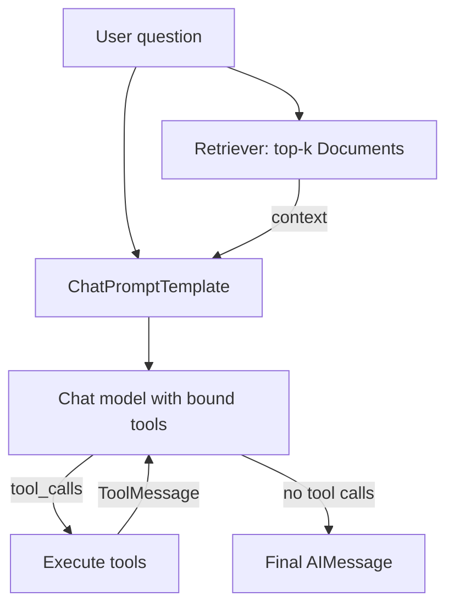

## TL;DR
LangChain is a common interface over chat models, tools, embeddings and retrievers, composed with LCEL
pipes, plus `create_agent` for a tool-calling loop. Use it for the integrations and the agent loop; use
LangGraph underneath when you need custom control flow.

## For agent builders
- **Why it matters for agents.** It gives one message and tool-call format across providers, so the same
  agent code can run on several models, and it plugs into LangGraph and LangSmith without glue.
- **Where it shows up in your stack.** `init_chat_model` for models, `@tool` for tool schemas, vector
  stores and retrievers for RAG, `create_agent` for the loop (built on LangGraph in LangChain 1.x).
- **What you control.** Which integration packages you install, the prompts you pass in, middleware on the
  agent loop, and retries and fallbacks on each Runnable.
- **What you can skip.** Legacy chains and the old `AgentExecutor`. New agent code uses `create_agent` or
  LangGraph directly; check the current docs for the migration notes.

## Why it exists
- **Every provider speaks a slightly different dialect.** Message roles, tool-call formats and streaming
  events differ. LangChain normalizes them into `AIMessage.tool_calls`, so swapping a model is ideally a
  one-line change.
- **RAG needs many small adapters.** Loaders, splitters, embedding models and vector stores each have
  their own SDK; LangChain wraps hundreds of them behind `Document`, `Embeddings`, `VectorStore` and
  retriever interfaces.
- **Composition needs uniform plumbing.** Streaming, batching, async and retries should work the same on a
  prompt, a model and a parser. The Runnable interface gives all of them `invoke`, `batch`, `stream` and
  async twins.
- **The early agent API was too magic.** Text-parsed ReAct agents with hidden prompts were hard to debug,
  which pushed agents onto LangGraph; `create_agent` is the thin, tool-calling successor.

## How it works
### Packages
| Package | Holds |
|---|---|
| `langchain-core` | messages, Runnables, prompts, tools, `Document`, base interfaces |
| `langchain` | `create_agent`, middleware, `init_chat_model` |
| `langchain-openai`, `langchain-anthropic`, ... | one package per provider integration |
| `langchain-community` | long tail of community integrations |

### Chat models and messages
- **One interface.** `init_chat_model("openai:gpt-4o-mini")` (or a provider class) returns a chat model
  with `invoke`, `stream`, `batch` and `bind_tools`.
- **Typed messages.** `SystemMessage`, `HumanMessage`, `AIMessage` (with `.tool_calls` and
  `.usage_metadata`) and `ToolMessage` (with `tool_call_id`).
- **Structured output.** `model.with_structured_output(MyPydanticModel)` uses the provider's native
  mechanism where available and returns a validated object.

### Tools
- **`@tool` turns a function into a schema.** Name from the function, description from the docstring,
  arguments from the type hints (`args_schema` is a Pydantic model).
- **`model.bind_tools([...])`** attaches the schemas to every call; the model replies with `tool_calls`
  that you, `ToolNode` or `create_agent` execute.

### LCEL: the pipe syntax
- **`a | b | c` builds a `RunnableSequence`.** Each step's output is the next step's input.
- **A dict is a parallel step.** `{"context": retriever, "question": RunnablePassthrough()}` runs both
  branches on the same input and returns a dict.
- **Every Runnable has** `with_retry`, `with_fallbacks`, `with_config` (tags, run name) and
  `astream_events` for fine-grained streaming.
- **Use LCEL for linear pipelines.** Loops, branches with state and pauses belong in LangGraph.

### Retrievers
- **A retriever is a Runnable from a query string to `list[Document]`.** `vector_store.as_retriever(
  search_kwargs={"k": 4})` is the common one; BM25, ensembles and rerankers fit the same interface.
- **Agents use them two ways:** always retrieve before answering (a chain), or expose retrieval as a tool
  the model decides to call (agentic RAG).

### `create_agent`
- **The loop as a function.** `create_agent(model, tools, system_prompt=...)` returns a compiled LangGraph
  graph: model, tools, repeat until no tool calls.
- **Middleware hooks the loop.** LangChain 1.x ships middleware such as `HumanInTheLoopMiddleware`,
  `SummarizationMiddleware` and `ModelCallLimitMiddleware`; check the current docs for their arguments.
- **It inherits LangGraph features:** pass `checkpointer=` for memory and resume, stream with
  `stream_mode`, and trace in LangSmith.

## Diagram
Follow one request: LCEL feeds retrieved context into the prompt, and the agent loop repeats model and
tool steps until the model stops calling tools.



## Examples
### LCEL retrieval chain (runs offline)
A toy embedding and a scripted model let this run without keys; the pipeline is the same with real ones.

```python
# pip install langchain-core numpy ; runs offline (toy embeddings, scripted model)
from langchain_core.documents import Document
from langchain_core.embeddings import Embeddings
from langchain_core.vectorstores import InMemoryVectorStore
from langchain_core.prompts import ChatPromptTemplate
from langchain_core.output_parsers import StrOutputParser
from langchain_core.runnables import RunnablePassthrough
from langchain_core.language_models.fake_chat_models import GenericFakeChatModel
from langchain_core.messages import AIMessage

class ToyEmbeddings(Embeddings):          # bag of words; use a real embedding model in practice
    VOCAB = ["refund", "return", "days", "shipping", "eu", "delivery"]
    def embed_query(self, text):
        return [float(w in text.lower()) for w in self.VOCAB]
    def embed_documents(self, texts):
        return [self.embed_query(t) for t in texts]

store = InMemoryVectorStore(embedding=ToyEmbeddings())
store.add_documents([
    Document("Refunds: return items within 30 days of delivery.", metadata={"src": "policy.md"}),
    Document("Shipping to the EU takes 5-7 business days.", metadata={"src": "shipping.md"}),
])
retriever = store.as_retriever(search_kwargs={"k": 1})      # a Runnable: str -> list[Document]

def format_docs(docs):
    return "\n".join(f"[{d.metadata['src']}] {d.page_content}" for d in docs)

prompt = ChatPromptTemplate.from_messages([
    ("system", "Answer only from the context and cite the [source].\n\nContext:\n{context}"),
    ("human", "{question}"),
])
llm = GenericFakeChatModel(messages=iter([AIMessage("Within 30 days of delivery [policy.md].")]))
# real model: from langchain.chat_models import init_chat_model; llm = init_chat_model("openai:gpt-4o-mini")

chain = (
    {"context": retriever | format_docs, "question": RunnablePassthrough()}   # dict runs both branches
    | prompt | llm | StrOutputParser()
)
print(retriever.invoke("Can I return it after 20 days?")[0].metadata)   # {'src': 'policy.md'}
print(chain.invoke("Can I return it after 20 days?"))
```

### A tool-calling agent with `create_agent`
The scripted model replays a tool call and then an answer, so the loop runs offline. Pass a provider
string instead for real use.

```python
# pip install langchain ; offline: a scripted model stands in for a real one
from langchain.agents import create_agent
from langchain_core.tools import tool
from langchain_core.messages import AIMessage
from langchain_core.language_models.fake_chat_models import GenericFakeChatModel

@tool
def order_status(order_id: str) -> str:
    """Look up the shipping status of an order by its id, e.g. 'A-1001'."""
    return {"A-1001": "shipped, arrives Friday"}.get(order_id, "not found")

class ScriptedModel(GenericFakeChatModel):          # replays canned replies; ignores bound tools
    def bind_tools(self, tools, **kwargs):
        return self

model = ScriptedModel(messages=iter([
    AIMessage("", tool_calls=[{"name": "order_status", "args": {"order_id": "A-1001"}, "id": "c1"}]),
    AIMessage("Order A-1001 has shipped and arrives Friday."),
]))
# real model: model = "openai:gpt-4o-mini" (any provider string init_chat_model accepts)

agent = create_agent(model, tools=[order_status],
                     system_prompt="You are a support agent. Use tools; never guess order data.")
result = agent.invoke({"messages": [{"role": "user", "content": "Where is order A-1001?"}]})
for m in result["messages"]:
    print(f"{m.type:>5}: {m.content or m.tool_calls}")
print(order_status.args_schema.model_json_schema()["properties"])
```

- **Output:** `human`, `ai` (a tool call), `tool` (the result), `ai` (the answer): the loop in four
  messages.
- **The last line** shows the JSON schema the model sees, built from the type hint.

### Worked scenario: which LangChain layer for which job
| Job in a support agent | LangChain piece | Why not something heavier |
|---|---|---|
| Answer FAQs from 3,000 help articles | LCEL chain: retriever, prompt, model | no loop needed, one pass is cheaper |
| Look up orders and open tickets | `create_agent` with 2-4 tools | loop is standard, no custom branching |
| Refunds needing approval | `create_agent` plus HITL middleware, or a LangGraph graph | needs durable pause and resume |
| Swap providers for cost | `init_chat_model` string per environment | same message format everywhere |

## Production patterns
- **Install only the integrations you use.** Depend on `langchain-core`, `langchain` and the specific
  provider packages, pin exact versions, and gate upgrades on your eval set, because minor releases
  have changed behavior before.
- **Wrap model calls in retries and fallbacks.** `llm.with_retry(stop_after_attempt=3).with_fallbacks(
  [backup_llm])` covers rate limits and outages; monitor fallback rate and cost per request.
- **Tag runs for tracing.** `chain.with_config({"run_name": "faq_answer", "tags": ["faq", "v3"]})` makes
  LangSmith or Langfuse traces filterable by feature and prompt version.
- **Batch offline work.** Use `chain.batch(inputs, config={"max_concurrency": 8})` for backfills and eval
  runs instead of a Python loop, and watch provider rate-limit errors.
- **Read usage from messages.** `AIMessage.usage_metadata` carries input and output token counts; log them
  per step to track agent cost and cache hits.

## Trade-offs
- **Breadth of integrations vs dependency weight.** Hundreds of adapters save glue code, but each package
  adds transitive dependencies and upgrade risk. Flips when you use one provider and one vector store.
- **Uniform interface vs provider features.** The common format lags new provider features (new content
  block types, special tool types); you sometimes drop to the raw SDK.
- **LCEL concision vs readability.** Pipes are short for linear flows but hard to step through when
  branched; plain Python functions or LangGraph read better past three or four steps.
- **`create_agent` speed vs control.** You get a working loop in a few lines; custom routing, parallel
  branches or several agents need a hand-written LangGraph graph.

## Pitfalls
- **Mixing legacy and current APIs.** Symptom: tutorials using `AgentExecutor` or `initialize_agent` fail
  or behave oddly. Fix: use `create_agent` or LangGraph and current docs only.
- **Vague tool docstrings.** Symptom: the model calls the wrong tool or invents arguments. Fix: the
  docstring is the tool description; state when to use it and give an example argument.
- **Hidden prompt drift.** Symptom: answers change after an upgrade with no code change. Fix: keep your
  prompts explicit in your repo and diff traces before and after upgrades.
- **Retrieving too much.** Symptom: high token cost and answers citing irrelevant chunks. Fix: tune `k`,
  add metadata filters and a reranker, and measure retrieval recall separately.

## When to use
- **Use when** you want provider-neutral chat models and tools, ready-made RAG integrations, and a quick
  tool-calling agent that can later grow into LangGraph.
- **Avoid when** you use one provider and one store and want minimal dependencies; the raw SDK plus a few
  helpers may be simpler.
- **Measure:** tokens and latency per step, tool-call accuracy, retrieval recall, and fallback rate.
- **Interviews:** explain LCEL, `bind_tools` and how `create_agent` relates to LangGraph.

## Role lens
- **Engineer:** Builds chains and agents from `init_chat_model`, `@tool` and retrievers, wraps calls in
  retries and fallbacks, and tags runs so traces map to features and prompt versions.
- **Architect:** Decides which layer LangChain owns (integrations, the agent loop, or both), pins the
  integration packages, and sets the upgrade policy gated on evals.
- **FDE:** Plugs a customer's existing vector store and model provider into a working agent quickly by
  choosing the matching integration packages, then hands over a pinned, traced setup.

## Check yourself
**Q:** A teammate's LCEL chain retrieves documents, formats a prompt and calls a model. Now they need the
model to decide whether to search again, call an order lookup, or answer, possibly several times. Should
they extend the LCEL chain?
**A:** No. LCEL is for linear or fan-out pipelines with no loop. Deciding repeatedly among tools is an
agent loop: expose retrieval and order lookup as `@tool` functions and use `create_agent`, which runs model
and tools until the model stops calling tools. If they later need custom branching, a durable pause for
approval or several agents, they should write the graph directly in LangGraph, since `create_agent` is
itself a LangGraph graph. Either way they keep the same retriever and prompts, add a step limit, and trace
the loop in LangSmith.

## Interview questions
### What is LCEL and when would you not use it?
- **Definition.** The LangChain Expression Language composes Runnables with `|` into sequences, and with
  dicts into parallel steps, giving uniform `invoke`, `batch`, `stream` and async.
- **When not.** Loops, conditional branches with shared state, pauses and multi-agent routing; those are
  LangGraph's job, and plain Python is clearer for anything branched.

### How does a LangChain tool become something the model can call?
- **`@tool` builds a schema** from the function name, docstring and type hints into a Pydantic
  `args_schema`.
- **`bind_tools` sends the schemas** with each model call in the provider's format; the reply's
  `tool_calls` are normalized into a list of name, args and id.
- **Something must execute them:** your loop, `ToolNode` or `create_agent`, returning `ToolMessage`s.

### Your agent works on one provider but breaks after switching models. What do you check?
- **Tool schema support.** Some models handle nested or optional arguments worse; simplify the schema.
- **Prompt assumptions.** System prompts tuned for one model may need rework; rerun the eval set.
- **Provider-specific features** (parallel tool calls, structured-output mode) may differ; check the
  integration's docs and the raw trace.

### How do `create_agent`, LangGraph and LangSmith relate?
- **`create_agent`** is a prebuilt LangGraph graph implementing the tool-calling loop, with middleware.
- **LangGraph** is the runtime: state, checkpointers, interrupts and streaming that `create_agent` uses.
- **LangSmith** traces and evaluates runs from both, with no code change beyond environment variables.

### How would you control cost in a LangChain RAG agent serving 100k queries a day?
- **Retrieve less.** Tune `k`, filter by metadata and rerank, so fewer chunks reach the prompt.
- **Route by difficulty.** A cheap model for easy queries via `init_chat_model`, a stronger one as
  fallback or for hard cases.
- **Measure per step** from `usage_metadata` and cache stable prompt prefixes at the provider.

## Quiz
### Q: In LCEL, what does a dict such as {"context": retriever, "question": RunnablePassthrough()} do in a pipeline?
- [ ] Defines the model's output schema
- [x] Runs each value on the same input and returns a dict of their outputs
- [ ] Stores intermediate results in a checkpointer
- [ ] Registers two tools with the model
> A dict literal is coerced to a parallel Runnable: every branch receives the same input, and the
> outputs are collected into a dict that the next step, usually a prompt template, consumes.

### Q: Where does a LangChain `@tool` get the description the model sees?
- [ ] From the variable name it is assigned to
- [ ] From a separate YAML file
- [x] From the function's docstring, with arguments taken from its type hints
- [ ] From the first line of the function body
> The decorator builds the schema from the name, docstring and type hints, so a vague docstring
> directly causes wrong tool selection and invented arguments.

### Q: What is the recommended way to build a new tool-calling agent in LangChain 1.x?
- [ ] `initialize_agent` with a ReAct text parser
- [ ] An LCEL chain with a while loop around it
- [x] `create_agent`, which builds a LangGraph graph running model and tools until no tool calls remain
- [ ] A retriever with `search_kwargs` set to the tool list
> `create_agent` is the current agent API and returns a compiled LangGraph graph. The older
> text-parsing agents are legacy, and retrievers are not tools by themselves.

## Use cases & projects
### Use cases
- **Support assistants.** An LCEL retrieval chain answers FAQs while a `create_agent` loop handles order
  lookups and ticket creation.
- **Provider portability.** Teams switch models per environment or tenant with `init_chat_model` strings
  and keep the same tools and prompts.
- **Agentic RAG.** Retrieval exposed as a tool lets the agent search again with a refined query when the
  first results are thin.
- **Bulk enrichment jobs.** `batch` with `max_concurrency` classifies or summarizes thousands of records
  through the same chain used online.

### Mini project
**Support agent with retrieval and one action (2 hours).**
- **Goal:** combine a retriever and a tool in one LangChain agent and see which one the model picks.
- **Steps:** load 20 help articles into an in-memory vector store; wrap the retriever as a `search_help`
  tool; add an `order_status` tool; build the agent with `create_agent` and a real model; write 10 test
  questions (5 FAQ, 5 order); log tool calls and tokens per question.
- **Done when:** you have a table showing which tool each question triggered, the answer, and tokens per
  question, with at least 9 of 10 routed correctly and a note on the one that was not.
