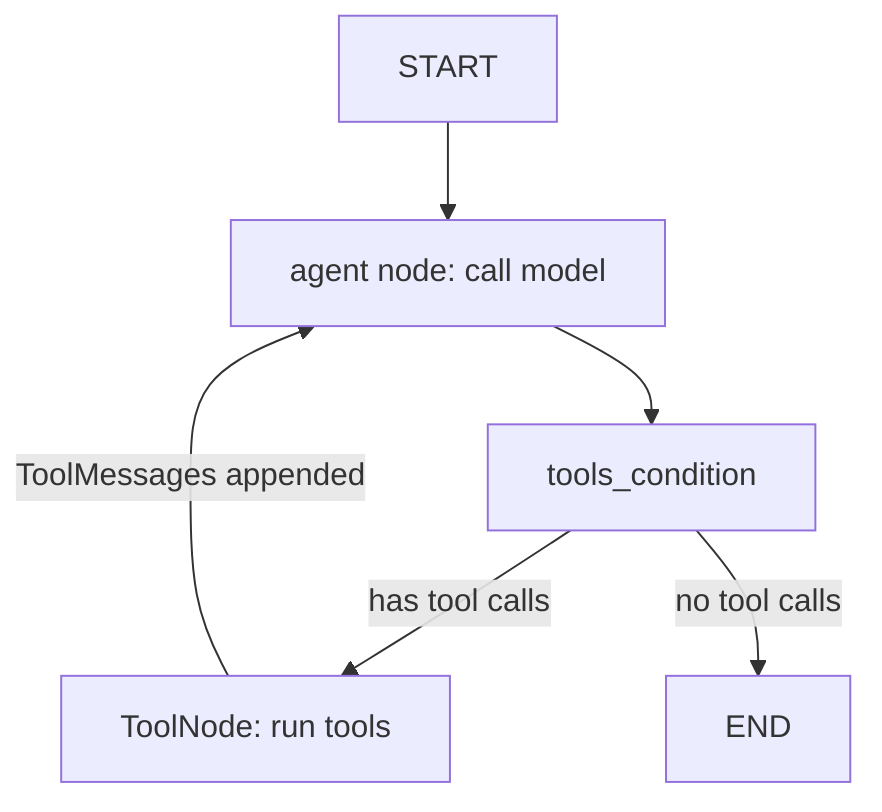

## TL;DR
LangGraph models an agent as a `StateGraph`: typed shared state, nodes that return partial updates,
reducers that merge them, and fixed or conditional edges. It makes the agent loop explicit, so you can
add branches, parallel work and limits deliberately.

## For agent builders
- **Why it matters for agents.** The tool-calling loop becomes two nodes and a conditional edge you can
  see, test and extend, instead of a black box with hidden retries.
- **Where it shows up in your stack.** `langgraph` in Python (and `@langchain/langgraph` in TypeScript);
  `create_agent` in LangChain is a prebuilt graph on top of it.
- **What you control.** The state schema and its reducers, which node runs next, the `recursion_limit`,
  and where models, tools and humans sit in the flow.
- **What you can skip.** The Pregel internals. Know that execution runs in supersteps and that parallel
  writes to one key need a reducer.

## Why it exists
- **Agents are state machines with an LLM inside.** Real agents need "classify, then branch", "retry this
  tool", "search three sources in parallel" and "stop after N steps". A while loop gets tangled fast.
- **Chains cannot loop.** LCEL pipelines run once from left to right; an agent must revisit the model
  after every tool result.
- **Shared state needs merge rules.** When two parallel branches both append findings, something must
  define how writes combine. Reducers make that explicit instead of last-write-wins by accident.
- **Explicit graphs are inspectable.** You can render the graph, unit-test a node with a fake state, and
  trace exactly which edge fired, which matters when a run goes wrong in production.

## How it works
### State and reducers
- **The state schema is a `TypedDict`, dataclass or Pydantic model.** Every node reads the full state and
  returns a dict of only the keys it changes.
- **Default merge is overwrite.** Annotate a key to change that: `Annotated[list[str], operator.add]`
  concatenates, and `add_messages` appends messages and replaces ones with the same id.
- **`MessagesState`** is a ready schema with `messages: Annotated[list, add_messages]`, the usual base for
  chat agents.

### Nodes and edges
1. **`add_node(name, fn)`** registers a function (sync or async) that takes state and returns an update.
2. **`add_edge(a, b)`** always goes from `a` to `b`; `START` and `END` mark entry and exit.
3. **`add_conditional_edges(src, router, path_map)`** calls `router(state)` after `src` and goes to the
   returned node name (or names). A `Literal` return type documents the targets.
4. **`compile()`** validates the graph and returns a Runnable with `invoke`, `stream` and `batch`;
   pass `checkpointer=` here for persistence.

### Routing tools: Command and Send
- **`Command(goto=..., update=...)`** returned from a node updates state and routes in one step, useful
  when the node itself decides the next hop.
- **`Send(node, payload)`** returned from a conditional edge launches one task per payload in parallel
  (map-reduce); a reducer on the target key collects results.

### Execution model
- **Supersteps.** All nodes triggered in one step run, then their updates merge through reducers, then the
  next set runs. Parallel branches fan in at a node with several incoming edges.
- **`recursion_limit`** (in the run config) caps supersteps; exceeding it raises `GraphRecursionError`.
  Set it per run as your step budget.
- **Retries per node.** `add_node(..., retry_policy=RetryPolicy(max_attempts=3))` retries flaky tool or
  model nodes with backoff.

### Prebuilt pieces
| Piece | Does |
|---|---|
| `ToolNode(tools)` | runs every tool call in the last AI message and returns `ToolMessage`s |
| `tools_condition` | router: to `"tools"` if the last message has tool calls, else `END` |
| `create_agent` (LangChain) | the whole model-tools loop as one call |

## Diagram
The tool-calling agent as a graph: one conditional edge decides between running tools and finishing,
and the edge back to the agent node is the loop.



## Examples
### The agent loop as an explicit graph (runs offline)
A scripted model replays a tool call and an answer; replace it with a real chat model and `bind_tools`.

```python
# pip install langgraph langchain-core ; offline: a scripted model stands in for a real one
from langgraph.graph import StateGraph, MessagesState, START, END
from langgraph.prebuilt import ToolNode, tools_condition
from langchain_core.tools import tool
from langchain_core.messages import AIMessage
from langchain_core.language_models.fake_chat_models import GenericFakeChatModel

@tool
def get_weather(city: str) -> str:
    """Current weather for a city."""
    return f"{city}: 18C, light rain"

class ScriptedModel(GenericFakeChatModel):
    def bind_tools(self, tools, **kwargs):
        return self

llm = ScriptedModel(messages=iter([
    AIMessage("", tool_calls=[{"name": "get_weather", "args": {"city": "Oslo"}, "id": "t1"}]),
    AIMessage("Oslo is 18C with light rain; take an umbrella."),
])).bind_tools([get_weather])           # real: init_chat_model("openai:gpt-4o-mini").bind_tools([...])

def call_model(state: MessagesState) -> dict:
    return {"messages": [llm.invoke(state["messages"])]}   # add_messages reducer appends

builder = StateGraph(MessagesState)
builder.add_node("agent", call_model)
builder.add_node("tools", ToolNode([get_weather]))      # runs every tool call in the last AI message
builder.add_edge(START, "agent")
builder.add_conditional_edges("agent", tools_condition)  # -> "tools" if tool calls, else END
builder.add_edge("tools", "agent")                       # the loop
graph = builder.compile()

out = graph.invoke({"messages": [("user", "Do I need an umbrella in Oslo?")]},
                   {"recursion_limit": 10})              # hard cap on supersteps
print([m.type for m in out["messages"]])                 # ['human', 'ai', 'tool', 'ai']
print(out["messages"][-1].content)
```

### Conditional routing plus parallel fan-out
A triage agent classifies a ticket, routes it, and for bugs searches three sources in parallel with
`Send`; the `operator.add` reducer collects the findings.

```python
import operator
from typing import Annotated, Literal, TypedDict
from langgraph.graph import StateGraph, START, END
from langgraph.types import Send

class Triage(TypedDict):
    ticket: str
    category: str
    findings: Annotated[list[str], operator.add]   # reducer: parallel writes are concatenated
    reply: str

def classify(state: Triage) -> dict:                # a model call with structured output in practice
    t = state["ticket"].lower()
    return {"category": "billing" if "charge" in t else "bug" if "error" in t else "other"}

def route(state: Triage) -> Literal["billing", "investigate", "escalate"]:
    return {"billing": "billing", "bug": "investigate"}.get(state["category"], "escalate")

def fan_out(state: Triage):                         # map step: one task per source, run in parallel
    return [Send("search", {"source": s, "ticket": state["ticket"]}) for s in ("logs", "docs", "issues")]

def search(task: dict) -> dict:
    return {"findings": [f"{task['source']}: match for '{task['ticket'][:12]}'"]}

def billing(state: Triage) -> dict:
    return {"reply": "Refund queued."}

def summarize(state: Triage) -> dict:
    return {"reply": f"{len(state['findings'])} findings: " + "; ".join(sorted(state["findings"]))}

g = StateGraph(Triage)
for name, fn in [("classify", classify), ("billing", billing), ("search", search), ("summarize", summarize)]:
    g.add_node(name, fn)
g.add_node("investigate", lambda s: {})            # no-op hub that fans out
g.add_node("escalate", lambda s: {"reply": "Sent to a human."})
g.add_edge(START, "classify")
g.add_conditional_edges("classify", route)          # Literal return type documents the targets
g.add_conditional_edges("investigate", fan_out, ["search"])
g.add_edge("search", "summarize")                   # fan-in: waits for all three branches
for end in ("billing", "summarize", "escalate"):
    g.add_edge(end, END)
app = g.compile()
print(app.invoke({"ticket": "Error 500 on checkout", "findings": []})["reply"])   # 3 findings: ...
print(app.invoke({"ticket": "Double charge on my card", "findings": []})["reply"])  # Refund queued.
```

- **Without the reducer** on `findings`, three parallel writes to one key in the same superstep raise an
  `InvalidUpdateError` instead of merging.
- **The router is plain Python** here; in production `classify` is a model call returning a Pydantic
  category, and the router stays deterministic.

## Production patterns
- **Keep routers deterministic.** Let a model node write a typed decision into state (via structured
  output), and let a plain function route on it. Edge choices then show up clearly in traces and are easy
  to unit-test.
- **Set a recursion limit per run.** Pass `{"recursion_limit": 25}` (or your budget) in the config and
  catch `GraphRecursionError` to return a graceful "could not finish" with the partial state; alert on
  its rate.
- **Retry at the node, not the graph.** Attach `RetryPolicy(max_attempts=3)` to nodes that call flaky
  tools or models, so one transient failure does not restart the whole run. Monitor retries per node.
- **Unit-test nodes as functions.** Nodes are plain functions from state to update; test each with a
  handcrafted state and a fake model before testing the compiled graph end to end.
- **Render the graph in review.** `graph.get_graph().draw_mermaid()` outputs the topology as Mermaid;
  commit it with the PR so reviewers see routing changes.

## Trade-offs
- **Explicit control vs boilerplate.** You see every edge and can add branches anywhere, but a simple
  agent takes 20 lines instead of one `create_agent` call. Flips when the flow is just the standard loop.
- **Typed shared state vs coupling.** One schema makes data flow obvious, yet every node can read
  everything; large teams split state with subgraphs and narrower input schemas.
- **Parallel supersteps vs ordering surprises.** `Send` and fan-out speed up independent work, but all
  writes merge at the step boundary, so order-dependent logic needs explicit sequencing.
- **Graph runtime vs plain code.** You gain checkpoints, streaming and interrupts for free, and pay with
  a framework dependency and a learning curve around reducers.

## Pitfalls
- **Returning the full state from a node.** Symptom: duplicated messages or lists growing unexpectedly.
  Fix: return only changed keys; reducers like `add_messages` append whatever you return.
- **Parallel writes without a reducer.** Symptom: `InvalidUpdateError` when two branches write one key in
  the same step. Fix: annotate the key with a reducer such as `operator.add`.
- **Unbounded loops.** Symptom: runs end in `GraphRecursionError` or burn tokens. Fix: a step counter in
  state, a router that exits on it, and a sensible `recursion_limit`.
- **LLM-driven routing without validation.** Symptom: router returns a node name that does not exist.
  Fix: structured output with a `Literal` of valid targets, and a default branch.

## When to use
- **Use when** the agent needs branches, loops with limits, parallel sub-tasks, or will later need
  persistence, streaming and human approval.
- **Avoid when** a single `create_agent` call or a linear LCEL chain does the job; add the graph when the
  flow outgrows it.
- **Measure:** steps per run, recursion-limit hits, retries per node, and tokens per node.
- **Interviews:** draw the agent loop as nodes and a conditional edge, and explain reducers.

## Role lens
- **Engineer:** Designs the state schema and reducers, writes nodes as testable functions, and sets
  recursion limits and retry policies per node.
- **Architect:** Decides where determinism ends and model judgment begins, which steps run in parallel,
  and how graphs split into subgraphs owned by different teams.
- **FDE:** Sketches a customer's process as a graph in a working session, then turns each box into a node
  so the agent mirrors the workflow they already trust.

## Check yourself
**Q:** You add a step where an agent searches three knowledge bases in parallel and each branch writes to
`state["results"]`. The run crashes with an update error. What is wrong and how do you fix it, and what
else should you set before shipping?
**A:** In one superstep the three branches each write `results`, and the default merge is overwrite, so
LangGraph refuses conflicting writes. Annotate the key with a reducer, for example `Annotated[list,
operator.add]`, so writes are concatenated, and have each branch return only its own list. Launch the
branches with `Send` from a conditional edge, and fan in at a node that runs after all of them. Before
shipping, add a `recursion_limit` per run, a `RetryPolicy` on the search nodes for transient failures, and
unit tests for each node with a fake state.

## Interview questions
### What are state, nodes, edges and reducers in LangGraph?
- **State** is a typed schema shared by all nodes; **nodes** are functions returning partial updates.
- **Edges** decide what runs next: fixed with `add_edge`, or computed with `add_conditional_edges`.
- **Reducers** define how updates merge into a key, such as `add_messages` appending messages; without
  one, the update overwrites.

### How would you implement a tool-calling agent in LangGraph without prebuilt helpers?
- **Two nodes:** one calls the model with bound tools and appends its message; one executes each tool
  call and appends `ToolMessage`s.
- **One conditional edge** after the model: tools if the last message has tool calls, else `END`.
- **One edge back** from tools to the model, plus a recursion limit as the step budget.

### When would you use `Command` instead of a conditional edge?
- **Use `Command`** when the node that does the work also decides the next hop, such as a handoff, and
  you want the update and the routing to be atomic.
- **Use conditional edges** when routing is a separate, deterministic decision on state, which keeps it
  visible in the graph structure and easy to test.

### A production agent sometimes loops between two nodes until it hits the recursion limit. How do you debug it?
- **Read the trace** to find which edge keeps firing and what state the router saw each time.
- **Usual causes:** a router reading a stale key, a tool error the model keeps retrying, or a missing exit
  condition.
- **Fix:** add a counter in state, exit after N attempts, return tool errors as structured messages, and
  alert on recursion-limit hits.

### How does LangGraph run parallel branches, and what can go wrong?
- **Supersteps:** all triggered nodes run, then updates merge through reducers, then the next step runs.
- **Risks:** missing reducers cause update errors, and order-dependent logic breaks because writes merge
  together at the boundary.
- **Cost:** parallel model calls multiply concurrent tokens, so watch rate limits.

## Quiz
### Q: What happens when two parallel nodes write to the same state key that has no reducer?
- [ ] The later node's value silently wins
- [ ] The values are concatenated automatically
- [x] LangGraph raises an invalid update error for conflicting writes in one step
- [ ] The graph waits and runs the nodes sequentially instead
> Without a reducer a key accepts one write per superstep. Annotating it, for example with
> `operator.add`, tells LangGraph how to combine parallel writes.

### Q: In the standard LangGraph agent, what does `tools_condition` decide?
- [ ] Which tool the model should call
- [x] Whether to route to the tool node or end, based on tool calls in the last AI message
- [ ] How many tools can run in parallel
- [ ] Whether a tool result is valid
> The model chooses tools; `tools_condition` only checks whether the latest AI message contains tool
> calls and routes to the tools node if so, otherwise to `END`.

### Q: What does `recursion_limit` in the run config protect against?
- [ ] Deeply nested Python recursion inside a node
- [x] Runaway loops, by capping the number of supersteps in a run
- [ ] Too many tools bound to the model
- [ ] Oversized state objects
> It caps supersteps per run and raises `GraphRecursionError` when exceeded, acting as a hard step
> budget against agents looping between model and tools.

## Use cases & projects
### Use cases
- **Triage and routing agents.** A classifier node writes a typed category and conditional edges route to
  billing, technical or human queues.
- **Research agents with fan-out.** `Send` searches several sources in parallel and a reducer merges the
  findings before synthesis.
- **Tool-calling assistants with limits.** The explicit loop gets per-node retries and a recursion limit
  instead of a hidden while loop.
- **Process automation.** Existing SOPs (check, decide, act, notify) map one-to-one onto nodes and edges.

### Mini project
**Ticket triage graph (2 hours).**
- **Goal:** build a LangGraph agent that classifies, routes and investigates support tickets.
- **Steps:** define a `TypedDict` state with a reducer on `findings`; add a model node that classifies into
  a `Literal` category with structured output; route with `add_conditional_edges`; for bugs, fan out with
  `Send` to three search nodes; add a `RetryPolicy` and a `recursion_limit`; unit-test each node.
- **Done when:** 10 sample tickets route correctly, bug tickets show three merged findings, node tests
  pass, and the rendered Mermaid graph is committed alongside the code.
