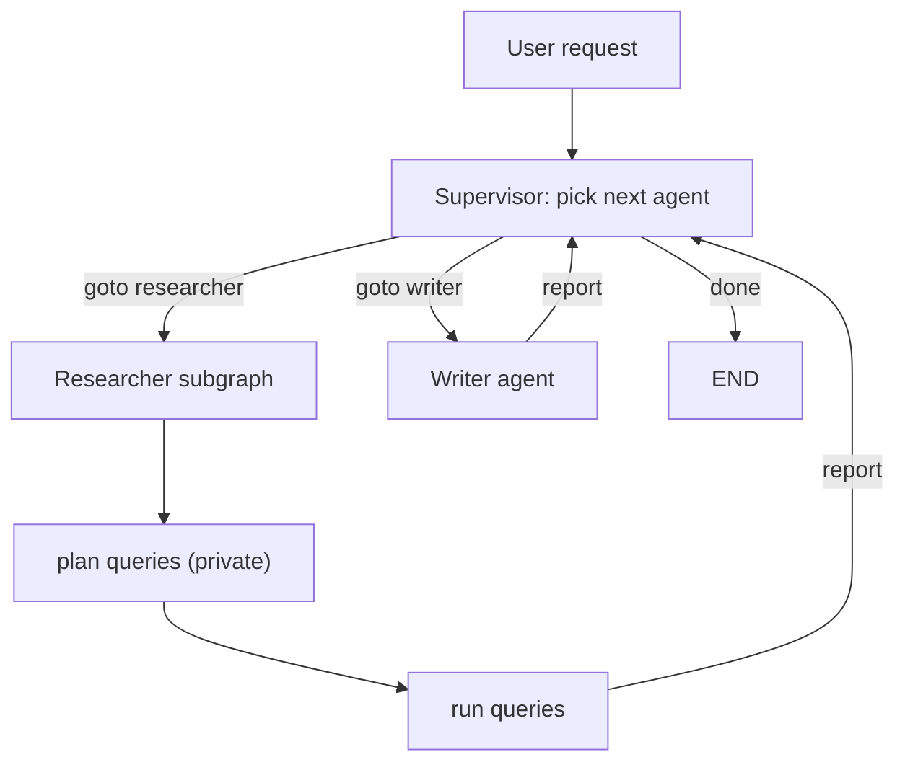

## TL;DR
LangGraph builds multi-agent systems from three pieces: a supervisor that routes to workers, handoffs
where an agent passes control with `Command`, and subgraphs that package an agent as a node. Use them only
when one agent with good tools measurably fails.

## For agent builders
- **Why it matters for agents.** Splitting work across agents can isolate context, tools and prompts per
  role, but every hop costs tokens and latency and adds a routing decision that can go wrong.
- **Where it shows up in your stack.** Hand-written supervisor graphs, `Command(goto=..., graph=
  Command.PARENT)` handoff tools, compiled graphs added as nodes, and the `langgraph-supervisor` and
  `langgraph-swarm` helper packages.
- **What you control.** Who decides the next agent, what history each agent sees, which tools each one
  holds, and the global step and cost budget.
- **What you can skip.** Agent "personalities". Roles matter only through the tools, context and
  instructions each agent gets.

## Why it exists
- **One agent with 40 tools picks the wrong one.** Tool-selection accuracy drops as the tool list and
  prompt grow; splitting tools across focused agents keeps each prompt short.
- **Context pollution.** A research agent's 30 search results do not belong in the writer's context;
  separate agents (or subgraphs with private state) keep transcripts small.
- **Team boundaries.** Billing and logistics teams can own their agents as separate graphs with their own
  tests, composed by a router.
- **The naive version fails quietly.** Free-form agents chatting with each other loop, repeat work and
  multiply tokens. Explicit routing and budgets keep the system debuggable.

## How it works
### Pattern 1: supervisor
- **One router, many workers.** The supervisor node (an LLM with structured output, or tool calls named
  `transfer_to_<agent>`) picks the next worker; each worker reports back to the supervisor.
- **Strengths:** central control, easy budgets and logging. **Cost:** an extra model call per hop, and the
  supervisor's context grows with every report.
- **Prebuilt:** `create_supervisor([agents], model=..., prompt=...)` from `langgraph-supervisor` builds
  it from `create_agent` workers. The LangChain docs also show "subagents as tools", where the main agent
  calls each worker through a tool; check current docs for the recommended form.

### Pattern 2: handoffs (swarm-style)
- **Agents pass control directly.** A tool returns `Command(goto="billing", graph=Command.PARENT,
  update=...)`, so the parent graph jumps to another agent node.
- **Include the history you hand over.** The handoff must carry the AI message with the tool call and a
  matching `ToolMessage`; providers reject a tool result without its call.
- **Prebuilt:** `create_swarm([agents], default_active_agent=...)` with `create_handoff_tool(
  agent_name=...)` from `langgraph-swarm`, which also remembers the active agent per thread.
- **Strengths:** no extra router call per turn. **Cost:** routing logic is spread across agents.

### Pattern 3: subgraphs
- **A compiled graph is a node.** `parent.add_node("researcher", research_graph)` runs it when routed to.
- **Shared keys flow automatically.** Keys with the same name (usually `messages`) pass between parent
  and child; keys only in the child schema stay private.
- **Different schemas?** Call the subgraph inside a wrapper node that maps parent state in and out.
- **Persistence:** give the checkpointer to the parent; subgraphs inherit it. Interrupts inside a
  subgraph surface to the parent caller.

### Choosing
| Situation | Pattern |
|---|---|
| Tasks need planning and several specialists in sequence | supervisor |
| Conversation moves between departments (triage, billing, tech) | handoffs |
| A team owns a self-contained capability with private state | subgraph |
| Specialists only answer narrow questions for a main agent | subagents as tools |

## Diagram
A supervisor routes to two workers; the researcher is a subgraph with private steps, and every worker
reports back before the supervisor decides again or ends.



## Examples
### Supervisor with a subgraph worker (runs offline)
Deterministic stand-ins replace the model decisions so the routing is visible; `subgraphs=True` shows
which graph emitted each update.

```python
# pip install langgraph ; deterministic stand-ins for model calls
from typing import Annotated, Literal, TypedDict
from langgraph.graph.message import add_messages
from langgraph.graph import StateGraph, MessagesState, START, END
from langgraph.types import Command

# --- a worker built as its own graph (a subgraph) with private state ---
class ResearchState(TypedDict, total=False):
    messages: Annotated[list, add_messages]   # same key and reducer as the parent
    queries: list[str]          # private to the subgraph: never reaches the parent

def plan_queries(s: ResearchState) -> dict:
    return {"queries": ["eu vat rules 2025", "vat digital services"]}

def run_queries(s: ResearchState) -> dict:
    notes = f"research: found {len(s['queries'])} sources on EU VAT"
    return {"messages": [("ai", notes)]}

r = StateGraph(ResearchState)
r.add_node("plan_queries", plan_queries); r.add_node("run_queries", run_queries)
r.add_edge(START, "plan_queries"); r.add_edge("plan_queries", "run_queries"); r.add_edge("run_queries", END)
researcher = r.compile()

# --- supervisor: decides the next worker and routes with Command ---
def supervisor(s: MessagesState) -> Command[Literal["researcher", "writer", "__end__"]]:
    said = " ".join(m.content for m in s["messages"] if m.type == "ai")
    if "research:" not in said:
        return Command(goto="researcher")            # an LLM with structured output picks this in practice
    if "draft:" not in said:
        return Command(goto="writer")
    return Command(goto=END)

def writer(s: MessagesState) -> Command[Literal["supervisor"]]:
    return Command(goto="supervisor", update={"messages": [("ai", "draft: VAT applies at the buyer's rate.")]})

g = StateGraph(MessagesState)
g.add_node("supervisor", supervisor)
g.add_node("researcher", researcher)                  # compiled graph as a node: shares 'messages'
g.add_node("writer", writer)
g.add_edge(START, "supervisor")
g.add_edge("researcher", "supervisor")                # workers always report back
app = g.compile()

for update in app.stream({"messages": [("user", "Write a note on EU VAT for SaaS")]},
                         stream_mode="updates", subgraphs=True):
    print(update[0] or "root", list(update[1]))         # namespace shows which graph emitted it
```

- **Output order:** `supervisor`, then `plan_queries` and `run_queries` under a `researcher:<id>`
  namespace, then `researcher`, `supervisor`, `writer`, `supervisor`.
- **`queries` never appears** in the parent's state: it is private to the subgraph schema.

### A handoff tool between two agents
Triage hands the conversation to billing with `Command.PARENT`. Scripted models make it run offline;
`InjectedState` passes the full history so the tool call and its result travel together.

```python
from typing import Annotated
from langchain_core.tools import tool, InjectedToolCallId
from langchain_core.messages import AIMessage, ToolMessage
from langchain_core.language_models.fake_chat_models import GenericFakeChatModel
from langchain.agents import create_agent
from langgraph.graph import StateGraph, MessagesState, START
from langgraph.types import Command
from langgraph.prebuilt import InjectedState

class ScriptedModel(GenericFakeChatModel):
    def bind_tools(self, tools, **kwargs):
        return self

@tool
def transfer_to_billing(reason: str, state: Annotated[dict, InjectedState],
                        tool_call_id: Annotated[str, InjectedToolCallId]) -> Command:
    """Hand the conversation to the billing agent. Give a one-line reason."""
    msg = ToolMessage(f"Transferred to billing: {reason}", tool_call_id=tool_call_id)
    return Command(goto="billing", graph=Command.PARENT, update={"messages": state["messages"] + [msg]})

triage = create_agent(ScriptedModel(messages=iter([AIMessage("", tool_calls=[
    {"name": "transfer_to_billing", "args": {"reason": "double charge"}, "id": "h1"}])])),
    tools=[transfer_to_billing], name="triage")
billing = create_agent(ScriptedModel(messages=iter([AIMessage("I've refunded the duplicate charge.")])),
                       tools=[], name="billing")

g = StateGraph(MessagesState)
g.add_node("triage", triage, destinations=("billing",))   # declares the handoff edge for rendering
g.add_node("billing", billing)
g.add_edge(START, "triage")
app = g.compile()
out = app.invoke({"messages": [("user", "I was charged twice")]})
print([(m.type, m.content[:40]) for m in out["messages"]])
# [('human', ...), ('ai', ''), ('tool', 'Transferred to billing: double charge'), ('ai', "I've refunded...")]
```

### Worked scenario: collapsing a three-agent crew
A team ran planner, researcher and writer agents for market briefs (illustrative numbers from an eval of
50 briefs).

| Setup | Model calls per brief | Tokens per brief | Eval pass rate |
|---|---|---|---|
| Supervisor plus 3 workers, full history to each | ~14 | ~95k | 82% |
| Supervisor plus 3 workers, workers see only their task | ~14 | ~40k | 84% |
| One agent with the same tools | ~8 | ~30k | 78% |

They kept the supervisor but scoped each worker's context, because the single agent lost 6 points on
briefs needing many searches.

## Production patterns
- **Start single, split on evidence.** Ship one agent first; split into roles only when an eval shows
  tool-selection or context errors, and keep the eval to prove the split helped.
- **Scope context per worker.** Pass a worker its task and the minimum history (subgraph with its own
  schema, or `output_mode="last_message"` in `create_supervisor`), so tokens do not grow with every hop.
  Monitor tokens per agent per run.
- **One budget for the whole system.** Set `recursion_limit` on the parent run and count handoffs in state,
  so agents cannot ping-pong forever. Alert on runs near the limit.
- **Name every agent in traces.** Give each agent a `name` and stream with `subgraphs=True`, so LangSmith
  traces and UI events show which agent spent which tokens.
- **Persist at the parent.** Compile only the parent with a checkpointer; subgraphs inherit it, and
  interrupts in a worker surface to the parent for approval UIs.

## Trade-offs
- **Specialization vs coordination cost.** Focused agents pick tools better, but every supervisor hop is
  an extra model call. Flips when tasks are short and need one or two tools.
- **Supervisor vs handoffs.** Central routing is easy to budget and audit; handoffs save router calls but
  spread routing across agents and make loops harder to spot.
- **Shared history vs private state.** Shared `messages` lets agents build on each other, but floods each
  context. Private subgraph state saves tokens at the risk of losing needed facts.
- **Prebuilt helpers vs hand-written graphs.** `create_supervisor` and `create_swarm` get you running
  quickly; hand-written graphs are easier to customize and debug.

## Pitfalls
- **Multi-agent by default.** Symptom: triple the tokens with no quality gain. Fix: compare against one
  agent with the same tools on your eval before splitting.
- **Handoffs without the tool-call message.** Symptom: provider errors about a tool result without a
  matching call. Fix: pass the AI message and its `ToolMessage` together in the handoff update.
- **Agents ping-ponging.** Symptom: runs hit the recursion limit with alternating handoffs. Fix: a handoff
  counter in state, clear handoff rules in prompts, and a fallback to a human.
- **Supervisor context bloat.** Symptom: later routing decisions get slower and worse. Fix: workers return
  short summaries, not full transcripts.

## When to use
- **Use when** distinct roles need different tools or instructions, tasks need planning across
  specialists, or teams must own separate agents.
- **Avoid when** one agent with fewer than about ten well-described tools passes your eval.
- **Measure:** pass rate versus a single-agent baseline, model calls and tokens per agent, handoffs per
  run and recursion-limit hits.
- **Interviews:** compare supervisor, handoffs and subgraphs and argue when not to go multi-agent.

## Role lens
- **Engineer:** Implements supervisors and handoff tools with `Command`, scopes worker state with
  subgraphs, and traces tokens per agent.
- **Architect:** Decides whether the system needs multiple agents at all, which pattern fits, and how
  context, budgets and ownership are split across teams.
- **FDE:** Maps a customer's departments to agents only where tools and data really differ, and shows
  the single-agent baseline before proposing a multi-agent design.

## Check yourself
**Q:** A customer-service system has a triage agent that hands off to billing or tech agents. Users report
that after a handoff the billing agent sometimes errors, and some conversations bounce between billing and
tech for 20 turns. What is likely wrong and what do you change?
**A:** The errors suggest the handoff update carries a `ToolMessage` without the AI message that made the
tool call, which providers reject; the handoff tool should pass the full history or at least both
messages. The bouncing means no agent owns the decision to stop: add a handoff counter in state and route
to a human after a small number of transfers, tighten each agent's handoff instructions, and set a
`recursion_limit` on the parent run. Then trace with agent names to confirm which handoff rule fires, and
compare against a single agent holding both tool sets.

## Interview questions
### Compare the supervisor and handoff patterns in LangGraph.
- **Supervisor:** one router picks the next worker and workers report back; central control and easy
  budgets, but an extra model call per hop.
- **Handoffs:** agents transfer control directly via `Command(goto=..., graph=Command.PARENT)`; fewer
  calls, but routing logic is distributed and loops are harder to see.

### How do subgraphs share state with the parent graph?
- **Same-named keys** in both schemas (usually `messages`) flow in and out automatically, using the
  parent's reducer on return.
- **Child-only keys stay private,** which keeps scratch work out of the parent.
- **Different schemas** need a wrapper node that maps state in and out before and after invoking the
  subgraph.

### When would you not build a multi-agent system?
- **When one agent passes the eval.** A single agent with fewer than about ten clear tools is cheaper,
  faster and easier to debug.
- **When roles share all tools and context,** splitting only adds hops; better tool descriptions or
  retrieval over tools usually fix selection errors.

### A multi-agent research system costs 3x the single-agent version. How do you cut it?
- **Measure tokens per agent** in traces to find who re-reads what.
- **Scope context:** workers get the task and a summary, return a short result, not the transcript.
- **Remove hops:** merge roles that always run together, and use a cheaper model for routing.

### How do you handle human approval inside a worker subgraph?
- **Call `interrupt()` in the worker node;** it surfaces to the parent caller with the payload.
- **Compile the parent with a durable checkpointer;** subgraphs inherit it, so the pause survives
  restarts.
- **Resume the parent thread** with `Command(resume=...)`; the worker node re-runs from its top.

## Quiz
### Q: What does `graph=Command.PARENT` do in a handoff tool's returned Command?
- [ ] Ends the whole multi-agent run
- [x] Applies the goto and update in the parent graph, so control jumps to a sibling agent node
- [ ] Restarts the current agent from its first node
- [ ] Sends the message to the supervisor's system prompt
> A tool runs inside an agent's own graph. `Command.PARENT` tells LangGraph to route in the enclosing
> graph, which is how one agent node hands control to another.

### Q: In a subgraph added as a node, what happens to a key that exists only in the subgraph's state schema?
- [ ] It is copied into the parent state after the subgraph finishes
- [x] It stays private to the subgraph and does not appear in the parent state
- [ ] It raises a schema validation error at compile time
- [ ] It overwrites the parent's messages key
> Only keys shared by name pass between parent and child. Private keys let a worker keep scratch state,
> such as search queries, out of the parent's context.

### Q: What is the strongest reason to split one agent into several in LangGraph?
- [ ] Multi-agent systems are always more accurate
- [ ] It removes the need for a recursion limit
- [x] An eval shows one agent failing because of too many tools or polluted context that focused agents fix
- [ ] Each agent can use a different system font in the UI
> Splitting adds hops, tokens and routing risk, so it is justified by measured failures of a single
> agent, typically tool-selection errors or context overload.

## Use cases & projects
### Use cases
- **Customer support with departments.** Triage hands off to billing, logistics or tech agents, each
  holding only its own tools.
- **Research and report pipelines.** A supervisor sends a researcher subgraph to gather sources and a
  writer to draft, with private scratch state.
- **Team-owned capabilities.** A platform team composes graphs owned by other teams as subgraphs behind
  one entry point.
- **Coding agents with reviewers.** A coder agent proposes a patch and a reviewer agent with test tools
  approves or sends it back, under a handoff budget.

### Mini project
**Supervisor versus single agent (2-3 hours).**
- **Goal:** find out whether a multi-agent design actually beats one agent on your task.
- **Steps:** build a single `create_agent` with search and calculator tools; build a supervisor with a
  researcher subgraph and an analyst agent using the same tools; write 15 eval questions; run both with
  tracing on; record pass rate, model calls, tokens and handoffs per question.
- **Done when:** you have a comparison table for both designs, a recursion limit and handoff counter in
  the multi-agent version, and a written decision on which to ship and why.
