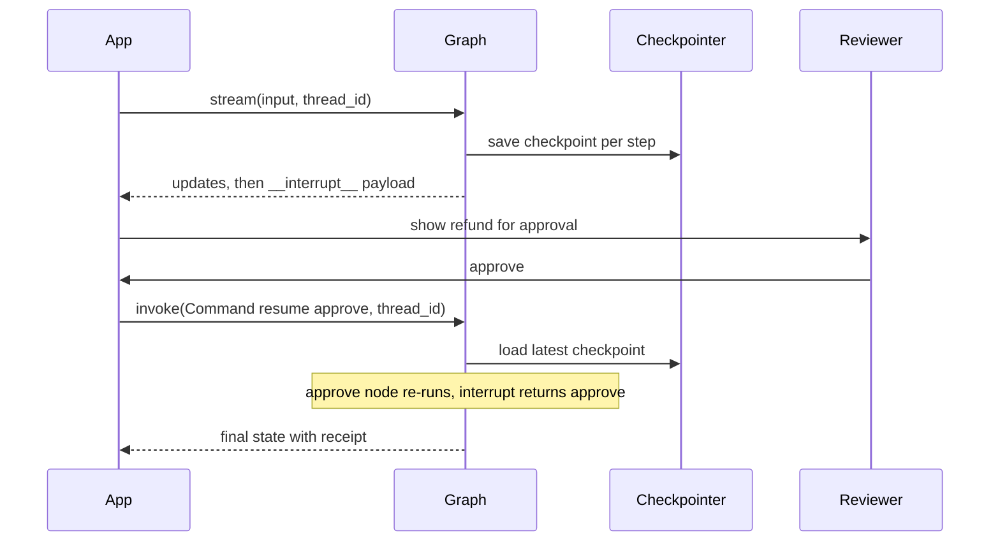

## TL;DR
A LangGraph checkpointer saves state after every superstep under a `thread_id`, which gives memory,
crash recovery, time travel and `interrupt()` pauses for human approval. Streaming modes expose state
updates, LLM tokens and custom progress events while the run is in flight.

## For agent builders
- **Why it matters for agents.** Real agents wait on people, crash mid-run and need to show progress.
  Checkpoints turn those into resumable runs instead of lost work.
- **Where it shows up in your stack.** `compile(checkpointer=...)` with `InMemorySaver`, `SqliteSaver` or
  `PostgresSaver`; `interrupt()` and `Command(resume=...)`; `stream(..., stream_mode=...)` behind your
  SSE or WebSocket endpoint.
- **What you control.** The thread id scheme, the checkpoint store and its retention, which nodes pause,
  what payload a reviewer sees, and which stream modes reach the UI.
- **What you can skip.** Checkpoint serialization internals. Know that state must be serializable and
  that the node with the interrupt re-runs from its top on resume.

## Why it exists
- **Approvals take hours, processes do not wait.** A refund agent cannot hold a Python frame open until a
  manager clicks approve; the run must be saved and resumed, possibly on another worker.
- **Long runs crash.** A 40-step research agent that dies at step 35 should resume at step 35, not
  re-spend every token. Checkpoints after each superstep make that the default.
- **Conversations are threads.** Multi-turn memory is just "load the last checkpoint for this
  `thread_id`", so the same mechanism powers chat history.
- **Users abandon silent agents.** Streaming steps and tokens gives feedback within a second instead of a
  spinner for 30 seconds.
- **Debugging needs history.** Replaying from an earlier checkpoint, or forking with edited state, turns
  "why did it do that" into a reproducible experiment.

## How it works
### Checkpointers and threads
- **A checkpoint is a snapshot of state** plus metadata and the next nodes to run, written after every
  superstep.
- **A thread is a sequence of checkpoints** keyed by `config["configurable"]["thread_id"]`. Same id
  continues the conversation; a new id starts fresh.
- **Stores by environment:**

| Saver | Package | Use for |
|---|---|---|
| `InMemorySaver` | `langgraph` | tests and notebooks; lost on restart |
| `SqliteSaver` | `langgraph-checkpoint-sqlite` | local tools, single-process apps |
| `PostgresSaver` | `langgraph-checkpoint-postgres` | production, many workers; call `setup()` once |

- **Pending writes.** If one node in a superstep fails, writes from the nodes that succeeded are kept, so
  a resume does not re-run them.
- **Durability modes.** The `durability` argument to `invoke` or `stream` takes `"exit"`, `"async"` (the
  default in current releases) or `"sync"`, trading write latency against how much can be lost on a crash.

### Reading and editing history
- **`get_state(cfg)`** returns a `StateSnapshot`: `values`, `next`, `tasks` (with any interrupts) and
  `config` with the checkpoint id.
- **`get_state_history(cfg)`** lists checkpoints newest first.
- **`update_state(cfg, values)`** writes a new checkpoint as if a node produced it; called on an old
  checkpoint's config, it forks the thread.
- **`invoke(None, cfg)`** continues from the checkpoint in `cfg`: replay or resume.

### Interrupts (human-in-the-loop)
1. **A node calls `interrupt(payload)`.** The run stops, the payload is saved with the checkpoint, and the
   stream yields an `__interrupt__` update.
2. **Your app shows the payload** to a reviewer: approve, edit arguments, or reject.
3. **Resume with `invoke(Command(resume=value), cfg)`.** The interrupted node **re-runs from its first
   line**, and this time `interrupt()` returns `value`.
4. **Consequence:** code before `interrupt()` in that node runs twice. Keep side effects in a later node,
   or make them idempotent.
- **Static breakpoints** (`interrupt_before=["tools"]` at compile or run time) pause before a node without
  code changes; useful for debugging, less so for product approvals.

### Long-term memory: the store
- **Checkpoints are per thread.** Facts that should outlive a thread (user preferences) go in a store:
  `compile(store=InMemoryStore())`, with `put(namespace, key, value)`, `get` and `search`.
- **Production stores** are Postgres-backed and can add semantic search; see the agent-memory lessons.

### Streaming
| `stream_mode` | Yields | Typical consumer |
|---|---|---|
| `"values"` | full state after each step | debugging, simple UIs |
| `"updates"` | each node's returned update | step-by-step progress |
| `"messages"` | `(token_chunk, metadata)` from model calls | typing effect in chat |
| `"custom"` | anything a node sends via `get_stream_writer()` | tool progress bars |
| `"debug"` | detailed events | development only |

- **Combine modes** with a list: `stream_mode=["updates", "custom"]` yields `(mode, chunk)` pairs.
- **`subgraphs=True`** adds a namespace so you can tell which subgraph emitted an event.
- **`metadata["langgraph_node"]`** on message chunks tells you which node produced a token, so you can
  stream only the final answer node.

## Diagram
One approval round trip: the first call stops at the interrupt and saves a checkpoint, and a later call
from any worker resumes the same thread.



## Examples
### Refund approval that survives a restart
Runs locally with SQLite; the second `invoke` could happen hours later in another process pointing at the
same database.

```python
# pip install langgraph langgraph-checkpoint-sqlite
import sqlite3
from typing import TypedDict
from langgraph.graph import StateGraph, START, END
from langgraph.checkpoint.sqlite import SqliteSaver
from langgraph.config import get_stream_writer
from langgraph.types import interrupt, Command

class Refund(TypedDict, total=False):
    order_id: str
    amount: float
    decision: str
    receipt: str

def propose(state: Refund) -> dict:
    get_stream_writer()({"progress": "looked up order"})      # 'custom' stream event
    return {"amount": 120.0}                                 # a model + tool call in practice

def approve(state: Refund) -> dict:
    if state["amount"] < 50:
        return {"decision": "auto-approved"}
    answer = interrupt({"question": f"Refund {state['amount']} for {state['order_id']}?"})
    return {"decision": answer}                              # node re-runs from the top on resume

def execute(state: Refund) -> dict:                          # side effect lives AFTER the approval
    if state["decision"] != "approve":
        return {"receipt": "cancelled"}
    return {"receipt": f"refund-{state['order_id']}"}        # pass an idempotency key to the payment API

g = StateGraph(Refund)
g.add_node("propose", propose); g.add_node("approve", approve); g.add_node("execute", execute)
g.add_edge(START, "propose"); g.add_edge("propose", "approve")
g.add_edge("approve", "execute"); g.add_edge("execute", END)

conn = sqlite3.connect("checkpoints.db", check_same_thread=False)
app = g.compile(checkpointer=SqliteSaver(conn))              # PostgresSaver in production
cfg = {"configurable": {"thread_id": "refund-A1001"}}

for mode, chunk in app.stream({"order_id": "A1001"}, cfg, stream_mode=["updates", "custom"]):
    print(mode, chunk)                                       # last update carries '__interrupt__'

snap = app.get_state(cfg)
print("paused at:", snap.next, "| payload:", snap.tasks[0].interrupts[0].value)

# ...hours later, any process with the same DB and thread_id:
print(app.invoke(Command(resume="approve"), cfg)["receipt"])
print("checkpoints:", len(list(app.get_state_history(cfg))))
```

- **Output:** a `custom` progress event, the `propose` update, an `__interrupt__` update, then
  `paused at: ('approve',)`, the receipt `refund-A1001`, and `checkpoints: 5` after the resume.

### Time travel: replay and fork a run
Find the checkpoint before a bad step, edit state, and continue from there. The thread head moves to the
fork, and the original history stays available.

```python
from typing import TypedDict
from langgraph.graph import StateGraph, START, END
from langgraph.checkpoint.memory import InMemorySaver

class S(TypedDict, total=False):
    query: str
    plan: str
    answer: str

def plan(s: S) -> dict:   return {"plan": f"search for {s['query']}"}
def act(s: S) -> dict:    return {"answer": f"result of '{s['plan']}'"}

g = StateGraph(S)
g.add_node("plan", plan); g.add_node("act", act)
g.add_edge(START, "plan"); g.add_edge("plan", "act"); g.add_edge("act", END)
app = g.compile(checkpointer=InMemorySaver())
cfg = {"configurable": {"thread_id": "t1"}}
app.invoke({"query": "q3 revenue"}, cfg)

history = list(app.get_state_history(cfg))            # newest first
before_act = next(h for h in history if h.next == ("act",))
print("replay from:", before_act.config["configurable"]["checkpoint_id"][:8], before_act.values["plan"])

fork = app.update_state(before_act.config, {"plan": "search finance DB for q3 revenue"})  # new branch
print(app.invoke(None, fork)["answer"])              # None = continue from that checkpoint
print(app.get_state(cfg).values["answer"])           # thread head is now the fork
```

### Worked scenario: duplicate emails after adding approval
| Observation | Cause | Fix |
|---|---|---|
| Customers get 2 "refund pending" emails | email sent in `approve` before `interrupt()` | move the email to its own node before `approve` |
| Retried resumes double-refund | payment call not idempotent | idempotency key = thread id + order id |
| Paused runs vanish after deploy | `InMemorySaver` in production | `PostgresSaver` with `setup()` at startup |
| UI shows nothing for 20 s | `invoke` instead of `stream` | stream `updates` and `messages` over SSE |

## Production patterns
- **Postgres checkpointer with a retention job.** Use `PostgresSaver` (or the async variant), run
  `setup()` in a migration step, and delete or archive checkpoints of closed threads on a schedule.
  Monitor checkpoint table size and write latency per step.
- **Deterministic thread ids.** Derive `thread_id` from the business object (`refund-{order_id}`,
  `chat-{user}-{session}`) so a retry or webhook resumes the same run instead of starting a duplicate.
- **Interrupt payloads as a contract.** Send a typed payload (action, arguments, risk, deadline) to an
  approvals queue, and resume with a typed decision (approve, edit with new args, reject). Alert on
  approvals pending past their SLA.
- **Side effects after the pause, with idempotency keys.** Put tool calls with external effects in a node
  after the approval, keyed by thread and action id, so re-runs and retries cannot double-execute.
- **Stream over SSE with filtered modes.** Forward `updates` for step progress, `messages` filtered by
  `langgraph_node` for tokens, and `custom` for tool progress; drop `values` to keep payloads small.
- **Encrypt sensitive state.** Checkpoints store full state, including PII and tool results; restrict
  database access and use an encrypted serializer (`EncryptedSerializer`) if policy requires it.

## Trade-offs
- **Durability vs latency.** Writing a checkpoint every superstep adds a database round trip per step;
  `"sync"` is safest, `"exit"` is fastest but loses intermediate progress on a crash.
- **Full state snapshots vs storage.** Time travel and pending writes need history, but long agents with
  big tool outputs fill tables fast. Store large artifacts by reference and prune old threads.
- **Dynamic `interrupt()` vs static breakpoints.** Dynamic interrupts carry a payload and fire on
  conditions; static `interrupt_before` needs no code but pauses every time.
- **Rich streaming vs client complexity.** More modes give better UX, but clients must handle
  interleaved event types and reconnection.

## Pitfalls
- **Side effects before `interrupt()`.** Symptom: duplicate emails, tickets or charges after approval.
  Fix: the node re-runs on resume, so move effects after the pause or make them idempotent.
- **Missing `thread_id`.** Symptom: an error that a checkpointer requires a thread id, or every message
  starting a new conversation. Fix: always pass `{"configurable": {"thread_id": ...}}`.
- **`InMemorySaver` in production.** Symptom: paused approvals and chat history disappear on deploy or
  scale-out. Fix: a shared Postgres checkpointer for every replica.
- **Unserializable state.** Symptom: checkpoint write errors when state holds clients, file handles or
  sockets. Fix: keep only data in state and inject clients through config or context.
- **Several interrupts resumed with one value.** Symptom: parallel branches paused together resume
  wrongly. Fix: resume with a mapping of interrupt ids to values; check current docs for the format.

## When to use
- **Use when** runs pause for people, last longer than a request, must survive crashes, or need
  multi-turn memory and visible progress.
- **Avoid when** the agent is a short stateless call; a checkpointer only adds writes and storage.
- **Measure:** checkpoint write latency, table growth, time paused per approval, resume success rate and
  time to first streamed token.
- **Interviews:** explain why the interrupted node re-runs and how you prevent duplicate side effects.

## Role lens
- **Engineer:** Wires a Postgres checkpointer, puts `interrupt()` before consequential tools, moves side
  effects after approvals with idempotency keys, and streams updates and tokens to the UI.
- **Architect:** Chooses the checkpoint store, thread id scheme, retention and encryption policy, and
  defines the approval payload contract shared with the review UI.
- **FDE:** Maps a customer's approval chain (who approves what, within what SLA) onto interrupt points and
  shows them a run paused, edited and resumed live.

## Check yourself
**Q:** An agent drafts a contract change, sends a Slack notification, then calls `interrupt()` for legal
approval. After approval, the Slack message is sent a second time. Why, and how do you fix it? What else
must be true for the approval to survive a deploy?
**A:** On resume LangGraph does not restore a Python frame; it re-runs the interrupted node from its first
line, and `interrupt()` returns the resume value only on that second pass. Everything before it, including
the Slack call, runs again. Move the notification into its own node that runs before the approval node, or
make it idempotent with a key derived from the thread and action. To survive a deploy, compile with a
shared durable checkpointer such as `PostgresSaver`, not `InMemorySaver`, and resume with the same
`thread_id` using `Command(resume=...)` from whichever worker handles the approval callback.

## Interview questions
### What does a LangGraph checkpointer store, and what does it enable?
- **State after every superstep** under a thread id, plus metadata, next nodes, pending writes and any
  interrupts.
- **Enables** multi-turn memory, resume after crashes, human-in-the-loop pauses, and time travel for
  debugging and forking.

### Design an approval step for an agent that can issue refunds.
- **Interrupt before the refund tool** with a typed payload: amount, order, reason, model rationale.
- **Resume with a typed decision** (approve, edit amount, reject) via `Command(resume=...)` on the same
  thread.
- **Execute in a separate node** with an idempotency key; durable Postgres checkpointer; alert on stale
  approvals.

### How would you stream an agent's progress to a web UI?
- **Use `stream` with several modes:** `updates` for steps, `messages` for tokens, `custom` for tool
  progress from `get_stream_writer()`.
- **Forward over SSE,** filtering tokens by `langgraph_node` so only the answer node types into the chat,
  and send the `thread_id` and latest checkpoint id so a reconnecting client can call `get_state` and
  catch up.

### When would you fork a thread with `update_state`?
- **Debugging and what-if.** Rewind to the checkpoint before a bad tool call, correct the state, and
  continue to see whether the rest of the run recovers.
- **Human correction.** A reviewer edits a draft or plan in state and the agent continues from there.
- **Caveat:** forks create new history; keep the original for audit.

### Your checkpoint table grew to hundreds of GB in a month. What do you do?
- **Measure first:** rows per thread and bytes per checkpoint; large tool outputs in state are the usual
  culprit.
- **Then reduce:** store big artifacts by reference, prune or archive checkpoints of closed threads, and
  keep only the latest checkpoint for threads that do not need time travel.

## Quiz
### Q: What happens to code that runs before `interrupt()` in a node when the run is resumed?
- [ ] It is skipped because the frame is restored after the interrupt
- [x] It runs again, because the whole node re-executes from the top on resume
- [ ] It runs only if the resume value is falsy
- [ ] It is moved to a separate node automatically
> LangGraph resumes by re-running the interrupted node; `interrupt()` then returns the resume value.
> Side effects before it repeat unless moved to another node or made idempotent.

### Q: Which checkpointer setup lets an approval paused on one server be resumed by another after a deploy?
- [ ] `InMemorySaver` on each server
- [ ] No checkpointer, passing the state in the resume request
- [x] A shared `PostgresSaver` with the same `thread_id` used on resume
- [ ] `interrupt_before` without a checkpointer
> Only a shared durable store keeps the checkpoint across processes. In-memory savers lose it on
> restart, and interrupts require a checkpointer to save the paused state.

### Q: Which stream mode gives token-by-token output from model calls inside the graph?
- [ ] `"values"`
- [ ] `"updates"`
- [x] `"messages"`
- [ ] `"debug"`
> `"messages"` yields message chunks with metadata such as the producing node, while `"values"` and
> `"updates"` yield state after each step and `"debug"` yields detailed execution events.

## Use cases & projects
### Use cases
- **Approval gates.** Refunds, account changes, outbound emails and code merges pause for a human and
  resume on the same thread.
- **Long research and coding agents.** Checkpoints let a 50-step run resume after a worker crash without
  re-spending tokens.
- **Chat assistants with memory.** One thread per conversation; a store holds cross-thread preferences.
- **Live progress UIs.** `updates`, `messages` and `custom` streams drive step lists, typing effects and
  tool progress bars.

### Mini project
**Durable approval agent with a streaming UI (2-3 hours).**
- **Goal:** an agent that proposes an action, pauses for approval, survives a restart and streams progress.
- **Steps:** build a three-node graph (propose, approve with `interrupt()`, execute); compile with
  `SqliteSaver` or `PostgresSaver`; expose `/start` and `/resume` endpoints that stream `updates` and
  `custom` events over SSE; kill the server while paused, restart it and resume by `thread_id`; add an
  idempotency key to execute.
- **Done when:** a paused run resumes after a restart, the side effect runs exactly once across three
  resume retries, and the browser shows step progress as it happens.
