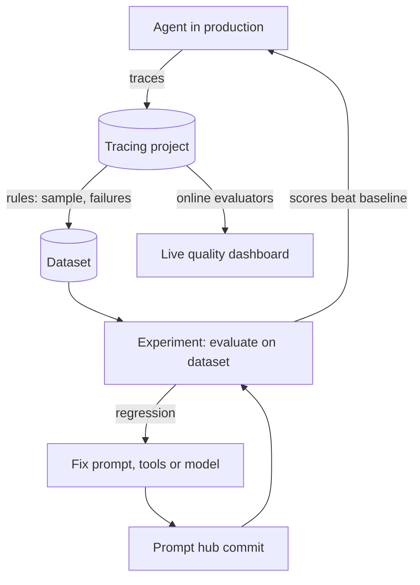

## TL;DR
LangSmith traces every model call, tool call and graph step of an agent, turns real traces into
datasets, scores runs with code, LLM-judge and trajectory evaluators, and versions prompts in a hub. It is
how LangChain and LangGraph teams debug and regression-test agents.

## For agent builders
- **Why it matters for agents.** Agent failures hide in the middle: a wrong tool, a bad argument, a loop.
  A trace tree per run and trajectory evals are how you see and catch them.
- **Where it shows up in your stack.** Environment variables turn on tracing for LangChain and LangGraph;
  `@traceable` covers your own code; `evaluate()` runs experiments; `push_prompt` and `pull_prompt`
  manage prompts.
- **What you control.** What gets traced (sampling, hidden inputs), how runs are tagged and grouped into
  threads, which evaluators gate a release, and which prompt version production pulls.
- **What you can skip.** Re-learning tracing basics; the observability LangSmith lesson covers runs,
  transport and feedback. This lesson is the agent workflow on top.

## Why it exists
- **Final-answer checks miss agent bugs.** An agent can reach a right answer by a wrong path (refunding
  before checking delivery) or a wrong answer by a right path. You need step-level visibility and
  trajectory scoring.
- **Agent quality regresses silently.** A prompt tweak, a model swap or a framework upgrade changes tool
  choices. Without a dataset and experiments, you find out from customers.
- **Production traces are the best test cases.** Failures in real traffic should become dataset examples
  in one click, not a manual copy job.
- **Prompts change faster than code.** Teams want to edit, compare and roll back the system prompt without
  redeploying, while keeping each version traceable to the runs it produced.

## How it works
### Tracing an agent
- **Turn it on with env vars:** `LANGSMITH_TRACING=true`, `LANGSMITH_API_KEY`, and `LANGSMITH_PROJECT`
  to pick the project. LangChain and LangGraph runs are traced with no code change.
- **The trace tree mirrors the graph.** One root run per invocation; child runs per node, model call
  (with tokens and cost) and tool call (with arguments and result).
- **Your own code:** decorate functions with `@traceable(run_type="tool")` or wrap provider clients
  (`wrap_openai`), so non-LangChain steps join the same tree.
- **Threads.** Runs that share a `thread_id` or `session_id` metadata key appear as one conversation;
  LangGraph's `thread_id` makes this natural.
- **Tags and metadata.** Pass `config={"tags": [...], "metadata": {...}}` (prompt version, tenant,
  model) so you can filter and compare later.

### Datasets
- **Examples are inputs plus reference outputs.** For agents, the reference often includes the expected
  tool sequence as well as the answer.
- **Sources:** hand-written golden cases, production traces added from the UI or by rules, and synthetic
  cases. Split them (for example `smoke`, `regression`, `hard`) so CI runs a fast subset.

### Evaluators for agents
| Level | Question | Typical evaluator |
|---|---|---|
| Final response | is the answer correct and grounded? | LLM judge (`openevals`) or exact match |
| Single step | did it pick the right tool with valid args? | code check on one model call |
| Trajectory | did it take an acceptable path? | `agentevals` trajectory match or trajectory judge |
| Cost and speed | tokens, latency, steps | summary evaluators from run stats |

- **Trajectory match modes** in `agentevals`: `strict`, `unordered`, `subset`, `superset`, with
  `tool_args_match_mode` to compare or ignore arguments.
- **`evaluate(target, data=..., evaluators=[...])`** runs the agent on every example, traces each run and
  records scores as feedback; `num_repetitions` reruns examples to measure variance and
  `max_concurrency` parallelizes.
- **Pairwise comparison** of two experiments and human review through annotation queues cover what
  automated scores miss.

### Online evaluation
- **Rules on a tracing project** run evaluators on a sample of production traces, add matching traces to
  a dataset, or send them to an annotation queue for humans.
- **User feedback** (thumbs up or down) is logged with `create_feedback` against the run id and appears
  next to automated scores.

### Prompt hub
- **`client.push_prompt("refund-agent-system", object=prompt)`** stores a new commit of a prompt template;
  commit tags (such as a production tag) mark which version is live.
- **`client.pull_prompt("refund-agent-system:<commit-or-tag>")`** loads a pinned version at startup;
  check the current docs for tag syntax and caching options.
- **Every run can record the prompt version** in metadata, so experiments compare prompt commits
  directly.

## Diagram
The loop teams run: production traces feed datasets, experiments gate changes, and online evaluators
watch live traffic for regressions.



## Examples
### Trajectory evaluators, offline
`agentevals` scores the tool path; this runs without a LangSmith account and is the same evaluator you
pass to `evaluate`.

```python
# pip install langsmith agentevals ; the evaluator part runs offline
from agentevals.trajectory.match import create_trajectory_match_evaluator

def tool_calls(*calls):                     # helper: OpenAI-style assistant message with tool calls
    return {"role": "assistant", "content": "", "tool_calls": [
        {"function": {"name": n, "arguments": a}} for n, a in calls]}

reference = [
    {"role": "user", "content": "Refund order A-1001"},
    tool_calls(("order_status", '{"order_id": "A-1001"}')),
    {"role": "tool", "content": "delivered"},
    tool_calls(("issue_refund", '{"order_id": "A-1001"}')),
    {"role": "tool", "content": "refund-77"},
    {"role": "assistant", "content": "Refunded, reference refund-77."},
]
skipped_check = [reference[0], reference[3], reference[4], reference[5]]   # refunded without looking up

strict = create_trajectory_match_evaluator(trajectory_match_mode="strict")
superset = create_trajectory_match_evaluator(trajectory_match_mode="superset", tool_args_match_mode="ignore")
print(strict(outputs=reference, reference_outputs=reference))       # score True
print(strict(outputs=skipped_check, reference_outputs=reference))   # score False: lookup missing
print(superset(outputs=reference, reference_outputs=skipped_check)) # extra calls allowed: True
```

### An experiment over a real agent
Needs LangSmith and OpenAI keys and a dataset named `refund-agent-golden` whose examples hold a
`question` input and reference `messages` and `answer` outputs.

```python
# pip install langsmith langchain langchain-openai agentevals openevals
# env: LANGSMITH_TRACING=true LANGSMITH_API_KEY=... LANGSMITH_PROJECT=refund-agent OPENAI_API_KEY=...
from langsmith import evaluate
from langchain.agents import create_agent
from langchain_core.tools import tool
from agentevals.trajectory.match import create_trajectory_match_evaluator
from openevals.llm import create_llm_as_judge
from openevals.prompts import CORRECTNESS_PROMPT

@tool
def order_status(order_id: str) -> str:
    """Delivery status for an order id."""
    return "delivered"

@tool
def issue_refund(order_id: str) -> str:
    """Refund a delivered order. Always check order_status first."""
    return "refund-77"

agent = create_agent("openai:gpt-4o-mini", tools=[order_status, issue_refund],
                     system_prompt="Refund agent. Verify delivery before refunding.")

def target(inputs: dict) -> dict:                      # one traced agent run per example
    result = agent.invoke({"messages": [{"role": "user", "content": inputs["question"]}]})
    return {"messages": result["messages"], "answer": result["messages"][-1].content}

match = create_trajectory_match_evaluator(trajectory_match_mode="superset", tool_args_match_mode="ignore")
judge = create_llm_as_judge(prompt=CORRECTNESS_PROMPT, model="openai:gpt-4o-mini", feedback_key="correct")

def tool_path(outputs: dict, reference_outputs: dict):  # did it call at least the reference tools?
    return match(outputs=outputs["messages"], reference_outputs=reference_outputs["messages"])

def correct(inputs: dict, outputs: dict, reference_outputs: dict):
    return judge(inputs=inputs["question"], outputs=outputs["answer"],
                 reference_outputs=reference_outputs["answer"])

if __name__ == "__main__":
    evaluate(target, data="refund-agent-golden", evaluators=[tool_path, correct],
             experiment_prefix="gpt-4o-mini-prompt-v3", max_concurrency=4, num_repetitions=3)
```

- **In the UI:** one experiment row per example and repetition, each linked to its full agent trace, with
  `trajectory_superset_match` and `correct` scores.
- **`num_repetitions=3`** shows how stable each score is; agents with temperature above zero vary.

### Worked scenario: a model swap that looked fine
Illustrative numbers from a refund agent's regression dataset.

| Metric on 120 examples | Old model | New model |
|---|---|---|
| Final answer correct (judge) | 91% | 92% |
| Trajectory superset match | 96% | 81% |
| Median tool calls per run | 3 | 2 |
| Cost per run | baseline | 40% lower |

- **The answer score hid the problem:** the new model often skipped `order_status` and refunded directly.
- **The decision:** keep the old model for refunds, add a guard node that requires the status check, and
  re-run the experiment before trying the new model again.

## Production patterns
- **Gate releases on experiments in CI.** Run `evaluate` on a smoke dataset for every prompt, model or
  framework change and fail the build if trajectory or correctness drops below the baseline experiment.
- **Turn failures into examples.** Add rules that send traces with negative user feedback, errors or long
  step counts to an annotation queue, and promote reviewed ones into the regression dataset weekly.
- **Sample and redact in production.** Set `LANGSMITH_TRACING_SAMPLING_RATE` (for example 0.1) for
  high-volume agents and `LANGSMITH_HIDE_INPUTS` or `LANGSMITH_HIDE_OUTPUTS` where data is sensitive;
  consider self-hosting for residency.
- **Tag every run with versions.** Put prompt commit, model and app version in metadata, so dashboards
  and experiments compare like with like and a regression points at one change.
- **Pin prompts by commit or tag.** Pull the production prompt by tag at startup, cache it, and keep a
  fallback copy in the repo so a hub outage cannot take the agent down.
- **Watch online scores per agent node.** Online evaluators on sampled traces track judge scores, tool
  errors and cost per run; alert on drops after deploys.

## Trade-offs
- **Native LangGraph integration vs lock-in.** Zero-code tracing and graph-aware views are strongest with
  LangChain and LangGraph; OpenTelemetry-first tools like Langfuse or Phoenix fit mixed stacks better.
- **Full traces vs cost and privacy.** Tracing every step of every run is the best debugging aid, but
  storage, ingestion pricing and PII exposure grow with volume; sample and redact.
- **LLM judges vs code checks.** Judges score open-ended answers, but cost tokens and drift; trajectory
  and schema checks are cheap and deterministic but narrow.
- **Hosted prompt hub vs prompts in git.** Editing in the hub is fast for non-engineers, but adds a
  runtime dependency and a second source of truth unless versions are pinned.

## Pitfalls
- **Evaluating only the final answer.** Symptom: unsafe or wasteful paths pass. Fix: add trajectory or
  single-step evaluators for consequential tools.
- **Strict trajectory match everywhere.** Symptom: correct runs fail because the agent took a valid
  extra step. Fix: use `superset` or `unordered` modes, or a trajectory judge, where order is flexible.
- **Datasets that never change.** Symptom: experiments pass while production quality drops. Fix: feed
  production failures into the dataset on a schedule.
- **Tracing secrets.** Symptom: API keys or PII visible in tool inputs. Fix: hide inputs or outputs,
  mask fields in your code before tracing, and restrict project access.
- **Single runs of a stochastic agent.** Symptom: scores swing between identical experiments. Fix:
  `num_repetitions` of 3 or more and compare averages.

## When to use
- **Use when** you build on LangChain or LangGraph, or want one tool for agent traces, datasets,
  experiments and prompt versions.
- **Avoid when** policy forbids sending traces to a SaaS and self-hosting is not an option, or your stack
  is standardized on OpenTelemetry tooling.
- **Measure:** trajectory and correctness scores per experiment, online judge scores, tool error rate,
  steps and cost per run.
- **Interviews:** explain final-response, single-step and trajectory evals and how a trace becomes a test.

## Role lens
- **Engineer:** Turns on tracing, tags runs with versions, writes trajectory and judge evaluators, and
  wires `evaluate` into CI so prompt and model changes must beat the baseline.
- **Architect:** Sets the evaluation policy (which datasets gate which releases), sampling and redaction
  rules, and whether LangSmith is hosted or self-hosted.
- **FDE:** Builds a customer's golden dataset from their real conversations, shows failures in trace
  trees, and proves improvements with side-by-side experiments.

## Check yourself
**Q:** After switching models, a refund agent's final-answer correctness stays at 92%, but support sees
refunds issued for undelivered orders. How would LangSmith have caught this, and what do you set up so it
cannot slip through again?
**A:** The answer judge only scored the final message, so a path that skipped the delivery check still
looked correct. The traces would show `issue_refund` without a preceding `order_status`. Add a trajectory
evaluator (superset match against a reference that includes `order_status`, or a trajectory judge) to the
regression dataset, add the failing production traces as examples via an annotation queue, and gate model
and prompt changes in CI on both correctness and trajectory scores with several repetitions. Add an online
evaluator or rule on production traces that flags refunds without a status check.

## Interview questions
### How would you evaluate a tool-calling agent beyond the final answer?
- **Three levels:** final response (judge or exact match), single step (right tool and valid args for a
  given state), and trajectory (acceptable sequence of tool calls).
- **Tools:** `agentevals` trajectory match modes or a trajectory judge, run through `evaluate` on a
  dataset with reference tool sequences.

### How do production traces become regression tests?
- **Rules on the tracing project** send failures, low feedback or long runs to an annotation queue.
- **Reviewers fix the reference output** and add the example to a dataset split.
- **CI runs `evaluate`** on that dataset for every change, so the same failure cannot ship twice.

### Your experiment scores change between two runs of the same code. Why, and what do you do?
- **Agents are stochastic:** sampling, tool timing and judge variance all move scores.
- **Use `num_repetitions`** of 3 or more, compare averages and spread, and fix temperature for judges.
- **Look at per-example diffs** in the comparison view instead of the aggregate alone.

### How do you keep traces safe and affordable at high volume?
- **Sample** with `LANGSMITH_TRACING_SAMPLING_RATE`, keeping full traces for errors and flagged runs.
- **Redact** with hide inputs or outputs settings and masking in code before tracing.
- **Retention and hosting:** shorter retention for raw traces, self-hosting where residency requires it.

### When would you choose Langfuse or Phoenix over LangSmith for an agent?
- **Mixed or non-LangChain stacks** that already emit OpenTelemetry fit OTel-first tools more naturally.
- **Open-source self-hosting** is a hard requirement and the team wants to run the whole stack itself.
- **LangSmith wins** when the agent is LangGraph-based and you want graph-aware traces with no code change.

## Quiz
### Q: What does a trajectory evaluator check that a final-answer judge does not?
- [ ] Whether the answer is grammatically correct
- [x] Whether the agent called an acceptable sequence of tools on the way to its answer
- [ ] Whether the prompt was pulled from the hub
- [ ] Whether the trace was sampled
> Trajectory evaluators compare the tool calls in a run with a reference path, catching runs that reach
> a plausible answer by skipping a required step or calling a wrong tool.

### Q: Why set `num_repetitions` above 1 in an agent experiment?
- [ ] To bypass rate limits
- [ ] To create more dataset examples automatically
- [x] To measure how much scores vary across runs of a stochastic agent before trusting a difference
- [ ] To force the agent to use a different model each time
> Agents and judges are nondeterministic. Repeating each example shows the spread, so a small score
> difference between experiments is not mistaken for a real improvement.

### Q: How do LangGraph agent runs get traced in LangSmith?
- [ ] Only after wrapping every node with `@traceable`
- [x] Automatically once tracing environment variables such as `LANGSMITH_TRACING` and an API key are set
- [ ] Only when deployed on LangGraph Platform
- [ ] By exporting checkpoints to LangSmith after the run
> LangChain and LangGraph emit runs to LangSmith when tracing is enabled through environment variables;
> `@traceable` is for your own non-LangChain code.

## Use cases & projects
### Use cases
- **Debugging agent loops.** Trace trees show which node, tool call or argument caused a wrong answer or
  a recursion-limit hit.
- **Model and prompt migrations.** Experiments on a golden dataset compare correctness, trajectory and
  cost before switching.
- **Continuous quality monitoring.** Online evaluators and feedback on sampled production traces catch
  regressions after deploys.
- **Prompt iteration with non-engineers.** Product and support staff edit prompts in the hub, and pinned
  commits keep production stable.

### Mini project
**Agent regression suite in LangSmith (2-3 hours).**
- **Goal:** catch a wrong tool path that a final-answer score would miss.
- **Steps:** build a two-tool refund agent with `create_agent`; create a 15-example dataset with reference
  answers and tool sequences; write a trajectory evaluator and an LLM-judge evaluator; run a baseline
  experiment with `num_repetitions=3`; change the system prompt to drop the "verify first" rule and rerun;
  compare both experiments.
- **Done when:** the comparison view shows the trajectory score dropping while correctness barely moves,
  and a CI script fails when trajectory falls below the baseline.
