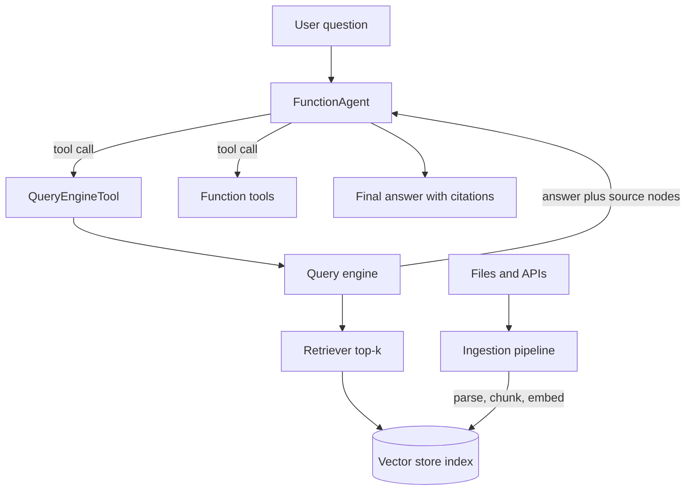

## TL;DR
LlamaIndex is a Python (and TypeScript) framework centred on the data side of agents: load, parse,
chunk, embed and index documents, expose them as query engines, then wrap those as tools for agents
that run on its event-driven Workflows engine.

## For agent builders
- **Why it matters for agents.** Most enterprise agents are retrieval agents in disguise: the hard part
  is getting the right chunk from a 400-page PDF, not the loop. LlamaIndex gives you that data layer and
  turns any index into a tool with one call.
- **Where it shows up in your stack.** Ingestion jobs (`IngestionPipeline`), the retrieval tool your
  agent calls (`QueryEngineTool`), the agent itself (`FunctionAgent`, `ReActAgent`, `AgentWorkflow`) and
  multi-step control flow (`Workflow` with typed events).
- **What you control.** Parsing, chunk size and overlap, embedding model, top-k, metadata filters,
  reranking, the vector store behind the index, and the tool descriptions the agent reads.
- **What you can skip.** The long tail of legacy query-engine variants and older agent classes. Learn
  indexes, retrievers, query engines, tools, `FunctionAgent` and `Workflow`; the rest is built from them.

## Lab
### Task
Fix a policy-retrieval workflow that leaks another tenant's documents and answers off-topic questions
from irrelevant chunks. You enforce tenant isolation with a metadata filter set from the caller's
identity, fail closed when no tenant is given, and add the refusal branch from the corrective-RAG
example.

This is the retrieval step your agent's `policy_search` tool will run.
- **Time box:** 45-75 minutes.
- **Prerequisites:** this lesson's Workflows section and the guarded-RAG example; agentic RAG basics.
- **Runs offline:** a deterministic keyword embedder replaces a real embedding model, and an
  extractive answer step replaces LLM synthesis, so no API key is needed.
- **Needs:** `llama-index-core` and `pytest`; checked with llama-index-core 0.14.25 on Python 3.12.

### Starter code
```python
# policy_rag.py: a tenant-safe retrieval workflow that refuses on weak evidence (LlamaIndex, offline)
import asyncio, re
from llama_index.core import VectorStoreIndex
from llama_index.core.embeddings import BaseEmbedding
from llama_index.core.schema import NodeWithScore, TextNode
from llama_index.core.vector_stores import ExactMatchFilter, MetadataFilters
from llama_index.core.workflow import Event, StartEvent, StopEvent, Workflow, step

VOCAB = ["refund", "day", "purchase", "allowed", "within", "travel", "economy", "class", "book"]
REFUSAL = "I could not find a supporting policy."

class KeywordEmbedding(BaseEmbedding):
    """Deterministic stand-in for a real embedder: one dimension per vocabulary word,
    plus an 'unknown' dimension so off-topic text is orthogonal to every policy."""
    def _vec(self, text: str) -> list[float]:
        words = {w.rstrip("s") for w in re.findall(r"[a-z]+", text.lower())}
        v = [1.0 if w in words else 0.0 for w in VOCAB]
        return v + [0.0 if any(v) else 1.0]
    def _get_text_embedding(self, text): return self._vec(text)
    def _get_query_embedding(self, query): return self._vec(query)
    async def _aget_query_embedding(self, query): return self._vec(query)

NODES = [
    TextNode(id_="acme-refund", text="Acme refunds are allowed within 30 days of purchase.",
             metadata={"tenant": "acme"}),
    TextNode(id_="acme-travel", text="Acme staff book travel in economy class.",
             metadata={"tenant": "acme"}),
    TextNode(id_="globex-refund", text="Globex refunds are allowed within 90 days of purchase.",
             metadata={"tenant": "globex"}),
]
index = VectorStoreIndex(NODES, embed_model=KeywordEmbedding())

class Retrieved(Event):
    question: str
    nodes: list[NodeWithScore]

class PolicyRAG(Workflow):
    def __init__(self, index, min_score: float = 0.5, top_k: int = 2, **kw):
        super().__init__(**kw)
        self.index, self.min_score, self.top_k = index, min_score, top_k

    @step
    async def retrieve(self, ev: StartEvent) -> Retrieved | StopEvent:
        tenant = ev.get("tenant")  # set by your auth layer, never by the model or the question
        # YOUR CODE 1: fail closed (raise ValueError) when tenant is missing, and build the
        # retriever with a metadata filter on "tenant" so other tenants' nodes are never candidates
        retriever = self.index.as_retriever(similarity_top_k=self.top_k)
        nodes = await retriever.aretrieve(ev.question)
        # YOUR CODE 2: keep only nodes scoring >= self.min_score; if none are left, stop with
        # {"answer": REFUSAL, "sources": []} instead of answering from weak evidence
        return Retrieved(question=ev.question, nodes=nodes)

    @step
    async def answer(self, ev: Retrieved) -> StopEvent:
        # Extractive stand-in for LLM synthesis: quote the best node and cite every node used
        return StopEvent(result={"answer": ev.nodes[0].get_content(),
                                 "sources": [n.node.node_id for n in ev.nodes]})

async def main():
    wf = PolicyRAG(index=index, timeout=10)
    for tenant, q in [("acme", "How many days do I have to get a refund after purchase?"),
                      ("globex", "How many days do I have to get a refund after purchase?"),
                      ("acme", "What is the parental leave policy?")]:
        print(tenant, "->", await wf.run(question=q, tenant=tenant))

if __name__ == "__main__":
    asyncio.run(main())
```

As given, both refund questions cite `acme-refund` and `globex-refund` (the two score the same, about
0.77), and the leave question is answered from `acme-travel` with a score of 0.

### Expected output
```
acme -> {'answer': 'Acme refunds are allowed within 30 days of purchase.', 'sources': ['acme-refund']}
globex -> {'answer': 'Globex refunds are allowed within 90 days of purchase.', 'sources': ['globex-refund']}
acme -> {'answer': 'I could not find a supporting policy.', 'sources': []}
```

### Tests
```python
# test_policy_rag.py: run with `pytest -q`
import asyncio
import pytest
import policy_rag as m

Q = "How many days do I have to get a refund after purchase?"

def run(**kw):
    async def go():  # a workflow run needs a running event loop
        return await m.PolicyRAG(index=m.index, timeout=10).run(**kw)
    return asyncio.run(go())

def test_acme_sees_only_acme():
    r = run(question=Q, tenant="acme")
    assert r["sources"] == ["acme-refund"]
    assert "30 days" in r["answer"]

def test_question_cannot_pick_the_tenant():
    r = run(question="What is the Globex refund window in days after purchase?", tenant="acme")
    assert "globex-refund" not in r["sources"]

def test_globex_sees_only_globex():
    assert run(question=Q, tenant="globex")["sources"] == ["globex-refund"]

def test_off_topic_question_is_refused():
    assert run(question="What is the parental leave policy?", tenant="acme") == {
        "answer": m.REFUSAL, "sources": []}

def test_missing_tenant_fails_closed():
    with pytest.raises(Exception, match="tenant"):
        run(question=Q)
```

All five fail on the starter: four on a cross-tenant source or a non-refusal, one because no error is
raised without a tenant.

### Failure scenarios
- **Inject a prompt-only filter:** drop the `MetadataFilters` and add "only use acme documents" to the
  question. `test_question_cannot_pick_the_tenant` still fails. Log the retrieved node IDs per run;
  `globex-refund` among the candidates proves the prompt cannot enforce tenancy.
- **Inject an embedder mismatch:** index with `KeywordEmbedding` but embed queries with `VOCAB`
  reversed. The Acme refund question is now answered from `acme-travel` and the Globex one is refused,
  with no error raised. Print `n.score` for the top nodes and compare the embed model used at
  ingestion and at query time, as in this lesson's Check yourself.
- **Inject a threshold of 0:** set `min_score=0.0`. The leave question gets an answer again: the
  refund text, citing `acme-refund` and `acme-travel`, both at score 0. Count refusals on a set of
  unanswerable questions; a refusal rate of zero means the guard is off.

### Submission
- **Your `policy_rag.py`** with both `YOUR CODE` steps done and nothing else changed.
- **A `pytest -q` run** showing 5 passed, plus the script output matching the expected lines.
- **A trace or log** for one run listing node IDs, scores and the tenant filter applied.
- **A short note** on how you would calibrate `min_score` for a real embedding model on a labelled set.
- **Evaluated on:** green tests, the filter built from the `tenant` argument only, and no answer
  without a source above the threshold.

## Why it exists
- **Retrieval is where RAG agents fail.** In practice wrong answers trace back to bad parsing, bad
  chunking or a missed document far more often than to the model. A framework that makes those steps
  explicit and swappable pays off quickly.
- **Hand-rolled ingestion does not scale.** Loading PDFs, slides and HTML, splitting them, embedding,
  deduplicating re-runs and writing to a vector store is the same 500 lines in every project, with the
  same bugs.
- **Indexes need to become tools.** An agent should choose between "search the HR handbook" and "search
  the contract archive". LlamaIndex wraps each index as a described tool, so routing is a tool-selection
  problem the model already handles.
- **Agents outgrew linear chains.** Retrieve, grade, maybe re-query, then answer is a loop with branches.
  Workflows model that as steps reacting to events, which stays readable as branches multiply.

## How it works
### The data layer
| Abstraction | What it is | Agent-builder note |
|---|---|---|
| `Document` | a loaded source file plus metadata | keep source, owner and ACL fields in `metadata`; you filter on them later |
| `Node` | a chunk of a document with links to neighbours | the unit that is embedded, retrieved and cited |
| Node parser | splitter such as `SentenceSplitter(chunk_size=512, chunk_overlap=50)` | chunking is the first thing to tune when answers miss |
| `IngestionPipeline` | ordered transformations plus optional docstore and cache | re-runs skip unchanged documents, so nightly syncs stay cheap |
| `VectorStoreIndex` | nodes plus embeddings in a vector store | defaults to in-memory; point it at a real store for production |
| Retriever | `index.as_retriever(similarity_top_k=k)` returns scored nodes | use directly when the agent needs raw chunks |
| Query engine | `index.as_query_engine()`: retrieve, then synthesize an answer | the thing you wrap as a tool |

### Global settings
- **`Settings`** holds defaults such as `Settings.llm` and `Settings.embed_model`, because most apps use
  one LLM and one embedder everywhere. Override per component when an agent needs a cheaper model for
  synthesis than for planning.
- **Integrations are separate packages,** for example `llama-index-llms-openai` or a vector-store
  package, imported as `llama_index.llms.openai`. Pin them together with `llama-index-core`.

### From index to tool to agent
1. **Wrap retrieval as a tool.** `QueryEngineTool.from_defaults(query_engine=..., name=..., description=...)`.
   The description is a prompt: say what the corpus covers and what input to send.
2. **Wrap plain functions too.** `FunctionAgent(tools=[fn])` accepts Python functions; the name, type
   hints and docstring become the tool schema (or use `FunctionTool.from_defaults(fn)` explicitly).
3. **Build the agent.** `FunctionAgent` uses the model's native tool calling; `ReActAgent` uses a
   text-based reason-act prompt for models without it.
4. **Run it.** `await agent.run(user_msg=...)`. Pass a `Context` (`ctx = Context(agent)`) to keep
   conversation state across runs.
5. **Go multi-agent if needed.** `AgentWorkflow` holds several agents that hand off to each other by
   name, with a root agent receiving the first message.

### Workflows: the runtime underneath
- **Steps are async methods decorated with `@step`.** Each declares the event type it accepts and the
  event types it may return, via type hints.
- **Events are typed messages.** `StartEvent` carries the `run(...)` keyword arguments, `StopEvent`
  carries the result, and you subclass `Event` for everything in between.
- **Routing comes from types.** Returning `Retrieved` triggers whichever step accepts `Retrieved`, so
  branches and loops need no explicit graph. The framework validates the step graph before running.
- **State lives in a `Context`,** shared by steps in a run and serializable, which is how you persist
  and resume. The exact store API changed across versions (`ctx.store` in recent releases); check the
  current docs.
- **A `timeout`** on the workflow bounds a run, which is your first line of defence against loops.

## Diagram
Follow a question from the agent through the retrieval tool to the index and back; ingestion runs
offline and feeds the same index.



## Examples
### A policy agent with a retrieval tool and a function tool
Requires `llama-index-core` and `llama-index-llms-openai` with an OpenAI key; any tool-calling model
integration works the same way.

```python
import asyncio, os
from datetime import date
from llama_index.core import SimpleDirectoryReader, StorageContext, VectorStoreIndex, load_index_from_storage
from llama_index.core.agent.workflow import FunctionAgent
from llama_index.core.tools import QueryEngineTool
from llama_index.llms.openai import OpenAI

PERSIST = "./storage"
if os.path.exists(PERSIST):                       # reuse embeddings instead of paying again
    index = load_index_from_storage(StorageContext.from_defaults(persist_dir=PERSIST))
else:
    docs = SimpleDirectoryReader("./policies").load_data()
    index = VectorStoreIndex.from_documents(docs)
    index.storage_context.persist(persist_dir=PERSIST)

policy_tool = QueryEngineTool.from_defaults(
    query_engine=index.as_query_engine(similarity_top_k=4),
    name="policy_search",
    description="Answers questions about refund, travel and expense policies. Input: one full question.",
)

def days_between(start: str, end: str) -> int:
    """Number of days between two ISO dates (YYYY-MM-DD)."""
    return (date.fromisoformat(end) - date.fromisoformat(start)).days

agent = FunctionAgent(
    tools=[policy_tool, days_between],
    llm=OpenAI(model="gpt-4o-mini"),
    system_prompt="Answer only from policy_search results, name the policy, and say 'not covered' if unsure.",
)

async def main():
    resp = await agent.run(user_msg="Bought 2025-03-01, asking for a refund on 2025-04-10. Eligible?")
    print(str(resp))

asyncio.run(main())
```

- **What to notice.** The agent must call `days_between` (40 days) and `policy_search`, then combine
  them. Arithmetic goes to code, not to the model.
- **Persisting** the index means the second run embeds nothing; in production the vector store does this.

### A corrective-RAG workflow that refuses on weak evidence
A workflow makes the "is the evidence good enough" branch explicit instead of hoping the agent decides.

```python
from llama_index.core.workflow import Event, StartEvent, StopEvent, Workflow, step

class Retrieved(Event):
    question: str
    texts: list[str]

class GuardedRAG(Workflow):
    def __init__(self, index, llm, min_score: float = 0.75, **kw):
        super().__init__(**kw)
        self.retriever = index.as_retriever(similarity_top_k=6)
        self.llm, self.min_score = llm, min_score

    @step
    async def retrieve(self, ev: StartEvent) -> Retrieved | StopEvent:
        nodes = await self.retriever.aretrieve(ev.question)
        good = [n.get_content() for n in nodes if (n.score or 0) >= self.min_score]
        if not good:                                   # branch by returning a different event
            return StopEvent(result="I could not find a supporting document.")
        return Retrieved(question=ev.question, texts=good)

    @step
    async def answer(self, ev: Retrieved) -> StopEvent:
        ctx = "\n\n---\n\n".join(ev.texts)
        out = await self.llm.acomplete(f"Use only this context:\n{ctx}\n\nQ: {ev.question}\nA:")
        return StopEvent(result=str(out))

# result = await GuardedRAG(index=index, llm=OpenAI(model="gpt-4o-mini"), timeout=60).run(question="...")
```

- **The score threshold is illustrative.** Similarity scales differ by embedding model and metric;
  calibrate `min_score` on a labelled set before trusting it.
- **Scenario numbers.** On an internal eval of 200 questions, a team might find 30 have no answer in
  the corpus. Without the guard, those become confident hallucinations; with it, they become explicit
  refusals you can count.

## Production patterns
- **Separate ingestion from serving.** Run `IngestionPipeline` as a scheduled job with a docstore (for
  deduplication by document hash) and a persistent vector store; the agent service only loads the index.
  Monitor documents added, skipped and failed per run, because a silent parser failure empties a corpus.
- **One tool per corpus, described precisely.** Give each index its own `QueryEngineTool` with a
  description listing scope and exclusions ("HR policies; not payroll"). Measure tool-selection accuracy
  on a labelled set; vague descriptions are the usual cause of wrong-corpus answers.
- **Filter by metadata for tenancy and ACLs.** Store tenant and permission fields on every node and
  pass metadata filters to the retriever (`MetadataFilters` in `llama_index.core.vector_stores`) per
  request. Never rely on the prompt to hide another tenant's chunks; test it with a cross-tenant query.
- **Trace every retrieval.** Use the instrumentation integrations (for example Langfuse, Arize Phoenix
  or OpenTelemetry handlers; check the current docs for the hook names) so each trace shows the query,
  retrieved node IDs, scores and the final prompt. Retrieval bugs are invisible in answer-only logs.
- **Evaluate retrieval and answers separately.** Track hit rate and MRR on question-to-document labels,
  plus faithfulness on answers; LlamaIndex ships evaluation modules, or use your eval tool. Re-run on
  every chunking or embedding change, because both silently shift quality.
- **Bound runs and costs.** Set a workflow `timeout`, cap `similarity_top_k`, use a cheaper LLM for
  synthesis than for planning, and log tokens per run. Embedding re-runs are the hidden cost; caching in
  the pipeline avoids paying for unchanged documents.

## Trade-offs
- **Fast retrieval scaffolding vs abstraction depth.** You get working RAG in 20 lines, but defaults
  (prompt templates, chunk sizes, response synthesis mode) hide decisions. Once quality matters, read and
  override them, or drop to the retriever and write your own synthesis.
- **Broad integrations vs dependency churn.** Hundreds of readers and stores exist as separate packages
  with independent versions. Pin everything and upgrade deliberately, because minor releases have
  renamed modules before.
- **Workflows vs a graph framework.** Event-typed steps are lighter than LangGraph's explicit graph and
  fine for retrieval pipelines. Workflows do support human-input events and a serializable `Context`,
  but for approvals that pause for days with managed checkpoints, LangGraph or a durable-execution
  engine is the more established choice.
- **Using its agents vs only its data layer.** Many teams use LlamaIndex purely for ingestion and
  retrieval and call it from a LangGraph node or Pydantic AI tool. That flips the choice when the
  orchestration requirements are heavier than the retrieval ones.

## Pitfalls
- **Re-embedding the corpus on every start.** Symptom: slow cold starts and a growing embedding bill.
  Fix: persist the index or use an external vector store, and load it in the serving process.
- **Trusting default chunking for structured documents.** Symptom: tables and clauses split mid-row,
  answers cite half a rule. Fix: parse with a layout-aware parser and tune chunk size and overlap per
  document type, then re-run the retrieval eval.
- **Copying code across API generations.** Symptom: imports like `from llama_index import ...` or old
  agent classes failing. Fix: since 0.10 the core lives in `llama_index.core`; use current agent classes
  from `llama_index.core.agent.workflow` and check the docs version matching your pin.
- **Tool descriptions that overlap.** Symptom: the agent queries the wrong index or both, doubling cost.
  Fix: make descriptions mutually exclusive, or add a router step that picks one corpus first.

## When to use
- **Use when** the hard part of your agent is documents: many sources, messy formats, multiple corpora,
  metadata filters, and you want indexes as tools with little glue.
- **Use its data layer only when** orchestration lives elsewhere (LangGraph, Pydantic AI, a vendor SDK)
  but you still want its readers, parsers, splitters and retrievers.
- **Avoid when** the agent mostly calls APIs with little unstructured data; a vendor agent SDK or
  Pydantic AI is less to learn and less to pin.
- **Measure** retrieval hit rate, faithfulness, refusal rate on unanswerable questions, and tokens per
  answer before and after every ingestion change.

## Role lens
- **Engineer:** Builds the ingestion pipeline and the retrieval tools, tunes chunking, top-k and filters
  against a retrieval eval, and wires tracing so every answer shows its source nodes.
- **Architect:** Decides whether LlamaIndex owns only the data layer or the agent runtime too, picks the
  vector store, and sets the tenancy, ACL and re-indexing strategy.
- **FDE:** Connects a customer's document sources (SharePoint, Confluence, PDFs), proves retrieval
  quality on their own questions, and explains why some answers are refused.

## Check yourself
**Q:** Your LlamaIndex support agent answers well in testing but, after a nightly sync, starts saying
"not covered" for questions it used to answer. What do you check, in order?
**A:** First the ingestion run: did the pipeline report documents skipped or failed, did a parser
change, did the docstore treat changed files as new and duplicate them, or did the sync point at an
empty folder? Second the index: is the serving process loading the new vector store collection, and
does it use the same embedding model as ingestion? A mismatch makes every similarity score low, which
trips a score threshold or returns irrelevant chunks. Third the retrieval eval: re-run the
question-to-document set and compare hit rate with the last good run. Only then look at the agent's
prompt or tool descriptions, because they did not change.

## Interview questions
### What is the difference between a retriever, a query engine and a QueryEngineTool in LlamaIndex?
- **A retriever** returns scored nodes for a query and nothing else; it is what you evaluate with hit
  rate and MRR.
- **A query engine** wraps a retriever plus response synthesis, so it returns an answer with source
  nodes.
- **A `QueryEngineTool`** gives that engine a name and description so an agent can choose to call it,
  which turns corpus routing into ordinary tool selection.

### You have three corpora: HR policy, contracts and engineering docs. How do you structure the agent?
- **One tool per corpus** with mutually exclusive descriptions, so the model's tool selection does the
  routing and traces show which corpus was used.
- **Metadata filters** for anything that is a filter rather than a topic, such as tenant, region or date,
  because those must be enforced in code.
- **Evaluate routing** with labelled questions per corpus and add a router step if selection accuracy is
  low.

### When would you use a LlamaIndex Workflow instead of a FunctionAgent?
- **Use a Workflow** when the control flow is known: retrieve, grade, re-query or refuse, answer. Typed
  events make each branch explicit and testable.
- **Use a FunctionAgent** when the model must decide which tools to call and in what order.
- **Combine them:** agents run on workflows, so an agent can be one step inside a larger workflow.

### How do you keep a production LlamaIndex agent from leaking documents across tenants?
- **Tag every node** with tenant and permission metadata at ingestion, because filters can only use
  fields that exist.
- **Apply filters in the retriever per request** from the authenticated identity, never from the prompt
  or the model's arguments.
- **Test it:** a red-team query from tenant A asking for tenant B's terms must return nothing, and that
  test runs in CI.

### What does LlamaIndex cost you compared with writing retrieval by hand?
- **Dependency surface:** many integration packages with their own versions; you must pin and upgrade
  them together.
- **Hidden defaults:** prompts and synthesis modes you did not choose until you override them.
- **What you save:** loaders, parsers, splitters, deduplicating ingestion and store adapters, which are
  weeks of work and a common source of subtle bugs.

## Quiz
### Q: In a LlamaIndex Workflow, how does control pass from one step to the next?
- [ ] Each step names the next step explicitly in a graph definition
- [x] A step returns a typed event, and the step whose signature accepts that event type runs next
- [ ] Steps run in the order they are defined in the class
- [ ] The LLM chooses the next step on every transition
> Steps declare the event types they accept and return through type hints. Returning `Retrieved` or
> `StopEvent` is the branch; no separate edge list is needed.

### Q: Why should ingestion run as a separate job rather than inside the agent's serving process?
- [ ] Because LlamaIndex agents cannot read from a persisted index
- [ ] Because embeddings can only be created on a GPU worker
- [x] Because re-parsing and re-embedding on every start is slow and costly, and a scheduled pipeline with a docstore skips unchanged documents
- [ ] Because query engines require the index to be rebuilt per request
> The serving process should load an existing index. A scheduled pipeline with deduplication keeps the
> index fresh while paying only for documents that changed.

### Q: Where should tenant isolation for retrieval be enforced?
- [ ] In the system prompt, by telling the agent which tenant it serves
- [ ] In the tool description of each QueryEngineTool
- [x] In metadata filters applied by the retriever from the authenticated identity on each request
- [ ] By using a different LLM per tenant
> Prompts and descriptions can be ignored or injected against. Filters applied in code from the caller's
> identity decide which nodes are even candidates.

## Use cases & projects
### Use cases
- **Policy and handbook assistants.** HR, IT and finance agents answer from thousands of pages with
  citations, refusing when no document supports an answer.
- **Multi-corpus research agents.** One tool per corpus (contracts, tickets, wiki) lets the agent route
  questions and combine evidence across sources.
- **Document-heavy back-office workflows.** Invoice, claim or contract intake where parsing and
  extraction quality decide the outcome more than the agent loop.
- **Retrieval layer for another framework.** Teams on LangGraph or Pydantic AI use LlamaIndex only for
  ingestion and retrievers, called from their own tools.

### Mini project
**Build a cited policy agent with a refusal path (2-3 hours).**
- **Goal:** an agent over 20-50 policy documents that answers with the policy name and refuses when
  evidence is weak.
- **Steps:** ingest with `IngestionPipeline` and a persisted index; expose it as a `QueryEngineTool`;
  add one function tool for date or amount arithmetic; write 25 labelled questions, including five with
  no answer in the corpus; run them, log retrieved node IDs and scores, then try two chunk sizes.
- **Done when:** you have a table of hit rate, correct refusals and tokens per answer for both chunk
  sizes, and every answer in the run cites a real document.

### Major project
**Multi-corpus enterprise knowledge agent (multi-day; can serve as the module Capstone's retrieval
layer).**
- **Goal:** a deployed agent over three corpora that routes, cites, refuses and never leaks across
  tenants.
- **Scope:** incremental ingestion with tenant and ACL metadata and a layout-aware PDF parser; one tool
  per corpus plus a guarded-RAG workflow; tracing; an API in front.
- **Done when:** a 100-question eval reports routing accuracy, retrieval hit rate, faithfulness and zero
  cross-tenant leaks, and a dashboard shows cost and refusal rate per corpus.
