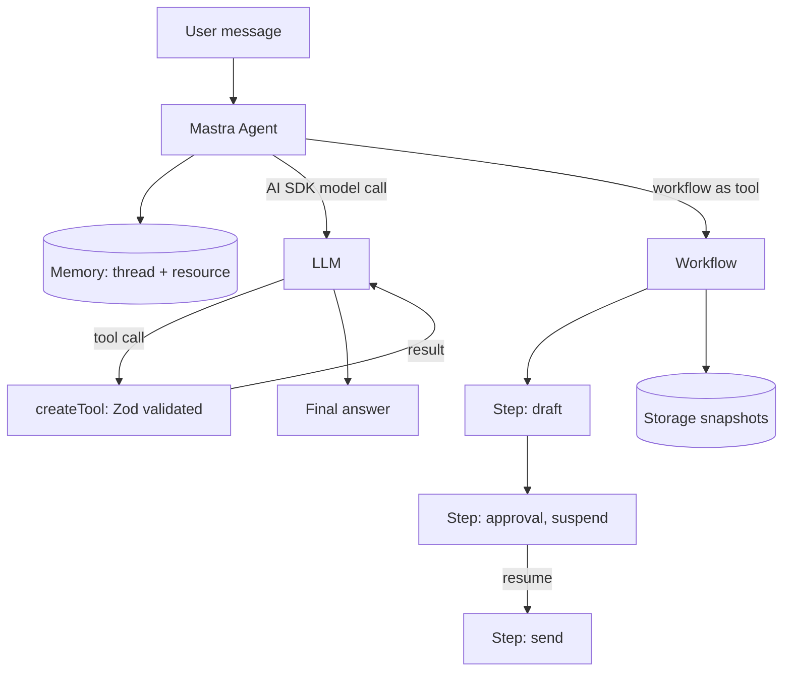

## TL;DR
Mastra is a TypeScript framework for agents and workflows built on the Vercel AI SDK: agents with Zod-typed
tools and memory, graph-style workflows with suspend and resume, a local playground, evals and tracing, in
one project structure.

## For agent builders
- **Why it matters for agents.** Many agent products are TypeScript web apps. Mastra gives them the agent
  loop, typed tools, conversation memory, durable-ish workflows and a dev playground without a Python
  service on the side.
- **Where it shows up in your stack.** The `@mastra/core` package (`Agent`, `createTool`, `Mastra`,
  workflows), `@mastra/memory` plus a storage adapter such as `@mastra/libsql` or Postgres, model providers
  from the AI SDK (`@ai-sdk/openai` and others), and the `mastra dev` server.
- **What you control.** Agent instructions, model, tools and their Zod schemas, memory configuration,
  workflow steps and their schemas, and where storage lives.
- **What you can skip.** The AI SDK's low-level streaming protocol; Mastra wraps it. Read the AI SDK
  lesson only when you need custom UI streaming.

## Why it exists
- **TypeScript teams need agent infrastructure too.** Most frameworks are Python-first; a Next.js or Node
  team would otherwise run a second stack just for agents.
- **The AI SDK is a model layer, not an agent platform.** It handles providers, tool calling and
  streaming, but not memory threads, workflows, evals or a dev UI; Mastra adds those on top.
- **Agents and workflows need one model.** Some steps need LLM choice, others need fixed order and
  human approval. Mastra workflows can call agents as steps, and agents can call workflows as tools.
- **Fast feedback matters.** `mastra dev` serves a playground to chat with agents, run workflows and
  inspect traces locally, which shortens the prompt-and-tool iteration loop.

## How it works
### Core abstractions
| Abstraction | What it is | Why it exists |
|---|---|---|
| `Agent` | name, instructions, model, tools, optional memory | the tool-calling loop; `generate()` for one result, `stream()` for tokens |
| `createTool` | id, description, Zod `inputSchema` and `outputSchema`, `execute` | typed actions; schemas validate model arguments |
| `Memory` (`@mastra/memory`) | thread history, working memory, optional semantic recall over a store | multi-turn and cross-session context |
| Workflows (`createWorkflow`, `createStep`) | typed steps chained with `.then()`, branching and parallel, suspend and resume | deterministic orchestration and human-in-the-loop |
| `Mastra` instance | registers agents, workflows, storage, logger and telemetry | one place to wire services; powers `mastra dev` and the server |
| MCP support (`@mastra/mcp`) | MCP client and server helpers | reuse MCP tools or expose your tools |

### The mental model
1. **Agents decide, workflows enforce.** Put open-ended reasoning in an agent; put required order,
   retries and approvals in a workflow, because a workflow step cannot be skipped by the model.
2. **Schemas everywhere.** Tool inputs, tool outputs and workflow step inputs and outputs are Zod schemas,
   so mismatches fail at the boundary instead of deep inside a prompt.
3. **Memory is keyed by thread and resource.** A thread is one conversation; a resource is usually the
   user. Memory reads recent messages and optional semantic matches from storage before each call.
4. **Storage is pluggable.** LibSQL or SQLite for local work, Postgres for production; workflow snapshots
   use storage too, which is what makes suspend and resume survive a restart.

### When to pick Mastra
| Pick Mastra when | Pick something else when |
|---|---|
| Your product is TypeScript or Next.js and you want agents in the same codebase | Your team and data stack are Python: LangGraph, ADK, Pydantic AI |
| You want agents, memory, workflows and a playground together | You only need streaming chat with a few tools: the AI SDK alone |
| You want typed tools and workflow steps end to end | You need a battle-tested durable engine for long jobs: Temporal or Inngest beside your agents |
| You want MCP tools in a JS agent quickly | You need the largest ecosystem of integrations: LangChain or LlamaIndex |

## Diagram
Follow a request: the agent loads memory, calls typed tools in a loop, and hands fixed-order work to a
workflow that can pause for approval.



## Examples
### A minimal agent with a typed tool
Requires `npm i @mastra/core @ai-sdk/openai zod` and `OPENAI_API_KEY`; the model id is illustrative. The
tool `execute` signature has changed across Mastra versions, so check the current docs.

```typescript
import { Agent } from "@mastra/core/agent";
import { createTool } from "@mastra/core/tools";
import { openai } from "@ai-sdk/openai";
import { z } from "zod";

const orderStatus = createTool({
  id: "order-status",
  description: "Look up the shipping status of an order by id",
  inputSchema: z.object({ orderId: z.string() }),
  outputSchema: z.object({ orderId: z.string(), status: z.string() }),
  execute: async ({ context }) => {
    const db: Record<string, string> = { A100: "shipped", A101: "processing" };
    return { orderId: context.orderId, status: db[context.orderId] ?? "not_found" };
  },
});

export const supportAgent = new Agent({
  name: "support-agent",
  instructions: "Answer order questions. Always call order-status before answering.",
  model: openai("gpt-4o-mini"),
  tools: { orderStatus },
});

const res = await supportAgent.generate("Where is order A100?");
console.log(res.text);
```

### Production wiring: memory, storage and registration
This shows the shape teams use; option names for memory and run APIs have shifted between releases, so
confirm against the current docs before copying.

```typescript
import { Mastra } from "@mastra/core";
import { Agent } from "@mastra/core/agent";
import { Memory } from "@mastra/memory";
import { LibSQLStore } from "@mastra/libsql";
import { openai } from "@ai-sdk/openai";

const storage = new LibSQLStore({ url: "file:./mastra.db" });   // Postgres adapter in production

export const assistant = new Agent({
  name: "assistant",
  instructions: "You are a concise account assistant.",
  model: openai("gpt-4o-mini"),
  memory: new Memory({ storage, options: { lastMessages: 20 } }),
});

export const mastra = new Mastra({ agents: { assistant }, storage });

// Each call names the conversation (thread) and the user (resource) so memory is scoped correctly.
await assistant.generate("My plan is Pro.", { memory: { thread: "t-42", resource: "user-7" } });
```

| Setting | Why |
|---|---|
| `lastMessages: 20` | caps history tokens per call instead of sending the whole thread |
| thread and resource ids from your auth layer | prevents one user's memory leaking into another's |
| storage shared by memory and workflows | suspended workflows and threads survive deploys |

## Production patterns
- **Deploy the Mastra server or embed in your app.** `mastra build` produces a server you can run in Node
  or a container; alternatively import agents into Next.js route handlers. Check the current docs for
  deployer packages per platform. Monitor p95 latency per agent and cold starts on serverless.
- **Use Postgres-backed storage in production.** Local LibSQL files do not survive ephemeral containers;
  a shared database keeps threads, working memory and workflow snapshots across replicas. Monitor storage
  size per resource and prune old threads.
- **Put approvals in workflows with suspend and resume.** A step suspends with a payload, your UI shows
  it, and a resume call continues from the stored snapshot. Monitor suspended-run age so approvals do not
  rot.
- **Turn on tracing.** Mastra emits OpenTelemetry-compatible traces for agent, tool and workflow spans;
  export them to Langfuse, LangSmith or any OTel backend. Monitor tokens and tool errors per span.
- **Score outputs with evals.** Mastra ships eval and scorer utilities (check the current package name and
  API); run them in CI on a fixed prompt set and sample live traffic. Track score trends per release.

## Trade-offs
- **One TypeScript stack vs ecosystem size.** Agents live with your app code and types, but the Python
  ecosystem has more retrieval, eval and research tooling.
- **Integrated features vs churn.** Memory, workflows, evals and a playground in one package speed you up,
  but the API has changed quickly; pin versions and read migration guides.
- **Built-in workflows vs a dedicated engine.** Mastra workflows cover approvals and multi-step jobs well;
  very long, high-volume or cross-service jobs may still belong in Temporal or Inngest.
- **AI SDK foundation vs abstraction depth.** You get every AI SDK provider, but debugging sometimes means
  reading two layers of library code.

## Pitfalls
- **Unbounded memory history.** Symptom: token cost per turn climbs with conversation length. Fix: set a
  `lastMessages` cap, use working memory for durable facts, and add semantic recall only when needed.
- **Missing or shared resource ids.** Symptom: users see each other's context. Fix: derive thread and
  resource ids from authenticated identity on the server, never from the client body alone.
- **Business rules hidden in instructions.** Symptom: the agent sometimes skips a required check. Fix:
  move the rule into a workflow step or tool validation.
- **Copying examples across major versions.** Symptom: type errors on `execute` arguments or memory
  options. Fix: match examples to your installed version and pin it.

## When to use
- **Use when:** your agent ships inside a TypeScript product, you want typed tools, memory and workflows
  together, and you value a local playground.
- **Avoid when:** your retrieval, eval and data tooling is Python, or a single AI SDK call already does the
  job.
- **Measure:** task success on an eval set, tokens per turn, tool error rate and suspended-workflow age.
- **Interviews:** explain agent versus workflow, Zod-typed tools, thread and resource memory scoping.

## Role lens
- **Engineer:** Builds agents and workflows in TypeScript with Zod-typed tools, tests them in
  `mastra dev`, and wires memory storage and tracing.
- **Architect:** Decides whether agents live in the web app or a separate Mastra server, which storage
  backs memory and workflows, and where a dedicated workflow engine is still needed.
- **FDE:** Drops a Mastra agent into a customer's Next.js app, connects their APIs as typed tools or MCP
  servers, and demos it in the playground.

## Check yourself
**Q:** A Mastra assistant in a Next.js app forgets context after deploys and sometimes shows one user's
plan details to another user. What is wrong and how do you fix both?
**A:** Two separate faults. Forgetting after deploys means memory uses local or in-process storage on an
ephemeral container; move memory and workflow storage to a shared Postgres-backed store so threads
survive restarts and replicas. Cross-user leakage means thread or resource ids are wrong: shared,
constant, or taken from the client. Derive the resource id from the authenticated user and the thread id
from a server-issued conversation id, then add a test that two users with the same thread name cannot
read each other's memory.

## Interview questions
### When do you use a Mastra agent and when a Mastra workflow?
- **Agent for open choices.** An agent picks tools in a loop and suits tasks where the path depends on
  the conversation, such as support questions.
- **Workflow for required order.** A workflow runs typed steps in a fixed graph, with branching, parallel
  steps and suspend for approvals, so required checks cannot be skipped by the model.

### How does Mastra relate to the Vercel AI SDK?
- **The AI SDK is the model layer.** It provides providers, tool calling and streaming; Mastra agents use
  AI SDK model objects such as `openai("...")`.
- **Mastra adds the platform.** Memory, workflows, evals, tracing, MCP helpers and a dev server sit on top,
  so you would use the AI SDK alone for simple chat and Mastra when you need those.

### Your agent's token cost doubles over long conversations. How do you debug it?
- **Inspect what memory injects.** Check how many recent messages and semantic recall results are added to
  each call in the trace.
- **Cap and summarize.** Lower `lastMessages`, move stable user facts into working memory, and enable
  semantic recall only for the queries that need it; compare cost per turn before and after.

### How would you add human approval before an agent sends an email?
- **Make sending a workflow step.** A draft step produces the email, an approval step suspends with the
  draft as payload, and a send step runs only after resume with an approved flag.
- **Persist and monitor.** Store snapshots in shared storage so approvals survive deploys, and alert when
  a suspended run is older than your SLA.

### What would make you choose a Python framework instead of Mastra?
- **Python-heavy surroundings.** If retrieval, evals, fine-tuning and data pipelines are in Python, a
  Python framework avoids a cross-language boundary.
- **Specific runtime needs.** LangGraph's explicit checkpointing or ADK's Google Cloud integration can
  outweigh Mastra's TypeScript fit.

## Quiz
### Q: What do Zod schemas on a Mastra tool provide?
- [ ] Faster model inference
- [x] A typed contract the model's arguments and the tool's result are validated against
- [ ] Automatic retries on network errors
- [ ] Encryption of tool inputs
> The `inputSchema` becomes the tool's JSON schema for the model and validates its arguments; the
> `outputSchema` checks the result, so bad calls fail at the boundary with a clear error.

### Q: In Mastra memory, what do thread and resource usually represent?
- [ ] The model and the provider
- [ ] A workflow and its steps
- [x] One conversation and the user or entity that owns it
- [ ] The vector index and its embedding model
> A thread is one conversation's history; a resource is typically the user, so working memory and recall
> can span that user's threads without mixing users.

### Q: Why put an approval step in a workflow rather than in the agent's instructions?
- [ ] Workflows use a cheaper model
- [ ] Instructions cannot mention approvals
- [ ] Agents cannot call tools after an approval
- [x] A workflow step runs in a fixed order and can suspend and resume, so the model cannot skip it
> Instructions are suggestions the model may not follow. A suspended workflow step is enforced by code
> and stored in a snapshot, so the send step cannot run until someone resumes it.

## Use cases & projects
### Use cases
- **In-app copilots in TypeScript products.** A Next.js SaaS adds an agent that calls its own APIs as typed
  tools, with per-user memory.
- **Approval-gated operations.** Workflows draft refunds, emails or config changes and suspend for a human
  before acting.
- **Internal tools over MCP.** A JS agent connects to company MCP servers for tickets, docs and CRM.
- **Multi-step content or data pipelines.** Typed workflow steps call agents for extraction and
  summarization, with retries.

### Mini project
**Ship an approval-gated refund agent in TypeScript (2-3 hours).**
- **Goal:** a Mastra agent that answers order questions and, for refunds, runs a workflow that suspends for
  human approval before calling a fake refund API.
- **Steps:** create a project with `npm create mastra@latest`; add an `order-status` tool and a refund
  workflow with draft, approval (suspend) and execute steps; give the agent memory backed by LibSQL; test
  it in `mastra dev`; export traces to a local OTel or Langfuse backend.
- **Done when:** a refund request pauses in the playground until you resume it, a restart does not lose the
  suspended run or the thread, and the trace shows each tool and step with token counts.
