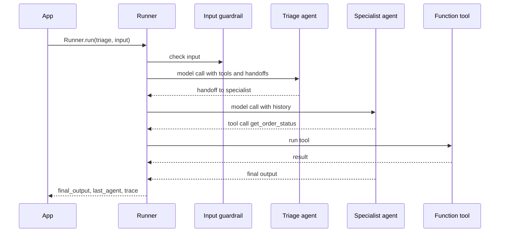

## TL;DR
The OpenAI Agents SDK is a small Python (and TypeScript) library with a handful of primitives: agents,
tools, handoffs, guardrails, sessions and built-in tracing, plus a `Runner` that executes the tool loop
for you until an agent produces a final output.

## For agent builders
- **Why it matters for agents.** It is the thinnest production-grade loop you can adopt: you write
  agents and Python functions, and the SDK handles tool-call parsing, the loop, handoffs between agents
  and a trace of every step.
- **Where it shows up in your stack.** `Agent` definitions, `@function_tool` wrappers around your
  services, `Runner.run` in your API handler, guardrails in front of expensive agents, and traces in the
  OpenAI dashboard or your own processor.
- **What you control.** Instructions, tools, `output_type`, which agents can hand off to which,
  guardrail logic, `max_turns`, model settings and where traces go.
- **What you can skip.** Graph DSLs and state machines: the SDK deliberately has none. When you need
  them, you write plain Python around `Runner.run`, or choose a graph framework.

## Why it exists
- **Every team re-wrote the same loop.** Call the model, parse tool calls, run them, append results,
  repeat, stop on a final answer. The SDK packages that loop with sane defaults so teams stop owning it.
- **Multi-agent needed a simple primitive.** A triage agent routing to billing or shipping specialists
  is common. Handoffs make "transfer to another agent" a tool call instead of custom orchestration.
- **Safety checks were bolted on ad hoc.** Guardrails run validation in parallel with the agent and
  abort with an exception when a tripwire fires, so cheap checks can block expensive or risky runs.
- **Agents are undebuggable without traces.** Tracing is on by default and records model calls, tool
  calls, handoffs and guardrails as spans, so the first bug report already has a timeline.

## How it works
### The primitives
| Primitive | What it is | Key fields or calls |
|---|---|---|
| `Agent` | an LLM plus instructions and capabilities | `name`, `instructions`, `tools`, `handoffs`, `output_type`, `model`, `model_settings` |
| Function tool | a Python function exposed as a tool | `@function_tool`; schema from type hints and docstring |
| Handoff | delegation to another agent, offered to the model as a tool | `handoffs=[agent]`, `handoff_description`, `handoff()` for options |
| Agent as tool | call another agent and get its result back, without transferring control | `agent.as_tool(tool_name=..., tool_description=...)` |
| Guardrail | a check on input or final output that can trip and abort | `@input_guardrail`, `@output_guardrail`, `GuardrailFunctionOutput` |
| Session | stored conversation history across runs | for example `SQLiteSession(session_id)` passed as `session=` (check the docs for current backends) |
| Context | your typed dependencies, never sent to the model | `context=` on run, `RunContextWrapper[T]` in tools |
| Trace | a span tree of one workflow | automatic; `with trace("name"):` groups several runs |

### The run loop
1. **`Runner.run(agent, input)`** (async), `Runner.run_sync` or `Runner.run_streamed` starts a run.
2. **Input guardrails** of the first agent run concurrently with its first model call.
3. **The model is called** with instructions, history, tool schemas and handoff tools.
4. **If it returns a final output** (plain text, or a valid `output_type` object), output guardrails run
   and the loop ends with `result.final_output`.
5. **If it calls a handoff,** the current agent changes and the loop continues; `result.last_agent`
   tells you who finished.
6. **If it calls tools,** the SDK runs them, appends results and loops.
7. **If the loop passes `max_turns`,** it raises `MaxTurnsExceeded`, your hard stop for runaway agents.

### Handoffs vs agents-as-tools
- **Handoff:** the specialist takes over the conversation and answers the user directly. Use it for
  routing (triage to billing), because the specialist sees the history and owns the reply.
- **Agent as tool:** a manager agent calls a sub-agent, gets its output back, and stays in charge. Use it
  when one agent must combine several specialists' results.

### Models and providers
- **Default is OpenAI's Responses API,** with the Chat Completions API also supported.
- **Other providers** plug in through a model provider interface and a LiteLLM extension; check the
  current docs for the import path, because it has moved between releases.
- **MCP servers** can be attached (`mcp_servers=[...]` on an `Agent`, with stdio and Streamable HTTP
  server classes in `agents.mcp`), so tools served over MCP look like ordinary tools to the agent.

## Diagram
Trace one run: guardrail and model call start together, then the loop either runs tools, hands off, or
returns a final output.



## Examples
### Triage with handoffs, a tool and an input guardrail
Requires `pip install openai-agents` and `OPENAI_API_KEY`. The guardrail is itself a tiny agent with a
structured output.

```python
import asyncio
from pydantic import BaseModel
from agents import (Agent, GuardrailFunctionOutput, InputGuardrailTripwireTriggered,
                    Runner, function_tool, input_guardrail, trace)

@function_tool
def get_order_status(order_id: str) -> str:
    """Return the shipping status of an order, given its ID such as A100."""
    return {"A100": "shipped 2025-05-02", "A200": "processing"}.get(order_id, "unknown order")

class TopicCheck(BaseModel):
    off_topic: bool
    reason: str

checker = Agent(name="Topic checker", model="gpt-4o-mini", output_type=TopicCheck,
                instructions="Flag messages unrelated to orders, billing or refunds.")

@input_guardrail
async def on_topic(ctx, agent, user_input):
    res = await Runner.run(checker, user_input, context=ctx.context)
    return GuardrailFunctionOutput(output_info=res.final_output,
                                   tripwire_triggered=res.final_output.off_topic)

orders = Agent(name="Orders agent", handoff_description="Order and shipping status questions",
               instructions="Look up orders with get_order_status. Never guess a status.",
               tools=[get_order_status])
billing = Agent(name="Billing agent", handoff_description="Charges, invoices and refunds",
                instructions="Explain charges. Refunds need a human: say a ticket was opened.")
triage = Agent(name="Triage agent", instructions="Hand off to the right specialist.",
               handoffs=[orders, billing], input_guardrails=[on_topic])

async def main():
    with trace("support-triage"):
        try:
            res = await Runner.run(triage, "Where is my order A100?", max_turns=8)
            print(res.last_agent.name, "->", res.final_output)
        except InputGuardrailTripwireTriggered:
            print("Refused: off-topic request")

asyncio.run(main())
```

- **Expected:** `Orders agent -> ...shipped 2025-05-02...`. Ask for a poem instead and the guardrail
  trips before any specialist runs.
- **Cost note:** the guardrail adds one small-model call per request, which is cheap insurance when the
  guarded agent uses a large model and several tools.

### Production shape: typed context, user-scoped tools and a turn budget
Context carries identity into tools without exposing it to the model, so the model cannot ask for
another user's data.

```python
from dataclasses import dataclass
from agents import Agent, MaxTurnsExceeded, RunContextWrapper, Runner, function_tool

@dataclass
class UserCtx:
    user_id: str
    plan: str

INVOICES = {"u1": ["INV-1", "INV-7"], "u2": ["INV-3"]}

@function_tool
def list_my_invoices(ctx: RunContextWrapper[UserCtx]) -> list[str]:
    """List the signed-in user's invoice IDs."""
    return INVOICES.get(ctx.context.user_id, [])    # identity from code, not from the model

agent = Agent[UserCtx](name="Account agent", tools=[list_my_invoices],
                       instructions="Answer account questions using tools only.")

async def handle(user_id: str, message: str) -> str:
    try:
        res = await Runner.run(agent, message, context=UserCtx(user_id, "pro"), max_turns=6)
        return res.final_output
    except MaxTurnsExceeded:
        return "This needs a human; I have opened a ticket."   # fail closed, log the trace ID
```

| Decision | Setting in this example | Why |
|---|---|---|
| Identity | `context=UserCtx(...)` | tools read it; the model never sees or sets it |
| Budget | `max_turns=6` | a looping agent raises instead of burning tokens |
| Failure | catch `MaxTurnsExceeded` | the user gets a handoff message, ops get a trace |
| History | add `session=` with a session store | multi-turn chat without hand-managing `to_input_list()` |

## Production patterns
- **Route traces to your own backend too.** Tracing exports to the OpenAI dashboard by default; add a
  processor with `add_trace_processor` (or use an integration such as Langfuse or Logfire) so traces
  live next to your other telemetry. Use `set_tracing_disabled(True)` or the documented environment
  variable when data policy forbids export. Monitor turns, tool errors and handoffs per trace.
- **Guard expensive agents with cheap checks.** Put a small-model input guardrail in front of the agent
  that uses the large model, and an output guardrail on anything user-facing (PII, policy). Count
  tripwire rate per guardrail; a sudden rise usually means a prompt regression, not an attack.
- **Typed final outputs for downstream code.** Set `output_type` to a Pydantic model whenever a program,
  not a person, consumes the result, so invalid shapes fail inside the run. Track validation failures.
- **Keep identity and secrets in context.** Pass user, tenant and clients through `context`, read them
  via `RunContextWrapper` in tools, and never accept IDs for authorization from tool arguments.
- **Persist conversations explicitly.** Use a session store, or save `result.to_input_list()` yourself,
  keyed by conversation ID. For long or approval-gated runs, wrap runs in a durable workflow engine
  (the docs describe integrations; check which are current) because the SDK itself keeps no checkpoints.
- **Budget and fail closed.** Set `max_turns`, catch `MaxTurnsExceeded` and guardrail exceptions, and
  record token usage per run from the result's usage data (check the attribute path in your version) so
  cost per conversation is a dashboard, not a guess.

## Trade-offs
- **Small API vs no orchestration model.** Five primitives are quick to learn, but there is no graph,
  checkpointing or interrupt primitive. Flips to LangGraph or a durable engine when runs pause for days.
- **OpenAI-first defaults vs portability.** Responses API features and hosted tools work best on OpenAI
  models; other providers work through adapters with uneven feature support. Test your exact model.
- **Handoffs vs explicit routing code.** Handoffs let the model route, which is flexible but probabilistic.
  When routing rules are fixed (by product or region), a Python `if` before `Runner.run` is cheaper and
  deterministic.
- **Default tracing vs data residency.** Traces with inputs and outputs leave your infrastructure by
  default. Flips to disabling export or a custom processor for regulated data.

## Pitfalls
- **No turn limit in production.** Symptom: a few conversations with huge token bills and 30-step traces.
  Fix: set `max_turns`, handle `MaxTurnsExceeded`, alert on runs near the limit.
- **Letting the model pass the user ID.** Symptom: a prompt-injected request reads another account.
  Fix: identity comes from `context`, set by your auth layer.
- **Vague `handoff_description`s.** Symptom: triage bounces between specialists or picks the wrong one.
  Fix: make descriptions mutually exclusive and evaluate routing on labelled messages.
- **Treating guardrails as complete security.** Symptom: injected tool output still triggers a write.
  Fix: guardrails are checks on input and final output; enforce permissions in the tools themselves.

## When to use
- **Use when** you want a thin, well-traced tool loop with handoffs, mostly on OpenAI models, and your
  control flow fits "agent plus tools plus a few specialists".
- **Avoid when** you need durable pauses, explicit state machines or heavy multi-provider parity; reach
  for LangGraph, a durable-execution engine, or Pydantic AI.
- **Compare with** the Claude Agent SDK, which ships a full computer-access harness (files, shell, MCP)
  rather than a bare loop.
- **Measure** turns per run, handoff accuracy, guardrail tripwire rate, tool error rate and cost per run.

## Role lens
- **Engineer:** Defines agents, function tools and guardrails, sets `max_turns` and `output_type`, and
  debugs runs from the trace timeline rather than from logs.
- **Architect:** Decides where handoffs are acceptable versus coded routing, where traces are exported,
  and what wraps the SDK for persistence and durable execution.
- **FDE:** Stands up a triage-plus-specialists agent on the customer's systems quickly and shows them the
  traces as evidence of what the agent did and why.

## Check yourself
**Q:** A support agent built with the OpenAI Agents SDK sometimes answers refund questions itself instead
of handing off to the billing agent, and once issued a refund tool call for the wrong customer. What do
you change?
**A:** Two separate problems. Routing: make the triage instructions and the billing agent's
`handoff_description` explicit and mutually exclusive, add a labelled routing eval, and if refund routing
must be guaranteed, route in code before calling the runner instead of trusting a handoff. Authorization:
the refund tool must take the customer from `context`, which your auth layer sets, not from a model
argument, and it should require an approval step for any write. Guardrails can add an output check, but
the fix for the wrong-customer refund is in the tool's contract, not in the prompt.

## Interview questions
### What is the difference between a handoff and an agent used as a tool?
- **Handoff:** control transfers; the receiving agent sees the conversation and produces the final reply,
  which suits triage and routing.
- **Agent as tool:** the caller stays in charge, gets the sub-agent's output as a tool result and
  continues, which suits a manager combining several specialists.
- **Choose by ownership of the reply:** who should talk to the user at the end decides it.

### How do guardrails execute, and what are they not good for?
- **Execution:** input guardrails run alongside the first agent's model call; output guardrails run on
  the final output. A tripped guardrail raises an exception that aborts the run.
- **Good for:** cheap topic, policy and PII checks that block expensive runs or unsafe replies.
- **Not good for:** authorization or protecting side-effecting tools mid-run; enforce those in tool code.

### A run occasionally loops for 40 turns. How do you find and fix the cause?
- **Find it in the trace:** look for repeated identical tool calls, tools returning errors the model keeps
  retrying, or handoffs bouncing between two agents.
- **Fix the cause:** clearer tool errors, idempotent tools, exclusive handoff descriptions.
- **Bound it anyway:** `max_turns` plus a handled `MaxTurnsExceeded` path and an alert.

### How would you run this SDK in a regulated environment?
- **Traces:** disable default export or add a custom processor that sends spans to an internal backend,
  with redaction of inputs and outputs.
- **Models:** pin the model and provider; if a non-OpenAI or private endpoint is required, verify tool
  calling and structured output support for that exact model.
- **Data:** keep identity and secrets in context, store sessions in your database, and log tool calls
  for audit.

### When would you choose the OpenAI Agents SDK over LangGraph?
- **Choose the SDK** for a straightforward tool loop with a few specialist agents, where speed of
  delivery and built-in tracing matter most.
- **Choose LangGraph** when you need explicit state, checkpointers, human interrupts that survive
  restarts, or complex branching you want to see as a graph.
- **Either way,** keep tools as plain typed functions so switching costs one module.

## Quiz
### Q: What happens when an input guardrail's tripwire is triggered?
- [ ] The agent receives a warning message and continues
- [x] The run raises an exception such as InputGuardrailTripwireTriggered, which your code handles
- [ ] The Runner retries the request with a different model
- [ ] The guardrail rewrites the input and restarts the run
> Guardrails return `GuardrailFunctionOutput(tripwire_triggered=...)`. When it is true the SDK aborts the
> run with an exception, so the application decides how to respond.

### Q: Why pass the user's identity through the run context instead of the prompt?
- [ ] Context is cheaper because it uses fewer tokens
- [x] Context is available to tools in code but is never sent to the model, so the model cannot change or forge it
- [ ] The model cannot read the prompt during tool calls
- [ ] Sessions only work when the identity is in the context
> Tools read `ctx.context` through `RunContextWrapper`. Anything in the prompt or tool arguments can be
> influenced by the model or by injected text.

### Q: Which mechanism stops an agent that keeps calling tools without finishing?
- [ ] An output guardrail
- [ ] A handoff back to the triage agent
- [x] The max_turns limit on the run, which raises MaxTurnsExceeded
- [ ] Disabling tracing for the run
> `max_turns` bounds the loop; handling `MaxTurnsExceeded` lets you fail closed with a clear message and
> a trace to investigate.

## Use cases & projects
### Use cases
- **Customer-support triage.** A triage agent hands off to billing, shipping and account specialists,
  each with its own tools and instructions.
- **Internal ops assistants.** Function tools wrap internal APIs (tickets, deploys, on-call), with
  guardrails blocking out-of-scope requests and traces for audit.
- **Research managers.** A manager agent calls search and summarise agents as tools and merges their
  outputs into a typed report.
- **Voice and realtime front-ends.** The same agents and tools back a voice interface; check the
  current docs for the realtime and voice features.

### Mini project
**Triage agent with routing eval and a turn budget (2-3 hours).**
- **Goal:** a three-specialist support agent whose routing accuracy you can measure.
- **Steps:** build triage, orders and billing agents with two mock function tools; add an input
  guardrail; set `max_turns` and handle `MaxTurnsExceeded`; write 30 labelled user messages; run them
  and record `last_agent`, turns and tokens; tighten `handoff_description`s and re-run.
- **Done when:** a before/after table shows routing accuracy and average turns, and you can open the
  trace of one misrouted message and explain the cause.

### Major project
**Production support desk on the Agents SDK (multi-day; fits the module Capstone).**
- **Goal:** a multi-agent support desk with typed context, sessions, guardrails and exported traces.
- **Scope:** triage plus three specialists; user-scoped tools via `RunContextWrapper`; one write tool
  behind a human approval step; a session store; a custom trace processor to your backend.
- **Done when:** a 50-case eval reports routing accuracy, task completion, guardrail false positives
  and cost per conversation, and an injection test cannot trigger a write for another user.
