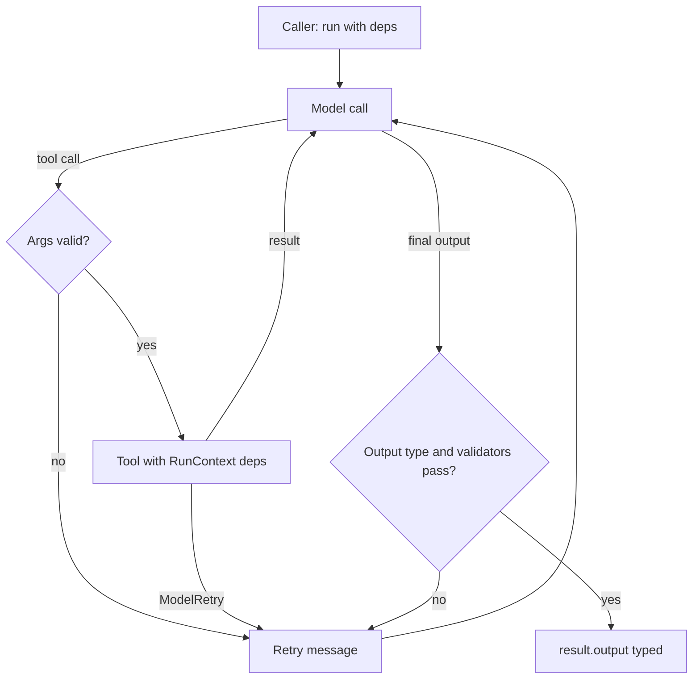

## TL;DR
Pydantic AI is a Python agent framework from the Pydantic team: an `Agent` with a model, instructions,
typed dependencies, tools and a validated output type, so agents feel like ordinary type-checked Python
functions across many model providers.

## For agent builders
- **Why it matters for agents.** Most agent bugs are contract bugs: a tool got the wrong argument type,
  the output missed a field, a dependency was a global. Pydantic AI makes deps, tool arguments and outputs
  typed and validated, and feeds validation errors back to the model to retry.
- **Where it shows up in your stack.** The agent module of a FastAPI or worker service, tools that
  receive a `RunContext` with your DB and HTTP clients, an `output_type` your downstream code relies on,
  and tests that swap in `TestModel`.
- **What you control.** Model string, instructions, `deps_type`, tools and their retries,
  `output_type`, output validators, usage limits and message history.
- **What you can skip.** Graph DSLs for simple agents. Pydantic Graph exists for explicit state
  machines, but most agents need only `Agent` plus plain Python control flow.

## Lab
### Task
Finish the refund agent from this lesson's first example so its contract holds under a hostile or
confused model. You add the ownership check in the tool, the order-total check in the output
validator, and a fail-closed handler for usage limits and exhausted retries.
- **Time box:** 45-75 minutes.
- **Prerequisites:** this lesson's run steps and validation diagram; Pydantic models.
- **Runs offline:** `scripted()` builds a `FunctionModel` that replays recorded turns (a probe for
  another customer's order, an over-total refund, a loop), so no provider key is needed.
- **Needs:** `pydantic-ai-slim` and `pytest`; checked with pydantic-ai-slim 2.60.0 (pydantic 2.14.1)
  on Python 3.12. Set `PYDANTIC_AI_NO_BANNER=1` to silence its stderr banner.

### Starter code
```python
# refund_agent.py: ownership checks, an output validator and a fail-closed budget (Pydantic AI, offline)
import asyncio
from dataclasses import dataclass
from pydantic import BaseModel, Field
from pydantic_ai import Agent, ModelRetry, RunContext
from pydantic_ai.exceptions import UnexpectedModelBehavior, UsageLimitExceeded
from pydantic_ai.messages import ModelResponse, ToolCallPart
from pydantic_ai.models.function import AgentInfo, FunctionModel
from pydantic_ai.usage import UsageLimits

@dataclass
class Deps:
    customer_id: str               # set by your auth layer per request
    orders: dict[str, dict]        # in production: a DB or API client

class RefundDecision(BaseModel):
    order_id: str
    eligible: bool
    amount_usd: float = Field(ge=0)
    reason: str

agent = Agent(deps_type=Deps, output_type=RefundDecision, retries=2,
              instructions="Orders under 30 days old and not refunded get a full refund.")

@agent.tool
async def get_order(ctx: RunContext[Deps], order_id: str) -> dict:
    """Fetch one of the current customer's orders by its ID."""
    # YOUR CODE 1: if the order is missing or belongs to another customer, raise
    # ModelRetry(f"No order {order_id} for this customer.") instead of returning it
    return ctx.deps.orders.get(order_id, {})

@agent.output_validator
async def within_total(ctx: RunContext[Deps], out: RefundDecision) -> RefundDecision:
    # YOUR CODE 2: raise ModelRetry("Refund amount cannot exceed the order total.")
    # when out.amount_usd is above the order's total_usd
    return out

async def handle(model, msg: str, deps: Deps) -> RefundDecision | None:
    """Return the decision, or None (route to a human) when the run cannot finish safely."""
    # YOUR CODE 3: catch UsageLimitExceeded and UnexpectedModelBehavior and return None
    r = await agent.run(msg, deps=deps, model=model, usage_limits=UsageLimits(request_limit=4))
    return r.output

def scripted(*turns):
    """A FunctionModel that replays recorded turns: ("tool", args) or ("final", output dict).
    It records every message list it receives, so tests can see what the model was told."""
    seen, queue = [], list(turns)
    def fn(messages, info: AgentInfo) -> ModelResponse:
        seen.append(messages)
        kind, args = queue.pop(0) if len(queue) > 1 else queue[0]  # repeat the last turn
        name = "get_order" if kind == "tool" else info.output_tools[0].name
        return ModelResponse(parts=[ToolCallPart(name, args)])
    return FunctionModel(fn), seen

ORDERS = {"A1": {"customer_id": "c1", "total_usd": 80.0, "days_ago": 12, "refunded": False},
          "B7": {"customer_id": "c2", "total_usd": 950.0, "days_ago": 3, "refunded": False}}
DEPS = Deps("c1", ORDERS)
OK = {"order_id": "A1", "eligible": True, "amount_usd": 80.0, "reason": "12 days old"}

async def main():
    probe, _ = scripted(("tool", {"order_id": "B7"}), ("tool", {"order_id": "A1"}), ("final", OK))
    print("probe:", await handle(probe, "Refund order B7", DEPS))
    greedy, _ = scripted(("tool", {"order_id": "A1"}), ("final", {**OK, "amount_usd": 120.0}), ("final", OK))
    print("greedy:", await handle(greedy, "Refund A1 plus extra", DEPS))
    loop, _ = scripted(("tool", {"order_id": "A1"}))
    try:
        print("loop:", await handle(loop, "Refund A1", DEPS))
    except Exception as e:  # what your API handler would turn into a 500
        print("loop: crashed with", type(e).__name__)

if __name__ == "__main__":
    asyncio.run(main())
```

As given, the probe silently receives customer `c2`'s order, `greedy` returns `amount_usd=120.0` for
an 80.0 order, and the loop ends with `crashed with UsageLimitExceeded`.

### Expected output
```
probe: order_id='A1' eligible=True amount_usd=80.0 reason='12 days old'
greedy: order_id='A1' eligible=True amount_usd=80.0 reason='12 days old'
loop: None
```

### Tests
```python
# test_refund_agent.py: run with `pytest -q`
import asyncio
from pydantic_ai import models
from pydantic_ai.messages import ToolReturnPart
import refund_agent as m

models.ALLOW_MODEL_REQUESTS = False  # any real model call fails loudly

def parts(seen):
    return [p for msgs in seen for msg in msgs for p in msg.parts]

def told(seen, text):  # did the model receive this text (as a retry or tool message)?
    return any(text in str(getattr(p, "content", "")) for p in parts(seen))

def test_other_customers_order_is_never_returned():
    model, seen = m.scripted(("tool", {"order_id": "B7"}), ("tool", {"order_id": "A1"}), ("final", m.OK))
    out = asyncio.run(m.handle(model, "Refund order B7", m.DEPS))
    assert out is not None and out.order_id == "A1"
    assert not any("c2" in str(p.content) for p in parts(seen) if isinstance(p, ToolReturnPart))
    assert told(seen, "No order B7 for this customer.")

def test_amount_above_total_is_sent_back_for_retry():
    model, seen = m.scripted(("tool", {"order_id": "A1"}),
                             ("final", {**m.OK, "amount_usd": 120.0}), ("final", m.OK))
    out = asyncio.run(m.handle(model, "Refund A1", m.DEPS))
    assert out.amount_usd == 80.0
    assert told(seen, "cannot exceed the order total")

def test_looping_agent_fails_closed():
    model, seen = m.scripted(("tool", {"order_id": "A1"}))
    assert asyncio.run(m.handle(model, "Refund A1", m.DEPS)) is None
    assert len(seen) <= 4

def test_exhausted_retries_fail_closed():
    model, _ = m.scripted(("tool", {"order_id": "A1"}), ("final", {**m.OK, "amount_usd": 500.0}))
    assert asyncio.run(m.handle(model, "Refund A1", m.DEPS)) is None
```

All four fail on the starter: a leaked `c2` order, an accepted 120.0 refund, an uncaught
`UsageLimitExceeded`, and an accepted 500.0 refund. The tests check message content, not part
classes: in 2.60.0 a `ModelRetry` reaches the model as a `ToolReturnPart`, while older releases use
`RetryPromptPart`.

### Failure scenarios
- **Inject a check on arguments only:** compare `order_id` against a prefix instead of
  `ctx.deps.customer_id`. The leak test fails. Print every `ToolReturnPart` the model saw; any
  `customer_id` other than the caller's is the bug.
- **Inject a vague retry message:** raise `ModelRetry("invalid")`. A real model now retries blindly
  and hits `UnexpectedModelBehavior` more often. Count retries per run in traces and make each message
  say what to change.
- **Inject `retries=0` on the agent:** the probe and greedy cases both return `None`. The checks work
  but the model gets no second attempt; compare the retry budget with the retry rate on your eval set.

### Submission
- **Your `refund_agent.py`** with the three `YOUR CODE` steps done and nothing else changed.
- **A `pytest -q` run** showing 4 passed, plus the script output matching the expected lines.
- **The message log** for the probe run, showing the retry text the model received.
- **A short note** on which checks belong in the type, the tool and the validator, with one example of
  each from your code.
- **Evaluated on:** green tests, ownership checked against `ctx.deps`, and no exception reaching the
  caller.

## Why it exists
- **Structured output alone is not enough.** Libraries such as Instructor validate one call's output;
  agents also need tools, dependencies, retries across a loop and history. Pydantic AI covers the loop
  with the same validation discipline.
- **Globals make agents untestable.** Tools that import a DB client cannot be tested or scoped per user.
  Dependency injection through `RunContext[Deps]` makes every tool a function of its inputs.
- **Validation errors are signal.** When the model returns a refund amount of -5, a `ValidationError`
  or `ModelRetry` is sent back as a retry prompt, so the model fixes it instead of your code crashing.
- **Teams switch providers.** One `provider:model` string (for example `openai:...`, `anthropic:...`)
  and a common interface reduce provider lock-in, while still exposing provider-specific settings.

## How it works
### The core objects
| Object | Role | Notes |
|---|---|---|
| `Agent(model, deps_type=..., output_type=..., instructions=...)` | the agent definition, reusable across runs | generic over deps and output types, so type checkers follow it |
| `RunContext[Deps]` | first parameter of context-aware tools and validators | `ctx.deps` holds your clients and identity; `ctx.usage` the running usage |
| `@agent.tool` / `@agent.tool_plain` | register tools with or without context | schema from type hints; docstring becomes the description |
| `output_type` | a Pydantic model, dataclass, scalar or union | validated; on failure the model is asked to retry |
| `@agent.output_validator` | extra checks that need deps or I/O | raise `ModelRetry("why")` to ask for a corrected output |
| `ModelRetry` | exception from a tool or validator | becomes a retry message to the model, bounded by `retries` |
| `UsageLimits` | caps on requests and tokens per run | exceeding raises `UsageLimitExceeded` |

### A run, step by step
1. **`agent.run(prompt, deps=...)`** (or `run_sync`, `run_stream`, `iter`) starts the loop.
2. **The model is called** with instructions, history and tool schemas generated from type hints.
3. **Tool calls are validated** against the schema; invalid arguments go back to the model as a retry.
4. **Tools run** with `RunContext`; a `ModelRetry` they raise also goes back as a retry message.
5. **The final output is validated** against `output_type`, then by output validators.
6. **The run returns** `result.output` (typed), `result.usage()`, and messages via `result.new_messages()`
   or `result.all_messages()`. Passing `message_history=` continues a conversation.
- **Retries are bounded.** `retries` on the agent or a tool caps attempts; past that, the run raises
  `UnexpectedModelBehavior`, which you catch and fail closed on.
- **Parameter names follow 1.x** (`output_type`, `result.output`); older examples use `result_type` and
  `result.data`.

### Around the agent
- **Testing:** `pydantic_ai.models.test.TestModel` and `FunctionModel`, swapped in with
  `agent.override(model=...)`, plus `models.ALLOW_MODEL_REQUESTS = False` in tests.
- **Observability:** OpenTelemetry instrumentation, with first-class Logfire support
  (`logfire.instrument_pydantic_ai()`); any OTel backend works.
- **Evals:** the separate `pydantic_evals` package defines `Case` and `Dataset` objects with evaluators.
- **Integrations:** MCP servers as toolsets, `FallbackModel` for provider failover, and durable-execution
  integrations; check the current docs for which engines are supported.

## Diagram
Follow how validation failures loop back to the model instead of surfacing as crashes.



## Examples
### A typed refund agent with dependencies and validation
Requires `pip install pydantic-ai` (or `pydantic-ai-slim[openai]`) and a provider key. The deps object
stands in for a database client.

```python
from dataclasses import dataclass
from pydantic import BaseModel, Field
from pydantic_ai import Agent, ModelRetry, RunContext

@dataclass
class Deps:
    customer_id: str
    orders: dict[str, dict]            # in production: a DB or API client

class RefundDecision(BaseModel):
    order_id: str
    eligible: bool
    amount_usd: float = Field(ge=0)
    reason: str

agent = Agent("openai:gpt-4o-mini", deps_type=Deps, output_type=RefundDecision,
              instructions="Orders under 30 days old and not refunded are eligible for a full refund.")

@agent.tool
async def get_order(ctx: RunContext[Deps], order_id: str) -> dict:
    """Fetch one of the current customer's orders by its ID."""
    order = ctx.deps.orders.get(order_id)
    if order is None or order["customer_id"] != ctx.deps.customer_id:
        raise ModelRetry(f"No order {order_id} for this customer. Ask the user to check the ID.")
    return order

@agent.output_validator
async def within_total(ctx: RunContext[Deps], out: RefundDecision) -> RefundDecision:
    order = ctx.deps.orders.get(out.order_id)
    if order and out.amount_usd > order["total_usd"]:
        raise ModelRetry("Refund amount cannot exceed the order total.")
    return out

deps = Deps("c1", {"A1": {"customer_id": "c1", "total_usd": 80.0, "days_ago": 12, "refunded": False}})
result = agent.run_sync("Can I get my money back for order A1?", deps=deps)
print(result.output)        # RefundDecision(order_id='A1', eligible=True, amount_usd=80.0, ...)
print(result.usage())
```

- **Three layers of contract:** `Field(ge=0)` in the type, ownership in the tool, cross-field logic in the
  validator. Each failure becomes a retry, not an exception in your handler.
- **Ownership check uses deps,** so the model cannot read another customer's order by guessing IDs.

### Production shape: tests without the network, budgets and stored history
Tests run against `TestModel`; production runs cap requests and persist history as JSON.

```python
import pytest
from pydantic_ai import models
from pydantic_ai.exceptions import UsageLimitExceeded
from pydantic_ai.messages import ModelMessagesTypeAdapter
from pydantic_ai.models.test import TestModel
from pydantic_ai.usage import UsageLimits

models.ALLOW_MODEL_REQUESTS = False             # any real model call in tests fails loudly

def test_agent_returns_refund_decision():
    with agent.override(model=TestModel(call_tools=[])):   # skip tools, generate a schema-valid output
        result = agent.run_sync("refund A1?", deps=deps)
    assert isinstance(result.output, RefundDecision)

async def handle(msg: str, deps: Deps, history_json: bytes | None):
    history = ModelMessagesTypeAdapter.validate_json(history_json) if history_json else None
    try:
        r = await agent.run(msg, deps=deps, message_history=history,
                            usage_limits=UsageLimits(request_limit=8))
    except UsageLimitExceeded:
        return None, history_json                # fail closed; log and route to a human
    return r.output, r.all_messages_json()      # store bytes keyed by conversation ID
```

| Concern | Mechanism | What it buys |
|---|---|---|
| Unit tests | `TestModel`, `agent.override` | deterministic, free, no network |
| Runaway loops | `UsageLimits(request_limit=8)` | a hard stop with a typed exception |
| Conversations | `message_history`, `all_messages_json()` | stateless service, history in your DB |
| Bad outputs | `output_type` plus validators | downstream code never sees an invalid object |

## Production patterns
- **Inject everything through deps.** Put DB pools, HTTP clients, the authenticated user and feature
  flags in a `Deps` dataclass built per request. Tools then scope queries to `ctx.deps.user`, and tests
  pass fakes. Monitor tool latency per dependency, because slow clients dominate agent latency.
- **Make the output type the API contract.** Downstream services consume `result.output` directly, so
  version that Pydantic model like an API schema. Track retry counts from validation failures per model;
  a rise after a model upgrade is an early regression signal.
- **Instrument with OpenTelemetry.** Call `logfire.configure()` and `logfire.instrument_pydantic_ai()`,
  or export to another OTel backend, so each run shows model requests, tool calls, retries and token
  usage. Alert on runs that hit retry limits.
- **Budget every run.** Pass `UsageLimits` (requests and tokens), set `retries` per tool, and catch
  `UsageLimitExceeded` and `UnexpectedModelBehavior` to fail closed. Record `result.usage()` per run for
  cost dashboards.
- **Evaluate with datasets.** Keep a `pydantic_evals` `Dataset` of `Case` objects (input, expected
  output, evaluators) in the repo and run it in CI on prompt, model or tool changes. Report pass rate and
  cost per case.
- **Fail over providers deliberately.** Use `FallbackModel` with two providers for availability, but run
  the eval set against both, because a fallback model that breaks your output type is not a fallback.

## Trade-offs
- **Explicit types vs speed of prototyping.** Defining deps and output models takes minutes up front and
  saves hours of debugging later. Flips for throwaway notebooks where a raw API call is faster.
- **Thin framework vs batteries.** No built-in retrieval stack, memory store or multi-agent runtime; you
  compose them (LlamaIndex retrievers as tools, your DB for memory). Flips to a heavier framework when you
  want those prebuilt.
- **Retries on validation vs cost and latency.** Each retry is another model call; strict types with a
  weak model can double cost. Flips toward looser types or a stronger model when retry rate is high.
- **Plain Python control flow vs graphs.** Most flows stay readable as functions calling agents; durable
  pauses need Pydantic Graph persistence or a durable-execution integration, where LangGraph is more
  established.

## Pitfalls
- **Copying pre-1.0 examples.** Symptom: `result_type` or `result.data` errors. Fix: use `output_type`
  and `result.output`, and pin the version your examples target.
- **Trusting IDs from tool arguments.** Symptom: the agent fetches another user's records. Fix: tools
  check ownership against `ctx.deps`, set from your auth layer.
- **Unbounded `ModelRetry` loops.** Symptom: slow runs that end in `UnexpectedModelBehavior`. Fix: make
  retry messages specific and actionable, set `retries`, and log which tool or validator retried.
- **Tests that silently call real models.** Symptom: slow, flaky, billed CI. Fix: set
  `models.ALLOW_MODEL_REQUESTS = False` and override with `TestModel` or `FunctionModel`.

## When to use
- **Use when** your team writes typed Python (FastAPI, Pydantic), the agent's output feeds other code,
  and you want provider flexibility with testable tools.
- **Avoid when** you need a prebuilt multi-agent collaboration runtime or heavy retrieval scaffolding
  out of the box; look at CrewAI, LangGraph or LlamaIndex.
- **Pairs well with** LlamaIndex retrievers as tools, Logfire or Langfuse for traces, and a durable
  engine for long-running runs.
- **Measure** validation retry rate, usage-limit hits, tool error rate, eval pass rate and cost per run.

## Role lens
- **Engineer:** Writes `Deps`, tools and output models, adds validators that raise `ModelRetry` with
  clear messages, and keeps tests on `TestModel` with real-model evals separate.
- **Architect:** Treats output types as versioned contracts between the agent and downstream services,
  and picks where durability and memory live outside the framework.
- **FDE:** Adapts the deps to the customer's systems and shows them validated, typed outputs their
  existing code can consume without parsing free text.

## Check yourself
**Q:** A Pydantic AI agent extracts invoice data into an `Invoice` model. After switching to a cheaper
model, latency doubled and some runs fail with `UnexpectedModelBehavior`. What is happening and what do
you do?
**A:** The cheaper model is producing outputs that fail validation (wrong types, missing fields, or your
validator's checks), so each run spends extra requests on retries, and some exceed the retry limit.
Confirm it in traces by counting retries per run and which field failed. Options: improve field
descriptions and instructions so the schema is easier to satisfy, relax types that are stricter than
the business needs, raise `retries` only if the success rate justifies the cost, or keep the stronger
model for this agent. Decide on cost per successful extraction from an eval set, not on per-call price.

## Interview questions
### Why does Pydantic AI pass dependencies through RunContext instead of letting tools import clients?
- **Testability:** tools become functions of their inputs, so tests pass fakes without patching
  globals.
- **Scoping:** each request builds its own deps with the authenticated user, so tools enforce ownership
  from code.
- **Typing:** `RunContext[Deps]` lets type checkers verify every tool uses the deps correctly.

### What happens when a model returns output that fails your output type?
- **The validation error is sent back** to the model as a retry prompt describing what failed.
- **Output validators** can raise `ModelRetry` for checks that need data, such as amounts versus totals.
- **Retries are bounded;** past the limit the run raises `UnexpectedModelBehavior`, which you handle by
  failing closed.

### How would you test a Pydantic AI agent in CI?
- **Unit level:** `TestModel` or `FunctionModel` via `agent.override`, with real requests disabled, to
  test tools, deps wiring and output handling deterministically.
- **Eval level:** a `pydantic_evals` dataset run against the real model on prompt or model changes, with
  pass rate and cost reported.
- **Keep them separate** so unit tests stay fast and free.

### When would you not choose Pydantic AI?
- **When the hard part is retrieval,** LlamaIndex's data layer does more for you.
- **When you need multi-day pauses and checkpoints as a first-class graph,** LangGraph is more mature.
- **When you want a full computer-use harness** with file and shell tools, a vendor harness such as the
  Claude Agent SDK fits better.

### How do you bound cost for a Pydantic AI agent in production?
- **`UsageLimits`** on requests and tokens per run, caught as `UsageLimitExceeded`.
- **`retries`** per tool and output, so validation loops end.
- **Measure** `result.usage()` per run and cost per successful task, and compare models on an eval set.

## Quiz
### Q: In Pydantic AI, what does raising ModelRetry inside a tool do?
- [ ] It crashes the run immediately with a stack trace
- [x] It sends the message back to the model as a retry prompt, bounded by the configured retries
- [ ] It retries the HTTP request to the model provider
- [ ] It switches to a fallback model
> `ModelRetry` turns a tool or validator failure into feedback for the model. Past the retry limit the
> run raises `UnexpectedModelBehavior`.

### Q: Where should a tool get the authenticated user's ID from?
- [ ] From a tool argument the model fills in
- [ ] From the system prompt
- [x] From ctx.deps, built per request by your application
- [ ] From the previous message in the history
> Deps are set by your code and never by the model, so ownership checks based on them cannot be talked
> around by the model or by injected text.

### Q: Which setup keeps unit tests deterministic and free?
- [ ] Running against the real model with temperature 0
- [x] Overriding the agent's model with TestModel and disabling real model requests
- [ ] Caching real responses in a global variable
- [ ] Setting UsageLimits to one request
> `TestModel` generates schema-valid responses without network calls, and `ALLOW_MODEL_REQUESTS = False`
> makes accidental real calls fail.

## Use cases & projects
### Use cases
- **Extraction agents feeding systems.** Invoices, contracts or tickets become validated models that
  downstream code writes to a database without parsing text.
- **Customer-facing assistants inside FastAPI services.** Deps carry the user and clients per request,
  and typed outputs drive UI components.
- **Decision agents with audit needs.** Typed decisions with reasons and validator checks give
  reviewers a consistent record to audit.
- **Multi-provider products.** One agent definition runs on several providers, with `FallbackModel` for
  availability and evals per provider.

### Mini project
**Typed support-decision agent with tests and an eval (2-3 hours).**
- **Goal:** an agent that returns a validated `Decision` for 20 support messages, with tests that never
  call a real model.
- **Steps:** define `Deps` with a fake order store and the current user; add two tools with ownership
  checks; set an `output_type` and one output validator; write `TestModel` unit tests; build a
  20-case `pydantic_evals` dataset; run it on two models with `UsageLimits`.
- **Done when:** unit tests pass offline, and a table shows eval pass rate, retry rate and cost per case
  for both models.

### Major project
**Typed claims-processing agent service (multi-day; fits the module Capstone).**
- **Goal:** a FastAPI service where a Pydantic AI agent reads a claim, checks policy and records a typed
  decision for human approval.
- **Scope:** deps with DB and policy clients; tools with ownership checks; versioned output models;
  stored message history; OTel tracing; `FallbackModel`; an approval queue for payouts.
- **Done when:** a 60-case eval reports accuracy, retry rate and cost per claim on two providers, and no
  payout is recorded without approval.
