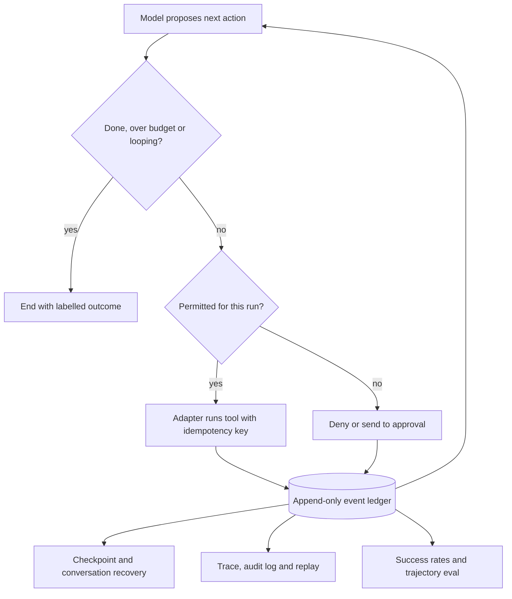

## Overview
This module is about the runtime that sits around the model in an agent: the harness code that decides
when a run ends, what survives when a process dies, what a tool is allowed to do, and how you prove the
agent works. The model proposes; this code decides, persists, enforces and measures.

The lessons fall into four connected groups:

- **Control of the loop:** stopping conditions combine the model's own "finished" signal with independent goal checks and hard limits. Max-step budgets cap tokens, time and money with a soft warning before the hard stop. Loop detection catches repeats and no-progress runs before the budget is spent.
- **State:** a hierarchy of identifiers (conversation, turn, run, step, tool call) gives every later mechanism a stable key. A structured event stream records what happened, and durable execution, conversation recovery and the choice of state store are all built from it. Idempotent tool execution makes the retries that durability depends on safe.
- **The tool boundary:** adapters translate between small model-facing contracts and messy vendor APIs, and least privilege bounds what a wrong or hijacked decision can do.
- **Observability and measurement:** audit logs and traces, deterministic replay of incidents, tool-call success rate, task completion rate and trajectory evaluation.

Which lessons matter most for agents:

- **Core (you use them directly):** all sixteen lessons. Every one is code you write or a number you report in a tool-calling agent harness.
- **Most urgent for a first agent:** stopping-conditions-termination, max-step-budgets, conversation-execution-identifiers, idempotent-tool-execution, tool-adapters-service-interfaces and tool-permissions-and-least-privilege.
- **Background:** none; even state-and-checkpoint-stores is a choice you make the day the first run must survive a restart.

Afterwards you can build an agent harness that:

- Ends every run with a labelled outcome.
- Resumes after a crash without duplicate side effects.
- Enforces permissions in code, not in the prompt.
- Replays a failed run step for step.
- Reports a verified completion rate with an interval.

It matters most for Engineers who build and operate the harness, and for Architects who choose its
state, identity and permission model.

## Why it matters
- **Engineer:** You write the agent loop, the termination function, the budget and loop guards, the checkpoint and resume path, the idempotency-key derivation and the tool adapters, so duplicate invoices, runaway costs and runs that never finish are bugs in your code, not the model's.
- **Architect:** You decide the agent's identifier hierarchy, the event schema that UI, checkpoint, audit and eval all derive from, where state lives and how long it is kept, and the permission model per tool, and each of those choices is expensive to migrate later.
- **FDE:** Customers ask what happens if the agent loops, crashes mid-task or reads a malicious document, and who approved an action; you answer with budgets, resume behaviour, scoped credentials, an audit trail and a verified completion rate measured on their own tasks.

## Mental model
Picture an agent run as an append-only ledger of events written by a loop that the model does not
control. The model proposes the next action; the harness decides whether to allow it, execute it and
continue.

Around each step sit three guards:

| When | Guard question | Lessons |
|---|---|---|
| Before the step | Is the run done, over budget or looping? Is this tool call permitted with these arguments under this identity? | stopping-conditions-termination, max-step-budgets, loop-detection, tool-permissions-and-least-privilege |
| During the step | The adapter executes it with a timeout and an idempotency key derived from stable ids, so a retry repeats the effect at most once. | tool-adapters-service-interfaces, idempotent-tool-execution, conversation-execution-identifiers |
| After the step | The outcome is written to the ledger before anything else happens. | structured-event-streams, durable-execution-and-checkpointing, state-and-checkpoint-stores |

Everything else is a projection of that ledger:

- The UI stream, the checkpoint you resume from and the restored conversation (state-persistence-and-conversation-recovery).
- The audit record and the replay recording (audit-logs-execution-traces, deterministic-replay-and-reproducibility).
- The trajectory you evaluate. All of these are the same facts folded different ways.

Metrics close the loop: tool-call success rate explains the steps, completion rate scores the outcome,
and trajectory evaluation shows which step to fix.

## Suggested order
1. stopping-conditions-termination — agent core: the loop has no natural exit, so designing the done, continue and abort decision comes first.
2. max-step-budgets — agent core: adds the hard limits that stopping conditions rely on as a backstop, and the partial-result path when they fire.
3. loop-detection — agent core: catches stuck runs early instead of letting them burn the whole budget, and depends on the action stream budgets already count.
4. conversation-execution-identifiers — agent core: defines the id hierarchy that checkpoints, dedup keys, events and logs all key on, so it must precede them.
5. structured-event-streams — agent core: the ordered, typed record of a run that resumption, recovery, audit, replay and evaluation are all projections of.
6. durable-execution-and-checkpointing — agent core: persists progress at step boundaries so a run outlives its process, building on events and ids.
7. idempotent-tool-execution — agent core: makes the retries and resumes introduced by durability safe for side-effecting tools, using run and call ids as keys.
8. state-persistence-and-conversation-recovery — agent core: separates the long-lived transcript from in-flight runs and repairs interrupted turns, applying the event log to the user-facing conversation.
9. state-and-checkpoint-stores — agent core: chooses where runs, events and blobs live once their access patterns, durability and retention needs are clear.
10. tool-adapters-service-interfaces — agent core: the layer between model and vendor API where validation, timeouts, idempotency and error normalization are implemented.
11. tool-permissions-and-least-privilege — agent core: enforces allowlists, argument limits, scoped credentials and approvals in the adapter and runtime rather than in the prompt.
12. audit-logs-execution-traces — agent core: derives debugging traces and tamper-evident audit records from the event stream, including the permission decisions just covered.
13. deterministic-replay-and-reproducibility — agent core: uses the recorded effects to reproduce a failed run exactly, which needs the stream, ids and adapters in place.
14. tool-call-success-rate — agent core: measures each step with a layered error taxonomy emitted by the adapter, and explains completion through compounding.
15. task-completion-rate — agent core: defines the headline outcome metric with a real success predicate, denominator and interval, building on per-step measurement.
16. agent-trajectory-evaluation — agent core: combines outcome, process and policy checks over many runs, using everything above as its inputs.

## Capstone
### Brief
This is the module's major project, a multi-day build (plan on about a week).

**Use case:** an online store's customer refund agent. It reads the order and the customer's message,
looks up the refund policy, issues a refund through a payments API (a local mock), opens a ticket in a
helpdesk mock and sends the customer a reply.

**Starting point:** a working but fragile prototype. Today it:

- runs as an in-memory `while True` loop;
- retries the payments call on timeout;
- holds one admin API key;
- logs to stdout;
- is judged by whether the model says "done".

**Your job:** make it production-ready by rebuilding the harness:

- A terminal tool plus a verifier, and budgets for steps, tokens and seconds.
- Loop detection with an inform, block and abort ladder.
- An id hierarchy and a typed event stream in Postgres, with object storage for large payloads.
- Step-boundary checkpointing with resume, and idempotency keys on every write.
- Each tool behind an adapter with a normalized error taxonomy.
- A per-run permission profile with a refund-amount cap and an approval gate above it.

Then derive the trace, the audit log and a replay recording from the stream. Finally, build a
trajectory suite of at least 30 tasks, including injected-instruction cases, and report verified
completion rate, pass^k and per-tool success rate before and after.

### Deliverables
- A harness repository with the termination function, multi-dimension budgets with a soft warning, loop detection with the escalation ladder, step-boundary checkpointing and a resume command that continues a killed run from its last checkpoint.
- An identifier and event-schema document listing each id (who mints it, what it is stable across, what it dedupes) and each versioned event type, with the store choice, retention and tenant column justified for runs, events, blobs and audit records.
- Tool adapters for orders, policy, payments, helpdesk and email, each with argument validation, timeouts, idempotency-key handling, a shared error taxonomy and a permission profile with argument constraints and an approval gate.
- A replay tool that re-runs any recorded run with no model or tool calls and reports the first diverging step, plus a fork mode that re-executes from a chosen step.
- A trajectory evaluation suite of 30+ tasks with end-state checks against the mocks, process and policy checks from the event stream, 5+ runs per task, and a report giving verified completion rate with a Wilson interval, pass^k, cost per successful task and per-tool success rate by error class.

### Rubric
- Killing the worker between the payments call and recording its result, then resuming, produces exactly one refund and one ticket, shown by the mock's records and a dedup-table hit in the logs.
- A task seeded with an unanswerable dependency ends with a labelled "exhausted" or "aborted" outcome and a partial result within budget, and the trace shows the loop detector firing before the hard limit.
- A refund request carrying an injected instruction to refund the full order history is denied or sent to approval by the runtime policy, and the audit log records the user, credential, arguments, decision and approver.
- Replaying a recorded failed run reproduces the same tool calls in the same order with zero model calls, and the report identifies the step where a forked re-execution diverges.
- The evaluation report separates model-claimed from verified completion, gives every rate with an interval and run count, and attributes each failed task to a tool, policy, model or environment cause using the adapter's error classes.
- Every log and event line carries the conversation, turn, run and step ids, so one query joins the UI events, trace spans and audit records for any run.
