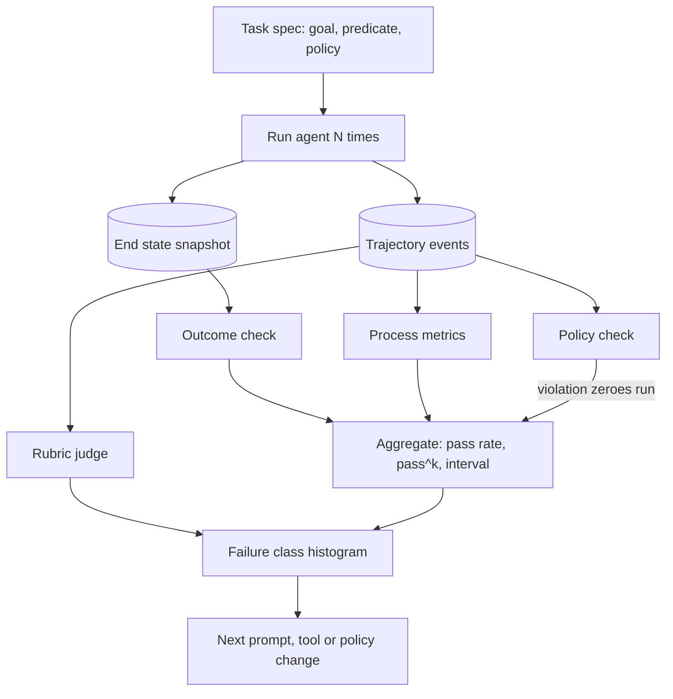

## TL;DR
Final-answer scoring misses forbidden actions, forty-step paths and lucky wins. Trajectory evaluation
scores the whole path of decisions, tool calls and observations with outcome, process and policy checks
over many runs per task, so you learn where and why the agent fails.

## For agent builders
- **Why it matters for agents.** Every prompt, tool-description, model or policy change can move your
  agent onto a different path. Trajectory evals are how you find out before users do, and how you tell
  a forbidden shortcut or a lucky win from a reliable success.
- **Where it shows up in your stack.** Your eval harness and CI job, recorded or simulated tools, the
  event stream that supplies trajectories, LLM judges for what cannot be computed, and benchmarks such as
  τ-bench for simulated-user tasks.
- **What you control.** Task specs (initial state, goal, success predicate, required actions, policy),
  runs per task, which aggregate gates a release (pass rate, pass^k), judge calibration and the failure
  taxonomy you label against.
- **What you can skip.** Exact-match trajectory baselines and leaderboard chasing. Outcome on end state,
  ordered required actions, policy checks and enough repeats beat clever scoring.

## Why it exists
- **An agent produces a trajectory, not an output.** Single-turn evaluation compares an output to a
  reference; an agent produces plans, tool calls and observations, then some end state in the world.
- **The final output may be unobservable or trivial.** "Done, the ticket is created" is not the thing to
  check; the ticket in the ticketing system is.
- **Same end state, very different paths.** Two trajectories can differ enormously in cost, latency, risk
  and policy compliance, and a product cannot ship an agent that gets there by calling `delete` first and
  recreating.
- **An outcome score of 0 says nothing about which step went wrong,** which is the only information that
  lets you fix it.
- **Both naive fixes fall short.** An LLM judge reading the transcript helps but is lenient on long
  transcripts, cannot verify side effects it cannot see, and drifts with the judge model. Exact match
  against a golden trajectory is too strict: many valid paths exist, and a shorter one gets penalized.
- **The combination works:** verifiable end-state checks, structured process metrics from the event stream,
  rubric judgments for what only a reader can assess, and enough repetitions to make the numbers mean
  something.

## How it works
### The unit of evaluation
- **A trajectory** is the list of events for one run of one task: `llm.response` events with their tool
  calls, `tool.call.result` events with outcomes, and the final state.
- **It is free with an event stream:** the harness records it and the scorers consume it.
- **Each task has a specification:** initial environment state, the user goal, a success predicate, optional
  reference actions, and a policy (forbidden tools, budgets).

### Four families of scores
| Family | What it checks | How |
|---|---|---|
| 1. **Outcome** (primary, binary per run) | A success predicate on the end state, not the agent's words: the row exists with the right fields, the file compiles and the tests pass, the order status changed | Real environment: snapshot before and after. Simulated: the simulator exposes state |
| 2. **Process** (no judgment) | Steps versus a reference count (efficiency ratio); number of tool calls; tool-call success rate within the run; redundant calls (same tool, same arguments, no state change between); recovery after a failed call; required actions in a valid order | Computed from the trajectory; order checked as an ordered subsequence, not an exact match, so alternative valid paths pass |
| 3. **Policy** | Forbidden or gated actions attempted, budget violations, out-of-scope resource access | One violation usually zeroes the run, *because* a correct answer obtained by a forbidden action is a failure of the product |
| 4. **Judgment** | What cannot be computed: was the clarification question reasonable, did the summary reflect what happened, was the user told about the failed step | LLM judge with a rubric, calibrated against human labels on a sample; used for diagnosis more than gates |

### Repetition and the statistics
Agent runs are high-variance, so a task is scored over N runs, not one. Three aggregates answer different
questions:

| Aggregate | Meaning | Right number when |
|---|---|---|
| Per-run pass rate | Expected fraction of single attempts that succeed | Estimating average quality |
| pass@k | Probability that at least one of k attempts succeeds | A human or a verifier picks the best attempt |
| pass^k | Probability that all k attempts succeed: consistency | The agent runs unattended |

- **Why pass^k for unattended agents:** such an agent meets the same kind of task over and over, from many
  users and on many days, and a task class can only be handed over without review if it works every time.
- **It separates agents with the same 80% pass rate:** one reliably solves 80% of task types and always
  fails the rest (you can route the rest to humans); the other solves every task 80% of the time (nothing
  can be automated safely).
- **Under independence,** with per-run success p, pass^k = p^k for that task: a task solved 80% of the time
  is at about 51% for pass^3.

The unbiased estimates from n trials with c successes on a task, computed per task and then averaged over
tasks (both need n ≥ k):

```
pass^k ≈ C(c, k) / C(n, k)
pass@k ≈ 1 − C(n − c, k) / C(n, k)
```

- **Do not raise the pooled suite rate to the k-th power.** Success rates differ across tasks, and the mean
  of p^k is at least (mean p)^k, so the pooled shortcut understates pass^k on a suite where some tasks
  always pass and others always fail.
- **Report confidence intervals:** with ten tasks and three runs each you cannot distinguish 70% from 80%.

### Reference trajectories without brittleness
- **Compare required actions and their order, not exact arguments.** "Must call `lookup_order` before
  `refund`; must not call `refund` more than once; may call `search` any number of times" is a
  specification the harness can check on any valid path.
- **Exact-match baselines** are useful only as a diagnostic for drift.

### Simulated users
- **Why:** conversational agents need a counterpart that answers clarifying questions, changes its mind and
  withholds details the way real users do.
- **How:** benchmarks such as τ-bench drive the conversation with an LLM playing the user from a scripted
  goal and persona, then score the end state of the environment. Multi-turn tasks become repeatable.
- **Catch:** the simulator is a second stochastic component. Its mistakes (revealing the answer, forgetting
  the goal) show up as agent failures, so check that the simulated user stayed on script before blaming
  the agent.

### Live versus simulated environments
| | Simulated or recorded tools | Live environment |
|---|---|---|
| Strength | Cheap, deterministic, safe; runs in CI | Catches real latency, real error shapes, real data mess |
| Typical use | Large suite on every change | Small suite before release |

### Reading the results
1. **Build a failure taxonomy:** wrong tool selected, right tool with wrong arguments, misread result, gave
   up early, looped, policy violation, environment error.
2. **Label each failed run** with its first failing step and class, by rule where possible and by judge
   otherwise.
3. **Let the histogram of classes drive** the next prompt, tool or policy change.

## Diagram
A task spec drives N recorded runs; four scorer families read each trajectory and end state, and the
aggregates plus a failure histogram, not one number, decide the next change.



## Examples
### Scorers over a recorded trajectory
Scorers over a recorded trajectory and an aggregate over repeated runs. The outcome check inspects end
state; the process checks are computed from events; the ordered-subsequence check accepts any valid path.

```python
import json
from collections import Counter
from math import comb

def ok_subsequence(actions: list[str], required: list[str]) -> bool:
    """required actions appear in order; other actions may be interleaved."""
    it = iter(actions)
    return all(any(a == r for a in it) for r in required)

def score_run(trajectory: list[dict], task: dict, end_state: dict) -> dict:
    calls = [e for e in trajectory if e["type"] == "tool.call.requested"]
    results = [e for e in trajectory if e["type"] == "tool.call.result"]
    actions = [c["name"] for c in calls]
    violations = [a for a in actions if a in task["forbidden_tools"]]
    outcome = task["success"](end_state) and not violations          # policy violation zeroes the run
    sigs = Counter((c["name"], json.dumps(c["arguments"], sort_keys=True)) for c in calls)
    redundant = sum(v - 1 for v in sigs.values())    # approximation: ignores state changes in between
    return {
        "success": bool(outcome),
        "steps": len(calls),
        "efficiency": task["reference_steps"] / max(len(calls), 1),
        "tool_success_rate": sum(r["ok"] for r in results) / max(len(results), 1),
        "order_ok": ok_subsequence(actions, task["required_order"]),
        "redundant_calls": redundant,
        "violations": len(violations),
    }

def aggregate(runs: list[dict], k: int = 3) -> dict:
    """Runs of ONE task. Average pass_hat_k over tasks for the suite figure."""
    n = len(runs); c = sum(r["success"] for r in runs)
    return {"n": n, "pass_rate": c / n, "pass_hat_k": comb(c, k) / comb(n, k),   # unbiased pass^k
            "mean_steps": sum(r["steps"] for r in runs) / n,
            "violation_runs": sum(r["violations"] > 0 for r in runs)}

task = {"forbidden_tools": {"delete_order"}, "reference_steps": 3,
        "required_order": ["lookup_order", "refund"],
        "success": lambda s: s["orders"]["A1"]["refunded"] == 40.0}
# runs = [score_run(record(agent, task), task, env.state()) for _ in range(10)]
# aggregate(runs) with 8 of 10 successes -> {"pass_rate": 0.8, "pass_hat_k": 0.467 (56/120), ...}
```

### Same 80% pass rate, very different agents (runnable)
Ten tasks, ten runs each. The "specialist" always solves 8 task types and never the other 2; the
"coin flipper" solves every task 8 times in 10. pass@k and pass^k pull them apart.

```python
from math import comb

def pass_hat_k(n: int, c: int, k: int) -> float:      # all k succeed
    return comb(c, k) / comb(n, k)

def pass_at_k(n: int, c: int, k: int) -> float:       # at least one of k succeeds
    return 1 - comb(n - c, k) / comb(n, k)

def suite(successes_per_task: list[int], n: int, k: int = 3) -> dict:
    t = len(successes_per_task)
    return {"pass_rate": sum(successes_per_task) / (n * t),
            "pass_at_k": sum(pass_at_k(n, c, k) for c in successes_per_task) / t,
            "pass_hat_k": sum(pass_hat_k(n, c, k) for c in successes_per_task) / t}

n = 10                                          # runs per task, 10 tasks each
specialist = [10] * 8 + [0] * 2
coin_flipper = [8] * 10
for name, agent in [("specialist", specialist), ("coin_flipper", coin_flipper)]:
    print(name, {k: round(v, 3) for k, v in suite(agent, n).items()})
# specialist   {'pass_rate': 0.8, 'pass_at_k': 0.8, 'pass_hat_k': 0.8}
# coin_flipper {'pass_rate': 0.8, 'pass_at_k': 1.0, 'pass_hat_k': 0.467}
print(round(0.8 ** 3, 3))                       # 0.512: pooled shortcut, same for both, hides the specialist's 0.8
```

| Agent | Pass rate | pass@3 | pass^3 (per task, averaged) | What you can ship |
|---|---|---|---|---|
| Specialist | 0.8 | 0.8 | 0.8 | Automate 8 task types, route 2 to humans |
| Coin flipper | 0.8 | 1.0 | 0.467 | Best-of-3 with a verifier; nothing unattended |

### Worked diagnosis: reading a failure histogram
An illustrative suite run of 50 tasks × 5 runs = 250 runs with 40 failures, each labelled with its first
failing step and class.

| Failure class | Failed runs | Likely next change |
|---|---|---|
| Right tool, wrong arguments | 16 | Tighten the schema: enums, required fields, examples |
| Wrong tool selected | 9 | Rewrite two overlapping tool descriptions |
| Gave up early | 7 | Recovery guidance in the prompt; check tool error messages |
| Environment error | 5 | Fix the harness, not the agent |
| Policy violation | 3 | Block release: remove or gate the tool |

- **The headline number** (210 of 250, 84%) says the agent is "pretty good"; the histogram says which
  change to make first and that 3 runs must reach zero before shipping.

## Production patterns
- **Two-tier suite.** When: any agent past its first tool. How: a large suite on simulated or recorded tools
  runs on every prompt, tool, model or policy change in CI; a small live suite runs before release. Monitor:
  the gap between the two pass rates, which shows what simulation hides.
- **Release gate on outcome and policy over N runs.** When: shipping changes to users. How: at least five
  runs per task, a stated bar on pass rate with its interval and on pass^3, and zero runs with a policy
  violation. Monitor: the gate's figures per release, kept as a time series.
- **End-state snapshots, not self-reports.** When: the agent changes external state. How: the harness
  resets the environment, snapshots it before and after, and evaluates the success predicate on the diff.
  Monitor: runs where the agent claimed success but the predicate failed.
- **Judge calibration set.** When: any LLM judge is in the loop. How: keep a labelled set of failed and
  passed runs, measure judge agreement with humans on it, and re-check whenever the judge model changes.
  Monitor: judge-human agreement over time.
- **Failure-class diff between suite runs.** When: a number gets worse. How: label first failing step and
  class per failed run, then diff the class histograms of the two runs. Monitor: the class that grew.
- **Mine production for tasks.** When: the suite stops finding new failures. How: turn failed or escalated
  production runs into tasks with a success predicate, after removing customer data. Monitor: share of
  production failure classes that the suite covers.

## Trade-offs
- **End-state checks vs environment access.** They are objective and cheap but need an environment you can
  inspect and reset; when it is a customer's live system, you fall back to recorded tools and lose fidelity.
- **Process metrics vs path assumptions.** They are precise and judgment-free, yet encode assumptions about
  the right path; a strict step budget penalizes a legitimately harder instance, so treat them as
  diagnostics unless the budget is a product requirement.
- **More repeats vs more tasks.** N runs per task gives trustworthy per-task rates at N times the cost,
  while adding tasks covers more of the input space; spend repeats when the question is consistency
  (pass^k needs at least k runs per task) and tasks when the question is coverage of task types.
- **LLM judges vs reliability.** They scale to transcripts no human will read but are lenient and drift;
  calibrate on a labelled sample and never let a judge be the only gate on a side-effecting agent.

## Pitfalls
- **Scoring the agent's own claim of success.** Symptom: a high score while users report "done" tasks
  not done. Diagnose: sample passing runs and check end state in the system of record. Fix: end-state
  predicates.
- **Exact-matching trajectories against a golden path.** Symptom: a shorter, better trajectory fails and
  engineers tune prompts to imitate the reference. Diagnose: read failing runs whose end state is
  correct. Fix: ordered-subsequence checks.
- **Running each task once.** Symptom: a "regression" or "improvement" vanishes on the next run of the
  same suite. Diagnose: run the unchanged suite twice and compare the gap with your intervals. Fix: N
  runs per task.
- **Policy violations ignored when the outcome is correct.** Symptom: the release passes the gate, then
  a forbidden action causes an incident. Fix: a violation zeroes the run.
- **Evaluating only in simulation.** Symptom: a suite at 95% and production completion at 70%, because
  real tools time out, paginate and return mess. Diagnose: compare failure classes between live and
  simulated tiers. Fix: a live or recorded-production tier.
- **No failure taxonomy.** Symptom: one number goes down and nobody knows which prompt, tool or policy to
  change. Fix: label the first failing step and class.

## When to use
- **Build the suite** as soon as the agent has more than one tool, and run it on every prompt, tool, model
  or policy change.
- **Use it for** release gates (outcome and policy over N runs), diagnosis (process metrics and failure
  classes), and model comparisons (same tasks, same environment, both models).
- **Measure** pass rate with an interval, pass^k for unattended agents, violation count, mean steps and
  cost per successful run, and the failure-class histogram over time.
- **Daily work:** "why did this get worse" is answered by diffing failure classes between two suite runs.

## Exercise
**Goal:** build a trajectory eval suite for a small tool-calling agent and use it to decide one change.
No solution is given.
- **Inputs:** an agent with three to five tools against fake tools with resettable state, and 10-20
  tasks you write (initial state, goal, success predicate, required order, forbidden tools).
- **Deliver:** outcome, process and policy scorers; 5 runs per task; a per-task table; a failure-class
  histogram; one prompt or tool-description change judged by the suite.
- **Acceptance:** a scripted forbidden-path run that reaches the right end state scores as failure; a
  scripted shorter valid path passes; pass rate carries an interval; your verdict on the change cites
  pass^3 and the class that moved.

## Role lens
- **Engineer:** Builds the harness that records trajectories, writes scorers over the event stream, and
  keeps a labelled set of failed runs for calibrating judges.
- **Architect:** Defines the task specification format, the policy rules that zero a run, the N and the
  confidence level a release gate requires, and the simulated-versus-live split.
- **FDE:** Builds the customer's task suite from real tickets, defines success predicates with their
  domain experts, and reports pass^k rather than a demo success story.

## Check yourself
**Q:** Your agent's outcome score is 85% on a 50-task suite, run once per task. The product owner wants
to ship. What is wrong with that number, and what do you report instead?
**A:** One run per task gives a point estimate with wide uncertainty; at n = 50 a 95% interval spans
roughly ten points either side, so 85% is not distinguishable from 75% or 93%, and a prompt tweak could
move it by noise alone. One run per task also cannot say whether failures are concentrated on a few task
types the product could route to humans, or spread across all tasks so that none can be trusted
unattended; that is the consistency question pass^k answers. And outcome alone hides policy
violations and expensive paths. Rerun the suite with at least five runs per task, report the pass rate
with an interval, report pass^3 per task averaged over the suite (a task solved 85% of the time independently is around 61%
for pass^3, and the per-task view shows which tasks drag the figure down), report the
number of runs with a policy violation, which should be zero, and show the failure-class histogram so the
decision is about the specific failures, not a single number. Then ship against a stated bar on those
figures.

## Interview questions
### Design an eval for a refund agent that talks to users and calls an orders API.
- **Environment:** simulated orders API with resettable state, and an LLM-simulated user with a scripted
  goal and persona.
- **Scores:** end-state predicate on the refund amount, ordered-subsequence check that `lookup_order`
  precedes `refund`, at most one `refund`, and a policy check that zeroes any forbidden call.
- **Statistics:** at least five runs per task, pass rate with an interval and pass^3; check the simulated
  user stayed on script before blaming the agent.

### When would you use pass@k instead of pass^k?
- **pass@k** fits when a human or a verifier picks the best of k attempts, such as code with tests run
  before accepting a patch.
- **pass^k** fits unattended agents, where every attempt reaches a user and must succeed.
- **Report both when unsure:** a big gap between them signals inconsistency, which is a routing decision,
  not just a quality one.

### Two agents both have an 80% pass rate. How do you tell which one to automate?
- **Compute pass^k per task and average:** an agent that always solves 8 of 10 task types keeps pass^3 at
  0.8; one that solves every task 80% of the time drops to about 0.51.
- **Look at the per-task distribution:** concentrated failures can be routed to humans; spread failures
  mean nothing is safe unattended.
- **Never pool first:** cubing the suite's 0.8 gives 0.512 for both and hides the difference.

### Your suite is at 95% but production completion is 70%. What do you investigate?
- **Simulation fidelity:** real tools time out, paginate and return messy data that recorded tools never
  showed; compare failure classes between the live and simulated tiers.
- **Task coverage:** production failures may be task types the suite does not contain; mine failed runs
  into new tasks.
- **Success definition:** check the suite scores end state, not the agent's claim of "done".

## Quiz
### Q: Why is pass^k rather than pass@k the right headline metric for an unattended agent?
- [ ] pass^k is easier to compute from a single run
- [x] An unattended agent meets the same task repeatedly with no one choosing among attempts, so consistency matters; pass^k requires all k runs to succeed while pass@k rewards any one success
- [ ] pass@k only applies to code generation benchmarks
- [ ] pass^k includes policy violations and pass@k does not
> pass@k models "a verifier picks the best of k". An unattended agent meets the same kind of task again and
> again with nobody choosing among attempts, so the question is whether it succeeds every time, which is
> what pass^k measures and why it falls as k grows while pass@k rises.

### Q: An agent reaches the correct end state but called a forbidden `delete_order` tool along the way. How should the run be scored?
- [ ] Success, because the end state is correct
- [ ] Partial credit proportional to the number of correct steps
- [x] Failure, because a policy violation is a product failure regardless of outcome
- [ ] Success, with the violation logged separately as a warning
> Trajectory evaluation exists precisely to catch correct outcomes reached by unacceptable paths; a gate
> that passes this run will pass the same behaviour into production.

### Q: What is the advantage of checking required actions as an ordered subsequence instead of an exact trajectory match?
- [ ] It makes the check run faster
- [x] It accepts any valid path that performs the required actions in order while still catching missing or misordered steps
- [ ] It removes the need for an outcome check
- [ ] It allows forbidden actions as long as the required ones are present
> Many trajectories are valid; the subsequence check encodes the constraints that matter (lookup before
> refund) without penalizing a shorter or different path.

## Mastery test
**Problem:** a travel-booking agent moves to a new model. On 40 tasks × 5 runs, pass rate rises from
78% to 83%, mean steps fall from 14 to 9, and policy violations go from 0 to 2 runs, both booking
without the user's confirmation. The LLM judge rates the new transcripts "more helpful". Ship it?

**A strong answer:**
- blocks the release: a violation zeroes the run, so the 2 runs are failures and the gate requires zero;
- notes a 5-point gain on 200 runs is inside the noise, so it needs per-task pass^k and an interval;
- reads the fewer steps as possibly the skipped confirmation, not efficiency, and checks the order;
- discounts the judge, which cannot see side effects and favours shorter transcripts;
- fixes with a confirmation gate or required-order check, then reruns.

## Use cases & projects
### Use cases
- **Release gates for agent changes.** Outcome and policy over N runs per task, with pass^3 and zero
  violations, decide whether a new prompt or model ships.
- **Choosing which task classes to automate.** pass^k per task shows which classes are consistent
  enough to run unattended and which to route to humans.
- **Diagnosing a regression.** Diffing failure-class histograms between two suite runs names the class
  that grew, such as wrong arguments after a tool-description edit.
- **Conversational agents.** Simulated users make multi-turn support or booking flows repeatable enough
  to test on every change.

### Mini project
**Trajectory eval suite for a small refund agent (2-3 hours).**
- **Goal:** score a tool-calling agent on outcome, process and policy, not on its final message.
- **Steps:** the Exercise with 10 tasks (for example `lookup_order` before `refund`), 5 runs each, and
  the scripted forbidden path being a `delete_order` call; label each failure's first failing step.
- **Done when:** the scripted forbidden-path run passes a final-answer check but fails your policy
  check, and you have the per-task table and histogram.
