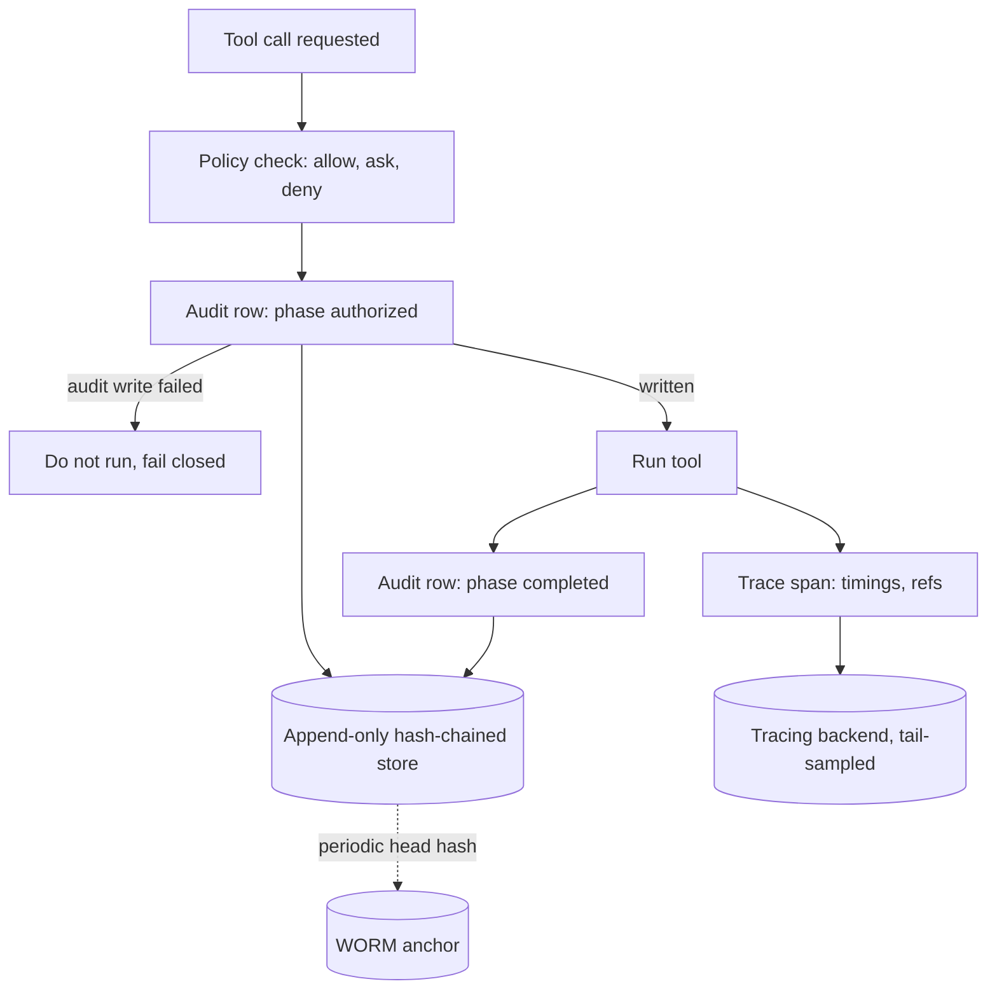

## TL;DR
A trace tells engineers what the agent did and why; an audit log tells security and compliance who did
what with whose authority. Both derive from one event stream but differ in contents, retention, access
and mutability, so build both on purpose.

## For agent builders
- **Why it matters for agents.** An agent makes decisions you did not write, from inputs you did not
  see. When a refund is wrong, you need the trace to see which prompt and tool result led to it, and the
  audit row to show whose authority it ran under.
- **Where it shows up in your stack.** Span trees in Langfuse, LangSmith or Phoenix, OpenTelemetry
  collectors and their sampling policies, and an append-only audit table or store next to your tool
  executor.
- **What you control.** Span attributes and payload references, tail-based sampling that keeps every
  failure, the audit record shape, write ordering around side effects, fail-closed behaviour, hash
  chaining and retention.
- **What you can skip.** Building your own trace viewer or log-management platform. Emit spans and
  audit rows from the event stream and let existing backends store and render them.

## Lab
### Task
Wrap a support agent's tools in a two-phase audit: an `authorized` row before the effect and a
`completed` row after, hash-chained, with keyed argument hashes and fail-closed behaviour for side
effects. Add a tail-sampling rule for traces and a reconciliation query that finds effects which
bypassed the runtime. Time box: 60-90 min.
- **Prerequisites:** Tracing; Structured event streams; the wrapper and chain examples in this lesson.
- **Setup:** Python 3.10+ and `pip install pytest` (checked with Python 3.13 and pytest 9.1; stdlib
  `hashlib` and `hmac` only). Save the starter as `lab.py` and the tests as `test_lab.py`.
- **No services:** `AuditStore` is an in-memory insert-only store whose `down` flag simulates an
  outage; the fake `refund` writes to a ledger that plays the target system.
- **You implement four functions:** `AuditLog.write`, `audited_call`, `keep_trace` and
  `unaudited_effects`. `verify` is given.

### Starter code
```python
"""Lab: a two-phase, fail-closed, hash-chained audit log plus a tail-sampling rule. Run: python lab.py"""
import hashlib
import hmac
import json

ARGS_KEY = b"lab-only-key"                     # production: from a secret store, never beside the log
GENESIS = "0" * 64
SIDE_EFFECTS = {"refund", "send_email"}

def canon(obj) -> bytes:
    return json.dumps(obj, sort_keys=True, default=str).encode()

def chain_hash(rec: dict) -> str:              # plain SHA-256 is fine for the chain
    return hashlib.sha256(canon(rec)).hexdigest()

def args_hash(args: dict) -> str:              # keyed, so low-entropy arguments cannot be enumerated
    return hmac.new(ARGS_KEY, canon(args), hashlib.sha256).hexdigest()

class AuditUnavailable(Exception):
    pass

class AuditStore:
    """Fake insert-only store (the real one: a table whose writer role has INSERT and SELECT only)."""
    def __init__(self):
        self.rows, self.down = [], False
    def insert(self, rec: dict):
        if self.down:
            raise AuditUnavailable("audit store unreachable")
        self.rows.append(dict(rec))
    def last_hash(self):
        return self.rows[-1]["hash"] if self.rows else None

def verify(rows: list[dict], anchored_head: str) -> str:
    prev = GENESIS
    for i, rec in enumerate(rows):
        body = {k: v for k, v in rec.items() if k != "hash"}
        if rec["prev_hash"] != prev or chain_hash(body) != rec["hash"]:
            return f"broken at row {i}"
        prev = rec["hash"]
    return "ok" if prev == anchored_head else "head does not match anchor"

class AuditLog:
    def __init__(self, store: AuditStore):
        self.store, self.prev = store, store.last_hash() or GENESIS   # resume the chain on restart

    def write(self, **rec) -> dict:
        """Set rec["prev_hash"] = self.prev and rec["hash"] = chain_hash(rec without "hash"), insert it,
        and advance self.prev ONLY after the insert succeeded (a failed insert must not fork the chain).
        Let AuditUnavailable propagate. Return the record."""
        # YOUR CODE HERE
        raise NotImplementedError

def audited_call(name: str, args: dict, *, ctx: dict, decision: str, tools: dict,
                 audit: AuditLog, buffer: list) -> dict:
    """Two-phase, fail-closed audit around one tool call.
    - base fields: run_id, step_id, actor (from ctx), action=name, target=args.get("order_id"),
      args_hash=args_hash(args), policy_version (from ctx), decision
    - write phase="authorized" BEFORE running. If it raises AuditUnavailable: a tool in SIDE_EFFECTS
      returns {"ok": False, "error": "audit_unavailable"} without running; any other tool appends the
      record (base + phase) to `buffer` and continues
    - only decision == "allow" runs the tool; otherwise the result is {"ok": False, "error": decision}
    - write phase="completed" with outcome "ok" or the result's error; if that write raises, append the
      record to `buffer` (the effect already happened)
    - return the result"""
    # YOUR CODE HERE
    raise NotImplementedError

def keep_trace(spans: list[dict], percent: int = 10) -> bool:
    """Tail-based sampling, decided after the run ends. Keep every run with a span whose "ok" is False
    or whose "permission" is "deny" or "ask". Otherwise keep it when
    int(hashlib.sha256(run_id.encode()).hexdigest(), 16) % 100 < percent (run_id from spans[0])."""
    # YOUR CODE HERE
    raise NotImplementedError

def unaudited_effects(ledger: list[dict], rows: list[dict]) -> list[str]:
    """Reconciliation: sorted target ids in the target system's ledger with no "authorized" audit row
    for the same target. These are effects that bypassed the runtime."""
    # YOUR CODE HERE
    raise NotImplementedError

def make_tools():
    ledger = []
    def lookup_order(order_id):
        return {"ok": True, "order_id": order_id, "total": 40}
    def refund(order_id, amount):
        ledger.append({"order_id": order_id, "amount": amount}); return {"ok": True}
    return {"lookup_order": lookup_order, "refund": refund}, ledger

if __name__ == "__main__":
    store, buffer = AuditStore(), []
    audit, (tools, ledger) = AuditLog(store), make_tools()
    ctx = {"run_id": "r9", "step_id": 3, "actor": "u-17", "policy_version": "support-v3"}
    call = lambda name, args, decision: audited_call(name, args, ctx=ctx, decision=decision,
                                                     tools=tools, audit=audit, buffer=buffer)
    print(call("lookup_order", {"order_id": "o-77"}, "allow"))
    print(call("refund", {"order_id": "o-77", "amount": 40}, "allow"))
    print(call("refund", {"order_id": "o-77", "amount": 4000}, "deny"))
    store.down = True
    print(call("refund", {"order_id": "o-78", "amount": 40}, "allow"))
    print(call("lookup_order", {"order_id": "o-78"}, "allow"))
    store.down = False
    anchor = store.last_hash()                                 # copied to a WORM bucket in production
    print("rows:", len(store.rows), "buffered:", len(buffer), "ledger:", [e["order_id"] for e in ledger])
    print("verify:", verify(store.rows, anchor))
    ledger.append({"order_id": "o-99", "amount": 900})       # a script that bypassed the runtime
    print("unaudited:", unaudited_effects(ledger, store.rows))
    store.rows[1]["decision"] = "ask"                         # someone edits a row
    print("after edit:", verify(store.rows, anchor))
    runs = {"run-a": [{"ok": True}], "run-b": [{"ok": True}, {"ok": False}],
            "run-c": [{"ok": True, "permission": "ask"}], "run-d": [{"ok": True}]}
    print("kept:", [r for r, spans in runs.items() if keep_trace([{"run_id": r}] + spans)])
```

### Expected output
`python lab.py` with a correct solution prints exactly:

```
{'ok': True, 'order_id': 'o-77', 'total': 40}
{'ok': True}
{'ok': False, 'error': 'deny'}
{'ok': False, 'error': 'audit_unavailable'}
{'ok': True, 'order_id': 'o-78', 'total': 40}
rows: 6 buffered: 2 ledger: ['o-77']
verify: ok
unaudited: ['o-99']
after edit: broken at row 1
kept: ['run-b', 'run-c', 'run-d']
```

`run-d` is kept by the 10% hash bucket (its bucket is 4); `run-a` lands in bucket 76 and is dropped.

### Tests
Run `pytest -q test_lab.py`. On the starter all 6 fail with `NotImplementedError`; a correct solution
passes all 6 (Python 3.13, pytest 9.1).

```python
import pytest
from lab import (GENESIS, AuditLog, AuditStore, AuditUnavailable, args_hash, audited_call, keep_trace,
                 make_tools, unaudited_effects, verify)

CTX = {"run_id": "r1", "step_id": 1, "actor": "u-1", "policy_version": "p-2"}

def setup():
    store, buffer = AuditStore(), []
    tools, ledger = make_tools()
    def call(name, args, decision="allow"):
        return audited_call(name, args, ctx=CTX, decision=decision, tools=tools,
                            audit=AuditLog(store), buffer=buffer)
    return store, buffer, ledger, call

def test_write_chains_and_a_failed_insert_does_not_fork_the_chain():
    store = AuditStore()
    log = AuditLog(store)
    first = log.write(action="a")
    assert first["prev_hash"] == GENESIS and len(first["hash"]) == 64
    store.down = True
    with pytest.raises(AuditUnavailable):
        log.write(action="b")
    store.down = False
    second = log.write(action="c")
    assert second["prev_hash"] == first["hash"] and verify(store.rows, second["hash"]) == "ok"

def test_authorized_row_is_written_before_the_effect():
    store, _, ledger, call = setup()
    tools, seen = make_tools()[0], []
    def spy_refund(order_id, amount):
        seen.append([r["phase"] for r in store.rows]); return {"ok": True}
    tools["refund"] = spy_refund
    audited_call("refund", {"order_id": "o1", "amount": 5}, ctx=CTX, decision="allow", tools=tools,
                 audit=AuditLog(store), buffer=[])
    assert seen == [["authorized"]]
    assert [r["phase"] for r in store.rows] == ["authorized", "completed"]
    row = store.rows[0]
    assert row["actor"] == "u-1" and row["policy_version"] == "p-2" and row["target"] == "o1"
    assert row["args_hash"] == args_hash({"order_id": "o1", "amount": 5}) and "amount" not in row

def test_side_effects_fail_closed_and_reads_buffer():
    store, buffer, ledger, call = setup()
    store.down = True
    assert call("refund", {"order_id": "o1", "amount": 5}) == {"ok": False, "error": "audit_unavailable"}
    assert ledger == [] and buffer == []
    assert call("lookup_order", {"order_id": "o1"})["ok"] is True
    assert [b["phase"] for b in buffer] == ["authorized", "completed"]

def test_denied_calls_do_not_run_but_are_audited():
    store, _, ledger, call = setup()
    assert call("refund", {"order_id": "o1", "amount": 4000}, "deny") == {"ok": False, "error": "deny"}
    assert ledger == [] and [r.get("outcome") for r in store.rows] == [None, "deny"]

def test_tail_sampling_keeps_every_failure_and_escalation():
    assert keep_trace([{"run_id": "run-a"}, {"ok": False}]) is True
    assert keep_trace([{"run_id": "run-a"}, {"ok": True, "permission": "deny"}]) is True
    assert keep_trace([{"run_id": "run-a"}, {"ok": True}]) is False         # bucket 76
    assert keep_trace([{"run_id": "run-d"}, {"ok": True}]) is True          # bucket 4
    kept = sum(keep_trace([{"run_id": f"r-{i}"}, {"ok": True}]) for i in range(1000))
    assert 50 < kept < 150

def test_reconciliation_finds_effects_that_bypassed_the_runtime():
    store, _, ledger, call = setup()
    call("refund", {"order_id": "o1", "amount": 5})
    ledger.append({"order_id": "o9", "amount": 900})
    assert unaudited_effects(ledger, store.rows) == ["o9"]
```

### Failure scenarios
- **Advance `self.prev` before the insert.** After an outage the next row points at a hash that was
  never stored, and the first test fails. In production nightly verification reports a broken chain
  that nobody tampered with; log the insert result next to the hash you chained.
- **Write only the `completed` row.** The ordering test sees no `authorized` row while the refund runs,
  which is exactly the record a crashed worker loses. Reconcile the ledger against `authorized` rows by
  target id to find such gaps.
- **Treat every tool the same during an outage.** Either reads stop working while the audit store is
  down, or refunds run unrecorded. Count tool runs refused with `audit_unavailable` per tool class.
- **Sample with `random.random() < 0.1` at the root span.** Failures disappear at the same rate as
  successes and the tests stop being deterministic. Compare the backend's failure count with the
  runtime's own counter: coverage of failed runs should be 100%.

### Submission
- **`lab.py`** with the four functions implemented; `verify`, `AuditStore` and the tools unchanged.
- **A green test run** (6 passed) and the printed output of `python lab.py`.
- **One extra test** of your own: restart the `AuditLog` mid-run (a new instance on the same store)
  and show the chain still verifies.
- **A short note** answering the incident question "did refund o-78 run?" from the rows and buffer alone.
- **Evaluated on:** authority recorded before every effect, fail-closed side effects, an unforked chain,
  no raw arguments in audit rows, and 100% retention of failed or escalated traces.

## Why it exists
- **Incidents ask a fixed set of questions.** An agent refunds a customer 4,000 instead of 40. Which user
  asked? What did the model see when it decided? Which tool ran, with what arguments, under which
  credential? Was it approved, and by whom? Could it happen again?
- **Ordinary application logs answer none of them well:** unstructured, scattered across services, missing
  the prompt, and routinely rotated after a week.
- **Without the exact context, failures are irreproducible and unattributable.** The decision is
  non-deterministic: without prompt and tool results you cannot reproduce it, and without the policy
  decision and credential you cannot attribute it.
- **"Log everything to stdout" fails three ways.** It logs PII, secrets and customer documents into a
  system with no access control; free text cannot be queried ("show me every refund over 1,000 in the last
  30 days where approval was skipped"); and a log that engineers can edit is not evidence.
- **Debugging and accountability need different artifacts.** The trace wants rich payloads, timings and
  sampling; the audit log wants completeness, immutability and long retention. One artifact is bad at one.

## How it works
### Execution trace
A trace is a tree of spans, exactly as in distributed tracing, with the agent's structure mapped onto it:

```
run (trace root)
+- step 3
   +- llm.call    model=..., prompt_ref=sha256:..., in_tokens=4120, out_tokens=212, latency_ms=1830, cache_hit=true
   +- tool.call   name=lookup_order, args_ref=..., ok=true, latency_ms=140
   +- tool.call   name=refund, args_ref=..., permission=ask, approval_id=..., ok=true
```

- **Span attributes:** model identifier, prompt template version or content hash, token counts,
  parameters, latency, cache hits, tool name, error class.
- **Standard names exist but move.** OpenTelemetry's generative-AI semantic conventions define attribute
  names for many of these; they are still evolving, so pin the version you adopt. Langfuse, LangSmith and
  Phoenix render the tree.
- **Payloads by reference.** Span inputs and outputs are references to a blob store, *because* a long run's
  trace with inline payloads is megabytes and the tracing backend is the wrong place for customer data.
- **Sampling under load.** A common policy keeps 100% of failed or escalated runs and a fraction of
  successful ones.
- **That policy needs tail-based sampling.** A collector buffers a run's spans and decides after it ends,
  *because* head-based sampling decides at the root span, before anyone knows the run will fail, and so
  drops failures at the same rate as successes.

### Audit log
An audit record is written at each authority-bearing moment: a permission decision, an approval, a
side-effecting tool execution, a credential issuance, a human override. It is small and fixed-shape:

```
ts, run_id, step_id, actor (user), principal (agent identity),
action (tool name), target (resource id), args_hash,
policy_version, decision (allow|ask|deny), approval_id, credential_id,
phase (authorized | completed), outcome (ok | error class), prev_hash, hash
```

| Design choice | Because |
|---|---|
| Store `args_hash` and a reference, not the arguments | The log can be retained for years without holding the content, while the referenced payload is deleted on schedule |
| The hash is keyed (an HMAC with a secret held outside the log) | Arguments are often low-entropy (a customer id and an amount), and a plain SHA-256 of them can be recovered by enumerating candidates |
| Keep `actor` and `target` as internal ids, not names or emails | A keyed hash is pseudonymous data, not anonymous |
| Append-only, in a separate store with narrower write permissions than the application | The people and systems being audited must not be able to edit it |
| `prev_hash` and `hash` chain the records | Deletion or modification becomes detectable; this is cheap and turns the log into evidence |
| Anchor the latest hash periodically somewhere the writer cannot touch (a WORM bucket, a separate account, a signed checkpoint) | Anyone able to rewrite every row could also recompute the whole chain |
| Complete, never sampled | "We dropped that one" is not an acceptable answer in an incident review |
| Queryable by actor, action, target and time | That means a table with indexes, not a text file |

### Write ordering follows from "complete"
1. **Authorization record before the side effect, outcome record after,** *because* a crash in between must
   leave evidence that an action was authorized and may have run. An outcome-only log loses exactly the
   actions that crashed mid-flight, which are the ones an investigation cares about.
2. **Side-effecting tools fail closed on audit:** if the audit store is unavailable, the tool does not run.
   - That costs availability, so read-only tools are often allowed to proceed with a buffered record.
   - But an unrecorded refund is worse than a delayed one.

### One source, two sinks
- **Both artifacts are projections of the run's event stream.** `tool.call.permission`,
  `tool.call.result`, `input.received` and credential events feed the audit sink; every event with timing
  feeds the trace sink.
- **Deriving both, rather than instrumenting twice,** guarantees they agree on what happened and share the
  `run_id` that lets an investigator jump from an audit row to the full trace.

### What to capture at the decision point
Capture eagerly the items that are expensive to recover; everything else can be reconstructed:
- **The exact prompt,** or its hash plus a registry version that resolves to the exact text.
- **The model identifier.**
- **The tool results that preceded the decision.**
- **The policy version.**

### Retention and access
| | Trace | Audit log |
|---|---|---|
| Retention | Short | Long, set by the regulated domain you operate in |
| Access | Engineers | Restricted |
| Coverage | Sampled | Complete |
| PII | May be scrubbed at ingestion | Should never have contained it |

## Diagram
One tool call produces both artifacts: the audit rows bracket the effect and are written fail-closed,
while the span collects timings and references.



## Examples
### A tool wrapper that writes both
A tool-execution wrapper that emits a trace span and append-only, hash-chained audit records from the
same call: one for the decision before anything runs, one for the outcome after.

- **Arguments** are hashed into the audit rows and stored by reference for the trace.
- **In a stream-based runtime** both would be projections of the run's events; the direct writes keep the
  example short.

```python
import hashlib, hmac, json, os, time
from opentelemetry import trace

tracer = trace.get_tracer("agent")
ARGS_KEY = os.environ["AUDIT_HMAC_KEY"].encode()      # held outside the audit store

def _canon(obj) -> bytes:
    return json.dumps(obj, sort_keys=True, default=str).encode()

def _h(obj) -> str:                                    # chain hash: plain SHA-256 is fine
    return hashlib.sha256(_canon(obj)).hexdigest()

def _args_hash(args) -> str:                           # keyed, so low-entropy args cannot be guessed
    return hmac.new(ARGS_KEY, _canon(args), hashlib.sha256).hexdigest()

class AuditLog:
    """Append-only, hash-chained, one writer per chain. The role has INSERT only, no UPDATE/DELETE."""
    def __init__(self, store):
        self.store, self.prev = store, store.last_hash() or "0" * 64    # resume the chain on restart
    def write(self, **rec) -> str:
        rec["prev_hash"] = self.prev
        rec["hash"] = _h(rec)
        self.store.insert(rec)
        self.prev = rec["hash"]
        return rec["hash"]

def run_tool(name, args, *, ctx, policy, tools, blobs, audit: AuditLog):
    with tracer.start_as_current_span(f"tool.call {name}") as span:
        decision = policy.check(ctx.run_id, name, args)             # allow | ask | deny
        args_ref = blobs.put(args, ttl_days=30)                     # payload lives in the blob store
        span.set_attributes({"agent.tool.name": name, "agent.args_ref": args_ref,
                             "agent.permission": decision, "agent.policy_version": policy.version})
        base = dict(run_id=ctx.run_id, step_id=ctx.step_id, actor=ctx.user_id,
                    principal=ctx.agent_id, action=name, target=args.get("id"),
                    args_hash=_args_hash(args), args_ref=args_ref, policy_version=policy.version,
                    decision=decision, credential_id=ctx.credential_id)
        audit.write(ts=time.time(), phase="authorized", **base)    # before the effect; raises -> no run
        t0 = time.time()
        # "ask" would go to an approval flow (omitted); here only "allow" executes
        result = tools[name](**args) if decision == "allow" else {"ok": False, "error": decision}
        span.set_attributes({"agent.ok": bool(result.get("ok")),
                             "agent.error": result.get("error", ""),
                             "agent.latency_ms": int((time.time() - t0) * 1000)})
        audit.write(ts=time.time(), phase="completed", **base,
                    outcome="ok" if result.get("ok") else result.get("error", "error"))
        return result
```

### Verifying the chain and the anchor (runnable, stdlib only)
Editing one row breaks the chain; recomputing every hash repairs the chain but no longer matches the
externally anchored head, which is why the anchor matters.

```python
import hashlib, json

def _h(obj) -> str:
    return hashlib.sha256(json.dumps(obj, sort_keys=True, default=str).encode()).hexdigest()

def append(chain: list, **rec) -> None:
    rec["prev_hash"] = chain[-1]["hash"] if chain else "0" * 64
    rec["hash"] = _h(rec)
    chain.append(rec)

def verify(chain: list, anchored_head: str) -> str:
    prev = "0" * 64
    for i, rec in enumerate(chain):
        body = {k: v for k, v in rec.items() if k != "hash"}
        if rec["prev_hash"] != prev or _h(body) != rec["hash"]:
            return f"broken at row {i}"
        prev = rec["hash"]
    return "ok" if prev == anchored_head else "head does not match anchor"

log = []
append(log, run_id="r9", action="refund", phase="authorized", decision="allow", target="o-77")
append(log, run_id="r9", action="refund", phase="completed", outcome="ok", target="o-77")
anchor = log[-1]["hash"]                     # copied to a store the writer cannot touch

print(verify(log, anchor))                   # ok
log[0]["decision"] = "ask"                   # someone edits a row
print(verify(log, anchor))                   # broken at row 0
for i, rec in enumerate(log):                # attacker recomputes the whole chain
    rec["prev_hash"] = log[i - 1]["hash"] if i else "0" * 64
    rec["hash"] = _h({k: v for k, v in rec.items() if k != "hash"})
print(verify(log, anchor))                   # head does not match anchor
```

### Worked incident: the 4,000 refund that should have been 40
Each standard question is answered by a specific field, and the shared `run_id` connects them.

| Question | Where the answer comes from |
|---|---|
| Which user asked? | Audit row `actor`, with `principal` naming the agent identity |
| Was it authorized, and by what? | Audit row `decision`, `policy_version`, `approval_id` (phase `authorized`) |
| Did it actually run? | Matching `completed` row with `outcome`; an `authorized` row alone means "may have run" |
| What did the model see? | Trace span `prompt_ref` and the preceding tool results, resolved from the blob store |
| Model or prompt change? | Span model identifier and prompt registry version against the previous release |
| Could it happen again? | Query the audit table for refunds over 1,000 in the last 30 days where approval was skipped |

## Production patterns
- **Tail-based sampling in the collector.** When: trace volume forces sampling. How: the OpenTelemetry
  Collector's tail-sampling processor with one policy that keeps every trace with error status and a
  probabilistic policy for the rest. Monitor: trace coverage of failed runs, which should be 100%.
- **Insert-only audit role in a separate store.** When: from the first side-effecting tool. How: the agent's
  writer role gets `INSERT` (and `SELECT` for the last hash) on the audit table, with no `UPDATE` or
  `DELETE`, in a database or account the application team does not administer. Monitor: grants on that
  table in access reviews.
- **External anchoring of the head hash.** When: the log must serve as evidence. How: write the latest hash
  every few minutes to write-once storage, such as an S3 bucket with Object Lock in compliance mode, or a
  separate account. Monitor: age of the newest anchor and nightly chain verification results.
- **Fail-closed audit for side effects.** When: tools move money, send messages or delete data. How: the
  `authorized` write must succeed before the tool runs; read-only tools buffer and retry instead. Monitor:
  audit write p95 latency on the critical path and the count of tool runs refused for audit unavailability.
- **One identifier everywhere.** When: always. How: put `run_id` (and `step_id`) on every span as an
  attribute and in every audit row, so a single query jumps between sinks. Monitor: audit rows of failed,
  denied or escalated runs whose `run_id` has no trace (those are never sampled out, so a miss means broken
  propagation), and target-system records with no audit row, which reveal effects that bypassed the runtime.
- **Blob retention from investigation windows.** When: payloads are stored by reference. How: lifecycle
  rules on the blob store set from the longest investigation you must support, with per-record delete for
  data-protection requests. Monitor: references in audit rows that no longer resolve.

## Trade-offs
- **One stream, two sinks vs coverage.** Deriving both artifacts from the event stream guarantees they
  agree, but the audit log is only as complete as the stream; an effect that bypasses the runtime (a tool
  that calls another service directly) is invisible to both.
- **Hash chaining vs write throughput.** It makes tampering detectable at almost no cost, yet serializes
  writes per chain; shard the chain per run or per day when write volume is high.
- **Sampling vs visibility.** Sampling traces controls cost, but a bug that only appears in sampled-out
  runs is a bug you cannot see; keep failed, denied and escalated runs at 100%.
- **References vs long investigations.** Storing payloads by reference keeps audit rows PII-free and traces
  small, but an investigation older than the blob retention window has hashes and no content; set blob
  retention from the longest investigation window you must support, not from storage cost alone.

## Pitfalls
- **The trace treated as the audit log.** Symptom: an auditor asks for every refund and hears the tracing
  backend samples at 10% and retains for 14 days. Fix: a separate, complete audit sink.
- **Audit records written with a role that can delete them.** Symptom: "could this have been edited" has
  no good answer. Diagnose: list the writer role's grants; anything beyond INSERT fails. Fix: insert-only
  role plus an anchored chain.
- **Full prompts and tool outputs in a shared log platform.** Symptom: a data-protection request needs
  customer content purged from a system with no per-record delete. Diagnose: scan log indexes for PII.
  Fix: payloads by reference.
- **No prompt version at the decision point.** Symptom: a reproduction cannot tell whether the model or
  the prompt changed. Fix: model id and prompt version on every LLM span.
- **The action recorded but not the authority.** Symptom: "the agent did X" with no user, policy or
  approver. Fix: `actor`, `policy_version` and `approval_id` on every row.
- **Separate run identifiers in trace and audit log.** Symptom: investigators match timestamps by hand.
  Fix: one `run_id` in both.
- **The audit record written only after the tool returns.** Symptom: a refund or email in the target
  system with no audit row, from a worker that crashed mid-call. Diagnose: reconcile target-system
  records against audit rows by target id. Fix: `authorized` row first, fail closed.
- **Head-based sampling with "keep all failures" only on paper.** Symptom: failed runs missing at the
  same rate as successes. Diagnose: compare the failure count in the backend with the runtime's own
  counter (coverage should be 100%). Fix: tail-based sampling.

## When to use
- **Trace from the first week** for every agent that acts on behalf of a user, because it is how you debug
  anything.
- **Audit log before the first side-effecting tool reaches production,** because retrofitting immutability
  onto a log that already exists is painful.
- **Decide retention, access and redaction per sink up front.**
- **Measure** trace coverage of failed runs (target 100%), audit write latency on the critical path, and
  time-to-answer for the standard incident questions.

## Exercise
**Goal:** add a trace and an audit log to a refund agent and prove the audit log is complete and
tamper-evident. No solution is given.
- **Inputs:** two tools (`lookup_order`, `refund`), a fake payment service, SQLite for audit rows and an
  OpenTelemetry console or in-memory exporter.
- **Constraints:** arguments go in by keyed hash plus reference, never inline; the audit writer is
  insert-only.
- **Deliver:** the wrapper, a chain verifier, an anchoring step and a reconciliation query.
- **Acceptance:** crash the worker between the two writes and an `authorized` row still exists; editing
  any row or recomputing the chain fails verification; reconciliation finds a refund made outside the
  runtime; one `run_id` joins an audit row to its spans.

## Role lens
- **Engineer:** Instruments steps and tool calls as spans, derives audit rows from permission and result
  events, and keeps payloads in the blob store by reference.
- **Architect:** Sets the two sinks' retention, access control and redaction policies, chooses the tracing
  backend, and decides that the audit store is append-only with its own credentials.
- **FDE:** Maps the audit record to the customer's compliance requirements and SIEM, and demonstrates that
  every agent action is attributable to a named user and policy.

## Check yourself
**Q:** A regulated customer says: "we need to prove, two years from now, exactly why your agent issued a
specific refund, and prove nobody altered that record". Design the logging to satisfy them without
retaining customer PII for two years.
**A:** Separate the artifacts. The audit log keeps a small, fixed-shape record per authority-bearing event:
internal user id, agent identity, tool, target id, keyed argument hash, policy version, decision, approval id, credential id,
outcome, and a hash chain linking rows; it is append-only, written with an insert-only role, retained for
the two years, and contains no free text. The trace holds the prompt reference, model id, token counts
and tool results by reference; its payloads live in a blob store with a shorter retention and per-record
deletion. To prove "why", the audit row gives the prompt hash and registry version, which resolve to the
exact template text kept in the prompt registry (not PII) and the policy that allowed the call; the
customer-specific inputs remain verifiable against a candidate by recomputing the keyed hash even after
the content is purged. To prove integrity, recompute the chain and compare it with the externally anchored
head hashes. The identifiers are shared, so a row leads to the trace while it exists.

## Interview questions
### A refund appears in the payments system but there is no audit row. How did that happen, and how do you prevent it?
- **Likely cause:** the audit record was written only after the tool returned, and the worker crashed
  mid-call; or the tool reached the payment service outside the runtime.
- **Prevent the first:** write an `authorized` row before the effect and a `completed` row after, and make
  the authorized write fail closed for side-effecting tools.
- **Detect the second:** reconcile the payment system's records against audit rows by target id.

### Why is a plain SHA-256 of the arguments not good enough in an audit row?
- **Low entropy:** arguments like a customer id and an amount can be enumerated, so a plain hash can be
  reversed by guessing candidates.
- **Use a keyed HMAC** with the secret held outside the log; the hash still proves which arguments were
  used when checked against a candidate.
- **It is still pseudonymous,** so keep actor and target as internal ids, not names or emails.

### Why not just sample audit records like traces to save cost?
- **Completeness is the product:** "we dropped that one" is not an acceptable answer in an incident review.
- **Audit rows are small and fixed-shape,** so keeping all of them is cheap compared with payload-heavy
  traces.
- **Save cost on traces instead,** with tail-based sampling that keeps every failed, denied or escalated
  run.

### Your hash chain verifies cleanly. Does that prove nobody tampered with the log?
- **Not on its own:** anyone who can rewrite every row can recompute the entire chain.
- **Anchor the head hash** periodically in storage the writer cannot touch, such as a WORM bucket or a
  separate account, and verify against it.
- **Restrict the writer** to insert-only, so editing requires a different, audited credential.

## Quiz
### Q: What most distinguishes an audit log from an execution trace?
- [ ] Audit logs are stored as JSON while traces use binary formats
- [x] Audit logs must be complete, attributable and tamper-evident with long retention; traces are rich, sampled debugging views with short retention
- [ ] Traces include tool calls while audit logs only include model calls
- [ ] Audit logs are generated by the model and traces by the runtime
> They serve different consumers: accountability needs completeness and immutability, debugging needs
> payloads and timings. Treating one as the other fails whichever need you ignored.

### Q: Why store an argument hash and a payload reference in the audit row instead of the arguments themselves?
- [ ] Hashes are faster for the model to read
- [ ] Because audit rows have a fixed 256-byte size limit
- [x] So the long-lived audit record holds no argument content while still proving which exact arguments were used
- [ ] Because arguments are non-deterministic and cannot be stored
> The (keyed) hash proves the identity of the arguments without holding their content; the content lives
> under a separate, shorter retention policy with per-record deletion.

### Q: A team samples traces at 10% to control cost. Which runs should be exempt from sampling?
- [ ] Runs shorter than one second
- [ ] Runs that completed successfully on the first attempt
- [x] Failed, denied and escalated runs, which are the ones investigations will ask about
- [ ] Runs from internal users only
> The purpose of a trace is to debug what went wrong; sampling out the failures defeats it. Successful
> runs are the safe place to save cost.

## Mastery test
**Problem:** a support agent sends emails through a vendor SaaS. Legal wants every sent email
attributable for 7 years; a GDPR request asks you to delete one customer's data. Your audit rows store
recipient address and body inline. Redesign without losing completeness.

**A strong answer:**
- keeps the row small and fixed: `actor`, `principal`, action, internal target id, keyed args hash,
  policy version, decision, outcome, `run_id`;
- moves recipient and body to a blob store with its own retention and per-record delete, referenced by id;
- explains why the keyed hash still proves which email was sent, but cannot be reversed by guessing;
- notes keyed hashes are still pseudonymous personal data: document a legal-retention basis, or destroy
  a per-customer key (crypto-shredding);
- keeps the chain intact, because erasure deletes the blob or key, not the row;
- reconciles the vendor's send log against audit rows.

## Use cases & projects
### Use cases
- **Incident review for a wrong action.** The trace shows the prompt, model and tool results before the
  decision; the audit row shows the user, policy version and approval behind it.
- **Regulated agents.** Payment, healthcare and HR agents need a complete, tamper-evident record of
  every authority-bearing action, kept far longer than traces.
- **Debugging cost and latency.** Span attributes for tokens, cache hits and latency show which step or
  tool drives a slow or expensive run.
- **Detecting bypasses.** Reconciling the payment or ticketing system's records against audit rows by
  target id reveals effects that bypassed the agent runtime and so appear in neither sink.

### Mini project
**Trace and audit a refund agent (2-3 hours).**
- **Goal:** produce both artifacts from one tool wrapper and prove the audit log is complete and
  tamper-evident.
- **Steps:** wrap `lookup_order` and `refund` so each call emits a span and `refund` writes `authorized`
  and `completed` rows; HMAC the arguments; chain with `prev_hash`; crash once between writes.
- **Done when:** the first, second and fourth Exercise acceptance checks pass.
