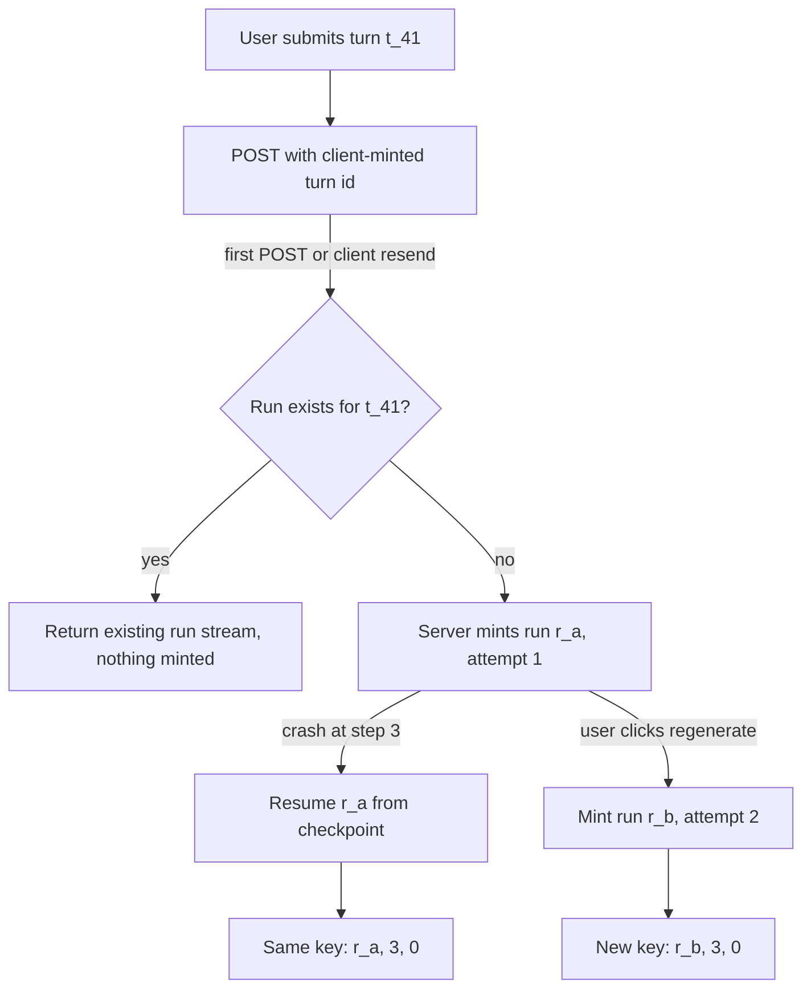

## TL;DR
Agents need an id hierarchy, not one "session id": tenant, user, conversation, turn, run, step,
tool call and trace. Each answers a different question (resume what, dedupe what, bill whom, trace
which); conflating them makes retries double-act and logs impossible to join.

## For agent builders
- **Why it matters for agents.** A turn fans out into runs, steps, tool calls, sub-agents and retries
  across services; without distinct ids you cannot resume, dedupe or explain a repeat.
- **Where it shows up in your stack.** The thread id your framework keys checkpoints by (LangGraph's
  `thread_id` in the run config), the `tool_call_id` the model API pairs with results, the
  `Idempotency-Key` header on tool requests, and OpenTelemetry trace context across services.
- **What you control.** Who mints each id and when (the client mints turn_id, the server mints run_id,
  keys are derived), attempt semantics, `parent_run_id` for sub-agents, propagation through
  `contextvars`, and tenant-scoped lookups.
- **What you can skip.** Building on the provider's conversation or thread id. Keep your own hierarchy and
  store provider ids as attributes for support cases.

## Why it exists
- **One session id cannot explain an incident.** "The agent created two tickets": two create calls in
  session S. Two user requests, a client retry, a crash-resume, or two parallel calls? Neither the logs nor
  dedup logic can tell; dedup needs a key equal across a retry and different across a second request.
- **Each capability relies on a specific identity.** Resume needs the execution; idempotent tools a
  retry-stable key; billing the tenant; reconnecting clients a conversation cursor; tracing a cross-service
  id; evaluation a repeatable "step 7 of run X".
- **The lifetimes differ.** A conversation spans days, a turn one request, a run one attempt at that
  request (a failed turn retried gets a new run under the same turn), a step one model call.
- **Provider ids are the wrong foundation:** they tie you to a vendor and know nothing of retries or runs.
- **Per-request random ids cannot dedupe,** because a retry mints a new one. Decide per id who mints it,
  when, and what it is stable across.

## How it works
### The hierarchy
```
tenant_id — user_id — conversation_id — turn_id — run_id — step — tool_call_id
                        (transcript)   (request)  (attempt)  (model call)  (one call)
```

| Id | What it is | Minted by, when | Stable across |
|---|---|---|---|
| **tenant_id / user_id** | Scope for isolation, quotas, billing and deletion; on every record and log line | Auth system | Everything |
| **conversation_id** (thread id) | The unit of memory; keys the event log and the sequence numbers clients resume from | Server, at conversation start | The conversation's life |
| **turn_id** | One user submission | The *client*, before sending | Network retries |
| **run_id** (execution id) | One attempt to produce the turn's response; keys checkpoints and leases | Server, when work starts | Crash-resume (not regenerate) |
| **step** | Index of the model call in the run; with run_id addresses a checkpoint | Harness counter | Resume of that run |
| **tool_call_id** | Pairs a requested call with its result | The model API | Resume only if the response was persisted |
| **idempotency_key** | Dedupes a side effect | *Derived*, not minted | Crash-resume |
| **trace_id / span_id** | Cross-service correlation (OpenTelemetry) | Tracing SDK | The turn's request path |

- **turn_id from the client** because then a retried POST carries the same id and the server can
  recognise it.
- **run_id and attempts.** A crash-resume continues the same run; a user-initiated "regenerate" or an
  automatic retry after failure starts a new run under the same turn with `attempt = n + 1`.
- **parent_run_id for sub-agents.** A child gets its own run id (own checkpoints, budget, lease) plus
  pointers to the parent run and the spawning tool call, so a resumed parent finds the existing child and
  the trace shows the delegation tree.
- **tool_call_id caveats.** The Claude and OpenAI APIs assign one per requested call and expect it echoed
  on the result. It is opaque and vendor-formatted, documented only for pairing within the conversation;
  scope it with run_id and step, not as globally unique.
- **idempotency_key derivation:** for example `f"{run_id}:{step}:{call_index}"` hashed, so a resumed step
  regenerates the same key.
- **trace_id placement.** Propagate across gateway, agent, tool services and model proxy; a run usually
  maps to one trace, each model and tool call a span. Store trace_id on the run record for support.
- **Provider request id.** Returned by the model API per call; log it, because it is what the vendor needs
  when you open a support case.

### Generation
- **UUIDv4 is fine for uniqueness.**
- **Time-ordered ids sort and index better.** UUIDv7 (standardised in RFC 9562) or ULID sort by creation
  time and keep B-tree inserts sequential, which matters for the high-write events table.
- **Never model-generated strings:** a model will happily invent plausible ids and reuse them.
- **Never derived from content:** the same question asked twice is two turns.

### Propagation
- **Carry the id set as a context object** (Python `contextvars`, Node `AsyncLocalStorage`) so every log
  line, metric, tool call and outbound request is tagged without threading parameters by hand.
- **Send ids outbound:** run_id, tool_call_id and the trace headers go into tool requests so the tool
  service's logs join back.
- **Put the full id set into every event** in the event log.

### Identifiers are not authorization
- **Every client-sent id is a claim, not a credential,** including a run id in a reconnect URL.
- **The classic bug:** loading `/conversations/{id}/events` without checking the conversation belongs to
  the caller's tenant and user, an insecure direct object reference. Unguessable UUIDs only hide it, since
  ids leak through logs, shared links and browser history.
- **The fix:** take identity from the auth token, then look up *scoped by* it
  (`where tenant_id = $1 and conversation_id = $2`).
- **Same for tool services receiving `X-Run-Id`:** it is for correlation, never for deciding what the
  caller may touch.

### What each id lets you do
| Need | Id |
|---|---|
| Resume after a crash | run_id plus latest step |
| Dedupe a retried submission | turn_id |
| Dedupe a retried side effect | idempotency key derived from (run_id, step, index) |
| Reconnect and catch up | conversation_id plus sequence number |
| Bill, enforce quotas, delete | tenant_id |
| Debug across services | trace_id |
| Pair a tool result with its request | tool_call_id |

### Attempt semantics
Decide what is shared across attempts of a turn:
- **The user's message and prior conversation:** yes.
- **The previous attempt's side effects:** they happened, so the new attempt must be told or must check.
- **The budget:** per attempt or per turn; per turn stops a retry storm.
- **Record `attempt` on the run and keep failed runs:** they are evidence.

## Diagram
What stays and what changes across the three kinds of repeat; only the regenerate path produces new
idempotency keys.



## Examples
### An immutable id set in a context variable
The frozen `Ids` object travels in a context variable; the server mints a run id per attempt, and the
key derives from run, step and call index so a resumed step reproduces it. Standard library only; run
on Python 3.9.

```python
import contextvars, hashlib, logging, uuid
from dataclasses import asdict, dataclass, replace

log = logging.getLogger(__name__)

@dataclass(frozen=True)
class Ids:
    tenant_id: str
    user_id: str
    conversation_id: str
    turn_id: str                          # minted by the client, stable across retries
    run_id: str = ""                      # minted by the server per attempt
    attempt: int = 1
    step: int = 0
    trace_id: str = ""

    def idem_key(self, call_index: int) -> str:     # identical on resume of this step
        raw = f"{self.run_id}:{self.step}:{call_index}"
        return hashlib.sha256(raw.encode()).hexdigest()[:32]

    def fields(self) -> dict:
        return {k: v for k, v in asdict(self).items() if v != ""}   # keep step=0

CURRENT: contextvars.ContextVar[Ids] = contextvars.ContextVar("ids")

def start_run(ids: Ids, attempt: int = 1) -> Ids:
    run = replace(ids, run_id=str(uuid.uuid4()), attempt=attempt, step=0)
    CURRENT.set(run)
    return run

def next_step() -> Ids:
    ids = replace(CURRENT.get(), step=CURRENT.get().step + 1)
    CURRENT.set(ids)
    return ids

def call_tool(tool, name, args, call_index):
    ids = CURRENT.get()
    headers = {"X-Run-Id": ids.run_id,             # correlation only, never authorization
               "Idempotency-Key": ids.idem_key(call_index)}
    # the trace context travels as the W3C `traceparent` header; let the OpenTelemetry
    # propagator inject it (propagate.inject(headers)) rather than inventing a header
    log.info("tool_call", extra={"tool": name, **ids.fields()})
    return tool(name, args, headers=headers)
```

### Worked trace: retry, resume, regenerate
| Case | What happens | Key for step 3, call 0 |
|---|---|---|
| POST for turn `t_41` times out; client re-sends `t_41` | Server finds a run already exists for it and returns that run's stream; nothing is minted | unchanged |
| Run `r_a` crashes at step 3 while calling `create_ticket` as call 0 | Resume restores `Ids(run_id="r_a", step=3)` from the checkpoint, so `idem_key(0)` hashes `"r_a:3:0"` again; the ticket API replays the first ticket | same |
| User clicks regenerate | `start_run` mints `r_b` with `attempt=2`; step 3's key now hashes `"r_b:3:0"` | different, so a second ticket is possible by design |

- **The product decision the ids expose:** a second ticket is right only if `r_b` knew `r_a` created
  one; the ids make that visible.

### Runnable check of the three cases
Paste below the `Ids` class; pure standard library.

```python
base = Ids("acme", "u_7", "c_9", turn_id="t_41")
r_a = replace(base, run_id="r_a", step=3)
resumed = replace(base, run_id="r_a", step=3)        # restored from the checkpoint
regen = replace(base, run_id="r_b", attempt=2, step=3)
print(r_a.idem_key(0) == resumed.idem_key(0))         # True: crash-resume dedupes
print(r_a.idem_key(0) == regen.idem_key(0))           # False: regenerate is new work
print(r_a.fields())   # tenant, user, conversation, turn, run, attempt=1, step=3
```

## Production patterns
- **Bind ids into every log line once.** At the start of a run, bind the id set into the logging context
  (for example `structlog.contextvars.bind_contextvars(**ids.fields())`, or a logging filter reading the
  context variable) so no call site forgets them. Monitor the share of log lines carrying the full id set.
- **OpenTelemetry for the trace, your ids as attributes.** Let the OpenTelemetry propagator inject W3C
  `traceparent` into outbound calls, and set run_id, turn_id and tenant_id as span attributes so traces
  are searchable by business id. Monitor the share of turns whose trace spans every service.
- **Database-enforced turn dedup.** A unique constraint on (conversation_id, turn_id) and an insert that
  does nothing on conflict, returning the existing run. Monitor conflict rate, your client retry rate.
- **Time-ordered primary keys for hot tables.** Use UUIDv7 or ULID for event and run ids (Python 3.14's
  `uuid.uuid7()`, PostgreSQL 18's `uuidv7()`, or a library on older versions) to keep B-tree inserts
  sequential. Monitor index bloat and insert latency on the events table.
- **Tenant-scoped lookups everywhere.** Route every load through a repository function that takes the
  authenticated tenant and user and adds `where tenant_id = ...` to the query; add a test that fetches
  another tenant's id and expects not-found. Monitor authorization-denied counts per endpoint.
- **Log the provider request id.** Record the model API's per-call request id (returned in a response
  header and exposed by the official SDKs) on the step's span. Monitor its presence on failed calls,
  since support cases need it.

## Trade-offs
- **Client-minted turn ids vs trust.** Retry-safe, but validate them (format, uniqueness per
  conversation), since a buggy or malicious client can collide them; server-minted ids cannot dedupe
  retries.
- **Full hierarchy vs discipline.** Every log line, event and outbound call must carry the ids;
  retrofitting is tedious, an early context-propagation layer makes it nearly free.
- **Derived idempotency keys vs new attempts.** Keys from (run, step, index) are stable across crash
  resumes, but a new attempt gets new keys by design, so a retried turn can repeat effects unless the new
  attempt checks the previous attempt's results.
- **Time-ordered vs random ids.** Time-ordered ids improve index locality and sortability but reveal
  creation time and ordering to anyone who sees them; random ids reveal nothing but fragment indexes.

## Pitfalls
- **One "session id" for both conversation and execution.** Symptom: a regenerate overwrites the first
  run's checkpoints or wrongly dedupes against it. Diagnose: count distinct runs per turn; always one
  means attempts share an id. Fix: separate turn and run ids.
- **Letting the model produce or echo identifiers in free text.** Symptom: tool results attached to the
  wrong call, or valid-looking ids that do not exist. Fix: the harness mints and attaches ids.
- **Minting a new run id on crash resume.** Symptom: idempotency keys change, so dedup never matches.
  Diagnose: compare the key of a resumed step with the pre-crash attempt in the logs. Fix: resume under
  the same run id.
- **Inconsistent names across services** (run_id in one, execution_id in another). Symptom: traces that
  cannot be joined in an incident. Diagnose: measure the share of log lines per service carrying the full
  id set. Fix: one shared id schema.
- **Forgetting to echo tool_call_id on the result.** Symptom: provider errors about unmatched tool calls
  and silently dropped results. Diagnose: diff requested and returned tool_call_ids per step. Fix: pair
  results by id in the harness.
- **Loading objects by a client-supplied id without tenant scoping.** Symptom: one customer's
  conversation renders for another after an id was pasted into a URL. Diagnose: a test that fetches
  another tenant's id and expects not-found. Fix: scoped lookups.
- **Sub-agents reusing the parent's run id, or unlinked to it.** Symptom: children overwrite the
  parent's checkpoints, or a resumed parent spawns a duplicate child. Fix: own run id plus
  parent_run_id.

## When to use
- **Day one of any agent project:** define the hierarchy; it costs nothing then and a migration later.
- **It shows up in:** the API (turn id), the store (run id keys checkpoints, conversation id keys
  events), the tools (key and trace headers) and every log line.
- **Measure:** percentage of log lines carrying the full id set, share of turns whose trace spans all
  services, and duplicate-effect incidents traced to id confusion.
- **Interviews:** say what stays stable across a retry versus a resume versus a regenerate, and which id
  dedupes each.

## Exercise
**Goal:** add the id hierarchy to an agent with a sub-agent and prove each repeat behaves correctly. No
solution is given.
- **Inputs:** a toy parent agent whose step 2 spawns a child agent that calls a fake `create_ticket`, a
  JSON-lines logger, and a fake ticket API that dedupes on `Idempotency-Key`.
- **Constraints:** the client mints turn ids; the server mints run ids; keys are derived; the child gets
  its own run id plus `parent_run_id`; every lookup is scoped by tenant.
- **Deliver:** scripted scenarios for a client resend, a parent crash after the child finished, and a
  regenerate, plus one log query per scenario that rebuilds the turn.
- **Acceptance:** the resend creates no run; the crash-resume finds the existing child and creates no
  second ticket; the regenerate gets `attempt = 2` and new keys; every log line carries the full id set;
  a cross-tenant fetch returns not-found.

## Role lens
- **Engineer:** Implements the Ids context object, mints turn ids in the client SDK, propagates
  headers to tool services and tags every log line and event with the full set.
- **Architect:** Specifies the id hierarchy, who mints each id, its stability guarantees across retry
  and resume, and the trace model that spans services and vendors.
- **FDE:** Maps customer-side correlation ids (ticket numbers, case ids, SSO subject ids) onto the
  hierarchy so the customer's own logs join with the agent's.

## Check yourself
**Q:** Explain which identifier stays the same and which changes across a client network retry, a
crash-resume of a run, and a user clicking regenerate. Why does it matter for duplicate side effects?
**A:** A client retry carries the same client-minted turn id, so the server recognises it and does
not start a second run; nothing new is minted. A crash-resume continues the same run id and step, so
the idempotency keys derived from them are identical and a re-executed pending tool call dedupes
against the first attempt. A regenerate is a new attempt: same conversation and turn, new run id, new
keys, because the user wants new work. That last case is why a new attempt must either see the
previous attempt's results in its context or check before acting; otherwise it repeats effects that
are legitimate from the runtime's perspective. The ids encode exactly which repeats are errors and
which are intended.

## Interview questions
### Why is a single session id not enough for an agent system?
- **It cannot separate the cases that matter:** two user requests, one retried request, a resumed run and
  parallel tool calls all look the same.
- **Dedup and resume need different keys:** turn id for submissions, run id plus step for checkpoints,
  and a derived idempotency key for side effects, each with its own lifetime.

### How would you design idempotency keys for tool calls in a durable runtime?
- **Derive, do not mint:** hash run id, step and call index, so a crash-resume of the step regenerates the
  same key.
- **Not random UUIDs** (they change on resume), **not argument hashes** (they collide across legitimate
  repeats), **not process counters** (they restart on a new worker).

### A support ticket says "the agent did it twice". Which ids do you look up, in what order?
- **Start from tenant and conversation,** then list turns: two turn ids means two user requests.
- **One turn, two runs** means a regenerate or automatic retry; check `attempt` and whether the second run
  was told about the first.
- **One run, repeated tool calls:** compare idempotency keys and step numbers, then follow trace_id and the
  provider request id into the tool service's logs.

### Is an unguessable UUID in the URL enough to protect a conversation?
- **No.** Ids leak through logs, shared links and browser history, so a lookup by id alone is an insecure
  direct object reference.
- **Scope every lookup by the authenticated tenant and user,** and treat ids like `X-Run-Id` as correlation
  only, never as authorization.

### UUIDv4 or UUIDv7 for the events table?
- **UUIDv7 (or ULID)** sorts by creation time and keeps B-tree inserts sequential, which helps a high-write
  table.
- **The cost:** it reveals creation time and ordering to anyone who sees the id; where that matters,
  expose a separate random public id.

## Quiz
### Q: Who should mint the turn id, and why?
- [ ] The model, because it understands the request
- [x] The client, before sending, so a retried request carries the same id and the server can deduplicate it
- [ ] The server, after validating the request
- [ ] The model provider, via its request id
> Deduplicating a retried submission needs an id that exists before the first attempt and is reused on
> retry; only the client has that information. Server or provider ids are minted too late.

### Q: How should an idempotency key for a tool call be produced in a durable agent runtime?
- [ ] A fresh random UUID per execution of the tool
- [ ] A hash of the tool's arguments only
- [x] Derived deterministically from run id, step and call index, so a crash resume regenerates the same key
- [ ] A per-process counter incremented on each tool dispatch
> A resume must reproduce the key to dedupe the re-execution; random keys change, a process counter
> restarts from zero on a new worker, and argument-only hashes collide across legitimate repeats.

### Q: What distinguishes a run id from a conversation id?
- [ ] Run ids are numeric while conversation ids are UUIDs
- [x] A conversation id keys the long-lived transcript, while a run id keys one execution attempt of one turn and is what checkpoints and leases are scoped to
- [ ] They are the same value in most systems
- [ ] Run ids are issued by the model provider
> Conversations span many turns and days; runs span one attempt lasting minutes. Resuming, leasing and
> deriving idempotency keys all need the attempt-level id, which a conversation id cannot provide.

## Mastery test
**Problem:** the agent now starts with no human client: a nightly cron that sometimes fires twice after a
scheduler failover, a webhook the sender redelivers on timeout, and a parent run that spawns three
children at step 2. Who mints each turn id, and how does a resumed parent avoid duplicate children?

**A strong answer:**
- cron: derive the turn id from schedule id and *scheduled* fire time, so both fires hit one turn;
- webhook: use the sender's event id, scoped by tenant and verified first, since redeliveries keep it;
- children: record each child's run id with `parent_run_id`, step and call index (unique) before
  spawning, so a resume finds them; `tool_call_id` is safe only if persisted.

## Use cases & projects
### Use cases
- **Debugging "the agent did it twice".** Turn, run, attempt and step ids in every log line tell a client
  retry from a crash-resume from a regenerate in minutes.
- **Durable agents with side-effecting tools.** Keys derived from (run_id, step, index) stay stable across
  a crash-resume, so the tool dedupes the repeat.
- **Multi-agent systems.** `parent_run_id` plus the spawning tool call lets a resumed parent find its
  existing child and shows the delegation tree in the trace.
- **Multi-tenant agent APIs.** `tenant_id` on every record scopes lookups, quotas, billing and deletion,
  closing the insecure-direct-object-reference hole.

### Mini project
**Thread one id set through an agent turn (1-2 hours).**
- **Goal:** tag every log line, event and tool request of a toy agent with tenant, conversation, turn, run,
  step and tool call ids, and show the three retry cases behave correctly.
- **Steps:** hold the ids in a frozen dataclass inside a `contextvars` variable; have the client mint the
  turn id; mint a UUIDv7 or ULID run id per attempt; derive idempotency keys from run id, step and call
  index; then simulate a client retry, a crash-resume and a regenerate.
- **Done when:** the retry reuses the turn, the resume reuses run and keys, the regenerate gets a new run
  with `attempt = 2`, and one log query reconstructs the whole turn.
