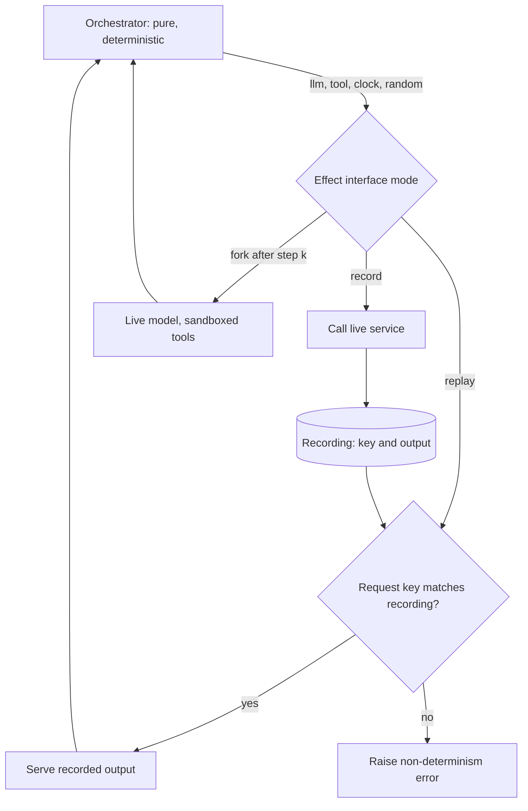

## TL;DR
Rerunning an agent does not reproduce it: models sample, providers change, tools return live data.
Reproducibility has three grades: exact replay from recorded effects, best-effort re-execution with pinned
settings, and statistical reproduction. Deterministic orchestration plus recorded effects keeps exact
replay always available.

## For agent builders
- **Why it matters for agents.** A bug report says "step 7 picked the wrong tool", and rerunning gives a
  different trajectory. Without recorded effects you cannot see what the model saw, and without repeated
  runs you cannot tell whether a fix helped.
- **Where it shows up in your stack.** Checkpointing and time-travel features in agent frameworks,
  workflow-engine replay (Temporal), your event stream as the recording, and eval harnesses that run
  each task many times.
- **What you control.** Which calls go through the effect interface (LLM, tools, clock, random), what
  the recording stores, keys for parallel calls, the code version stamped on each run, sandboxed forks
  and the N you budget for statistical checks.
- **What you can skip.** Chasing bit-exact model outputs across providers. Exact replay from recordings
  plus statistical reproduction answers the questions that matter.

## Lab
### Task
Turn the sequential `Effects` sketch from this lesson into one that handles a real incident: a support
agent with three parallel tool calls refunded 400 instead of 40. Time box: 60-90 min.
- **The goal:** record the run, replay it offline under a different completion order, refuse replays on
  changed input or code, and fork at step 1 to test the fix with a sandboxed refund tool.
- **Prerequisites:** Structured event streams; Sampling strategies; the recorder example in this lesson.
- **Setup:** Python 3.10+ and `pip install pytest` (checked with Python 3.13 and pytest 9.1). Save the
  starter as `lab.py` and the tests as `test_lab.py`.
- **No model and no network:** `make_llm` is a scripted fake model and `make_tools` writes refunds to a
  ledger list, so you can see whether a real refund happened.
- **You implement three things:** the code-version check in `Effects.__init__`, `Effects.do` for the
  three modes, and `merge`. Do not edit `agent`.

### Starter code
```python
"""Lab: record, replay and fork an agent run with parallel tool calls. Run: python lab.py"""
import hashlib
import json
import random

def _h(obj) -> str:
    return hashlib.sha256(json.dumps(obj, sort_keys=True, default=str).encode()).hexdigest()[:16]

class NonDeterminismError(RuntimeError):
    pass

class VersionMismatch(RuntimeError):
    pass

class Effects:
    """The one interface for every non-deterministic call. Effects are keyed by logical identity,
    f"{step}:{call_id}", never by arrival position.
    recording = {"code_version": str, "effects": {key: {"kind", "hash", "output"}}}
    modes: "record" (call live, store), "replay" (serve from recording, call nothing),
           "fork" (replay steps <= fork_after, then go live with sandbox overrides)."""
    def __init__(self, mode, recording, live, *, code_version, fork_after=None, sandbox=None):
        self.mode, self.rec, self.live = mode, recording, live
        self.fork_after, self.sandbox = fork_after, sandbox or {}
        self.live_calls = []                                    # (key, kind) of every live call made
        # In "record" mode set recording["code_version"] = code_version. In "replay" or "fork" mode
        # raise VersionMismatch when recording["code_version"] != code_version.
        # YOUR CODE HERE
        raise NotImplementedError

    def do(self, step: int, call_id: str, kind: str, **inputs):
        """key = f"{step}:{call_id}", hash = _h({"kind": kind, **inputs}).
        record: out = self.live[kind](**inputs); store {"kind", "hash", "output"} under key; return out
        replay: missing key -> NonDeterminismError(f"{key} not in recording");
                hash differs -> NonDeterminismError(f"{key}: request changed"); else the recorded output
        fork:   steps <= fork_after behave like replay; later steps call
                self.sandbox.get(kind, self.live[kind])(**inputs) and are not recorded
        Every live call (record mode, or fork after fork_after) appends (key, kind) to self.live_calls."""
        # YOUR CODE HERE
        raise NotImplementedError

def merge(results: list[tuple[str, object]]) -> list[tuple[str, object]]:
    """Parallel tool results arrive in completion order. Return them in a fixed order (by call_id)."""
    # YOUR CODE HERE
    raise NotImplementedError

def agent(task: str, fx: Effects, arrival_seed: int = 0, max_steps: int = 6) -> str:
    """Orchestration: a pure function of the recorded history. Do not edit."""
    messages = [{"role": "user", "content": f"{task} (today is {fx.do(0, 'clock', 'clock')})"}]
    for step in range(1, max_steps + 1):
        resp = fx.do(step, "llm", "llm", messages=messages)
        messages.append({"role": "assistant", "content": resp.get("text", ""), "calls": resp.get("tool_calls", [])})
        if not resp.get("tool_calls"):
            return resp["text"]
        calls = list(resp["tool_calls"])
        random.Random(arrival_seed + step).shuffle(calls)      # stands in for real completion order
        done = [(c["id"], fx.do(step, c["id"], "tool", name=c["name"], arguments=c["arguments"])) for c in calls]
        for call_id, result in merge(done):
            messages.append({"role": "tool", "call_id": call_id, "content": result})
    return "step budget exhausted"

def make_llm(refund_amount):
    def llm(messages):
        turns = sum(m["role"] == "assistant" for m in messages)
        if turns == 0:
            return {"tool_calls": [{"id": "c1", "name": "lookup_order", "arguments": {"id": "o-7"}},
                                   {"id": "c2", "name": "refund_policy", "arguments": {}},
                                   {"id": "c3", "name": "customer_tier", "arguments": {"id": "u-17"}}]}
        if turns == 1:
            return {"tool_calls": [{"id": "c4", "name": "refund", "arguments": {"id": "o-7", "amount": refund_amount}}]}
        return {"text": f"Refunded {messages[-1]['content']['amount']} on o-7."}
    return llm

def make_tools(ledger):
    def tool(name, arguments):
        if name == "refund":
            ledger.append(arguments["amount"])
            return {"ok": True, "amount": arguments["amount"]}
        return {"lookup_order": {"total": 40, "status": "damaged"}, "refund_policy": {"max": 40},
                "customer_tier": {"tier": "gold"}}[name]
    return tool

if __name__ == "__main__":
    prod = []                                                  # the real refund ledger
    live = {"clock": lambda: "2026-10-19T03:00", "llm": make_llm(400), "tool": make_tools(prod)}  # bug: 400
    rec = {"code_version": None, "effects": {}}
    print("record:", agent("Refund o-7 if eligible", Effects("record", rec, live, code_version="abc123")))
    print("keys:", sorted(rec["effects"]))
    fx = Effects("replay", rec, {}, code_version="abc123")
    print("replay:", agent("Refund o-7 if eligible", fx, arrival_seed=99), "live calls:", fx.live_calls)
    for label, make in [("changed input", lambda: agent("Refund o-8 if eligible", Effects("replay", rec, {}, code_version="abc123"))),
                        ("new code", lambda: Effects("replay", rec, {}, code_version="def456"))]:
        try:
            make()
        except (NonDeterminismError, VersionMismatch) as e:
            print(f"{label}: {type(e).__name__}: {e}")
    sandbox_ledger = []
    fixed = dict(live, llm=make_llm(40))                      # the fix under test
    fx = Effects("fork", rec, fixed, code_version="abc123", fork_after=1, sandbox={"tool": make_tools(sandbox_ledger)})
    print("fork:", agent("Refund o-7 if eligible", fx), "live calls:", fx.live_calls)
    print("prod ledger:", prod, "sandbox ledger:", sandbox_ledger)
```

### Expected output
`python lab.py` with a correct solution prints the following (the `VersionMismatch` message text is
yours to choose; the tests check only the type):

```
record: Refunded 400 on o-7.
keys: ['0:clock', '1:c1', '1:c2', '1:c3', '1:llm', '2:c4', '2:llm', '3:llm']
replay: Refunded 400 on o-7. live calls: []
changed input: NonDeterminismError: 1:llm: request changed
new code: VersionMismatch: recorded on abc123, running def456
fork: Refunded 40 on o-7. live calls: [('2:llm', 'llm'), ('2:c4', 'tool'), ('3:llm', 'llm')]
prod ledger: [400] sandbox ledger: [40]
```

### Tests
Run `pytest -q test_lab.py`. On the starter all 8 fail with `NotImplementedError`; a correct solution
passes all 8 (Python 3.13, pytest 9.1).

```python
import pytest
from lab import Effects, NonDeterminismError, VersionMismatch, agent, make_llm, make_tools, merge

TASK = "Refund o-7 if eligible"

def recorded(amount=400):
    prod = []
    live = {"clock": lambda: "2026-10-19T03:00", "llm": make_llm(amount), "tool": make_tools(prod)}
    rec = {"code_version": None, "effects": {}}
    fx = Effects("record", rec, live, code_version="v1")
    answer = agent(TASK, fx)
    return rec, live, prod, fx, answer

def test_record_keys_effects_by_step_and_call_id():
    rec, _, prod, fx, answer = recorded()
    assert answer == "Refunded 400 on o-7." and prod == [400] and rec["code_version"] == "v1"
    assert set(rec["effects"]) == {"0:clock", "1:llm", "1:c1", "1:c2", "1:c3", "2:llm", "2:c4", "3:llm"}
    assert len(fx.live_calls) == 8 and rec["effects"]["2:c4"]["kind"] == "tool"

def test_merge_is_independent_of_arrival_order():
    assert merge([("c3", 3), ("c1", 1), ("c2", 2)]) == [("c1", 1), ("c2", 2), ("c3", 3)]

@pytest.mark.parametrize("seed", [1, 7, 99])
def test_replay_calls_nothing_and_survives_any_arrival_order(seed):
    rec, _, prod, _, answer = recorded()
    fx = Effects("replay", rec, {}, code_version="v1")
    assert agent(TASK, fx, arrival_seed=seed) == answer
    assert fx.live_calls == [] and prod == [400]

def test_replay_refuses_changed_or_missing_requests():
    rec, *_ = recorded()
    with pytest.raises(NonDeterminismError, match="1:llm: request changed"):
        agent("Refund o-8 if eligible", Effects("replay", rec, {}, code_version="v1"))
    del rec["effects"]["2:c4"]
    with pytest.raises(NonDeterminismError, match="2:c4 not in recording"):
        agent(TASK, Effects("replay", rec, {}, code_version="v1"))

def test_replay_and_fork_check_the_code_version():
    rec, *_ = recorded()
    for mode in ("replay", "fork"):
        with pytest.raises(VersionMismatch):
            Effects(mode, rec, {}, code_version="v2", fork_after=1)

def test_fork_replays_the_prefix_and_sandboxes_side_effects():
    rec, live, prod, _, _ = recorded()
    sandbox_ledger = []
    fixed = dict(live, llm=make_llm(40))
    fx = Effects("fork", rec, fixed, code_version="v1", fork_after=1, sandbox={"tool": make_tools(sandbox_ledger)})
    assert agent(TASK, fx, arrival_seed=5) == "Refunded 40 on o-7."
    assert [k for k, _ in fx.live_calls] == ["2:llm", "2:c4", "3:llm"]
    assert prod == [400] and sandbox_ledger == [40]
```

### Failure scenarios
- **Return `results` unsorted from `merge`.** Replays with seeds 7 and 99 fail with
  `2:llm: request changed`: the tool messages reached the model in a new order, so the step-2 prompt hash
  differs. When a non-determinism error names an `llm` key, diff the recorded and replayed prompts.
- **Match effects by position (a counter) instead of by key.** Replay raises a non-determinism error on
  the first shuffled step, or, without the hash check, silently serves `c2`'s result to `c1`. Log each
  served key next to the requested one; they must be equal.
- **Forget the sandbox in fork mode.** The fork test sees `prod == [400, 40]`: debugging refunded a real
  customer again. Assert in CI that no fork ever touches the production ledger or endpoint.
- **Skip the version check.** Old recordings replay against changed code and either crash deep in a run
  or, worse, serve outputs to requests they were never recorded for. Store the commit SHA with each run.

### Submission
- **`lab.py`** with `Effects.__init__`, `Effects.do` and `merge` implemented; `agent` unchanged.
- **A green test run** (8 passed) and the printed output of `python lab.py`.
- **One extra test** of your own: route a `uuid4()` request id through `fx.do` and show that replay
  reproduces the same id.
- **A short note** on what the fork proves and what it does not (one fork is one sample; a rate claim
  needs the N from the sample-size example).
- **Evaluated on:** zero live calls on replay, keyed effects that survive any arrival order, loud
  refusals on changed input or code, and forks that never reach production tools.

## Why it exists
- **The failure you cannot see.** A run fails at 03:00: the agent called the wrong tool at step 7 and
  corrupted a record. The morning rerun works, so there is no failure to look at.
- **Several links in the chain are not functions of their inputs:** the model's sampled output, the
  provider's silently updated weights or serving stack, a tool returning today's data instead of last
  night's, the clock, the random id generator. Each decision is conditioned on everything before it, so
  change one token at step 2 and step 7 may not happen at all.
- **"Temperature 0 and rerun" fails.** Greedy decoding removes sampling noise but not numerical noise:
  GPU floating-point reductions are order-dependent, batching puts your request next to different
  neighbours, and kernels get updated, so the argmax can flip on near-tied logits.
- **Providers and tools move too.** Hosted providers move alias model names to new snapshots, and even a
  dated snapshot can see serving-stack changes. None of this touches the tools, which are the bigger source
  of divergence in practice.
- **Durable workflow engines already solved it** by splitting code into deterministic orchestration and
  recorded effects. Agents inherit that: record every effect, replay the recording, and the orchestration
  reproduces the exact trajectory, step for step, on any machine, with no model call at all.

## How it works
### Classify everything as orchestration or effect
| | Orchestration | Effects |
|---|---|---|
| What | Code that decides what to do next given the history: assembling the prompt, parsing the tool call, checking the policy, choosing the next step | Anything whose output is not a function of its inputs from the orchestrator's view: LLM calls, tool calls, `time.now()`, `random()`, `uuid4()`, environment reads |
| Rule | Must be a pure function of the recorded history | Each goes through one interface |

### Record mode
1. **The runtime runs normally.**
2. **Every effect request is written to the run's event stream before execution,** with its sequence number
   and an input hash; its output is written after.
3. **LLM events:** the request stores the model identifier, the full parameters and a reference to the exact
   prompt; the response stores the exact text and tool calls.
4. **Tool events** store arguments and results by reference.
5. **Clock and random draws are recorded too,** *because* a timestamp in a prompt or a generated id in an
   argument is enough to make the next step differ.

### Replay mode
- **Same orchestrator, recorded effects.** It runs again from the initial input, but the effect interface
  serves from the recording: the nth effect request returns the nth recorded output, after checking the
  request matches (same effect type and input hash).
- **No model is called; no tool runs.** Because orchestration is deterministic, it issues exactly the same
  sequence of requests, and the run reproduces step by step.
- **You can debug the past:** set breakpoints, inspect the prompt the model saw at step 7, and see why its
  answer led to the wrong tool.

### The match check is the safety feature
- **A mismatched request means the code changed** in a way that alters the trajectory. The replayer raises a
  non-determinism error rather than silently serving a mismatched answer.
- **Durable workflow engines enforce the same rule:** code versions and recordings go together, so the
  runtime records a code version with each run and replays against the same version.

### Parallel calls need keys, not positions
- **Position matching ("the nth effect") breaks for parallel tool calls,** whose results arrive in a
  different order each run.
- **Key each effect by logical identity:** `(step, call_id)` for tool calls and `(step, "llm")` for the model
  call, and have the replayer look up by key. Arrival order then stops mattering.
- **Merge deterministically:** the orchestrator must merge parallel results in a fixed order (by `call_id`,
  not by completion time), or replay will still diverge.

### Fork: replay to a point, then go live
1. **Replay the recording up to step k,** then switch the effect interface back to live for steps after k.
2. **Everything up to the divergence is identical,** so the comparison isolates the change.
3. **This is "time travel"** in checkpoint-based frameworks: load the state at a checkpoint, optionally
   edit it, continue live.
4. **"Live" means live model and sandboxed or faked side-effecting tools,** *because* a fork of an incident
   run that refunds a real customer a second time turns debugging into a new incident.

### The three grades of reproducibility
| Grade | How | What it answers | Limit |
|---|---|---|---|
| 1. **Exact replay** (recording) | Serve every effect from the recording | What happened, exactly | Reproduces the past; cannot say what the model would do now |
| 2. **Best-effort re-execution** | Pin the model version where exposed, temperature 0 or a fixed seed, tool snapshots or fakes, frozen clock | "Does the model still make this mistake?" | Not bit-exact; "close" is the honest claim |
| 3. **Statistical reproduction** | Run the task N times, report pass rate with an interval, compare distributions | "Did my fix help?" for a stochastic system | Costs N runs per task |

- **Grade 2 details.** Some providers expose a seed parameter and a fingerprint of the serving
  configuration, documented as best-effort rather than guaranteed; self-hosted engines get closer with
  fixed batch composition and kernels.
- **Grade 3 budget.** Pick N from the effect size: showing a 10% failure rate fell to 5% with a standard
  two-proportion test (5% significance, 80% power) takes roughly 430 runs per arm.
- **That is why forking matters for long agents:** each of those runs pays only for the divergent tail
  from step k, not the whole trajectory.

### What the recording must contain
In the order people forget it; miss one and replay diverges at the first step that touches it:
1. Model id and parameters.
2. Exact prompt text, or a hash resolving to it.
3. The exact response, including tool-call JSON.
4. Every tool's arguments and result.
5. Clock reads and random draws.
6. Environment variables that reach prompts.
7. The code version.

## Diagram
Every non-deterministic call passes one effect interface; the mode decides whether it goes live, is
served from the recording, or is refused because the request no longer matches.



## Examples
### Effect recorder and replayer
An effect recorder/replayer wrapped around an agent loop. In `record` mode it logs every boundary; in
`replay` mode it serves recorded outputs and refuses to continue if the orchestrator asks for something
different.

- **Sequential loop:** tool calls run one at a time, so matching by position is enough; with parallel calls
  the lookup would be by `(step, call_id)` as described above.

```python
import hashlib, json

def _h(obj):
    return hashlib.sha256(json.dumps(obj, sort_keys=True, default=str).encode()).hexdigest()[:16]

class NonDeterminismError(RuntimeError):
    pass

class Effects:
    """Every non-deterministic boundary goes through `do`. Orchestration stays pure."""
    def __init__(self, mode: str, log: list[dict], live: dict):
        self.mode, self.log, self.live, self.i = mode, log, live, 0

    def do(self, kind: str, **inputs):
        key = _h({"kind": kind, **inputs})
        if self.mode == "replay":
            if self.i >= len(self.log):
                raise NonDeterminismError(f"effect #{self.i} ({kind}) not in recording")
            rec = self.log[self.i]
            if rec["key"] != key:
                raise NonDeterminismError(f"effect #{self.i}: recorded {rec['kind']}/{rec['key']}, got {kind}/{key}")
            self.i += 1
            return rec["output"]
        out = self.live[kind](**inputs)                      # record mode: run it, then log it
        self.log.append({"seq": self.i, "kind": kind, "key": key, "output": out}); self.i += 1
        return out

def agent(task: str, fx: Effects, max_steps: int = 8) -> str:
    messages = [{"role": "user", "content": f"{task} (today is {fx.do('clock')})"}]
    for _ in range(max_steps):
        resp = fx.do("llm", model="model-x@2026-06", messages=messages, temperature=0)
        messages.append({"role": "assistant", "content": resp["text"], "tool_calls": resp.get("tool_calls", [])})
        if not resp.get("tool_calls"):
            return resp["text"]
        for call in resp["tool_calls"]:
            result = fx.do("tool", name=call["name"], arguments=call["arguments"])
            messages.append({"role": "tool", "name": call["name"], "content": result})
    return "step budget exhausted"

# Record once against live services and persist `log`. Later, replay with no network at all:
#   answer = agent(task, Effects("replay", log, live={}))   -> identical trajectory, step by step
```

### Record, replay and a refused replay (runnable)
Uses `Effects`, `NonDeterminismError` and `agent` from the block above, with fake live services. A changed
input makes the first LLM request hash differently, so replay refuses instead of inventing a run.

```python
def fake_llm(model, messages, temperature):
    if messages[-1]["role"] == "user":
        return {"text": "", "tool_calls": [{"name": "lookup", "arguments": {"id": "o-7"}}]}
    return {"text": "Order o-7 shipped."}

live = {"clock": lambda: "2026-10-19T03:00", "llm": fake_llm,
        "tool": lambda name, arguments: {"status": "shipped"}}

log = []
print(agent("Where is o-7?", Effects("record", log, live)))       # Order o-7 shipped.
print([r["kind"] for r in log])                                   # ['clock', 'llm', 'tool', 'llm']
print(agent("Where is o-7?", Effects("replay", log, live={})))    # same answer, nothing called

try:                                                              # input (or code) changed
    agent("Where is o-8?", Effects("replay", log, live={}))
except NonDeterminismError as e:
    print("refused:", e)                                          # effect #1: recorded llm/..., got llm/...
```

### Budgeting N for the statistical grade
A standard two-proportion sample-size formula, stdlib only. It reproduces the "roughly 430 runs per arm"
figure and shows why small improvements are expensive to prove.

```python
from math import ceil, sqrt
from statistics import NormalDist

def runs_per_arm(p_before: float, p_after: float, alpha=0.05, power=0.80) -> int:
    """Two-proportion z-test sample size (two-sided), per arm."""
    z_a = NormalDist().inv_cdf(1 - alpha / 2)
    z_b = NormalDist().inv_cdf(power)
    p_bar = (p_before + p_after) / 2
    num = (z_a * sqrt(2 * p_bar * (1 - p_bar))
           + z_b * sqrt(p_before * (1 - p_before) + p_after * (1 - p_after))) ** 2
    return ceil(num / (p_before - p_after) ** 2)

print(runs_per_arm(0.10, 0.05))   # 435
print(runs_per_arm(0.10, 0.02))   # 138
print(runs_per_arm(0.10, 0.08))   # 3213
```

| Failure rate before → after | Runs per arm | With a 12-step agent forked at step 7 |
|---|---|---|
| 10% → 5% | 435 | each run pays for 6 live steps, not 12 |
| 10% → 2% | 138 | a cheap confirmation |
| 10% → 8% | 3,213 | consider whether the gain is worth proving |

## Production patterns
- **Record by default from the event stream.** When: every production run. How: route LLM, tool, clock and
  random calls through one effect interface that appends request and response events; most of this is the
  stream you keep for resumption and audit. Monitor: replay coverage, the fraction of runs that replay
  without a non-determinism error.
- **Stamp the code version on every run.** When: any runtime whose code changes while recordings live on.
  How: store the deploy's commit SHA with the run and refuse or warn when replaying against a different
  version; Temporal's workflow versioning and patching APIs exist for exactly this. Monitor: replays
  attempted across versions.
- **Replay tests in CI.** When: changing orchestration code. How: replay a fixed set of recorded production
  runs against the new code and fail the build on non-determinism errors (Temporal, for example, ships a
  replayer for workflow histories). Monitor: which recordings break and at which step.
- **Sandboxed forks.** When: testing a fix from an incident recording. How: fork mode swaps side-effecting
  tools for fakes or a staging backend while the model goes live. Monitor: any fork that reaches a
  production endpoint, which should be zero.
- **Pinned model snapshots with a re-pin schedule.** When: evals and reproductions must be comparable. How:
  use dated model identifiers rather than aliases and put the deprecation date on the calendar. Monitor:
  divergence rate of best-effort re-execution after each provider change.
- **Recordings under retention.** When: recordings contain customer content. How: keep payloads by
  reference in a blob store with lifecycle rules and per-record delete, so the event history survives
  data-protection deletions. Monitor: unresolved references in recordings you still need.

## Trade-offs
- **Exact replay vs relevance.** It is cheap to run and perfectly faithful to the past, but it only
  reproduces what was recorded; once you change the prompt or code before the failing step, you are in
  re-execution territory with its uncertainty.
- **Watertight recording vs discipline.** Recording clock and random draws makes replay watertight but any
  developer who calls `datetime.now()` directly inside orchestration breaks replay, and the error appears
  weeks later on an old recording.
- **Pinned models vs drift.** Pinning gives stability for reproduction and evals, but pinned versions get
  deprecated and drift away from the one users get; schedule the re-pinning rather than discovering it.
- **Statistical reproduction vs cost.** It answers the right question for stochastic systems but costs N
  runs per task; for expensive multi-step agents, replay-then-fork from the step before the failure cuts
  the cost to the divergent tail.

## Pitfalls
- **Believing temperature 0 means deterministic.** Symptom: a "reproduction" diverges at step 3 with no
  code change. Diagnose: rerun the same request N times and diff outputs. Fix: replay the recording.
- **The prompt template name recorded, not its text or hash.** Symptom: replay silently uses today's
  template and a different trajectory. Diagnose: compare the recorded prompt hash with today's. Fix:
  record the hash.
- **The model called inside orchestration without the effect interface,** for example a helper that
  "just summarizes" tool output. Symptom: a non-determinism error at a step that looks pure. Diagnose:
  read the error's effect index against the recording. Fix: route it through `do`.
- **Old recordings replayed on changed code without a version check.** Symptom: a mismatched response
  served to a different request, a run that never happened. Fix: stamp and check the code version.
- **One successful rerun treated as proof of a fix.** Symptom: the bug returns at roughly its old rate.
  Diagnose: compute runs per arm for the claimed change. Fix: the statistical grade.
- **Live side-effecting tools during replay.** Symptom: the reproduction creates a second real ticket.
  Fix: fake or sandboxed tools in replay and forks.
- **Parallel tool calls replayed by arrival position.** Symptom: non-determinism errors only on runs with
  parallel calls. Fix: key by `(step, call_id)`.
- **Recordings under no retention policy.** Symptom: a deletion request cannot be honoured because
  customer content sits in years of replay logs. Fix: payloads by reference with retention.

## When to use
- **Record every production run by default;** the event stream you already keep for resumption and audit
  is most of the recording, and the extra cost is clock and random draws.
- **In any incident, reach for exact replay first,** because it is free and faithful; then fork from the
  step before the divergence to test a fix; then run the statistical grade across N runs before shipping.
- **Measure** replay coverage (fraction of runs that replay without a non-determinism error), the
  divergence rate of best-effort re-execution, and the run count needed to detect the improvement you care
  about.

## Exercise
**Goal:** make one tool-calling agent fully replayable and use a fork to test a fix. No solution is
given; the `Effects` class above is a sequential sketch, and your version must handle parallel calls.
- **Inputs:** any agent loop with at least one parallel tool step; fake or sandboxed tools only.
- **Constraints:** LLM, tools, clock and random go through one interface keyed by `(step, call_id)`;
  each recording carries the code version.
- **Deliver:** record, replay and fork modes, plus a CI test replaying ten recordings.
- **Acceptance:** replay makes zero live calls and reproduces each trajectory; shuffling parallel
  completion order still replays; changing prompt assembly raises a non-determinism error; a fork at
  step *k* runs only steps after *k* live.

## Role lens
- **Engineer:** Routes every LLM, tool, clock and random call through one effect interface and keeps
  orchestration code free of hidden non-determinism.
- **Architect:** Decides what the recording contains, how code versions are tied to recordings, and which
  grade of reproducibility each process (incident, eval gate, regression) requires.
- **FDE:** Replays a customer's failing run offline, without touching their live systems, to show exactly
  which step diverged and why.

## Check yourself
**Q:** An agent corrupted a record at step 7 of a 12-step run last night. Rerunning the task today
succeeds. Walk through how you find the cause and how you prove your fix works.
**A:** Rerunning is not reproduction; the model, tools and clock differ. Load last night's recording and
replay it with the effect interface in replay mode: no model or tool is called, the orchestrator reissues
the same requests, and the replayer serves the recorded outputs, so the run reproduces exactly. Inspect the
exact prompt the model saw when it chose the step-7 call, including the tool results from steps 1 to 6,
which usually reveals a misleading tool result or a prompt assembled with an unexpected value such as a
timestamp. Make the fix, then fork: replay steps 1 to 6 under the fixed code, go live from step 7, and
confirm the divergence is gone. If the fix changes requests before step 7, the replayer raises a
non-determinism error at that point, which tells you the fork has to start earlier. Because the model is stochastic, a
single success proves little, so run the task N times with the fix and compare the failure rate to the
baseline with a confidence interval. Finally, record the code version with the fix so future replays of
this recording warn that it predates the change.

## Interview questions
### Replay works for sequential runs but fails with non-determinism errors on runs with parallel tool calls. Why?
- **Position matching:** the replayer serves "the nth effect", but parallel results arrive in a different
  order each run, so the nth request no longer matches the nth recording.
- **Fix the lookup:** key effects by logical identity, `(step, call_id)` for tools and `(step, "llm")` for
  the model.
- **Fix the merge:** combine parallel results in a fixed order such as by `call_id`, not completion time.

### Is temperature 0 with a fixed seed enough for reproducible evals?
- **No, it is best-effort:** GPU reductions are order-dependent, batch neighbours change, kernels update and
  near-tied logits can flip.
- **Providers and tools also move:** alias names point to new snapshots and live tools return new data.
- **Use it for** "does the model still make this mistake"; use recordings for exact answers and repeated
  runs for rate questions.

### How many runs do you need to show a fix cut failures from 10% to 5%?
- **Roughly 430 per arm** with a two-proportion test at 5% significance and 80% power.
- **Effect size dominates:** 10% to 2% needs about 140, while 10% to 8% needs over 3,000.
- **Make runs cheaper:** fork from the step before the failure so each run pays only for the divergent tail.

### When would you not bother with full effect recording?
- **Short, side-effect-free tasks** where rerunning is cheap and an incident has no lasting consequence.
- **Even then keep the cheap part:** model id, prompt hash and code version, because without them you
  cannot tell whether the model or the prompt changed.
- **Any agent with side effects or regulated data** should record by default; the stream already exists.

## Quiz
### Q: Why does setting temperature to 0 not guarantee a reproducible agent run?
- [ ] Temperature only affects the first token of each response
- [x] Greedy decoding removes sampling noise but not numerical, batching, model-version or tool-data variation, any of which can change a step
- [ ] Temperature 0 is ignored by tool-calling models
- [ ] Because tools always run at temperature 1
> Determinism of one component is not determinism of the chain; near-tied logits, changed serving stacks
> and live tool data all alter trajectories regardless of sampling settings.

### Q: During replay the orchestrator requests a tool call that does not match the recording. What should the runtime do?
- [ ] Serve the next recorded output anyway, since the order is probably close enough
- [ ] Call the live tool to fill the gap
- [x] Raise a non-determinism error, because the code has changed in a way that alters the trajectory and the recording no longer applies
- [ ] Skip the request and continue from the following recorded event
> Serving a mismatched output fabricates a run that never happened; failing loudly is what makes replay
> trustworthy, exactly as durable workflow engines do.

### Q: Which grade of reproducibility answers "did my fix reduce the failure rate"?
- [ ] Exact replay of the failing recording
- [ ] Best-effort re-execution with a fixed seed
- [x] Statistical reproduction over many runs with a confidence interval
- [ ] Any single successful rerun after the fix
> Replay reproduces the past and a single rerun is one sample from a stochastic process; only repeated
> runs measure a change in rate.

## Mastery test
**Problem:** after a weekend deploy, 30% of in-flight runs fail on resume with non-determinism errors,
all at the step after the last checkpoint. The diff changed a helper that builds a request id from
`uuid4()` and reordered two tool calls. Replay of last week's recordings in CI passed. What happened,
and what do you change?

**A strong answer:**
- explains that resume replays history through new code, so both the id and the reordering change
  request hashes;
- spots the CI gap: no recording exercised the changed path, so the replay sample needs coverage of
  every step type;
- routes `uuid4()` through the effect interface and versions the orchestrator;
- lets old runs finish on the old version (or a version branch) instead of mixing code.

## Use cases & projects
### Use cases
- **Debugging a production incident.** Replay the recorded run step by step and inspect the exact
  prompt and tool results behind the bad decision, with no model or tool called.
- **Testing a fix on the failing tail.** Fork the recording at the step before the mistake, go live
  with sandboxed tools, and pay only for the divergent steps.
- **Safe orchestration refactors.** Replaying recorded runs in CI catches code changes that alter the
  trajectory before they break resumption of in-flight runs.
- **Release decisions.** Statistical reproduction with an interval shows whether a prompt or model
  change actually cut the failure rate.

### Mini project
**Record, replay and fork an agent run (2-3 hours).**
- **Goal:** make one tool-calling agent fully replayable and use a fork to test a fix.
- **Steps:** route LLM calls, tool calls, clock reads (`datetime.now()`) and `uuid4()` through one effect
  interface keyed by `(step, call_id)`; record a run that makes a mistake; replay it offline; change how
  the prompt is assembled (so a request hash changes) and confirm replay refuses; fork at the step before
  the mistake with a fixed prompt and fake side-effecting tools.
- **Done when:** the Exercise acceptance checks pass, and 20 forks show how often the fixed decision now
  appears (a smoke check; proving a rate change needs the N from the sample-size formula).
