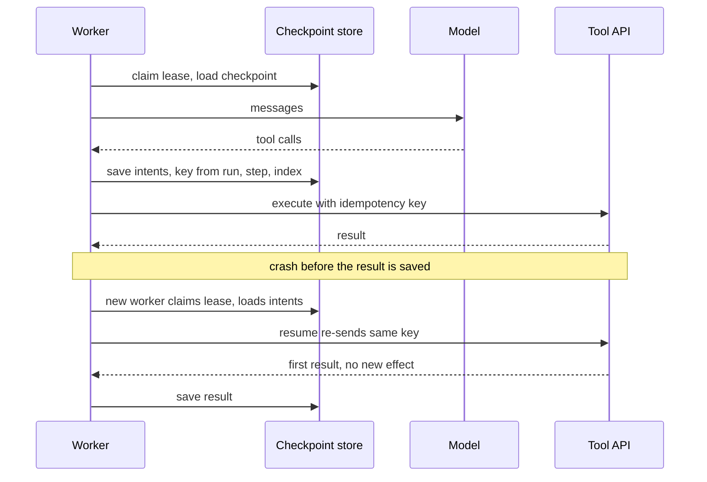

## TL;DR
Durable execution makes an agent run's progress outlive its process; checkpointing persists state at step
boundaries so a resume continues from the last boundary, not from scratch. The hard part is side effects,
so checkpointing is inseparable from idempotent tools.

## For agent builders
- **Why it matters for agents.** A long agent run spends tokens and creates tickets, branches and messages
  as it goes. Without checkpoints, every deploy or OOM restarts it from zero, re-pays the tokens and
  repeats the side effects on top of the first attempt's half-finished work.
- **Where it shows up in your stack.** LangGraph checkpointers keyed by a thread id (for example
  `PostgresSaver` from `langgraph-checkpoint-postgres`), Temporal workflows with model and tool calls as
  activities, or your own snapshot table plus a lease.
- **What you control.** What the checkpoint contains, where the save sits (between "model decided" and
  "tools run"), the intent-execute-record protocol with stable idempotency keys, how waits are parked,
  per-call timeouts and retries, and checkpoint schema versions.
- **What you can skip.** Saving partial model output. A model call can be repeated safely; only side
  effects need the intent record.

## Why it exists
- **A chat completion is one request; an agent run is not.** If a single call's process dies, the client
  retries and loses one call. An agent run differs in three ways:
  - **Long:** tens of steps, minutes to hours, with waits on tools, humans and rate limits.
  - **Expensive:** restarting re-pays every token already spent.
  - **Side-effecting:** by step twelve it has created a branch, opened a ticket and sent a message;
    restarting from scratch creates a second of each.
- **A restart is a different run.** The model is nondeterministic, so the "retry" may make different
  decisions on top of the first run's half-finished effects.
- **Process death is a daily event.** Every deploy restarts workers; autoscalers scale in; spot instances
  get reclaimed; one oversized tool output triggers an OOM; a dependency bug raises somewhere unexpected.
  At thousands of runs a day, "the process died mid-run" happens daily.
- **The naive answers fail.** "Background job with retries" restarts from zero, with the problems above;
  "keep the state in memory and hope" is where most prototypes live. Neither answers: when the process
  comes back, how does it know what already happened?
- **What it takes.** State written somewhere durable before the process can lose it, and a resume
  procedure that reads it and continues without redoing side effects.

## How it works
### What a checkpoint contains
Everything needed to continue as if nothing happened:
- the message transcript (or a reference to it) and the step index;
- budget counters;
- tool calls issued but not yet completed, and pending human approvals;
- tool-side state (temp directories, branch names);
- the prompt and model version, and any random seed.
- **Omit any of these and the resume is subtly different:** budgets reset, a pending approval is
  forgotten, or a new prompt version runs against old context.

### Two architectures
| | **Snapshot checkpointing** | **Event-sourced replay** |
|---|---|---|
| Write | Full state after each step, keyed by (run id, step) | Each event (model response, tool result, timer fired, signal received) to an append-only history |
| Resume | Load the latest snapshot, continue the loop | Re-run orchestration code from the start; substitute recorded results for calls already in history |
| Example | LangGraph checkpointers, after each super-step, keyed by a thread id | Temporal: model and tool calls are activities with recorded results and their own retry policies |
| Gain | Simple, framework-agnostic | Orchestration reads like sequential code yet is crash-proof |
| Cost | Writing a growing state every step | Determinism discipline and a learning curve |

- **LangGraph detail.** It also stores the pending writes of nodes that finished inside a super-step that
  failed, so on resume those nodes are not run again: the intent-and-result idea applied to graph nodes.
- **Snapshot mitigation.** Store the transcript as append-only events and snapshot only the small
  non-transcript part.
- **Temporal's determinism rule.** Workflow code must not read the clock directly, use randomness or do
  I/O. Time and random values come from the engine's deterministic APIs, which are recorded in the
  history, and all I/O goes through activities, so replay follows the same path.
- **Both land in the same place:** completed steps are never re-executed; the only re-execution risk is
  the step in flight at the moment of death.

### The side-effect boundary
The sequence:
1. The model asks for `create_ticket`.
2. The harness calls the API.
3. The ticket now exists.
4. The harness records the result.

- **Death between 2 and 4** leaves a ticket with no record; on resume the pending call has no result, so
  it runs again: two tickets.
- **No checkpoint placement fixes this,** because the external effect and the local record cannot be
  made atomic.
- **The answer is a three-phase protocol:**
  1. Record the *intent*: a pending call with a deterministic idempotency key derived from run id and step.
  2. Execute, passing the key.
  3. Record the result.
- **On resume,** a pending intent without a result is re-executed with the *same* key, and an idempotent
  tool or a dedup table turns the second execution into a no-op that returns the first result.
- **Durable execution without idempotent tools gives at-least-once side effects; with them, effectively
  once.**

### Resume protocol
1. A worker claims the run with an expiring lease, so two workers cannot resume it concurrently.
2. Load the latest checkpoint, or replay the history.
3. Validate the transcript: every tool call has a result; synthesize an error result for any that cannot
   be re-executed, because model APIs reject histories with unmatched calls.
4. Re-execute pending intents with their recorded keys.
5. Continue the loop under the *same* run id, incrementing a resume counter (or lease epoch) on the run
   record.

- **A crash-resume is not a new attempt.** A new attempt would mint a new run id and with it new
  idempotency keys, which is exactly what must not happen to a half-finished step.
- **What is *not* protected:** a model call that completed but whose response was not yet saved is
  simply made again. That costs tokens and may produce a different decision, but it is safe, because no
  side effect happens until intents are recorded and executed.
- **So the save sits between "model decided" and "tools run",** not after the tools.

### Durable waits
- **Agents wait** for a human approval, a CI pipeline, a rate-limit window, a scheduled follow-up the
  next morning.
- **Holding a worker wastes capacity and bets the run.** Its memory, connections and lease are tied up
  for hours, and the run depends on that process surviving.
- **Park the run instead.** Record "waiting for signal `approval:42`" or "timer due at 09:00" and release
  the worker. When the signal arrives or the timer fires, any worker claims the run and continues from
  the checkpoint.
- **Implementations.** Temporal exposes durable timers and signals; in a snapshot design it is a status
  (`awaiting_approval`) plus a wake-up row a scheduler polls. Either way, waiting costs storage, not a
  process.

### Timeouts and retries per step
- **Each model call and tool call is the unit of retry,** with its own timeout and retry policy, because
  retrying the whole run would repeat completed work.
- **Two timeouts:** one per attempt of the call, and one for the call overall, including retries.
- **Heartbeats for long tools.** The tool reports "still working" every few seconds, so the runtime
  detects a dead worker in seconds instead of waiting out a timeout sized for the slowest legitimate
  case; Temporal activities support exactly this.
- **Automatic retries only for safe calls.** They apply only to calls classified as idempotent or keyed;
  for the rest, an ambiguous failure becomes a reconciliation step rather than a blind retry.

### Versioning
- **Old checkpoints must load in new code.** Store a schema version in each checkpoint; keep loaders for
  old versions or migrate on read.
- **Replay systems are stricter.** Changing orchestration code changes the path, so in-flight runs need
  versioned branches in the code or must be drained before deploy.

### Checkpoint frequency
- **Per step is the natural unit,** because the step is the boundary between "model decided" and "world
  changed". Less often widens the window of lost work.
- **Inside a step, save each completed tool result,** so a step with several parallel calls does not
  re-run finished ones on resume.
- **Anything finer buys little.** Saving partial model output is pointless because a model call can be
  repeated safely: it costs tokens but has no side effects.
- **Latency matters.** The write sits on the critical path of every step; that is the topic of the state
  and checkpoint stores lesson.

## Diagram
The intent is saved before the side effect, so a crash at any arrow leaves enough on disk to resume
without acting twice.



## Examples
### Save-before-execute loop with pending intents
The loop saves the model's decision and the tool-call intents, with deterministic keys, *before*
executing anything, and saves each result as it lands. On restart only intents without a result are
re-executed, with the same keys, so idempotent tools return the original result instead of acting twice.

```python
def key_for(run_id, step, idx):                 # deterministic -> identical on resume
    return f"{run_id}:{step}:{idx}"

def load_or_start(store, run_id, initial_messages):
    cp = store.load_latest(run_id)              # None on first start
    if cp is None:
        cp = {"step": 0, "messages": initial_messages, "pending": [], "status": "running"}
        store.save(run_id, cp)
    return cp

def run(store, run_id, model, tools, initial_messages):
    cp = load_or_start(store, run_id, initial_messages)    # caller holds the run's lease
    while True:
        for call in cp["pending"]:              # empty unless we died mid-step
            if "result" not in call:            # completed calls are not re-run
                call["result"] = tools[call["name"]](**call["args"], idempotency_key=call["key"])
                store.save(run_id, cp)          # record each result as soon as it exists
        if cp["pending"]:
            cp["messages"] += [{"role": "tool", "tool_call_id": c["id"], "content": c["result"]}
                               for c in cp["pending"]]
            cp["pending"] = []
            store.save(run_id, cp)
        resp = model(cp["messages"])            # lost on a crash before the next save: re-asked
        cp["messages"].append(resp.message)
        if not resp.tool_calls:
            cp["status"] = "done"
            store.save(run_id, cp)
            return cp
        cp["pending"] = [{"id": c.id, "name": c.name, "args": c.args,
                          "key": key_for(run_id, cp["step"], i)}
                         for i, c in enumerate(resp.tool_calls)]
        cp["step"] += 1
        store.save(run_id, cp)                  # intent recorded BEFORE execution
```

Kill the worker at each boundary and see what the resume does:

| Killed at | What the resume does |
|---|---|
| During the model call | No intents exist, so the call is simply made again |
| Fourth step of run `run_9` (step index 3), three parallel calls; call 0 recorded, call 1 executing | Skips call 0; re-runs call 1 with the same key `run_9:3:1`, so the downstream API returns the first execution's result; runs call 2 for the first time |
| After all three results were recorded, before the messages were updated | Re-runs nothing; only finishes the bookkeeping |

At no boundary does a side effect happen twice, provided the tools honour the key.

### Runnable: crash between execute and record, with and without stable keys
Pure Python with an in-memory "store" and a ticket API that honours idempotency keys. The crash happens
after the ticket exists but before its result is saved.

```python
import copy, uuid

class Crash(Exception): pass

class TicketAPI:                                    # an API that honours idempotency keys
    def __init__(self): self.tickets, self.by_key = [], {}
    def create(self, title, idempotency_key):
        if idempotency_key in self.by_key:          # same key again: return first result
            return self.by_key[idempotency_key]
        self.tickets.append(title)
        self.by_key[idempotency_key] = f"T-{len(self.tickets)}"
        return self.by_key[idempotency_key]

def step(db, api, run_id, crash=False, fresh_key=False):
    cp = copy.deepcopy(db.get(run_id)) or {"step": 0, "pending": []}
    if not cp["pending"]:                           # the "model" asks for one ticket
        cp["pending"] = [{"title": "Fix login", "key": f"{run_id}:{cp['step']}:0"}]
        db[run_id] = copy.deepcopy(cp)              # intent saved BEFORE execution
    for call in cp["pending"]:
        if "result" not in call:
            key = str(uuid.uuid4()) if fresh_key else call["key"]
            call["result"] = api.create(call["title"], idempotency_key=key)
            if crash:
                raise Crash("died before recording the result")
            db[run_id] = copy.deepcopy(cp)
    return cp

for fresh in (False, True):
    db, api = {}, TicketAPI()
    try:
        step(db, api, "run_9", crash=True, fresh_key=fresh)
    except Crash:
        pass                                        # the worker is gone; db survives
    step(db, api, "run_9", fresh_key=fresh)         # another worker resumes
    print("random keys" if fresh else "deterministic keys", "->", len(api.tickets), "ticket(s)")
# deterministic keys -> 1 ticket(s)
# random keys -> 2 ticket(s)
```

## Production patterns
- **LangGraph with a durable checkpointer.** For graph-shaped agents, compile the graph with a Postgres
  checkpointer (`PostgresSaver` from the `langgraph-checkpoint-postgres` package) and pass a stable
  `thread_id` in the run config; use `interrupt()` for human approvals so the run parks instead of
  holding a worker. Monitor checkpoint write latency and checkpoint table growth.
- **Temporal activities for every model and tool call.** Run each call as an activity with a
  `start_to_close_timeout` (per attempt), a `schedule_to_close_timeout` (overall), a `heartbeat_timeout`
  for long tools and a retry policy that marks non-idempotent errors as non-retryable. Monitor activity
  retry counts and workflow task failures, which often signal non-determinism.
- **Version in-flight workflows on deploy.** In Temporal, guard changed orchestration code with
  `workflow.patched(...)` (Python SDK) or drain old runs; in snapshot designs, store `schema_version` in
  each checkpoint and migrate on read. Monitor resume failures by checkpoint version.
- **Kill-at-every-boundary tests.** In CI, inject a crash after each save and each tool execution in turn,
  resume, and assert the side-effect count is unchanged (as the runnable example does). Monitor
  duplicate-side-effect incidents in production as the matching SLO.
- **Lease plus fencing on resume.** Claim runs with an expiring lease row and increment a lease epoch on
  each claim; reject writes carrying an older epoch. Monitor lease steals and runs stuck in `running` with
  an expired lease.

## Trade-offs
- **Snapshot simplicity vs write size.** Snapshot checkpointing is simple and framework-agnostic, but
  write size grows with the transcript; splitting append-only events from a small snapshot restores
  constant-size per-step writes at the cost of two tables.
- **Replay engines vs discipline.** Replay makes orchestration code crash-proof with no explicit save
  calls, but demands deterministic workflow code and versioning discipline; worth it once runs are long
  and numerous, overkill for a ten-step helper.
- **Per-step checkpoints vs latency.** Each iteration gains a durable write; acceptable with a nearby
  Postgres or Redis, noticeable with a remote store, which is why some teams checkpoint only before side
  effects.
- **Deterministic keys vs tool requirements.** They make retries safe, but every side-effecting tool must
  honour them; tools that cannot must be gated behind approvals or an outbox instead.

## Pitfalls
- **Checkpointing only after tool execution.** The symptom is duplicate tickets, emails or commits after
  worker restarts, each a few seconds apart. Fix: save the intent first.
- **Regenerating idempotency keys randomly on resume.** The symptom is a dedup layer that exists but
  duplicates that still appear after crashes. Fix: derive keys from run id, step and call index.
- **Resuming without a lease.** The symptom is two workers continuing the same run and a transcript with
  interleaved, contradictory tool results. Fix: an expiring lease with fencing.
- **Changing the prompt or tool schema without a version check.** The symptom is resumed runs failing
  with malformed-history errors or behaving differently from fresh ones. Fix: versioned checkpoints.
- **Storing the entire transcript in every snapshot.** The symptom is checkpoint storage growing
  quadratically and store latency climbing as runs lengthen. Fix: append-only events plus a small
  snapshot.
- **Waiting for a human approval inside a live worker.** The symptom is runs lost whenever a deploy
  happens during business hours, and worker pools sized for idle waiting rather than work. Fix: park
  the run.
- **Treating a crash-resume as a new attempt with a fresh run id.** The symptom is the same as random
  keys: duplicates after restarts, because every derived idempotency key changed. Fix: keep the run id,
  bump a resume counter.

## When to use
- **Use when:** a run can outlive a single request, touches external systems, or costs enough that
  restarting hurts, which in practice is nearly every production agent.
- **Avoid when:** a chat assistant with read-only tools and short turns can get by with transcript
  persistence alone.
- **Snapshot vs replay:** snapshot when you control a simple loop and want minimal dependencies; a replay
  engine when runs are long, span human waits of hours or days, and you already run workflow
  infrastructure.
- **Measure:** resume success rate, duplicate-side-effect incidents and checkpoint write latency.
- **Interviews:** the question is usually "what happens if the worker dies between the API call and
  recording its result"; have the three-phase answer ready.

## Role lens
- **Engineer:** Writes the save-before-execute loop and the resume path with pending-intent
  re-execution, and tests that kill the process at every boundary and assert no duplicate effects.
- **Architect:** Chooses between snapshot checkpointing and a replay engine, and defines checkpoint
  schema versioning and the idempotency contract every tool must meet.
- **FDE:** Explains to a customer why their agent created two Jira tickets during a deploy, and
  delivers the checkpoint-plus-idempotency fix within their infrastructure constraints.

## Check yourself
**Q:** A worker dies right after calling an external API that creates a ticket but before recording
the result. Walk through how a durable design prevents a second ticket on resume.
**A:** Before calling the API the harness wrote a pending intent to the checkpoint containing a
deterministic idempotency key derived from the run id, step and call index. On restart a worker takes
the lease, loads the checkpoint, sees the intent without a result and re-executes it with the same
key. If the ticketing API supports idempotency keys, it returns the existing ticket; if not, the tool
adapter checks its own dedup table keyed by that value, or searches by an external reference it wrote
into the ticket, and returns the first result. The result is recorded, the intent cleared, and the
loop continues. Without the pre-execution intent, or with a random key, nothing links the two
attempts and a second ticket appears.

## Interview questions
### What is the difference between "retry the job" and durable execution for an agent?
- **Retry restarts from zero:** it re-pays every token and, because the model is nondeterministic, may
  take a different path on top of the first run's half-finished side effects.
- **Durable execution resumes from the last step boundary,** re-executing only the in-flight step with
  the same idempotency keys, so completed work and side effects are not repeated.

### Where exactly do you put the checkpoint write in the agent loop, and why?
- **After the model decides, before tools run:** save the tool-call intents with deterministic keys.
- **Then after each tool result,** so parallel calls that finished are not re-run.
- **Not only after tools,** because a crash between the side effect and the save would duplicate it;
  losing an unsaved model response only costs tokens.

### Snapshot checkpointing or a Temporal-style replay engine: how do you choose?
- **Snapshot** for a simple loop you control with minimal dependencies; it is framework-agnostic but
  needs care with growing transcripts.
- **Replay** when runs are long, wait hours or days on humans, and workflow infrastructure already
  exists; the price is deterministic orchestration code and versioning on every deploy.

### After a deploy, the team sees duplicate Jira tickets. How do you debug it?
- **Check key derivation first:** if keys are random or the resume minted a new run id, nothing links the
  two attempts.
- **Check save order:** if results are saved but intents are not saved before execution, a crash between
  call and save leaves no trace.
- **Check the tool:** confirm it honours the key or has a dedup table, and check for two workers resuming
  without a lease.

### How do you handle an agent that must wait two days for a human approval?
- **Park the run:** set a status such as `awaiting_approval`, record the signal it waits for, and release
  the worker.
- **Wake on the signal** (or a durable timer) and let any worker claim and resume it, so waiting costs
  storage rather than a live process that a deploy would kill.

## Quiz
### Q: Why can a crash between executing a tool and recording its result not be fixed by checkpoint placement alone?
- [ ] Checkpoints are too slow to write synchronously
- [x] The external side effect and the local record cannot be made atomic, so the resume must re-execute with an idempotency key that makes the second attempt a no-op
- [ ] Models cannot be told that a tool was already executed
- [ ] Tool results are too large to store in a checkpoint
> No ordering of a remote call and a local write is atomic across the network boundary. Recording the
> intent with a deterministic key before executing, and making the tool idempotent, prevents duplicates.

### Q: What does event-sourced replay (the Temporal-style model) require of orchestration code?
- [ ] It must be written in a compiled language
- [ ] It must checkpoint explicitly after every step
- [x] It must be deterministic, with I/O in recorded activities and time or randomness taken only from the engine's recorded APIs, so replay follows the same path
- [ ] It must keep the whole transcript in memory
> Replay re-runs the code and substitutes recorded results; if the code could take a different path on
> replay, the substitution would be wrong. Determinism is the price of implicit checkpointing.

### Q: Which item is most often missing from a checkpoint and causes subtly wrong resumes?
- [ ] The system prompt text
- [x] Pending tool calls that were issued but not yet completed, together with their idempotency keys
- [ ] The user's display name
- [ ] The model's temperature setting
> Without recorded pending intents, a resume cannot tell whether an in-flight tool ran; it either
> repeats the side effect or loses it. Prompt text and settings are reconstructable from a version id.

## Use cases & projects
### Use cases
- **Coding agents that survive deploys.** A run that has created a branch and opened a pull request
  resumes at its last step after a worker restart instead of opening a second one.
- **Approval-gated agents.** A run waiting two days for a human approval is parked as a status plus a
  wake-up signal, costing storage instead of a held worker.
- **Back-office agents with many side effects.** Ticket, email and CRM writes go through recorded intents
  with stable keys, so a crash between execute and record does not duplicate them.
- **Long research agents on spot capacity.** Reclaimed instances lose at most the step in flight, not the
  hour of tokens already spent.

### Mini project
**Make a toy agent crash-safe (2-3 hours).**
- **Goal:** show that a run killed between executing a tool and recording its result resumes without a
  duplicate side effect.
- **Steps:** write a 5-step agent loop whose tool appends a row to a local "tickets" table; save a
  checkpoint (transcript, step index, budgets, pending intents with keys from run id, step and call index) to
  SQLite before tools run; add a dedup table keyed by idempotency key; kill the process at random points
  with an injected exception and resume under the same run id.
- **Done when:** across 50 randomized crash-and-resume trials the tickets table holds exactly one row per
  logical call, and a version without stable keys shows the duplicates.
