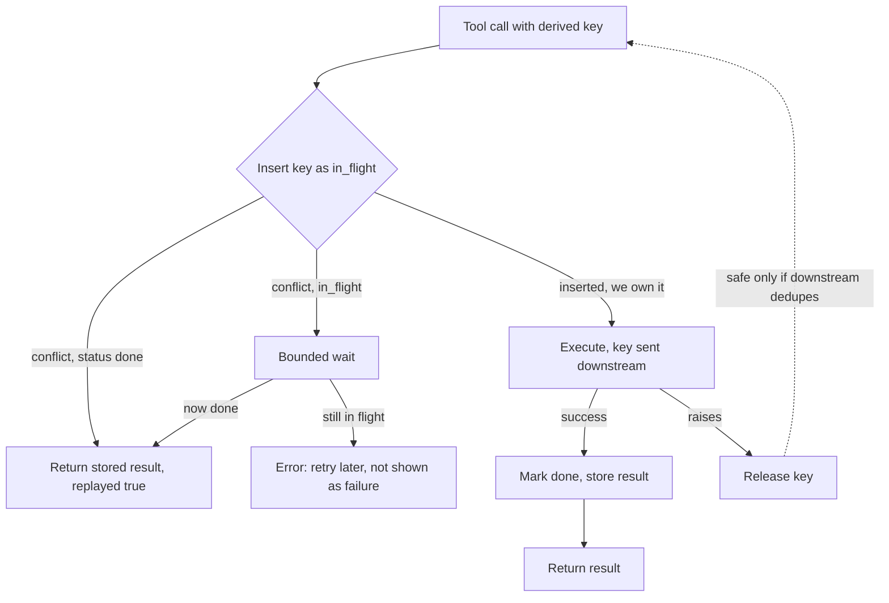

## TL;DR
Agents retry at three layers, and exactly-once execution across a network is impossible. Target
at-least-once execution with idempotent effects: classify tools, derive a deterministic key per call,
dedupe downstream or locally, and gate unkeyable effects behind approvals or an outbox.

## Why it exists
- **A timeout is ambiguous.** `send_invoice(customer, amount)` times out after thirty seconds. Did the
  invoice send? If the request was lost, no; if the response was lost, yes. The caller cannot tell: the
  classic two-generals situation, with no protocol solution. Retry and risk a duplicate, or give up and
  risk that nothing happened.
- **Agents retry at three uncoordinated layers.** The model, which on seeing an error often calls the tool
  again, sometimes with slightly different arguments; the harness, with its HTTP retry policy; and the
  durable runtime, which re-executes pending calls after a crash. One ambiguous timeout can become three
  invoices.
- **"Only retry safe methods" does not help,** because the actions that make agents valuable are the
  unsafe ones: creating, sending, charging, deploying.
- **"Never retry writes" backfires.** Runs fail on every transient error, which in practice means the
  model retries anyway, uncontrolled.
- **The way out: idempotent effects, not exactly-once delivery.** Repeating a call with the same identity
  must produce the same outcome and the same response, so cheap, robust at-least-once delivery yields
  effectively-once results. That needs an identity per logical call, a place to remember what it
  produced, and tools (or adapters) that honour the identity.

## How it works
### What "idempotent" means here
- **Mathematics:** applying an operation twice equals applying it once: f(f(x)) = f(x).
- **For a tool call, stricter in one way:** repeating a call *with the same identity* must leave the world
  in the same state as one call **and** return the same response as the first call. Same state alone is
  not enough, because the caller who lost the first response needs the ticket id it contained.
- **Looser in another:** "same identity" is not "same arguments". Two identical-looking calls with
  different identities are two intended actions.

### Classify every tool
| Class | Examples | Retry policy |
|---|---|---|
| **Read-only** | `search`, `get_record` | Naturally idempotent. Retry freely, and never replay cached results across retries, because freshness matters |
| **Idempotent writes** | `set_status(id, "closed")`, upsert by natural key, HTTP PUT to a known resource | Repeating is harmless by construction. Retry freely |
| **Non-idempotent writes** | `create_ticket`, `send_email`, `charge`, `increment` | Must be wrapped |

- **Record the class in the tool schema** so the harness picks the retry policy automatically.
- **MCP tool annotations** (`readOnlyHint`, `idempotentHint`, `destructiveHint`) exist for exactly this.
  They are hints, not guarantees: verify them in integration tests.

### Make the operation idempotent where you can
- **Relative writes repeat their effect.** `increment(balance, 10)` and `append(list, item)` change state
  again on every repeat; an *absolute* write (`set(balance, 110)`) does not.
- **A blind `set` can clobber a concurrent change,** so pair it with a precondition: a conditional update
  `set balance = 110 where version = 7`, an HTTP `If-Match` with an ETag, a compare-and-set.
- **How it plays out:** the first execution matches the precondition and succeeds; a repeat finds the
  version already moved and becomes a no-op you can recognise.
- **Same move as "create" to "upsert by natural key",** and it removes the need for a dedup table for that
  tool entirely.

### Derive the key
- **Identical across every retry of one logical call, different for distinct calls.** Derive it from
  execution identifiers, for example `f"{run_id}:{step}:{call_index}"`, optionally hashed.
- **Not a random UUID,** because a retry would mint a new one.
- **Not a hash of the arguments alone,** because the model may reword an email body on retry, and two
  legitimately different calls with equal arguments would collide.
- **Optional semantic identity.** For consequential actions some teams also include recipient plus turn id,
  so a model-level retry with changed wording still dedupes; that is a product decision, not a runtime
  default.

### Three ways to honour the key
1. **Downstream support.** Pass the key as the API's idempotency header or field. Stripe's
   `Idempotency-Key` header is the canonical example, and many payment, messaging and ticketing APIs offer
   an equivalent. The provider stores the first response and replays it. Strongest, because the dedup
   lives where the effect lives.
2. **Natural key on the resource.** Write the key into the created object (an `external_ref` field, a tag,
   part of the subject line) and look it up before creating, or use a conditional create (`If-None-Match`,
   `INSERT ... ON CONFLICT DO NOTHING`). Lookup-then-create is racy across concurrent workers, so prefer
   conditional writes where the API offers them.
3. **Local dedup table.** `tool_executions(key primary key, args_hash, status, result, started_at, finished_at)`. Before executing, insert the key with status `in_flight`:
   - On conflict, return the stored result if status is `done`, or wait briefly if `in_flight`, because
     another worker is on it.
   - After executing, update to `done` with the result.
   - The table must be durable, ideally in the same store as the checkpoint.
   - **Its blind spot:** a crash between the effect and the `done` update. The resume finds `in_flight` and
     must look the effect up downstream, or treat the tool as "possibly executed" and escalate.

### Keys need a fingerprint and a lifetime
- **Store an argument hash next to the key.** Same key and same hash is a retry; the same key with
  *different* arguments is a bug (a colliding key derivation, or a resumed step whose model output
  changed), and silently replaying the first result would hide it.
- **Stripe behaves this way:** reusing a key with different parameters returns an error rather than the
  cached response.
- **Keys expire.** Stripe documents that keys may be pruned once at least 24 hours old; other providers
  have their own windows, and your dedup table needs a retention period too.
- **Rule: the dedup window must outlast the longest parked run.** A run that waits three days for an
  approval, then re-executes a pending call with a key the provider forgot after one day, gets a
  duplicate, with every component behaving as documented.

### Return the same response
- **The second call returns the first result, marked as replayed** (`{"replayed": true, ...}`), so the
  model receives the ticket id it needs and knows not to try again.
- **Returning an error on a duplicate** pushes the model into a retry loop.

### Concurrency
- **Same key from two workers or two parallel calls:** the dedup table's primary key or the downstream's
  own lock makes one wait or fail.
- **Design the `in_flight` branch explicitly:** a bounded wait and then the stored result, or an immediate
  error the harness treats as "retry later" rather than a tool failure shown to the model.

### What cannot be made idempotent
Some effects have no key and no undo: an SMS already delivered, a physical action. Options:
- **Outbox:** the intent is written to a durable table inside the checkpoint transaction, and a
  single-consumer worker delivers it with its own dedup.
- **Approval gate:** a human confirms consequential actions, which also bounds the blast radius.
- **Compensation** (refund, delete) when the effect can be reversed, as in sagas.
- **Pick per tool** and record the choice in the tool's adapter.

### Interaction with the model
- **Say it in the tool description:** retries are safe, and a replayed result means the action already
  happened.
- **Never expose the key to the model;** the harness injects it.
- **Reworded retries:** if the model retries with different arguments, the harness sees a new key and a new
  effect. Correct when the arguments genuinely differ, wrong when the model merely reworded; the
  semantic-key option and loop detection address that case.

## Diagram
The decision path for one side-effecting call through a local dedup table that also forwards the key
downstream.



## Examples
### An idempotent wrapper with a dedup store
- **Claims the key before executing,** waits briefly if another worker holds it, and replays the stored
  result on repeats with a `replayed` flag.
- **Forwards the key downstream,** so the dedup also lives where the effect lives.
- **Releases the key if the tool raises,** so a retry can run; safe only because the downstream API dedupes
  on the same key. An adapter without downstream support should instead mark the row "unknown" and
  reconcile before retrying.

```python
import hashlib, time

class DedupStore:   # key -> {status, result}; in prod a durable table that also stores an
                    # args hash and rejects a key reused with different arguments
    def __init__(self):
        self.rows = {}
    def begin(self, key):         # existing row, or None if we now own the key; in prod an
        row = self.rows.get(key)  # atomic INSERT ... ON CONFLICT DO NOTHING, not get-then-set
        if row is None:
            self.rows[key] = {"status": "in_flight", "started": time.time()}
        return row
    def finish(self, key, result):
        self.rows[key] = {"status": "done", "result": result}

def idempotent(store: DedupStore, wait_s: float = 10):
    def wrap(tool):
        def run(args: dict, *, key: str):
            row, deadline = store.begin(key), time.time() + wait_s
            while row and row["status"] == "in_flight" and time.time() < deadline:
                time.sleep(0.2)                     # another worker holds the key
                row = store.rows.get(key)
            if row and row["status"] == "done":
                return {**row["result"], "replayed": True}
            if row:                                 # still in flight after the wait
                raise RuntimeError("in_flight: retry later, do not re-issue")
            try:
                result = tool(**args, idempotency_key=key)   # key goes downstream too
            except Exception:
                store.rows.pop(key, None)           # release, or it stays in flight forever
                raise
            store.finish(key, result)
            return result
        return run
    return wrap

def key_for(ids, call_index: int) -> str:
    return hashlib.sha256(f"{ids.run_id}:{ids.step}:{call_index}".encode()).hexdigest()

@idempotent(DedupStore())
def create_ticket(title, body, idempotency_key):
    return api.post("/tickets", json={"title": title, "body": body},
                    headers={"Idempotency-Key": idempotency_key}).json()

# in the agent loop:  create_ticket({"title": t, "body": b}, key=key_for(ids, i))
```

### Worked trace: the paths through the wrapper
| Path | What happens | Model sees |
|---|---|---|
| First call for key `k1` | `begin` finds no row, records `in_flight`; the API creates ticket `T-901`; `finish` stores it | `{"id": "T-901"}` |
| Worker dies before the checkpoint records that result; resume re-executes with `k1` | `begin` finds `done`; the API is not touched | `{"id": "T-901", "replayed": true}` |
| Two parallel workers resume the same step | One owns `k1`; the other waits up to ten seconds, then replays the stored result or raises `in_flight`, which the harness schedules for later | the result, or nothing yet |
| API raises after the ticket was actually created (response timeout) | Row released; the retry sends `k1` again; the ticketing API's own dedup returns `T-901` | `T-901` |
| Same, but the API has no downstream dedup | The retry creates `T-902` | a duplicate |

- **Why the release-on-exception rule needs downstream support:** without it, the last row happens.

### Runnable: lost response, with and without downstream dedup
Paste below the `DedupStore` and `idempotent` definitions above (the `create_ticket` example is not
needed). A fake API creates the ticket and then loses the response once.

```python
class FakeTicketAPI:                     # stands in for a ticketing API
    def __init__(self, honours_key=True, fail_once=False):
        self.created, self.by_key = [], {}
        self.honours_key, self.fail_once = honours_key, fail_once
    def create(self, title, idempotency_key):
        if self.honours_key and idempotency_key in self.by_key:
            return self.by_key[idempotency_key]
        ticket = {"id": f"T-{901 + len(self.created)}"}
        self.created.append(ticket)
        self.by_key[idempotency_key] = ticket
        if self.fail_once:               # ticket created, but the response is lost
            self.fail_once = False
            raise TimeoutError("response lost")
        return ticket

for honours in (True, False):
    api = FakeTicketAPI(honours_key=honours, fail_once=True)
    tool = idempotent(DedupStore())(lambda title, idempotency_key:
                                    api.create(title, idempotency_key))
    try:
        tool({"title": "Fix login"}, key="k1")
    except TimeoutError:
        pass                             # row released; harness retries with the same key
    print(tool({"title": "Fix login"}, key="k1"),   # retry
          tool({"title": "Fix login"}, key="k1"),   # replay from the dedup table
          "created:", len(api.created))
# {'id': 'T-901'} {'id': 'T-901', 'replayed': True} created: 1
# {'id': 'T-902'} {'id': 'T-902', 'replayed': True} created: 2
```

## Production patterns
- **Forward keys to APIs that support them.** For Stripe and similar APIs, send the derived key in the
  `Idempotency-Key` header on every create or charge, and keep your own dedup window at least as long as
  your longest parked run, or fall back to lookups after the provider's window. Monitor provider
  idempotency errors (key reused with different parameters), which signal a key-derivation bug.
- **Durable dedup table beside the checkpoint.** In Postgres, claim with
  `INSERT ... ON CONFLICT (key) DO NOTHING RETURNING key` and store an argument hash; reject a key reuse
  whose hash differs. Monitor the replay rate and the count of `in_flight` rows older than the tool's
  timeout.
- **Reaper for stale in-flight rows.** A scheduled job moves `in_flight` rows past the tool timeout to
  "unknown" and triggers reconciliation (look up by `external_ref`, or escalate) instead of letting every
  retry error forever. Monitor unknown-outcome counts per tool.
- **Managed idempotency utilities in serverless tools.** On AWS Lambda, the Powertools for AWS Lambda
  idempotency utility wraps a handler with a persistence layer (for example DynamoDB) and a configurable
  expiry. Monitor expired-key replays and persistence-layer errors.
- **Transactional outbox for unkeyable effects.** Write the intent row in the same transaction as the
  checkpoint, and have one consumer deliver it and mark it sent. Monitor outbox lag and rows stuck
  unsent.
- **Fault-injection tests per tool.** In integration tests, drop the response after the effect, kill the
  process mid-call, and run two workers on one key; assert exactly one effect. Monitor duplicate-effect
  incidents per thousand runs in production.

## Trade-offs
- **Downstream keys vs coverage.** They give the strongest guarantee with the least code, but only where
  the API supports them; everything else needs an adapter-level dedup table that cannot see effects
  completed just before a crash.
- **Local dedup table vs overhead.** It makes any tool retry-safe from the harness's view, but adds a
  durable write per side-effecting call and a stale in-flight problem that needs expiry and
  reconciliation.
- **Execution-id keys vs semantic keys.** Execution ids are precise and stable across resumes; semantic
  identity also catches model-level reworded retries, at the risk of suppressing a legitimately different
  second action.
- **Replay vs freshness.** Replaying the stored result keeps the model moving, but it may be stale if the
  resource has changed since; for reads prefer fresh execution, for writes prefer the replay.
- **Conditional absolute writes vs ambiguity.** They remove the need for a dedup table, but a repeat that
  finds the version moved is indistinguishable from a genuine concurrent change unless you also record
  which version your call produced; where conflicts are common, keyed dedup is clearer.

## Pitfalls
- **Random keys generated at call time.** The symptom is dedup infrastructure in place while duplicates
  still appear after crashes and retries. Fix: derive keys from run, step and call index.
- **An error on a duplicate instead of the original result.** The symptom is the model looping to "fix" an
  action that already succeeded. Fix: replay with `replayed: true`.
- **The replaying wrapper on read tools.** The symptom is the agent acting on stale data because a
  repeated read returned a cached result. Fix: wrap writes only.
- **Trusting schema or MCP hints without testing.** The symptom is a tool labelled idempotent creating
  duplicates under retry in integration tests. Fix: fault-injection tests.
- **Never expiring in-flight rows.** The symptom is a key stuck in flight after a crash, so every retry
  errors forever. Fix: a reaper plus reconciliation.
- **A dedup window shorter than the longest parked run.** The symptom is duplicates only for runs resumed
  days later, typically after a slow human approval, and never in tests. Fix: size retention to park time.
- **Replaying on key match without comparing arguments.** The symptom is a resumed step whose model
  produced a different call (another recipient, another amount) silently "succeeding" with the first
  call's result while the intended action never happens. Fix: store and compare an argument hash.

## When to use
- **Every tool that writes,** from the first prototype that touches a real system.
- **Order of work:** classify tools and refuse automatic retries on non-idempotent ones until wrapped; add
  keys derived from execution ids; pass them downstream where supported and dedupe locally elsewhere.
- **Reserve outboxes and approval gates** for effects that cannot be keyed.
- **Measure:** duplicate-effect incidents per thousand runs, the replay rate (how often the dedup actually
  fired), and in-flight rows older than the tool's timeout.
- **Interviews:** "your tool call timed out, what do you do" expects the key, the dedup table, the replayed
  response, and the honest statement that exactly-once delivery is impossible.

## Role lens
- **Engineer:** Classifies tools, writes the idempotent wrapper and dedup table, forwards keys to
  downstream APIs and tests every tool under injected timeouts and process kills.
- **Architect:** Sets the policy that no side-effecting tool ships without an idempotency strategy,
  and chooses between downstream keys, outbox and approval gates per class of effect.
- **FDE:** Audits the customer's APIs for idempotency support, builds adapters with natural-key
  lookups where there is none, and explains why the duplicate tickets stopped after the fix.

## Check yourself
**Q:** A `create_ticket` tool call times out. The ticketing API has no idempotency header. Design
the retry so the run neither loses the ticket nor creates two.
**A:** Before the first call, the harness inserted a dedup row keyed by (run id, step, call index)
with status in_flight and wrote the same key into the ticket payload as an external reference. On
timeout the harness does not blindly retry; it queries the API for a ticket carrying that external
reference. If one is found, it records the result as done and returns it to the model marked
replayed. If none is found, it retries the create with the same reference, so a race in which the
first request completes late still yields a findable duplicate to reconcile rather than a silent
one. Expire stale in_flight rows, and if the API cannot be queried at all, route the call to an
approval or an outbox worker rather than guessing.

## Interview questions
### Why is exactly-once tool execution impossible, and what do you build instead?
- **A lost response looks exactly like a lost request,** so after a timeout the caller cannot know whether
  the effect happened; no protocol fixes that.
- **Build at-least-once delivery with idempotent effects:** a deterministic key per logical call, a
  dedup record or downstream key that replays the first result, so retries are safe.

### Why not derive the idempotency key from a hash of the tool arguments?
- **Reworded retries escape it:** the model may change an email body on retry, producing a new hash and a
  duplicate send.
- **Legitimate repeats collide:** two intended identical actions would be suppressed. Derive from run id,
  step and call index, and add a semantic identity only as a deliberate product choice.

### A customer reports duplicate SMS messages only for runs that waited days for approval. What is going on?
- **The dedup window expired:** the provider or your table pruned the key before the parked run resumed
  and re-executed its pending call.
- **Fix:** keep the dedup window longer than the longest parked run, or record delivery in an outbox so
  resume checks state instead of re-sending; SMS has no undo, so an approval gate or outbox is the safe
  default.

### When would you rewrite a tool instead of wrapping it with a dedup table?
- **When a relative write can become a conditional absolute one:** `increment` becomes a compare-and-set
  on a version, so a repeat is a recognisable no-op.
- **Not when conflicts are common,** because a moved version looks like a real concurrent change unless you
  record which version your call produced; keyed dedup is clearer there.

### What should a duplicate call return to the model, and why does it matter?
- **The original result, flagged `replayed: true`,** so the model has the ticket id it needs and knows the
  action already happened.
- **Not an error,** which makes the model try to "fix" a successful action and loop, adding cost and risk.

## Quiz
### Q: Why is "exactly-once tool execution" the wrong design target?
- [ ] Models cannot be prevented from retrying
- [x] A lost response is indistinguishable from a lost request, so delivery cannot be exactly-once; the achievable target is at-least-once delivery with idempotent effects
- [ ] Idempotency keys are not supported by most APIs
- [ ] Exactly-once is only possible with message queues
> Across a network boundary the caller cannot know whether a timed-out request took effect. Making the
> effect idempotent lets retries be safe, which is the only route to effectively-once outcomes.

### Q: What should a duplicate (same key) call to an idempotent tool return?
- [ ] An error indicating the action was already performed
- [x] The original result, flagged as replayed, so the model has the ids it needs and does not retry again
- [ ] Nothing, since the effect already happened
- [ ] A fresh execution with a new key
> Returning an error pushes the model into retry loops; returning the stored result gives it the same
> information the first call would have, which is the definition of idempotent behaviour.

### Q: Which tools should NOT be wrapped with a result-replaying dedup layer?
- [ ] Tools that create resources
- [ ] Tools that send messages
- [x] Read-only tools, because a replayed result may be stale and repeated reads are harmless
- [ ] Tools that charge payments
> Reads are naturally idempotent and the agent needs current data, so replaying a cached result risks
> acting on stale state. Writes are where replaying the first result prevents duplicates.
