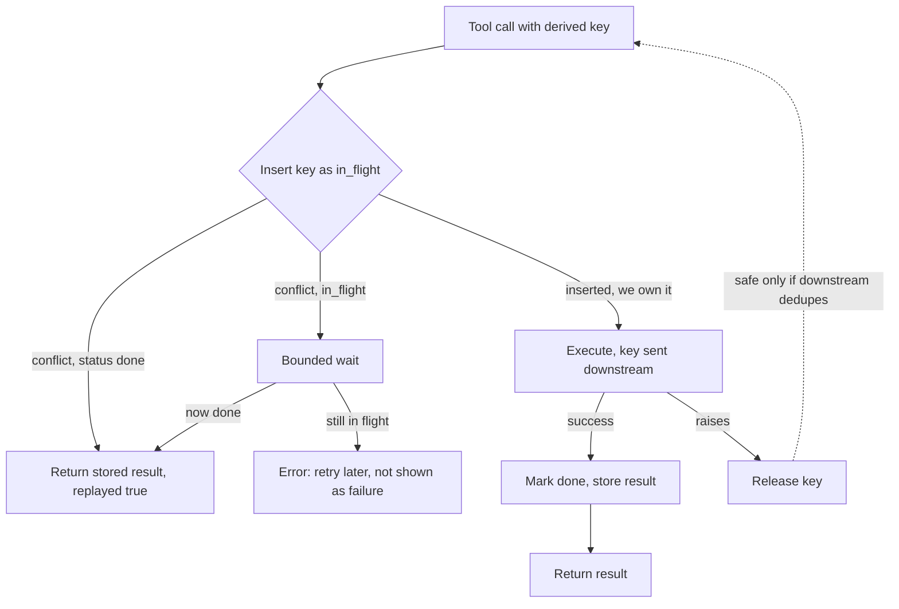

## TL;DR
Agents retry at three layers, and exactly-once execution across a network is impossible. Target
at-least-once execution with idempotent effects: classify tools, derive a deterministic key per call,
dedupe downstream or locally, and gate unkeyable effects behind approvals or an outbox.

## For agent builders
- **Why it matters for agents.** Useful tools create, send, charge and deploy, and several layers retry
  them; without idempotent effects one ambiguous timeout becomes three customer emails.
- **Where it shows up in your stack.** Your tool adapters and their schemas, MCP tool annotations
  (`readOnlyHint`, `idempotentHint`, `destructiveHint`), downstream headers such as Stripe's
  `Idempotency-Key`, a `tool_executions` dedup table beside the checkpoint, and an outbox for effects with
  no key.
- **What you control.** The class of each tool, the key derivation from run id, step and call index, the
  argument fingerprint, the dedup window versus the longest parked run, what a replay returns to the
  model, and which tools sit behind an approval gate.
- **What you can skip.** Chasing exactly-once delivery. Accept at-least-once execution and make the effect
  idempotent instead.

## Lab
### Task
Make `create_ticket` retry-safe against a ticketing API with no idempotency header, the case the
example's release-on-exception rule cannot cover. Claim a SQLite dedup row with an argument hash, write
the key into the ticket as `external_ref`, and reconcile lost responses and stale `in_flight` rows by
searching for it. Time box: 60-90 min.
- **Prerequisites:** Tool calling; Durable execution & checkpointing; Conversation / execution
  identifiers; the wrapper and worked trace in this lesson.
- **Setup:** Python 3.10+ with SQLite 3.24 or newer (for `ON CONFLICT ... DO NOTHING`) and
  `pip install pytest`. Checked with Python 3.13 (SQLite 3.53) and pytest 9.1. Save the starter as
  `lab.py` and the tests as `test_lab.py`.
- **No external service:** `TicketAPI` is a fake that can create a ticket and then lose the response;
  time is passed in as `now` so the in-flight timeout is deterministic.

### Starter code
```python
"""Lab: make create_ticket retry-safe when the ticket API has no idempotency key, only an
external_ref field you can search by. Run: python lab.py"""
import hashlib, json, sqlite3

class KeyReuse(Exception): pass          # same key, different arguments: a bug, never a replay
class InFlight(Exception): pass          # another worker may still be running it: retry later
class Crash(Exception): pass

class Dedup:
    def __init__(self):
        self.db = sqlite3.connect(":memory:", isolation_level=None)
        self.db.execute("""create table tool_executions (key text primary key, args_hash text not null,
                           status text not null, result text, started real not null)""")

    def begin(self, key, args_hash, now):
        """Claim the key with INSERT ... ON CONFLICT (key) DO NOTHING (status 'in_flight').
        Return None if this call inserted the row, else the existing row as a dict
        {"status", "result", "started"}. Raise KeyReuse if the stored args_hash differs."""
        # YOUR CODE HERE
        raise NotImplementedError

    def finish(self, key, result):
        self.db.execute("update tool_executions set status = 'done', result = ? where key = ?",
                        (json.dumps(result), key))

def args_hash(args: dict) -> str:
    return hashlib.sha256(json.dumps(args, sort_keys=True).encode()).hexdigest()

class TicketAPI:                         # no idempotency key; tickets carry an external_ref
    def __init__(self):
        self.tickets, self.lose_next_response = [], False
    def create(self, title, external_ref):
        self.tickets.append({"id": f"T-{len(self.tickets) + 1}", "title": title, "ref": external_ref})
        if self.lose_next_response:      # created, but the caller never hears back
            self.lose_next_response = False
            raise TimeoutError("response lost")
        return {"id": self.tickets[-1]["id"]}
    def search(self, external_ref):
        return next(({"id": t["id"]} for t in self.tickets if t["ref"] == external_ref), None)

def create_ticket(store, api, args, key, now, timeout=30, crash_after_effect=False):
    """1. row = store.begin(key, args_hash(args), now)
    2. done -> {**result, "replayed": True}
    3. in_flight and younger than timeout -> raise InFlight; older -> reconcile (step 5)
    4. we own the key -> api.create(title, external_ref=key); if crash_after_effect, raise Crash
       right after the effect (the row stays in_flight); on TimeoutError -> reconcile
    5. reconcile: api.search(external_ref=key); found -> store it, return {**found, "reconciled": True};
       not found -> create again with the same external_ref
    Every successful path stores the result with store.finish(key, result)."""
    # YOUR CODE HERE
    raise NotImplementedError

if __name__ == "__main__":
    store, api = Dedup(), TicketAPI()
    fix = {"title": "Fix login"}
    print("first call:   ", create_ticket(store, api, fix, "k1", now=0))
    print("harness retry:", create_ticket(store, api, fix, "k1", now=1))
    api.lose_next_response = True
    print("lost response:", create_ticket(store, api, {"title": "Rotate keys"}, "k2", now=2))
    try:
        create_ticket(store, api, {"title": "Page on-call"}, "k3", now=3, crash_after_effect=True)
    except Crash:
        print("crash after effect: worker died, row left in_flight")
    for now in (10, 60):
        try:
            print(f"resume at t={now}:", create_ticket(store, api, {"title": "Page on-call"}, "k3", now=now))
        except InFlight:
            print(f"resume at t={now}: in_flight, retry later")
    try:
        create_ticket(store, api, {"title": "Fix logout"}, "k1", now=70)
    except KeyReuse:
        print("same key, new args: KeyReuse")
    print("tickets:", [t["id"] for t in api.tickets])
```

### Expected output
`python lab.py` with a correct solution prints exactly:

```
first call:    {'id': 'T-1'}
harness retry: {'id': 'T-1', 'replayed': True}
lost response: {'id': 'T-2', 'reconciled': True}
crash after effect: worker died, row left in_flight
resume at t=10: in_flight, retry later
resume at t=60: {'id': 'T-3', 'reconciled': True}
same key, new args: KeyReuse
tickets: ['T-1', 'T-2', 'T-3']
```

- **Read it:** three logical calls (`k1`, `k2`, `k3`), three tickets, no duplicate. The `t=10` refusal is the bounded
  wait: under the 30-second timeout the first worker may still be mid-call, so a search could miss a
  ticket that is about to exist.

### Tests
Run `pytest -q test_lab.py`. On the starter all 5 fail with `NotImplementedError`; a correct solution
passes all 5 (Python 3.13, pytest 9.1).

```python
import pytest
from lab import Crash, Dedup, InFlight, KeyReuse, TicketAPI, args_hash, create_ticket

FIX = {"title": "Fix login"}

def test_begin_claims_once_and_rejects_changed_args():
    d = Dedup()
    assert d.begin("k", args_hash(FIX), now=0) is None
    row = d.begin("k", args_hash(FIX), now=1)
    assert row["status"] == "in_flight" and row["started"] == 0
    with pytest.raises(KeyReuse):
        d.begin("k", args_hash({"title": "other"}), now=2)

def test_repeat_replays_the_first_result():
    d, api = Dedup(), TicketAPI()
    assert create_ticket(d, api, FIX, "k1", now=0) == {"id": "T-1"}
    assert create_ticket(d, api, FIX, "k1", now=1) == {"id": "T-1", "replayed": True}
    assert len(api.tickets) == 1

def test_lost_response_is_reconciled_by_external_ref():
    d, api = Dedup(), TicketAPI()
    api.lose_next_response = True
    assert create_ticket(d, api, FIX, "k2", now=0) == {"id": "T-1", "reconciled": True}
    assert create_ticket(d, api, FIX, "k2", now=1) == {"id": "T-1", "replayed": True}
    assert len(api.tickets) == 1

def test_crash_between_effect_and_record():
    d, api = Dedup(), TicketAPI()
    with pytest.raises(Crash):
        create_ticket(d, api, FIX, "k3", now=0, crash_after_effect=True)
    with pytest.raises(InFlight):
        create_ticket(d, api, FIX, "k3", now=10)                 # may still be running
    assert create_ticket(d, api, FIX, "k3", now=60) == {"id": "T-1", "reconciled": True}
    assert len(api.tickets) == 1

def test_stale_row_with_no_ticket_creates_exactly_one():
    d, api = Dedup(), TicketAPI()
    d.begin("k4", args_hash(FIX), now=0)                         # claimed, then died before the call
    assert create_ticket(d, api, FIX, "k4", now=60) == {"id": "T-1"}
    assert api.tickets[0]["ref"] == "k4" and len(api.tickets) == 1
```

### Failure scenarios
- **Release the row and re-create on `TimeoutError`** (the example's rule, without downstream dedup).
  The lost-response line creates a second ticket for `k2` and the reconcile test fails on two tickets.
  Search the API by `external_ref` and count tickets per key.
- **Skip the argument-hash comparison in `begin`.** "Fix logout" comes back as `{'id': 'T-1',
  'replayed': True}`: the intended ticket is never created and nobody is told. Log args-hash mismatches
  on every key hit.
- **Reconcile an `in_flight` row at once, ignoring its age.** The `t=10` line returns a result and the
  `InFlight` test fails; with real concurrency a second worker searches before the first worker's create
  lands, finds nothing and creates a duplicate. Alert on `in_flight` rows younger than the timeout that
  were reconciled.

### Submission
- **`lab.py`** with `Dedup.begin` and `create_ticket` implemented; the fake API unchanged.
- **A green run** of `pytest -q test_lab.py` (5 passed) and the output of `python lab.py`.
- **A randomized trial** of your own: 100 runs that randomly lose responses and crash after the effect,
  ending with exactly one ticket per key.
- **A short note:** what this adapter should return to the model on `InFlight` so it does not issue a
  reworded second `create_ticket`.
- **Evaluated on:** one ticket per logical call on every path, replays flagged `replayed`, lookups
  flagged `reconciled`, and a raised error on key reuse with new arguments.

## Why it exists
- **A timeout is ambiguous.** `send_invoice(customer, amount)` times out after thirty seconds. Lost
  request: no invoice; lost response: sent. The caller cannot tell (the two-generals situation, with no
  protocol solution), so it risks a duplicate or nothing.
- **Agents retry at three uncoordinated layers.** The model calls again on an error, sometimes with
  different arguments; the harness has its HTTP retry policy; the durable runtime re-executes pending
  calls after a crash. One ambiguous timeout can become three invoices.
- **"Only retry safe methods" does not help,** because the actions that make agents valuable are the
  unsafe ones: creating, sending, charging, deploying.
- **"Never retry writes" backfires.** Runs fail on every transient error, which in practice means the
  model retries anyway, uncontrolled.
- **The way out: idempotent effects, not exactly-once delivery.** A repeat with the same identity gives
  the same outcome and response, so at-least-once delivery yields effectively-once results. That needs an
  identity per logical call, a record of what it produced, and tools or adapters that honour it.

## How it works
### What "idempotent" means here
- **Mathematics:** applying an operation twice equals applying it once: f(f(x)) = f(x).
- **For a tool call, stricter:** a repeat *with the same identity* must leave the same state **and**
  return the first response, because a caller who lost it needs the ticket id it contained.
- **And looser:** "same identity" is not "same arguments"; identical-looking calls with different
  identities are two intended actions.

### Classify every tool
| Class | Examples | Retry policy |
|---|---|---|
| **Read-only** | `search`, `get_record` | Naturally idempotent. Retry freely, and never replay cached results across retries, because freshness matters |
| **Idempotent writes** | `set_status(id, "closed")`, upsert by natural key, HTTP PUT to a known resource | Repeating is harmless by construction. Retry freely |
| **Non-idempotent writes** | `create_ticket`, `send_email`, `charge`, `increment` | Must be wrapped |

- **Record the class in the tool schema** so the harness picks the retry policy automatically.
- **MCP tool annotations** (`readOnlyHint`, `idempotentHint`, `destructiveHint`; spec 2025-03-26 on)
  exist for this. They are hints, not guarantees: verify them in integration tests.

### Make the operation idempotent where you can
- **Relative writes repeat their effect.** `increment(balance, 10)` and `append(list, item)` change state
  again on every repeat; an *absolute* write (`set(balance, 110)`) does not.
- **A blind `set` can clobber a concurrent change,** so pair it with a precondition: a conditional update
  `set balance = 110 where version = 7`, an HTTP `If-Match` with an ETag, a compare-and-set.
- **How it plays out:** the first execution matches and succeeds; a repeat finds the version moved, a
  recognisable no-op.
- **Same move as "create" to "upsert by natural key",** and that tool needs no dedup table.

### Derive the key
- **Identical across every retry of one logical call, different for distinct calls.** Derive it from
  execution identifiers, for example `f"{run_id}:{step}:{call_index}"`, optionally hashed.
- **Not a random UUID,** because a retry would mint a new one.
- **Not a hash of the arguments alone,** because the model may reword an email body on retry, and two
  legitimately different calls with equal arguments would collide.
- **Optional semantic identity.** For consequential actions some teams also include recipient plus turn id,
  so a model-level retry with changed wording still dedupes; that is a product decision, not a runtime
  default.

### Three ways to honour the key
1. **Downstream support.** Pass the key as the API's idempotency header or field. Stripe's
   `Idempotency-Key` header is the canonical example, and many payment, messaging and ticketing APIs offer
   an equivalent. The provider stores the first response and replays it. Strongest, because the dedup
   lives where the effect lives.
2. **Natural key on the resource.** Write the key into the created object (an `external_ref` field, a tag,
   part of the subject line) and look it up before creating, or use a conditional create (`If-None-Match`,
   `INSERT ... ON CONFLICT DO NOTHING`). Lookup-then-create is racy across concurrent workers, so prefer
   conditional writes where the API offers them.
3. **Local dedup table.** `tool_executions(key primary key, args_hash, status, result, started_at, finished_at)`. Before executing, insert the key with status `in_flight`:
   - On conflict, return the stored result if status is `done`, or wait briefly if `in_flight`, because
     another worker is on it.
   - After executing, update to `done` with the result.
   - The table must be durable, ideally in the same store as the checkpoint.
   - **Its blind spot:** a crash between the effect and the `done` update. The resume finds `in_flight` and
     must look the effect up downstream, or treat the tool as "possibly executed" and escalate.

### Keys need a fingerprint and a lifetime
- **Store an argument hash next to the key.** Same key and same hash is a retry; the same key with
  *different* arguments is a bug (a colliding key derivation, or a resumed step whose model output
  changed), and silently replaying the first result would hide it.
- **Stripe behaves this way:** reusing a key with different parameters returns an error rather than the
  cached response.
- **Keys expire.** Stripe documents that keys may be pruned once at least 24 hours old; other providers
  have their own windows, and your dedup table needs a retention period too.
- **Rule: the dedup window must outlast the longest parked run.** A run that waits three days for an
  approval, then re-executes a pending call with a key the provider forgot after one day, gets a
  duplicate, with every component behaving as documented.

### Return the same response
- **The second call returns the first result, marked as replayed** (`{"replayed": true, ...}`), so the
  model gets the ticket id and stops.
- **Returning an error on a duplicate** pushes the model into a retry loop.

### Concurrency
- **Same key from two workers:** the dedup table's primary key or the downstream's lock makes one wait or
  fail.
- **Design the `in_flight` branch explicitly:** a bounded wait then the stored result, or an error the
  harness treats as "retry later", not a tool failure shown to the model.

### What cannot be made idempotent
Some effects have no key and no undo: an SMS already delivered, a physical action. Options:
- **Outbox:** the intent is written to a durable table inside the checkpoint transaction, and a
  single-consumer worker delivers it with its own dedup.
- **Approval gate:** a human confirms consequential actions, which also bounds the blast radius.
- **Compensation** (refund, delete) when the effect can be reversed, as in sagas.
- **Pick per tool** and record the choice in the tool's adapter.

### Interaction with the model
- **Say it in the tool description:** retries are safe, and a replayed result means the action already
  happened.
- **Never expose the key to the model;** the harness injects it.
- **Reworded retries** get a new key and a new effect: correct when arguments genuinely differ, wrong
  when merely reworded; semantic keys and loop detection address that.

## Diagram
The decision path for one side-effecting call through a local dedup table that also forwards the key
downstream.



## Examples
### An idempotent wrapper with a dedup store
- **Claims the key before executing,** waits if another worker holds it, replays stored results with a
  `replayed` flag, and forwards the key downstream.
- **Releases the key if the tool raises,** so a retry can run; safe only because the downstream API
  dedupes on the same key. Without that, mark the row "unknown" and reconcile before retrying.

```python
import hashlib, time

class DedupStore:   # key -> {status, result}; in prod a durable table that also stores an
                    # args hash and rejects a key reused with different arguments
    def __init__(self):
        self.rows = {}
    def begin(self, key):         # existing row, or None if we now own the key; in prod an
        row = self.rows.get(key)  # atomic INSERT ... ON CONFLICT DO NOTHING, not get-then-set
        if row is None:
            self.rows[key] = {"status": "in_flight", "started": time.time()}
        return row
    def finish(self, key, result):
        self.rows[key] = {"status": "done", "result": result}

def idempotent(store: DedupStore, wait_s: float = 10):
    def wrap(tool):
        def run(args: dict, *, key: str):
            row, deadline = store.begin(key), time.time() + wait_s
            while row and row["status"] == "in_flight" and time.time() < deadline:
                time.sleep(0.2)                     # another worker holds the key
                row = store.begin(key)              # re-claims it if the holder released it
            if row and row["status"] == "done":
                return {**row["result"], "replayed": True}
            if row:                                 # still in flight after the wait
                raise RuntimeError("in_flight: retry later, do not re-issue")
            try:
                result = tool(**args, idempotency_key=key)   # key goes downstream too
            except Exception:
                store.rows.pop(key, None)           # release, or it stays in flight forever
                raise
            store.finish(key, result)
            return result
        return run
    return wrap

def key_for(ids, call_index: int) -> str:
    return hashlib.sha256(f"{ids.run_id}:{ids.step}:{call_index}".encode()).hexdigest()

@idempotent(DedupStore())
def create_ticket(title, body, idempotency_key):
    return api.post("/tickets", json={"title": title, "body": body},
                    headers={"Idempotency-Key": idempotency_key}).json()

# in the agent loop:  create_ticket({"title": t, "body": b}, key=key_for(ids, i))
```

### Worked trace: the paths through the wrapper
| Path | What happens | Model sees |
|---|---|---|
| First call for key `k1` | `begin` finds no row, records `in_flight`; the API creates ticket `T-901`; `finish` stores it | `{"id": "T-901"}` |
| Worker dies before the checkpoint records that result; resume re-executes with `k1` | `begin` finds `done`; the API is not touched | `{"id": "T-901", "replayed": true}` |
| Two parallel workers resume the same step | One owns `k1`; the other waits up to ten seconds, then replays the stored result or raises `in_flight`, which the harness schedules for later | the result, or nothing yet |
| API raises after the ticket was actually created (response timeout) | Row released; the retry sends `k1` again; the ticketing API's own dedup returns `T-901` | `T-901` |
| Same, but the API has no downstream dedup | The retry creates `T-902` | a duplicate |

- **Why the release-on-exception rule needs downstream support:** without it, the last row happens.

### Runnable: lost response, with and without downstream dedup
Paste below the `DedupStore` and `idempotent` definitions above (the `create_ticket` example is not
needed). A fake API creates the ticket and then loses the response once.

```python
class FakeTicketAPI:                     # stands in for a ticketing API
    def __init__(self, honours_key=True, fail_once=False):
        self.created, self.by_key = [], {}
        self.honours_key, self.fail_once = honours_key, fail_once
    def create(self, title, idempotency_key):
        if self.honours_key and idempotency_key in self.by_key:
            return self.by_key[idempotency_key]
        ticket = {"id": f"T-{901 + len(self.created)}"}
        self.created.append(ticket)
        self.by_key[idempotency_key] = ticket
        if self.fail_once:               # ticket created, but the response is lost
            self.fail_once = False
            raise TimeoutError("response lost")
        return ticket

for honours in (True, False):
    api = FakeTicketAPI(honours_key=honours, fail_once=True)
    tool = idempotent(DedupStore())(lambda title, idempotency_key:
                                    api.create(title, idempotency_key))
    try:
        tool({"title": "Fix login"}, key="k1")
    except TimeoutError:
        pass                             # row released; harness retries with the same key
    print(tool({"title": "Fix login"}, key="k1"),   # retry
          tool({"title": "Fix login"}, key="k1"),   # replay from the dedup table
          "created:", len(api.created))
# {'id': 'T-901'} {'id': 'T-901', 'replayed': True} created: 1
# {'id': 'T-902'} {'id': 'T-902', 'replayed': True} created: 2
```

## Production patterns
- **Forward keys to APIs that support them.** For Stripe and similar APIs, send the derived key in the
  `Idempotency-Key` header on every create or charge, and keep your own dedup window at least as long as
  your longest parked run, or fall back to lookups after the provider's window. Monitor provider
  idempotency errors (key reused with different parameters), which signal a key-derivation bug.
- **Durable dedup table beside the checkpoint.** In Postgres, claim with
  `INSERT ... ON CONFLICT (key) DO NOTHING RETURNING key` and store an argument hash; reject a key reuse
  whose hash differs. Monitor the replay rate and the count of `in_flight` rows older than the tool's
  timeout.
- **Reaper for stale in-flight rows.** A scheduled job moves `in_flight` rows past the tool timeout to
  "unknown" and triggers reconciliation (look up by `external_ref`, or escalate) instead of letting every
  retry error forever. Monitor unknown-outcome counts per tool.
- **Managed idempotency utilities in serverless tools.** On AWS Lambda, the Powertools for AWS Lambda
  idempotency utility wraps a handler with a persistence layer (for example DynamoDB) and a configurable
  expiry. Monitor expired-key replays and persistence-layer errors.
- **Transactional outbox for unkeyable effects.** Write the intent row in the same transaction as the
  checkpoint, and have one consumer deliver it and mark it sent. Monitor outbox lag and rows stuck
  unsent.
- **Fault-injection tests per tool.** In integration tests, drop the response after the effect, kill the
  process mid-call, and run two workers on one key; assert exactly one effect. Monitor duplicate-effect
  incidents per thousand runs in production.

## Trade-offs
- **Downstream keys vs coverage.** They give the strongest guarantee with the least code, but only where
  the API supports them; everything else needs an adapter-level dedup table that cannot see effects
  completed just before a crash.
- **Local dedup table vs overhead.** It makes any tool retry-safe from the harness's view, but adds a
  durable write per side-effecting call and a stale in-flight problem that needs expiry and
  reconciliation.
- **Execution-id keys vs semantic keys.** Execution ids are precise and stable across resumes; semantic
  identity also catches model-level reworded retries, at the risk of suppressing a legitimately different
  second action.
- **Replay vs freshness.** Replaying the stored result keeps the model moving, but it may be stale if the
  resource has changed since; for reads prefer fresh execution, for writes prefer the replay.
- **Conditional absolute writes vs ambiguity.** They remove the need for a dedup table, but a repeat that
  finds the version moved is indistinguishable from a genuine concurrent change unless you also record
  which version your call produced; where conflicts are common, keyed dedup is clearer.

## Pitfalls
- **Random keys generated at call time.** Symptom: dedup infrastructure in place, yet duplicates still
  appear after crashes and retries. Diagnose: log the key per attempt of one step; different values mean
  it is minted, not derived. Fix: derive keys from run, step and call index.
- **An error on a duplicate instead of the original result.** Symptom: the model loops to "fix" an action
  that already succeeded. Diagnose: count same-tool calls after a dedup hit. Fix: replay with
  `replayed: true`.
- **The replaying wrapper on read tools.** Symptom: the agent acts on stale data because a repeated read
  returned a cached result. Fix: wrap writes only.
- **Trusting schema or MCP hints without testing.** Symptom: a tool labelled idempotent creates
  duplicates under retry in integration tests. Fix: fault-injection tests.
- **Never expiring in-flight rows.** Symptom: a key stuck in flight after a crash, so every retry errors
  forever. Diagnose: alert on `in_flight` rows older than the tool timeout. Fix: a reaper plus
  reconciliation.
- **A dedup window shorter than the longest parked run.** Symptom: duplicates only for runs resumed days
  later, typically after a slow approval, never in tests. Diagnose: compare park time of duplicated runs
  with the key retention. Fix: size retention to park time.
- **Replaying on key match without comparing arguments.** Symptom: a resumed step whose model produced a
  different call (another recipient, another amount) silently "succeeds" with the first result while the
  intended action never happens. Diagnose: log args-hash mismatches on key hits. Fix: store and compare
  an argument hash.

## When to use
- **Every tool that writes,** from the first prototype that touches a real system.
- **Order of work:** classify tools and refuse automatic retries on non-idempotent ones until wrapped; add
  keys derived from execution ids; pass them downstream where supported and dedupe locally elsewhere.
- **Reserve outboxes and approval gates** for effects that cannot be keyed.
- **Measure:** duplicate-effect incidents per thousand runs, the replay rate (how often the dedup actually
  fired), and in-flight rows older than the tool's timeout.
- **Interviews:** "your tool call timed out, what do you do" expects the key, the dedup table, the replayed
  response, and the honest statement that exactly-once delivery is impossible.

## Exercise
**Goal:** make three different tools retry-safe, each with the strategy that fits it. No solution is
given.
- **Inputs:** fake APIs for `charge` (honours `Idempotency-Key`), `create_ticket` (no key, but tickets
  accept an `external_ref` field and can be searched by it) and `send_sms` (no key, no lookup), plus a
  fault injector that loses responses after the effect and kills the worker between effect and record.
- **Deliver:** one adapter per tool, the tool-class table with each strategy and its reason, and a
  reaper for stale `in_flight` rows.
- **Acceptance:** over 200 randomized faulty trials, `charge` and `create_ticket` produce exactly one
  effect per logical call; `send_sms` never sends without an outbox row or approval; a same-key,
  different-arguments call raises; no `in_flight` row outlives the tool timeout plus one reaper cycle.

## Role lens
- **Engineer:** Classifies tools, writes the idempotent wrapper and dedup table, forwards keys to
  downstream APIs and tests every tool under injected timeouts and process kills.
- **Architect:** Sets the policy that no side-effecting tool ships without an idempotency strategy,
  and chooses between downstream keys, outbox and approval gates per class of effect.
- **FDE:** Audits the customer's APIs for idempotency support, builds adapters with natural-key
  lookups where there is none, and explains why the duplicate tickets stopped after the fix.

## Check yourself
**Q:** A `create_ticket` tool call times out. The ticketing API has no idempotency header. Design
the retry so the run neither loses the ticket nor creates two.
**A:** Before the first call, the harness inserted a dedup row keyed by (run id, step, call index)
with status in_flight and wrote the same key into the ticket payload as an external reference. On
timeout the harness does not blindly retry; it queries the API for a ticket carrying that external
reference. If one is found, it records the result as done and returns it to the model marked
replayed. If none is found, it retries the create with the same reference, so a race in which the
first request completes late still yields a findable duplicate to reconcile rather than a silent
one. Expire stale in_flight rows, and if the API cannot be queried at all, route the call to an
approval or an outbox worker rather than guessing.

## Interview questions
### Why is exactly-once tool execution impossible, and what do you build instead?
- **A lost response looks exactly like a lost request,** so after a timeout the caller cannot know whether
  the effect happened; no protocol fixes that.
- **Build at-least-once delivery with idempotent effects:** a deterministic key per logical call, a
  dedup record or downstream key that replays the first result, so retries are safe.

### Why not derive the idempotency key from a hash of the tool arguments?
- **Reworded retries escape it:** the model may change an email body on retry, producing a new hash and a
  duplicate send.
- **Legitimate repeats collide:** two intended identical actions would be suppressed. Derive from run id,
  step and call index, and add a semantic identity only as a deliberate product choice.

### A customer reports duplicate SMS messages only for runs that waited days for approval. What is going on?
- **The dedup window expired:** the provider or your table pruned the key before the parked run resumed
  and re-executed its pending call.
- **Fix:** keep the dedup window longer than the longest parked run, or record delivery in an outbox so
  resume checks state instead of re-sending; SMS has no undo, so an approval gate or outbox is the safe
  default.

### When would you rewrite a tool instead of wrapping it with a dedup table?
- **When a relative write can become a conditional absolute one:** `increment` becomes a compare-and-set
  on a version, so a repeat is a recognisable no-op.
- **Not when conflicts are common,** because a moved version looks like a real concurrent change unless you
  record which version your call produced; keyed dedup is clearer there.

### What should a duplicate call return to the model, and why does it matter?
- **The original result, flagged `replayed: true`,** so the model has the ticket id it needs and knows the
  action already happened.
- **Not an error,** which makes the model try to "fix" a successful action and loop, adding cost and risk.

## Quiz
### Q: Why is "exactly-once tool execution" the wrong design target?
- [ ] Models cannot be prevented from retrying
- [x] A lost response is indistinguishable from a lost request, so delivery cannot be exactly-once; the achievable target is at-least-once delivery with idempotent effects
- [ ] Idempotency keys are not supported by most APIs
- [ ] Exactly-once is only possible with message queues
> Across a network boundary the caller cannot know whether a timed-out request took effect. Making the
> effect idempotent lets retries be safe, which is the only route to effectively-once outcomes.

### Q: What should a duplicate (same key) call to an idempotent tool return?
- [ ] An error indicating the action was already performed
- [x] The original result, flagged as replayed, so the model has the ids it needs and does not retry again
- [ ] Nothing, since the effect already happened
- [ ] A fresh execution with a new key
> Returning an error pushes the model into retry loops; returning the stored result gives it the same
> information the first call would have, which is the definition of idempotent behaviour.

### Q: Which tools should NOT be wrapped with a result-replaying dedup layer?
- [ ] Tools that create resources
- [ ] Tools that send messages
- [x] Read-only tools, because a replayed result may be stale and repeated reads are harmless
- [ ] Tools that charge payments
> Reads are naturally idempotent and the agent needs current data, so replaying a cached result risks
> acting on stale state. Writes are where replaying the first result prevents duplicates.

## Mastery test
**Problem:** `send_email` runs through the example wrapper with derived keys, and the provider honours
them. Users still get two near-identical emails. Traces: the first call timed out, the model saw the
`TimeoutError`, and next step it called `send_email` with a reworded body. Why did no dedup fire, and
how do you fix it without blocking real second emails?

**A strong answer:**
- the model's retry is a new step, so its key and argument hash both differ: key dedup covers harness and
  runtime retries only;
- the harness should retry the ambiguous timeout itself with the same key, returning the provider's
  replay, never a bare failure;
- if still unknown, tell the model "outcome unknown, do not resend" and offer a status lookup;
- adds recipient-plus-turn identity only as a deliberate product choice.

## Use cases & projects
### Use cases
- **Billing and payments agents.** Every charge or invoice call carries a key derived from run id, step and
  call index, passed downstream as the provider's idempotency header.
- **Ticketing and CRM agents.** A conditional create on an `external_ref` field turns a resumed
  `create_ticket` into a no-op that returns the existing ticket id.
- **Messaging agents.** SMS and email with no downstream key go through an outbox or an approval gate,
  because a delivered message cannot be undone.
- **Approval-gated agents that wait for days.** The dedup window is set longer than the longest parked run,
  so a resumed call after approval does not duplicate.

### Mini project
**Wrap a non-idempotent tool for an agent (1-2 hours).**
- **Goal:** make a fake `create_ticket` tool safe under model, harness and runtime retries.
- **Steps:** implement a dedup table `tool_executions(key, args_hash, status, result)` in SQLite; derive keys
  from run id, step and call index; insert `in_flight` before executing and `done` after; return
  `{"replayed": true, ...}` on a repeat; raise on a same-key, different-arguments call; inject a lost
  response and a crash between effect and record.
- **Done when:** 100 randomized retry trials create exactly one ticket per logical call, the
  different-arguments case raises, and the crash case is flagged "possibly executed" rather than repeated.
