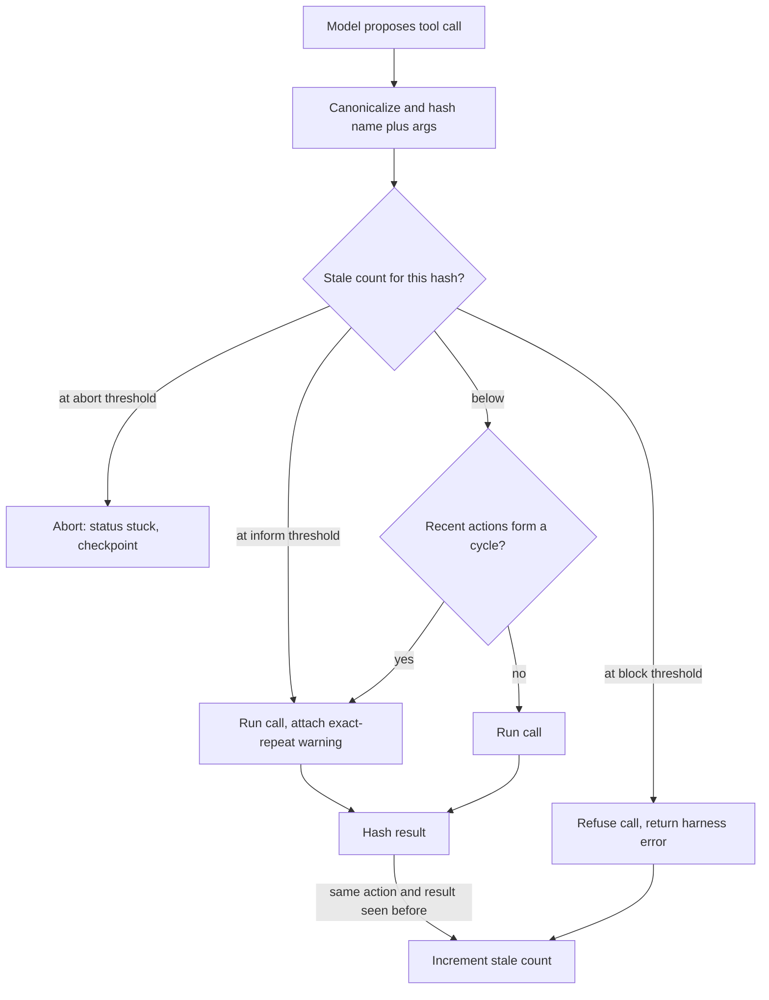

## TL;DR
Loop detection watches an agent's actions for exact repeats, short cycles and no-progress stretches, then
escalates (tell the model, block, replan, abort), because budgets stop loops only after burning the whole
allowance and making repetition visible is the cheapest fix.

## Why it exists
- **Same context in, same action out.** A model picks its next action from the context; if the context
  after a failed action looks almost identical to before, the likeliest next action is the same one. The
  model has no counter; nothing in its input says "this is attempt four".
- **Typical triggers.** A file read returning an error the model does not interpret; a search returning
  nothing; a test command failing the same way; two edits that undo each other; a flaky tool returning
  different errors so the model keeps "trying one more time".
- **A budget alone is a poor answer.** With a thirty-step budget, a loop starting at step five burns
  twenty-five increasingly expensive steps, yields an exhausted partial, and teaches you nothing about
  *why*. Detecting it at step eight saves most of the cost and creates a chance to recover.
- **Telling the model works.** "You have run this exact command three times with the same output" often
  makes it change strategy. What is obvious to a human watching the trace is not obvious from inside the
  context, because repeated blocks look like ordinary history.
- **"Abort if the same tool is called twice" fails both ways.** It kills legitimate repeats (polling a
  job status, reading two files with the same tool, re-running tests after each edit) and misses loops
  where arguments differ trivially (whitespace, a reworded query) or the cycle spans several steps.

## How it works
### Signals
| # | Signal | How | Cost and caveat |
|---|---|---|---|
| 1 | **Exact repeats** | Canonicalize tool name plus arguments (sorted keys, normalized whitespace), hash, count per hash; flag at a threshold (three is a common start) | Cheap. Canonicalization matters because models vary key order and formatting between attempts |
| 2 | **Short cycles** | Compare the last *p* action hashes with the *p* before them, for *p* from 2 to a small max *P* (A B A B, A B C A B C) | O(P²) comparisons per step, trivial for P ≈ 4; period 1 is just signal 1 |
| 3 | **No progress** | Hash the tool *result* too; a repeating (action, result) pair means nothing in the world changed | The strongest signal. Alternative: a task metric (failing test count, files changed, distinct URLs visited) and steps since it last improved |
| 4 | **Semantic near-duplicates** | Embed the action or stated intent; flag cosine similarity above a threshold with a recent action | An embedding call per step and false positives; reserve for high-value runs or run offline over traces |
| 5 | **Reflection text patterns** | The model repeating "let me try again" | Weak; a tie-breaker only |

### Legitimate repetition
Polling (`get_job_status(id)` every few seconds), re-running tests after each edit and re-reading a file
after modifying it must be allowed. Three ways:
- **Mark tools as pollable in the schema:** a higher repeat ceiling, or a time budget instead of a count.
- **Add a changing argument to the key:** for those tools, include a monotonically changing value such as
  an attempt number.
- **Rely on the result hash:** polling that returns a changing status is progress; polling that returns
  the identical status ten times is a loop.

### Escalation ladder
Information is the cheapest intervention, so rungs are ordered by cost and severity:
1. **Inform.** Inject: "You have called `run_tests` with identical arguments three times and the output
   was identical each time. Explain what you will do differently, or report the blocker." This alone
   resolves many loops.
2. **Block.** Return a harness-generated tool error instead of executing ("refused: identical to call 12,
   whose result did not change"). It saves the tool cost and forces a different action.
3. **Force a replan or reflection.** Switch to a reflection prompt, invoke a planner, or narrow the
   available tool set.
4. **Abort.** End the run with status `stuck`, attach the loop evidence, and checkpoint the state for a
   human.
- **Each rung has its own threshold,** for example inform at three, block at four, abort at six.

### Loops above the tool stream
Not every loop is one tool called twice:
- **Handoff ping-pong.** A router sends a task to the billing agent, which decides it is a support
  question and sends it back.
- **Non-converging critique-and-revise.** Each revision trades one flagged issue for another.
- **Plan regeneration.** A planner regenerates essentially the same plan after every failure.
- **Self-delegation.** A sub-agent delegates to a copy of itself.

The same three signals apply one level up:
1. Hash handoffs as (from, to, task) and count repeats.
2. Treat a revision whose critique score did not improve as a no-progress step.
3. Cap delegation depth.
- **Put the detector in the orchestrator.** Each agent sees only its own short, healthy-looking history,
  so these loops are invisible to a per-agent guard.

### Why deterministic settings make it worse
- **Low temperature favours exact repeats.** Greedy or low-temperature decoding makes "nearly the same
  context in, same action out" more likely, which is why agents run at temperature 0 for reproducibility
  tend to repeat exactly rather than drift.
- **That argues for detection, not for raising temperature.** Changing the context (the inform message)
  changes the choice for a reason; sampling noise changes it at random.

### Where it lives
- **In the harness, between the model's response and tool dispatch,** so it sees every action regardless
  of which model is used.
- **Log every detection with its evidence** (hashes, window contents, counts). This is also the best data
  for improving tools and prompts, because it shows which error messages failed to help the model change
  course.

## Diagram
Every proposed call passes the guard before dispatch; only results that repeat earlier results move a
call up the ladder.



## Examples
### A result-aware loop guard
- **Escalates on *stale* repeats:** calls with identical canonical (tool, args) whose result matched an
  earlier result for the same call.
- **Changing results never escalate by count** (re-running tests after each edit); the cycle check
  catches them only if the actions themselves repeat, such as two edits undoing each other.
- **Pollable tools** get the same ladder with thresholds scaled up, as a stand-in for a time budget.
- **A refused call counts as stale,** because blocking made no progress either, so a model that keeps
  insisting climbs to abort.

```python
import hashlib, json
from collections import Counter, deque

def canon(*parts):     # strip volatile fields (timestamps, request ids) from results first
    raw = json.dumps(parts, sort_keys=True, separators=(",", ":"), default=str)
    return hashlib.sha1(raw.encode()).hexdigest()

class LoopGuard:
    def __init__(self, inform=1, block=2, abort=4, window=12, max_period=4,
                 pollable=(), poll_factor=10):
        self.calls, self.stale, self.seen = Counter(), Counter(), set()
        self.seq, self.max_period = deque(maxlen=window), max_period
        self.pollable, self.poll_factor = set(pollable), poll_factor
        self.inform, self.block, self.abort = inform, block, abort

    def _cycle(self):
        s = list(self.seq)
        for p in range(2, self.max_period + 1):  # period 1 is the stale count's job
            if len(s) >= 2 * p and s[-p:] == s[-2 * p:-p] and len(set(s[-p:])) > 1:
                return p
        return 0

    def before(self, name, args):                # call before dispatching the tool
        h = canon(name, args)
        self.seq.append(h); self.calls[h] += 1
        n, st = self.calls[h], self.stale[h]
        f = self.poll_factor if name in self.pollable else 1
        if st >= self.abort * f:
            return "abort", f"{name}: {n} identical calls, result unchanged {st} times"
        if st >= self.block * f:
            self.stale[h] += 1                   # a refused call is no progress either
            return "block", f"refused: identical to {n - 1} earlier calls; result never changed"
        if st >= self.inform * f:
            return "inform", f"call {n} of {name} with these exact args; last result was identical"
        if p := self._cycle():
            return "inform", f"your last {2 * p} actions repeat with period {p}; change approach"
        return "ok", ""

    def after(self, name, args, result):         # call after the tool returns
        if (k := canon(name, args, str(result))) in self.seen:
            self.stale[canon(name, args)] += 1
        self.seen.add(k)
```

### Worked traces through the guard
| Scenario | What happens |
|---|---|
| Failing `run_tests` printing the same 40-line failure each time | Call 1 runs; call 2 runs and matches call 1 (stale = 1); call 3 runs with an inform message; calls 4 and 5 are refused (stale was 2); call 6 aborts as `stuck`. Inform at three, block at four, abort at six |
| Healthy edit-test cycle | Every `run_tests` output differs because the failing count drops, so stale stays at 0 and nothing fires |
| Deploy poller declared pollable, returning "building" over and over | Informed on call 12 (ten results that repeated an earlier one) and refused from call 22, by which point a wall-clock budget should normally have taken over |

### Runnable driver: exercise the guard without an LLM
Paste below the class above and run with plain Python.
- **First loop:** reproduces the failing-test trace.
- **Second loop:** two edits undo each other (text "a", then "b"). Every result differs, so the stale
  count never moves, but the A B A B cycle is caught at call 4. The second edit lists its keys in a
  different order, which `canon()` normalizes away when that edit recurs.

```python
g = LoopGuard()
for i in range(1, 7):                            # same call, same result every time
    verdict, _ = g.before("run_tests", {"path": "tests/"})
    print(i, verdict)                            # ok, ok, inform, block, block, abort
    if verdict in ("ok", "inform"):
        g.after("run_tests", {"path": "tests/"}, "FAILED test_x")

g = LoopGuard()
undo = [("edit", {"line": 3, "text": "a"}), ("edit", {"text": "b", "line": 3})]
for i, (name, args) in enumerate([*undo, *undo, *undo], 1):
    print(i, *g.before(name, args))             # inform from call 4: period 2
    g.after(name, args, f"ok {i}")              # results differ, so only the cycle fires
```

## Production patterns
- **Guard in the dispatch path, one per run.** Instantiate the guard per run in the harness (not per
  agent), call `before()` ahead of every tool dispatch and `after()` on every result. Monitor detections
  per hundred runs, broken down by tool.
- **Strip volatile fields before hashing results.** Remove timestamps, request ids and durations from
  tool output (a per-tool list of JSON paths to drop) before computing the result hash, otherwise
  no-progress detection never fires. Monitor tools whose results never repeat at all, a hint that a
  volatile field slipped through.
- **Pollable flag in the tool registry.** Mark status-check tools as pollable with a scaled threshold or a
  wall-clock cap, and use backoff between polls. Monitor poll counts per job and time-to-terminal-status.
- **Orchestrator-level handoff counter.** In multi-agent systems, count (from, to, task) handoffs and
  delegation depth in the orchestrator and route to a human after a small repeat count. Monitor
  handoff-repeat detections per agent pair.
- **Offline trace mining.** Run exact and semantic repeat detection as a batch job over budget-exhausted
  runs to find loops the online guard missed, then tune thresholds or tool error messages. Monitor the
  share of exhausted runs containing an undetected repeat pattern.

## Trade-offs
- **Exact match vs coverage.** Exact-match detection is cheap with near-zero false positives, but misses
  loops with trivially varied arguments; normalization or semantic similarity widens coverage at the cost
  of false alarms on legitimate variation.
- **Inform before block vs extra calls.** Informing preserves autonomy and often recovers the run, but
  spends an extra model call per warning; if warnings rarely change a given model's behaviour, move the
  block rung earlier.
- **Result-hash detection vs hashing cost.** It is the most reliable signal, yet requires hashing possibly
  large outputs and fails on outputs that embed timestamps or ids; strip volatile fields first.
- **Tight thresholds vs legitimate repeats.** They catch loops early but break polling and edit-test
  cycles; per-tool thresholds and result-aware rules restore those at the price of more configuration.

## Pitfalls
- **Keying only on the tool name.** Every file read looks like a repeat; the symptom is aborts on
  perfectly healthy runs that read several files. Fix: hash name plus canonical args.
- **Blocking polling tools.** The symptom is long-running jobs that never complete because the status
  check is refused after the third call. Fix: mark them pollable and rely on the result hash.
- **Detecting but only logging.** The symptom is traces showing "loop detected" at step six and budget
  exhaustion at step thirty. Fix: wire the ladder.
- **Vague warnings ("you seem stuck").** The symptom is the model acknowledging and repeating. Fix:
  include the exact call, the count and the fact that the result was identical.
- **Hashing arguments without canonicalization.** The symptom is obvious repeats with reordered JSON keys
  that are never counted. Fix: sorted keys and normalized whitespace.
- **Escalating on raw call counts instead of unchanged results.** The symptom is healthy edit-test cycles
  aborted as "stuck" on the sixth test run while every run was making progress. Fix: count stale repeats.
- **Running the detector per agent in a multi-agent system.** The symptom is a task bouncing between two
  agents for the whole budget while each agent's guard reports nothing. Fix: detect in the orchestrator.

## When to use
- **Use when:** any agent calls tools more than a few times per run, and especially anything that runs
  unattended.
- **Start with:** exact-repeat and (action, result) no-progress detection in the harness, an afternoon of
  work, plus the inform/block/abort ladder.
- **Add later:** cycle detection when traces show oscillation; semantic detection only when exact matching
  demonstrably misses loops you care about.
- **Measure:** detections per hundred runs by tool, recovery rate after the inform rung, and the share of
  budget-exhausted runs that contained an undetected repeat pattern (mine the traces offline).
- **Interviews:** describe the signals, the legitimate-repeat problem, and why informing the model comes
  before aborting.

## Role lens
- **Engineer:** Implements the guard in the tool-dispatch path, canonicalizes arguments, tunes
  thresholds per tool and writes warning messages that name the exact repeated call.
- **Architect:** Decides where loop evidence is recorded and how `stuck` outcomes feed retries, human
  escalation and the agent-quality metrics shared across teams.
- **FDE:** Mines customer traces for repeat patterns to show which tools return unhelpful errors,
  turning loop detections into concrete tool and prompt fixes.

## Check yourself
**Q:** Your agent polls a deployment status tool every step until the deploy finishes, and separately
it sometimes re-runs a failing test command endlessly. How do you detect the second without breaking
the first?
**A:** Key detection on the tool result as well as the call. Polling returns a changing status
(pending, building, done), so the (call, result) pair rarely repeats, while the failing test returns
byte-identical output each time, which is exactly the no-progress signal. Mark the status tool as
pollable with a higher repeat ceiling or a time budget, strip volatile fields such as timestamps
before hashing results, and apply the ladder: after three identical (call, result) pairs inform the
model with the exact command and output, refuse the fourth, and abort with status stuck if it
persists. Log both cases so the thresholds can be tuned from real traces rather than guesses.

## Interview questions
### Why not just rely on the step budget to stop looping agents?
- **It fires too late.** A loop starting at step five of thirty burns twenty-five increasingly expensive
  steps before the budget stops it.
- **It teaches nothing and recovers nothing.** Detecting at step eight saves most of the cost, records the
  evidence, and gives the model a chance to change strategy once told about the repeat.

### How would you tell a stuck loop apart from legitimate repetition such as polling?
- **Hash the result as well as the action.** Polling that returns a changing status is progress; an
  identical (action, result) pair means the world did not change.
- **Mark pollable tools** with a higher ceiling or a time budget, and strip volatile fields such as
  timestamps before hashing, or every result looks new.

### A task bounces between a router and a billing agent for the whole budget. Why did no guard fire, and what do you change?
- **Each agent saw a short, healthy history,** so a per-agent guard had nothing to flag.
- **Move detection to the orchestrator:** hash handoffs as (from, to, task), count repeats, cap delegation
  depth and escalate to a human after a small count.

### When would you add semantic near-duplicate detection, and what does it cost?
- **Only when exact matching demonstrably misses loops you care about,** such as reworded search queries.
- **Cost:** an embedding call per step plus false positives on legitimate variation, so reserve it for
  high-value runs or run it offline over traces.

### Would raising the temperature fix an agent that keeps repeating the same call?
- **It would change the action at random, not for a reason.** Low temperature does make exact repeats more
  likely, but the fix is to change the context.
- **Inform the model** with the exact call, the count and the unchanged result; that changes its choice
  deliberately and keeps runs reproducible.

## Quiz
### Q: Why is the pair (action, result) a stronger loop signal than the action alone?
- [ ] Results are smaller to hash than arguments
- [x] An identical action producing an identical result means the world did not change, which separates a stuck loop from legitimate repeats such as polling
- [ ] Models never repeat an action whose result changed
- [ ] It makes semantic similarity unnecessary in every case
> Repeating a call whose result changes can be productive; repeating one whose result is identical
> gains no information. Using the result distinguishes polling and edit-test cycles from genuine loops.

### Q: What is the first rung of the escalation ladder when a repeat is detected?
- [ ] Abort the run immediately with status stuck
- [x] Inject a message naming the exact repeated call, its count and the unchanged result, so the model can change approach
- [ ] Silently drop the tool call and continue
- [ ] Switch to a larger model
> The model cannot see its own repetition from inside the context; making it explicit is cheap and
> often sufficient. Blocking and aborting come later if the warning does not change behaviour.

### Q: Which design choice most reduces false negatives caused by models reformatting their arguments between attempts?
- [ ] Hash only the tool name
- [ ] Compare the model's reasoning text instead of the arguments
- [x] Canonicalize arguments (sorted keys, normalized whitespace) before hashing
- [ ] Increase the repeat threshold
> Models vary key order and whitespace between calls; without canonicalization identical intents hash
> differently and are never counted. Hashing only the name would flag unrelated calls instead.
