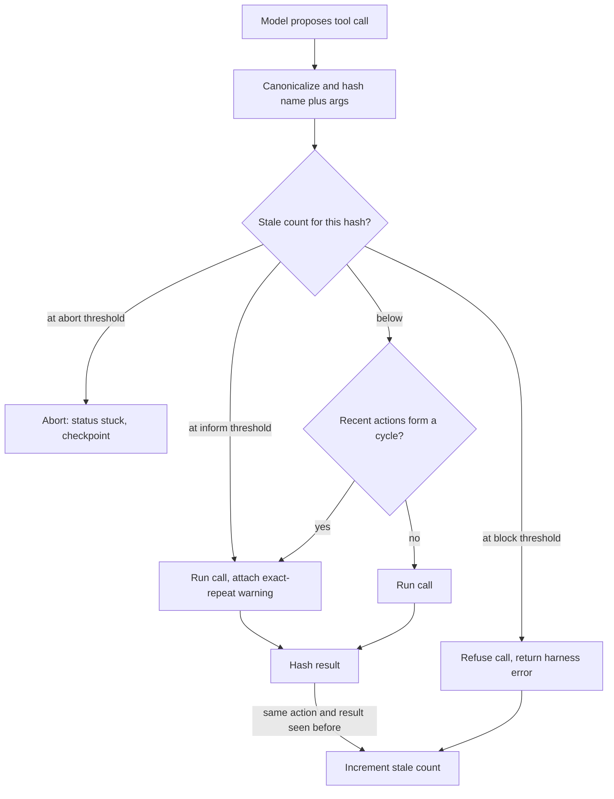

## TL;DR
Loop detection watches an agent's actions for exact repeats, short cycles and no-progress stretches, then
escalates (tell the model, block, replan, abort), because budgets stop loops only after burning the whole
allowance and making repetition visible is the cheapest fix.

## For agent builders
- **Why it matters for agents.** Repeating the same failing tool call is the most common way a
  tool-calling loop gets stuck, and from inside the context the repeats look like ordinary history.
  Catching it early saves most of the cost and gives the run a chance to recover.
- **Where it shows up in your stack.** In your harness, between the model's response and tool dispatch;
  in the orchestrator of a multi-agent system for handoff ping-pong; and in offline jobs over traces of
  budget-exhausted runs.
- **What you control.** How arguments are canonicalized, which volatile fields are stripped from results
  before hashing, which tools are pollable, the thresholds per rung (inform, block, replan, abort) and the
  wording of the inform message.
- **What you can skip.** Semantic near-duplicate detection on day one. Exact repeats plus (action, result)
  hashing catch most loops at almost no cost.

## Lab
### Task
Build the two pieces the example guard leaves out: a per-tool `strip_volatile()` so the no-progress
signal fires on a failing test whose output carries a fresh duration and request id each run, and an
orchestrator-level `HandoffGuard` that stops router-billing ping-pong and runaway delegation depth.
Time box: 40-60 min.
- **Prerequisites:** The agent loop; Max-step budgets; the result-aware guard in this lesson's Examples.
- **Setup:** Python 3.10+ and `pip install pytest` (checked with Python 3.13 and pytest 9.1). Save the
  starter as `lab.py` and the tests as `test_lab.py`.
- **No model calls:** tool results and handoffs are scripted.

### Starter code
```python
"""Lab: no-progress detection with volatile fields stripped, plus an orchestrator handoff guard.
Run: python lab.py"""
import copy, hashlib, json
from collections import Counter

def canon(*parts) -> str:
    raw = json.dumps(parts, sort_keys=True, separators=(",", ":"), default=str)
    return hashlib.sha1(raw.encode()).hexdigest()

def strip_volatile(result, paths: list[str]):
    """Return a copy of result without the dotted paths ("meta.request_id"); never mutate the input.
    Non-dict results and missing paths are left alone."""
    # YOUR CODE HERE
    raise NotImplementedError

class NoProgress:
    """Counts stale repeats: the same canonical (tool, args) whose stripped result was seen before."""
    def __init__(self, volatile: dict[str, list[str]]):
        self.volatile, self.seen, self.stale = volatile, set(), Counter()

    def observe(self, tool: str, args: dict, result) -> int:
        # YOUR CODE HERE: strip the tool's volatile paths, hash (tool, args, stripped result);
        # if that hash was seen, bump stale[canon(tool, args)]; remember it; return the stale count
        raise NotImplementedError

class HandoffGuard:
    """Lives in the orchestrator, where agent-to-agent loops are visible."""
    def __init__(self, max_repeats: int = 2, max_depth: int = 3):
        self.max_repeats, self.max_depth, self.counts = max_repeats, max_depth, Counter()

    def on_handoff(self, frm: str, to: str, task_id: str, depth: int) -> str:
        # YOUR CODE HERE: "human" if depth > max_depth, or if this (frm, to, task_id) has now
        # been seen more than max_repeats times; otherwise "ok"
        raise NotImplementedError

VOLATILE = {"run_tests": ["duration_ms", "meta.request_id"]}

def make_result(i, failing=2):
    return {"failing": failing, "duration_ms": 900 + i, "meta": {"request_id": f"req-{i}", "runner": "ci-1"}}

if __name__ == "__main__":
    raw, guarded = NoProgress({}), NoProgress(VOLATILE)
    for i in range(4):
        r = make_result(i)
        print(f"run_tests #{i + 1}: stale raw={raw.observe('run_tests', {'path': 'tests/'}, r)}"
              f" stripped={guarded.observe('run_tests', {'path': 'tests/'}, r)}")
    fixing = NoProgress(VOLATILE)
    print("edit-test cycle:", [fixing.observe("run_tests", {"path": "tests/"}, make_result(i, failing=3 - i))
                               for i in range(4)])
    g = HandoffGuard()
    hops = [("router", "billing"), ("billing", "router")] * 3
    print("ping-pong:", [g.on_handoff(a, b, "ticket-88", depth=1) for a, b in hops])
    print("deep delegation:", [HandoffGuard().on_handoff("planner", f"sub{d}", "t9", depth=d) for d in (1, 2, 3, 4)])
```

### Expected output
`python lab.py` with a correct solution prints exactly:

```
run_tests #1: stale raw=0 stripped=0
run_tests #2: stale raw=0 stripped=1
run_tests #3: stale raw=0 stripped=2
run_tests #4: stale raw=0 stripped=3
edit-test cycle: [0, 0, 0, 0]
ping-pong: ['ok', 'ok', 'ok', 'ok', 'human', 'human']
deep delegation: ['ok', 'ok', 'ok', 'human']
```

- **Read it:** without stripping, the stuck test never repeats, so the ladder in the example would never
  climb; with stripping, the stale count reaches 3 by the fourth run, past the example guard's inform
  (1) and block (2) thresholds.

### Tests
Run `pytest -q test_lab.py`. On the starter all 5 fail with `NotImplementedError`; a correct solution
passes all 5 (Python 3.13, pytest 9.1).

```python
from lab import VOLATILE, HandoffGuard, NoProgress, strip_volatile, make_result as out

def test_strip_volatile_copies_and_removes_nested_paths():
    r = out(0)
    s = strip_volatile(r, ["duration_ms", "meta.request_id", "meta.missing", "nope.deep"])
    assert s == {"failing": 2, "meta": {"runner": "ci-1"}}
    assert r["meta"]["request_id"] == "req-0" and "duration_ms" in r   # input untouched
    assert strip_volatile("plain text", ["a"]) == "plain text"

def test_stale_repeats_found_only_after_stripping():
    raw, guarded = NoProgress({}), NoProgress(VOLATILE)
    a = {"path": "tests/"}
    assert [raw.observe("run_tests", a, out(i)) for i in range(4)] == [0, 0, 0, 0]
    assert [guarded.observe("run_tests", a, out(i)) for i in range(4)] == [0, 1, 2, 3]

def test_progress_and_different_args_are_not_stale():
    np = NoProgress(VOLATILE)
    assert [np.observe("run_tests", {"path": "tests/"}, out(i, failing=3 - i)) for i in range(4)] == [0] * 4
    assert np.observe("run_tests", {"path": "other/"}, out(9, failing=0)) == 0

def test_handoff_ping_pong_goes_to_a_human():
    g = HandoffGuard()
    hops = [("router", "billing"), ("billing", "router")] * 3
    assert [g.on_handoff(a, b, "ticket-88", depth=1) for a, b in hops] == ["ok"] * 4 + ["human"] * 2
    assert g.on_handoff("router", "billing", "ticket-99", depth=1) == "ok"   # another task

def test_depth_cap():
    assert HandoffGuard().on_handoff("planner", "sub", "t9", depth=4) == "human"
    assert HandoffGuard(max_depth=4).on_handoff("planner", "sub", "t9", depth=4) == "ok"
```

### Failure scenarios
- **Hash only (tool, args) in `observe`, not the result.** The edit-test cycle prints `[0, 1, 2, 3]`:
  a run whose failing count drops every time is treated as stuck, the "raw call counts" pitfall. Log
  the result hash next to each stale bump and check whether it actually repeated.
- **Strip by deleting keys from the input dict.** The first test fails on "input untouched", and in
  production the trace loses the request ids that support needs. Diff the logged tool result before and
  after `observe()` runs.
- **Key handoffs on (from, to) without the task id.** The `ticket-99` assertion fails: a second,
  healthy ticket inherits the first ticket's count and goes to a human. Print the counter keys after the
  ping-pong to see that two tasks share one bucket.

### Submission
- **`lab.py`** with `strip_volatile`, `NoProgress.observe` and `HandoffGuard.on_handoff` implemented.
- **A green run** of `pytest -q test_lab.py` (5 passed) and the output of `python lab.py`.
- **A volatile-field list for two of your own tools** (or two real APIs you call), with the field each
  path removes and why it changes between identical calls.
- **A short note:** where `HandoffGuard` sits in your orchestrator and what the human hand-off carries
  (task id, the repeated hops, the last result from each agent).
- **Evaluated on:** stale repeats detected only when the stripped result repeats, no false positive on
  progress, and handoff loops stopped per task.

## Why it exists
- **Same context in, same action out.** A model picks its next action from the context; if the context
  after a failed action looks almost identical to before, the likeliest next action is the same one. The
  model has no counter; nothing in its input says "this is attempt four".
- **Typical triggers.** A file read returning an error the model does not interpret; a search returning
  nothing; a test command failing the same way; two edits that undo each other; a flaky tool returning
  different errors so the model keeps "trying one more time".
- **A budget alone is a poor answer.** With a thirty-step budget, a loop starting at step five burns
  twenty-five increasingly expensive steps, yields an exhausted partial, and teaches you nothing about
  *why*. Detecting it at step eight saves most of the cost and creates a chance to recover.
- **Telling the model works.** "You have run this exact command three times with the same output" often
  makes it change strategy, because what a human sees in the trace is invisible from inside the context.
- **"Abort if the same tool is called twice" fails both ways.** It kills legitimate repeats (polling a
  job status, reading two files with the same tool, re-running tests after each edit) and misses loops
  where arguments differ trivially (whitespace, a reworded query) or the cycle spans several steps.

## How it works
### Signals
| # | Signal | How | Cost and caveat |
|---|---|---|---|
| 1 | **Exact repeats** | Canonicalize tool name plus arguments (sorted keys, normalized whitespace), hash, count per hash; flag at a threshold (three is a common start) | Cheap. Canonicalization matters because models vary key order and formatting between attempts |
| 2 | **Short cycles** | Compare the last *p* action hashes with the *p* before them, for *p* from 2 to a small max *P* (A B A B, A B C A B C) | O(P²) comparisons per step, trivial for P ≈ 4; period 1 is just signal 1 |
| 3 | **No progress** | Hash the tool *result* too; a repeating (action, result) pair means nothing in the world changed | The strongest signal. Alternative: a task metric (failing test count, files changed, distinct URLs visited) and steps since it last improved |
| 4 | **Semantic near-duplicates** | Embed the action or stated intent; flag cosine similarity above a threshold with a recent action | An embedding call per step and false positives; reserve for high-value runs or run offline over traces |
| 5 | **Reflection text patterns** | The model repeating "let me try again" | Weak; a tie-breaker only |

### Legitimate repetition
Polling (`get_job_status(id)` every few seconds), re-running tests after each edit and re-reading a file
after modifying it must be allowed. Three ways:
- **Mark tools as pollable in the schema:** a higher repeat ceiling, or a time budget instead of a count.
- **Add a changing argument to the key:** for those tools, include a monotonically changing value such as
  an attempt number.
- **Rely on the result hash:** polling that returns a changing status is progress; polling that returns
  the identical status ten times is a loop.

### Escalation ladder
Information is the cheapest intervention, so rungs are ordered by cost and severity:
1. **Inform.** Inject: "You have called `run_tests` with identical arguments three times and the output
   was identical each time. Explain what you will do differently, or report the blocker." This alone
   resolves many loops.
2. **Block.** Return a harness-generated tool error instead of executing ("refused: identical to call 12,
   whose result did not change"). It saves the tool cost and forces a different action.
3. **Force a replan or reflection.** Switch to a reflection prompt, invoke a planner, or narrow the
   available tool set.
4. **Abort.** End the run with status `stuck`, attach the loop evidence, and checkpoint the state for a
   human.
- **Each rung has its own threshold,** for example inform at three, block at four, abort at six.

### Loops above the tool stream
Not every loop is one tool called twice:
- **Handoff ping-pong.** A router sends a task to the billing agent, which decides it is a support
  question and sends it back.
- **Non-converging critique-and-revise.** Each revision trades one flagged issue for another.
- **Plan regeneration.** A planner regenerates essentially the same plan after every failure.
- **Self-delegation.** A sub-agent delegates to a copy of itself.

The same three signals apply one level up:
1. Hash handoffs as (from, to, task) and count repeats.
2. Treat a revision whose critique score did not improve as a no-progress step.
3. Cap delegation depth.
- **Put the detector in the orchestrator.** Each agent sees only its own short, healthy-looking history,
  so these loops are invisible to a per-agent guard.

### Why deterministic settings make it worse
- **Low temperature favours exact repeats.** Greedy or low-temperature decoding makes "nearly the same
  context in, same action out" more likely, which is why agents run at temperature 0 for reproducibility
  tend to repeat exactly rather than drift.
- **That argues for detection, not for raising temperature.** Changing the context (the inform message)
  changes the choice for a reason; sampling noise changes it at random.

### Where it lives
- **In the harness, between the model's response and tool dispatch,** so it sees every action regardless
  of which model is used.
- **Log every detection with its evidence** (hashes, window contents, counts). This is also the best data
  for improving tools and prompts, because it shows which error messages failed to help the model change
  course.

## Diagram
Every proposed call passes the guard before dispatch; only results that repeat earlier results move a
call up the ladder.



## Examples
### A result-aware loop guard
- **Escalates on *stale* repeats:** identical canonical (tool, args) whose result matched an earlier one.
- **Changing results never escalate by count** (tests re-run after each edit); only the cycle check
  catches repeating actions, such as two edits undoing each other.
- **Pollable tools** get the same ladder with thresholds scaled up, as a stand-in for a time budget.
- **A refused call counts as stale,** because blocking made no progress either, so a model that keeps
  insisting climbs to abort.

```python
import hashlib, json
from collections import Counter, deque

def canon(*parts):     # strip volatile fields (timestamps, request ids) from results first
    raw = json.dumps(parts, sort_keys=True, separators=(",", ":"), default=str)
    return hashlib.sha1(raw.encode()).hexdigest()

class LoopGuard:
    def __init__(self, inform=1, block=2, abort=4, window=12, max_period=4,
                 pollable=(), poll_factor=10):
        self.calls, self.stale, self.seen = Counter(), Counter(), set()
        self.seq, self.max_period = deque(maxlen=window), max_period
        self.pollable, self.poll_factor = set(pollable), poll_factor
        self.inform, self.block, self.abort = inform, block, abort

    def _cycle(self):
        s = list(self.seq)
        for p in range(2, self.max_period + 1):  # period 1 is the stale count's job
            if len(s) >= 2 * p and s[-p:] == s[-2 * p:-p] and len(set(s[-p:])) > 1:
                return p
        return 0

    def before(self, name, args):                # call before dispatching the tool
        h = canon(name, args)
        self.seq.append(h); self.calls[h] += 1
        n, st = self.calls[h], self.stale[h]
        f = self.poll_factor if name in self.pollable else 1
        if st >= self.abort * f:
            return "abort", f"{name}: {n} identical calls, result unchanged {st} times"
        if st >= self.block * f:
            self.stale[h] += 1                   # a refused call is no progress either
            return "block", f"refused: identical to {n - 1} earlier calls; result never changed"
        if st >= self.inform * f:
            return "inform", f"call {n} of {name} with these exact args; last result was identical"
        if p := self._cycle():
            return "inform", f"your last {2 * p} actions repeat with period {p}; change approach"
        return "ok", ""

    def after(self, name, args, result):         # call after the tool returns
        if (k := canon(name, args, str(result))) in self.seen:
            self.stale[canon(name, args)] += 1
        self.seen.add(k)
```

### Worked traces through the guard
| Scenario | What happens |
|---|---|
| Failing `run_tests` printing the same 40-line failure each time | Call 1 runs; call 2 runs and matches call 1 (stale = 1); call 3 runs with an inform message; calls 4 and 5 are refused (stale was 2); call 6 aborts as `stuck`. Inform at three, block at four, abort at six |
| Healthy edit-test cycle | Every `run_tests` output differs because the failing count drops, so stale stays at 0 and nothing fires |
| Deploy poller declared pollable, returning "building" over and over | Informed on call 12 (ten results that repeated an earlier one) and refused from call 22, by which point a wall-clock budget should normally have taken over |

### Runnable driver: exercise the guard without an LLM
Paste below the class above and run with plain Python.
- **First loop:** reproduces the failing-test trace.
- **Second loop:** two edits undo each other (text "a", then "b"). Every result differs, so the stale
  count never moves, but the A B A B cycle is caught at call 4. The second edit lists its keys in a
  different order from the first; `canon()` sorts keys, so a reordered repeat of the same edit would
  still hash identically.

```python
g = LoopGuard()
for i in range(1, 7):                            # same call, same result every time
    verdict, _ = g.before("run_tests", {"path": "tests/"})
    print(i, verdict)                            # ok, ok, inform, block, block, abort
    if verdict in ("ok", "inform"):
        g.after("run_tests", {"path": "tests/"}, "FAILED test_x")

g = LoopGuard()
undo = [("edit", {"line": 3, "text": "a"}), ("edit", {"text": "b", "line": 3})]
for i, (name, args) in enumerate([*undo, *undo, *undo], 1):
    print(i, *g.before(name, args))             # inform from call 4: period 2
    g.after(name, args, f"ok {i}")              # results differ, so only the cycle fires
```

## Production patterns
- **Guard in the dispatch path, one per run.** Instantiate the guard per run in the harness (not per
  agent), call `before()` ahead of every tool dispatch and `after()` on every result. Monitor detections
  per hundred runs, broken down by tool.
- **Strip volatile fields before hashing results.** Remove timestamps, request ids and durations from
  tool output (a per-tool list of JSON paths to drop) before computing the result hash, otherwise
  no-progress detection never fires. Monitor tools whose results never repeat at all, a hint that a
  volatile field slipped through.
- **Pollable flag in the tool registry.** Mark status-check tools as pollable with a scaled threshold or a
  wall-clock cap, and use backoff between polls. Monitor poll counts per job and time-to-terminal-status.
- **Orchestrator-level handoff counter.** In multi-agent systems, count (from, to, task) handoffs and
  delegation depth in the orchestrator and route to a human after a small repeat count. Monitor
  handoff-repeat detections per agent pair.
- **Offline trace mining.** Run exact and semantic repeat detection as a batch job over budget-exhausted
  runs to find loops the online guard missed, then tune thresholds or tool error messages.

## Trade-offs
- **Exact match vs coverage.** Exact-match detection is cheap with near-zero false positives, but misses
  loops with trivially varied arguments; normalization or semantic similarity widens coverage at the cost
  of false alarms on legitimate variation.
- **Inform before block vs extra calls.** Informing preserves autonomy and often recovers the run, but
  spends an extra model call per warning; if warnings rarely change a given model's behaviour, move the
  block rung earlier.
- **Result-hash detection vs hashing cost.** It is the most reliable signal, yet requires hashing possibly
  large outputs and fails on outputs that embed timestamps or ids; strip volatile fields first.
- **Tight thresholds vs legitimate repeats.** They catch loops early but break polling and edit-test
  cycles; per-tool thresholds and result-aware rules restore those at the price of more configuration.

## Pitfalls
- **Keying only on the tool name.** Symptom: aborts on healthy runs that read several files, because
  every file read looks like a repeat. Diagnose: list the hashes behind each abort; distinct arguments
  under one key give it away. Fix: hash name plus canonical args.
- **Blocking polling tools.** Symptom: long-running jobs never complete because the status check is
  refused after the third call. Diagnose: blocks on tools whose results were changing. Fix: mark them
  pollable and rely on the result hash.
- **Detecting but only logging.** Symptom: traces show "loop detected" at step six and budget exhaustion
  at step thirty. Diagnose: steps between first detection and run end. Fix: wire the ladder.
- **Vague warnings ("you seem stuck").** Symptom: the model acknowledges and repeats. Diagnose: recovery
  rate after the inform rung. Fix: name the exact call, the count and the identical result.
- **Hashing arguments without canonicalization.** Symptom: obvious repeats with reordered JSON keys are
  never counted. Fix: sorted keys and normalized whitespace.
- **Escalating on raw call counts instead of unchanged results.** Symptom: healthy edit-test cycles
  aborted as "stuck" on the sixth test run while every run made progress. Diagnose: check whether the
  aborted calls' result hashes differed. Fix: count stale repeats.
- **Running the detector per agent in a multi-agent system.** Symptom: a task bounces between two agents
  for the whole budget while each guard reports nothing. Diagnose: count (from, to, task) handoffs per
  run. Fix: detect in the orchestrator.

## When to use
- **Use when:** any agent calls tools more than a few times per run, and especially anything that runs
  unattended.
- **Start with:** exact-repeat and (action, result) no-progress detection in the harness, an afternoon of
  work, plus the inform/block/abort ladder.
- **Add later:** cycle detection when traces show oscillation; semantic detection only when exact matching
  demonstrably misses loops you care about.
- **Measure:** detections per hundred runs by tool, recovery rate after the inform rung, and the share of
  budget-exhausted runs that contained an undetected repeat pattern (mine the traces offline).

## Exercise
**Goal:** find the loops your own agent misses, then tune a guard to catch them without false
positives. No solution is given.
- **Inputs:** at least 20 traces of budget-exhausted or slow runs (yours, or scripted ones covering a
  failing test, a reworded empty search, a poller and an edit pair that undo each other).
- **Constraints:** result hashing with volatile fields stripped per tool, pollable tools flagged, ladder
  thresholds set from the traces.
- **Deliver:** an offline replay that labels each trace with the rung reached and the step it fired, plus
  a list of loops still missed and why.
- **Acceptance:** every scripted loop is caught before step 8; no healthy edit-test or polling trace
  reaches block; replaying twice gives identical labels.

## Role lens
- **Engineer:** Implements the guard in the tool-dispatch path, canonicalizes arguments, tunes
  thresholds per tool and writes warning messages that name the exact repeated call.
- **Architect:** Decides where loop evidence is recorded and how `stuck` outcomes feed retries, human
  escalation and the agent-quality metrics shared across teams.
- **FDE:** Mines customer traces for repeat patterns to show which tools return unhelpful errors,
  turning loop detections into concrete tool and prompt fixes.

## Check yourself
**Q:** Your agent polls a deployment status tool every step until the deploy finishes, and separately
it sometimes re-runs a failing test command endlessly. How do you detect the second without breaking
the first?
**A:** Key detection on the tool result as well as the call. Polling returns a changing status
(pending, building, done), so the (call, result) pair rarely repeats, while the failing test returns
byte-identical output each time, which is exactly the no-progress signal. Mark the status tool as
pollable with a higher repeat ceiling or a time budget, strip volatile fields such as timestamps
before hashing results, and apply the ladder: after three identical (call, result) pairs inform the
model with the exact command and output, refuse the fourth, and abort with status stuck if it
persists. Log both cases so the thresholds can be tuned from real traces rather than guesses.

## Interview questions
### How would you tell a stuck loop apart from legitimate repetition such as polling?
- **Hash the result as well as the action.** Polling that returns a changing status is progress; an
  identical (action, result) pair means the world did not change.
- **Mark pollable tools** with a higher ceiling or a time budget, and strip volatile fields such as
  timestamps before hashing, or every result looks new.

### A task bounces between a router and a billing agent for the whole budget. Why did no guard fire, and what do you change?
- **Each agent saw a short, healthy history,** so a per-agent guard had nothing to flag.
- **Move detection to the orchestrator:** hash handoffs as (from, to, task), count repeats, cap delegation
  depth and escalate to a human after a small count.

### When would you add semantic near-duplicate detection, and what does it cost?
- **Only when exact matching demonstrably misses loops you care about,** such as reworded search queries.
- **Cost:** an embedding call per step plus false positives on legitimate variation, so reserve it for
  high-value runs or run it offline over traces.

### Would raising the temperature fix an agent that keeps repeating the same call?
- **It would change the action at random, not for a reason.** Low temperature does make exact repeats more
  likely, but the fix is to change the context.
- **Inform the model** with the exact call, the count and the unchanged result; that changes its choice
  deliberately and keeps runs reproducible.

## Quiz
### Q: Why is the pair (action, result) a stronger loop signal than the action alone?
- [ ] Results are smaller to hash than arguments
- [x] An identical action producing an identical result means the world did not change, which separates a stuck loop from legitimate repeats such as polling
- [ ] Models never repeat an action whose result changed
- [ ] It makes semantic similarity unnecessary in every case
> Repeating a call whose result changes can be productive; repeating one whose result is identical
> gains no information. Using the result distinguishes polling and edit-test cycles from genuine loops.

### Q: What is the first rung of the escalation ladder when a repeat is detected?
- [ ] Abort the run immediately with status stuck
- [x] Inject a message naming the exact repeated call, its count and the unchanged result, so the model can change approach
- [ ] Silently drop the tool call and continue
- [ ] Switch to a larger model
> The model cannot see its own repetition from inside the context; making it explicit is cheap and
> often sufficient. Blocking and aborting come later if the warning does not change behaviour.

### Q: Which design choice most reduces false negatives caused by models reformatting their arguments between attempts?
- [ ] Hash only the tool name
- [ ] Compare the model's reasoning text instead of the arguments
- [x] Canonicalize arguments (sorted keys, normalized whitespace) before hashing
- [ ] Increase the repeat threshold
> Models vary key order and whitespace between calls; without canonicalization identical intents hash
> differently and are never counted. Hashing only the name would flag unrelated calls instead.

## Mastery test
**Problem:** a writer agent revises a report and a critic agent scores it. Over 12 rounds scores go 6,
7, 6, 7 and the flagged issue alternates between "tone" and "missing citation". Every draft differs, so
the guard never fires. Why, and what do you build?

**A strong answer:**
- new draft text each round makes every hash unique, so the loop is visible only at agent level;
- in the orchestrator, hashes each critique's issue set (A B A B is a period-2 cycle) and counts
  rounds that do not beat the best score (stuck at 7 since round 2);
- informs the writer of both issues at once, then stops, returning the best draft as partial, not the
  last.

## Use cases & projects
### Use cases
- **Coding agents re-running a failing test.** The (action, result) hash shows nothing changed, so the
  guard informs, then blocks, before the budget burns.
- **Search and browsing agents.** Rewording defeats exact hashing, so stripped result hashes are paired
  with a progress metric such as new useful URLs.
- **Job-polling agents.** Pollable tools get a higher ceiling or a time cap, so a changing status counts as
  progress while ten identical statuses count as a loop.
- **Multi-agent routers.** An orchestrator-level (from, to, task) counter stops a router and a billing agent
  bouncing one ticket back and forth.

### Mini project
**Add a loop guard to a scripted agent (1-2 hours).**
- **Goal:** detect exact repeats, short cycles and no-progress steps in a tool loop and escalate through
  inform, block and abort.
- **Steps:** build a fake model that replays a scripted list of tool calls (an exact repeat, an A B A B
  cycle, and a polling sequence whose status changes); implement `before()` and `after()` with canonical
  argument hashing and result hashing; strip a timestamp field from results; inform on the third identical
  (call, result), block the fourth and abort on the sixth.
- **Done when:** the exact-repeat script ends `stuck` on call six with logged evidence, the A B A B script
  gets an inform naming period 2, the polling script finishes without a false positive, and a short note
  records which rung resolved each case.
