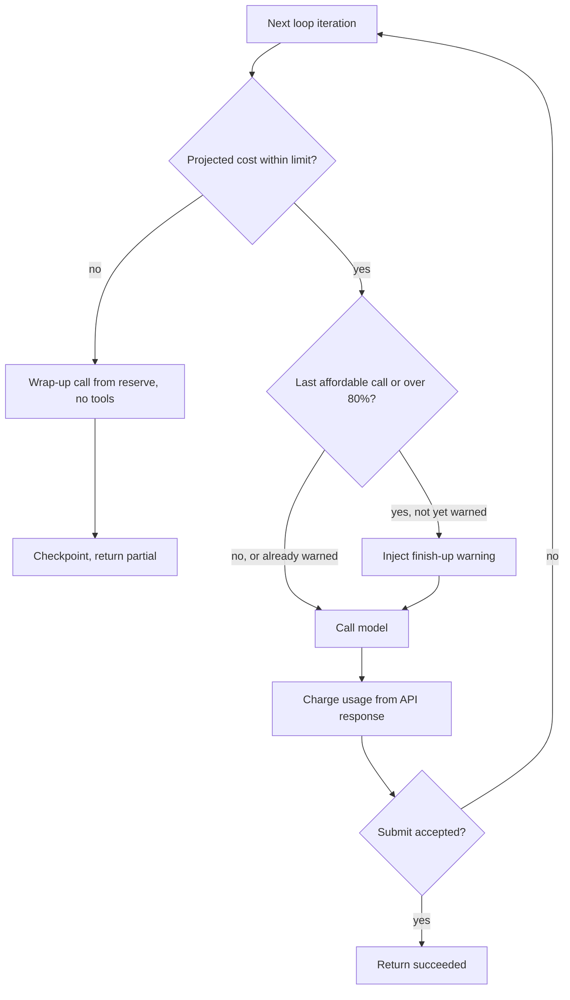

## TL;DR
A max-step budget caps the model calls, tokens, seconds and dollars one run may spend. It is a backstop,
not a target: set it from successful runs, warn before it fires, return a labelled partial, and treat
every exhaustion as a stuck-agent signal.

## For agent builders
- **Why it matters for agents.** A stuck tool-calling loop re-sends a growing transcript every step, so
  cost and latency climb faster than the step count. The budget is the one guard that works even when the
  model, the tools and your other checks are all wrong.
- **Where it shows up in your stack.** `max_turns` on `Runner.run` in the OpenAI Agents SDK
  (`MaxTurnsExceeded`), `recursion_limit` in LangGraph (`GraphRecursionError`), usage fields on every
  model response, per-call tool timeouts, and tenant quotas in a shared counter.
- **What you control.** Which dimensions you cap (steps, tool calls, tokens, wall-clock, money, depth),
  the number per task class, the soft warning, the projection before each call, the wrap-up reserve and
  the sub-budgets handed to child agents.
- **What you can skip.** Tuning one global step count by feel. Derive numbers from successful-run traces
  and spend the effort on the exhaustion path instead.

## Why it exists
- **Stuck models never stop themselves.** A stuck model keeps calling tools until something external
  stops it, and each step costs more than the last because the accumulated context is re-sent on every
  call. One stuck run can burn hours of wall-clock and a surprising amount of money before anyone notices.
- **Failures arrive in bursts.** A tool outage that makes every call fail multiplies stuck runs across
  every concurrent user.
- **The cap needs no intelligence.** It cannot be fooled by a confident model, a mislabelled tool result
  or a failure mode nobody anticipated.
- **The naive cap hides problems.** `for step in range(20)` is where most teams start. Twenty of what? A
  call emitting five parallel tool calls is one step or five; an early step costs a few thousand input
  tokens, step forty may cost tens of thousands. Steps are a loose proxy for what you want to bound: cost
  and time.
- **Raising on the limit loses the work.** The model never gets to say "here is what I have and what is
  blocking me", often the most useful output of a failed run. Hence several dimensions, a soft threshold
  and a state-preserving exhaustion path.

## How it works
### Dimensions
| Dimension | What it counts | Why it matters |
|---|---|---|
| **Steps** | Model invocations, one per loop iteration | Cheap to count, coarse in meaning |
| **Tool calls** | Each tool invocation; per-tool caps ("no more than five web searches") | Encode task knowledge the model lacks |
| **Tokens** | Cumulative input plus output | What actually protects cost (see below) |
| **Wall-clock** | Seconds since the run started | Bounds user-facing latency and hanging tools |
| **Money** | Tokens × price plus tool costs (paid APIs, compute) | The dimension finance cares about |
| **Depth and fan-out** | How deep delegation recurses, how many children a parent spawns | Bounds sub-agent trees |

- **Tokens grow roughly quadratically.** Input is re-sent each turn, so without compaction cumulative
  input grows with the square of steps. Illustrative: each step adds about 2k tokens, so twenty steps
  re-send about 2k × (1 + 2 + … + 20) ≈ 420k input tokens.
- **Prompt caching does not remove the need.** Where offered, it discounts the re-sent prefix but does not
  shrink the token count or the context-window limit, so the budget still counts tokens and prices them
  separately.
- **Wall-clock needs per-call timeouts.** A ten-minute budget does nothing if a single tool call blocks
  for thirty.

### Setting the number
1. **Measure successful runs.** Collect the step and token distribution of *successful* runs per task
   class.
2. **Set the hard limit high.** Put it above a high percentile (p95 to p99 plus margin), not at the mean,
   because at the mean you cut off the hard-but-solvable tail, exactly where agents earn their keep.
3. **Watch the exhaustion rate.** A backstop that fires on more than a few percent of runs is a
   termination or loop problem, not a budget problem.
4. **Separate task classes.** "Fix a typo" and "migrate a module" should not share one budget.

### Soft threshold
- **Warn at a fraction of the budget.** Around 75–80% is a common starting point: "You have used 16 of 20
  steps. Finish up: submit your best result and list what remains."
- **Why it works.** A model can usually produce a coherent partial answer when told to, so a hard failure
  becomes a labelled partial result.
- **Stay quiet below the line.** The model should not need to know the budget exists, or it may ration
  effort unnecessarily; whether to disclose it at all is a judgement call worth measuring.

### Hard threshold
When any dimension is exceeded:
1. Stop issuing model calls.
2. Persist the state (checkpoint) so a human or a retry with a larger budget can resume.
3. Return status `partial` or `exhausted` with the last draft, never `succeeded`.
- **Do not raise and lose the transcript.**

### Hierarchy
- **Sub-budgets for children.** A parent gives each sub-agent a sub-budget; the sum of the children's
  allowances must not exceed the parent's remaining budget.
- **Charge and report upward.** Children charge their own budget and report usage; the parent debits on
  return. Without this a single sub-agent can spend the parent's whole allowance.
- **Caps above the run.** Enforce tenant-level and platform-level caps (a tenant's daily token quota, a
  global concurrency cap), because a thousand runs each within budget can still be an incident.

### Accounting
- **Use real usage, not estimates.** Charge after each model response from the usage fields the API
  returns (input and output tokens); charge tool costs as they occur.
- **Persist counters.** Store them in the checkpoint so a resumed run does not start from zero.
- **Close the post-hoc gap by projecting.** The check runs *before* a call but cost is known only *after*.
  At 390k of a 400k-token budget, "are we over?" says no, and the next call re-sends a 60k-token context
  and lands at 450k.
  - The next call's input is the current context size (known, or counted with the provider's token
    counter), and its output is bounded by `max_tokens`.
  - Refuse the call if `used + context + max_tokens` would exceed the limit. The same projection tells you
    when to fire the wrap-up turn instead of another working step.

### Reserve for the wrap-up
- **The partial result costs a call.** If the hard limit is the whole allowance, the wrap-up cannot be
  afforded at exactly the moment it is needed.
- **Hold back a reserve.** One context-sized call is the natural unit, spendable only by the wrap-up.
- **Withhold tools on that call** so the model summarises instead of acting.

## Diagram
Before every call the harness projects the cost (`used + context + max_tokens`); the soft warning and the
hard stop both come from that projection, not only from the fraction used.



## Examples
### A multi-dimension budget with projection and sub-budgets
- **What it does:** caps steps, tokens and seconds with one soft warning at 80% of whichever is closest;
  refuses a call whose *projected* cost breaches the token limit and returns a labelled partial; and
  `child()` / `absorb()` fund a sub-agent from what remains and debit the parent on its return.

Why the warning also fires on `last`, traced for a run whose context grows by about 15k tokens per step
(step *n* sends roughly 15k × n; cumulative spend after *n* steps is 15k × n(n+1)/2):

| After step | Cumulative | Next call | Decision |
|---|---|---|---|
| 5 | 225k (56%) | step six sends 90k: 225k + 90k + 4k ≤ 400k fits | but six and seven together would not, so warn with step six |
| 6 | 315k (still under the 80% line) | step seven would project to 424k | stop with a partial |

- **Lesson:** a purely fractional soft line would never have fired. With quadratic growth, "under 80%"
  becomes "cannot afford another call" in one step, so the projection must drive the warning.

```python
import time
from dataclasses import dataclass, field

@dataclass
class Budget:
    max_steps: int = 20; max_tokens: int = 400_000; max_seconds: float = 600
    soft_fraction: float = 0.8; steps: int = 0; tokens: int = 0; warned: bool = False
    started: float = field(default_factory=time.monotonic)

    def charge(self, usage):                     # usage block from the API response
        self.steps += 1
        self.tokens += usage.input_tokens + usage.output_tokens

    def fraction_used(self) -> float:
        return max(self.steps / self.max_steps, self.tokens / self.max_tokens,
                   (time.monotonic() - self.started) / self.max_seconds)

    def can_afford(self, ctx: int, max_out: int, calls: int = 1) -> bool:  # project first
        return (self.steps + calls <= self.max_steps
                and time.monotonic() - self.started < self.max_seconds
                and self.tokens + calls * (ctx + max_out) <= self.max_tokens)

    def child(self, share: float = 0.25) -> "Budget":   # slice of what is left, never 0
        left = max(0.0, 1 - self.fraction_used()) * share
        return Budget(max_steps=max(1, int(self.max_steps * left)),
                      max_tokens=max(1, int(self.max_tokens * left)),
                      max_seconds=max(1.0, self.max_seconds * left))

    def absorb(self, child: "Budget"):          # parent pays for the child on return
        self.steps += child.steps; self.tokens += child.tokens

def run(state, model, budget: Budget, max_out=4_000):
    while True:
        ctx = state.context_tokens()
        if not budget.can_afford(ctx, max_out):  # wrap_up: no-tools call, paid from a
            return {"status": "partial", "reason": "budget_exhausted",   # reserve kept
                    "draft": state.wrap_up()}                            # outside max_tokens
        last = not budget.can_afford(ctx, max_out, calls=2)   # room for one more call only
        if not budget.warned and (last or budget.fraction_used() >= budget.soft_fraction):
            budget.warned = True
            state.push_user("Budget nearly used. Submit your best result now "
                            "and list anything unfinished.")
        resp = model(state.messages)
        budget.charge(resp.usage)
        if state.handle(resp):                   # True once submit_result is accepted
            return {"status": "succeeded", "result": state.result}

# --- runnable check (Python 3.10+): a stuck run whose context grows 15k per step ---
from types import SimpleNamespace as NS

class StuckState:                                # never submits, like a looping agent
    def __init__(self): self.messages, self.n = [], 0
    def context_tokens(self): return 15_000 * (self.n + 1)
    def push_user(self, text): print(f"warning injected before step {self.n + 1}")
    def handle(self, resp): self.n += 1; return False
    def wrap_up(self): return f"summary after {self.n} steps"

state = StuckState()
model = lambda messages: NS(usage=NS(input_tokens=state.context_tokens(), output_tokens=0))
b = Budget()
print(run(state, model, b), b.tokens)            # warns before step 6; partial at 315000
child = b.child(); print(child.max_steps, child.max_tokens)   # 1 21250: a slice of what is left
```

### Runnable: simulate quadratic token growth
Pure Python, no API. It reproduces the trace above and shows why step counts understate cost.

```python
def simulate(per_step=15_000, budget=400_000, max_out=4_000, soft=0.8):
    used, n = 0, 0
    while True:
        ctx = per_step * (n + 1)                  # context sent on the next call
        if used + ctx + max_out > budget:
            return n, used, "stop: next call would breach"
        last = used + 2 * (ctx + max_out) > budget
        warn = last or used / budget >= soft
        n += 1
        used += ctx                               # input only, for simplicity
        print(f"step {n}: sent {ctx//1000}k, used {used//1000}k ({used/budget:.0%})"
              + ("  <- warn" if warn else ""))

print(simulate())             # warns on step 6 at 79%, stops before step 7
for steps in (8, 10, 20):     # re-sent context units: 36, 55, 210
    print(steps, "steps ->", sum(range(1, steps + 1)), "units of re-sent context")
```

- **Read the output:** 8 to 10 steps is a 25% rise in steps but about 1.5x in re-sent context; 20 steps
  re-send 210 units, nearly six times the 8-step run.

## Production patterns
- **Use the framework's turn cap as the outer backstop.** In the OpenAI Agents SDK pass `max_turns` to
  `Runner.run` and handle `MaxTurnsExceeded`; in LangGraph set `recursion_limit` in the run config and
  catch `GraphRecursionError`. Convert either exception into a labelled `partial` with the checkpointed
  state rather than letting it surface as a crash. Monitor how often each fires per task class.
- **Token budget from usage fields, projected before the call.** Read input and output tokens from every
  response, count the next context with the provider's token-counting endpoint where available, and
  refuse calls where `used + context + max_tokens` breaches the limit. Monitor the gap between projected
  and actual spend.
- **Per-task-class budgets from p95 to p99 of successes.** Recompute budgets from a weekly job over
  successful-run traces and store them in config keyed by task class. Monitor exhaustion rate per class;
  alert when it exceeds a few percent.
- **Tenant and platform caps above runs.** Keep a daily token quota per tenant in a shared counter (for
  example a Redis key with a TTL) and a global concurrency cap, and also set provider-side spend limits
  where the provider offers them. Monitor quota burn rate and how many runs are refused at admission.
- **Per-call timeouts under the wall-clock budget.** Wrap every tool call in a timeout (for example
  `asyncio.wait_for`) and set the SDK client's request timeout, so the wall-clock budget can actually
  interrupt. Monitor p99 tool latency and timeout counts per tool.

## Trade-offs
- **Tight budget vs long-tail tasks.** It bounds cost and latency precisely but truncates the long-tail
  tasks that justify an agent; it flips when the exhaustion rate on solvable tasks costs more than the
  spend saved.
- **Warning the model vs rushing.** Remaining-budget warnings yield usable partials, but warning too early
  makes the model rush or skip verification; keep the soft line late and measure quality on runs that got
  the warning.
- **Step counts vs token and money budgets.** Steps are trivial to implement and explain, yet poorly
  correlated with cost once contexts grow; token and money budgets track the real constraint at the price
  of accurate usage accounting.
- **Hierarchical sub-budgets vs starved sub-tasks.** They keep a delegation tree bounded, but starve deep
  sub-tasks when the parent has already spent most of its allowance; dynamic reallocation helps but
  complicates accounting.
- **Projection vs early stops.** Projecting cost before each call never overshoots, but stops runs a step
  early whenever `max_tokens` is set far above typical output; size `max_tokens` from observed output
  lengths, or the projection becomes the binding constraint instead of real spend.

## Pitfalls
- **Counting steps but not tokens.** Symptom: cost per run growing far faster than steps per run as tasks
  lengthen, and a surprising bill. Diagnose: plot input tokens per step against step index; a rising line
  is re-sent context. Fix: add a token or money budget.
- **Raising an exception on exhaustion and discarding the transcript.** Symptom: support cannot see what
  the agent did, and users get a bare "failed" with no partial output. Diagnose: count exhausted runs
  with no checkpoint or draft. Fix: checkpoint and return `partial`.
- **Resetting the budget to zero on resume.** Symptom: a stuck run that is retried automatically consumes
  several budgets instead of one. Diagnose: sum tokens across all attempts of one run id. Fix: persist
  counters in the checkpoint.
- **One budget constant for every task type.** Symptom: trivial tasks with absurd headroom while complex
  ones are cut off at a fixed step count regardless of progress. Diagnose: exhaustion rate and step
  percentiles split by task class. Fix: per-class budgets.
- **Wall-clock budget without per-call timeouts.** Symptom: a run that "times out" long after its budget,
  because one tool call hung and nothing interrupted it. Diagnose: compare the longest tool span with the
  run's overshoot. Fix: timeouts on every call.
- **Checking the budget only after charging.** Symptom: runs ending 10–20% over their token limit,
  because the final call's cost was unknown until paid. Fix: project before the call.

## When to use
- **Always on, from the first prototype:** the prototype without a cap is the one that runs overnight.
- **Choose dimensions by what you protect:** tokens or money for cost, wall-clock for interactive latency,
  depth and fan-out for multi-agent systems, per-tool caps for expensive or rate-limited tools.
- **Measure:** exhaustion rate per task class, median and p95 steps and tokens of successful runs, and
  the quality of partial results produced after the soft warning.
- **Day to day:** this is the parameter you revisit after every "why did this run cost that much"
  conversation.

## Exercise
**Goal:** budget a parent agent that delegates to two sub-agents, from real usage data. No solution is
given.
- **Inputs:** traces (or logged usage) of at least 20 successful runs of one task class, and a loop with a
  scripted fake model for both levels.
- **Constraints:** hard limits from the success percentiles, projection before every call, a reserved
  no-tools wrap-up, children funded from what remains, counters persisted and restored on resume.
- **Deliver:** the budget config with the data behind each number, and scripted runs: a stuck child, a
  resume after a crash, and a hung tool under the wall-clock cap.
- **Acceptance:** no run, including parent plus children, ever exceeds its token limit; resume continues
  the counters; the hung tool is interrupted within its timeout; all 20 successful runs fit.

## Role lens
- **Engineer:** Implements the Budget object, wires usage accounting from API responses, persists the
  counters in checkpoints and writes the soft-warning message the model actually responds to.
- **Architect:** Sets the budget policy per task class and the tenant and platform caps above it,
  and decides what "exhausted" means for automatic retries and billing.
- **FDE:** Calibrates budgets against the customer's real task mix and cost ceiling, and reports
  exhaustion rates as the early sign that a workflow has outgrown its current design.

## Check yourself
**Q:** Your agent's step cap is 15. Finance reports that cost per run doubled last month while median
steps rose only from 8 to 10. What is happening, and what do you change?
**A:** Cost is driven by cumulative tokens, and cumulative input grows roughly with the square of the
step count when the whole history is re-sent on every call. Do the arithmetic, though: with a constant
amount added per step, input scales with n(n+1)/2, which goes from 36 to 55 units between 8 and 10
steps, about 1.5x. So the step rise explains part of the doubling, not all of it. The rest has to come
from what each step carries (larger tool outputs, a bigger system prompt, a dropped cache) or from the
tail: cost per run is a mean, and a few long runs near the cap move it far more than the median
reveals. First confirm with per-run token accounting split by input and output, by step and by
percentile.
Then add a token budget alongside the step cap, with a soft warning, and attack the cause: truncate
or compact tool outputs, summarize older context, and check whether a tool started returning much
larger payloads. Report the exhaustion rate by task class rather than lowering the step cap blindly.

## Interview questions
### Why is a step count a weak proxy for what an agent budget should bound?
- **Steps are not uniform.** One model call may emit five parallel tool calls, and a late step re-sends
  the whole history, so it can cost many times an early one.
- **Cost grows roughly quadratically.** With a constant amount added per step, cumulative input scales
  with n(n+1)/2, so token and money budgets are what actually bound spend; steps stay as a cheap backstop.

### How would you pick the budget number for a new task class?
- **From data, not intuition:** collect step and token usage of successful runs, then set the hard limit
  above p95 to p99 plus margin.
- **Not at the mean,** because that cuts off the hard-but-solvable tail where agents add most value.
- **Then monitor exhaustion rate.** If it fires on more than a few percent of runs, investigate
  termination or loops instead of raising the cap.

### A run ended 12.5% over its token budget. How did that happen and how do you prevent it?
- **Post-hoc charging gap:** the check ran before the call, but cost was only known after. At 390k of
  400k, a 60k-context call lands at 450k.
- **Fix by projecting:** refuse the call when `used + context + max_tokens` exceeds the limit, and keep a
  reserve so the no-tools wrap-up call can still be afforded.

### When would a tight budget be the wrong choice?
- **When the long tail is the product.** Migrations and multi-file fixes legitimately need many steps;
  a tight cap turns them into partials and the lost value exceeds the saved spend.
- **When warnings make the model rush.** An early soft line can make it skip verification, so keep it
  late (around 75–80%) and compare quality on warned versus unwarned runs.

## Quiz
### Q: Why is a token or cost budget a better primary guard than a step count?
- [ ] Steps cannot be counted reliably when the model emits parallel tool calls
- [x] Per-step cost grows as the context accumulates, so steps correlate poorly with the money and latency you actually want to bound
- [ ] Token budgets are enforced automatically by the model provider
- [ ] Step counts cannot be stored in checkpoints
> Each model call re-sends the growing history, so late steps cost many times what early ones do; a
> step cap bounds iterations but not spend. Token and money budgets measure the real constraint.

### Q: How should the hard budget number be chosen for a task class?
- [ ] Set it to the mean step count across all runs
- [ ] Set it as low as possible to minimise cost
- [x] Set it above a high percentile of successful runs' step and token usage, then monitor the exhaustion rate
- [ ] Let the model choose its own budget per task
> The budget is a backstop that should rarely fire; cutting at the mean removes the hard-but-solvable
> tail. A budget that fires often signals a termination or loop problem, not a budget problem.

### Q: What should happen when the hard budget is exceeded mid-run?
- [ ] Raise an exception and discard the run
- [ ] Silently return the last model message as the final answer
- [x] Stop calling the model, checkpoint the state and return a result labelled partial or exhausted
- [ ] Double the budget and continue
> Exhaustion must be visible to callers and metrics, and the state must survive so a human or a retry
> can resume. Returning the last message as success hides the failure; discarding loses the work.

## Mastery test
**Problem:** a parent on the example's default `Budget` has used 4 steps and 100k tokens. It spawns 4
parallel sub-agents with `child()` before any returns. All succeed, yet the parent's synthesis call is
refused. Compute each child's allowance and redesign the funding.

**A strong answer:**
- 0.75 × 0.25 = 0.1875 each: 3 steps, 75k tokens, 112.5 s, so four take all 300k left;
- nothing is debited until `absorb()`, so parallel spawns slice the same remainder, with no reserve for
  the parent's synthesis;
- reserve the parent's remaining work first, debit each allowance at spawn, refund unused on return;
- check 3 steps against the children's success p95; fund fewer children if too low.

## Use cases & projects
### Use cases
- **Customer-facing chat agents.** A wall-clock budget with per-call timeouts keeps a slow tool from
  turning one answer into a minutes-long spinner.
- **Coding and browsing agents.** Token and per-tool caps ("no more than five web searches") bound the
  quadratic growth of long runs and stop runaway search loops.
- **Multi-agent research systems.** Parents hand sub-budgets to children and debit actual usage on return,
  so one sub-agent cannot spend the whole allowance.
- **Multi-tenant agent platforms.** Tenant daily quotas and a global concurrency cap stop a tool outage
  from turning thousands of in-budget runs into one large bill.

### Mini project
**Build a multi-dimension budget for a tool loop (2-3 hours).**
- **Goal:** wrap an existing agent loop in a budget that caps steps, tokens and wall-clock, warns at about
  80%, and ends with a labelled `partial` built from a no-tools wrap-up call.
- **Steps:** collect step and token counts from 30 successful runs of one task class; set the hard limit
  near their p95 plus margin; charge from response usage fields; project `used + context + max_tokens`
  before each call; reserve one call for the wrap-up; then force a stuck run with a tool that always fails.
- **Done when:** the stuck run ends `partial` with a summary and checkpointed counters, no run overshoots
  its token limit, and replaying the 30 successful tasks under the new limits cuts none of them off.
