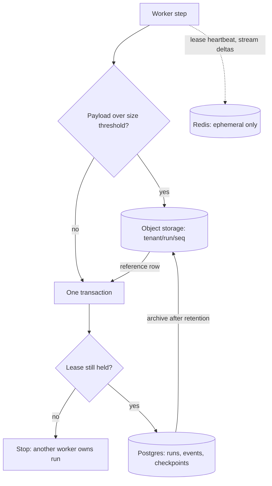

## TL;DR
The agent state store sets per-step latency, crash survival, tenant isolation and deletion. A sound
default: Postgres for run records, events and small snapshots, object storage for large tool outputs,
Redis only for leases and stream buffers, and a tenant id on every row.

## Why it exists
- **Every step pays a durable write.** Checkpointing puts one on the critical path of each step. A store
  taking a few hundred milliseconds per write (illustrative) adds tens of seconds to a hundred-step run,
  more once a step writes several times (intents, each tool result, the snapshot), and it is felt in every
  streaming response.
- **Fast but not durable loses the step you need.** A store that acknowledges writes before they are
  durable silently loses the last step on a crash, which is precisely the step a resume needs.
- **Agent state has an awkward shape.** Mostly small structured records (run status, step index,
  budgets), plus a long append-only log, plus occasional very large blobs (megabytes of HTML from a tool,
  a full report from a sub-agent). It is queried by run id (resume), conversation id (history), sometimes
  by step (time-travel and debugging), always scoped by tenant, and it must expire: operational
  checkpoints have a short useful life while audit records may be kept for years.
- **"Whatever is already there" fails: Redis.** It is fast with TTLs, so teams start there and discover
  persistence was never tuned, multi-megabyte blobs eat memory, and "the agent forgot everything after the
  cache restarted" is now a support ticket.
- **"Whatever is already there" fails: document databases.** Teams write the checkpoint and the run status
  as two independent operations because multi-document transactions are off the default path (MongoDB
  needs a replica set for them; DynamoDB's transactional writes are capped per call and cost extra
  capacity), and get half-updated runs after crashes. Choose against the access pattern and durability
  needs, not convenience.

## How it works
### The data model
Three logical tables (names illustrative) plus a blob store:

| Table | Columns | Role |
|---|---|---|
| `runs` | `runs(run_id, conversation_id, tenant_id, status, attempt, owner, lease_until, schema_version, created_at, updated_at)` | One row per execution; the thing you lease and poll |
| `events` | `events(run_id, seq, type, payload, created_at)` | Append-only model responses, tool calls and tool results; small payloads inline as JSONB, large ones replaced by a reference |
| `checkpoints` | `checkpoints(run_id, step, state, created_at)` | Small snapshot of non-transcript state (budgets, pending intents, loop-guard counters) |
| Blob store | object storage at `tenant/run_id/seq` | Large payloads, referenced from events by key and size |

- **Why snapshots stay small:** the transcript lives in `events`, so total storage grows linearly with
  steps rather than quadratically.

### Write pattern per step
- **One transaction:** insert the step's events, upsert the checkpoint row, update the run's status and
  timestamp.
- **Why transactional:** a crash between "events written" and "checkpoint written" produces a resume whose
  pending intents disagree with the log, so it re-issues calls that already have results.
- **By store type:** relational stores give this for free; with a key-value store you emulate it with a
  single document per run (and then size becomes the problem) or accept a repair step on resume.

### What "durable" actually means
"The write succeeded" can mean three things:

| Acknowledged when | Survives node crash | Survives losing the node |
|---|---|---|
| Accepted into memory | No | No |
| Reached local disk with an fsync | Yes | No |
| Reached a replica as well | Yes | Yes |

- **Postgres:** by default waits for its write-ahead log to flush before acknowledging a commit; turning
  `synchronous_commit` off trades a window of recently acknowledged commits for lower latency.
- **Redis:** the append-only file is fsynced per `appendfsync` (`always`, `everysec` or `no`); with
  `everysec` a crash can lose about the last second of writes.
- **Asynchronous replication:** a failover can promote a replica that never received the latest commits.
- **Why it matters here:** the lost write is by definition the most recent step, the one a resume needs,
  so ask which of the three your configuration gives before calling it durable.

### Leases, not locks
- **A lease is a conditional update:** set `owner` and `lease_until` only where the row is unowned or the
  lease has expired, returning the row on success.
- **It expires if the worker dies; a lock would not.** Renew on a heartbeat and stop working if renewal
  fails, because another worker may have taken over.
- **The stale-worker failure mode.** A worker pauses (a long GC, a stalled VM), its lease expires, a
  second worker takes over, and the first wakes up still believing it owns the run.
  - **Lease check inside every state write** (as the example does) stops it corrupting the store, because
    check and write share one transaction.
  - **It does not stop external calls.** Give each claim a monotonically increasing epoch (a fencing
    token), send it with side-effecting calls, and have adapters or the downstream reject an epoch lower
    than one already seen.
  - **Where the downstream cannot,** idempotency keys keep a stale worker's duplicate call harmless.

### The options
| Store | Strengths | Limits | Use for |
|---|---|---|---|
| **In-memory** (a dict, LangGraph's `InMemorySaver`, formerly `MemorySaver`) | Zero latency | Zero durability | Tests and notebooks only |
| **Redis** | Sub-millisecond writes, native TTL | Durability depends on persistence config; high memory cost per byte; usually treated as a cache, which is how it gets flushed | Leases, rate counters, resumable stream buffers; checkpoints only with deliberate persistence (append-only file, an fsync policy you understand) and small blobs |
| **Postgres or another relational store** | Durable by default, transactions, JSONB, indexes on (tenant, conversation), row-level security, mature backups, low-millisecond writes on a local network | A single primary caps write throughput | The default for most teams; LangGraph ships a Postgres checkpointer and a SQLite one for local use |
| **Document and wide-column** (DynamoDB, MongoDB, Cassandra) | Horizontal scale, per-item TTL, key-value access matches run id lookups | Cross-item transactions more limited (bounded in size, extra cost, or single-partition only in Cassandra); heavier operational knowledge | When a single relational primary becomes the bottleneck |
| **Object storage** (S3-style) | Cheap, effectively unlimited | Slower, unqueryable | Blobs and long-term archive of event logs; never alone on the hot path |
| **Workflow engines** (Temporal and similar) | Own the event history and resume logic | You adopt the engine | Application state only; the decision becomes "adopt the engine" rather than "pick a database" |

### Retention and deletion
- **Separate hot from cold.** Checkpoints and leases expire within hours or days of run completion; events
  may be kept longer for audit and evaluation, then archived to object storage and deleted on a schedule.
- **Tenant-scoped deletion must reach everything** (right to erasure, contract end): events, blobs and
  archives. That is why `tenant_id` is a column on every row and a prefix on every blob key, never
  inferred by joining through conversations.
- **Encrypt blobs at rest:** tool outputs routinely contain customer data.

### Sizing
```
daily_bytes = events_per_run × avg_payload × runs_per_day   (+ blob volume)
total       = daily_bytes × retention_days
```
- **Illustrative:** a thousand runs a day with fifty events of 4 KB each is about 200 MB a day of JSONB
  before blobs, comfortably within a single Postgres for a long time.
- **The blob side is what grows unexpectedly.**

## Diagram
Each step commits events, snapshot and run status in one transaction; large payloads go to object
storage first, and Redis only holds what can be lost.



## Examples
### One transaction per step with lease check and blob offload
- **Fencing check first:** the transaction verifies this worker still holds the lease, so a worker whose
  lease expired cannot overwrite its successor.
- **Then the writes:** events (large payloads offloaded to object storage behind a reference) and the
  small snapshot upsert.
- **`claim`** takes an expiring lease so only one worker resumes a given run. Every table carries
  `tenant_id`.

```python
import json, psycopg

DDL = """
create table if not exists runs (
  run_id text primary key, tenant_id text not null, conversation_id text not null,
  status text not null, owner text, lease_until timestamptz,
  schema_version int not null default 1, updated_at timestamptz default now());
create table if not exists events (
  run_id text references runs, tenant_id text not null, seq int, type text, payload jsonb,
  blob_key text, created_at timestamptz default now(), primary key (run_id, seq));
create table if not exists checkpoints (
  run_id text references runs, tenant_id text not null, step int, state jsonb,
  primary key (run_id, step));
"""
# conn = psycopg.connect(dsn, autocommit=True): claim() commits at once and
# conn.transaction() below is a real BEGIN/COMMIT rather than a savepoint

def claim(conn, run_id, worker, ttl_s=30) -> bool:
    row = conn.execute(
        """update runs set owner = %s, lease_until = now() + make_interval(secs => %s)
           where run_id = %s and (owner is null or lease_until < now())
           returning run_id""", (worker, ttl_s, run_id)).fetchone()
    return row is not None

def save_step(conn, run_id, tenant_id, worker, step, new_events, state, blobs, big=64_000):
    with conn.transaction():                              # all or nothing
        if conn.execute("""update runs set updated_at = now() where run_id = %s
                           and owner = %s and lease_until > now()""",
                        (run_id, worker)).rowcount == 0:
            raise RuntimeError("lease lost: stop, another worker owns this run")
        for ev in new_events:
            raw, key = json.dumps(ev["payload"]), None
            if len(raw) > big:                            # offload large outputs
                key = f"{tenant_id}/{run_id}/{ev['seq']}.json"
                blobs.put(key, raw)
                raw = json.dumps({"ref": key, "bytes": len(raw)})
            conn.execute("""insert into events (run_id, tenant_id, seq, type, payload, blob_key)
                            values (%s, %s, %s, %s, %s::jsonb, %s)""",
                         (run_id, tenant_id, ev["seq"], ev["type"], raw, key))
        conn.execute("""insert into checkpoints (run_id, tenant_id, step, state)
                        values (%s, %s, %s, %s::jsonb) on conflict (run_id, step)
                        do update set state = excluded.state""",
                     (run_id, tenant_id, step, json.dumps(state)))
```

### Worked step: what the transaction protects
Worker `w2` claims run `r7` with a 30-second lease and renews it every 10 seconds.

| Event | Size | Where it goes |
|---|---|---|
| Model response | 2 KB | inline in `events` |
| Tool call | 1 KB | inline in `events` |
| Tool result (HTML) | 900 KB | blob `acme/r7/37.json`, reference row in `events` |
| Checkpoint 12 | small | upserted, then commit |

- **Crash before the commit** leaves neither the events nor the checkpoint, so the resume sees a
  consistent step 11.
- **Stale worker:** had `w2` stalled for 40 seconds while `w3` claimed the run, `w2`'s next `save_step`
  would find `owner = w3`, update zero rows and stop.
- **The visible gap:** the blob is written before the transaction commits, so a rollback can leave an
  orphan object. That is harmless, because nothing references it, and a sweep or a bucket lifecycle rule
  cleans it up, which is cheaper than making object storage transactional.

### Worked sizing: where the growth comes from
Illustrative numbers for one year at a thousand runs a day:

| Component | Per day | 365 days |
|---|---|---|
| Events: 1,000 runs × 50 events × 4 KB | 200 MB | ~73 GB |
| Checkpoints: kept 7 days after completion | small, bounded by TTL | stays flat |
| Blobs: if each run offloads two 500 KB tool results | ~1 GB | ~365 GB |

- **Reading it:** the relational side stays comfortable for a single Postgres; the blob side is five times
  larger and belongs in object storage with a lifecycle rule.

## Production patterns
- **Postgres as the durable default, partitioned by time.** Keep `events` in a range-partitioned table
  (declarative partitioning by `created_at`), archive old partitions to object storage, then drop them,
  which is far cheaper than bulk `DELETE`. Monitor checkpoint write p95 latency and table and index
  size per day.
- **Claim runs with `FOR UPDATE SKIP LOCKED`.** When workers pick up runnable or expired-lease runs from
  a queue table, select candidates with `SELECT ... FOR UPDATE SKIP LOCKED` inside the claim transaction
  so concurrent workers never block on the same row. Monitor claim latency and lease steals.
- **Row-level security for tenant isolation.** Enable RLS on every state table with a policy such as
  `using (tenant_id = current_setting('app.tenant_id'))`, and set that setting per connection or
  transaction from the authenticated request. Monitor policy-violation errors in tests and audits.
- **Redis configured for what it holds.** If Redis holds leases or stream buffers, set `appendonly yes`
  with an `appendfsync` policy you have chosen, and a `maxmemory-policy` that will not silently evict
  state keys (for example `noeviction`, so writes fail loudly). Monitor memory use, evictions and
  persistence errors.
- **Object storage lifecycle rules.** Prefix every blob key with tenant and run, and use bucket lifecycle
  rules to expire orphans and transition archives to colder storage classes; run tenant deletion by
  prefix. Monitor blob volume per tenant and deletion completeness.

## Trade-offs
- **Postgres simplicity vs write ceiling.** It gives transactions and durability with simple operations,
  but a single primary caps write throughput; shard by tenant or move the event log to a wide-column
  store once writes per second become the bottleneck.
- **Redis speed vs durability.** It makes each step's write nearly free and handles leases and stream
  buffers well, but durability depends on persistence configuration and memory cost limits payload size;
  use it beside a durable store, not instead of one.
- **Blob offload vs extra I/O.** Offloading large payloads keeps the database small and fast, but adds a
  second write and a fetch on resume; set the threshold from your payload distribution rather than
  offloading everything.
- **Relaxed durability vs safety.** Asynchronous commit or `everysec` fsync cuts per-step write latency,
  acceptable when losing the last step only costs a repeated model call; it flips the moment that step's
  record stands between a crash and a duplicated side effect.
- **Short TTLs vs debuggability.** They control growth and limit exposure of sensitive tool outputs, but
  shorten the window for resume and debugging; keep events longer than checkpoints and archive rather
  than delete when audit demands it.

## Pitfalls
- **Treating Redis as durable without checking persistence.** The symptom is every in-flight run vanishing
  after a cache node restart. Fix: a durable store for checkpoints.
- **Events and checkpoint in separate statements without a transaction.** The symptom is resumed runs
  re-issuing tool calls that already have results in the log. Fix: one transaction per step.
- **The full transcript in every snapshot.** The symptom is checkpoint storage and write latency growing
  with the square of run length. Fix: events table plus small snapshots.
- **Omitting tenant_id from events and blobs.** The symptom is a deletion request that needs multi-table
  joins and still misses archived objects. Fix: a column on every row, a prefix on every key.
- **Locks instead of leases.** The symptom is a run stuck forever as "owned" by a dead worker, resumable
  only by manual intervention. Fix: expiring leases with heartbeats.
- **Calling a store durable because writes succeed.** Without checking fsync and replication settings,
  the symptom is a resume after a node failure or failover that restarts a step the run had already
  completed and acknowledged. Fix: verify which of the three acknowledgement levels you have.

## When to use
- **Decide when you first persist a run,** because migrating state stores later is painful.
- **Default:** a relational store with object storage for blobs, unless you already run a workflow engine
  or your write volume clearly exceeds a single primary.
- **Add Redis** for leases, counters and resumable stream buffers.
- **Measure:** checkpoint write p95 latency (it is inside every step), store growth per day, resume
  success rate and deletion completeness.
- **Day to day:** this shows up when a run cannot resume, a storage bill arrives, or a customer asks how
  their data is deleted.
- **Interviews:** expect "where do you keep agent state and why"; answer with the access pattern,
  durability and tenant requirements, not a product name.

## Role lens
- **Engineer:** Implements the schema, the per-step transaction, blob offloading and lease renewal,
  and load-tests write latency at the expected concurrency.
- **Architect:** Owns the store selection, retention and encryption policy, the tenant isolation
  model, and the migration plan for when the first choice is outgrown.
- **FDE:** Fits the design to the customer's approved databases and data-residency rules, and proves
  to their security team how tenant data is scoped and deleted.

## Check yourself
**Q:** A team checkpoints to Redis with a 24-hour TTL and stores full tool outputs inline. Runs now
last hours and tool outputs reach megabytes. What breaks first, and how would you restructure?
**A:** Memory breaks first: inline multi-megabyte outputs across thousands of runs exhaust the Redis
instance, and eviction or a restart without tuned persistence loses in-flight runs entirely, which
also means hours-long runs cannot be resumed. Restructure into a durable relational store for run
records, an append-only events table and small per-step snapshots, with any payload above a size
threshold offloaded to object storage behind a reference whose key carries tenant and run. Keep Redis
for leases, rate counters and resumable stream buffers, where its speed matters and loss is
tolerable. Set retention separately: checkpoints expire soon after completion, events are archived per
audit policy, and tenant-scoped deletion covers the blobs too.

## Interview questions
### Where would you keep agent run state, and why there?
- **Postgres for runs, events and small snapshots,** because each step needs a durable, transactional
  write that is also queryable by run, conversation and tenant.
- **Object storage for large tool outputs,** referenced from events, so the database stays small.
- **Redis only for leases, counters and stream buffers,** where speed matters and loss is tolerable.

### A worker paused for 40 seconds, its lease expired, and it then overwrote its successor's checkpoint. How do you prevent that?
- **Check the lease inside the same transaction as every state write,** so a stale owner updates zero rows
  and stops.
- **Fence external calls too:** give each claim a rising epoch, send it with side effects, and have
  adapters reject lower epochs; fall back on idempotency keys where the downstream cannot check.

### When is relaxing durability (async commit, `everysec`) acceptable for a checkpoint store?
- **Acceptable** when losing the last step only means repeating a model call, which costs tokens but has
  no side effects.
- **Not acceptable** when that step's record is what prevents a duplicated side effect after a crash,
  such as recorded intents before a payment call.

### How do you size a state store for a new agent product?
- **Formula:** events per run × average payload × runs per day × retention days, plus blob volume.
- **Example:** 1,000 runs a day × 50 events × 4 KB is about 200 MB a day of JSONB; blobs usually dominate,
  so set an offload threshold and lifecycle rules early.

### A customer asks you to prove their data is deleted at contract end. What must the design already have?
- **`tenant_id` on every row and as a prefix on every blob key,** so deletion works by tenant without
  joins or object scans.
- **Coverage of archives and summaries,** with lifecycle rules or per-tenant encryption keys for backups
  that cannot be rewritten, and a completeness check you can show.

## Quiz
### Q: Why should the per-step events and checkpoint be written in one transaction?
- [ ] It reduces the number of network round trips
- [x] A crash between the two writes would otherwise leave a resume that re-issues tool calls already recorded in the log
- [ ] Transactions are required for JSONB columns
- [ ] It lets the checkpoint be larger
> The checkpoint's pending intents and the event log must agree; if one is written and the other is
> not, the resume either repeats a side effect or loses one. Atomicity removes that window.

### Q: What is the main reason to prefer a lease over a lock when a worker claims a run to resume?
- [ ] Leases are faster to acquire in Postgres
- [x] A lease expires automatically if the worker dies, so another worker can claim the run without manual cleanup
- [ ] Locks are not supported on JSONB tables
- [ ] Leases allow two workers to share a run
> Workers die without releasing locks; an expiring lease, renewed by heartbeat, bounds how long a dead
> worker's run stays unclaimed, while still guaranteeing a single active owner during the lease.

### Q: Why should tenant_id be a column on every row and a prefix on every blob key?
- [ ] It makes JSON payloads smaller
- [ ] Postgres requires it for foreign keys
- [x] Tenant-scoped queries, isolation policies and deletion must work without joining through other tables or scanning every object
- [ ] It allows TTLs to be set per tenant only
> Deletion requests and isolation rules apply per tenant across events, snapshots and archives;
> inferring tenancy through joins is slow and error-prone, and object stores cannot join at all.
