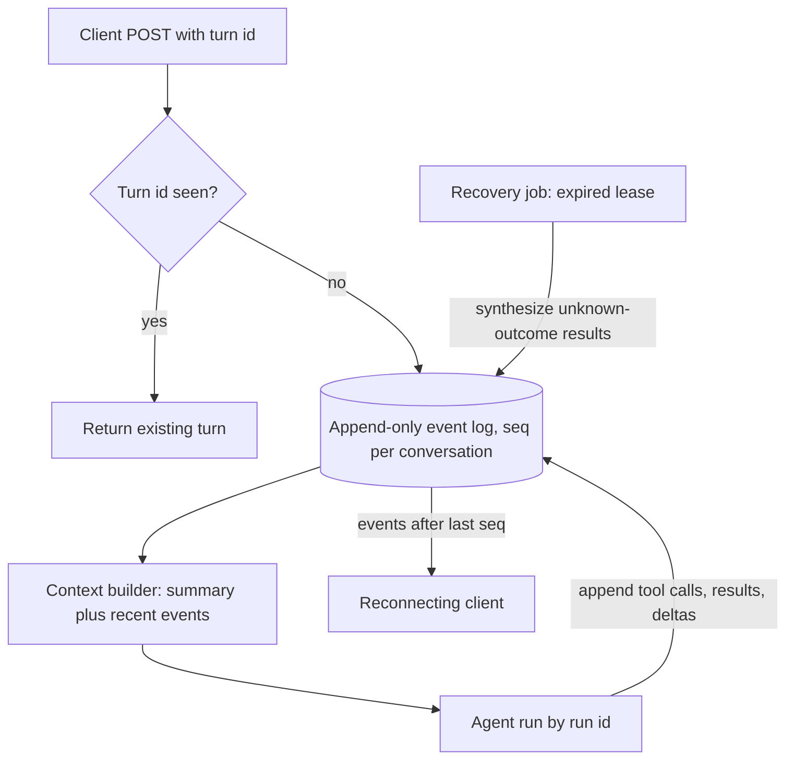

## TL;DR
Persist conversation state and execution state separately. Keep the transcript as an append-only,
sequence-numbered event log and derive the model's context from it, so clients catch up by sequence
number and interrupted turns are repaired, never dangling or duplicated.

## For agent builders
- **Why it matters for agents.** A tool-using assistant leaves tool calls, streamed deltas and approvals
  mid-flight whenever a client drops or a worker dies. An unrepaired tool call with no result makes the
  next model request fail, so the conversation is stuck until you fix the log.
- **Where it shows up in your stack.** Your conversation events table, the SSE stream (event `id:` as the
  `seq`, `Last-Event-ID` on reconnect), the context builder that formats provider messages, and a startup
  scan for turns whose run lease expired.
- **What you control.** The split between conversation and execution state, the event schema, the turn
  state machine, client-minted turn ids, how interrupted calls are repaired, how compaction writes summary
  events, and how edits become branches.
- **What you can skip.** Using a provider's hosted thread as your record of truth. Derive provider messages
  from your own log so you can swap models and re-derive any past context.

## Why it exists
- **Three timescales get confused.** A multi-turn assistant lives for days or months; the HTTP request
  carrying one turn lives for seconds; the agent run inside it, for minutes.
- **The user comes back tomorrow.** If the transcript lived in a process variable or a client-side
  array, it is gone or inconsistent across devices.
- **The client disconnects mid-stream** (mobile network, closed tab, load-balancer timeout). If the run is
  tied to the request it is cancelled or orphaned; if it continues, the client has no way to pick up the
  rest.
- **The server dies mid-turn.** The transcript holds an unfinished assistant message or a tool call with no
  result; the next model call rejects the malformed history or, worse, the user stares at a turn that
  never completes.
- **The naive design only works in demos.** Keeping the message array in memory and re-sending it from the
  client loses history on restart, cannot resume streams, lets a retried POST append the user's message
  twice, and makes the model's context the storage format, so any compaction (summarizing old turns to fit
  the window) permanently destroys the original record. Hence a canonical record, derived views and a
  turn state machine.

## How it works
### Two kinds of state
| | **Conversation state** | **Execution state** |
|---|---|---|
| What | Ordered user messages, assistant messages, tool calls and tool results, plus metadata (title, participants, settings) | The in-flight run producing one assistant turn: step index, budgets, pending tool calls, loop-guard counters, scratch data |
| Lifetime | The conversation | The turn |
| Owner | Conversation store keyed by conversation id | Checkpoint store keyed by run id |

- **Hand-off:** when the turn completes, its outputs are appended to the conversation and the execution
  state can be archived.

### Append-only event log
- **Schema:** events `(conversation_id, seq, type, payload, created_at)` with `seq` increasing
  monotonically per conversation.
- **Why append-only:** cheap to write, makes "what happened" auditable, gives clients a cursor to resume
  from, and never loses information to compaction.
- **The context is *built*, not stored:** select events, apply summaries, format as messages for the
  provider. Because the view is derived, you can change the compaction strategy, swap models, or debug by
  re-deriving any past context exactly.

### Turn state machine
`accepted → running → awaiting_tool | awaiting_approval → running → completed | failed | interrupted | cancelled`

- **Persist the current state and the run id on the turn record,** so a reconnecting client can decide
  what to render:

| Turn state | Client renders |
|---|---|
| running | A spinner |
| awaiting approval | A prompt |
| completed | The result |
| failed or interrupted | A retry affordance |

### Reconnect and catch-up
1. **The client remembers the last `seq` it rendered.**
2. **On reconnect it requests events after that sequence number;** the server returns everything appended
   since, then continues streaming live events over SSE or a websocket.
3. **Buffer in-progress deltas.** Tokens are streamed, so keep the in-progress assistant message as deltas
   in a resumable stream keyed by run id; a reconnect mid-message replays the deltas, not just completed
   events.
- **Idempotent submission.** The client generates a turn id before sending, and the server ignores a
  duplicate POST with the same id, so a retry after a timeout does not create two turns.

### Repairing interrupted turns
On server restart, scan turns in `running` or `awaiting_tool` whose run lease has expired, then either:
- **Resume** from the run's checkpoint, if durable execution is in place; or
- **Mark the turn `interrupted`,** append an event saying so, and make the log well-formed:
  - every tool call event gets a matching result event; synthesize `{"error": "interrupted: outcome unknown"}`
    when the real one is missing;
  - say "unknown", not "failed", because a side-effecting call may have completed downstream;
  - no assistant message is left half-written without an end marker.
- **Why it is mandatory:** model APIs reject a history in which a tool call has no result, so an
  unrepaired log makes the conversation permanently unusable.

### Compaction and the window
- **Summarize, do not delete.** When the derived context exceeds the window, summarize older events into a
  summary event, store it, and build later contexts from summary plus recent events. The original events
  stay.
- **Record which summary version each turn used** so behaviour can be reproduced later.

### Edits, regenerations and branches
- **Overwriting in place breaks things.** It breaks the append-only property and every client cursor that
  pointed past the edit.
- **Model it as a branch instead:**
  - each turn event records its parent turn;
  - an edit creates a new user turn whose parent is the turn before the edited one;
  - a regenerate creates a new run (a new attempt) under the same turn.
- **Active leaf.** The conversation's "current path" points to the active leaf; the context is derived by
  walking parents from it. Abandoned branches stay in the log for audit and for "previous response 1/2"
  navigation without leaking into the context.

### What goes in the log
- **Keep events small enough to scan.** A tool returning a 3 MB web page writes the payload to object
  storage; the event holds a reference plus size and hash, and the context builder fetches or truncates
  it when building the view.
- **Log the rendered inputs that mattered** (which summary, which retrieved documents by id), because
  "why did the assistant say that" is answered by the exact context, and the log is the only place it can
  be re-derived from.

### Deletion against an append-only log
Append-only and "delete my data" pull in opposite directions. Two workable answers:
- **Delete or tombstone** the conversation's events and blobs outright; simple when deletion is per
  conversation or per user.
- **Crypto-shredding:** encrypt each conversation's payloads under its own key and destroy the key, which
  also reaches backups and archives that cannot be rewritten.
- **Summaries are derived data** and must be deleted with their sources, or the "deleted" content
  survives in the summary.

### Concurrency across devices
- **One active turn per conversation.** Reject or queue a new submission while one is running, using a
  conversation-level lock or an optimistic version check.
- **Why:** otherwise two runs interleave events and the model sees a history that contradicts itself.

## Diagram
The log is the source of truth; clients read from it by sequence number and the model reads a view
derived from it.



## Examples
### Event-log store with catch-up, dedup, repair and a derived view
The store appends sequence-numbered events, serves catch-up by sequence number, dedupes submissions on
the client-generated turn id, repairs dangling tool calls after a crash, and derives the model context
from the log plus the latest summary.

```python
import json

class ConversationStore:
    def __init__(self):
        self.events, self.turns = {}, {}

    def append(self, cid, type_, payload):
        log = self.events.setdefault(cid, [])
        ev = {"seq": len(log) + 1, "type": type_, "payload": payload}
        log.append(ev)
        return ev

    def since(self, cid, after_seq):                     # reconnect catch-up
        return [e for e in self.events.get(cid, []) if e["seq"] > after_seq]

    def submit(self, cid, turn_id, text):                # idempotent on turn_id
        if turn_id in self.turns:
            return self.turns[turn_id]
        self.append(cid, "user", {"text": text, "turn_id": turn_id})
        self.turns[turn_id] = {"state": "accepted", "run_id": None}
        return self.turns[turn_id]

    def repair(self, cid):                               # after a crash
        log = self.events.get(cid, [])
        calls = {e["payload"]["id"] for e in log if e["type"] == "tool_call"}
        results = {e["payload"]["id"] for e in log if e["type"] == "tool_result"}
        for call_id in calls - results:
            self.append(cid, "tool_result", {"id": call_id,
                        "error": "interrupted: outcome unknown, check before retrying"})
        return len(calls - results)

def build_context(store, cid, recent=40):
    """Derive the model view: latest summary (if any) plus the events after it."""
    log = store.events.get(cid, [])
    summary = next((e for e in reversed(log) if e["type"] == "summary"), None)
    tail = [e for e in log if summary is None or e["seq"] > summary["seq"]][-recent:]
    # a real view also moves the cut so it never separates a tool call from its result
    msgs = [{"role": "system", "content": summary["payload"]["text"]}] if summary else []
    # mapping event types to the provider's message format is omitted for brevity
    return msgs + [{"role": e["type"], "content": json.dumps(e["payload"])} for e in tail]
```

### Worked trace: one crash in a refund conversation
| seq | Event in conversation `c1` |
|---|---|
| 1 | user: "refund order 1182" |
| 2 | assistant tool call `t_a` (`lookup_order`) |
| 3 | its result |
| 4 | tool call `t_b` (`issue_refund`) |
| | worker dies before seq 5 is written; the client's last rendered seq was 3 |
| 5 | written by `repair`: an `interrupted` result for `t_b` |

1. **Recovery:** the job finds the turn `running` with an expired lease and no checkpoint to resume from,
   so `repair` appends seq 5 and the turn is marked `interrupted`.
2. **Reconnect:** the client sends `after_seq=3`, receives seq 4 and 5, and renders "the refund step was
   interrupted; retry?".
3. **Next model call:** sees a well-formed history; every tool call has a result.
- **What repair cannot know:** whether `issue_refund` reached the payment system. The synthesized result
  must say "outcome unknown", and a retry must reuse the original idempotency key or check the refund's
  status first; that is where the durable-execution and idempotent-tool lessons take over.

### Runnable: replay the trace against the store
Paste below the `ConversationStore` class above; it reproduces the table, including a retried POST that
does not create a second user event.

```python
s = ConversationStore()
s.submit("c1", "turn-1", "refund order 1182")
s.submit("c1", "turn-1", "refund order 1182")            # retried POST: no second event
s.append("c1", "tool_call", {"id": "t_a", "name": "lookup_order"})
s.append("c1", "tool_result", {"id": "t_a", "status": "delivered"})
s.append("c1", "tool_call", {"id": "t_b", "name": "issue_refund"})
# worker dies here; recovery job runs:
print("repaired:", s.repair("c1"))                       # 1
for e in s.since("c1", after_seq=3):                     # client reconnects
    print(e["seq"], e["type"], e["payload"])
# 4 tool_call {'id': 't_b', 'name': 'issue_refund'}
# 5 tool_result {'id': 't_b', 'error': 'interrupted: outcome unknown, check before retrying'}
```

## Production patterns
- **SSE event ids as the catch-up cursor.** Send each event with an SSE `id:` field equal to its `seq`;
  the browser's `EventSource` sends it back as the `Last-Event-ID` header on reconnect, so the server
  replays from there. Monitor reconnect counts and the gap between last-sent and last-acknowledged seq.
- **Database-enforced idempotent submit.** Put a unique constraint on the turn id and insert with
  `INSERT ... ON CONFLICT (turn_id) DO NOTHING` in Postgres, plus a unique `(conversation_id, seq)`
  constraint so two writers cannot claim one slot. Monitor conflict hits, which equal client retries.
- **Resumable token streams in a log structure.** Buffer deltas per run id in an append-only stream such
  as a Redis Stream (`XADD` on write, `XREAD` from the last id on reconnect) with a TTL after the turn
  completes. Monitor stream length and memory, and the share of reconnects served from the buffer.
- **Scheduled repair job.** Every minute or so, find turns in `running` or `awaiting_tool` with expired
  leases, resume or mark them `interrupted`, and synthesize unknown-outcome results. Alert on any
  malformed-history error from the model API; the target is zero.
- **Per-conversation data keys for deletion.** Envelope-encrypt payloads with a per-conversation key held
  in a KMS and delete the key on erasure requests, deleting derived summaries alongside. Monitor erasure
  completion time against the policy deadline.

## Trade-offs
- **Event log vs storage cost.** An append-only log with derived views preserves every detail and enables
  resumable streams, but costs more storage and a derivation step per model call than storing the
  model-ready array directly.
- **Continue after disconnect vs wasted tokens.** Continuing delivers results users would otherwise lose
  but spends tokens on turns nobody may read; cancel on disconnect for cheap chat, continue for expensive
  agent tasks.
- **Mark interrupted vs resume.** A failed mark with a retry button is simple and honest; resuming from
  checkpoints is seamless but needs the full durable-execution machinery. Choose by run cost and side
  effects.
- **One active turn vs eager users.** Locking prevents interleaving but blocks users who send a follow-up
  mid-run; queueing the follow-up as the next turn keeps both properties.
- **Branching vs simplicity.** Branching on edit keeps the log immutable and auditable, but every context
  build walks a parent chain and every UI must understand "active leaf"; without edit or regenerate, a
  linear log is simpler and the trade flips.

## Pitfalls
- **Model context as the storage format.** Symptom: users ask "what did I say earlier" and the assistant
  has no record, because compaction erased history. Fix: log is truth, context is a view.
- **Retried POSTs without a client-generated turn id.** Symptom: duplicate user messages and two
  concurrent runs in one conversation after a timeout. Diagnose: find identical user events seconds
  apart with different turn ids. Fix: dedupe on turn id.
- **A tool call left without a result after a crash.** Symptom: every later request on that conversation
  fails with an API error about unmatched tool calls. Diagnose: diff tool_call ids against tool_result
  ids per conversation. Fix: the repair job.
- **Replaying only completed events on reconnect.** Symptom: the client shows a message starting
  mid-sentence. Diagnose: compare the first replayed delta with the run's first delta. Fix: replay
  buffered deltas.
- **Turn state only in memory.** Symptom: spinners that never stop after a deploy, for turns no worker is
  running. Diagnose: list `running` turns whose lease expired. Fix: persist state and run id on the turn
  record.
- **A plain "error" result for an interrupted side-effecting call.** Symptom: the model confidently
  re-issues the refund or email next turn, because history said the first attempt failed, not that its
  outcome is unknown. Fix: say "outcome unknown".
- **Editing messages in place.** Symptom: reconnecting clients render a mix of old and new content, and
  audits cannot show what the assistant saw. Fix: branches.

## When to use
- **Conversation store:** any assistant used more than once by the same person.
- **Turn state machine and catch-up endpoint:** anything that streams or runs longer than a few seconds
  per turn.
- **Repair step:** anything with tools.
- **Decide early** whether a turn survives client disconnect, because it shapes the whole API.
- **Measure:** reconnect success rate, share of turns ending interrupted, malformed-history errors from
  the model API (which should be zero), and duplicate-turn rate.

## Exercise
**Goal:** put a streaming chat agent of yours on an event log and prove it survives the three failures
above. No solution is given.
- **Inputs:** an agent endpoint that streams over SSE and calls at least one tool; SQLite or Postgres.
- **Constraints:** unique turn id and unique `(conversation_id, seq)`, deltas buffered per run id, a repair
  job on expired leases, edits stored as branches.
- **Deliver:** fault scripts that drop the client mid-message, retry a POST after a timeout, kill the
  worker between a tool call and its result, and edit an earlier message.
- **Acceptance:** the reconnecting client renders the full answer from its last seq with no gap; one user
  event per turn id; the next model call after the crash succeeds; the derived context never includes
  the abandoned branch.

## Role lens
- **Engineer:** Builds the event log, the catch-up-by-sequence endpoint, resumable token streams and
  the crash-repair job that closes dangling tool calls.
- **Architect:** Defines the conversation and turn schemas, the lifetime boundary between
  conversation and execution state, and the disconnect policy for each product surface.
- **FDE:** Maps the customer's existing session and audit requirements onto the event log, and
  diagnoses "my chat lost its history after your deploy" tickets from the sequence numbers.

## Check yourself
**Q:** A user on a flaky mobile connection sends a message, the agent runs for ninety seconds with
three tool calls, and the connection drops at second forty. Describe what happens and how the user
still gets the answer.
**A:** The POST carried a client-generated turn id, so the server accepted it once and started a run
with its own run id; the turn record is persisted as running. Because the run is decoupled from the
request, the disconnect does not cancel it; the harness keeps appending tool call, tool result and
assistant delta events to the conversation log with increasing sequence numbers. When the client
reconnects it sends the last sequence it rendered; the server returns the missed events, replays the
buffered deltas of the in-progress message, and continues streaming live. If the client never
returns, the completed answer waits in the log. Had the server died instead, the repair job would
close any dangling tool call and mark the turn interrupted with a retry affordance.

## Interview questions
### Why keep conversation state and execution state in different stores?
- **Different lifetimes:** a conversation lasts days or months, a run lasts one turn; mixing them bloats
  the transcript with scratch data or loses run state when the conversation is compacted.
- **Different owners and keys:** the conversation store is keyed by conversation id, the checkpoint store
  by run id, and only a completed turn's outputs cross from one to the other.

### After a deploy, every request in some conversations fails with an unmatched tool call error. What happened and how do you fix it?
- **Workers died between a tool call event and its result,** leaving dangling calls that model APIs reject.
- **Fix:** a repair job that finds turns with expired leases, resumes them or appends synthesized
  results marked "outcome unknown", and marks the turn `interrupted`; then alert on malformed-history
  errors, which should be zero.

### Should a run continue when the client disconnects?
- **Cancel for cheap chat,** because tokens spent on unread turns are waste.
- **Continue for expensive agent tasks,** because users would lose real work; this needs the event log,
  resumable deltas and catch-up by sequence number so the answer is there when they return.

### How do you honour a deletion request when the transcript is append-only?
- **Tombstone or delete** the conversation's events and blobs when deletion is per conversation or user.
- **Crypto-shred** with a per-conversation key to reach backups that cannot be rewritten.
- **Delete derived summaries too,** or the content survives inside them.

## Quiz
### Q: Why should the model's context be derived from the stored transcript rather than being the stored transcript?
- [ ] Model contexts cannot be serialized to JSON
- [x] Compaction and formatting are lossy and provider-specific, so storing the raw event log keeps the full record and lets the view change independently
- [ ] Storing the context would violate provider terms of service
- [ ] Derived views are always faster to query
> The context is a lossy projection: summaries drop detail and formats differ by provider. Keeping the
> append-only log as the source of truth preserves history and the ability to re-derive any past context.

### Q: A worker crashes after the model emitted a tool call and before the tool result was stored. What must happen before the conversation can continue?
- [ ] Delete the whole conversation and ask the user to start over
- [ ] Re-send the same messages and hope the model ignores the gap
- [x] Append a synthesized tool result (for example an interrupted error) or resume and complete the call, so every tool call has a matching result
- [ ] Switch to a model that accepts incomplete histories
> Model APIs require each tool call to be paired with a result; an unmatched call makes the history
> invalid. Repairing or completing the pair restores a well-formed transcript without losing earlier turns.

### Q: What makes a message submission safe to retry after a network timeout?
- [ ] The server deduplicates by comparing message text
- [x] The client attaches a generated turn id and the server treats a repeated id as the same submission
- [ ] The server rejects any message within five seconds of the previous one
- [ ] The client waits for the run to finish before retrying
> A client-generated id lets the server recognise the retry as the same turn regardless of timing or
> text, which is the standard idempotency approach. Text comparison fails for legitimately repeated messages.

## Mastery test
**Problem:** a team keeps each conversation as the provider-formatted message array in one JSON column,
rewritten after every turn and compacted in place when it nears the window. They now need multi-device
sync, an audit of what the model saw, and erasure on request. What breaks, and what do you migrate to?

**A strong answer:**
- names the breaks: compaction destroyed the record, a whole-array rewrite gives no cursor and lets two
  devices overwrite each other, and there is no record of the exact context;
- migrates to a sequence-numbered event log with summary events and derived views, logging which summary
  and documents each turn used;
- adds one active turn and catch-up by seq;
- handles erasure with deletion or per-conversation keys, including summaries.

## Use cases & projects
### Use cases
- **Support and refund assistants.** A user closes the tab mid-refund and returns on another device; the
  client catches up from its last `seq` and sees the turn's real state.
- **Coding assistants with long turns.** Streamed deltas buffered by run id let a reconnect mid-message
  replay the output instead of starting the turn again.
- **Assistants after a deploy.** A startup scan marks expired turns `interrupted` and synthesizes
  "outcome unknown" tool results, so every conversation stays usable.
- **Assistants with edit and regenerate.** Edits become branches with an active leaf, so the model never
  sees abandoned replies and audit keeps them all.

### Mini project
**Build a recoverable chat-agent transcript (2-3 hours).**
- **Goal:** store an assistant's transcript as a sequence-numbered event log that survives disconnects,
  duplicate POSTs and a mid-turn crash.
- **Steps:** create an events table `(conversation_id, seq, type, payload, created_at)` in SQLite; accept
  turns with a client-minted turn id and ignore repeats; derive provider messages from the log; simulate a
  crash after a tool call event; on restart, append a synthesized "interrupted: outcome unknown" result and
  mark the turn `interrupted`.
- **Done when:** a catch-up request after any `seq` returns the missing events, a retried POST adds no
  second turn, and the repaired history passes a check that every tool call has a result.
