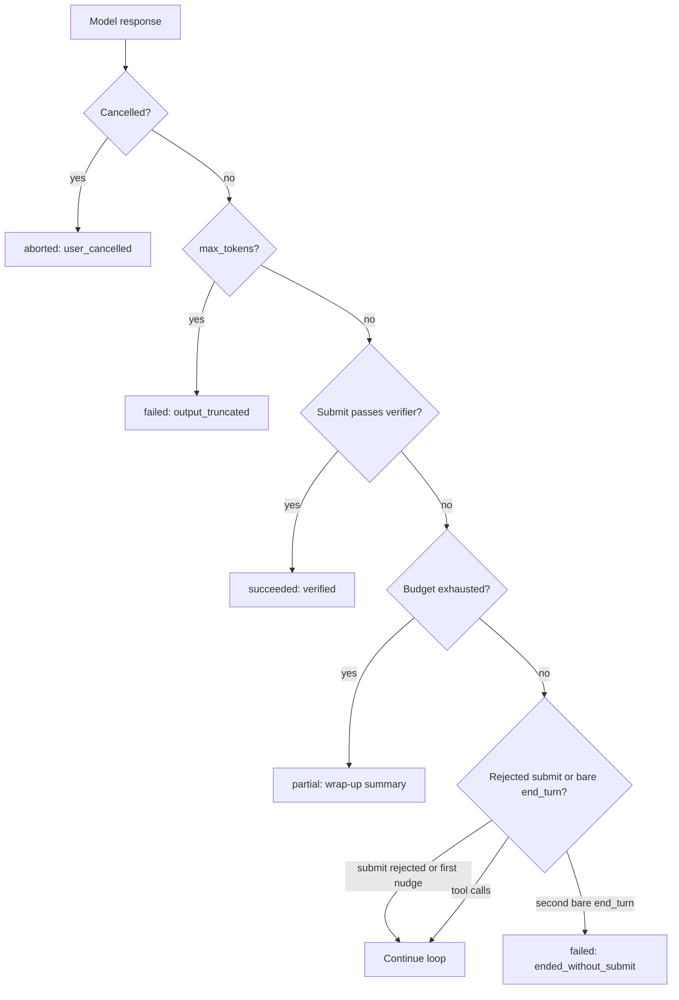

## TL;DR
An agent loop never ends on its own, so termination is designed: a function over run state returns
continue, done or abort by combining the model's structured done signal, independent verifiers and hard
limits, and every exit records a labelled reason.

## For agent builders
- **Why it matters for agents.** Every tool-calling loop you write needs an exit you designed. Without
  one, truncated answers, narrated plans and endless re-checking all come back as "returned text", and
  your app shows them as finished work.
- **Where it shows up in your stack.** The provider stop field (`stop_reason` for Claude,
  `finish_reason` for OpenAI Chat Completions), framework turn caps such as `max_turns` in the OpenAI
  Agents SDK or `recursion_limit` in LangGraph, and the run status your UI, retries and evals read.
- **What you control.** The terminal tool and its schema, the verifier a submit must pass, the order of
  checks in `decide()`, the single nudge, the reserved wrap-up call, and the outcome taxonomy every run
  emits.
- **What you can skip.** Clever prompt wording that asks the model to "know when it is done". A
  structured submit plus an external check beats any instruction to self-assess.

## Why it exists
- **The loop has no natural exit.** An agent loop is `while True: call model; run tools`. Prompt the
  model; if it emits tool calls, run them, append results and call again; if it emits none, return the
  text. The only exit is "the model did not ask for a tool", so termination becomes a *model decision*.
- **Models misjudge completion in both directions.** *Too early:* it narrates "I will now run the tests"
  without emitting a call, so the user gets a plan instead of a result, or it declares done after a tool
  error it did not read. *Too late:* tests already pass but it keeps "double-checking", each pass costlier
  because context grew. *Never:* it alternates two failing approaches or polls a status endpoint forever.
- **"Trust the model" fails** for exactly the reasons above, and each failure looks like success unless
  the outcome is labelled.
- **"Cap at N steps" alone hides the truth.** It turns a never-ending run into a truncated one but tells
  nobody whether the result is complete, so downstream code treats a budget-exhausted draft as finished.
- **"Stop when the output contains DONE" is brittle.** It is a string match on free text, which the model
  emits inconsistently and which cannot carry a result payload. So termination needs three ingredients:
  a structured model signal, independent checks, and hard limits as a backstop, and every exit records
  *why* it exited.

## How it works
### Sources of stop signals
1. **API stop reason.** Branch on it, not on "was there a tool call", because truncation is not
   completion. Treating truncation as done is one of the most common silent bugs in agent code.

   | Meaning | Claude `stop_reason` | OpenAI Chat Completions `finish_reason` |
   |---|---|---|
   | Wants tools run | `tool_use` | `tool_calls` |
   | Finished its turn | `end_turn` | `stop` |
   | Cut off at output limit (truncation) | `max_tokens` | `length` |
   | Hit a stop sequence | `stop_sequence` | (folded into `stop`) |
   | Filtered or refused | `refusal` (newer versions) | `content_filter` |
   | Long server-side tool turn paused; send it back to continue | `pause_turn` (newer versions) | n/a |

   - The set is vendor- and version-specific, so an unknown value should **fail closed**.
2. **Terminal tool.** Give the model `submit_result(answer, confidence, open_issues)` and define "done" as
   "the model called it".
   - It is a tool call with a schema, so it is structured, validated, logged, and cannot be emitted by
     accident mid-prose.
   - No tool call at all then means "stopped without submitting": a soft failure you nudge once ("call
     submit_result or continue working").
3. **Programmatic verifiers.** Anything checkable outside the model: the test suite passes, the output
   parses against a schema, the ticket exists in the tracker, a rubric-based grader approves. Verifiers
   decide *correctness*; the model only decides *when to claim*.
4. **Budgets.** Steps, tokens, wall-clock, money. They should fire rarely and always mean "stopped, not
   finished".
5. **Progress checks.** Loop detection and no-new-information counters.
6. **External signals.** User cancel, client disconnect, a human denying an approval, a policy guard
   tripping, graceful shutdown of the worker.

### The decision function
After every step, evaluate signals in a fixed order, cheap and safe checks first:
1. **External aborts.**
2. **Hard budgets.** A breach wins even if the model simultaneously claims success; record the claim, but
   the status is "exhausted".
3. **Progress checks.**
4. **The verifier.**
5. **The model's signal.**

- **Refinement: verify a submit that crosses the budget.** If the response that crosses the budget also
  carries a submit, run the verifier before declaring exhaustion. A *verified* result on the last step is
  a success; an unverified claim is still `partial`. The verifier may jump the queue because it is the one
  check that does not depend on the model's judgement.
- **Return values.** The function returns `continue`, `done(result)` or `abort(reason)`.
- **Final record.** It carries `status ∈ {succeeded, partial, aborted, failed}` plus a reason code.

### Why "done" must be a labelled outcome
- **Consumers need the distinction.** The UI, downstream workflows and evaluation pipelines must tell
  "verified success" from "model says success" from "budget ran out with a draft".
- **Collapsing them corrupts metrics.** One return value means your task-completion metric counts
  truncations as completions. Make status a first-class field and let the caller decide what to show.

### Ending cleanly
Deciding to stop is half the job; stopping without debris is the other half. An abort can arrive while
tool calls are in flight, so there are two modes:

| Mode | What happens | Use for | Because |
|---|---|---|---|
| **Graceful** | Stop new model calls; let in-flight tool calls finish or hit their per-call timeout; record results; write the outcome | Budgets, verifier decisions | In-flight work is legitimate and its results belong in the record |
| **Hard** | Cancel in-flight calls (cooperative cancellation tokens, killing subprocesses) | User cancel, policy guard, denied approval | Continuing is unsafe or unwanted |

- **Always release resources.** Free leases, sandboxes, temp branches and locks in a `finally`-style
  cleanup.
- **Cancelled is not "not run".** A cancelled call may still have taken effect downstream, so list such
  calls in the outcome as "possibly executed".

### The wrap-up turn
- **The best artefact is often the model's own account.** When a budget or progress check fires, do not
  return the last raw message.
- **Make one final call with tools withheld.** Omit the tool list, or set tool choice to none where the
  API supports it, and ask for what was done, what remains and what blocked it. Withholding tools matters
  because otherwise the model treats the request as another chance to act.
- **Reserve budget for it**, or it cannot be afforded at exactly the moment it is needed.

### Sub-agents and termination
- **A child returns the same labelled status, never a bare string**, because its outcome is an input to
  its parent.
- **The parent decides explicitly on `partial`:** retry with more budget, try another approach, or
  propagate `partial` upward, instead of treating the child's draft as an answer.
- **Without this,** a truncation three levels down surfaces at the top as a confident success.

### The state-machine view
- **Termination is a set of transitions:**
  `running → awaiting_tool → running → … → {succeeded | partial | aborted | failed}`.
- **Terminal states are absorbing.** A resumed or retried run gets a new attempt rather than re-entering
  a terminal state.
- **Pairs with checkpointing,** which persists the state so a crash does not lose the outcome.

## Diagram
The checks run in a fixed order after every model response; only a verified submit ends as success.



## Examples
### A decision function with a verified terminal tool
This loop makes "done" a tool call that an external check must accept, treats truncation as failure, and
nudges exactly once when the model ends its turn without submitting.
- **Order:** cancellation first; a verified submit is accepted even on the last allowed step (see
  Trade-offs); only then does budget exhaustion produce a `partial` built from the wrap-up turn.
- **Walk one run through it:** step 6 submits with 2 of 40 tests failing, so the submit is rejected with
  the failure names and the run continues; step 9 submits with all tests green and the run ends
  `succeeded/verified`.
- **Counterfactual:** had step 9 been the twelfth and last allowed step with tests still red, the outcome
  would be `partial/budget_exhausted` carrying the model's summary, and the dashboard would count it as
  not done.
- **Wire in the fail-closed map.** As written, `decide()` checks raw Claude values only, so a `refusal`
  with no tool calls falls through to `None` and the run idles until the budget fires. In real code, pass
  the stop reason through `normalise()` (next example) and return `failed` on `refused` or `unknown`.

```python
from dataclasses import dataclass

@dataclass
class Outcome:
    status: str                      # succeeded | partial | aborted | failed
    reason: str
    result: dict | None = None

def decide(state, resp, verify) -> Outcome | None:
    """Return an Outcome to stop, or None to continue. Order matters."""
    if state.cancelled:
        return Outcome("aborted", "user_cancelled")
    if resp.stop_reason == "max_tokens":
        return Outcome("failed", "output_truncated")
    submit = next((c for c in resp.tool_calls if c.name == "submit_result"), None)
    ok, detail = verify(submit.args) if submit else (False, "")   # independent check
    if ok:                                           # verified success wins even on the last step
        return Outcome("succeeded", "verified", submit.args)
    if state.steps >= state.max_steps or state.tokens >= state.max_tokens:
        return Outcome("partial", "budget_exhausted", state.wrap_up())  # no-tools summary call
    if submit:
        # every tool call needs a matching result, or the next API request is rejected
        state.push_tool_result(submit, f"rejected: {detail}. Keep working.")
        return None
    if resp.stop_reason == "end_turn":               # stopped talking, did not submit
        if state.nudged:
            return Outcome("failed", "ended_without_submit")
        state.nudged = True
        state.push_user("Call submit_result when finished, or continue working.")
    return None

def run(state, model, tools, verify):
    while True:
        resp = model(state.messages)
        state.account(resp)                          # steps, tokens from usage
        out = decide(state, resp, verify)
        if out:
            return out
        for call in resp.tool_calls:
            if call.name != "submit_result":     # a rejected submit already got its result
                state.push_tool_result(call, tools[call.name](**call.args))
```

### Fail-closed mapping of provider stop reasons
Normalise vendor values into one internal enum before `decide()` sees them, so a new or unknown value
stops the run instead of being read as "finished".

```python
STOP_MAP = {
    # Anthropic stop_reason
    "tool_use": "tools", "end_turn": "ended", "stop_sequence": "ended",
    "max_tokens": "truncated", "pause_turn": "resend", "refusal": "refused",
    # OpenAI Chat Completions finish_reason
    "tool_calls": "tools", "stop": "ended", "length": "truncated",
    "content_filter": "refused",
}

def normalise(raw: str | None) -> str:
    return STOP_MAP.get(raw or "", "unknown")    # unknown -> caller treats as failed

assert normalise("length") == "truncated"
assert normalise("some_future_value") == "unknown"
```

### Worked scenario: what a labelled outcome reveals
A team ships 1,000 runs a day of a ticket-triage agent. Before labelling, every run that returned text
counted as "completed".

| Outcome after labelling | Runs | What it means |
|---|---|---|
| `succeeded/verified` | 780 | Ticket exists and passes schema check |
| `partial/budget_exhausted` | 120 | Draft only; needs retry or a human |
| `failed/output_truncated` | 60 | Answer cut mid-JSON, previously shown as done |
| `failed/ended_without_submit` | 30 | Narrated a plan, never acted |
| `aborted/user_cancelled` | 10 | User stopped the run |

The old dashboard said 99% complete (everything but the cancels); the honest number is 78%. The numbers
are illustrative, but the shape is typical: truncations and narrated plans hide inside "returned text".

## Production patterns
- **One outcome taxonomy for every agent.** When several teams ship agents on one platform, define
  `status` plus a reason-code enum in a shared library and reject runs that return a bare string. Monitor
  the termination-reason distribution per task type; a rising "exhausted" share means the agent is
  getting stuck more often.
- **Fail-closed stop-reason mapping.** On every provider integration, map raw `stop_reason` /
  `finish_reason` values through an explicit table with an "unknown" default (as above), and alert when
  "unknown" appears, which usually means an API version bump.
- **Verifier-gated submit.** For tasks with a checkable finish (tests, schema, record exists), run the
  verifier inside the loop on every `submit_result` and push the failure details back as the tool
  result. Monitor the reject rate per run and verifier latency, since the budget has to cover it.
- **Reserved wrap-up budget.** Hold back one model call's worth of tokens below the hard cap, and when a
  budget fires, call the model with no tools (omit the tool list or set tool choice to none) for a
  "done / remaining / blocked" summary. Monitor how often the wrap-up call itself fails or truncates.
- **Cleanup in `finally`.** Release leases, sandboxes and temp branches in a cleanup block that runs on
  every exit path, and record cancelled-in-flight calls as "possibly executed". Monitor orphaned
  sandbox counts and lease-expiry waits on the next attempt.

## Trade-offs
- **Terminal tool vs prompt overhead.** A structured, loggable done signal costs a description in every
  prompt, and models occasionally forget to call it, so you need the one-nudge fallback, which costs a
  step.
- **Verifier gating vs availability.** It rejects false claims of success, but only when a verifier
  exists; for open-ended tasks such as writing a memo you fall back to rubric-based LLM judges, which
  carry their own error rate and cost.
- **Budget-first ordering vs last-step successes.** Checking hard budgets before the model's signal
  guarantees a cap but can reject a success that arrived on the last step. Evaluating a present submit
  first (as the example does) recovers it, and is safe only because verification is cheap and bounded;
  if the verifier is expensive (a long test suite), the budget has to cover it too.
- **Graceful vs hard termination.** Graceful preserves in-flight results and a coherent record, but a hung
  tool delays the stop until its timeout; for user cancels and safety aborts the trade flips toward hard
  cancellation and accepting "possibly executed" calls.
- **Nudging vs wasted calls.** Nudging after a bare `end_turn` rescues "narrated but did not act" turns,
  but on a genuinely finished task it wastes a model call; cap it at one nudge per run.

## Pitfalls
- **Treating truncation as completion.** `stop_reason == "max_tokens"` (or `finish_reason == "length"`)
  read as done; the symptom is answers ending mid-sentence or JSON that fails to parse, marked successful
  in the logs. Fix: map it to `truncated` and fail or continue.
- **Same shape for "verified done" and "budget exhausted".** The symptom is a completion dashboard that
  looks healthy while users complain about half-finished work. Fix: a labelled status field.
- **The model as its own verifier** ("are you sure you are done?"). The symptom is a confident yes on
  failing tests, because self-assessment correlates poorly with success on the hard cases. Fix: an
  external check.
- **Terminal tool that performs the final side effect** (submit = send the email). A rejected
  verification has already acted; the symptom is duplicate or premature sends when the model resubmits.
  Fix: submit only proposes; the harness acts after verification.
- **Ignoring parallel tool calls next to `submit_result`.** The symptom is tools executing after the run
  is marked done. Fix: decide on the whole response before running any of its calls.
- **Wrap-up summary with tools still enabled.** The symptom is the "wrap-up" call emitting another tool
  call, which runs past the budget or is dropped, leaving no summary at all. Fix: withhold tools.
- **Aborting without cleanup.** The symptom is orphaned sandboxes, leases blocking the next attempt until
  they expire, and temp branches piling up in the customer's repository. Fix: `finally`-style cleanup.

## When to use
- **Always:** every agent loop needs this; the choice is how rich to make it.
- **Minimum for a single-tool chatbot:** branch correctly on the stop reason plus a step cap.
- **Writes to external systems or more than a handful of steps:** add a terminal tool and a verifier, and
  emit a labelled outcome.
- **Measure:** the distribution of termination reasons per task type (verified, model-claimed, exhausted,
  aborted). A rising "exhausted" share means the agent is getting stuck more often, not that the budget is
  too small.
- **Interviews:** "how does your agent know it is done" expects all three ingredients and why the model
  alone cannot be trusted with the decision.

## Role lens
- **Engineer:** Writes the `decide()` function, maps provider stop reasons correctly, adds the submit
  tool to the schema and asserts in tests that a truncated response never returns `succeeded`.
- **Architect:** Defines the outcome taxonomy and reason codes that every agent on the platform must
  emit, so metrics, retries and user interfaces can reason about runs uniformly.
- **FDE:** Translates a customer's notion of "done" (ticket closed in ServiceNow, record updated in
  SAP) into a verifier the loop can call, and explains why the agent's own claim is not enough for
  sign-off.

## Check yourself
**Q:** A coding agent sometimes replies "I have completed the task" without running the tests, and
other times keeps refactoring for twenty more steps after the tests already pass. Design the
termination logic that fixes both behaviours.
**A:** Separate the claim from the verification. Add a `submit_result` terminal tool and define
completion as "submit called and the test suite passes" via a verifier the loop runs itself; a submit
with failing tests is rejected with the failure output pushed back as a message, which removes the
premature-done case. For the over-working case, run the verifier after every tool step rather than
only on submit: once tests pass, inject "tests pass; call submit_result now" and refuse further edit
tools, or cap post-pass steps at two. Keep budgets as a backstop, and record outcomes as verified,
partial or exhausted so the completion metric reflects reality rather than the model's confidence.

## Interview questions
### Why can't the model alone decide when an agent run is finished?
- **Its judgement fails both ways.** Models stop early (narrating a plan without a tool call, or declaring
  done after an unread error) and late (re-checking work that already passes), and some never stop.
- **Its claim is not evidence.** Self-assessment correlates poorly with success on hard cases, so
  correctness has to come from a verifier the harness runs, with budgets as a backstop.

### Your completion dashboard says 98% but users report half-finished answers. How do you debug it?
- **Check how "complete" is computed.** If any returned text counts, truncations (`max_tokens`, `length`)
  and budget-exhausted drafts are being counted as successes.
- **Add labelled outcomes and reason codes**, then backfill from traces: look for responses ending
  mid-sentence, unparseable JSON and runs that hit the step cap.
- **Fix the loop** to branch on the stop reason and to require a verified `submit_result` for `succeeded`.

### When would you put the verifier ahead of the budget check, and when not?
- **Ahead when it is cheap and bounded.** A schema check or quick test run lets a success that lands on
  the last step count as verified instead of `partial`.
- **Not when it is expensive.** A long test suite can blow through the wall-clock or money cap, so either
  budget for it explicitly or keep the budget check first and record the claim as unverified.

### A user hits cancel while three tool calls are running. What does your agent do?
- **Hard termination:** cancel the in-flight calls with cooperative cancellation tokens or by killing
  subprocesses, because continuing is unwanted.
- **Clean up in `finally`:** release leases, sandboxes, temp branches and locks.
- **Record honestly:** mark the run `aborted/user_cancelled` and list the cancelled calls as "possibly
  executed", since they may already have taken effect downstream.

### How should sub-agent termination propagate to the parent?
- **Same labelled status, never a bare string**, so the parent sees `partial` versus `succeeded`.
- **Parent decides explicitly:** retry with more budget, switch approach, or propagate `partial` upward.
  Otherwise a truncation three levels down surfaces at the top as a confident success.

## Quiz
### Q: The model returns stop_reason "max_tokens" with no tool calls. What should the loop do?
- [ ] Return the text as the final answer, since no tool was requested
- [x] Treat it as a truncation: either continue the generation or mark the run failed, never succeeded
- [ ] Retry the same request with temperature 0
- [ ] Ask the model whether it was finished
> `max_tokens` means the output was cut off at the limit, so the content is incomplete regardless of
> tool calls. Returning it as done produces half-answers and broken JSON marked successful; the loop
> must continue the generation or fail explicitly.

### Q: Why is a terminal tool (submit_result) preferred over detecting the word DONE in the model's text?
- [ ] Tools are cheaper in tokens than text
- [ ] Models cannot write the word DONE reliably
- [x] A tool call is structured, schema-validated and logged, can carry the result payload, and gives the harness a hook to run verification
- [ ] Text output cannot be streamed to the client
> A string match on prose is brittle and carries no data. A tool call has a schema, appears in traces,
> cannot occur accidentally mid-sentence, and lets the harness verify before accepting completion.

### Q: Which ordering of checks in the decision function is safest?
- [ ] Model signal first, then verifier, then budgets
- [x] External aborts and hard budgets first, then progress checks, then verifier, then model signal
- [ ] Verifier first, then budgets, then model signal
- [ ] Any order, since each check is independent
> Hard limits and cancellations must win regardless of what the model claims, so they are evaluated
> first. The model's signal is the least trustworthy input and comes last, gated by the verifier.

## Use cases & projects
### Use cases
- **Coding agents.** "Done" means a `submit_result` call plus a green test run that the harness executes,
  not the model writing "I have completed the task".
- **Ticket and CRM agents.** A verifier confirms the record exists and passes a schema check before the
  run counts as `succeeded`; everything else is labelled partial or failed.
- **Research and report agents.** With no hard verifier, a rubric-based judge gates the submit, and budget
  exits return a labelled `partial` carrying the no-tools wrap-up summary.
- **Multi-agent orchestrators.** Sub-agents return the same labelled status, so the parent retries, switches
  approach or propagates `partial` instead of trusting a child's draft.

### Mini project
**Add labelled termination to a toy agent (2-3 hours).**
- **Goal:** turn a bare `while True` tool loop into one that ends only through `decide()` with a status and
  a reason code.
- **Steps:** give a small agent two tools (read a file, run a test command) plus `submit_result`; add the
  fail-closed stop-reason map, a verifier that runs the tests, one nudge after a bare `end_turn`, a step cap
  and a no-tools wrap-up call; then force each exit with a fake model (truncate, narrate, loop, succeed).
- **Done when:** a test suite proves a truncated response never returns `succeeded`, every exit path shows
  up with its reason code in a per-run log, and a table counts outcomes over 20 scripted runs.
