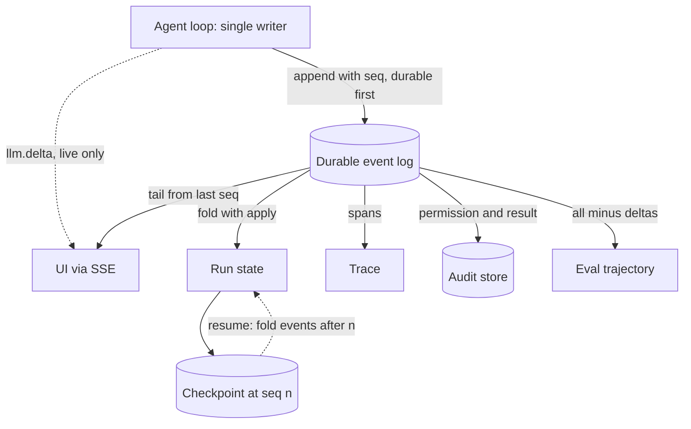

## TL;DR
An agent run is a sequence of happenings, not a returned string. Emit them as one ordered, typed,
versioned event stream and derive the UI, persisted state, trace and eval trajectory from it: one
replayable source of truth instead of four drifting formats.

## Why it exists
- **Every new consumer invents a format.** The first agent returns a final answer. The second needs a
  progress UI, because a 90-second silent wait reads as a hang. The third must survive a worker restart.
  The fourth needs traces and eval trajectories. Built separately, the UI parses print statements, the
  checkpoint serializes a Python object, the tracer wraps functions, the eval harness scrapes logs.
- **The formats disagree.** None of them can answer "what did the model see when it chose that tool"
  without a second instrumentation pass.
- **An agent's state is a history, not a value.** The next prompt is built from everything that happened
  before, so the only faithful representation of the run is the ordered list of what happened.
- **Event sourcing already says this:** store the facts, derive the views. Agent runtimes rediscovered it
  because live streaming, resumption, audit, replay and evaluation are all projections of the same facts.
- **Free-text logging fails three ways:** it cannot be parsed reliably, it has no ordering guarantee
  across processes, and the model's token stream, which the UI needs most, does not fit in a log line.

## How it works
### The envelope
Every event carries the same header, and the header is what makes the stream usable by machines:

```
run_id      which run this belongs to
seq         monotonic integer per run, assigned by the single writer
ts          wall-clock time, for humans; never used for ordering
type        discriminator, e.g. "tool.call.started"
version     schema version of this type's payload
step_id     the agent step (plan -> act -> observe cycle) this belongs to
parent_id   optional, for nesting (sub-agent runs, parallel tool calls)
payload     type-specific body
```

- **`seq` exists *because* timestamps are not a total order.** Two processes with skewed clocks, or two
  parallel tool calls, produce ties and inversions.
- **One writer per run assigns `seq`;** consumers sort by it, and `(run_id, seq)` is the idempotency key
  that lets at-least-once delivery dedupe.
- **Parallel workers do not write to the stream.** They report back to the writer, which appends results
  in the order received. That order is arbitrary but fixed, and that is enough: every replay sees the same
  order.

### The vocabulary
A workable minimum, named as dotted lifecycle pairs:

| Events | Carries | Persisted? |
|---|---|---|
| `run.started` / `run.completed` / `run.failed` / `run.cancelled` | Run lifecycle | Yes |
| `llm.request` / `llm.response` | Model id, prompt reference, parameters / content, tool calls, usage | Yes |
| `llm.delta` | Streamed tokens; high volume | Usually not |
| `tool.call.requested` | Name, arguments | Yes |
| `tool.call.permission` | allow/ask/deny, policy version | Yes |
| `tool.call.started` / `tool.call.result` | Start / ok, error class, duration, result reference | Yes |
| `step.completed` | The step's summary | Yes |
| `input.requested` / `input.received` | Human-in-the-loop pauses | Yes |

- **Large blobs go by reference.** Payloads point to full prompts and tool outputs by content hash or
  storage key, *because* the stream must stay cheap to transport, cheap to index, and redactable: PII
  lives in the blob store with its own retention, while the event history stays intact.

### State is a fold
- **Definition:** the run's state at any point is `reduce(apply, events[:n], initial)`.
- **`apply` is pure.** It appends an `llm.response` to the message list, records a pending call on
  `tool.call.requested`, resolves it on `tool.call.result`. It may update its accumulator in place, but
  reads nothing except the state and the event: no clock, no network, no randomness.
- **Resumption** after a crash is replaying the persisted events through `apply` and continuing from the
  resulting state.
- **A checkpoint is just a cached fold** at some `seq`, kept so that replay does not start from zero.

### Projections
| Consumer | Derived how |
|---|---|
| **UI** | Subscribe; render `llm.delta` as streaming text and `tool.call.*` as status rows. SSE or WebSocket; the client sends its last `seq` on reconnect and receives only what it missed |
| **Trace** | Map `step` and `tool.call` pairs to spans with durations |
| **Audit** | Filter to `tool.call.permission` and `tool.call.result`, append to the immutable store |
| **Eval trajectory** | The full list, minus deltas |

### Delivery and backpressure
1. **The agent process is the single writer.** It appends to a durable log (a database table, a Redis
   stream or a Kafka topic keyed by `run_id`) and fans out to live subscribers.
2. **A slow UI must never stall the agent.** Live fan-out is buffered or dropped for deltas, while
   state-changing events are always durable before the agent proceeds.
3. **"Durable first, then act"** makes the stream trustworthy: if a tool call ran, there is an event saying
   it was requested.
4. **Live subscribers tail the durable log** rather than receiving a second copy, *because* writing the log
   and publishing to a socket separately is a dual write: one can succeed while the other fails, and the UI
   shows events the history does not contain.
5. **Tailing handles late joins for free:** a client opening the page mid-run reads from `seq` 0 (or its
   last seen `seq`) and then follows.

### Ambiguity after a crash
- **Durable-first does not remove ambiguity; it makes it visible.** A `tool.call.requested` with no matching
  `tool.call.result` means the call may or may not have executed.
- **The fold surfaces it as pending,** and the runtime resolves it by re-issuing the call with the same
  idempotency key or asking the tool for the operation's status, never by assuming it did not happen.

### Versioning
- **The `version` field** lets old runs replay through a reader that knows both shapes, and lets a new
  consumer refuse versions it does not understand instead of silently misparsing them.
- **Upcasters:** a small function converts a version-1 payload to version 2 on read, so the fold only
  handles the current shape and stored history is never rewritten.
- **Standards are emerging but young:** OpenTelemetry's generative-AI conventions for the trace
  projection, and agent-to-UI event protocols for the live one. Own your internal schema and map to them
  at the edges, which keeps you independent of their churn.

## Diagram
One writer appends to one durable log; every consumer, including the run's own resumption, is a reader of
that log. Only token deltas skip it.



## Examples
### Typed stream, fold and SSE framing
A minimal typed stream: a discriminated union of events, a single-writer emitter, a pure fold that
rebuilds state, and SSE framing for the UI. The same list feeds persistence, replay and evaluation.

```python
from typing import Literal, Union
from pydantic import BaseModel
import json, itertools

class Base(BaseModel):
    run_id: str
    seq: int
    version: int = 1

class LLMResponse(Base):
    type: Literal["llm.response"] = "llm.response"
    text: str = ""
    tool_calls: list[dict] = []

class ToolRequested(Base):
    type: Literal["tool.call.requested"] = "tool.call.requested"
    call_id: str; name: str; arguments: dict

class ToolResult(Base):
    type: Literal["tool.call.result"] = "tool.call.result"
    call_id: str; ok: bool; error: str | None = None; result_ref: str | None = None

class RunCompleted(Base):
    type: Literal["run.completed"] = "run.completed"
    answer: str

Event = Union[LLMResponse, ToolRequested, ToolResult, RunCompleted]

def emit(run_id: str, counter: itertools.count, cls, **payload) -> Event:
    return cls(run_id=run_id, seq=next(counter), **payload)        # single writer assigns seq

def apply(state: dict, ev: Event) -> dict:
    """Deterministic fold, no I/O; it mutates only the accumulator. state = reduce(apply, events)."""
    if ev.type == "llm.response":
        state["messages"].append({"role": "assistant", "content": ev.text, "tool_calls": ev.tool_calls})
    elif ev.type == "tool.call.requested":
        state["pending"][ev.call_id] = ev.name
    elif ev.type == "tool.call.result":
        state["pending"].pop(ev.call_id, None)
        state["messages"].append({"role": "tool", "call_id": ev.call_id, "ok": ev.ok, "ref": ev.result_ref})
    elif ev.type == "run.completed":
        state["done"], state["answer"] = True, ev.answer
    return state

def rebuild(events: list[Event]) -> dict:
    state = {"messages": [], "pending": {}, "done": False}
    for ev in sorted(events, key=lambda e: e.seq):                   # order by seq, never by timestamp
        state = apply(state, ev)
    return state

def to_sse(ev: Event) -> str:                     # UI transport; client resends last seq on reconnect
    return f"id: {ev.seq}\nevent: {ev.type}\ndata: {json.dumps(ev.model_dump())}\n\n"
```

### Clock skew, a crash and a checkpoint (runnable, stdlib only)
A worker's clock runs 0.3 s behind the orchestrator's, and the process crashes after requesting a second
call. Sorting by `ts` inverts the first pair; folding by `seq` exposes the ambiguous pending call.

```python
import copy
from dataclasses import dataclass, field
from functools import reduce

@dataclass
class Ev:
    run_id: str
    seq: int          # assigned by the single writer
    ts: float         # stamped by whichever host saw it: for humans only
    type: str
    payload: dict = field(default_factory=dict)

def apply(state: dict, ev: Ev) -> dict:          # pure: reads only state and event
    if ev.type == "tool.call.requested":
        state["pending"][ev.payload["call_id"]] = ev.payload["idem_key"]
    elif ev.type == "tool.call.result":
        state["pending"].pop(ev.payload["call_id"], None)
    return state

events = [
    Ev("r1", 7, 100.00, "tool.call.requested", {"call_id": "c1", "idem_key": "r1:s3:c1"}),
    Ev("r1", 8, 99.70, "tool.call.result", {"call_id": "c1"}),      # worker clock 0.3 s behind
    Ev("r1", 9, 100.10, "tool.call.requested", {"call_id": "c2", "idem_key": "r1:s3:c2"}),
]                                                                     # crash here: did c2 run?

print([e.type for e in sorted(events, key=lambda e: e.ts)][0])       # tool.call.result: inverted
state = reduce(apply, sorted(events, key=lambda e: e.seq), {"pending": {}})
print(state["pending"])                  # {'c2': 'r1:s3:c2'}: re-issue with this key, never assume

ckpt_seq, ckpt = 8, reduce(apply, [e for e in events if e.seq <= 8], {"pending": {}})
resumed = reduce(apply, [e for e in events if e.seq > ckpt_seq], copy.deepcopy(ckpt))
assert resumed == state                  # checkpoint + tail == full fold
```

### Worked sizing: why deltas stay live-only
An illustrative 20-step run with 500 output tokens per step and 15 tool calls, counting one delta per
token as the worst case (real streams often batch several tokens per chunk).

| Event kind | Count per run | Persist? |
|---|---|---|
| `llm.delta` | 500 × 20 = 10,000 | No, live fan-out only |
| `llm.request` + `llm.response` | 2 × 20 = 40 | Yes |
| `tool.call.requested`, `.permission`, `.started`, `.result` | 4 × 15 = 60 | Yes |
| `step.completed` + `run.started` + `run.completed` | 20 + 2 = 22 | Yes |

- **Persisted:** 122 rows instead of over 10,000, roughly 80 times fewer writes, with no loss of state,
  because each `llm.response` carries the assembled text the deltas spelled out.

## Production patterns
- **Postgres event table with a unique key.** When: you already run Postgres and volumes are moderate. How:
  an append-only table with `UNIQUE (run_id, seq)`, inserts inside the step's transaction, and readers
  that poll or use `LISTEN`/`NOTIFY` for wake-ups. Monitor: insert latency on the step's critical path.
- **Kafka or Redis streams keyed by run.** When: many runs and many subscribers. How: partition a Kafka
  topic by `run_id`, so one run's events stay ordered within a partition, or use one Redis stream per run
  read with `XREAD` from the last seen id. Monitor: consumer lag to the slowest subscriber.
- **SSE resume by event id.** When: a browser UI follows a run. How: write `id: <seq>` on every SSE frame;
  the browser's `EventSource` sends `Last-Event-ID` on reconnect, and the server resumes from the log
  after that `seq`. Monitor: reconnect rate and gaps detected client-side.
- **Upcasters at read time.** When: any payload shape changes. How: bump `version` and register a
  function from version *n* to *n + 1*; the reader applies them before the fold. Monitor: replay of a
  sample of last month's runs in CI, which must not crash.
- **Replay-equality check.** When: you rely on folds for resume. How: periodically rebuild completed runs
  from events and compare a hash of the result with the stored checkpoint. Monitor: the fraction of runs
  that rebuild to identical state, which should be 100%.

## Trade-offs
- **One canonical stream vs schema ownership.** It removes format drift between UI, checkpoint, trace and
  evals, but forces every consumer through one schema, and one team becomes the owner of its evolution.
- **Persisting deltas vs cost.** Fine-grained token deltas give exact replay of what the user saw, at a
  storage and write-rate cost that is usually not worth it; persist the assembled `llm.response` and keep
  deltas live-only unless a product requirement says otherwise.
- **References vs inlining.** Payloads by hash keep events small and redactable but add a second store and
  a second failure mode; for small internal tools, inlining is simpler until retention or PII rules bite.
- **Durable-before-act vs latency.** It guarantees the history is trustworthy but adds a write on the
  critical path of every step; for sub-second interactive agents, batch the writes per step rather than per
  event.

## Pitfalls
- **Ordering by timestamp instead of a per-run sequence.** Symptom: parallel tool results that appear
  before their requests in the UI or the replay.
- **Multiple processes writing one run's stream.** Symptom: duplicate or interleaved `seq` values and folds
  that produce different state on different replays.
- **Inlining full tool outputs into events.** Symptom: a stream table that grows by megabytes per run and a
  redaction request that requires rewriting history.
- **Changing a payload shape without bumping `version`.** Symptom: replay of last month's runs crashing in
  the fold.
- **Blocking the agent on a slow websocket consumer.** Symptom: step latency that tracks the user's network
  rather than the model's.
- **Emitting events after the side effect instead of before.** Symptom: a crash between the tool running
  and the event being written leaves a run that resumes and runs the tool again.
- **Publishing to live subscribers and the durable log as two independent writes.** Symptom: a user saw a
  step in the UI that is missing when the run is resumed or replayed.

## When to use
- **Adopt it** as soon as more than one consumer needs to know what the agent is doing: in practice, the
  first progress UI or resume-after-crash requirement.
- **Keep it for batch agents too,** because the eval trajectory and the audit log come for free.
- **Measure** events per run, bytes per run, fan-out lag to the slowest subscriber, and the fraction of runs
  that rebuild to identical state on replay.
- **Daily work:** the stream is where you look first when a run misbehaves.
- **Interviews:** "state is a fold over events, the UI and the checkpoint are projections" signals you have
  built an agent that survived contact with production.

## Role lens
- **Engineer:** Defines the event types, assigns sequence numbers from a single writer, writes the fold,
  and wires SSE so the UI reconnects by last seq.
- **Architect:** Chooses the durable log (database table, Redis stream, Kafka), the retention and
  redaction policy, and the schema versioning rule all teams follow.
- **FDE:** Streams the same events into the customer's existing observability and ticketing systems so
  their operators see agent activity in tools they already trust.

## Check yourself
**Q:** Your agent runs two tool calls in parallel, and the UI occasionally shows a result row before its
"calling tool" row. A worker crash during that window also caused one tool to run twice on resume. Explain
both symptoms with one root cause and fix it.
**A:** The root cause is that no single writer owns the run's history: events are written by whichever
process or thread holds them, stamped with that process's clock, and written when convenient rather than
before the effect. Ordering suffers because the orchestrator stamps `tool.call.requested` with its clock
while a worker on another host stamps `tool.call.result` with its own; a skew larger than the call's
duration gives the result an earlier `ts`, and a UI sorting by `ts` shows the inversion. Durability
suffers because the request is only persisted when the worker reports back: a crash between execution and
that write leaves no record, so the fold on resume sees no pending call and issues it again. The fix is a single writer per run that assigns a monotonic `seq`, consumers that sort by `seq`, and a
durable `tool.call.requested` event written before the adapter runs, paired with an idempotency key so
that even a retry after a crash cannot repeat the effect.

## Interview questions
### Why model an agent run as an event stream rather than as saved state?
- **The state is a history:** the next prompt is built from everything that happened, so the ordered facts
  are the only faithful record; state is `reduce(apply, events)`.
- **One source, many views:** UI, checkpoint, trace, audit and eval trajectory become projections, so they
  cannot disagree about what happened.
- **Replay comes free:** resumption and debugging are re-running the fold, not reconstructing from logs.

### Design live streaming to a browser that survives reconnects and late joins.
- **Single writer, durable log:** the agent appends events with `seq`; the UI never gets a separate copy.
- **SSE with ids:** each frame carries `id: <seq>`; on reconnect the browser sends its last id and the
  server tails the log from there. A late joiner starts from `seq` 0.
- **Deltas are the exception:** they go live-only and may be dropped for a slow client, because the
  assembled `llm.response` is persisted anyway.

### When is persisting every token delta worth it?
- **Usually not:** deltas outnumber every other event by orders of magnitude, and `llm.response` already
  holds the assembled text.
- **Worth it when** a product or compliance requirement says you must reproduce exactly what the user saw
  and when, for example a disputed live answer.
- **Middle ground:** keep deltas in a short-retention store, not the permanent history.

### After a crash, the log has `tool.call.requested` but no `tool.call.result`. What does the runtime do?
- **Treat it as unknown, not as not-run:** the call may have executed before the crash.
- **Resolve it safely:** re-issue with the same idempotency key so a completed effect is not repeated, or
  query the tool for the operation's status.
- **Why the request was durable first:** without it the fold would see nothing pending and re-run the tool
  blindly.

### Your event schema needs a breaking payload change. How do you ship it without breaking replay?
- **Bump `version`** for that event type and write new events in the new shape.
- **Add an upcaster** that converts the old version on read, so the fold handles only the current shape and
  stored history is never rewritten.
- **Prove it:** replay a sample of old runs in CI and require identical rebuilt state.

## Quiz
### Q: Why does each event carry a per-run sequence number in addition to a timestamp?
- [ ] Timestamps are too large to store efficiently
- [x] Timestamps do not give a total order across processes or parallel calls, while a single-writer sequence does and also serves as a dedup key
- [ ] Sequence numbers encrypt the event for the audit log
- [ ] Timestamps are only needed for the UI, so they are optional
> Clock skew and concurrency produce ties and inversions; a monotonic sequence from one writer is what
> replay and reconnect logic can rely on.

### Q: What is the relationship between the event stream and a checkpoint in this design?
- [ ] The checkpoint is the source of truth and events are derived from it
- [ ] They are independent; checkpoints store state while events store logs
- [x] A checkpoint is a cached fold of the events up to some sequence, kept so replay does not start from zero
- [ ] Checkpoints replace events once a run completes
> State is reduce(apply, events); a checkpoint memoizes that reduction at a point. It speeds resumption
> but the events remain the truth.

### Q: Why store large tool outputs by reference rather than inline in the event payload?
- [ ] Because JSON cannot represent strings longer than 64 KB
- [ ] Because the model cannot read inline payloads
- [x] To keep the stream small and indexable and to let PII be redacted or expired in the blob store without rewriting event history
- [ ] Because references are required for SSE transport
> Events are the permanent history; payloads carry the bulk and the sensitive content. Separating them
> keeps transport cheap and retention policies independent.
