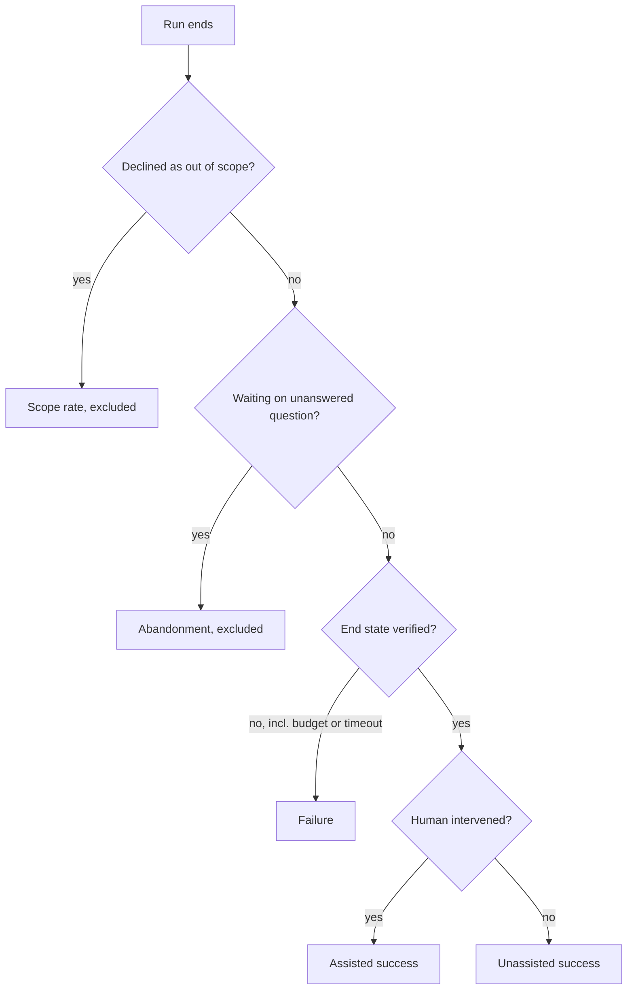

## TL;DR
Task completion rate is the fraction of tasks an agent verifiably finishes, not claims to. It is only as
good as three definitions: task, success and denominator. Report it with an interval,
segmented by task type, beside pass^k for unattended use.

## Why it exists
- **It is the output metric.** An agent product lives or dies on whether it actually finishes the job.
  Latency, token cost and tool metrics are inputs; unit economics (cost per *successful* task) divide by
  completion directly.
- **Without it every other number floats free:** a 30% cost reduction means nothing if completion fell from
  80% to 60%.
- **Self-report is the least reliable signal in the system.** Agents confidently declare completion on tasks
  they half-did, misread or abandoned, and the gap between claimed and verified completion is routinely
  large enough to change a launch decision.
- **Careless denominators produce two truths.** Abandoned sessions, out-of-scope requests and clarifying
  questions end up counted as failures or quietly excluded depending on who ran the query, so two
  dashboards show two different rates for the same week.
- **So treat it like a service-level indicator:** a precise definition of unit, success predicate,
  denominator and measurement method, plus statistics that respect how few tasks you actually have.

## How it works
### Define the unit
- **A task is a user goal with a clear end condition:** "refund order A1", "fix the failing test in repo
  R", "answer the question with a cited source".
- **Grains differ.** Multi-turn sessions may contain several tasks; a long task may decompose into subtasks
  whose completion is not the same as the parent's.
- **Pick the grain that matches what the user wants done and keep it fixed,** *because* changing the grain
  changes the rate without changing the agent.

### Define success
In descending order of trust:

| Rank | Method | Strength | Weakness |
|---|---|---|---|
| 1 | **Verifiable end state:** order shows refunded, tests pass, file exists with the right contents | Automatable, objective; preferred wherever the environment can be inspected | Needs an inspectable environment |
| 2 | **Human acceptance:** the user or a reviewer confirms | Ground truth for subjective tasks | Expensive; biased by who bothers to respond |
| 3 | **LLM judge with a rubric** | Scales | Must be calibrated against (1) or (2) on a sample, and re-calibrated when the judge model changes |
| 4 | **Self-report:** the agent said done | Cheap | Useful only as a leading indicator of the claimed-versus-verified gap |

- **Keep success binary at the task grain.** Partial completion is tempting and usually wrong as a
  headline: a task that is 80% done often has zero value to the user. Track partial progress as a separate
  diagnostic.

### Define the denominator
Decide explicitly, and write down, how each case counts:

| Case | Policy | Tracked as |
|---|---|---|
| Declined as out of scope | Usually excluded | *Scope rate* |
| Clarifying question the user never answered | Excluded from completion | *Abandonment* |
| Hit a step budget or a timeout | Failure | Completion |
| Completed only after a human intervened | Separate | *Assisted completion rate* |

- **The unassisted rate is the autonomy number;** the assisted rate is the containment number a support
  organisation cares about. Mixing them hides both.

### Attempts versus tasks
- **Per-attempt completion** is the probability one run succeeds: the expected fraction of single-shot users
  who get their task done.
- **pass@k** applies to agents with retries or a human picking the best of several.
- **pass^k** is for unattended agents: the probability that every one of k attempts at the same task
  succeeds. It measures consistency rather than average success.
- **Why consistency matters:** an unattended agent meets the same task again and again, so an operator can
  hand a task class over without review only if it works every time.
- **Same rate, different agents.** One that always solves 85% of task types and always fails the rest lets
  you route the rest to humans; one that solves every task 85% of the time leaves nothing safe to automate.
- **Formulas.** With per-attempt rate p and independence, pass^k ≈ p^k; the unbiased estimate from n trials
  with c successes is C(c, k) / C(n, k), averaged over tasks. At 90% per attempt on every task: about 73%
  for pass^3 and 59% for pass^5.

### Statistics
- **Use a Wilson interval** with n tasks and c successes, not the normal approximation, which misbehaves
  near 0 and 1 and at small n.
- **Segment by task type and difficulty,** *because* the overall rate moves when the task mix shifts, which
  looks like a regression and is not.
- **Track it as a time series per release** and gate releases on a stated bar with a stated interval.

### Offline and online
| | Offline | Online |
|---|---|---|
| Source | A task suite with known success predicates, run N times | Production runs with verified outcomes where possible, sampled human review where not |
| Fallback | — | Behavioural proxies: the user repeating the same request within a short window, a ticket reopened, an escalation to a human, an undo of the agent's change |

- **Proxies are biased in known directions** (silent users count as successes), so calibrate each against
  reviewed samples before trusting it.
- **Note which runs *can* be verified:** if only the easy task types have an inspectable end state, the
  verified online rate describes the easy types, not the product.
- **Report offline and online side by side;** a large gap is the most useful signal that the suite is not
  representative.

## Diagram
Every finished run lands in exactly one bucket under the written denominator policy; only the bottom three
buckets enter the completion rate.



## Examples
### Worked release decision with intervals and pass^k
A worked scenario, then the code that computes it.

1. **The suite:** a release candidate runs a 200-task suite: 150 verified successes, 30 failures, 12
   clarification dead ends, 8 declined as out of scope.
2. **Denominator:** excluding declined and abandoned tasks, it is 180, and the per-attempt rate is 150/180
   = 83.3%. The Wilson 95% interval is roughly 77% to 88%.
3. **First look at consistency:** the agent runs unattended, so the team estimates pass^3 ≈ 0.833³ ≈ 58%
   under independence.
4. **Segments:** billing tasks 92% (n = 90), code tasks 74% (n = 90).
5. **The headline is not "83%";** it is "billing is shippable, code is not, and consistency across attempts
   is below the bar".

- **The 58% is only a first look:** raising a pooled rate to the k-th power assumes every task has the same
  success probability.
- **The proper estimate** comes from five repeated trials per task (second block in the code): the
  per-attempt rate is 88.9% but pass^3 is 75.6%, far above 0.889³ ≈ 70%, because the failures concentrate
  on 60 of the 180 tasks.
- **Per-task pass^k is what goes in the release report.**

```python
from math import sqrt, comb

def wilson(c: int, n: int, z: float = 1.96) -> tuple[float, float]:
    if n == 0:
        return (0.0, 0.0)
    p = c / n; d = 1 + z * z / n
    centre = (p + z * z / (2 * n)) / d
    half = z * sqrt(p * (1 - p) / n + z * z / (4 * n * n)) / d
    return (max(0.0, centre - half), min(1.0, centre + half))

def pass_hat_k(trials: list[tuple[int, int]], k: int) -> float:
    """trials: per-task (successes c, attempts n). Unbiased pass^k averaged over tasks with n >= k."""
    usable = [(c, n) for c, n in trials if n >= k]
    return sum(comb(c, k) / comb(n, k) for c, n in usable) / len(usable)

results = {"verified_success": 150, "failed": 30, "abandoned": 12, "declined": 8}
n = results["verified_success"] + results["failed"]           # denominator policy: exclude abandoned, declined
p = results["verified_success"] / n
lo, hi = wilson(results["verified_success"], n)
print(f"completion {p:.1%}  95% CI [{lo:.1%}, {hi:.1%}]  n={n}")
print(f"declined {results['declined'] / 200:.1%}   abandonment {results['abandoned'] / 200:.1%}")

# per-task repeated trials for the unattended bar: (successes, attempts)
trials = [(5, 5)] * 120 + [(4, 5)] * 40 + [(2, 5)] * 20
print(f"pass^1 {pass_hat_k(trials, 1):.1%}  pass^3 {pass_hat_k(trials, 3):.1%}")
# -> completion 83.3%  95% CI [77.2%, 88.1%]  n=180 ; declined 4.0% ; pass^1 88.9%  pass^3 75.6%
```

| Segment | Successes / n | Rate | Wilson 95% interval |
|---|---|---|---|
| Billing | 83 / 90 | 92.2% | 84.8% to 96.2% |
| Code | 67 / 90 | 74.4% | 64.6% to 82.3% |
| All | 150 / 180 | 83.3% | 77.2% to 88.1% |

### One denominator policy for every dashboard (runnable)
The policy above as code, so two teams cannot compute two rates. The same suite as before, except that 10
of the 150 successes needed a human fix: the autonomy and containment numbers now differ.

```python
from collections import Counter

def bucket(run: dict) -> str:
    """Written denominator policy, applied the same way by every dashboard."""
    if run["declined"]:
        return "declined"                       # out of scope: excluded, tracked as scope rate
    if run["awaiting_user"]:
        return "abandoned"                      # unanswered clarifying question: excluded
    if not run["verified"]:
        return "failed"                         # includes step-budget and timeout endings
    return "assisted" if run["human_fixed"] else "unassisted"

runs = ([dict(declined=False, awaiting_user=False, verified=True, human_fixed=False)] * 140
        + [dict(declined=False, awaiting_user=False, verified=True, human_fixed=True)] * 10
        + [dict(declined=False, awaiting_user=False, verified=False, human_fixed=False)] * 30
        + [dict(declined=False, awaiting_user=True, verified=False, human_fixed=False)] * 12
        + [dict(declined=True, awaiting_user=False, verified=False, human_fixed=False)] * 8)
b = Counter(bucket(r) for r in runs)
attempted = b["unassisted"] + b["assisted"] + b["failed"]
print(f"unassisted {b['unassisted'] / attempted:.1%}")                      # 77.8%: autonomy
print(f"assisted   {(b['unassisted'] + b['assisted']) / attempted:.1%}")    # 83.3%: containment
print(f"scope {b['declined'] / len(runs):.1%}  abandonment {b['abandoned'] / len(runs):.1%}")  # 4.0%, 6.0%
```

## Production patterns
- **A written metric definition.** When: before anyone quotes a number. How: one document, versioned with
  the code, fixing the unit, success predicate, denominator policy, interval method and segments, and a
  single shared function (like `bucket` above) that every dashboard calls. Monitor: dashboards computing
  the rate any other way.
- **Gate on the interval's lower bound.** When: release decisions. How: require the Wilson lower bound per
  segment, not the point estimate, to clear the bar, plus a per-task pass^k bar for unattended segments.
  Monitor: segments that pass on the point estimate but fail on the lower bound, which need more tasks.
- **Post-run verifiers online.** When: the system of record can be queried. How: an asynchronous job after
  each run checks the end state (refund posted, PR merged, ticket closed) and writes a verified label onto
  the run's events. Monitor: the claimed-versus-verified gap per task type.
- **Calibrated behavioural proxies.** When: end state cannot be verified. How: treat repeat requests, reopened
  tickets, escalations and undo actions as failure signals, and each week compare them with a random
  sample of hand-reviewed sessions. Monitor: proxy precision and recall against the reviewed sample.
- **Offline-online reconciliation.** When: every release. How: put the offline suite rate and the online
  verified rate per segment side by side. Monitor: a widening gap, which means the suite needs new tasks
  mined from production.

## Trade-offs
- **Verified end state vs coverage.** It is objective but limits you to tasks whose outcome you can inspect;
  for advisory or creative tasks you fall back to human acceptance or a calibrated judge and accept wider
  error bars.
- **Binary success vs visible progress.** Binary at the task grain is honest about user value but hides
  progress on long tasks; track partial progress as a diagnostic, never as the headline, or the rate
  inflates without the product improving.
- **Excluding declines vs gaming.** Excluding declined and abandoned tasks isolates agent quality, but an
  agent that declines aggressively looks better while helping less; report scope and abandonment beside it.
- **pass^k vs popularity.** pass^k is the honest number for unattended agents and is never higher than the
  per-attempt rate (equal only for tasks that always or never succeed), which makes it unpopular; the
  condition that justifies reporting pass@k instead is a real verifier or human choosing among attempts.

## Pitfalls
- **Counting "the model said done" as completion.** Symptom: a dashboard at 90% and a support queue full of
  half-finished tasks.
- **Changing the task grain between releases.** Symptom: a rate that jumps or drops with no change in agent
  behaviour.
- **One rate across a shifting task mix.** Symptom: a "regression" that turns out to be a week with more
  hard tasks.
- **Quoting 85% from 50 tasks without an interval.** Symptom: launch decisions reversed by the next run of
  the same suite.
- **Mixing assisted and unassisted completions.** Symptom: an autonomy number that looks fine until the
  humans who were quietly fixing tasks go on holiday.
- **An offline suite never compared to online outcomes.** Symptom: a suite at 95% and customers at 70%.
- **Treating "no complaint" as success online.** Symptom: a high proxy completion rate that drops sharply
  the first time someone hand-reviews a random sample of sessions.

## When to use
- **Make it the headline metric** of any agent from the first prototype, and define its unit, success
  predicate and denominator in a document before anyone quotes a number.
- **Use** the offline rate with an interval as the release gate, the online verified rate as the health
  signal, and the gap between them as the signal to refresh the suite.
- **Pair it** with cost per successful task and with tool-call success rate, which explains most movements
  in it.
- **Interviews:** "how would you measure whether the agent works" should produce the definitions, the
  denominator policy, the Wilson interval, segmentation, and the pass^k argument for unattended agents,
  not a single percentage.

## Role lens
- **Engineer:** Implements the success predicates and the verification step in the harness, and makes sure
  the event stream carries the labels the rate is computed from.
- **Architect:** Writes the metric definition (unit, success, denominator, interval, segmentation) and sets
  the release bar and the pass^k requirement for unattended deployments.
- **FDE:** Agrees the success criteria with the customer's domain owners, reconciles offline and online
  rates in their environment, and reports the assisted and unassisted numbers separately.

## Check yourself
**Q:** Two teams report completion rates for the same agent over the same week: 88% and 71%. Neither is
lying. List the definitional differences that could explain the gap and say which number you would put in
front of a customer.
**A:** The candidates are the denominator and the success criterion. One team may exclude declined and
abandoned tasks, the other may count them as failures. One may count assisted completions, where a human
fixed the result, the other only unassisted ones. One may use the agent's self-report, the other verified
end state. One may measure per attempt, the other pass^k over repeated attempts. They may also use
different task grains, for example sessions versus subtasks, or different task mixes. For a customer I
would present the unassisted, verified, per-attempt rate with a Wilson interval and the denominator policy
stated, segmented by task type, and beside it per-task pass^k for the unattended case, because it tells
them which task types work every time and can be automated without review. The assisted rate goes in as
a secondary line for their support organisation.

## Interview questions
### Why can't you measure task completion by counting runs where the agent said it was done?
- **Self-report is the least reliable signal:** agents declare completion on tasks they half-did, misread or
  abandoned.
- **The gap is large enough to matter:** claimed versus verified completion routinely differs by enough to
  change a launch decision.
- **Use a success predicate instead,** ideally a verified end state, with human acceptance or a calibrated
  judge where the state cannot be inspected.

### Completion dropped from 84% to 78% this week with no deploy. How do you investigate?
- **Check the task mix first:** segment by task type and difficulty; a week with more hard tasks moves the
  overall rate without any change in the agent.
- **Check the interval:** with a few hundred tasks a six-point move may sit inside the noise.
- **Check upstream:** tool-call success rate explains most movements, so look for a dependency that
  started failing or timing out.

### How do you handle tasks the agent declined or that ended in an unanswered question?
- **Exclude them from completion,** so the rate reflects how well the agent executes tasks it attempted.
- **Report them beside it** as scope rate and abandonment, because an agent that declines aggressively
  would otherwise look better while helping less.
- **Write the policy down** and compute it with one shared function, so two dashboards cannot disagree.

### What sample size and interval would you use for a release gate?
- **Wilson interval,** because the normal approximation misbehaves near 0 and 1 and at small n.
- **Scale of the problem:** 150 of 180 is 83.3% with an interval of roughly 77% to 88%; 50 tasks gives
  about ten points either side.
- **Gate on the lower bound per segment** and add per-task pass^k from repeated trials for unattended
  segments.

### When is the assisted completion rate the right number to report?
- **For containment:** a support organisation cares how many tasks finished without escalating, even if a
  human touched them inside the workflow.
- **Never as the autonomy number:** it hides the human effort that would disappear if the reviewers went
  away.
- **Report both,** clearly labelled, with unassisted as the headline for unattended deployment.

## Quiz
### Q: Why is the agent's own "task complete" message a poor basis for completion rate?
- [ ] Because the message is not stored in the event stream
- [x] Because self-reported completion is unreliable and routinely overstates verified success
- [ ] Because it is only emitted at temperature 0
- [ ] Because completion must be judged by an LLM, not by the agent
> Models declare completion on tasks they misread or half-finished; the metric needs an independent
> success predicate, ideally a verified end state.

### Q: An agent succeeds on 90% of attempts. Roughly what is its pass^3, and why does it matter?
- [ ] 90%, because pass^k equals the per-attempt rate
- [ ] About 99.9%, because three attempts give more chances to succeed
- [x] About 73%, because all three attempts must succeed, which measures whether the task works every time it recurs
- [ ] About 30%, because pass^k divides the rate by k
> Under independence pass^k ≈ p^k, so 0.9³ ≈ 0.73; it measures consistency, which decides whether a task
> class can run unattended as it recurs across users. The 99.9% figure, 1 − 0.1³, would be pass@3.

### Q: Which denominator policy best isolates agent quality while staying honest?
- [ ] Count every session, including out-of-scope requests, as a task
- [x] Exclude declined and abandoned tasks from completion but report scope and abandonment rates alongside
- [ ] Exclude all failed tasks that hit a step budget
- [ ] Include only tasks the agent marked as complete
> Removing declined and abandoned tasks keeps the rate about agent execution, and reporting those rates
> separately stops an agent from looking better by declining more.
