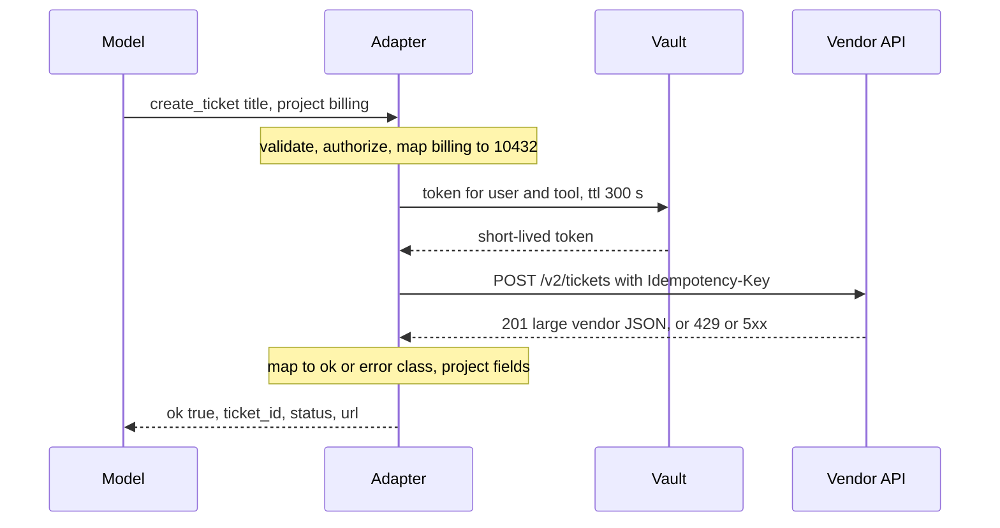

## TL;DR
A tool adapter translates between small typed model calls and real services with auth, pagination, rate
limits and 40-field responses. It validates, enforces policy, injects credentials, bounds retries and
returns every outcome as a compact structured result, making tools testable, swappable and safe.

## For agent builders
- **Why it matters for agents.** The model only ever sees your tool contract and the result you hand
  back. Whether it picks the right tool, fills arguments correctly and recovers from failures depends
  more on the adapter's shape than on the prompt.
- **Where it shows up in your stack.** Every tool definition you register with a provider API or agent
  framework, every MCP server you write, and the fake service interfaces your eval harness swaps in.
- **What you control.** Argument count and enums, the error taxonomy and `retryable` flag, which retries
  happen inside the adapter, idempotency keys, response projection and where large payloads go.
- **What you can skip.** Generic API-gateway theory and full hexagonal-architecture ceremony. One base
  class with validation, timeout, error envelope and projection is enough to start.

## Why it exists
- **Raw vendor APIs break three ways at once.** Hand a model the OpenAPI spec of a ticketing system and the
  schema is enormous (eats context, degrades tool selection), the responses are enormous (bury the two
  fields that matter), and the failure modes are the vendor's: a 429 with a Retry-After header, a 502 HTML
  page, a timeout with no body.
- **The model cannot parse vendor failures.** It either hallucinates a fix for an error it cannot read or
  loops on the same call. And the API key has to live somewhere; "in the prompt" is the one place it must
  not be.
- **Quick SDK functions do not scale either.** They fail the first time you swap the vendor, run evals
  without hitting production, apply a permission check, or ask why 8% of calls fail, because the logic is
  scattered across twenty functions, each with its own idea of an error.
- **The pattern is older than agents.** Hexagonal architecture calls the consumer-facing contract a *port*
  and the vendor-specific implementation an *adapter*; the application depends only on ports.
- **What is new is the consumer.** A language model changes what a good contract looks like: fewer
  arguments, enums over opaque IDs, explicit outcomes rather than ones implied by status codes, and
  absolutely no secrets on the model side of the boundary.

## How it works
### Two interfaces, one component
| Face | What it is | Designed for | Changes when |
|---|---|---|---|
| **Model-facing contract** | Tool definition: name, one-paragraph description, JSON schema for arguments, implied result shape | A reader that pattern-matches on descriptions and cannot look anything up | Rarely; it must stay stable across backend changes |
| **Service interface** | Client for the real system: SDK or HTTP, auth, base URLs, pagination cursors, vendor error codes | The vendor | Whenever the vendor changes; the model never notices |

- **Good contract shape:** three to six arguments, enums where the backend wants IDs (`project: "billing"`
  rather than `project_id: 10432`), sensible defaults, and a stable shape.

### What the adapter does on every call
1. **Validate** arguments against the schema before any side effect, *because* the model emits text and a
   missing field is cheaper to reject now than to discover as a 400 after half the work. Failures return
   a structured error naming the field, so the model can correct it.
2. **Authorize** against the run's permission policy. The adapter is the natural enforcement point because
   it is the last code that sees the parsed arguments before they become effects.
3. **Translate** intent into service calls. One model-facing call may be several: resolve the project name
   to an ID, create the ticket, fetch its URL. Hiding that sequence is the point; the model should not plan
   around the vendor's data model.
4. **Inject credentials** from a vault, scoped to the user and tool, at call time. The token exists only
   inside the adapter's stack frame.
5. **Bound the call** with a timeout, a retry policy for retryable classes only, and an idempotency key
   derived from the run and step, so a retry after a lost response cannot create a second ticket.
   - If the vendor does not honour an idempotency header, the adapter deduplicates locally by that key.
   - Transient failures are retried *inside* the adapter, a small bounded number of times with jittered
     backoff, *because* a retry the model decides on costs a full model turn of latency and tokens.
   - Only when that budget is spent does the failure reach the model, as a result it can plan around.
6. **Normalize the outcome** into one shape: `{"ok": true, ...}` or `{"ok": false, "error": <code>, "retryable": <bool>, ...}`.
   The error code comes from a small taxonomy you own (`invalid_arguments`, `not_found`, `denied`,
   `rate_limited`, `upstream_timeout`, `upstream_error`), *because* the model should learn one vocabulary
   of failure across all tools, and your success-rate metrics need the same classes.
7. **Project the response** down to what the next step needs, with stable identifiers the model can refer
   back to and a cursor if the result is paged. Large payloads go to a blob store; the model gets a
   reference plus a summary.
8. **Emit telemetry:** a span with latency and error class, and an event on the run's stream.

### Composite calls and partial failure
- **New failure mode:** hiding a three-call sequence behind one tool means call two can succeed and call
  three fail.
- **Never report a plain failure,** *because* the model will try again and create a second ticket.
- **Either compensate** (undo the earlier calls, if they can be undone) **or report the partial state:**
  `{"ok": false, "error": "partial", "created": {"ticket_id": "T-88"}, "failed_step": "attach_file"}`.
- **Rule of thumb:** one model-facing tool maps to at most one non-idempotent service write. When a
  workflow needs several, make it a durable sub-workflow with its own checkpoints, or expose the writes as
  separate tools.

### Evolving the contract
The model-facing contract is an API with a fussy client.

| Change | Safe? | Why |
|---|---|---|
| New optional argument with a default | Yes | Old calls still validate |
| New result field | Yes | Nothing depends on its absence |
| Rename an argument, narrow an enum, change a field's meaning | No, breaking | Prompts, few-shot examples and recorded eval trajectories encode the old shape, and the model keeps producing it |

- **Version breaking changes as a new tool name** (`create_ticket_v2`), run the trajectory suite against
  both, and retire the old one when its call volume reaches zero.
- **The service interface can change freely** as long as the contract tests, which run the adapter
  against recorded vendor responses, keep passing.

### Where the boundary lives
- **In-process adapters** are plain classes: fastest and simplest.
- **MCP** standardizes the boundary as a protocol: the server exposes tool contracts, the host's client
  calls them, and the eight responsibilities above move into the server. That buys reuse across agents and
  languages at the cost of a network hop and a deployment.
- **Either way the adapter is the evaluation seam:** swap the service interface for a recorded or fake one
  and the agent runs deterministically against the same contract.

### Why not just let the model emit HTTP
- **A generic `http_request` tool is the zero-adapter design.** It maximizes flexibility and minimizes
  everything else: no argument validation, no permission check on semantics, vendor errors passed straight
  through, and credentials that must be reachable by the model to be usable.
- **Right for** a sandboxed research agent; **wrong for** anything with side effects.

## Diagram
One model-facing call fans out inside the adapter; the model only ever sees the projected, normalized
result, never the token or the raw vendor body.



## Examples
### A `create_ticket` adapter
Typed arguments on the outside, a vendor HTTP API on the inside, one error vocabulary, and a projected
result. Nothing vendor-specific leaks to the model. Checked with pydantic 2.14 and httpx 0.28.

```python
from typing import Literal
from pydantic import BaseModel, Field, ValidationError
import httpx

class CreateTicketArgs(BaseModel):
    title: str = Field(max_length=120)
    body: str
    priority: Literal["low", "normal", "high"] = "normal"
    project: Literal["billing", "platform", "support"]     # enum for the model, ID for the vendor

class TicketAdapter:
    def __init__(self, client: httpx.Client, project_ids: dict[str, int], vault, web_base: str):
        self.client, self.project_ids, self.vault = client, project_ids, vault
        self.web_base = web_base.rstrip("/")                 # UI host, not the API base_url

    def create_ticket(self, raw_args: dict, *, user: str, idempotency_key: str) -> dict:
        try:
            a = CreateTicketArgs.model_validate(raw_args)                  # 1. validate before side effects
        except ValidationError as e:     # same args will fail again: the model must fix them
            return {"ok": False, "error": "invalid_arguments", "retryable": False,
                    "detail": [f"{'.'.join(map(str, x['loc']))}: {x['msg']}" for x in e.errors()]}
        payload = {"summary": a.title, "description": a.body,            # 3. translate to vendor shape
                   "priority_code": {"low": 3, "normal": 2, "high": 1}[a.priority],
                   "project_id": self.project_ids[a.project]}
        headers = {"Authorization": f"Bearer {self.vault.token_for(user, 'tickets', ttl_s=300)}",  # 4.
                   "Idempotency-Key": idempotency_key}                     # 5. retry cannot double-create
        try:
            r = self.client.post("/v2/tickets", json=payload, headers=headers, timeout=10.0)
        except httpx.TimeoutException:
            return {"ok": False, "error": "upstream_timeout", "retryable": True}
        except httpx.TransportError:                       # DNS, refused, reset: never raise to the loop
            return {"ok": False, "error": "upstream_error", "retryable": True}
        if r.status_code == 429:                  # Retry-After may be seconds or an HTTP date
            ra = r.headers.get("Retry-After", "")
            return {"ok": False, "error": "rate_limited", "retryable": True,
                    "retry_after_s": int(ra) if ra.isdigit() else 5}
        if r.status_code >= 400:                                          # 6. one error vocabulary
            err = {401: "denied", 403: "denied", 404: "not_found"}.get(r.status_code, "upstream_error")
            return {"ok": False, "error": err, "retryable": r.status_code >= 500,
                    "http_status": r.status_code}       # raw vendor body goes to the trace, not the model
        d = r.json()                                                       # 7. project the response
        return {"ok": True, "ticket_id": d["id"], "status": d["status"],
                "url": f"{self.web_base}/tickets/{d['id']}"}
```

### Contract test against a fake vendor
`httpx.MockTransport` replaces the network, so the adapter runs in CI and in eval harnesses without
touching production. The handler plays back a big vendor response and a rate limit.

```python
import httpx

class FakeVault:
    def token_for(self, user, tool, ttl_s):
        return "test-token"

def vendor(request: httpx.Request) -> httpx.Response:
    if request.headers["Idempotency-Key"] == "run-1:step-3":
        return httpx.Response(201, json={"id": 88, "status": "open", "custom_fields": ["..."] * 40})
    return httpx.Response(429, headers={"Retry-After": "7"})

client = httpx.Client(transport=httpx.MockTransport(vendor), base_url="https://api.vendor.example")
ad = TicketAdapter(client, {"billing": 10432, "platform": 1, "support": 2}, FakeVault(),
                   web_base="https://tickets.example/")
args = {"title": "Refund stuck", "body": "Order o-1", "project": "billing"}

assert ad.create_ticket(args, user="u1", idempotency_key="run-1:step-3") == {
    "ok": True, "ticket_id": 88, "status": "open", "url": "https://tickets.example/tickets/88"}
assert ad.create_ticket(args, user="u1", idempotency_key="other")["retry_after_s"] == 7
assert ad.create_ticket({"title": "x", "body": "y", "project": "sales"},
                        user="u1", idempotency_key="k")["error"] == "invalid_arguments"
```

### Worked mapping: what the model sees for each vendor outcome
| Vendor outcome | Adapter result | What the runtime or model does next |
|---|---|---|
| 201 with a 40-field body | `ok: true` with 4 fields | Uses `ticket_id` in the next step |
| Missing `project` in arguments | `invalid_arguments`, `retryable: false`, field named | Model fixes the argument, no network call made |
| 429, `Retry-After: 7` | `rate_limited`, `retry_after_s: 7` | Runtime waits, model does not burn a turn |
| 403 | `denied`, `retryable: false` | Model re-plans or asks the user |
| 502 HTML page | `upstream_error`, `retryable: true`, `http_status: 502` | Bounded retry; raw page goes to the trace only |
| Timeout after 10 s | `upstream_timeout`, `retryable: true` | Retry with the same idempotency key, so no duplicate |

## Production patterns
- **One adapter base class.** When: from the second tool onward. How: a base that does schema validation,
  a default timeout, the error taxonomy and the result envelope, so each tool implements only `translate`
  and `project`. Monitor: success rate per tool broken down by error class.
- **Recorded contract tests.** When: every adapter that talks to a vendor. How: replay recorded vendor
  responses through a fake transport (`httpx.MockTransport`, or cassette libraries such as vcrpy) and
  assert on the normalized result. Monitor: tests failing after a vendor API change, before users notice.
- **Retries inside the adapter, keyed for idempotency.** When: timeouts, 429s and 5xx on calls that are
  safe to repeat. How: a small attempt cap with jittered exponential backoff (for example tenacity's
  `stop_after_attempt` and `wait_random_exponential`), reusing the run-and-step idempotency key. Monitor:
  retries per call and duplicate writes.
- **Shared rate limiter.** When: many concurrent runs hit one vendor limit. How: a token bucket in Redis or
  a process-wide limiter set slightly under the vendor limit, shared by all runs. Monitor: 429 rate from
  the vendor, which should stay near zero.
- **Versioned tool names on breaking changes.** When: renaming arguments or narrowing enums. How: ship
  `create_ticket_v2` beside the old tool, run the trajectory suite on both, retire at zero call volume.
  Monitor: `invalid_arguments` rate per tool right after each deploy.
- **Blob offload for big results.** When: a response would exceed a few thousand tokens. How: write the
  full payload to object storage, return a reference, a summary and a cursor. Monitor: fraction of
  responses truncated or offloaded per tool.

## Trade-offs
- **Adapter per tool vs generic HTTP tool.** An adapter is code to write and maintain, but it is the only
  place validation, policy, retries and error normalization live once rather than per call site; the cost
  flips toward a generic HTTP tool only for sandboxed, read-only exploration.
- **Narrow contract vs expressiveness.** A narrow contract improves selection accuracy and safety yet cannot
  express the request you did not anticipate; for open-ended tasks, offer a few composable primitives
  rather than one tool per workflow.
- **Projection vs completeness.** Projecting responses saves context tokens and keeps the model focused,
  but every dropped field is one the model cannot use; add a `fields` argument or a follow-up `get` tool
  rather than widening the default.
- **Out-of-process vs in-process.** MCP-style adapters give reuse across agents and languages at the price
  of a network hop, a deployment and a second place where auth must be configured; in-process adapters win
  for a single-service agent.

## Pitfalls
- **A whole OpenAPI spec exposed as tools.** Symptom: 80 tools, high token overhead per turn, near-miss
  picks. Diagnose: measure tool-definition tokens per turn and wrong-tool rate on the trajectory suite.
  Fix: a few intent-level adapters.
- **An adapter that raises.** Symptom: loops crash on a vendor 502 instead of the model learning the call
  is retryable. Diagnose: count run crashes whose stack trace ends inside an adapter. Fix: catch and
  return the envelope.
- **Vendor error bodies passed straight through.** Symptom: the model "fixes" an HTML error page by
  inventing different arguments, repeatedly. Diagnose: grep tool results in traces for HTML or vendor
  codes. Fix: map to the taxonomy.
- **No timeout on the service call.** Symptom: runs hang for minutes on one tool while the step budget
  expires. Diagnose: p99 latency per tool against the timeout you think you set. Fix: explicit timeout.
- **Results without stable identifiers.** Symptom: a follow-up refers to "the second ticket" and the
  adapter cannot resolve it. Fix: return ids in every result.
- **Non-idempotent writes behind automatic retries.** Symptom: duplicate tickets, emails or refunds after
  a transient timeout. Diagnose: count vendor writes per idempotency key (should be one). Fix: key every
  write.
- **A composite call's partial failure reported as plain failure.** Symptom: orphaned or duplicated
  records from the model's second attempt. Fix: compensate or return `"partial"` with what was created.
- **An argument renamed in place.** Symptom: `invalid_arguments` jumps for that tool right after deploy,
  because the model emits the old name from examples. Fix: a versioned tool name.

## When to use
- **Use when** a tool does anything beyond a pure in-memory computation: any network call, any credential,
  any side effect.
- **Prototype:** a single adapter base class with validation, timeout and error normalization is enough.
- **Production:** add idempotency keys, policy checks and telemetry.
- **Measure** per-tool success rate by error class, p95 latency, and the fraction of responses truncated,
  because those three numbers tell you whether the contract or the service is the problem.

## Exercise
**Goal:** wrap a real HTTP API with a large response as one agent tool. No solution is given; the
`create_ticket` adapter above is a reference shape, not a template to copy.
- **Inputs:** any public or internal API whose responses exceed a few kilobytes; `httpx.MockTransport`
  for tests.
- **Constraints:** three to six arguments with enums; no exception escapes the adapter; the token never
  appears in a result.
- **Deliver:** the adapter, recorded contract tests and a table of vendor outcome to adapter result.
- **Acceptance:** tests cover a success, a 429 with `Retry-After`, a 502, a timeout and invalid
  arguments; every result uses the `ok/error/retryable` envelope; the success result is under 300 tokens.

## Role lens
- **Engineer:** Writes adapters with typed arguments, a shared error taxonomy and tests that run the agent
  against a fake service interface.
- **Architect:** Decides the contract conventions (naming, error codes, result envelopes), whether
  adapters are in-process or MCP servers, and which tools are forbidden from being generic.
- **FDE:** Builds the adapter to the customer's internal systems, hiding their legacy data model behind a
  contract the standard agent already understands.

## Check yourself
**Q:** A customer's CRM API returns 2 MB JSON documents per contact and rate-limits at 10 requests per
second. The agent needs to look up contacts and update a status field. How do you design the adapter, and
what do you return to the model?
**A:** Two tools, not one: `find_contact(query)` and `update_contact_status(contact_id, status)`. The find
adapter calls the CRM search endpoint, projects each hit to id, name, company and current status, caps the
list at perhaps ten entries with a cursor for more, and puts nothing else in context; the model can request
a `get_contact(contact_id, fields=[...])` when it needs detail. The update adapter validates `status`
against an enum, checks the run's policy, injects a per-user token, sends the PATCH with a timeout and an
idempotency key, and maps 429 to `rate_limited` with the server's retry-after so the runtime, not the
model, handles backoff. A client-side token bucket at slightly under 10 requests per second protects the
shared limit across concurrent runs, but only if it is shared by all of them (process-wide, or backed by
Redis when runs span workers); a bucket per run lets ten concurrent runs send ten times the limit. Every outcome returns in the same `ok/error/retryable` envelope and is recorded
with its error class so success rate per tool is visible from day one.

## Interview questions
### What is a tool adapter, and why not let tools call the vendor SDK directly?
- **Definition:** the component between the model-facing contract and the real service that validates,
  authorizes, translates, injects credentials, bounds the call, normalizes outcomes and projects results.
- **Why not direct SDK calls:** that logic ends up scattered across every tool with a different idea of an
  error, so you cannot swap vendors, run evals offline or explain why 8% of calls fail.
- **Lineage:** it is the ports-and-adapters pattern, with a language model as the consumer of the port.

### A create-then-attach tool fails on the attach step. What should the adapter return, and why?
- **Not a plain failure,** because the model will retry and create a second ticket.
- **Either compensate** by deleting the created ticket, **or report partial state** with the created id
  and the failed step, so the model retries only the attach.
- **Design fix:** keep at most one non-idempotent write per tool, or make the sequence a durable
  sub-workflow with checkpoints.

### When would you choose MCP servers over in-process adapters?
- **Choose MCP** when several agents, teams or languages need the same tools: one server, one contract,
  reused everywhere.
- **Pay for it** with a network hop, a deployment and a second place where auth must be configured.
- **Stay in-process** for a single-service agent where latency and simplicity matter more than reuse.

### After a deploy, one tool's success rate dropped from 97% to 85%. How do you debug it?
- **Split failures by error class first:** a jump in `invalid_arguments` points at a contract change the
  model has not caught up with; `upstream_error` or `upstream_timeout` points at the service.
- **Check the diff for renamed arguments or narrowed enums,** because recorded examples and prompts still
  encode the old shape; the fix is a versioned tool name, not a prompt patch.
- **Replay recorded vendor responses** through the contract tests to tell adapter bugs from vendor changes.

## Quiz
### Q: Why should a tool adapter return a structured error object instead of raising an exception when the upstream service times out?
- [ ] Exceptions cannot be serialized into the event stream
- [x] So the model receives a result it can reason about, including whether a retry makes sense, instead of the run crashing or looping
- [ ] Because timeouts are always retryable and the adapter should retry silently forever
- [ ] Because raising would reveal the vendor name to the model
> The model is the planner; a structured failure with an error class and a retryable flag lets it re-plan
> or wait, while an exception either kills the loop or surfaces as opaque text.

### Q: A team exposes the vendor's 60-endpoint OpenAPI spec directly as agent tools. Which symptom is most likely?
- [ ] Credentials become unnecessary because the spec is self-describing
- [ ] Response payloads shrink because the model asks for exactly the fields it needs
- [x] Tool selection accuracy drops and per-turn token cost rises because the model must read a large, vendor-shaped tool list every step
- [ ] Idempotency is automatically guaranteed by the spec's operation IDs
> Large, vendor-shaped tool menus are hard for a model to choose from and expensive to carry in context;
> an adapter presents a few intent-level tools instead.

### Q: What does mapping `project: "billing"` to `project_id: 10432` inside the adapter achieve?
- [ ] It makes the call idempotent
- [x] It keeps the model-facing contract stable and readable while the vendor's identifiers stay on the service side
- [ ] It removes the need for argument validation
- [ ] It allows the model to call the vendor API directly when the adapter is down
> Enums the model can read reduce argument errors and decouple the contract from vendor IDs that can
> change; the adapter owns the translation.

## Mastery test
**Problem:** a payments vendor answers `POST /charges` with a 200 whose body is
`{"status": "pending"}`, then settles minutes later via webhook; it ignores idempotency headers. Your
`charge_customer` tool timed out once and the agent's retry charged twice. Redesign the adapter.

**A strong answer:**
- deduplicates locally by a run-and-step key before calling, because the vendor will not;
- treats a timeout as unknown, not failed: sends the key as the charge's client reference or metadata
  and looks the charge up by it before any retry;
- returns `pending` as its own outcome with the charge id, so the model does not read it as success
  or failure;
- moves settlement to a separate status tool or the runtime;
- adds a contract test for the timeout-then-retry path that asserts one vendor charge.

## Use cases & projects
### Use cases
- **Agents over SaaS systems.** Ticketing, CRM and billing tools get intent-level contracts and projected
  results instead of a vendor's 60-endpoint spec.
- **FDE integrations with legacy systems.** The adapter hides the customer's data model behind a contract
  the standard agent already understands.
- **Offline evals.** Swapping the service interface for recorded responses lets the same agent run
  deterministically in CI.
- **Shared tools across agents.** Packaging adapters as MCP servers gives several teams one contract and
  one implementation of validation, retries and error normalization.

### Mini project
**Wrap a real API as an agent tool (2-3 hours).**
- **Goal:** turn a public or internal HTTP API into one tool an agent can use reliably.
- **Steps:** do the Exercise with a Pydantic argument model, then mount the tool in a small agent loop
  and run ten tasks.
- **Done when:** the Exercise acceptance checks pass and you can report success rate per error class.
