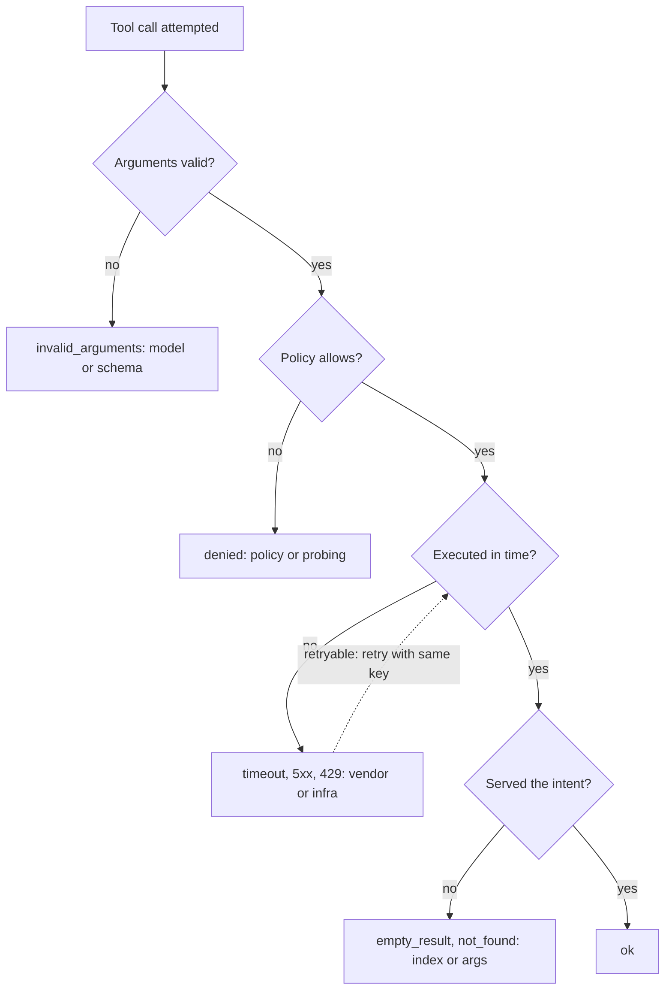

## TL;DR
Tool-call success rate is the fraction of tool invocations that succeed, split into layers: well-formed,
permitted, executed and effective. Failure compounds (ten steps at 95% is about 60% end to end), and the
layers localize it to model, policy, tool or environment.

## For agent builders
- **Why it matters for agents.** Every step of a loop depends on a tool call working, so small per-call
  failure rates compound into failed tasks. The layer that fails tells you who fixes it: the prompt, the
  policy, the integration or the retrieval index.
- **Where it shows up in your stack.** `tool.call.result` events from your adapters, Prometheus-style
  counters by tool and error class, tracing backends, and the join from tool events to task outcomes.
- **What you control.** The shared error taxonomy, the `attempt` and `step_id` fields, automatic retries
  for retryable classes, structured error results that let the model recover, per-tool alerts and the
  per-step target you derive from task goals.
- **What you can skip.** One global success percentage. It averages a broken tool against healthy ones
  and hides which layer failed.

## Why it exists
- **Completion rate says the agent fails, not why.** Most agent failures are tool failures in disguise: a
  malformed argument, a 429 nobody retried, a search that returned nothing useful, a result the model
  misread. Invisible in an outcome metric, obvious in a per-tool breakdown.
- **Per-call failure compounds.** If a task needs ten sequential calls each succeeding with probability p,
  all ten succeed with p¹⁰ (ignoring recovery): 0.99¹⁰ ≈ 0.90, 0.95¹⁰ ≈ 0.60, 0.90¹⁰ ≈ 0.35. A tool that
  fails one call in twenty does not sound broken; it caps a ten-step agent at about 60%.
- **Counting HTTP 200s overstates success:** a 200 with an empty result list, a wrong record or a truncated
  payload counts as fine while the model proceeds on bad data.
- **It also understates it:** a retry that eventually succeeds counts as one or more failures and one
  success, hiding that the step was in fact fine.
- **And it misses calls that never reached the service:** schema-invalid arguments rejected by the adapter,
  or calls denied by policy, which are model and policy problems rather than tool problems.
- **Actionable only when classified:** every call goes into a small, shared error taxonomy by the one
  component that sees everything, the tool adapter, and rates are computed per tool, per error class and
  per cause.

## How it works
### The four layers of "success"
| Layer | Success means | Failure is | Rate |
|---|---|---|---|
| 1. **Well-formed** | Arguments parse and validate against the schema | The model's: wrong type, missing field, hallucinated enum value | schema-valid / attempted |
| 2. **Permitted** | The policy allowed the call (or it was approved) | Policy or prompt: the model keeps asking for what it cannot have | allowed / well-formed |
| 3. **Executed** | Non-error result within the timeout | Infrastructure: timeouts, 5xx, rate limits, auth expiry. The layer the 200-count measures | executed / permitted |
| 4. **Effective** | The result served the intent: relevant hits, the record found, state changed | Subtler: a right call with wrong arguments, or a tool that technically worked and returned nothing | heuristics in production, references or a judge in evaluation |

- **Effectiveness heuristics:** empty result, zero rows affected, result never referenced by the next step.
- **The overall rate is the product of the four,** and that product is usually less informative than the
  layers.

### Instrumentation
- **One event per call.** The adapter emits a `tool.call.result` event with `tool`, `error_class`, `attempt`
  number, `latency_ms` and `retryable`.
- **A fixed taxonomy:** `ok`, `invalid_arguments`, `denied`, `upstream_timeout`, `upstream_error`,
  `rate_limited`, `not_found`, `empty_result`. Each class maps to its layer and its likely owner.
- **Small and shared across tools** is the design choice that makes the metric comparable across tools and
  over time; rates are then simple aggregations.

### Attempts versus steps
Count both:
- ***Per-attempt* success** tells you how healthy the tool is.
- ***Per-step* success,** where a step is the model's intent and may include retries, tells you how often the
  agent got past it.
- **The gap is the retry policy's value.** A tool at 85% per attempt with automatic retry on retryable
  classes might be 98% per step; a widening gap means the tool is degrading while the agent still copes.

### Model-level recovery, and why p^n is a bound
- **The model recovers too.** When `invalid_arguments` comes back with the offending field named, it usually
  fixes the call on its next turn; when a search returns nothing, it may rephrase.
- **Track *recovery rate*:** of steps whose first attempt failed, the fraction where a later call in the same
  step or the next one succeeded. It shows whether structured error results are doing their job.
- **So p^n is pessimistic** for agents that recover well.
- **It can also be optimistic,** because failures are not independent: one vendor outage or one expired
  credential fails every call in a run at once, and a model that misunderstood the task produces a chain
  of individually valid calls aimed at the wrong thing.
- **Use p^n as a planning bound** linking per-step targets to task completion, and measure the real
  relation by joining tool events to task outcomes.

### Attribution
| Rising class | Points at |
|---|---|
| `invalid_arguments` after a prompt change | The prompt or the tool description |
| `denied` | A policy tighter than the task needs, or a model probing |
| `upstream_*` for one tool | The vendor; the earliest signal of an API change |
| `empty_result` | The retrieval index or argument quality |

- **Alert per tool and per class,** *because* an aggregate rate averages a broken tool against nine healthy
  ones.

### Relation to selection accuracy
- **Success rate measures the calls that were made.** It does not catch the call that should have been made
  and was not, or the wrong tool chosen with valid arguments.
- **Those are tool selection accuracy,** measured in evaluation against reference trajectories. Together the
  two cover "did it choose right" and "did it work".

### Targets
1. **There is no universal number;** the useful bar comes from the compounding arithmetic.
2. **Decide the end-to-end completion you need and the typical step count,** then solve for the per-step
   rate: a 90% ten-step task needs roughly 99% per step after retries.
3. **That is the target for the layer-3 and layer-4 rates,** and why idempotent retries matter so much.

## Diagram
Each call is classified at the first layer it fails, which names the owner; only calls passing all four
layers count as effective successes.



## Examples
### Per-tool, per-class rates from the event stream
Per-tool, per-class rates from the event stream, with the layered breakdown and the per-attempt versus
per-step distinction. Running this over a day's events gives the table that identifies which tool, and
which owner, is dragging completion down. The sample data is illustrative.

```python
from collections import defaultdict

LAYER = {"invalid_arguments": "well_formed", "denied": "permitted",
         "upstream_timeout": "executed", "upstream_error": "executed", "rate_limited": "executed",
         "not_found": "effective", "empty_result": "effective"}

def tool_rates(events: list[dict]) -> dict:
    by_tool = defaultdict(lambda: defaultdict(int))
    steps = defaultdict(lambda: defaultdict(set))                 # tool -> step_id -> {ok?}
    for e in events:
        if e["type"] != "tool.call.result":
            continue
        t, cls = e["tool"], e["error_class"]
        by_tool[t]["attempts"] += 1
        by_tool[t][cls] += 1
        steps[t][e["step_id"]].add(cls == "ok")
    out = {}
    for t, c in by_tool.items():
        n = c["attempts"]
        layers = defaultdict(int)
        for cls, k in c.items():
            if cls in LAYER:
                layers[LAYER[cls]] += k
        per_step = sum(True in s for s in steps[t].values()) / max(len(steps[t]), 1)
        out[t] = {"attempts": n, "per_attempt": c["ok"] / n, "per_step": per_step,
                  "model_fail": layers["well_formed"] / n, "policy_fail": layers["permitted"] / n,
                  "infra_fail": layers["executed"] / n, "semantic_fail": layers["effective"] / n}
    return out

def mk(tool, cls, ids):
    return [{"type": "tool.call.result", "tool": tool, "step_id": f"{tool}{i}", "error_class": cls} for i in ids]

events = (mk("search", "ok", range(95)) + mk("search", "empty_result", range(95, 100))
        + mk("lookup", "invalid_arguments", range(12)) + mk("lookup", "ok", range(12, 100))
        + mk("refund", "rate_limited", range(20)) + mk("refund", "ok", range(60)))   # refund0..19 retried after 429

for tool, r in tool_rates(events).items():
    print(tool, {k: round(v, 3) if isinstance(v, float) else v for k, v in r.items()})
# search: per_attempt 0.95, semantic_fail 0.05           -> index or argument quality
# lookup: per_attempt 0.88, model_fail 0.12              -> prompt or tool description
# refund: per_attempt 0.75, per_step 1.0, infra_fail 0.25 -> vendor rate limit; retries are carrying it
```

### Compounding calculator: from task target to per-step target (runnable)
The planning bound in code, including the effect of recovery. It assumes independent steps, so treat the
outputs as bounds, not forecasts.

```python
def end_to_end(p_attempt: float, steps: int, recovery: float = 0.0) -> float:
    """Planning bound: independent steps; recovery = share of failed first attempts later fixed."""
    p_step = p_attempt + (1 - p_attempt) * recovery
    return p_step ** steps

def per_step_needed(target: float, steps: int) -> float:
    return target ** (1 / steps)

for p in (0.99, 0.95, 0.90):
    print(f"p={p}: 10 steps -> {end_to_end(p, 10):.2f}")                 # 0.90, 0.60, 0.35
print(f"95% with 80% recovery: {end_to_end(0.95, 10, recovery=0.8):.2f}")  # 0.90
print(f"need per step for 90% over 10 steps: {per_step_needed(0.90, 10):.4f}")  # 0.9895
print(f"need per step for 90% over 20 steps: {per_step_needed(0.90, 20):.4f}")  # 0.9947
```

| Scenario | Per-step rate | End to end over 10 steps |
|---|---|---|
| Healthy tools | 0.99 | 0.90 |
| One-in-twenty failures, no recovery | 0.95 | 0.60 |
| Same, but 80% of failures recovered | 0.95 + 0.05 × 0.8 = 0.99 | 0.90 |
| Target 90% end to end | needs about 0.9895 | 0.90 |

- **Reading it:** structured errors that let the model recover are worth as much as making the tool itself
  reliable, which is why recovery rate is tracked next to success rate.

## Production patterns
- **Counter per tool and class, alert per tool.** When: from the first tool. How: a counter such as
  `tool_calls_total{tool, error_class}` and an alert on each tool's failure ratio, for example in PromQL
  `sum by (tool) (rate(tool_calls_total{error_class!="ok"}[5m])) / sum by (tool) (rate(tool_calls_total[5m])) > 0.05`.
  Monitor: per-tool ratios, never only the aggregate.
- **Per-attempt and per-step side by side.** When: any tool with automatic retries. How: compute both from
  `attempt` and `step_id` on the result events and plot them together. Monitor: the gap; a widening gap is
  the early warning that retries are carrying a degrading vendor.
- **Route classes to owners.** When: more than one team owns parts of the agent. How: map `invalid_arguments`
  to the prompt and tool-description owners, `denied` to the policy owner, `upstream_*` to the integration
  owner, `empty_result` to the retrieval owner. Monitor: pages that land on the wrong team.
- **Deploy markers on class rates.** When: prompts, tool descriptions or schemas change. How: annotate each
  deploy on the per-tool `invalid_arguments` chart and compare the hour before and after. Monitor: step
  changes in `invalid_arguments` right after a deploy.
- **Join tool events to task outcomes.** When: setting targets. How: join `tool.call.result` events to the
  run's verified outcome by `run_id` and measure completion conditional on each tool's failure, instead of
  relying on p^n alone. Monitor: tools whose failures most reduce completion.

## Trade-offs
- **Shared taxonomy vs vendor detail.** A small shared taxonomy makes rates comparable across tools and
  attributable to owners, but loses vendor-specific detail; keep the raw error in the payload reference and
  the class in the metric.
- **Per-step vs per-attempt.** Per-step success (after retries) reflects what the agent experiences, while
  per-attempt reflects tool health; reporting only the former hides a degrading vendor until retries stop
  saving you.
- **Cheap effectiveness heuristics vs accuracy.** Heuristics like empty results catch real problems but
  misclassify legitimately empty answers; when the base rate of true empties is high, move that check into
  evaluation with references instead of production monitoring.
- **Automatic retries vs latency and duplicates.** Retries raise per-step success but cost latency and, for
  non-idempotent tools, risk duplicates; retry only classes marked retryable and only through adapters with
  idempotency keys.

## Pitfalls
- **Counting HTTP 200 as success.** Symptom: a tool at 99% while the trajectory evals show the model acting
  on empty or wrong results.
- **Aggregating across tools.** Symptom: a healthy-looking 96% overall while one critical tool sits at 70%
  and caps every task that needs it.
- **Not distinguishing schema-invalid from upstream failures.** Symptom: an infrastructure team paged for a
  problem caused by a prompt change.
- **Counting each retry as an independent failure without a per-step view.** Symptom: panic over a 429 storm
  that the agent is actually surviving.
- **Ignoring the compounding arithmetic.** Symptom: a team happy with 95% per tool and puzzled that
  ten-step tasks complete 60% of the time.
- **Treating denied calls as tool failures.** Symptom: loosening a permission policy to improve a metric
  that was signalling a model probing beyond its scope.
- **Returning opaque error strings, then wondering why recovery is low.** Symptom: a model that repeats the
  identical failing call two or three times before giving up, visible as consecutive identical
  `invalid_arguments` events within one step.

## When to use
- **Instrument it from the first tool,** because the adapter already sees every outcome and the cost is one
  event per call.
- **Operations:** per-tool, per-class dashboards with alerts per tool rather than on the aggregate.
- **Post-mortems and trajectory evaluation:** use the layered breakdown to assign each failure an owner.
- **Targets:** derive them from the compounding formula and the step counts of your real tasks.
- **Watch** per-attempt and per-step side by side so vendor degradation is visible before it reaches users,
  and add recovery rate after model-visible failures, which tells you whether your error results are good
  enough for the model to act on.
- **Interviews:** "how do you know your tools work" is answered by the four layers, the taxonomy,
  attribution to an owner, and the p^n argument that links tool reliability to task completion.

## Role lens
- **Engineer:** Emits a classified result event from every adapter, builds the per-tool breakdown, and
  wires retries only to retryable classes with idempotency keys.
- **Architect:** Owns the error taxonomy and its layer mapping, sets per-tool targets from the compounding
  arithmetic, and decides which classes page which team.
- **FDE:** Uses the per-tool breakdown to show a customer that completion dropped because their API
  started rate-limiting, not because the model got worse.

## Check yourself
**Q:** Completion rate on ten-step tasks fell from 80% to 55% this week with no prompt or model change.
The aggregate tool success rate is still 96%. Where do you look, and what do you expect to find?
**A:** The aggregate is averaging nine healthy tools against one broken one, so I break it down per tool
and per error class. A drop from 80% to 55% on ten-step tasks needs a per-task factor of about 0.69, and
per-step rates multiply, so it is consistent with one tool that appears about three times per task
falling to roughly 88% per step (0.80 × 0.88³ ≈ 0.55). If that tool carries around a third of all calls,
it moves the aggregate by only three or four points, which is why 96% still looks healthy. I would
expect to see a single tool with a rising `upstream_timeout`, `rate_limited` or `empty_result` class,
which points at a vendor change, a quota, or a retrieval index issue respectively, and I would compare
per-attempt with per-step rates to see whether retries are already masking part of it. If instead
`invalid_arguments` rose, something changed in the tool description or schema even though the prompt did
not. The fix follows the class: backoff and idempotent retries for infrastructure, a schema or description
change for arguments, an index check for empties.

## Interview questions
### Why is counting HTTP 200 responses a bad measure of tool success?
- **It overstates:** a 200 with an empty list, a wrong record or a truncated payload counts as success while
  the model acts on bad data.
- **It understates:** a call that succeeded after a retry shows up as failures plus a success, hiding that
  the step was fine.
- **It is blind upstream:** schema-invalid and policy-denied calls never reach the service, so a 200-count
  cannot see model or policy problems.

### A tool's `invalid_arguments` rate jumped from 1% to 12% right after a deploy. What happened and what do you do?
- **Likely cause:** the deploy changed the tool's schema or description (a renamed argument, a narrowed
  enum), and the model still emits the shape it learned from prompts and examples.
- **Confirm:** look at the rejected fields in the structured errors; one field dominating points at the
  rename.
- **Fix:** restore the old contract or ship the change as a new versioned tool, rather than patching the
  prompt.

### Should you retry every failed tool call automatically?
- **No:** retry only classes marked retryable (timeouts, rate limits, transient 5xx), because
  `invalid_arguments` or `denied` will fail the same way again.
- **Only with idempotency keys** for tools with side effects, or a retry after a lost response creates a
  duplicate.
- **Watch the cost:** retries add latency, and a large per-attempt versus per-step gap means a vendor
  problem to fix, not a retry budget to raise.

### You need 90% completion on ten-step tasks. What per-step success rate do you need?
- **Solve the bound:** 0.9 to the power one tenth is about 0.9895, so roughly 99% per step after retries.
- **Recovery helps:** at 95% per attempt, recovering 80% of failures lifts the per-step rate to 0.99.
- **Treat it as a bound:** correlated failures such as an outage break independence, so confirm by joining
  tool events to task outcomes.

### How does tool-call success rate differ from tool selection accuracy?
- **Success rate** measures the calls that were made: well-formed, permitted, executed, effective.
- **Selection accuracy** catches the call that should have been made and was not, or a wrong tool with
  valid arguments; it is measured in evaluation against reference trajectories.
- **You need both:** one answers "did it work", the other "did it choose right".

## Quiz
### Q: Why does a tool with 95% per-call success matter more than it sounds for an agent?
- [ ] Because tool calls are billed at a higher rate than model tokens
- [x] Because multi-step tasks compound per-call failure, so ten sequential calls at 95% succeed end to end only about 60% of the time
- [ ] Because the model refuses to use tools below 99% success
- [ ] Because 95% is below the industry standard of 99.9%
> Task success is roughly the product of step successes; 0.95¹⁰ ≈ 0.60. Small per-tool losses become
> large task losses.

### Q: A tool returns HTTP 200 with an empty list for a query that should have matched. Which layer failed?
- [ ] Well-formed, because the arguments were wrong
- [ ] Executed, because the service did not return data
- [x] Effective, because the call ran but did not serve the intent
- [ ] Permitted, because the policy should have blocked an unproductive call
> The call parsed, was allowed and executed; it failed at the semantic layer, which a 200-count cannot
> see and which the model may not notice either.

### Q: After a 429 storm, per-attempt success for one tool is 75% while per-step success is still 99%. What does this tell you?
- [ ] The metric is broken and should be recomputed
- [x] Retries are absorbing the failures, so users are unaffected for now but the vendor or quota problem needs fixing before retries stop coping
- [ ] The model is sending invalid arguments on first attempts
- [ ] The policy is denying first attempts and approving retries
> Per-attempt measures tool health, per-step measures what the agent experiences; a widening gap is the
> early warning that a tool is degrading.

## Use cases & projects
### Use cases
- **Catching a bad tool-description deploy.** A step change in `invalid_arguments` for one tool right
  after a deploy points at the contract, not the vendor.
- **Early warning on vendor degradation.** A widening gap between per-attempt and per-step success shows
  retries carrying a failing API before tasks start failing.
- **Routing pages to the right team.** Error classes map to prompt, policy, integration and retrieval
  owners, so alerts land with whoever can fix them.
- **Setting reliability targets.** Working back from a task-completion goal and step count gives the
  per-step rate each tool must hit.

### Mini project
**Tool-call health dashboard for an agent (1-2 hours).**
- **Goal:** measure tool success by layer and connect it to task outcomes.
- **Steps:** make your agent's adapters emit `tool.call.result` events with `tool`, `error_class`,
  `attempt` and `step_id`; inject faults (bad arguments, a 429 storm, empty results) into fake tools; run
  30 tasks; compute per-attempt and per-step success per tool and class, the recovery rate, and completion
  conditional on each tool failing.
- **Done when:** a table or chart shows each tool's rates by class, the injected 429 storm appears as a
  per-attempt drop with per-step success held up by retries, and you can name the tool whose failures most
  reduce completion.
