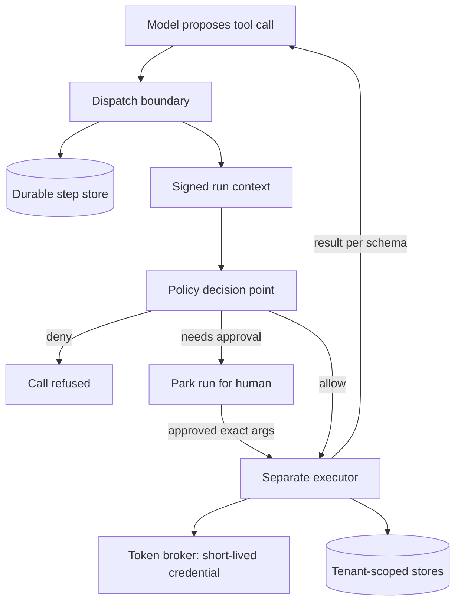

## Overview
This module covers the parts of an agent system that sit around the model rather than inside it. The
model proposes tool calls; the runtime decides what actually happens, where state lives, who the agent acts
as and which credentials it may use.

It starts with the runtime and orchestration layer: the loop of call model, dispatch tool, record result,
rebuilt as a long-lived, crash-safe unit of work. That unit persists before it executes, pauses for approvals
without holding a thread, and coordinates sub-agents, queues and budgets.

Every later topic plugs a
cross-cutting rule into that layer's dispatch boundary.

What this module gives an agent builder:
- **A durable loop.** The runtime and orchestration layer turns a prototype `while` loop into a run that survives restarts, resumes without repeating side effects and can park for a human.
- **Approval and authorization boundaries.** These decide whether a principal may take an action at all and whether a human must confirm this exact instance, with the approval bound to the precise arguments.
- **Policy enforcement.** This generalises that check across many agents and tool servers by splitting one policy decision point from many enforcement points, and by attenuating authority down a delegation chain.
- **Multi-tenant state isolation.** This inventories every place tenant data lands (step logs, memory, vector indexes, caches, sandboxes, traces) and enforces scoping structurally at each store.
- **Secrets and credential isolation.** This keeps credentials out of the context window entirely, minting short-lived, per-tenant tokens inside a separate executor.
- **Cross-language API contracts.** These make the tool schemas, event streams and checkpoints that cross Python, TypeScript and the model itself one generated, validated source of truth.

Core versus background for agents:
- **Core (all six lessons):** agent-runtime-and-orchestration-layer, approval-and-authorization-boundaries, policy-enforcement-across-agents-and-tools, multi-tenant-state-isolation, secrets-and-credential-isolation and cross-language-api-contracts. You use each one directly the moment an agent takes real actions.
- **Background:** none in this module. The background material lives inside each lesson, for example XACML, CaMeL-style information-flow tracking and running your own KMS, which you should recognise but can skip building.

What you can build afterwards:
- **A runtime diagram.** Draw a production agent runtime layer by layer, and explain where each control lives and why it cannot live in the prompt.
- **Tested controls.** Prove the controls hold with kill tests, canary leak tests, injection tests and secret scans.
- **A multi-tenant agent platform.** Ship agents that take real actions for more than one customer and pass a customer's security review.

It matters most for Architects and AI Engineers shipping agents that take real actions for more than one
customer, and for FDEs who must pass a customer's security review.

## Why it matters
- **Engineer:** You will write the agent's dispatcher, the step store, the tool adapters and the schema generation step, so you need to know why state is persisted before a tool runs, how a run context with tenant and user identity is threaded through every adapter, and how to prove with a kill test and a canary test that resume and isolation actually work.
- **Architect:** You own the decision of where each control lives in the agent platform: one policy decision point versus checks scattered in agents, storage-level tenant scoping versus remembered filters, a token broker versus secrets in environment variables, and a neutral contract versus hand-kept types. Those choices decide auditability, blast radius and how cheaply the system can add agents.
- **FDE:** Customer security teams will ask who the agent acts as, what it can touch, who approves irreversible actions, where their data and tokens live and how deletion works. You need to answer with the architecture, configure approval tiers and connected-account scopes for their environment, and demonstrate the leak and revocation tests on their tenant.

## Mental model
Picture the model as an untrusted planner sitting inside a ring, and the runtime as the ring. The model can
only propose: a tool name and some arguments.

Everything that turns a proposal into an effect happens on the runtime side of one boundary, the
tool-dispatch point. Every concern in this module is a check stacked on that boundary.

| Step at the dispatch boundary | What happens | Lesson |
|---|---|---|
| 1. Persist | The runtime has already written the step to durable state | agent-runtime-and-orchestration-layer |
| 2. Attach context | A signed run context (tenant, user, delegated scope, provenance of the data in play) that the model never produced | multi-tenant-state-isolation, policy-enforcement-across-agents-and-tools |
| 3. Decide | One policy engine returns a decision | policy-enforcement-across-agents-and-tools |
| 4. Approve | If the action is consequential, the run parks until a human approves those exact arguments | approval-and-authorization-boundaries |
| 5. Execute | A separate executor resolves a named connection to a short-lived credential | secrets-and-credential-isolation |
| 6. Write | Results go only into stores scoped by that context | multi-tenant-state-isolation |
| Every arrow | The data follows one generated schema | cross-language-api-contracts |

The model sits at the top and only ever sends proposals into the dispatch boundary; everything below it
is the runtime this module builds. If an action can reach a side effect without crossing that boundary,
the design has a hole.

## Suggested order
1. agent-runtime-and-orchestration-layer — establishes the loop, durable step state and the dispatch boundary that every other control attaches to.
2. approval-and-authorization-boundaries — the first and simplest check at that boundary: may this principal act, and does a human need to confirm this call.
3. policy-enforcement-across-agents-and-tools — scales that single gate into a decision point with many enforcement points and attenuated delegation across agents.
4. multi-tenant-state-isolation — applies the signed run context to every store the runtime writes, so tenant identity never comes from model output.
5. secrets-and-credential-isolation — builds on tenant and user scoping to mint per-tenant, short-lived credentials the model can name but never see.
6. cross-language-api-contracts — ties the layers together by making tool schemas, events, run context and checkpoints one validated contract across languages and the model.

## Capstone
### Brief
This is the module's major project, a multi-day build. **Use case:** a helpdesk SaaS vendor wants a support
agent that acts for many customer companies at once, and every customer's security team must sign off.

Build a small multi-tenant agent runtime for a fictional helpdesk product. The agent can read tickets,
search a knowledge base, and take two consequential actions:
- **Refunds** through a mock payments API.
- **Customer email** through a mock mail API.

Two tenants, each with two users of different roles, share the deployment. The requirements, one lesson
each:
- **Durable worker.** The loop runs as a durable worker, not inside a request handler. Each step is persisted before its tool executes, and killing the worker mid-run must resume without repeating a refund.
- **One policy decision point.** Every tool call passes through it, combining the user's rights with the agent's delegated scope.
- **Bound approvals.** Refunds above a threshold and all outbound email park the run for approval bound to a fingerprint of the arguments, with a TTL and re-authorization on resume.
- **Attenuated sub-agents.** A planner agent may spawn a research sub-agent whose scope is attenuated from its parent.
- **Tenant scoping.** Tenant identity comes only from authentication and scopes the step store, the vector index, a semantic cache and traces at the storage layer.
- **Credential isolation.** Credentials for the mock APIs live in a vault-backed broker in a separate executor process.
- **One contract.** Tool definitions, run events and the run context are defined once in a schema that generates both the Python runtime types and a TypeScript client that streams run events to a minimal approvals UI.

### Deliverables
- A runnable repository with the durable worker, step store, policy decision point, tool executor process, token broker and approvals UI, started with one command against local mock services.
- An architecture diagram of the layers and trust zones, plus a one-page surface inventory listing every store that holds tenant data and the storage-level mechanism that scopes it.
- A `contracts/` directory with the shared schema, generated Python and TypeScript types, and a CI step that regenerates and fails on diff.
- A test suite covering a forced-kill resume, a cross-tenant canary leak test across every listed store, a prompt-injected document that attempts an unapproved refund and email exfiltration, and an environment and filesystem scan proving no secret is reachable from the loop or sandbox.
- A short write-up with measured steps per run, model versus tool time, policy-gate coverage, approval and reject rates per tool, and token TTL and revocation-to-last-use time.

### Rubric
- Killing the worker at any step and restarting it completes the run with exactly one refund recorded in the mock payments API, shown by a test that repeats the kill at several points.
- Every tool invocation in the step log has a matching logged policy decision (coverage is 100%), and a sub-agent's effective scope is provably a subset of its parent's; a test that asks the sub-agent to exceed it is denied.
- Changing any argument of an approved refund after approval invalidates it, an expired approval cannot be used, and the injected-document test produces a denied or parked call, never an executed one.
- The canary test seeds a unique string in tenant A in every store and confirms tenant B's runs, searches, cache hits and trace queries never return it; no tool accepts `tenant_id` as a model-supplied argument.
- No credential value appears in prompts, tool arguments, traces, step logs or the sandbox environment, and revoking a tenant's connection stops its next tool call within the measured window.
- Renaming a field in the schema without regenerating breaks CI, and the TypeScript client tolerates an unknown new event type without throwing.
