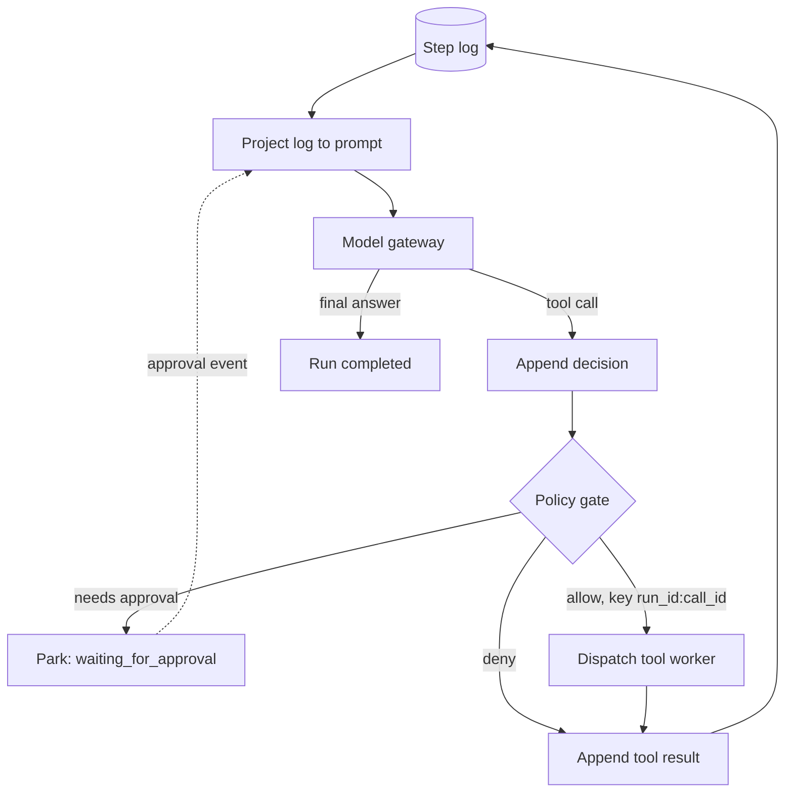

## TL;DR
The runtime owns your agent's loop (call model, run tool, feed back) as a crash-safe, policy-checked unit of
work; orchestration coordinates many runs. Both exist because loop state outlives processes, tools have side
effects, and rules need one enforcement point.

## For agent builders
- **Why it matters for agents.** The `while` loop you prototype with is the part that breaks first in
  production: restarts lose the transcript, re-run side effects and cannot pause for a human. The runtime
  is what turns a demo agent into one you can deploy, resume and audit.
- **Where it shows up in your stack.** LangGraph checkpointers and `interrupt()`, Temporal workflows and
  activities, hosted vendor agent APIs, or your own run table, step log and worker pool behind a queue.
- **What you control.** The step log schema, write-ahead ordering, idempotency keys of the form
  `run_id:call_id`, lease length, the single gated dispatch path, and how sub-agent scopes and budgets are
  derived from the parent run.
- **What you can skip.** Building your own workflow engine or scheduler from scratch. Assemble from an
  engine or framework, but know the layers so you can see what each one leaves to you.

## Why it exists
- **The first agent is a `while` loop in a request handler.** Call the model, run any tool call, append the
  result, repeat until it answers. It works in a demo and fails in production for reasons unrelated to the
  model.
- **The loop is long-lived.** A real task takes dozens of steps and minutes to hours, beyond an HTTP timeout
  or a pod's lifetime. On restart the in-memory message list is gone, so the task starts over and re-executes
  side effects it already performed.
- **The loop has to pause.** It waits for a human approval, a slow external job or a rate limit. A function
  on the call stack cannot pause for a day.
- **Cross-cutting rules multiply.** Every tool call needs a policy check, tenant and user attribution, the
  right credentials, an audit entry and a budget charge. Bespoke loops reimplement each rule slightly
  differently, a spawned sub-agent inherits none of them, and you still need to stream, trace and replay
  the loop.
- **"Add retries and a bigger timeout" fixes none of this.** What is missing is separation of concerns: the
  model decides, a distinct runtime owns lifecycle, state, dispatch and rules. It is a workflow engine or OS
  scheduler specialised for a loop whose next step a model chooses.

## How it works
### The run as a persisted state machine
- **A run is the unit of work.** It has an identity (run id, tenant, user, parent run), a status, and an
  append-only log of **steps**: model decisions, tool calls, tool results, approvals, errors.
- **The prompt is a projection of the log,** not a mutable list held in memory. This is event sourcing,
  chosen because it gives three things for free:
  1. **Resume** after a crash: replay the log, rebuild the prompt.
  2. **Audit:** the log is the record.
  3. **Compaction:** summarise old steps into one synthetic step without losing the originals.
- **Status is an explicit state machine:**
  `created → running → waiting_for_tool | waiting_for_approval | waiting_for_event → running → completed | failed | cancelled`.
- **Explicit waiting states let the loop pause for a day.** The run is parked in storage with nothing on a
  call stack, and an external event (approval granted, webhook arrived) re-schedules it.

### Write-ahead ordering inside a step
A step cannot be one database transaction, because the tool's side effect (an email sent, a ticket opened)
happens in another system that cannot join your transaction. So the runtime brackets the side effect with
two durable writes, like a database write-ahead log:
1. Record the model's decision (the tool call it wants) **before** executing the tool.
2. Record the tool result **before** calling the model again.

That ordering makes every crash point distinguishable on recovery:

| Log ends with | Meaning | Recovery action |
|---|---|---|
| tool result | step complete | call the model for the next decision |
| decision, no result | tool never ran, or ran with unknown outcome | re-issue with the same idempotency key, or ask the tool for the outcome |
| nothing new | model call lost | call the model again (costs tokens, no side effect) |

- **The middle row needs idempotent tools.** The re-issued call carries the same key (`run_id:call_id`) and
  the tool deduplicates on it. One without the other still duplicates emails and tickets.
- **The event stream has the same problem.** Publishing an event and writing the log are two systems, so a
  runtime that must never lose events writes them to an outbox table in the same transaction as the step
  and publishes from there.

### Ownership: leases and fencing
- **Re-scheduling creates a hazard.** The "crashed" worker may only be slow (a long GC pause, a network
  partition) and still executing. Two workers advancing one run fork its log and double its side effects.
- **A lease gives one worker the run at a time.** It has an expiry and is renewed by heartbeat.
- **A fencing token guards every append.** Each lease carries a monotonically increasing token; the store
  rejects writes from a stale token.
- **Lease length is a trade.** Short leases recover dead workers quickly but falsely expire healthy ones
  during long tool calls, so long tools should heartbeat or run asynchronously with the run parked in
  `waiting_for_tool`.

### Layers of the runtime
A production runtime is a stack of narrow, replaceable components:

1. **Model gateway** — provider abstraction, retries, routing, token accounting. The loop never calls a
   vendor SDK directly, so a provider change or fallback does not touch agent logic.
2. **Executor (the loop)** — projects the log to a prompt, calls the gateway, parses the decision, advances
   the state machine. It is stateless between steps; all state is in the store.
3. **Policy and authorization gate** — every tool call passes through it before dispatch, because the
   model's output is untrusted input and the gate is the only place the organisation's rules are enforced.
4. **Tool dispatch** — hands calls to tool workers, usually out of process (queue or RPC), with the run
   context (tenant, user, budget, delegation chain) attached. That gives isolation, independent scaling and
   freedom to write tools in another language.
5. **State store** — run records, step log, checkpoints, approval requests.
6. **Event stream** — each appended step is published, so UIs, traces and evaluators observe the run live
   rather than polling the store.

| Plane | Contains | Why separate |
|---|---|---|
| Control plane | run lifecycle, scheduling, policy, budgets | small, must be highly consistent |
| Data plane | model inference, tool execution | where cost and latency live |

They are split because they scale, fail and are secured differently.

### The orchestration layer
Orchestration decides *which* runs exist and how they relate. Common patterns:
- **Supervisor** spawns sub-agent runs and waits for them.
- **Handoff** transfers a run from one agent definition to another.
- **Fan-out with a join** runs over a list and merges results.
- **Admission queue** admits runs under concurrency and cost limits.

A sub-agent is simply another run with a `parent_run_id`, and its context is **attenuated** from the parent:
scopes are intersected, budgets subtracted, deadlines inherited. This is deliberate, because a child that
starts fresh can do what its parent was forbidden to do.

### Build vs assemble
- **Durable workflow engines** (Temporal and similar) and **graph frameworks** (LangGraph and similar)
  provide many pieces, notably persisted state and resumable execution.
- **Hosted "agent" APIs** from model vendors provide the loop and tool dispatch but typically leave policy,
  tenancy and credential handling to you.
- **Either way,** the architecture above is what you are assembling.

## Diagram
Follow one step: the decision is written before the tool runs, the policy gate can park the run, and the
result is written before the model is called again.



## Examples
### Minimal runtime with a policy gate and resume
The run is an append-only log, the prompt is projected from it, every tool call passes a policy gate
before dispatch, and approvals park the run instead of blocking a thread. The same `tick()` resumes after a
crash or an approval because it first looks for a decided-but-unexecuted call in the log.

```python
from dataclasses import dataclass, field

@dataclass
class Run:
    id: str; tenant: str; user: str
    status: str = "running"
    steps: list = field(default_factory=list)          # append-only; the prompt is derived from it

def project(steps):                                    # log -> messages for the next model call
    return [s["message"] for s in steps if "message" in s]

def pending_call(steps):                               # decision recorded, result not: resume point
    last = steps[-1] if steps else None
    return last.get("call") if last and last["type"] == "model" else None

class Runtime:
    def __init__(self, gateway, tools, policy, store, events):
        self.gateway, self.tools, self.policy, self.store, self.events = gateway, tools, policy, store, events

    def append(self, run, step):
        run.steps.append(step)
        self.store.append(run.id, step)                # durable before anything else happens
        self.events.publish(run.id, step)              # UIs, traces and evals subscribe here

    def tick(self, run: Run, max_steps=40):
        while run.status == "running" and len(run.steps) < max_steps:
            call = pending_call(run.steps)             # after a crash or an approval, don't re-ask the model
            if call is None:
                d = self.gateway.complete(project(run.steps), tenant=run.tenant)
                self.append(run, {"type": "model", "message": d.message, "call": d.tool_call})
                if d.tool_call is None:
                    run.status = "completed"; break
                call = d.tool_call
            verdict = self.policy.check(run, call)     # allow | deny | needs_approval (reads approval records)
            if verdict.effect == "needs_approval":
                run.status = "waiting_for_approval"    # parked; the approval event re-schedules tick()
                self.store.request_approval(run.id, call); break
            out = ({"error": f"denied: {verdict.reason}"} if verdict.effect == "deny" else
                   self.tools.dispatch(call, ctx=run, idempotency_key=f"{run.id}:{call.id}"))
            self.append(run, {"type": "tool_result", "call_id": call.id,
                              "message": {"role": "tool", "tool_call_id": call.id, "content": out}})
        if run.status == "running":
            run.status = "failed"                      # budget exhausted is a terminal state, not a hang
        self.store.save(run)
```

### Worked trace: a refund that waits a day for approval
| Moment | What happens |
|---|---|
| Step 1 | the log records the decision `refund(order=812, amount=40)` |
| Policy check | returns `needs_approval`; the run is saved as `waiting_for_approval` and the worker is free |
| A day later | the approval is recorded and the run is re-queued |
| Resume | `tick()` finds the pending call in the log; the policy now sees the approval and returns `allow` |
| Dispatch | the refund goes out with key `run_7:call_1` |
| Worker dies mid-dispatch | the next worker repeats exactly that path; the payment service sees the same key and refunds once |

### Runnable: crash between side effect and result
Pure Python, no dependencies. The worker is "killed" after the email is sent but before the result is
logged; recovery classifies the log tail and re-issues with the same key, so exactly one email goes out.

```python
class EmailTool:                       # a side-effecting tool that dedups on the key
    def __init__(self): self.sent, self.seen = [], {}
    def send(self, to, key):
        if key in self.seen:           # re-issue after an unknown outcome: return the first result
            return self.seen[key]
        self.sent.append(to)
        self.seen[key] = {"status": "sent", "to": to}
        return self.seen[key]

def recovery_action(log):              # classify the tail of a run's step log
    if not log or log[-1]["type"] == "tool_result":
        return "call_model"
    return "reissue_same_key"          # decision recorded, result missing

tool, log = EmailTool(), []
log.append({"type": "model", "call": {"id": "call_1", "to": "ana@example.com"}})  # write-ahead
tool.send("ana@example.com", key="run_7:call_1")   # side effect happens...
# ...and the worker is killed here, before the result is appended.

print(recovery_action(log))                        # reissue_same_key
out = tool.send("ana@example.com", key="run_7:call_1")
log.append({"type": "tool_result", "call_id": "call_1", "content": out})
print(recovery_action(log), len(tool.sent))        # call_model 1
```

## Production patterns
- **Fenced lease on every append** — when more than one worker can pick up runs. Store a lease token on the
  run row and write with a conditional update such as `UPDATE runs SET ... WHERE id = $1 AND lease_token =
  $2`; zero rows updated means you lost ownership, so stop. Monitor lease expiries and rejected writes.
- **Heartbeat long tools** — when a tool call can outlast the lease. In Temporal, set a heartbeat timeout on
  the activity and call `activity.heartbeat()` from the Python SDK inside the loop; elsewhere, renew the
  lease from the tool worker. Monitor false lease expiries during healthy calls.
- **Checkpointer plus interrupt for approvals** — when using LangGraph. Compile the graph with a persistent
  checkpointer (a Postgres-backed one, not in-memory) and pause with `interrupt()` before consequential
  tools, resuming by thread id. Monitor runs parked in waiting states and their age.
- **Transactional outbox for step events** — when UIs or evaluators must never miss a step. Insert the step
  and an outbox row in one transaction, and have a relay publish and mark rows sent. Monitor outbox lag
  and unsent row count.
- **Drain on shutdown** — when deploys kill workers. Handle SIGTERM by finishing the in-flight step and
  releasing leases, with Kubernetes `terminationGracePeriodSeconds` longer than a typical step. Monitor
  steps re-issued after deploys.
- **Budget on the run tree** — when supervisors spawn children. Keep the remaining budget on the root run
  and decrement it atomically for every child's model and tool call. Monitor spend per root run against
  its limit.

## Trade-offs
- **Separate runtime vs inline loop.** You gain durability, observability and one enforcement point, and pay
  a persistence round-trip per step plus real operational surface. For a single-shot, side-effect-free call
  that finishes in seconds, an inline loop is the right call.
- **Out-of-process vs in-process tools.** Out-of-process dispatch gives isolation, independent scaling and
  polyglot tools, at the cost of serialisation, queue latency and more failure modes. Keep cheap pure
  functions in-process.
- **Append-only log vs mutable state blob.** The log makes replay and audit trivial but grows without bound,
  so you must own compaction and retention. A mutable blob is simpler until the first "what happened?"
  incident.
- **Durable workflow engine vs bespoke.** An engine saves writing checkpointing and timers, but deterministic
  replay and versioned workflow code constrain how agent code changes. That bites when runs live for days
  while agent code ships daily, and matters little when runs drain before a deploy.
- **Hosted vendor runtime vs your own.** It removes the loop entirely, but you inherit their state model,
  pay their per-call and per-tool pricing, and still build policy, tenancy and credential handling around
  it.

## Pitfalls
- **Executing the tool before persisting the model's decision.** Symptom: duplicated side effects (two
  tickets, two emails) after every deploy or OOM kill. Fix: write-ahead the decision, then dispatch with an
  idempotency key.
- **Building the prompt from an in-memory list rather than the persisted log.** Symptom: runs silently
  restart from scratch after a pod restart. Fix: project the prompt from the store on every step.
- **A path that skips the policy gate.** The orchestrator or a sub-agent calls tools directly. Symptom: audit
  logs show executed actions with no corresponding policy decision. Fix: one dispatch path, gated.
- **Budgets per model call, not per run tree.** Symptom: a supervisor spawns ten children, each within
  budget, and spends ten times the limit. Fix: subtract child budgets from the parent's remainder.
- **Re-scheduling without a lease or fencing token.** Symptom: a run log with two interleaved branches and
  duplicated tool calls after a worker stalled rather than died. Fix: fenced appends.
- **Blocking a worker thread while waiting for a human approval.** Symptom: a thread pool exhausted by runs
  that are "running" but doing nothing. Fix: park the run in an explicit waiting state.
- **Coupling the executor to one vendor's tool-call wire format.** Symptom: a provider fallback that requires
  rewriting the loop under incident pressure. Fix: normalise calls in the model gateway.

## When to use
- **Use a real runtime when** an agent runs longer than a request timeout, performs side effects, needs human
  approval mid-task, serves more than one tenant, or spawns other agents.
- **Avoid it when** none of those apply: a loop in a handler with a step cap is fine, and you should say so.
- **Measure:** steps per run, wall time per step split into model versus tool time, resume success rate after
  a forced kill, and the fraction of tool calls that pass through the policy gate (it should be 100%).
- **Interviews:** draw the layers, explain why persistence happens before execution, show how an approval
  pauses a run without holding a thread, and describe how a sub-agent's authority and budget derive from
  its parent.

## Role lens
- **Engineer:** Implements the executor against a gateway and tool dispatcher, writes the step log and
  projection, and proves resume works by killing the process mid-run in a test.
- **Architect:** Owns the control-plane/data-plane split, the choice between a workflow engine, a
  framework and a bespoke runtime, and the rule that all tool calls pass one gate.
- **FDE:** Maps the runtime's layers onto a customer's existing queue, identity and audit systems, and
  explains why their "just call the API in a cron job" design loses work on restart.

## Check yourself
**Q:** A team's agent sends a customer email as a tool call. After a deploy, several customers received the
same email twice. Walk through where in the runtime the bug most likely is and how a correct design prevents
it.
**A:** The loop almost certainly executed the email tool and then crashed (or was terminated by the deploy)
before the tool result was persisted, so on restart the run's log ended with a model decision that had no
result and the executor re-ran it. A correct design does two things. First, it persists the model's decision
before dispatch and the result immediately after, so recovery can distinguish "never attempted" from
"attempted, outcome unknown". Second, every dispatch carries an idempotency key derived from `run_id` and
`call_id`, and the email tool (or its adapter) deduplicates on it, so even a legitimate re-issue after an
unknown outcome sends once. A strong answer adds that side-effecting tools should be classified so recovery
asks the tool for the outcome rather than re-executing, and that graceful shutdown should drain in-flight
steps before the process exits.

## Interview questions
### What is the difference between an agent runtime and an agent framework or SDK?
- **A runtime owns the lifecycle.** It persists each run as a step log, schedules and resumes it, enforces
  policy before every tool call, and publishes events; a framework mostly gives you the loop shape.
- **Why it matters:** loop state must outlive processes and side effects must not repeat, which is a
  storage and scheduling problem rather than a prompting problem.

### A run's log shows two interleaved branches and every tool call doubled. What happened and how do you fix it?
- **Diagnosis:** two workers advanced the same run, usually because a worker stalled (GC pause, network
  partition), its ownership was assumed lost, and the run was re-scheduled while it kept executing.
- **Fix:** hand runs out under a lease renewed by heartbeat, and carry a monotonically increasing fencing
  token on every append so the store rejects writes from the stale worker.
- **Also:** pair it with idempotency keys so any side effect that slipped through deduplicates downstream.

### When would you not build a separate runtime?
- **Short, side-effect-free calls.** A single-shot classification or summary that finishes in seconds gains
  nothing from durability and pays a persistence round-trip per step.
- **The flip condition:** the moment the agent outlives a request timeout, performs side effects, needs
  approval, serves multiple tenants or spawns sub-agents, the inline loop starts losing work and rules.

### How should a sub-agent's permissions and budget relate to its parent's?
- **Attenuated, never fresh.** Scopes are the intersection with the parent's, budget is a share of the
  parent's remainder, and deadlines are inherited from the parent run.
- **Why:** a child started with default scopes can do what its parent was forbidden to do, turning
  orchestration into a privilege and cost escalation path.
- **How to enforce:** record `parent_run_id` and keep the remaining budget on the root run so every
  descendant decrements the same counter.

### What would you measure to know the runtime is healthy in production?
- **Resume success rate after forced kills,** because it proves write-ahead ordering and idempotency work
  rather than assuming they do.
- **Policy-gate coverage,** the fraction of tool calls with a matching policy decision, which should be
  100%; anything less is an ungated path.
- **Step time split into model versus tool time, plus waiting-state age,** so you can tell slow models from
  slow tools and spot runs stuck in approval.

## Quiz
### Q: Why does a production agent runtime build the model prompt from a persisted step log instead of an in-memory message list?
- [ ] Persisted logs reduce the number of tokens the model needs to read
- [x] So a run can be resumed, audited and compacted from durable state after a crash or pause
- [ ] Because model providers require a stored transcript for tool calling
- [ ] To avoid holding message objects that would exceed the process memory limit
> Deriving the prompt from the log means nothing of value lives only on a call stack: a run can be
> re-scheduled on any worker after a restart or a day-long approval wait, and the same log doubles as the
> audit trail. Token count and provider requirements are unaffected.

### Q: A sub-agent spawned by a supervisor is given a fresh context with the agent's default tool scopes. What is the architectural flaw?
- [ ] The child will not share the parent's KV cache, raising latency
- [ ] Sub-agents must always run in the same process as their parent
- [x] The child's authority and budget are not attenuated from the parent's, so it can do what the parent could not
- [ ] Fresh contexts prevent the supervisor from reading the child's final answer
> Delegation must be monotonic: a child's scopes should be the intersection with the parent's, and its budget
> a share of the parent's remainder. Starting fresh turns multi-agent orchestration into a privilege and
> cost escalation path.

### Q: Which design lets a run wait a day for a human approval without wasting resources?
- [ ] Sleep the worker thread with a long timeout and poll the approval table
- [ ] Keep the run in memory and retry the tool call every minute until approved
- [x] Persist the run in a waiting state with no thread attached, and re-schedule it when the approval event arrives
- [ ] Ask the model to re-plan without the tool so no approval is needed
> Making "waiting_for_approval" an explicit, persisted state means the loop holds no process resources while
> parked; the approval becomes an event that re-queues the run. Sleeping threads exhaust pools, and silently
> re-planning around the approval defeats the control.

## Use cases & projects
### Use cases
- **Support agents that issue refunds or credits.** The run parks in `waiting_for_approval`, survives a
  day-long wait, and the idempotency key makes the refund take effect once even if dispatch is retried.
- **Long-running coding and research agents.** Dozens of steps over minutes to hours outlive any request
  timeout, so the step log and resume path carry the task across restarts and deploys.
- **Supervisor agents that fan out to sub-agents.** Child runs carry a `parent_run_id`, attenuated scopes
  and a share of the root budget, so ten children cannot spend ten times the limit.
- **Agent platforms serving many teams.** One gated dispatch path gives every agent the same policy, audit
  and budget rules instead of each loop reimplementing them.

### Mini project
**Kill-test a minimal agent runtime (2-3 hours).**
- **Goal:** prove that a tool-calling agent resumes after a crash without repeating a side effect.
- **Steps:** store runs and steps in SQLite; implement `tick()` with write-ahead ordering (decision before
  dispatch, result before the next model call); add a fake email tool that deduplicates on
  `run_id:call_id`; add a policy stub that returns `needs_approval` for one tool; kill the process
  between the side effect and the result append, then restart and resume.
- **Done when:** a test kills the worker at each of the three crash points in the recovery table, every
  run completes after restart, the email tool's sent list has exactly one entry per call, and an
  approval-gated run resumes from storage with no thread waiting.
